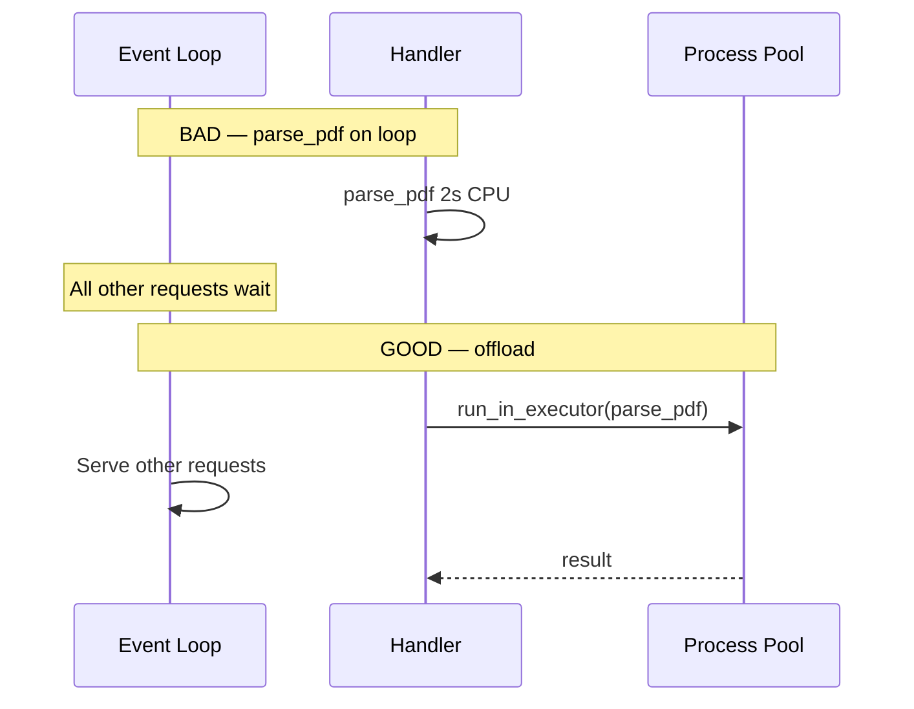

# Lesson 05: Python Concurrency Models

> **Prerequisites:** [Lesson 04: Asynchronous Processing](../04-asynchronous-processing/README.md).  
> **Estimated Reading Time:** 30–35 minutes  
> **Target Audience:** Python backend engineers running FastAPI/Django/Flask under load and choosing asyncio, threads, or processes correctly.  
> **Free PDF Notes:** [Download SD-J-005.pdf](https://backendroadmap.com/notes/system-design/SD-J-005.pdf) · [Phase 3, Caching Scaling & Traffic (PDF)](https://backendroadmap.com/notes/system-design/Phase3_Caching_Scaling_Traffic_Notes.pdf)

> [!NOTE]
> **In one line:** Use asyncio or threads for I/O-bound work and processes for CPU-bound Python; one blocking call freezes an event loop, so offload CPU work to a process pool; scale across cores with multiple worker processes and across connections with asyncio inside each.

> [!TIP]
> **The Golden Rule of Python Concurrency:** Pick by the *kind of work*, not by fashion. Never block the event loop—`await` I/O, `asyncio.to_thread` for blocking libraries, `run_in_executor(ProcessPoolExecutor)` for CPU. Measure **loop lag**; low CPU with high latency is often a blocked loop.

---

## 1. What the Models Are, and What They Aren't

A FastAPI service handles $1{,}000$ RPS of DB lookups. You add PDF parsing to one endpoint and the whole service grinds to a halt—including the fast endpoints. Same code, same server: the wrong concurrency model.

| Term | Precise Meaning | Production Example |
| :--- | :--- | :--- |
| **I/O-bound** | Time spent waiting on network/disk | DB queries, HTTP calls, S3 |
| **CPU-bound** | Time spent computing in Python/native | PDF parse, image resize, compression |
| **asyncio** | Single-threaded cooperative concurrency | Thousands of websockets per process |
| **GIL** | One thread runs Python bytecode at a time per process | Threads won't parallelize pure-Python CPU |

### Why It Matters
Choosing threads for CPU Python wastes cores. Choosing asyncio then calling `requests`/`time.sleep` freezes every coroutine on that worker.

---

## 2. Anatomy: GIL, Loop, Pools

| Piece | Role | Failure Mode |
| :--- | :--- | :--- |
| **GIL** | Serializes Python bytecode in a process | CPU threads take turns (~no speedup) |
| **Event loop** | Schedules ready coroutines | One blocking call stalls all |
| **Thread pool** | Offload blocking I/O libs | Still one GIL for Python CPU |
| **Process pool** | True multi-core for Python CPU | Higher memory / IPC cost |
| **Gunicorn workers** | Multiple processes | Parallelism across cores |
| **Uvicorn** | Async server per worker | Concurrency within process |

```
Time for 8 CPU-bound jobs on 4 cores (illustrative)
1 thread     ████████████████████ 40s
4 threads    ████████████████████ 41s  (GIL)
4 processes  █████ 11s
```

> [!WARNING]
> **The Observability Gap:** Host CPU can look *low* while $p_{99}$ explodes—the loop is blocked waiting, not computing. Instrument **event-loop lag** (callback delay) and dependency wait time; don't autoscale only on CPU.

---

## 3. Mathematical Model: Parallel Speedup vs GIL

Amdahl-style for CPU Python under the GIL (threads ≈ no parallel fraction):

$$T_{\text{threads}} \approx T_1 \qquad T_{\text{processes}} \approx \frac{T_1}{\min(P, C)} + T_{\text{overhead}}$$

| Workers | Model | 8 jobs × 5s CPU | Approx wall time |
| :---: | :--- | :---: | :---: |
| 1 | thread/process | 40s | 40s |
| 4 | threads (GIL) | ~40s | ~41s |
| 4 | processes | ~10s + overhead | ~11s |
| 8 | processes on 4 cores | capped by 4 cores | ~11–12s |

For I/O, concurrency $N$ with wait $W$ and little CPU:

$$\text{In-flight} \approx \lambda \times W \quad \text{(Little's Law)}$$

asyncio shines when $W$ dominates and memory per connection must stay tiny.

---

## 4. Metrics & Distributions

| Metric | Meaning | Signal |
| :--- | :--- | :--- |
| **Loop lag $p_{99}$** | Delay before ready callbacks run | Blocking / CPU on loop |
| **Request $p_{50}$ vs $p_{99}$** | Typical vs stalled | One bad endpoint poisoning worker |
| **CPU %** | Compute saturation | High with processes; may be low when blocked |
| **Pool queue depth** | Executor backlog | Undersized process pool |

### Worked Example
50 concurrent requests each accidentally block $300\text{ ms}$ on sync HTTP:

$$\text{Serialized block time} \approx 50 \times 0.3\text{ s} = 15\text{ s of loop monopoly}$$

Median latency becomes seconds while CPU stays low—autoscaling on CPU never fires.

---

## 5. Compounding: One Bad Endpoint

Probability a request hits the poisoned worker while the PDF handler runs:

With $W$ workers and fraction $f$ of traffic to the CPU endpoint, blast radius concentrates on shared event loops.

| Workers | CPU endpoint RPS | Effect |
| :---: | :---: | :--- |
| 1 asyncio worker | any | Whole process stalls |
| 4 workers | moderate | $25\%$ of pods feel pain if sticky-ish LB |
| Offloaded to process pool | high | Loop stays free; pool saturates instead |

---

## 6. Numbers Every Engineer Must Know

| Fact | Order | Implication |
| :--- | :---: | :--- |
| GIL | 1 bytecode thread/process | Processes for Python CPU |
| asyncio connections | $10^3\text{–}10^4+$ / process | Great for websockets |
| `run_in_executor` process | ~cores workers | Size to `os.cpu_count()` |
| Gunicorn workers | ~1–2 × cores async | Bound by RAM & DB conns |
| `max_requests` recycle | e.g. 10k | Cap memory leaks |
| Free-threaded 3.13 | experimental | Design still assumes GIL |

---

## 7. Protocol Deep Dive: Blocked vs Offloaded



| Situation | Use |
| :--- | :--- |
| Many concurrent network calls | asyncio (or threads) |
| Blocking I/O library | `asyncio.to_thread` / thread pool |
| CPU-heavy Python | Process pool or separate workers |
| Heavy long jobs | Task queue (Lesson 04) |
| NumPy/native | Often releases GIL; threads can help |

Production combo: Gunicorn manages processes; each uses Uvicorn asyncio worker class.

```python
# gunicorn.conf.py
workers = 4
worker_class = "uvicorn.workers.UvicornWorker"
timeout = 30
max_requests = 10000
```

---

## 8. Hierarchical Budgets & Sizing

| Budget | Target | Control |
| :--- | :--- | :--- |
| Loop lag $p_{99}$ | $< 50\text{ ms}$ | Ban blocking calls; debug mode in tests |
| Process pool size | $\approx$ CPU count | Avoid oversubscribe |
| Sync thread pool | small (e.g. 40) | Bound DB/HTTP fan-out |
| Worker count | 1–2 × cores | Memory + DB connection caps |
| PDF endpoint SLO | separate queue | Don't share with chatty API pool |

---

## 9. Top Mitigations

1. **Classify work** I/O vs CPU before coding.
2. **Never block the loop** — async clients (`httpx`), `to_thread`, process pools.
3. **Multi-process + asyncio** (Gunicorn + Uvicorn).
4. **Heavy jobs → Celery/SQS**, not request workers.
5. **Loop-lag metrics + asyncio debug** in CI.
6. **Recycle workers** (`max_requests`) to bound leaks.

---

## 10. Production War Story (SEV-1): The Blocked Loop

- **Impact:** Sync HTTP client inside async handlers; under load each call blocked $300\text{ ms}$; with 50 concurrent requests latency hit seconds; CPU low so HPA idle.
- **Fix:** Async `httpx`; loop-lag metric; asyncio debug mode in tests.

```mermaid
sequenceDiagram
    participant LB
    participant Loop
    participant SyncHTTP

    LB->>Loop: 50 concurrent requests
    Loop->>SyncHTTP: blocking call 300ms
    Note over Loop: Cannot schedule others
    LB-->>LB: p99 → seconds; CPU low
```

**Lesson:** Async code is only as concurrent as its least asynchronous line.

---

## 11. Multi-Language Production Code Tabs

*(Python is the subject; other languages show the same offload pattern for polyglot interviews.)*

````carousel
```go
// Go: goroutines already multiplex I/O; CPU work uses worker pool
package main

import "sync"

func ParseAll(files [][]byte, workers int) []dict {
	ch := make(chan []byte)
	out := make(chan dict, len(files))
	var wg sync.WaitGroup
	for i := 0; i < workers; i++ {
		wg.Add(1)
		go func() {
			defer wg.Done()
			for b := range ch {
				out <- parsePDF(b) // parallel across OS threads
			}
		}()
	}
	go func() {
		for _, f := range files {
			ch <- f
		}
		close(ch)
		wg.Wait()
		close(out)
	}()
	var res []dict
	for d := range out {
		res = append(res, d)
	}
	return res
}
```
<!-- slide -->
```typescript
// TypeScript/Node: CPU off the event loop via worker_threads
import { Worker } from "worker_threads";

function parsePdfOffLoop(data: Buffer): Promise<object> {
  return new Promise((resolve, reject) => {
    const w = new Worker(`
      const { parentPort, workerData } = require('worker_threads');
      parentPort.postMessage(parsePdf(workerData));
    `, { eval: true, workerData: data });
    w.on("message", resolve);
    w.on("error", reject);
  });
}

// I/O: async/await; never use sync fs in request path
```
<!-- slide -->
```python
# Python: ProcessPoolExecutor for CPU; to_thread for blocking I/O
import asyncio, os
from concurrent.futures import ProcessPoolExecutor
from fastapi import FastAPI, UploadFile

app = FastAPI()
pool = ProcessPoolExecutor(max_workers=os.cpu_count())

def parse_pdf(data: bytes) -> dict:
    ...  # CPU-heavy, runs in another process

@app.post("/parse")
async def parse(file: UploadFile):
    data = await file.read()
    loop = asyncio.get_running_loop()
    return await loop.run_in_executor(pool, parse_pdf, data)  # loop stays free

async def legacy():
    return await asyncio.to_thread(blocking_client.fetch)
```
<!-- slide -->
```csharp
// C#: Task for I/O; Task.Run / dedicated pool for CPU
using System.Threading.Tasks;

static async Task<object> ParseAsync(byte[] data)
{
    // Offload CPU so ASP.NET thread pool isn't monopolized by pure compute
    return await Task.Run(() => ParsePdf(data));
}

static async Task<string> FetchAsync(HttpClient http, string url)
{
    return await http.GetStringAsync(url); // true async I/O
}
```
````

---

## 12. Hands-On CLI Verification Workflows

```bash
# Threads vs processes for CPU-bound work
python3 -c "
import time, threading, multiprocessing as mp

def cpu(n=3_000_00):
    x=0
    for i in range(n): x+=i*i
    return x

def run_threads(k=4):
    ts=[threading.Thread(target=cpu) for _ in range(k)]
    t=time.perf_counter(); [t.start() for t in ts]; [t.join() for t in ts]
    return time.perf_counter()-t

def run_procs(k=4):
    with mp.Pool(k) as p:
        t=time.perf_counter(); p.map(cpu, [3_000_00]*k); return time.perf_counter()-t

print('threads', round(run_threads(),3), 's')
print('procs  ', round(run_procs(),3), 's')
"
```

---

## 13. Common Mistakes to Avoid

1. **Blocking calls** (`time.sleep`, `requests`, heavy loops) inside async handlers.
2. **Threads for CPU-bound Python.**
3. **Too many processes**, exhausting memory.
4. **Accidental shared mutable state** across processes.
5. **Pool sizes** not matched to cores or DB limits.
6. **Ignoring loop lag.**
7. **Putting heavy jobs on web workers** instead of a queue.
8. **Assuming free-threaded 3.13 is production-ready everywhere.**

---

## 14. Key Terms Glossary

| Key Term | Definition |
| :--- | :--- |
| **GIL** | Global Interpreter Lock—one Python bytecode thread per process. |
| **I/O-bound** | Mostly waiting on external I/O. |
| **CPU-bound** | Mostly computing. |
| **asyncio** | Single-threaded cooperative concurrency via an event loop. |
| **Event loop** | Scheduler of async tasks/callbacks. |
| **Process pool** | Worker processes for CPU work. |
| **run_in_executor** | Run blocking/CPU callables off the loop. |
| **Gunicorn / Uvicorn** | Process manager + async ASGI server. |
| **Free-threaded Python** | Optional 3.13+ build without the GIL (experimental). |
| **Loop lag** | Delay between scheduled and actual callback execution. |

---

## 15. System Design Interview Questions & Answers

### Basic Conceptual Questions

<details>
<summary><strong>Q1: When does asyncio help and when not? [BASIC]</strong></summary>

**Answer:**
It helps I/O-bound work with many concurrent connections. It does not help CPU-bound work, and any blocking call freezes the whole loop—so offload CPU to a process pool.
</details>

<details>
<summary><strong>Q2: How does the GIL affect scaling? [BASIC]</strong></summary>

**Answer:**
Only one thread runs Python bytecode per process, so threads do not parallelize CPU-bound Python. Scale across cores with multiple processes.
</details>

<details>
<summary><strong>Q3: Threads versus processes? [BASIC]</strong></summary>

**Answer:**
Threads suit I/O (GIL released while waiting). Processes give true parallelism for CPU work at the cost of memory and IPC.
</details>

<details>
<summary><strong>Q4: What do Gunicorn and Uvicorn do? [BASIC]</strong></summary>

**Answer:**
Gunicorn manages worker processes; Uvicorn runs an asyncio ASGI server. Combined (UvicornWorker), you typically run about one or two workers per core.
</details>

### Scenario-Based Architecture Questions

<details>
<summary><strong>Q5: One endpoint freezes the whole service. [SCENARIO]</strong></summary>

**Answer:**
A blocking or CPU-heavy call is on the event loop. Offload to a process or thread pool (or a task queue) and add loop-lag metrics.
</details>

<details>
<summary><strong>Q6: Parse large PDFs in an async API. [SCENARIO]</strong></summary>

**Answer:**
`run_in_executor` with a `ProcessPoolExecutor`, or send work to Celery/SQS dedicated workers.
</details>

<details>
<summary><strong>Q7: 10,000 concurrent WebSocket connections. [SCENARIO]</strong></summary>

**Answer:**
asyncio (or similar), with any CPU work offloaded. Size processes for RAM; don't use one thread-per-socket.
</details>

<details>
<summary><strong>Q8: CPU is low but latency is high. [SCENARIO]</strong></summary>

**Answer:**
Likely a blocked event loop or waiting on I/O. Measure loop lag and dependency latency; CPU autoscaling will not help.
</details>

### Advanced & Tricky Interview Questions

<details>
<summary><strong>Q9: Do threads speed up NumPy? [TRICKY]</strong></summary>

**Answer:**
Often yes—many native routines release the GIL, so threads can run numeric kernels in parallel.
</details>

<details>
<summary><strong>Q10: Is free-threaded Python ready? [TRICKY]</strong></summary>

**Answer:**
Experimental in 3.13; many libraries are still adapting. Design today with the GIL in mind.
</details>

<details>
<summary><strong>Q11: How many workers? [TRICKY]</strong></summary>

**Answer:**
Roughly one or two per core for async servers; more for sync; always bounded by memory and database connections.
</details>

<details>
<summary><strong>Q12: Why recycle workers? [TRICKY]</strong></summary>

**Answer:**
To bound memory growth from leaks (`max_requests` / max lifetime).
</details>

---

## 16. One-Page Master Cheat Sheet

```
+---------------------------------------------------------------------------------------------------------+
|                         PYTHON CONCURRENCY — MASTER CHEAT SHEET                                         |
+---------------------------------------------------------------------------------------------------------+
| 1. I/O-bound → asyncio or threads · CPU-bound Python → processes.                                       |
+---------------------------------------------------------------------------------------------------------+
| 2. GIL serializes bytecode per process · native/NumPy often releases GIL.                               |
+---------------------------------------------------------------------------------------------------------+
| 3. NEVER block the loop · to_thread for sync I/O · ProcessPool for CPU.                                 |
+---------------------------------------------------------------------------------------------------------+
| 4. Prod: Gunicorn processes + Uvicorn asyncio · recycle max_requests · watch loop lag.                  |
+---------------------------------------------------------------------------------------------------------+
| 5. Heavy/long jobs → task queue (SD-J-004), not web workers.                                            |
+---------------------------------------------------------------------------------------------------------+
```

---

## Further Reading & Sources

- Python docs — asyncio & concurrent.futures.
- PEP 703 — Making the GIL optional.
- Gunicorn and Uvicorn docs.

---

## Free PDF Notes

[SD-J-005.pdf](https://backendroadmap.com/notes/system-design/SD-J-005.pdf)

---

## Next

Continue with [Lesson 06: Batching](../06-batching/README.md) — pay the fixed cost once, spread over many items.
