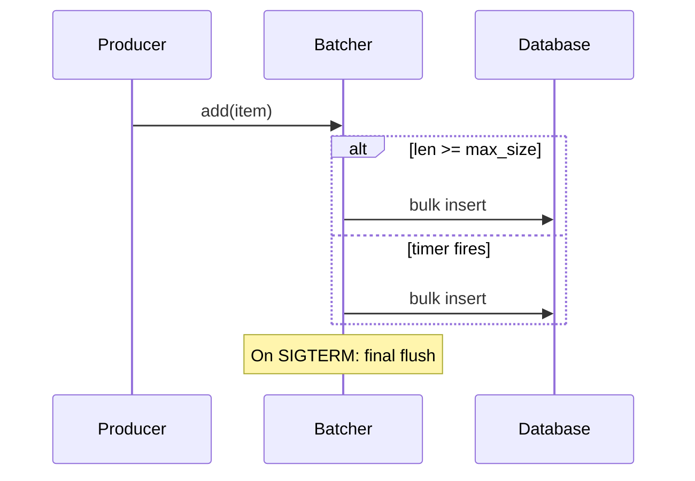
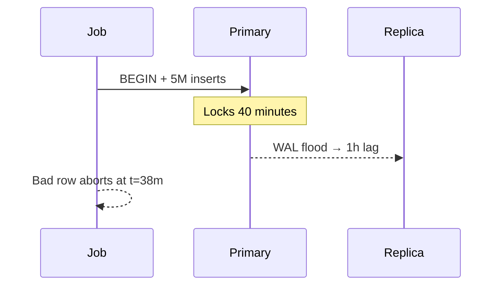

# Lesson 06: Batching

> **Prerequisites:** [Lesson 03: Database Bottlenecks](../03-database-bottlenecks/README.md) · [Lesson 04: Asynchronous Processing](../04-asynchronous-processing/README.md).  
> **Estimated Reading Time:** 28–32 minutes  
> **Target Audience:** Backend engineers optimizing inserts, Redis pipelines, Kafka producers, and GPU inference with micro-batching.  
> **Free PDF Notes:** [Download SD-J-006.pdf](https://backendroadmap.com/notes/system-design/SD-J-006.pdf) · [Phase 3, Caching Scaling & Traffic (PDF)](https://backendroadmap.com/notes/system-design/Phase3_Caching_Scaling_Traffic_Notes.pdf)

> [!NOTE]
> **In one line:** Every operation has a fixed overhead (round trip, commit, syscall, kernel launch)—batching groups many items into one operation so that overhead is amortized; the cost is added latency, so cap both batch size and wait time (micro-batching).

> [!TIP]
> **The Golden Rule of Batching:** Flush when **either** max size **or** max wait hits. Bound batches for safety (locks, WAL, memory). Put durable data on a queue before an in-memory buffer if loss is unacceptable—and always flush on SIGTERM.

---

## 1. What Batching Is, and What It Isn't

Your service writes every click event to Postgres one `INSERT` at a time. At $2{,}000$ events/s the database spends most of its time on round trips and commits, not on data. Group those writes and the same database handles ten times the load.

| Term | Precise Meaning | Production Example |
| :--- | :--- | :--- |
| **Batching** | Group many items into one operation | Multi-row `INSERT` / `COPY` |
| **Amortization** | Spread fixed cost over $N$ items | 1 commit for 1{,}000 rows |
| **Micro-batching** | Small, frequent batches (100s of ms) | Spark Streaming; Triton dynamic batching |
| **Nightly mega-batch** | One huge transaction | Hours of locks—usually the wrong extreme |

### Why It Matters
Fixed overhead often dominates per-item work until you batch. Throughput rises; each item waits for the flush—hence the latency trade-off.

---

## 2. Anatomy of a Micro-Batcher

```
item → buffer → (size ≥ Max) OR (wait ≥ MaxWait) → flush → one bulk op
```

| Where Batching Shows Up | Mechanism |
| :--- | :--- |
| SQL | Multi-row insert, `COPY` |
| Redis | `MGET` / pipelining |
| Kafka | `linger.ms`, `batch.size` |
| HTTP APIs | Batch endpoints accepting lists |
| ML inference | Dynamic batching on GPU |

> [!WARNING]
> **The Observability Gap:** DB QPS dropping looks like “less load” while **bytes/rows per second** soar. Track **items/s**, **batches/s**, **flush reason (size vs timer)**, **buffer depth**, and **$p_{99}$ item delay** (enqueue→durable), not only statement rate.

---

## 3. Mathematical Model: Amortization Curve

$$\text{Time per item} = \frac{F}{B} + c$$

where $F$ = fixed cost per batch, $B$ = batch size, $c$ = marginal per-item cost.

| Batch size $B$ | $F=50\text{ ms}$, $c=0.01\text{ ms}$ | Time/item | Relative to $B=1$ |
| :---: | :---: | :---: | :---: |
| 1 | $50.01\text{ ms}$ | $50.01$ | $1\times$ |
| 10 | $5.01\text{ ms}$ | $5.01$ | $\sim 10\times$ better |
| 100 | $0.51\text{ ms}$ | $0.51$ | $\sim 100\times$ |
| 1{,}000 | $0.06\text{ ms}$ | $0.06$ | diminishing vs memory/locks |

Illustrative wall times for 1{,}000 events: $1{,}000$ single inserts $\sim 1000\text{ ms}$; one multi-row $\sim 60\text{ ms}$; `COPY` $\sim 25\text{ ms}$.

**Latency tax:** under light load, timer bounds delay:

$$W_{\text{item}} \le \max\_wait$$

---

## 4. Metrics & Percentiles

| Metric | Meaning |
| :--- | :--- |
| **Item delay $p_{50}/p_{99}$** | Wait in buffer + flush time |
| **Batch size histogram** | Timer- vs size-dominated flushes |
| **Partial failure rate** | Poison rows |
| **Lost-on-crash estimate** | Max buffer × crash rate |

### Worked Example
At $2{,}000$ events/s with max wait $500\text{ ms}$ and max size $1{,}000$:

- Heavy load: size flushes $\approx 2$ batches/s (was $2{,}000$ round trips/s).
- Light load: timer flushes keep delay $\le 500\text{ ms}$.

---

## 5. Compounding: Giant Batches

Lock / WAL hold time roughly scales with batch work:

$$T_{\text{txn}} \propto B$$

| Batch rows | Lock hold | Replica lag risk |
| :---: | :---: | :--- |
| 5{,}000 | seconds | Low |
| 5{,}000{,}000 | tens of minutes | Hour-scale lag (incident) |

---

## 6. Numbers Every Engineer Must Know

| Pattern | Typical Knob | Note |
| :--- | :--- | :--- |
| Analytics micro-batch | $100\text{–}1000$ / $100\text{–}500\text{ ms}$ | Fine if freshness SLO allows |
| Kafka linger | `linger.ms` 5–100 | Throughput vs latency |
| Postgres `COPY` | bulk load path | Fastest bulk ingest |
| GPU dynamic batch | size + wait | Tune to latency SLO |
| Crash buffer risk | in-memory only | Use durable queue first |

---

## 7. Protocol Deep Dive: Size-or-Time Flush



---

## 8. Hierarchical Budgets & Sizing

| Budget | Target | Knob |
| :--- | :--- | :--- |
| Item delay $p_{99}$ | e.g. $\le 500\text{ ms}$ | `max_wait` |
| Peak buffer memory | e.g. $\le 64\text{ MB}$ | `max_size` × row size |
| Txn duration | $\le$ few seconds | Cap $B$ |
| Durability | zero loss | Queue ahead of buffer |

---

## 9. Top Mitigations

1. **Cap size and wait**; flush on either.
2. **Prefer `COPY` / multi-row** over chatty singles.
3. **Durable queue before RAM buffer** when loss matters.
4. **Partial failure handling** — bisect / quarantine poison rows.
5. **Flush on shutdown**; idempotent keys on retry.
6. **Throttle mega-jobs** into 5k-row chunks with checkpoints.

---

## 10. Production War Story (SEV-1): The Giant Batch

- **Impact:** Nightly job inserted $5\text{ M}$ rows in one transaction; locks $40\text{ min}$; replicas lagged ~1 hour; one malformed row aborted at minute 38.
- **Fix:** Batches of $5{,}000$ with checkpoints; quarantine bad rows; throttle to protect replicas.



**Lesson:** Batch for throughput, but bound the batch for safety.

---

## 11. Multi-Language Production Code Tabs

````carousel
```go
// Go: size-or-time micro-batcher
package main

import (
	"context"
	"sync"
	"time"
)

type Batcher[T any] struct {
	maxSize int
	maxWait time.Duration
	flush   func(context.Context, []T) error
	mu      sync.Mutex
	buf     []T
}

func (b *Batcher[T]) Add(ctx context.Context, item T) error {
	b.mu.Lock()
	defer b.mu.Unlock()
	b.buf = append(b.buf, item)
	if len(b.buf) >= b.maxSize {
		return b.flushLocked(ctx)
	}
	return nil
}

func (b *Batcher[T]) Run(ctx context.Context) {
	t := time.NewTicker(b.maxWait)
	defer t.Stop()
	for {
		select {
		case <-ctx.Done():
			b.mu.Lock(); _ = b.flushLocked(context.Background()); b.mu.Unlock(); return
		case <-t.C:
			b.mu.Lock(); _ = b.flushLocked(ctx); b.mu.Unlock()
		}
	}
}

func (b *Batcher[T]) flushLocked(ctx context.Context) error {
	if len(b.buf) == 0 {
		return nil
	}
	batch := b.buf
	b.buf = nil
	return b.flush(ctx, batch)
}
```
<!-- slide -->
```typescript
// TypeScript: micro-batch writer
class Batcher<T> {
  private buf: T[] = [];
  private timer?: NodeJS.Timeout;
  constructor(
    private flushFn: (batch: T[]) => Promise<void>,
    private maxSize = 1000,
    private maxWaitMs = 500
  ) {
    this.timer = setInterval(() => void this.flush(), maxWaitMs);
  }
  async add(item: T) {
    this.buf.push(item);
    if (this.buf.length >= this.maxSize) await this.flush();
  }
  async flush() {
    const batch = this.buf;
    this.buf = [];
    if (batch.length) await this.flushFn(batch);
  }
  async close() {
    clearInterval(this.timer);
    await this.flush();
  }
}
```
<!-- slide -->
```python
# Python: asyncio Batcher + bulk insert / COPY
import asyncio

class Batcher:
    def __init__(self, flush_fn, max_size=1000, max_wait=0.5):
        self.buf, self.flush_fn = [], flush_fn
        self.max_size, self.max_wait = max_size, max_wait
        self.lock = asyncio.Lock()

    async def add(self, item):
        async with self.lock:
            self.buf.append(item)
            if len(self.buf) >= self.max_size:
                await self._flush()

    async def _flush(self):
        batch, self.buf = self.buf, []
        if batch:
            await self.flush_fn(batch)

    async def run(self):
        while True:
            await asyncio.sleep(self.max_wait)
            async with self.lock:
                await self._flush()

async def bulk_insert(events):
    await conn.executemany(
        "insert into clicks(user_id, url, ts) values ($1, $2, $3)", events
    )
    # or: await conn.copy_records_to_table("clicks", records=events)
```
<!-- slide -->
```csharp
// C#: Channel-based micro-batcher
using System.Threading.Channels;

sealed class Batcher<T>
{
    private readonly Channel<T> _ch = Channel.CreateUnbounded<T>();
    public Batcher(Func<List<T>, Task> flush, int maxSize = 1000, int maxWaitMs = 500)
    {
        _ = Task.Run(async () =>
        {
            var batch = new List<T>(maxSize);
            while (await _ch.Reader.WaitToReadAsync())
            {
                var delay = Task.Delay(maxWaitMs);
                while (batch.Count < maxSize)
                {
                    var next = _ch.Reader.WaitToReadAsync().AsTask();
                    var won = await Task.WhenAny(next, delay);
                    if (won == delay) break;
                    while (_ch.Reader.TryRead(out var item))
                    {
                        batch.Add(item);
                        if (batch.Count >= maxSize) break;
                    }
                    if (batch.Count >= maxSize) break;
                }
                if (batch.Count > 0) { await flush(batch); batch.Clear(); }
            }
        });
    }
    public ValueTask AddAsync(T item) => _ch.Writer.WriteAsync(item);
}
```
````

---

## 12. Hands-On CLI Verification Workflows

```bash
python3 -c "
F,c=50.0,0.01
for B in (1,10,100,1000):
    print(B, F/B + c)
"
# Simulate RPS → batches/s at size 1000
python3 -c "print(2000/1000, 'batches/s at full size')"
```

---

## 13. Common Mistakes to Avoid

1. **Unbounded batch size or wait time.**
2. **Losing buffered data on crash.**
3. **One poison item failing a whole batch with no quarantine.**
4. **Batching latency-critical user paths** without SLO checks.
5. **Forgetting to flush on shutdown.**
6. **Huge transactions locking tables / bloating WAL.**
7. **Measuring only QPS**, not items/s and item delay.
8. **Retrying whole mega-batches** without idempotent keys.

---

## 14. Key Terms Glossary

| Key Term | Definition |
| :--- | :--- |
| **Batching** | Grouping items into one operation. |
| **Amortization** | Spreading fixed cost over many items. |
| **Micro-batching** | Small, frequent batches. |
| **linger.ms** | Kafka producer wait before sending. |
| **Pipelining** | Send many commands without waiting each reply. |
| **Bulk insert / COPY** | Load many rows at once. |
| **Dynamic batching** | Model server combining requests. |
| **Flush** | Send the buffered batch. |
| **Partial failure** | Some items in a batch fail. |
| **Throughput vs latency** | Core batching trade-off. |

---

## 15. System Design Interview Questions & Answers

### Basic Conceptual Questions

<details>
<summary><strong>Q1: What are the latency trade-offs of batching? [BASIC]</strong></summary>

**Answer:**
Throughput rises by amortizing fixed overhead, but each item waits for the batch to fill—so you cap both batch size and wait time.
</details>

<details>
<summary><strong>Q2: What is micro-batching? [BASIC]</strong></summary>

**Answer:**
Processing small batches continuously (every few hundred milliseconds) to balance throughput and freshness—not one giant nightly job.
</details>

<details>
<summary><strong>Q3: Name places batching appears. [BASIC]</strong></summary>

**Answer:**
Bulk inserts/`COPY`, Redis pipelining/`MGET`, Kafka producers, batch HTTP APIs, GPU inference dynamic batching.
</details>

<details>
<summary><strong>Q4: Why is batching faster? [BASIC]</strong></summary>

**Answer:**
Fixed costs (round trips, commits, kernel launches) are paid once per batch instead of once per item.
</details>

### Scenario-Based Architecture Questions

<details>
<summary><strong>Q5: 2,000 inserts/s overload Postgres. [SCENARIO]</strong></summary>

**Answer:**
Buffer and flush with multi-row `INSERT` or `COPY` every $500\text{ ms}$ or $1{,}000$ rows—cutting round trips from ~2000/s to ~2/s under load.
</details>

<details>
<summary><strong>Q6: Buffered events must not be lost. [SCENARIO]</strong></summary>

**Answer:**
Put them on a durable queue or log first, then batch consume from the queue into the database.
</details>

<details>
<summary><strong>Q7: One bad row fails the batch. [SCENARIO]</strong></summary>

**Answer:**
Retry by splitting/bisecting, insert good rows, and quarantine the bad row into an error table.
</details>

<details>
<summary><strong>Q8: Serve an ML model efficiently. [SCENARIO]</strong></summary>

**Answer:**
Dynamic batching with max batch size and max wait tuned to the latency SLO (Triton/vLLM pattern).
</details>

### Advanced & Tricky Interview Questions

<details>
<summary><strong>Q9: How do you pick the batch size? [TRICKY]</strong></summary>

**Answer:**
Measure throughput against $p_{99}$ latency and memory; choose the knee of the curve—not the theoretical maximum $B$.
</details>

<details>
<summary><strong>Q10: Does batching reduce load or only hide it? [TRICKY]</strong></summary>

**Answer:**
It reduces per-item overhead, so real capacity improves (fewer RTTs/commits), not merely cosmetics.
</details>

<details>
<summary><strong>Q11: What happens on shutdown? [TRICKY]</strong></summary>

**Answer:**
Flush the buffer on SIGTERM, or risk losing items still in memory.
</details>

<details>
<summary><strong>Q12: Why a timer as well as a size limit? [TRICKY]</strong></summary>

**Answer:**
Under light traffic a size limit alone would delay the first items indefinitely.
</details>

---

## 16. One-Page Master Cheat Sheet

```
+---------------------------------------------------------------------------------------------------------+
|                                  BATCHING — MASTER CHEAT SHEET                                          |
+---------------------------------------------------------------------------------------------------------+
| 1. time/item = F/B + c · Cap B and max_wait · Flush on either.                                          |
+---------------------------------------------------------------------------------------------------------+
| 2. Micro-batch for freshness · Avoid multi-million-row mega-txns.                                       |
+---------------------------------------------------------------------------------------------------------+
| 3. Durable queue before RAM if loss matters · Flush on SIGTERM · Quarantine poison rows.                |
+---------------------------------------------------------------------------------------------------------+
| 4. Tools: COPY, pipelining, Kafka linger, GPU dynamic batching.                                         |
+---------------------------------------------------------------------------------------------------------+
| 5. Measure items/s, item delay p99, flush reason—not only QPS.                                          |
+---------------------------------------------------------------------------------------------------------+
```

---

## Further Reading & Sources

- PostgreSQL docs — `COPY` and populating a database.
- Kafka docs — Producer configs.
- Triton docs — Dynamic batching.

---

## Free PDF Notes

[SD-J-006.pdf](https://backendroadmap.com/notes/system-design/SD-J-006.pdf)

---

## Next

Continue with [Lesson 07: Compression](../07-compression/README.md) — trade CPU for bytes when the network is the bottleneck.
