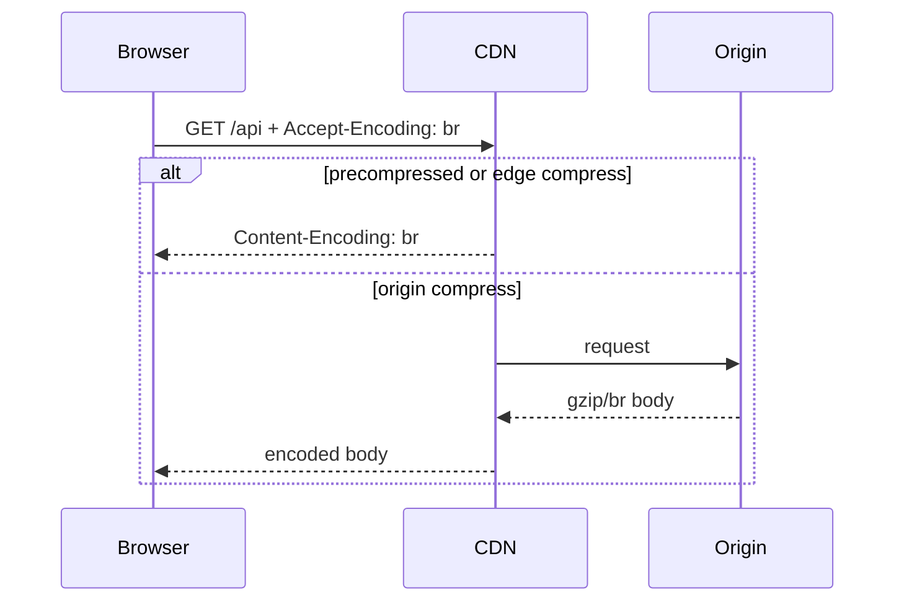
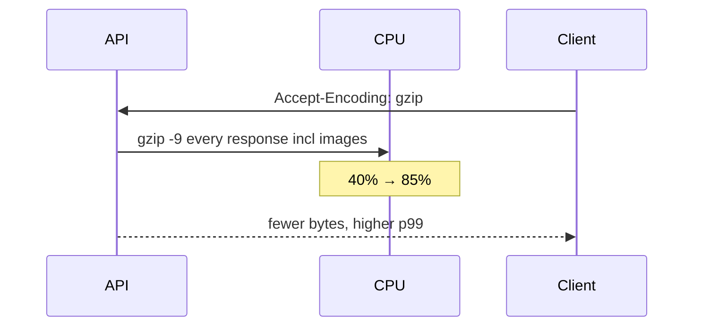

# Lesson 07: Compression

> **Prerequisites:** [Lesson 08: Latency](../../01-core-fundamentals/08-latency/README.md) · [Lesson 06: Batching](../06-batching/README.md).  
> **Estimated Reading Time:** 28–32 minutes  
> **Target Audience:** Backend and edge engineers choosing gzip/Brotli/zstd for HTTP, CDN, logs, and storage without torching CPU.  
> **Free PDF Notes:** [Download SD-J-007.pdf](https://backendroadmap.com/notes/system-design/SD-J-007.pdf) · [Phase 3, Caching Scaling & Traffic (PDF)](https://backendroadmap.com/notes/system-design/Phase3_Caching_Scaling_Traffic_Notes.pdf)

> [!NOTE]
> **In one line:** Compression spends CPU to shrink data—it wins when the network or disk is the bottleneck and the data is repetitive (JSON, HTML, logs, CSV); use Brotli or gzip for HTTP text, precompress static files, zstd for storage/internal traffic; skip already-compressed data and tiny payloads.

> [!TIP]
> **The Golden Rule of Compression:** It is a **CPU-for-bytes** trade. Prefer CDN/edge and build-time precompression for static assets; keep dynamic levels moderate (≈4–6); never compress JPEG/PNG/MP4/zip; set `Vary: Accept-Encoding`; measure CPU, bytes, and $p_{99}$ together.

---

## 1. What Compression Is, and What It Isn't

Your API returns a $2\text{ MB}$ JSON product list. Mobile users on slow networks wait seconds. Turn on compression and it becomes $\sim 200\text{ KB}$. But compression costs CPU—and sometimes it is not worth it at all.

| Term | Precise Meaning | Production Example |
| :--- | :--- | :--- |
| **Compression** | Spend CPU to encode fewer bytes | `Content-Encoding: br` on JSON |
| **Compression ratio** | Original size / compressed size | $2000/215 \approx 9.3\times$ |
| **Precompression** | Compress once at build time | `app.js.br` served by CDN |
| **Already compressed** | Entropy already low | JPEG, PNG, video, zip — skip |

### Why It Matters
Fewer bytes cut transfer time and egress cost; on slow links this dominates. On CPU-bound origins, high levels can *worsen* $p_{99}$.

---

## 2. Anatomy: Codecs & Negotiation

| Algorithm | Strength | Best For |
| :--- | :--- | :--- |
| **gzip** | Universal client support; decent ratio | Default HTTP |
| **Brotli** | $15\text{–}20\%$ smaller than gzip on text | HTTP text, static assets |
| **zstd** | Very fast; excellent ratio | Storage, logs, internal traffic |
| **LZ4 / Snappy** | Lower ratio; extremely fast | Hot paths where CPU is scarce |

```
2 MB JSON (illustrative): uncompressed 2000KB | gzip-6 260KB | brotli-5 215KB | zstd-3 240KB
```

HTTP: client sends `Accept-Encoding: br, gzip`; server replies `Content-Encoding`.

> [!WARNING]
> **The Observability Gap:** “Bytes out” falling while $p_{99}$ rises means you are on the wrong side of the trade (CPU). Track **origin CPU**, **compression time**, **encoded bytes**, and **TTFB/transfer**—plus exclude incompressible `Content-Type`s from dashboards averages.

---

## 3. Mathematical Model: When Compression Wins

Transfer time dominated by bandwidth $B$ and size $S$:

$$T_{\text{net}} \approx \frac{S}{B} \qquad T_{\text{total}} \approx T_{\text{cpu,comp}} + \frac{S/R}{B} + T_{\text{cpu,decomp}}$$

Compression wins when savings in $\frac{S}{B}(1-1/R)$ exceed extra CPU time.

| Link | $S=2\text{ MB}$ | $R=8$ | Bytes saved time @ $1\text{ MB/s}$ | CPU budget to break even |
| :--- | :---: | :---: | :---: | :--- |
| Mobile ~1 MB/s | 2.0s | 0.25s | **1.75s saved** | Large — compress |
| DC 1 GB/s | 2ms | 0.25ms | 1.75ms | Only cheap levels |
| Tiny 500 B | negligible | — | overhead may grow size | Skip |

| Utilization after enabling max gzip | Latency multiplier risk |
| :---: | :--- |
| $40\% → 85\%$ CPU | Queueing $\frac{1}{1-\rho}$ can dominate byte savings |

---

## 4. Metrics & Levels

| Level strategy | Use |
| :--- | :--- |
| Dynamic gzip/br ~4–6 | Online API responses |
| Static br 11 + gzip | Build-time assets |
| zstd 3–6 | Logs, backups, internal RPC |

### Worked Example
gzip levels on the same JSON: higher levels squeeze a bit more but CPU climbs steeply—diminishing returns.

---

## 5. Compounding: Fleet-Wide CPU

If every pod compresses at level 9:

$$\rho_{\text{new}} \approx \rho_{\text{old}} + \lambda \cdot C_{\text{level9}}$$

At high RPS, compression CPU alone can push the fleet past the $70\%$ headroom cliff even as wire bytes drop $70\%$.

---

## 6. Numbers Every Engineer Must Know

| Fact | Order | Implication |
| :--- | :---: | :--- |
| Text ratio | often $5\text{–}10\times$ | Worth it on WAN |
| Images/video | $\sim 1\times$ | Wasted CPU |
| Min size threshold | ~1 KB | Below: skip |
| CDN offload | edge CPU | Spare origins |
| Parquet columns | $10\times+$ | Storage + scan I/O |
| BREACH | size oracle | Don't compress secrets + attacker input |

---

## 7. Protocol Deep Dive: Edge vs Origin



```nginx
gzip on;
gzip_comp_level 5;
gzip_min_length 1024;
gzip_types application/json text/css application/javascript;
gzip_static on;  # serve file.js.gz if present
# brotli on; brotli_comp_level 5; brotli_static on;
```

---

## 8. Hierarchical Budgets & Sizing

| Slice | Budget | Control |
| :--- | :--- | :--- |
| Dynamic compress CPU | $< 10\%$ of request CPU | Level ≤ 5; CDN offload |
| Static asset encode | build time only | br11 + gzip |
| Skip list | images/video/zip | `gzip_types` allowlist |
| Min length | ≥ 1 KB | `gzip_min_length` |
| Cache correctness | required | `Vary: Accept-Encoding` |

---

## 9. Top Mitigations

1. **Brotli/gzip at CDN** for public HTTP.
2. **Precompress static** at highest level once.
3. **zstd** for logs/storage/internal.
4. **Low/medium levels** for dynamic origin compression.
5. **Skip incompressible + tiny**; watch BREACH.
6. **Measure** CPU, bytes, latency before/after.

---

## 10. Production War Story (SEV-1): Compressing on the Origin

- **Impact:** gzip level 9 on all responses; CPU $40\% → 85\%$; $p_{99}$ worsened despite $70\%$ fewer bytes; images re-compressed uselessly.
- **Fix:** Level 4; exclude media; move to CDN + precompress static; compare CPU/bytes/latency.



**Lesson:** Check you are on the right side of the CPU-for-bytes trade.

---

## 11. Multi-Language Production Code Tabs

````carousel
```go
// Go: gzip responses with threshold; skip incompressible types
package main

import (
	"compress/gzip"
	"io"
	"net/http"
	"strings"
)

func maybeGzip(next http.Handler) http.Handler {
	return http.HandlerFunc(func(w http.ResponseWriter, r *http.Request) {
		if !strings.Contains(r.Header.Get("Accept-Encoding"), "gzip") {
			next.ServeHTTP(w, r)
			return
		}
		w.Header().Add("Vary", "Accept-Encoding")
		gz := gzip.NewWriter(w)
		defer gz.Close()
		w.Header().Set("Content-Encoding", "gzip")
		next.ServeHTTP(&gzipWriter{Writer: gz, ResponseWriter: w}, r)
	})
}

type gzipWriter struct {
	io.Writer
	http.ResponseWriter
}

func (g *gzipWriter) Write(b []byte) (int, error) { return g.Writer.Write(b) }
```
<!-- slide -->
```typescript
// TypeScript: negotiate encoding; prefer precompressed static
import { createGzip, constants } from "zlib";
import { pipeline } from "stream/promises";

export function shouldCompress(type: string, length: number) {
  if (length < 1024) return false;
  if (/image\/|video\/|zip|octet-stream/i.test(type)) return false;
  return /json|text|javascript|css/i.test(type);
}

// Dynamic: gzip level 5; static: serve .br/.gz built at CI
export async function gzipJson(body: Buffer) {
  const gzip = createGzip({ level: 5 });
  // pipeline into response...
  return gzip;
}
```
<!-- slide -->
```python
# Python: level sweep + HTTP negotiation awareness
import gzip, json, time

data = json.dumps(products).encode()
for level in (1, 6, 9):
    t = time.perf_counter()
    out = gzip.compress(data, compresslevel=level)
    print(level, len(out), f"{(time.perf_counter()-t)*1000:.0f} ms")

# Prefer CDN/brotli for browsers; zstd for logs:
# import zstandard as zstd; zstd.ZstdCompressor(level=3).compress(data)
```
<!-- slide -->
```csharp
// C#: Response compression with MIME allowlist (ASP.NET)
using Microsoft.AspNetCore.ResponseCompression;

builder.Services.AddResponseCompression(opts =>
{
    opts.EnableForHttps = true;
    opts.MimeTypes = ResponseCompressionDefaults.MimeTypes.Concat(
        new[] { "application/json", "application/javascript" });
    opts.Providers.Add<BrotliCompressionProvider>();
    opts.Providers.Add<GzipCompressionProvider>();
});
builder.Services.Configure<GzipCompressionProviderOptions>(o => o.Level = System.IO.Compression.CompressionLevel.Fastest);
// MapStaticAssets / CDN should serve precompressed br for JS/CSS
```
````

---

## 12. Hands-On CLI Verification Workflows

```bash
# Check negotiated encoding
curl -sI -H 'Accept-Encoding: br, gzip' https://example.com/app.js | grep -i encoding

# Local gzip ratio/timing
python3 -c "
import gzip,json,time
d=json.dumps({'x':list(range(10000))}).encode()
for lv in (1,6,9):
 t=time.perf_counter(); o=gzip.compress(d,compresslevel=lv)
 print(lv,len(d),len(o),round((time.perf_counter()-t)*1000,1),'ms')
"
```

---

## 13. Common Mistakes to Avoid

1. **Maximum compression level on dynamic responses.**
2. **Compressing images, video, or zips.**
3. **Compressing tiny payloads.**
4. **Compressing secrets alongside user input (BREACH).**
5. **Missing `Vary: Accept-Encoding`.**
6. **Never measuring CPU vs bytes vs latency.**
7. **Doing heavy compression on already CPU-bound origins.**
8. **Forgetting precompressed static at the CDN.**

---

## 14. Key Terms Glossary

| Key Term | Definition |
| :--- | :--- |
| **Compression ratio** | Original size divided by compressed size. |
| **gzip** | Universal DEFLATE-based codec. |
| **Brotli** | Google codec; excellent for web text. |
| **zstd** | Fast codec with high ratio (Meta). |
| **Accept-Encoding** | Request header listing codecs. |
| **Content-Encoding** | Response header naming the codec used. |
| **Precompression** | Compress at build time. |
| **Parquet** | Columnar format that compresses well. |
| **BREACH** | Attack inferring secrets from compressed sizes. |
| **Vary** | Tells caches which request headers change the response. |

---

## 15. System Design Interview Questions & Answers

### Basic Conceptual Questions

<details>
<summary><strong>Q1: When is compression not worth it? [BASIC]</strong></summary>

**Answer:**
When data is already compressed, payloads are tiny, the server is CPU-bound, or secrets mix with attacker-controlled input over HTTPS (BREACH risk).
</details>

<details>
<summary><strong>Q2: How do you choose an algorithm? [BASIC]</strong></summary>

**Answer:**
Brotli or gzip for HTTP text (precompress static at high level); zstd for storage and internal traffic; LZ4/Snappy when CPU is the limit.
</details>

<details>
<summary><strong>Q3: How does HTTP negotiate compression? [BASIC]</strong></summary>

**Answer:**
The client sends `Accept-Encoding`; the server replies with `Content-Encoding` and should send `Vary: Accept-Encoding`.
</details>

<details>
<summary><strong>Q4: What does compression trade? [BASIC]</strong></summary>

**Answer:**
CPU on both ends for fewer bytes on the network or disk.
</details>

### Scenario-Based Architecture Questions

<details>
<summary><strong>Q5: A 2 MB JSON response is slow on mobile. [SCENARIO]</strong></summary>

**Answer:**
Enable Brotli/gzip (ideally at the CDN) and also shrink the payload (pagination/field selection).
</details>

<details>
<summary><strong>Q6: Static JS and CSS delivery. [SCENARIO]</strong></summary>

**Answer:**
Precompress at build with Brotli level 11 and gzip; serve with correct `Content-Encoding` and `Vary`.
</details>

<details>
<summary><strong>Q7: Logs and backups are huge. [SCENARIO]</strong></summary>

**Answer:**
Use zstd (and Parquet for columnar analytics) to cut storage and scan I/O.
</details>

<details>
<summary><strong>Q8: CPU rose after enabling compression. [SCENARIO]</strong></summary>

**Answer:**
Lower levels, offload to CDN, skip incompressible types, and re-measure $p_{99}$.
</details>

### Advanced & Tricky Interview Questions

<details>
<summary><strong>Q9: Why can compression make a small response bigger? [TRICKY]</strong></summary>

**Answer:**
Headers and codec dictionary/framing overhead can exceed savings on tiny bodies.
</details>

<details>
<summary><strong>Q10: What is BREACH? [TRICKY]</strong></summary>

**Answer:**
An attack that infers secrets from the compressed size of responses when attacker input is reflected alongside them over TLS.
</details>

<details>
<summary><strong>Q11: Why higher levels give diminishing returns? [TRICKY]</strong></summary>

**Answer:**
Ratio gains flatten while CPU time grows steeply—bad for dynamic paths.
</details>

<details>
<summary><strong>Q12: Can compression speed up disk reads? [TRICKY]</strong></summary>

**Answer:**
Yes—fewer bytes read from disk; decompression is often faster than the I/O saved.
</details>

---

## 16. One-Page Master Cheat Sheet

```
+---------------------------------------------------------------------------------------------------------+
|                               COMPRESSION — MASTER CHEAT SHEET                                          |
+---------------------------------------------------------------------------------------------------------+
| 1. Trade CPU for bytes · Wins when network/disk bound + repetitive data.                                |
+---------------------------------------------------------------------------------------------------------+
| 2. gzip universal · Brotli best web text · zstd storage/internal · LZ4/Snappy when CPU scarce.          |
+---------------------------------------------------------------------------------------------------------+
| 3. Dynamic level ~4–5 · Static precompress max · Skip media/tiny · Vary: Accept-Encoding.               |
+---------------------------------------------------------------------------------------------------------+
| 4. Prefer CDN/edge · Measure CPU + bytes + p99 · Beware BREACH.                                         |
+---------------------------------------------------------------------------------------------------------+
| 5. MATH: save S/B*(1-1/R) must beat extra CPU; high ρ from compress can erase the win.                  |
+---------------------------------------------------------------------------------------------------------+
```

---

## Further Reading & Sources

- MDN — HTTP compression.
- Google — Brotli.
- Meta — Zstandard.

---

## Free PDF Notes

[SD-J-007.pdf](https://backendroadmap.com/notes/system-design/SD-J-007.pdf)

---

## Next

Continue with [Lesson 08: Serialization Formats](../08-serialization-formats/README.md) — JSON vs Protobuf vs Avro vs MessagePack.
