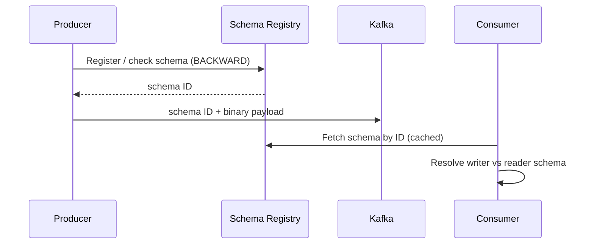
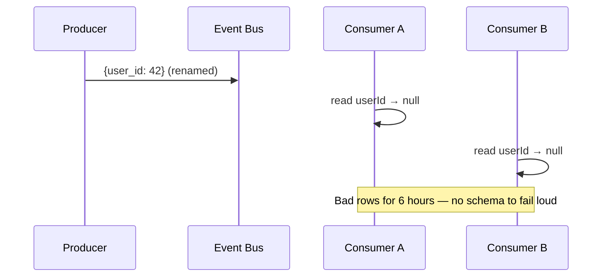

# Lesson 08: Serialization Formats

> **Prerequisites:** [Lesson 07: Compression](../07-compression/README.md) · [Lesson 04: Asynchronous Processing](../04-asynchronous-processing/README.md).  
> **Estimated Reading Time:** 30–34 minutes  
> **Target Audience:** Backend engineers choosing wire formats for public APIs, gRPC, Kafka events, and high-QPS internal buses.  
> **Free PDF Notes:** [Download SD-J-008.pdf](https://backendroadmap.com/notes/system-design/SD-J-008.pdf) · [Phase 3, Caching Scaling & Traffic (PDF)](https://backendroadmap.com/notes/system-design/Phase3_Caching_Scaling_Traffic_Notes.pdf)

> [!NOTE]
> **In one line:** Choose JSON for public APIs, Protobuf for gRPC and service calls, Avro for event streams with a schema registry, MessagePack for compact schemaless internal data—schema-based formats are smaller, faster, and keep evolution safe when you version schemas and test compatibility in CI.

> [!TIP]
> **The Golden Rule of Serialization:** Keep JSON at the public edge; use binary + schemas internally. Never reuse Protobuf field numbers; never rename JSON fields without a dual-read window; never use `pickle` across services. Compatibility is a CI gate, not a hope.

---

## 1. What Serialization Is, and What It Isn't

Your services exchange events as JSON—readable and easy. At $100{,}000$ events/s, JSON parsing burns CPU, every message repeats field names, and one team renames a field and breaks three consumers silently.

| Term | Precise Meaning | Production Example |
| :--- | :--- | :--- |
| **Serialization** | Turning in-memory data into bytes | Encode a `Click` event for Kafka |
| **Schema** | Formal description of fields/types | `.proto`, Avro schema, JSON Schema |
| **Schemaless** | Structure implied by producer/consumer convention | Raw JSON / MessagePack maps |
| **Schema registry** | Central store assigning IDs + compatibility | Confluent Registry for Avro |

### Why It Matters
Bytes and CPU at high QPS are real capacity. Silent field renames without schemas are SEV-1 data corruption.

---

## 2. Anatomy: Format Comparison

| Format | Schema | Size | Speed | Best For |
| :--- | :--- | :--- | :--- | :--- |
| **JSON** | none/optional | verbose | slowest | Public APIs, browsers, humans |
| **MessagePack** | none | compact | fast | Caches, internal messages |
| **Protobuf** | `.proto`; fields by number | small | very fast | gRPC, service-to-service |
| **Avro** | separate schema (often registry) | smallest (no names) | fast | Kafka, data lakes |

```
Same event (illustrative bytes): JSON 220B | MessagePack 140B | Protobuf 70B | Avro 60B
```

> [!WARNING]
> **The Observability Gap:** Broker “messages/s” can look fine while **CPU in JSON encode/decode** saturates producers/consumers. Measure **serialize CPU**, **bytes/event**, **schema-compat CI failures**, and **consumer null-rate** after deploys—not only topic lag.

---

## 3. Mathematical Model: Bandwidth & CPU at Scale

$$\text{Bytes/s} = \lambda \times S \qquad \text{CPU} \approx \lambda \times C_{\text{ser}}$$

| Format | $S$ (bytes) | $\lambda=100\text{k}/s$ | Wire MB/s | Relative parse CPU |
| :--- | :---: | :---: | :---: | :--- |
| JSON | 220 | 100k | $\approx 22$ | $1.0\times$ (baseline high) |
| MessagePack | 140 | 100k | $\approx 14$ | $\sim 0.6\times$ |
| Protobuf | 70 | 100k | $\approx 7$ | $\sim 0.3\times$ |
| Avro | 60 | 100k | $\approx 6$ | $\sim 0.3\times$ |

Moving JSON→Avro halves bytes and often more than halves parse CPU at this QPS.

---

## 4. Metrics & Distributions

| Metric | Meaning |
| :--- | :--- |
| **Encode/decode $p_{99}$** | Serialization latency tax |
| **Avg bytes/event** | Bandwidth & storage |
| **Compat check fail rate** | Evolution safety |
| **Unknown/null field rate** | Silent breakages (JSON) |

### Worked Example
At $100\text{k}$ events/s, JSON at $220\text{ B}$ is $22\text{ MB/s}$ payload alone—before replication factor and batching overhead. Avro at $60\text{ B}$ is $\sim 6\text{ MB/s}$.

---

## 5. Compounding: Silent Schema Drift

Without a schema, a rename is a soft failure:

$$P(\text{bad row}) \approx 1 - (1-f)^{N_{\text{consumers}}}$$

If fraction $f$ of events use the new name while old consumers read the old field as null, corruption spreads to every consumer independently—often for hours before detection.

---

## 6. Numbers Every Engineer Must Know

| Fact | Implication |
| :--- | :--- |
| JSON repeats field names as text | Verbose at high QPS |
| Protobuf field numbers are identity | Never reuse/renumber |
| Avro writer schema needed at read | Registry + ID in message |
| MessagePack ≈ binary JSON | No evolution enforcement |
| `orjson` ≫ stdlib `json` (Python) | Still not a schema |
| `pickle` | Python-only + arbitrary code exec risk |

---

## 7. Protocol Deep Dive: Avro + Registry



**Protobuf evolution rules:** add fields with **new** numbers; never reuse; `reserved` removed numbers.

**Compatibility:**
- **Backward:** new readers read old data (add fields with defaults).
- **Forward:** old readers read new data (ignore unknowns).

---

## 8. Hierarchical Budgets & Sizing

| Path | Format Budget | Controls |
| :--- | :--- | :--- |
| Public REST | JSON (+ optional gzip/br) | `orjson`; pagination |
| gRPC mesh | Protobuf | Generated stubs; CI compat |
| Kafka backbone | Avro/Protobuf + registry | BACKWARD mode |
| Hot cache values | MessagePack/Protobuf | Size + parse time |
| Cross-language | never pickle | Explicit schemas |

---

## 9. Top Mitigations

1. **JSON at the edge**; binary inside.
2. **Schema registry** for events.
3. **Compatibility tests in CI.**
4. **Dual-write / dual-read** during renames.
5. **Default values** for new fields—avoid required additions.
6. **Faster JSON libs** when you must stay on JSON.

---

## 10. Production War Story (SEV-1): The Renamed Field

- **Impact:** `userId` → `user_id` in JSON events; three consumers silently read null and wrote bad rows for six hours; cleanup took two days.
- **Fix:** Avro + registry `BACKWARD`; consumer-driven contracts; introduce new fields beside old, then deprecate.



**Lesson:** Without a schema, a rename is a silent outage.

---

## 11. Multi-Language Production Code Tabs

````carousel
```go
// Go: prefer protobuf structs; JSON only at HTTP edge
package main

import (
	"encoding/json"

	"google.golang.org/protobuf/proto"
)

type ClickJSON struct {
	UserID int64  `json:"user_id"`
	Action string `json:"action"`
	Ts     int64  `json:"ts"`
}

func EncodeJSON(c ClickJSON) ([]byte, error) { return json.Marshal(c) }

func EncodeProto(m proto.Message) ([]byte, error) { return proto.Marshal(m) }
```
<!-- slide -->
```typescript
// TypeScript: JSON public API + protobuf for RPC payloads
import protobuf from "protobufjs";

const Click = protobuf.parse(`
  syntax = "proto3";
  message Click {
    int64 user_id = 1;
    string action = 2;
    int64 ts = 3;
    // add new fields with NEW numbers; reserved 4;
  }
`).root.lookupType("Click");

export function encodeClick(obj: object) {
  const err = Click.verify(obj);
  if (err) throw new Error(err);
  return Click.encode(Click.create(obj)).finish();
}

export function publicJson(obj: object) {
  return JSON.stringify(obj); // browsers / external clients
}
```
<!-- slide -->
```python
# Python: MessagePack / orjson / Avro-oriented event
import msgpack, orjson

event = {"user": 42, "action": "click", "ts": 1700000000}
b = msgpack.packb(event)          # compact schemaless binary
back = msgpack.unpackb(b)
j = orjson.dumps(event)           # fast JSON bytes for public APIs

# Avro (conceptual): register schema → write schema_id + binary
# Never use pickle across services:
# pickle.loads(untrusted)  # arbitrary code execution risk
```
<!-- slide -->
```csharp
// C#: System.Text.Json at edge; protobuf-net / Google.Protobuf internally
using System.Text.Json;
using Google.Protobuf;

public sealed record ClickDto(long UserId, string Action, long Ts);

static byte[] ToPublicJson(ClickDto c) =>
    JsonSerializer.SerializeToUtf8Bytes(c);

static byte[] ToProto(IMessage msg) => msg.ToByteArray();

// Evolution: add optional fields; never reuse field numbers in .proto
```
````

---

## 12. Hands-On CLI Verification Workflows

```bash
# Bytes/s at 100k events/s
python3 -c "
for name,s in [('json',220),('msgpack',140),('proto',70),('avro',60)]:
    print(name, round(100_000*s/1e6,2), 'MB/s')
"

# JSON rename breakage demo
python3 -c "
old={'userId':42}
new={'user_id':42}
print('old consumer sees', old.get('userId'), 'vs', new.get('userId'))
"
```

---

## 13. Common Mistakes to Avoid

1. **Renaming/retyping fields** without compatibility checks.
2. **Using pickle across services.**
3. **JSON everywhere at very high volume.**
4. **Reusing Protobuf field numbers.**
5. **Schemas not versioned or stored centrally.**
6. **Adding required fields** without defaults.
7. **No dual-read window** during renames.
8. **Assuming binary is always faster** without measuring (`orjson` can be “enough”).

---

## 14. Key Terms Glossary

| Key Term | Definition |
| :--- | :--- |
| **Serialization** | Turning data into bytes for storage or transport. |
| **Schema** | Formal description of fields and types. |
| **Protobuf** | Schema-based binary format with numbered fields. |
| **Avro** | Schema-resolved binary format; schema often external. |
| **MessagePack** | Binary JSON-like, schemaless. |
| **orjson** | High-performance Python JSON library. |
| **Schema registry** | Central store of schemas and IDs. |
| **Backward compatible** | New code can read old data. |
| **Forward compatible** | Old code can read new data. |
| **Pickle** | Python-only serializer; unsafe with untrusted input. |

---

## 15. System Design Interview Questions & Answers

### Basic Conceptual Questions

<details>
<summary><strong>Q1: Which serialization format would you use for events and why? [BASIC]</strong></summary>

**Answer:**
Avro or Protobuf with a schema registry—compact, fast, and enforce compatible schema evolution between producers and consumers.
</details>

<details>
<summary><strong>Q2: Why not JSON everywhere? [BASIC]</strong></summary>

**Answer:**
It is verbose and slower to parse, and without a schema a renamed field can silently break consumers.
</details>

<details>
<summary><strong>Q3: What is Protobuf's evolution rule? [BASIC]</strong></summary>

**Answer:**
Add fields with new numbers; never reuse or renumber; reserve removed numbers so old and new code interoperate.
</details>

<details>
<summary><strong>Q4: What does a schema registry do? [BASIC]</strong></summary>

**Answer:**
Stores schemas, assigns IDs, and rejects incompatible changes before they reach production.
</details>

### Scenario-Based Architecture Questions

<details>
<summary><strong>Q5: Public REST API. [SCENARIO]</strong></summary>

**Answer:**
JSON—every client can read it; use a fast library (`orjson`) and HTTP compression as needed.
</details>

<details>
<summary><strong>Q6: Microservices over gRPC. [SCENARIO]</strong></summary>

**Answer:**
Protobuf with generated clients and compatibility checks in CI.
</details>

<details>
<summary><strong>Q7: Kafka event backbone. [SCENARIO]</strong></summary>

**Answer:**
Avro (or Protobuf) with a registry in BACKWARD compatibility mode; message carries schema ID + binary.
</details>

<details>
<summary><strong>Q8: Cache values are large and hot. [SCENARIO]</strong></summary>

**Answer:**
MessagePack or Protobuf to save space and parse time versus JSON strings.
</details>

### Advanced & Tricky Interview Questions

<details>
<summary><strong>Q9: Why is pickle dangerous? [TRICKY]</strong></summary>

**Answer:**
Unpickling untrusted data can execute arbitrary code, and it is Python-only—unsuitable as a cross-service contract.
</details>

<details>
<summary><strong>Q10: Avro versus Protobuf? [TRICKY]</strong></summary>

**Answer:**
Avro needs the writer schema at read time and has strong resolution rules—great with a registry for pipelines. Protobuf embeds field numbers and dominates RPC/gRPC.
</details>

<details>
<summary><strong>Q11: Can you add a required field safely? [TRICKY]</strong></summary>

**Answer:**
Not without breaking old data. Add an optional field with a default instead.
</details>

<details>
<summary><strong>Q12: Is binary always faster? [TRICKY]</strong></summary>

**Answer:**
Usually in parse time and size, but measure—JSON with `orjson` (plus compression) can be fast enough at moderate QPS.
</details>

---

## 16. One-Page Master Cheat Sheet

```
+---------------------------------------------------------------------------------------------------------+
|                         SERIALIZATION FORMATS — MASTER CHEAT SHEET                                      |
+---------------------------------------------------------------------------------------------------------+
| 1. JSON public/human · MessagePack compact schemaless · Protobuf gRPC · Avro+registry events.           |
+---------------------------------------------------------------------------------------------------------+
| 2. Schema-based = smaller/faster + safe evolution · Test compatibility in CI.                           |
+---------------------------------------------------------------------------------------------------------+
| 3. Protobuf: new field numbers only · Avro: defaults for adds · Dual-read on renames.                   |
+---------------------------------------------------------------------------------------------------------+
| 4. MATH: bytes/s = λ×S · 100k×220B ≈ 22 MB/s JSON vs ~6 MB/s Avro.                                      |
+---------------------------------------------------------------------------------------------------------+
| 5. NEVER pickle across services · Don't rename JSON without contracts · Keep JSON at the edge.          |
+---------------------------------------------------------------------------------------------------------+
```

---

## Further Reading & Sources

- Protobuf docs — Updating a message type.
- Confluent — Schema Registry and compatibility.
- Kleppmann, DDIA, ch. 4.

---

## Free PDF Notes

[SD-J-008.pdf](https://backendroadmap.com/notes/system-design/SD-J-008.pdf)

---

## Next

Continue with [Lesson 09: The USE Method](../09-the-use-method/README.md) when that lecture ships—or return to the [track overview](../README.md).
