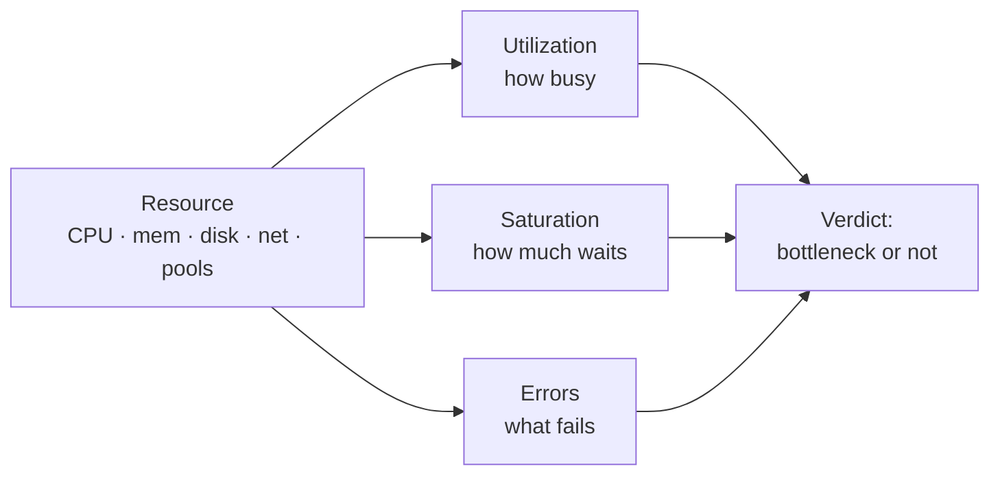
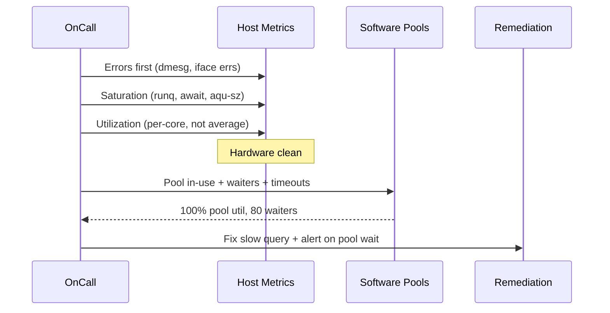

# Lesson 09: The USE Method — Find the Bottleneck (Utilization, Saturation, Errors)

> **Prerequisites:** [Lesson 08: Serialization Formats](../08-serialization-formats/README.md) and [Track: Performance and Traffic](../README.md).  
> **Estimated Reading Time:** 30–35 minutes  
> **Target Audience:** Backend engineers, SREs, and on-call responders who need a systematic checklist when latency is up and dashboards are noisy.  
> **Free PDF Notes:** [Download SD-J-009.pdf](https://backendroadmap.com/notes/system-design/SD-J-009.pdf)

> [!NOTE]
> **In one line:** the USE method (Brendan Gregg) finds bottlenecks systematically: for every resource check **Utilization**, **Saturation**, and **Errors**. Saturation (queues) is the key signal—averages can look healthy while a resource is saturated in bursts or on a single core.

> [!TIP]
> **The Golden Rule of USE:** Start with **errors** (fastest to check), then **saturation** (queues, waiters, await), then **utilization**. Apply the three questions to *software* resources too—connection pools, thread pools, and file descriptors—not only CPU and disk. When no resource is saturated, the problem is inside the code: profile it ([Lesson 10](../10-profiling-python/README.md)).

---

## 1. Core Definition & Taxonomic Comparison

**The USE method is a resource checklist:** for every resource (hardware or software), ask three questions. It replaces guessing (“is it the DB?”) with a walk of the bottleneck surface until the first saturated or erroring resource appears.

| Term | Precise Meaning | Production Example |
| :--- | :--- | :--- |
| **Utilization** | How busy the resource is, as % of time or capacity. | CPU 85% busy; pool 40/40 connections in use. |
| **Saturation** | Extra work that cannot be served yet—usually queued. | Run queue of 12 on 4 cores; 80 waiters on a DB pool. |
| **Errors** | Failures of the resource itself. | Dropped packets, disk I/O errors, OOM kills, pool timeouts. |
| **USE** vs **RED** | USE is *resource*-oriented (infra). RED (Rate, Errors, Duration) is *request*-oriented (services). | USE finds a saturated disk; RED shows API p99 climbing. Use both. |

**Business impact.** Guessing from a wall of graphs wastes hours of SEV-1 time. USE finds the bottleneck in minutes—often a software queue while CPU sits at 20%.

---

## 2. Component Anatomy & The Observability Gap

### Anatomy: Three Questions Per Resource

```text
 for each resource (CPU, memory, disk, network, pools, FDs):
   |-- Utilization  → how busy?
   |-- Saturation   → how much waits?
   +-- Errors       → what fails?
 → first saturated/erroring resource = dig here
```



*Figure 1. USE: three questions for every resource.*

### Apply It to Each Resource

| Resource | Utilization | Saturation | Errors |
| :--- | :--- | :--- | :--- |
| **CPU** | Per-core busy % | Run queue length / load vs cores | Machine check, throttling |
| **Memory** | Used / available | Swapping, OOM kills, page scans | Allocation failures |
| **Disk** | Busy % (`%util`) | I/O queue length, `await` | Device errors |
| **Network** | Bandwidth used | Drops, retransmits, backlog | Interface errors |
| **Pools** | Threads/connections in use | Waiters in the acquire queue | Timeouts / `PoolTimeout` |

### The Observability Gap

| Vantage Point | What It Captures | What It Hides |
| :--- | :--- | :--- |
| **Fleet-average CPU** | Machine looks “fine” at 25%. | One core at 100% starving a single-threaded process. |
| **Memory used %** | Heap looks OK. | Swapping (`si`/`so`) or impending OOM. |
| **Disk %util alone** | 40% busy looks healthy. | Burst queue length 28 and `await` 51 ms. |
| **App latency only** | p99 is high. | Which resource is saturated—need USE walk. |
| **Metrics to add** | Per-core CPU, run queue, `aqu-sz`/`await`, pool waiters, FD usage, error counters. | A single “CPU healthy” green tile. |

**Operational rule:** check errors first, then saturation, then utilization—starting with resources closest to the symptom.

---

## 3. Mathematical Model: Averages Hide Saturation

### Why Saturation Matters More Than Average Busy %

A resource at 70% *average* utilization can still be saturated in bursts. A disk at 40% busy can still have requests waiting behind a write storm. Per-machine averages also hide individual cores.

**Worked example — 8-core machine:**

| View | Value | Truth |
| :--- | :--- | :--- |
| Machine average | 25% | Looks fine |
| Core 1 (hot thread) | 100% | Saturated |
| Other 7 cores | ~14% | Idle |

The single-threaded process is the bottleneck; the average lied.

### Queue Length as the Saturation Signal

From [Little's Law](../12-queueing-theory/README.md) ($L = \lambda W$): when service slows or arrival spikes, **queue length** $L$ grows first—often before average utilization looks alarming. That is why USE privileges saturation metrics (run queue, `aqu-sz`, pool waiters) over busy percentages.

$$
W = \frac{L}{\lambda}
\quad\Rightarrow\quad
\text{growing } L \text{ at fixed } \lambda \Rightarrow \text{latency climbing}
$$

---

## 4. Metrics, Percentiles & What “Healthy” Hides

| Signal | Who It Describes | Trap |
| :--- | :--- | :--- |
| **CPU average** | Fleet / host mean busy | Hides hot cores and burst saturation |
| **Load average / `r` in vmstat** | Threads wanting CPU | Compare to core count—`r > cores` = CPU saturation |
| **`iostat` `%util` + `await` + `aqu-sz`** | Disk busy and wait | High `%util` + long queue = saturated disk |
| **Pool in-use / waiters** | Software resource USE | 100% in-use + waiters = app bottleneck with idle CPU |
| **Error counters** | Failures | Often the fastest root-cause path—check first |

**Worked deception:** CPU 30%, memory fine, API latency up → `iostat -x 1` shows `%util ≈ 99.8`, `aqu-sz = 28.4`, `await = 51.2 ms`. Disk is saturated; a log shipper shares the DB volume.

---

## 5. Compounding Effects & System Scale

When one resource saturates:

1. Latency rises → client timeouts → **retries** increase arrival rate $\lambda$.
2. Higher $\lambda$ deepens queues → more saturation.
3. Cross-resource cascade: disk saturation → I/O wait → effective CPU “busy” on wait → pool hold times grow → connection pool saturates.

| Cascade Stage | Symptom | USE Finding |
| :--- | :--- | :--- |
| 1 | p99 up | Disk `await` high |
| 2 | Retries spike | Arrival rate up |
| 3 | Pool waiters | Software saturation |
| 4 | Platform SEV-1 | Multiple resources red |

Stop the cascade at the **first** saturated resource; do not scale CPU when the disk (or pool) is the bottleneck.

---

## 6. Numbers Every Backend Engineer Must Know

| Operation / Signal | Layer | Typical Value | Implication |
| :--- | :--- | :--- | :--- |
| Run queue `r` vs cores | CPU | `r > n_cores` | CPU saturation |
| Disk `await` under load | Storage | Tens of ms = pain; `< few ms` healthy NVMe | Queueing on disk |
| `aqu-sz` | Disk queue | Rising with latency | Saturation, not just busy % |
| Swap `si`/`so` | Memory | Non-zero under load | Memory saturation |
| Pool waiters | App | Any sustained waiters | Software bottleneck |
| FD limit | OS | Soft limit often 1024 | Exhaustion → accept/connect errors |

---

## 7. Linux & Cloud Deep Dive (The USE Toolkit)

| Resource | Commands |
| :--- | :--- |
| CPU & run queue | `vmstat 1`, `top` / `htop`, `mpstat -P ALL 1` |
| Memory | `free -m`, `vmstat` (`si`/`so`), `dmesg` for OOM |
| Disk | `iostat -x 1` (`%util`, `await`, `aqu-sz`) |
| Network | `sar -n DEV 1`, `ss -s`, `nstat` |
| Errors | `dmesg \| grep -iE 'oom\|error'` |

```bash
$ iostat -x 1
Device   r/s    w/s   rkB/s   wkB/s  aqu-sz  await  %util
nvme0n1  120   1850    4800   92000    28.4   51.2   99.8   # saturated

$ vmstat 1
 r  b   swpd   free   si   so   wa
 2  0      0  ...      0    0    1        # r = run queue; si/so = swap
```

In the cloud, the same signals come from CloudWatch / Azure Monitor / GCP metrics—map them to utilization, saturation, and errors explicitly.



---

## 8. Hierarchical Investigation Budget

Order of investigation when latency is the symptom:

| Step | Focus | Budget |
| :--- | :--- | :--- |
| 1 | Resources closest to the symptom | First 5 minutes |
| 2 | Errors on those resources | Seconds each |
| 3 | Saturation (queues) | Minutes |
| 4 | Utilization (per-core / per-device) | Minutes |
| 5 | Software pools & FDs | If hardware clean |
| 6 | Profile / trace code | Only if nothing saturated |

**Sizing rule for pools:** size connection/thread pools from downstream capacity and [Little's Law](../12-queueing-theory/README.md)—not from “CPU still looks free.”

---

## 9. Top Engineering Mitigation Techniques

1. **Walk USE before changing code** — find the saturated resource first.
2. **Alert on saturation, not only utilization** — pool waiters, run queue, `await`.
3. **Per-core and per-device views** — never trust host averages alone.
4. **Separate noisy writers** — log shippers / backups off the latency path volume.
5. **Include software resources in dashboards** — pools, FDs, lock wait.
6. **Baseline comparison** — know normal queue lengths before the incident.

---

## 10. Production War Story (SEV-1 Post-Mortem)

**Severity & Impact:** API p99 climbed for 40 minutes; CPU dashboards green at ~20%. Customer checkout timeouts. Detection via latency SLO; resolution ~25 minutes after USE walk.

**What Happened:** Hardware USE showed nothing saturated. Software USE on the DB connection pool: **100% utilization**, **80 requests waiting**. A slow query held connections for seconds.

```python
# Flaw: unbounded wait on a saturated pool — no pool-wait metric, alert only on CPU
conn = pool.acquire()  # blocks; 80 waiters invisible to CPU graphs
rows = conn.execute(SLOW_REPORT_SQL)  # seconds per hold
```

```mermaid
sequenceDiagram
    participant Client
    participant API
    participant Pool as DB Pool (40)
    participant DB

    Client->>API: Checkout (latency rising)
    API->>Pool: acquire()
    Note over Pool: 40/40 in use, 80 waiters
    Pool->>DB: Slow report query holds conn
    Note over API: Workers blocked; CPU ~20%
    API-->>Client: Timeouts / 504
```

**RCA:** Software queue saturation with idle CPU—classic USE miss if you only graph hardware.

**The Fix:**
1. Fixed the slow query (index + limit).
2. Added **pool-wait** histogram and waiter gauge.
3. Alerted on pool saturation, not CPU.
4. Sized the pool to the database's real capacity.

**Lesson:** software queues are resources too; USE finds them if you apply it to them.

---

## 11. Multi-Language Production Code — Pool Saturation Metrics

````carousel
```go
package poolsat

import (
	"context"
	"sync/atomic"
	"time"
)

// InstrumentedPool tracks utilization (in-use/max) and saturation (waiters).
type InstrumentedPool struct {
	max     int64
	inUse   atomic.Int64
	waiters atomic.Int64
	acquire func(context.Context) (conn, error)
	release func(conn)
}

type conn any

func (p *InstrumentedPool) Acquire(ctx context.Context) (conn, error) {
	p.waiters.Add(1)
	defer p.waiters.Add(-1)
	start := time.Now()
	c, err := p.acquire(ctx)
	if err != nil {
		return nil, err
	}
	p.inUse.Add(1)
	_ = start // export acquire_wait_seconds histogram in real code
	return c, nil
}

func (p *InstrumentedPool) Release(c conn) {
	p.release(c)
	p.inUse.Add(-1)
}

func (p *InstrumentedPool) Utilization() float64 {
	return float64(p.inUse.Load()) / float64(p.max)
}

func (p *InstrumentedPool) Waiters() int64 { return p.waiters.Load() }
```
<!-- slide -->
```typescript
/** USE for a software pool: utilization = inUse/max, saturation = waiters. */
export class InstrumentedPool<T> {
  private inUse = 0;
  private waiters = 0;
  constructor(
    private readonly max: number,
    private readonly acquireImpl: () => Promise<T>,
    private readonly releaseImpl: (c: T) => void
  ) {}

  async acquire(): Promise<T> {
    this.waiters++;
    try {
      const c = await this.acquireImpl();
      this.inUse++;
      return c;
    } finally {
      this.waiters--;
    }
  }

  release(c: T): void {
    this.releaseImpl(c);
    this.inUse--;
  }

  utilization(): number {
    return this.inUse / this.max;
  }

  saturationWaiters(): number {
    return this.waiters;
  }
}
```
<!-- slide -->
```python
"""USE metrics for a connection pool — alert on waiters, not only CPU."""
from __future__ import annotations

import threading
import time
from typing import Any, Callable


class InstrumentedPool:
    def __init__(self, max_size: int, acquire_impl: Callable[[], Any], release_impl: Callable[[Any], None]) -> None:
        self.max_size = max_size
        self._acquire_impl = acquire_impl
        self._release_impl = release_impl
        self._lock = threading.Lock()
        self.in_use = 0
        self.waiters = 0
        self.acquire_wait_seconds = 0.0  # sum for export / histogram

    def acquire(self) -> Any:
        with self._lock:
            self.waiters += 1
        start = time.monotonic()
        try:
            conn = self._acquire_impl()
        finally:
            waited = time.monotonic() - start
            with self._lock:
                self.waiters -= 1
                self.in_use += 1
                self.acquire_wait_seconds += waited
        return conn

    def release(self, conn: Any) -> None:
        self._release_impl(conn)
        with self._lock:
            self.in_use -= 1

    def utilization(self) -> float:
        with self._lock:
            return self.in_use / self.max_size

    def saturation_waiters(self) -> int:
        with self._lock:
            return self.waiters
```
<!-- slide -->
```csharp
using System;
using System.Diagnostics;
using System.Threading;
using System.Threading.Tasks;

/// <summary>USE for pools: Utilization = InUse/Max, Saturation = Waiters.</summary>
public sealed class InstrumentedPool<T>
{
    private readonly int _max;
    private readonly Func<CancellationToken, Task<T>> _acquire;
    private readonly Action<T> _release;
    private int _inUse;
    private int _waiters;

    public InstrumentedPool(int max, Func<CancellationToken, Task<T>> acquire, Action<T> release)
    {
        _max = max; _acquire = acquire; _release = release;
    }

    public async Task<T> AcquireAsync(CancellationToken ct = default)
    {
        Interlocked.Increment(ref _waiters);
        var sw = Stopwatch.StartNew();
        try
        {
            var c = await _acquire(ct).ConfigureAwait(false);
            Interlocked.Increment(ref _inUse);
            // Export sw.Elapsed as pool_acquire_wait_seconds
            return c;
        }
        finally
        {
            Interlocked.Decrement(ref _waiters);
        }
    }

    public void Release(T conn)
    {
        _release(conn);
        Interlocked.Decrement(ref _inUse);
    }

    public double Utilization => (double)Volatile.Read(ref _inUse) / _max;
    public int Waiters => Volatile.Read(ref _waiters);
}
```
````

---

## 12. Hands-On CLI Verification Workflows

### 1. Per-core CPU (catch the hot core)

```bash
mpstat -P ALL 1 3
```

Compare `%usr` per CPU—one core at ~100% with others idle is a single-threaded bottleneck.

### 2. Disk saturation triad

```bash
iostat -x 1 5
```

Look for high `%util` **and** rising `aqu-sz` / `await` together.

### 3. Run queue vs cores

```bash
nproc; vmstat 1 5
```

If `r` consistently exceeds `nproc`, the CPU is saturated even when “average %” looked mild.

### 4. Quick error sweep

```bash
dmesg -T | grep -iE 'oom|error|throttl' | tail -n 40
```

---

## 13. Common Mistakes to Avoid

- Looking only at **average CPU**.
- Ignoring queues (run queue, I/O queue, pool waiters).
- Forgetting **software** resources (pools, FDs, locks).
- Skipping **errors**, which are the quickest to check.
- Per-machine averages hiding one hot core.
- No baseline to compare against.
- Scaling the wrong tier (more app pods when the disk/pool is saturated).
- Jumping to profiling before USE clears hardware/software resources.

---

## 14. Key Terms Glossary

| Term | Interview-Ready Definition |
| :--- | :--- |
| **USE method** | For every resource, check Utilization, Saturation, and Errors. |
| **Utilization** | How busy a resource is (% time or capacity). |
| **Saturation** | Queued, unserved work waiting for the resource. |
| **Run queue** | Threads waiting for CPU time. |
| **iostat** | Disk statistics tool (`%util`, `await`, `aqu-sz`). |
| **vmstat** | CPU, memory, and I/O summary (`r`, `si`/`so`, `wa`). |
| **I/O wait** | CPU idle while waiting on disk. |
| **Connection pool** | Shared connections with a hard limit—a software resource. |
| **File descriptors** | OS handles with a limit (sockets, files). |
| **Bottleneck** | The most constrained resource limiting the system. |
| **RED** | Rate, Errors, Duration—request-oriented companion to USE. |

---

## 15. Complete 12 System Design Interview Q&As

### Basic Conceptual Questions (Q1–Q4)

<details>
<summary><strong>Q1: What is the USE method? [BASIC]</strong></summary>

<strong>What a strong answer covers:</strong>
For every resource—CPU, memory, disk, network, and software pools—check **utilization**, **saturation**, and **errors** to find the bottleneck systematically instead of guessing from random graphs.

</details>

<details>
<summary><strong>Q2: Why focus on saturation? [BASIC]</strong></summary>

<strong>What a strong answer covers:</strong>
Queueing causes latency. Averages can look healthy while a resource is saturated in bursts or on a single core. Saturation (run queue, I/O queue, pool waiters) is the early-warning signal.

</details>

<details>
<summary><strong>Q3: Which Linux tools would you use? [BASIC]</strong></summary>

<strong>What a strong answer covers:</strong>
`vmstat`, `top`/`htop`, and `mpstat` for CPU; `free` for memory; `iostat -x` for disk; `sar`/`ss`/`nstat` for network; `dmesg` for errors/OOM.

</details>

<details>
<summary><strong>Q4: Does USE apply to software? [BASIC]</strong></summary>

<strong>What a strong answer covers:</strong>
Yes. Thread pools, connection pools, and file descriptors have utilization (in use / max) and saturation (waiters / allocate failures). Many “CPU is fine” incidents are saturated pools.

</details>

### Scenario-Based Architecture Questions (Q5–Q8)

<details>
<summary><strong>Q5: Latency is up but CPU and memory look fine. [SCENARIO]</strong></summary>

<strong>What a strong answer covers:</strong>
Walk the other resources: disk with `iostat` (await/queue), network drops/retransmits, then software pools and queues. Classic case: log shipper saturating the DB volume.

</details>

<details>
<summary><strong>Q6: One core is at 100% and others idle. [SCENARIO]</strong></summary>

<strong>What a strong answer covers:</strong>
A single-threaded bottleneck. Use multiple processes/shards or find the hot function with a profiler ([Lesson 10](../10-profiling-python/README.md)). Machine-average CPU will still look low.

</details>

<details>
<summary><strong>Q7: Disk is at 40% busy yet requests are slow. [SCENARIO]</strong></summary>

<strong>What a strong answer covers:</strong>
Check queue length and wait time (`aqu-sz`, `await`). Bursts can saturate a disk despite a low average busy percentage.

</details>

<details>
<summary><strong>Q8: No hardware resource is saturated. [SCENARIO]</strong></summary>

<strong>What a strong answer covers:</strong>
Look at software queues and lock contention, then profile the code and trace dependencies. USE cleared the infra layer—now measure inside the process.

</details>

### Advanced & Tricky Interview Questions (Q9–Q12)

<details>
<summary><strong>Q9: USE versus RED? [TRICKY]</strong></summary>

<strong>What a strong answer covers:</strong>
USE is resource-oriented (infrastructure health). RED (rate, errors, duration) is request-oriented (service SLIs). Use RED to detect the symptom and USE to locate the bottleneck resource.

</details>

<details>
<summary><strong>Q10: Why check errors first? [TRICKY]</strong></summary>

<strong>What a strong answer covers:</strong>
They are quick to check (`dmesg`, interface errors, OOM) and often explain the symptom directly—skipping hours of utilization analysis when a device is failing.

</details>

<details>
<summary><strong>Q11: Is 100% utilization always a problem? [TRICKY]</strong></summary>

<strong>What a strong answer covers:</strong>
Not by itself. Trouble starts when work **queues**—that is saturation. A fully busy disk with empty queues and low await can be fine; 70% busy with a deep queue is not.

</details>

<details>
<summary><strong>Q12: How does Little's Law relate? [TRICKY]</strong></summary>

<strong>What a strong answer covers:</strong>
$L = \lambda W$: queue length grows with arrival rate and time in system. Saturation shows up as growing $L$; USE watches those queues before latency SLOs burn.

</details>

---

## 16. One-Page Master Cheat Sheet

```text
====================================================================================================
                         USE METHOD  —  CHEAT SHEET
====================================================================================================
IN ONE LINE   For every resource: Utilization, Saturation, Errors. Saturation (queues) is the key.

ORDER         Errors → Saturation → Utilization | start near the symptom | then software pools
HARDWARE      CPU: per-core + run queue (r) | Mem: used + si/so/OOM | Disk: %util+await+aqu-sz
              Net: bandwidth + drops/retransmits | always check dmesg for errors
SOFTWARE      pools in-use/max, waiters, timeouts | FDs | lock wait — CPU can be 20% and still broken

WHY AVERAGES LIE
  8 cores @ 25% avg can hide 1 core @ 100% | disk 40% busy can still have await 50 ms + queue 28

TOOLS         vmstat 1 | mpstat -P ALL 1 | iostat -x 1 | free -m | sar -n DEV 1 | ss -s | dmesg
USE vs RED    USE = resources (infra) | RED = rate/errors/duration (requests) | use both
LITTLE'S LAW  L = λW → growing queues ⇒ growing latency

ANTI-PATTERNS X avg CPU only  X ignore queues  X skip software pools  X skip errors
              X no baseline  X scale wrong tier  X profile before USE
NEXT          If nothing saturated → profile ([SD-J-010] Lesson 10)
====================================================================================================
```

---

## Free PDF notes

Download these notes as a printable PDF with the USE checklist, Linux tool grid, and interview answers: [SD-J-009.pdf](https://backendroadmap.com/notes/system-design/SD-J-009.pdf).

---

## Sources

- [Brendan Gregg — The USE Method](https://www.brendangregg.com/usemethod.html)
- [Brendan Gregg — Systems Performance](https://www.brendangregg.com/systems-performance-2nd-edition-book.html)
- Linux man pages: `iostat`, `vmstat`, `mpstat`, `sar`
- [Lesson 10: Profiling Python](../10-profiling-python/README.md) · [Lesson 12: Queueing Theory](../12-queueing-theory/README.md)

---

## Next

Next → [Lesson 10: Profiling Python — py-spy, cProfile, Scalene & Flame Graphs](../10-profiling-python/README.md)

Track overview: [Performance and Traffic](../README.md)
