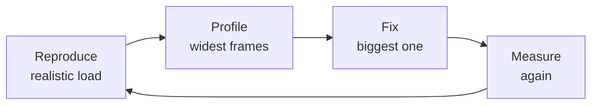
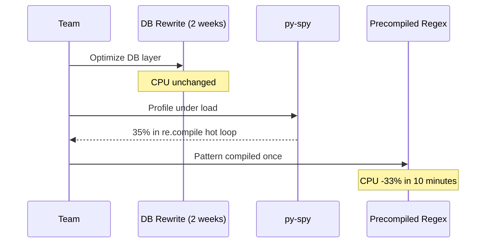

# Lesson 10: Profiling Python — py-spy, cProfile, Scalene & Flame Graphs

> **Prerequisites:** [Lesson 09: The USE Method](../09-the-use-method/README.md).  
> **Estimated Reading Time:** 30–35 minutes  
> **Target Audience:** Backend engineers fixing CPU-bound Python services, reading flame graphs under real load, and separating “busy” from “waiting.”  
> **Free PDF Notes:** [Download SD-J-010.pdf](https://backendroadmap.com/notes/system-design/SD-J-010.pdf)

> [!NOTE]
> **In one line:** use a sampling profiler (`py-spy`) on a running process under real load, read the flame graph for the widest frames, fix the biggest one, and measure again. Profiles show what is **busy**; tracing shows what is **waiting**.

> [!TIP]
> **The Golden Rule of Profiling:** Never guess where time goes. Attach a **sampling** profiler in production (low overhead, no restart), fix the **widest** frame first, re-profile. If latency is high but CPU is low, stop CPU profiling—use tracing / off-CPU / wall-clock views for locks, I/O, and downstream waits.

---

## 1. Core Definition & Taxonomic Comparison

**A profiler measures where a process spends time** so you optimize the hot path instead of rewriting the wrong layer. Two families exist; using the wrong one in production wastes days and distorts results.

| Term | Precise Meaning | Production Example |
| :--- | :--- | :--- |
| **Sampling profiler** | Periodically records stacks; counts where the program is found. Low overhead. | `py-spy record --pid 1234 --duration 60` |
| **Deterministic profiler** | Hooks every function call; exact counts/times. High overhead. | `python -m cProfile` on one script/test |
| **Flame graph** | Stacked chart of samples; width = share of samples. | Widest plateau under `json.dumps` → serialize less / use `orjson` |
| **CPU vs wall-clock** | CPU = running time only; wall-clock includes waiting. | High latency + low CPU → need wall/off-CPU + tracing |
| **Profiling vs tracing** | Profile = busy inside a process; trace = waits across services. | Profile finds regex; trace finds 800 ms downstream |

**Business impact.** Two weeks rewriting a DB layer can lose to a 10-minute precompiled-regex fix once you measure.

---

## 2. Component Anatomy & The Observability Gap

### Anatomy of a Sampling Session

```text
 running worker under real traffic
   |-- attach sampler (py-spy) for 30–60 s
   |-- stacks counted → flame graph SVG
   |-- width = % of samples (not left-to-right time!)
   +-- fix widest / cheapest frame → re-measure
```



*Figure 1. The profiling loop: measure → fix biggest → verify.*

### Reading a Flame Graph

```text
 handler()                         100% of samples
 ├── json.dumps                    40%
 │    └── encoder (C)              …
 ├── db.query                      20%
 └── other                         40%
```

- Each box is a function stacked on its caller; **width** is share of samples.
- **Left to right is not time**—only sorted. A tall narrow tower is deep, not expensive.
- Widest plateaus (often near the top of wide stacks) are where time goes.

### The Observability Gap

| Vantage Point | What It Captures | What It Hides |
| :--- | :--- | :--- |
| **On-CPU sample** | Functions burning CPU | Lock waits, I/O, downstream latency |
| **cProfile in prod** | Exact call counts | Distorts fast functions; slows the service |
| **Idle process profile** | Clean but useless graph | Wrong workload → wrong optimization |
| **Per-service CPU** | Host looks busy | Which frame inside the worker |
| **Metrics to add** | Continuous profiles, loop-lag (asyncio), before/after flame compare | “We optimized the DB” with no SVG |

---

## 3. Mathematical Model: Sample Share & Amdahl on Hot Frames

If function $f$ occupies fraction $p$ of samples and you speed it up by factor $s$:

$$
\text{Overall speedup} = \frac{1}{(1-p) + \frac{p}{s}}
$$

| $p$ (sample share) | Local $s$ | Overall gain | Lesson |
| :--- | :--- | :--- | :--- |
| 40% (`json.dumps`) | 3× (`orjson`) | ~1.36× (~27% less time) | Fix the wide frame |
| 5% (micro-opt) | 10× | ~1.047× (~4.5%) | Not worth a rewrite |
| 35% (regex compile) | ∞ (precompile) | ~1.54× | Biggest frame wins |

**Stop rule:** stop when the target is met or remaining frames are small relative to effort.

---

## 4. Metrics, Percentiles & Tool Choice

| Tool | What It Does | Overhead | Use |
| :--- | :--- | :--- | :--- |
| **py-spy** | Attach to PID; flame graphs; no code change | Low; prod-safe | Live services |
| **cProfile** | Built-in deterministic | High | One script / test |
| **Scalene** | CPU, memory, GPU; Python vs native | Moderate | Line-level + mem |
| **memray** | Allocation tracking | Moderate | Leaks / spikes |
| **Pyroscope / cloud** | Continuous profiling | Tiny | Before/after releases |

```bash
py-spy record -o profile.svg --pid 1234 --duration 60
py-spy top --pid 1234
py-spy record --idle -o wait.svg --pid 1234   # include idle (waiting)
python -m cProfile -o out.prof script.py
python -c "import pstats; pstats.Stats('out.prof').sort_stats('cumtime').print_stats(15)"
```

---

## 5. Compounding Effects at Scale

| Situation | Effect |
| :--- | :--- |
| Optimize without measuring | Days on a 5% frame while a 40% frame remains |
| cProfile in production | Inflates tiny functions; false hotspots |
| Profile idle / synthetic load | Miss production serialization / regex paths |
| Fix small frames first | p99 barely moves; morale and trust drop |
| CPU profile for wait-bound latency | “Nothing hot” while users burn |

Async compounding: blocking the event loop stalls *all* coroutines—py-spy `--idle` plus a **loop-lag** metric catch it.

---

## 6. Numbers Every Backend Engineer Must Know

| Operation | Typical | Implication |
| :--- | :--- | :--- |
| Sample window | 30–60 s under real traffic | Shorter misses rare hot paths |
| Sampling overhead | ~1–3% typical | Safe for one prod instance |
| cProfile overhead | Can be 2–10×+ on tiny calls | Distorts production |
| Continuous profiling | Sub-percent | Compare releases |
| `json` → `orjson` on fat payloads | Often large CPU drop | Classic widest-frame win |

---

## 7. Runtime Deep Dive: Async, Native, and Off-CPU

```mermaid
sequenceDiagram
    participant Eng as Engineer
    participant Worker as Python Worker
    participant Spy as py-spy
    participant Fix as Hotfix

    Eng->>Worker: Real traffic (not idle)
    Eng->>Spy: record --pid --duration 60
    Spy-->>Eng: profile.svg flame graph
    Note over Eng: Widest frame = json.dumps 40%
    Eng->>Fix: Switch to orjson
    Eng->>Spy: Re-record
    Spy-->>Eng: Frame gone; p99 improved
```

- **asyncio:** profilers often show the event loop; hunt blocking calls; use `--idle`; monitor loop lag.
- **Native/C extensions:** Scalene separates Python vs native time.
- **Waiting:** on-CPU profiles hide locks—use wall-clock / off-CPU / distributed tracing.

---

## 8. Hierarchical Optimization Budget

| Priority | Action | Stop When |
| :--- | :--- | :--- |
| 1 | USE cleared? ([Lesson 09](../09-the-use-method/README.md)) | Resource saturated → fix that first |
| 2 | Sample 30–60 s under real load | Flame graph in hand |
| 3 | Fix widest cheapest frame | Serialization, regex, N+1, logging |
| 4 | Re-profile | Confirm gain; find next frame |
| 5 | Trace if CPU low / latency high | Waiting, not busy |

---

## 9. Top Engineering Mitigation Techniques

1. **Profile first, always** — require a flame graph on performance PRs.
2. **Sampling in production** — one instance, short window.
3. **Continuous profiling** — catch regressions across releases.
4. **Biggest frame first** — Amdahl on sample share.
5. **Separate busy vs waiting** — profile + trace.
6. **Realistic load** — production traffic mix or faithful replay.

---

## 10. Production War Story (SEV-1 Post-Mortem)

**Severity & Impact:** Team spent two weeks rewriting a database layer to cut CPU. p99 unchanged. Later a 10-minute fix cut CPU by ~⅓.

**What Happened:** `py-spy` finally showed **35% of CPU in regex compilation inside a hot loop**.

```python
# Flaw: recompile on every request
import re

def extract(text: str) -> list[str]:
    return re.findall(r"[A-Z]{2,}-\d+", text)  # compile cost every call
```



**The Fix:** Precompile the regex; add continuous profiling; require flame graphs on perf PRs. Shelve the rewrite.

**Lesson:** the biggest frame is rarely where intuition points.

---

## 11. Multi-Language Production Code — Profile-Guided Hot Path

````carousel
```go
package hotpath

import (
	"encoding/json"
	"regexp"
	"sync"
)

// Precompile once — mirrors the Python regex incident fix.
var ticketRe = regexp.MustCompile(`[A-Z]{2,}-\d+`)

var bufPool = sync.Pool{New: func() any { return make([]byte, 0, 4096) }}

func ExtractTickets(text string) []string {
	return ticketRe.FindAllString(text, -1)
}

func MarshalPooled(v any) ([]byte, error) {
	buf := bufPool.Get().([]byte)[:0]
	defer bufPool.Put(buf)
	return json.Marshal(v) // swap for a faster codec after a profile says so
}
```
<!-- slide -->
```typescript
/** Precompiled pattern + fast JSON — only after a profile names the hotspot. */
const TICKET_RE = /[A-Z]{2,}-\d+/g;

export function extractTickets(text: string): string[] {
  return text.match(TICKET_RE) ?? [];
}

export function serializeFast(payload: unknown): string {
  // Profile showed JSON.stringify dominating → keep payload small / use faster lib
  return JSON.stringify(payload);
}
```
<!-- slide -->
```python
"""After py-spy: widest frames were re.findall compile + json.dumps."""
from __future__ import annotations

import re
from typing import Any

import orjson

TICKET_RE = re.compile(r"[A-Z]{2,}-\d+")


def extract_tickets(text: str) -> list[str]:
    return TICKET_RE.findall(text)


def serialize_response(payload: Any) -> bytes:
    # before: json.dumps(payload).encode()  — 40% of CPU in flame graph
    return orjson.dumps(payload)
```
<!-- slide -->
```csharp
using System.Collections.Concurrent;
using System.Text.Json;
using System.Text.RegularExpressions;

public static partial class HotPath
{
    // Compiled regex — equivalent to Python's precompiled pattern fix
    [GeneratedRegex(@"[A-Z]{2,}-\d+", RegexOptions.Compiled)]
    private static partial Regex TicketRe();

    private static readonly ConcurrentBag<byte[]> BufferPool = new();

    public static MatchCollection ExtractTickets(string text) => TicketRe().Matches(text);

    public static byte[] SerializeFast<T>(T payload)
    {
        // Profile first; then trim payload / use source-gen serializer if JSON dominates
        return JsonSerializer.SerializeToUtf8Bytes(payload);
    }
}
```
````

---

## 12. Hands-On CLI Verification Workflows

### 1. Sample a live PID

```bash
py-spy record -o profile.svg --pid $(pgrep -n -f 'uvicorn|gunicorn') --duration 30
```

Open `profile.svg` and find the widest plateau.

### 2. Live top view

```bash
py-spy top --pid 1234
```

### 3. Deterministic local script

```bash
python -m cProfile -o out.prof app_bench.py
python -c "import pstats; pstats.Stats('out.prof').sort_stats('cumtime').print_stats(15)"
```

### 4. Scalene line view

```bash
scalene app_bench.py
```

---

## 13. Common Mistakes to Avoid

- Optimizing without measuring.
- Using **cProfile in production**.
- Profiling an idle or unrealistic workload.
- Reading flame graph **x-axis as time**.
- Profiling CPU when the problem is **waiting**.
- Fixing small frames while the big one remains.
- Skipping re-measure after the fix.
- Ignoring asyncio loop blocking / missing `--idle`.

---

## 14. Key Terms Glossary

| Term | Interview-Ready Definition |
| :--- | :--- |
| **Profiler** | Tool measuring where time (or memory) goes. |
| **Sampling profiler** | Periodically records stacks; production-friendly. |
| **Deterministic profiler** | Hooks every call; precise but slow. |
| **Flame graph** | Stacked chart of sampled stacks; width = cost. |
| **py-spy** | Sampling profiler for Python; attach by PID. |
| **Scalene** | CPU, memory, and GPU profiler with line detail. |
| **memray** | Memory allocation profiler. |
| **Continuous profiling** | Always-on low-overhead sampling. |
| **Tracing** | Follows a request across services (waiting). |
| **Hot path** | Code that consumes most time/samples. |
| **Wall-clock profile** | Includes waiting; contrasts with on-CPU. |

---

## 15. Complete 12 System Design Interview Q&As

### Basic Conceptual Questions (Q1–Q4)

<details>
<summary><strong>Q1: How do you find where a Python service spends CPU time? [BASIC]</strong></summary>

<strong>What a strong answer covers:</strong>
Attach a sampling profiler like `py-spy` to a running process under real load, generate a flame graph, and look for the widest frames. Fix the biggest, measure again.

</details>

<details>
<summary><strong>Q2: Why sampling instead of cProfile in production? [BASIC]</strong></summary>

<strong>What a strong answer covers:</strong>
Sampling has very low overhead and needs no code changes. cProfile slows every call and distorts results—especially for small, frequent functions.

</details>

<details>
<summary><strong>Q3: How do you read a flame graph? [BASIC]</strong></summary>

<strong>What a strong answer covers:</strong>
Bottom up; width is the share of samples; the widest plateaus are where time goes; left-to-right is sorting, not chronology. Tall ≠ expensive.

</details>

<details>
<summary><strong>Q4: Which tool finds memory leaks? [BASIC]</strong></summary>

<strong>What a strong answer covers:</strong>
`memray` or Scalene track allocations and help find leaks and spikes.

</details>

### Scenario-Based Architecture Questions (Q5–Q8)

<details>
<summary><strong>Q5: CPU at 100% and p99 rising. [SCENARIO]</strong></summary>

<strong>What a strong answer covers:</strong>
Profile one worker for ~60 seconds under real load; fix the widest frame; measure again. Common wins: serialization, regex, logging, N+1.

</details>

<details>
<summary><strong>Q6: Latency high but CPU low. [SCENARIO]</strong></summary>

<strong>What a strong answer covers:</strong>
The service is waiting. Use tracing and I/O, lock, and downstream analysis—not on-CPU profiling alone. Consider wall-clock / `--idle`.

</details>

<details>
<summary><strong>Q7: Profile an asyncio service. [SCENARIO]</strong></summary>

<strong>What a strong answer covers:</strong>
Use `py-spy` with `--idle`, look for blocking coroutines that stall the loop, and monitor loop-lag metrics in production.

</details>

<details>
<summary><strong>Q8: How do you prevent regressions? [SCENARIO]</strong></summary>

<strong>What a strong answer covers:</strong>
Continuous profiling plus performance tests in CI with latency thresholds on critical paths.

</details>

### Advanced & Tricky Interview Questions (Q9–Q12)

<details>
<summary><strong>Q9: Why can cProfile mislead? [TRICKY]</strong></summary>

<strong>What a strong answer covers:</strong>
Its per-call overhead inflates the apparent cost of small, frequent functions, creating false hotspots.

</details>

<details>
<summary><strong>Q10: Does a profile show lock waits? [TRICKY]</strong></summary>

<strong>What a strong answer covers:</strong>
Not in on-CPU profiles. Use off-CPU or wall-clock profiling and tracing to see lock and I/O waits.

</details>

<details>
<summary><strong>Q11: What is wall-clock versus CPU profile? [TRICKY]</strong></summary>

<strong>What a strong answer covers:</strong>
Wall-clock includes waiting; CPU counts only running time. High latency with low CPU ⇒ wall-clock/tracing problem.

</details>

<details>
<summary><strong>Q12: When do you stop optimizing? [TRICKY]</strong></summary>

<strong>What a strong answer covers:</strong>
When the target is met or remaining frames are small relative to effort—Amdahl says tiny frames barely move the overall number.

</details>

---

## 16. One-Page Master Cheat Sheet

```text
====================================================================================================
                      PERFORMANCE PROFILING  —  CHEAT SHEET
====================================================================================================
IN ONE LINE   Measure, never guess. Sampling + flame graph → fix widest → measure again.

TOOLS         py-spy (prod) | cProfile (script) | Scalene (CPU/mem/GPU) | memray | Pyroscope
FLAME GRAPH   width = sample share | L→R not time | tall ≠ expensive | widest plateau = hot
LOOP          reproduce → profile 30–60s → fix biggest → re-profile → stop at target

BUSY vs WAIT  Profiles show busy | Tracing / wall-clock / --idle show waiting
ASYNC         Event loop dominates samples | hunt blockers | loop-lag metric
AMDAHL        speedup = 1 / ((1-p) + p/s) | p=0.05 even s=∞ saves only 5%

ANTI-PATTERNS X guess  X cProfile in prod  X idle workload  X x-axis as time
              X CPU profile for waits  X fix tiny frames first  X no re-measure
NEXT          Load / stress / soak / spike tests → [SD-J-011] Lesson 11
====================================================================================================
```

---

## Free PDF notes

Download these notes as a printable PDF with the flame-graph guide, tool grid, and interview answers: [SD-J-010.pdf](https://backendroadmap.com/notes/system-design/SD-J-010.pdf).

---

## Sources

- [py-spy documentation](https://github.com/benfred/py-spy)
- [Brendan Gregg — Flame Graphs](https://www.brendangregg.com/flamegraphs.html)
- [Scalene](https://github.com/plasma-umass/scalene) · [memray](https://github.com/bloomberg/memray)
- [Lesson 09: USE Method](../09-the-use-method/README.md) · [Lesson 11: Load Testing](../11-load-testing-vs-stress-soak-spike-tests/README.md)

---

## Next

Next → [Lesson 11: Load Testing vs Stress, Soak & Spike Tests (Locust, k6)](../11-load-testing-vs-stress-soak-spike-tests/README.md)

Track overview: [Performance and Traffic](../README.md)
