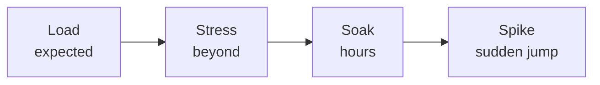
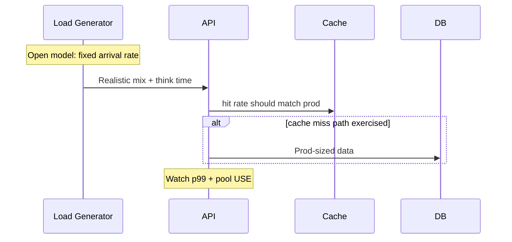
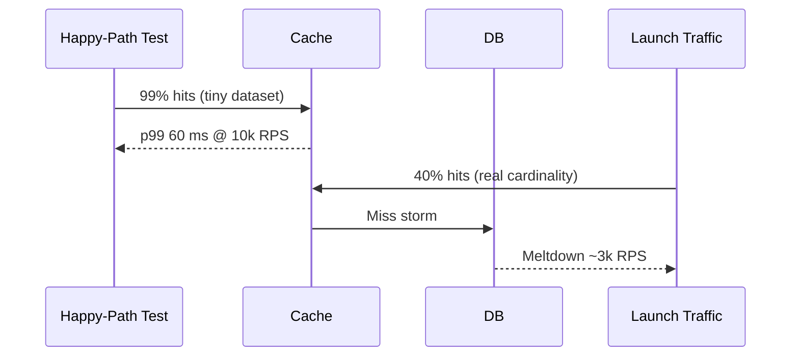

# Lesson 11: Load Testing vs Stress, Soak & Spike Tests (Locust, k6)

> **Prerequisites:** [Lesson 09: The USE Method](../09-the-use-method/README.md), [Lesson 10: Profiling Python](../10-profiling-python/README.md).  
> **Estimated Reading Time:** 32–35 minutes  
> **Target Audience:** Backend and SRE engineers proving capacity before launch day, writing Locust/k6 plans, and avoiding coordinated omission.  
> **Free PDF Notes:** [Download SD-J-011.pdf](https://backendroadmap.com/notes/system-design/SD-J-011.pdf)

> [!NOTE]
> **In one line:** define goals and pass criteria first, model realistic traffic and data, run **load**, **stress**, **soak**, and **spike** tests against a production-like environment, and measure throughput, latency percentiles, errors, and resource saturation. Beware **coordinated omission**.

> [!TIP]
> **The Golden Rule of Performance Testing:** A load test is only as honest as its **traffic model**. Pass criteria before results. Prefer an **open model** (fixed arrival rate) so stalls build queues like real users. Run generators on separate machines and watch USE metrics so you know *what* saturates first.

---

## 1. Core Definition & Taxonomic Comparison

**Performance testing proves capacity before real users do.** Four complementary tests answer different questions—one “happy path” ramp is not a programme.

| Term | Precise Meaning | Production Example |
| :--- | :--- | :--- |
| **Load test** | Expected peak traffic; do we meet SLOs? | 5,000 RPS, p99 &lt; 300 ms, errors &lt; 0.1% |
| **Stress test** | Raise load past normal; where/how do we break? | Pool saturates at 7,000 RPS → p99 2.4 s |
| **Soak test** | Normal load for hours; leaks / slow degradation? | 12 h at peak → RSS climb, FD leak |
| **Spike test** | Sudden jump; do autoscaling and queues cope? | 10× burst for 2 min → scale lag, 503s |
| **Open vs closed** | Open = fixed arrival rate; closed = wait for reply before next. | Closed under-reports latency (coordinated omission) |

**Business impact.** Launch day is the worst capacity discovery tool. Unrealistic tests greenlight launches that melt at 30% of claimed RPS.

---

## 2. Component Anatomy & The Observability Gap

### Anatomy of a Useful Test Plan

```text
 1. SLO goal + pass criteria (before any run)
 2. Traffic model: mix, think time, data volume, cache realism
 3. Production-like env: instance sizes, DB size, deps
 4. Ramp in stages; watch app p99 + USE saturation
 5. Record knee; fix bottleneck; lighter suite in CI
```



*Figure 1. Four test types—each answers a different question.*

### The Observability Gap

| Vantage Point | What It Captures | What It Hides |
| :--- | :--- | :--- |
| **Load-tool average latency** | Looks great | Tail + coordinated omission |
| **Empty/tiny DB** | Fast queries | Prod data volume / cold caches |
| **99% cache hit in test** | Huge RPS | Prod 40% hit → DB melts |
| **Generator on same host** | Fake ceiling | Generator saturated first |
| **Metrics to add** | p95/p99, error %, RPS, USE (CPU/disk/pools), cache hit rate | Pass/fail from averages alone |

---

## 3. Mathematical Model: Knee, Ramp, and Coordinated Omission

### Finding the Knee

As arrival rate $\lambda$ rises, latency stays flat then bends sharply—the **knee** marks usable capacity.

| RPS | p99 (illustrative) | Reading |
| :--- | :--- | :--- |
| 3,000 | 120 ms | Comfortable |
| 5,000 | 240 ms | Meets 300 ms target |
| 6,500 | 520 ms | Past knee |
| 7,000 | 2,400 ms | Pool saturated |

### Coordinated Omission (Closed Model)

In a **closed** model the tool waits for each response before sending the next. When the system stalls, the tool also stalls—**under-counting** slow responses exactly when they matter.

$$
\text{Reported latency}_{\text{closed}} \ll \text{True user-experienced wait under queueing}
$$

**Open model:** send on a schedule (fixed arrival rate). Stalls build a queue; measured latency matches users.

---

## 4. Metrics, Percentiles & Pass Criteria

| Metric | Why |
| :--- | :--- |
| **Throughput (RPS)** | Capacity claim |
| **p95 / p99** (not average) | What users feel |
| **Error rate** | Correctness under load |
| **USE saturation** | What breaks first ([Lesson 09](../09-the-use-method/README.md)) |
| **Cache hit rate** | Honesty of the traffic model |

**Set pass criteria before the test**, e.g. `p(99)<300` and `rate<0.001` in k6 thresholds.

---

## 5. Compounding Effects & System Scale

| Flaw | Compounded Failure |
| :--- | :--- |
| One search term, hot cache | Test 10k RPS @ 60 ms → prod melts at 3k |
| Tiny DB | Index fits memory → prod I/O cliff |
| Closed-loop tool | Green CI while real p99 is seconds |
| No stress beyond target | Unknown next bottleneck |
| No soak | Leak appears on day 3 of launch |

---

## 6. Numbers Every Backend Engineer Must Know

| Item | Typical Guidance |
| :--- | :--- |
| Think time | `between(1, 3)` s (Locust) — humans are not bots |
| Ramp | Minutes, not instant, unless spike test |
| Soak | Hours (often overnight) |
| Generator placement | Separate machines, enough CPU/network |
| Mix example | 60% search / 30% view / 10% checkout |

---

## 7. Tooling & Traffic-Model Deep Dive

| Tool | Notes |
| :--- | :--- |
| **Locust** | Python user classes; natural for Python teams |
| **k6** | JS scripts; efficient; strong open-model executors |
| **JMeter** | Older Java GUI tool |



---

## 8. Hierarchical Budgets & Capacity Sizing

| Layer | Question |
| :--- | :--- |
| Edge / API | Meets RPS + p99? |
| Cache | Hit rate ≈ production? |
| DB / pools | What saturates at the knee? |
| Dependencies | Downstream timeouts under load? |
| Autoscaling | Spike recovery time? |

Derive “usable capacity” as the highest RPS that still meets p99/error SLOs **with headroom** before the knee ([Lesson 12](../12-queueing-theory/README.md)).

---

## 9. Top Engineering Mitigation Techniques

1. **Goals first** — SLO as pass criteria.
2. **Realistic mix + data + env**.
3. **Open arrival-rate model**.
4. **Ramp + USE** — note the knee.
5. **CI smoke load** on critical paths.
6. **Soak before major releases**.
7. **Separate, non-bottlenecked generators**.

---

## 10. Production War Story (SEV-1 Post-Mortem)

**Severity & Impact:** Pre-launch load test showed p99 of 60 ms at 10,000 RPS. Production cache hit rate was 40% not 99%; database melted near 3,000 RPS. Launch delayed; emergency scale-up.

**What Happened:** One repeated search term + empty cache-friendly dataset.

```python
# Flaw: unrealistic Locust user — one hot query, no write mix, no think diversity
class HappyPath(HttpUser):
    @task
    def search(self):
        self.client.get("/search?q=shoes")  # always warm cache
```



**The Fix:** Replay sanitized production traffic; production-sized DBs; compare cache hit rates test vs prod.

**Lesson:** a load test is only as honest as its traffic model.

---

## 11. Multi-Language Production Code — Load Clients & Thresholds

````carousel
```go
package loadshape

import (
	"net/http"
	"time"
)

// WeightedMix approximates 60/30/10 search/view/checkout with think time.
type WeightedMix struct {
	Client *http.Client
	Base   string
}

func (m *WeightedMix) Think() { time.Sleep(time.Duration(1000+time.Now().UnixNano()%2000) * time.Millisecond) }

func (m *WeightedMix) Step(n int) error {
	m.Think()
	switch n % 10 {
	case 0, 1, 2, 3, 4, 5:
		_, err := m.Client.Get(m.Base + "/search?q=shoes")
		return err
	case 6, 7, 8:
		_, err := m.Client.Get(m.Base + "/products/42")
		return err
	default:
		_, err := m.Client.Post(m.Base+"/checkout", "application/json", nil)
		return err
	}
}
```
<!-- slide -->
```typescript
/** k6-style open model: ramping arrival rate + hard percentile thresholds. */
export const options = {
  scenarios: {
    load: {
      executor: "ramping-arrival-rate",
      startRate: 100,
      timeUnit: "1s",
      preAllocatedVUs: 500,
      stages: [
        { target: 5000, duration: "5m" },
        { target: 5000, duration: "15m" },
      ],
    },
  },
  thresholds: {
    http_req_duration: ["p(99)<300"],
    http_req_failed: ["rate<0.001"],
  },
};

export default function () {
  // weighted tasks + sleep(think time) in real scripts
}
```
<!-- slide -->
```python
"""Locust: realistic mix, think time, named endpoints for percentile breakdown."""
from locust import HttpUser, between, task


class Shopper(HttpUser):
    wait_time = between(1, 3)  # think time

    @task(6)
    def search(self):
        self.client.get("/search?q=shoes", name="/search")

    @task(3)
    def view(self):
        self.client.get("/products/42", name="/products/:id")

    @task(1)
    def checkout(self):
        self.client.post("/checkout", json={"cart": [42]}, name="/checkout")
```
<!-- slide -->
```csharp
using System;
using System.Net.Http;
using System.Threading.Tasks;

/// <summary>Weighted open-loop worker — fire on a timer, do not wait to schedule next.</summary>
public sealed class ShopperWorker
{
    private readonly HttpClient _http;
    private readonly string _base;
    private readonly Random _rng = new();

    public ShopperWorker(HttpClient http, string baseUrl) { _http = http; _base = baseUrl; }

    public async Task StepAsync()
    {
        var roll = _rng.Next(10);
        if (roll < 6) await _http.GetAsync($"{_base}/search?q=shoes");
        else if (roll < 9) await _http.GetAsync($"{_base}/products/42");
        else await _http.PostAsync($"{_base}/checkout", null);
        // Arrival scheduling owned by the harness (open model), not by this await.
    }
}
```
````

---

## 12. Hands-On CLI Verification Workflows

### 1. Locust headless ramp

```bash
locust -f shopper.py --headless -u 500 -r 50 -t 10m --host https://staging.example.com
```

### 2. k6 with thresholds

```bash
k6 run load.js
```

Fail the build if `p(99)` or error rate thresholds break.

### 3. Confirm generator is not the bottleneck

```bash
# On generator host while test runs
mpstat 1 5; sar -n DEV 1 5
```

### 4. Compare cache honesty

```bash
# App metric during test vs prod dashboard
# cache_hit_ratio should be within ~5–10 points of production
```

---

## 13. Common Mistakes to Avoid

- Unrealistic traffic mix or data.
- Testing with an empty or tiny database.
- Load generator saturating before the service.
- Using averages instead of percentiles.
- Ignoring coordinated omission (closed model).
- Pass criteria chosen after seeing results.
- Skipping soak / spike entirely.
- Not watching USE for the true bottleneck.

---

## 14. Key Terms Glossary

| Term | Interview-Ready Definition |
| :--- | :--- |
| **Load test** | Expected traffic; confirm latency/error targets. |
| **Stress test** | Beyond capacity to find limits and failure mode. |
| **Soak test** | Long run to find leaks and slow degradation. |
| **Spike test** | Sudden surge; autoscaling and shedding. |
| **Think time** | Pause between user actions. |
| **Ramp-up** | Gradual load increase. |
| **Knee** | Point where latency climbs steeply. |
| **Coordinated omission** | Closed tool hides slow responses by slowing sends. |
| **Open model** | Fixed arrival rate regardless of response time. |
| **Locust / k6 / JMeter** | Common load tools. |

---

## 15. Complete 12 System Design Interview Q&As

### Basic Conceptual Questions (Q1–Q4)

<details>
<summary><strong>Q1: How do you design a load test? [BASIC]</strong></summary>

<strong>What a strong answer covers:</strong>
Define the goal and pass criteria, model realistic traffic and data, ramp load in a production-like environment, and measure throughput, latency percentiles, errors, and resource saturation.

</details>

<details>
<summary><strong>Q2: What is a soak test for? [BASIC]</strong></summary>

<strong>What a strong answer covers:</strong>
Running normal load for hours to find memory leaks, resource exhaustion, and slow degradation.

</details>

<details>
<summary><strong>Q3: Load versus stress test? [BASIC]</strong></summary>

<strong>What a strong answer covers:</strong>
Load confirms targets at expected traffic; stress pushes beyond to find the breaking point and how the system fails.

</details>

<details>
<summary><strong>Q4: Which tools do you use? [BASIC]</strong></summary>

<strong>What a strong answer covers:</strong>
Locust (Python), k6 (JavaScript), JMeter (Java)—plus separate generators and production-like data.

</details>

### Scenario-Based Architecture Questions (Q5–Q8)

<details>
<summary><strong>Q5: Prove the service handles 5,000 RPS. [SCENARIO]</strong></summary>

<strong>What a strong answer covers:</strong>
Ramp to 5,000 RPS with a realistic mix, check p99 and error targets, then continue into stress to find the next bottleneck (e.g. pool saturation at 7k).

</details>

<details>
<summary><strong>Q6: Results look great but production fails. [SCENARIO]</strong></summary>

<strong>What a strong answer covers:</strong>
Traffic or data was unrealistic: cache hit rates, data volume, request mix, or environment differed.

</details>

<details>
<summary><strong>Q7: Check autoscaling. [SCENARIO]</strong></summary>

<strong>What a strong answer covers:</strong>
Spike test: jump traffic and observe time to scale, queue growth, and errors / shedding.

</details>

<details>
<summary><strong>Q8: Catch regressions early. [SCENARIO]</strong></summary>

<strong>What a strong answer covers:</strong>
Run a short load test in CI on critical paths with hard latency/error thresholds.

</details>

### Advanced & Tricky Interview Questions (Q9–Q12)

<details>
<summary><strong>Q9: What is coordinated omission? [TRICKY]</strong></summary>

<strong>What a strong answer covers:</strong>
A closed-loop tool slows its sending when responses are slow, hiding real queueing delay and under-reporting latency. Prefer open (arrival-rate) models.

</details>

<details>
<summary><strong>Q10: Why percentiles? [TRICKY]</strong></summary>

<strong>What a strong answer covers:</strong>
Averages hide the tail that users feel—especially under queueing near the knee.

</details>

<details>
<summary><strong>Q11: Where should load generators run? [TRICKY]</strong></summary>

<strong>What a strong answer covers:</strong>
On separate machines, close enough for realistic RTT, with enough CPU/network so *they* are not the bottleneck.

</details>

<details>
<summary><strong>Q12: Can you load test in production? [TRICKY]</strong></summary>

<strong>What a strong answer covers:</strong>
Carefully: synthetic traffic with limits and a kill switch, or shadow traffic—never unbounded chaos without controls.

</details>

---

## 16. One-Page Master Cheat Sheet

```text
====================================================================================================
                   LOAD / STRESS / SOAK / SPIKE  —  CHEAT SHEET
====================================================================================================
IN ONE LINE   Goals first; realistic mix+data+env; percentiles+errors+USE; open model; find the knee.

FOUR TESTS    Load=expected SLO | Stress=break point | Soak=hours/leaks | Spike=autoscaling
TRAFFIC MODEL endpoint mix · think time · data volume · cache hit ≈ prod · prod-sized DB
MEASURE       RPS · p95/p99 · error% · saturation (pools/CPU/disk) | pass criteria BEFORE run
KNEE          latency flat → bends → cliff | usable capacity is before the cliff with headroom

COORD. OMISSION  closed waits for replies → under-reports | open fixed arrival rate = truth
TOOLS         Locust · k6 (ramping-arrival-rate) · JMeter | generators on separate hosts
CI            short critical-path load with thresholds | soak before major releases

ANTI-PATTERNS X one URL forever  X empty DB  X avg latency  X criteria after results
              X generator bottleneck  X closed-only  X ignore USE
NEXT          Queueing theory — why 95% util explodes → [SD-J-012] Lesson 12
====================================================================================================
```

---

## Free PDF notes

Download these notes as a printable PDF with the four-test grid, open vs closed diagram, and interview answers: [SD-J-011.pdf](https://backendroadmap.com/notes/system-design/SD-J-011.pdf).

---

## Sources

- [Locust documentation](https://docs.locust.io/) · [k6 documentation](https://k6.io/docs/)
- [Gil Tene — How NOT to Measure Latency](https://www.youtube.com/watch?v=lJ8ydIuPFeU)
- [Google SRE Book — Testing for Reliability](https://sre.google/sre-book/testing-for-reliability/)
- [Lesson 12: Queueing Theory](../12-queueing-theory/README.md)

---

## Next

Next → [Lesson 12: Queueing Theory — Little's Law & Why Not to Run at 95% CPU](../12-queueing-theory/README.md)

Track overview: [Performance and Traffic](../README.md)
