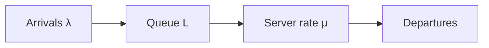
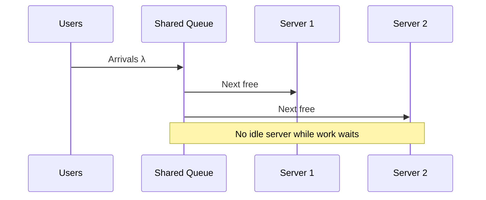
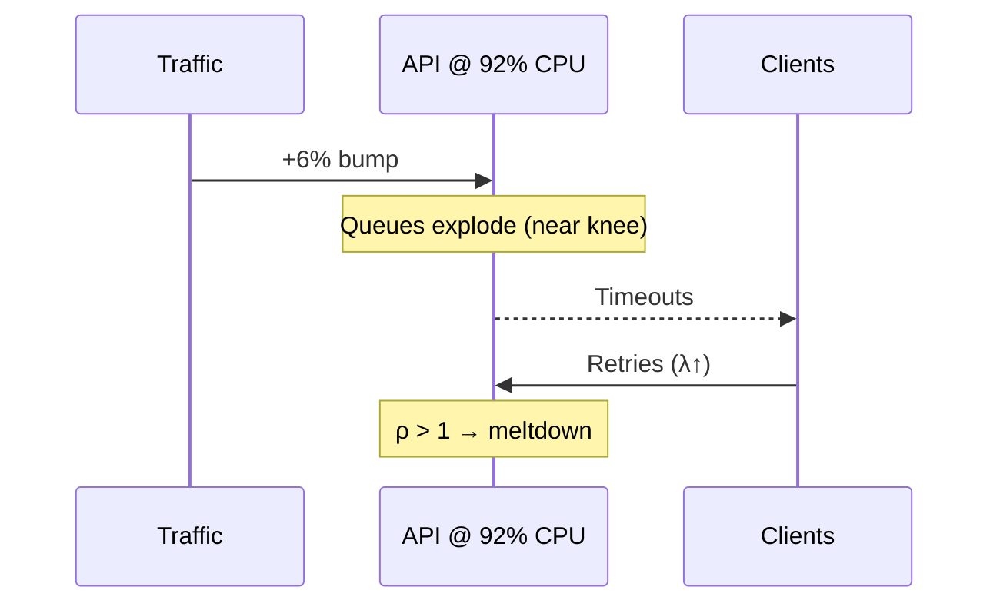

# Lesson 12: Queueing Theory — Little's Law & Why Not to Run at 95% CPU

> **Prerequisites:** [Lesson 09: The USE Method](../09-the-use-method/README.md), [Lesson 11: Load Testing](../11-load-testing-vs-stress-soak-spike-tests/README.md).  
> **Estimated Reading Time:** 32–35 minutes  
> **Target Audience:** Backend engineers sizing pools, setting utilization targets, and explaining why latency triples from 70% → 90% CPU.  
> **Free PDF Notes:** [Download SD-J-012.pdf](https://backendroadmap.com/notes/system-design/SD-J-012.pdf)

> [!NOTE]
> **In one line:** Little's Law ($L = \lambda W$) relates items in the system, arrival rate, and time. In the basic $M/M/1$ model, time in system is $\frac{\text{service time}}{1 - \rho}$, so latency shoots up as utilization nears 100%. Keep headroom: **60–80%** for interactive systems.

> [!TIP]
> **The Golden Rule of Queues:** Headroom is not waste—it stabilizes latency. Autoscale **before** the knee (~60–70%), alert on **queue length / saturation**, prefer **one shared queue** over per-server queues, and remember **retries raise $\lambda$**. Variance in service time lengthens waits (Pollaczek–Khinchine)—isolate slow work.

---

## 1. Core Definition & Taxonomic Comparison

**Queueing theory explains why latency explodes nonlinearly as utilization rises**—nothing needs to be “broken.”

| Term | Precise Meaning | Production Example |
| :--- | :--- | :--- |
| **Little's Law** | $L = \lambda W$ for any stable system | 100 RPS × 0.2 s = 20 in flight |
| **Utilization $\rho$** | Arrival rate / service rate | 80 RPS into 100 RPS capacity → $\rho=0.8$ |
| **$M/M/1$** | Random arrivals, random service, one server | $W = \frac{S}{1-\rho}$ |
| **Knee** | Region where latency rises sharply | 70% fine → 90% 3× latency |
| **Headroom** | Spare capacity for bursts | Target 60–80% interactive |

**Business impact.** Running a fleet at 92% “to save money” turns a 6% traffic bump into timeouts, retries, and collapse.

---

## 2. Component Anatomy & The Observability Gap

### Anatomy of Time in System

```text
 request arrives
   |-- queue wait  (grows as ρ → 1)
   +-- service time S
 total W ≈ S / (1-ρ)   for M/M/1
```



### Shared vs Separate Queues

| Design | Behavior | p99 |
| :--- | :--- | :--- |
| **Separate queue per server** | One line long while another idle | Worse |
| **One shared queue** | Next free server takes next work | Much better |

### The Observability Gap

| Vantage Point | Captures | Hides |
| :--- | :--- | :--- |
| **CPU %** | Busy look | Queue length driving latency |
| **Average latency** | Mild rise | Tail explosion near knee |
| **Per-instance queues** | Local view | Imbalance across separate queues |
| **Metrics to add** | Queue depth, wait time, $\rho$, in-flight $L$ | “CPU 90% is efficient” without latency |

---

## 3. Mathematical Model & Exponential Saturation

### Little's Law

$$
L = \lambda W \quad\Rightarrow\quad W = \frac{L}{\lambda}
$$

```python
def inflight(rate_per_s: float, latency_s: float) -> float:
    return rate_per_s * latency_s  # Little's Law

# 400 req/s, 50 ms each → 20 concurrent; target 70% util → ~29 workers
workers = inflight(400, 0.050) / 0.7
```

### Utilization

$$
\rho = \frac{\lambda}{\mu} \quad (0 \le \rho < 1 \text{ for stability})
$$

### $M/M/1$ Time in System

$$
W = \frac{S}{1 - \rho} \quad\text{where } S = \frac{1}{\mu}
$$

| Utilization $\rho$ | Multiplier $1/(1-\rho)$ | With $S=10$ ms |
| :--- | :--- | :--- |
| 50% | 2× | 20 ms |
| 70% | ~3.3× | 33 ms |
| 80% | 5× | 50 ms |
| 90% | 10× | 100 ms |
| 95% | 20× | 200 ms |
| 99% | 100× | 1,000 ms |

```python
def mm1_time(service_ms: float, util: float) -> float:
    return service_ms / (1 - util)

for u in (0.5, 0.7, 0.9, 0.95):
    print(f"{u:.0%}", round(mm1_time(10, u)), "ms")  # 20, 33, 100, 200
```

---

## 4. Metrics, Percentiles & Distributions

| Signal | Role |
| :--- | :--- |
| **Queue length $L$** | Saturation (USE) |
| **Wait time** | Direct latency pain |
| **$\rho$** | Distance to the cliff |
| **Service-time variance** | Longer waits (PK formula) |
| **p99** | Feels the knee first |

**Worked:** $S=10$ ms at 70% → 33 ms; at 90% → 100 ms. Same code, **3× latency**, pure queueing.

---

## 5. Compounding Effects at Scale

1. Near the knee, a small $\Delta\lambda$ → large $\Delta W$.
2. Timeouts → **retries** → higher effective $\lambda$ → $\rho$ exceeds 1 → unbounded growth.
3. High variance (mixed huge/small requests) lengthens waits further.
4. Separate queues amplify p99 imbalance.

| N servers, separate queues | Effect |
| :--- | :--- |
| One hot, one idle | Wasted capacity at same average $\rho$ |
| Shared queue / good LB | Lower wait at same $\rho$ |

---

## 6. Numbers Every Backend Engineer Must Know

| Rule of Thumb | Value |
| :--- | :--- |
| Interactive utilization target | **60–80%** |
| Autoscale trigger | ~**60–70%** or queue length |
| 95% utilization ($M/M/1$) | ~**20×** service time |
| Batch jobs | Can run hotter (nobody waits interactively) |
| Worker sizing | $L=\lambda W$, then ÷ target $\rho$ |

---

## 7. Deep Dive: Variance & Pollaczek–Khinchine

$M/M/1$ assumes exponential service. With general service ($M/G/1$), waiting grows with **variance** of service time (Pollaczek–Khinchine). Mixing a 2 ms ping with a 2 s export on one pool hurts everyone.



**Mitigation:** split slow endpoints to their own pool; cap concurrency; shed load ([Lesson 15](../15-backpressure/README.md)).

---

## 8. Hierarchical Budgets & Capacity Sizing

| Step | Action |
| :--- | :--- |
| 1 | Measure $S$ and $\lambda$ |
| 2 | $\rho = \lambda S / N$ for $N$ servers |
| 3 | Target $\rho \in [0.6, 0.8]$ |
| 4 | Sanity-check $L = \lambda W$ |
| 5 | Autoscale before the knee |

**Pool example:** 400 RPS × 50 ms = 20 concurrent → at 70% → ~29 workers.

---

## 9. Top Engineering Mitigation Techniques

1. **Utilization targets 60–80%** for interactive paths.
2. **Alert on queue length**, not only CPU %.
3. **Autoscale before the knee**.
4. **Shared queues / good load balancing**.
5. **Isolate high-variance work**.
6. **Cap retries** so $\lambda$ does not self-amplify.
7. **Size pools with Little's Law**.

---

## 10. Production War Story (SEV-1 Post-Mortem)

**Severity & Impact:** API fleet run at **92% CPU** to save money. Normal p99 ~400 ms (5× design). A **6%** traffic bump sent queue times 0.4 s → 4 s; retries pushed $\rho>1$; collapse.



**The Fix:** Target **65%** util, autoscale at **60%**, queue-length alerts, retry budget.

**Lesson:** running hot saves money until the first burst costs more.

---

## 11. Multi-Language Production Code — Little's Law Sizing

````carousel
```go
package capacity

// InFlight applies Little's Law: L = λW.
func InFlight(rps float64, latencySeconds float64) float64 {
	return rps * latencySeconds
}

// WorkersForTarget returns pool size for target utilization (e.g. 0.7).
func WorkersForTarget(rps, latencySeconds, targetUtil float64) int {
	need := InFlight(rps, latencySeconds) / targetUtil
	return int(need + 0.999) // ceil
}

// MM1TimeMs is W = S / (1-ρ) in milliseconds.
func MM1TimeMs(serviceMs, util float64) float64 {
	return serviceMs / (1 - util)
}
```
<!-- slide -->
```typescript
/** Little's Law + M/M/1 helpers for pool sizing dashboards. */
export function inFlight(rps: number, latencySeconds: number): number {
  return rps * latencySeconds;
}

export function workersForTarget(rps: number, latencySeconds: number, targetUtil = 0.7): number {
  return Math.ceil(inFlight(rps, latencySeconds) / targetUtil);
}

export function mm1TimeMs(serviceMs: number, util: number): number {
  return serviceMs / (1 - util);
}
```
<!-- slide -->
```python
"""Size workers and predict M/M/1 latency from utilization."""

def inflight(rate_per_s: float, latency_s: float) -> float:
    return rate_per_s * latency_s


def workers_for_target(rate_per_s: float, latency_s: float, target_util: float = 0.7) -> int:
    return int(-(-inflight(rate_per_s, latency_s) // target_util))  # ceil


def mm1_time_ms(service_ms: float, util: float) -> float:
    if not 0 <= util < 1:
        raise ValueError("util must be in [0, 1)")
    return service_ms / (1 - util)


# 400 rps * 50 ms → 20 in flight; / 0.7 → ~29 workers
assert workers_for_target(400, 0.050, 0.7) == 29
assert round(mm1_time_ms(10, 0.9)) == 100
```
<!-- slide -->
```csharp
using System;

public static class QueueingMath
{
    public static double InFlight(double rps, double latencySeconds) => rps * latencySeconds;

    public static int WorkersForTarget(double rps, double latencySeconds, double targetUtil = 0.7)
        => (int)Math.Ceiling(InFlight(rps, latencySeconds) / targetUtil);

    public static double Mm1TimeMs(double serviceMs, double util)
    {
        if (util < 0 || util >= 1) throw new ArgumentOutOfRangeException(nameof(util));
        return serviceMs / (1 - util);
    }
}
```
````

---

## 12. Hands-On CLI Verification Workflows

### 1. Print the $M/M/1$ curve

```bash
python -c "S=10
for u in (0.5,0.7,0.8,0.9,0.95,0.99):
 print(f'{u:.0%}', round(S/(1-u)), 'ms')"
```

### 2. Size a pool

```bash
python -c "print(int(-(-(400*0.05)//0.7)))"  # ~29
```

### 3. Observe saturation under load

```bash
# While load test runs: queue depth / run queue, not only CPU %
vmstat 1 10
```

---

## 13. Common Mistakes to Avoid

- Targeting **95%** utilization to save cost.
- Watching CPU average and not **queue length**.
- Separate queues per server.
- Ignoring **variance** of service time.
- Forgetting **retries** increase arrival rate.
- Applying $M/M/1$ blindly to highly deterministic or multi-server setups without care.
- Autoscaling **after** the cliff.

---

## 14. Key Terms Glossary

| Term | Interview-Ready Definition |
| :--- | :--- |
| **Little's Law** | $L = \lambda W$ — items = rate × time in system. |
| **Arrival rate $\lambda$** | Requests per second entering. |
| **Service rate $\mu$** | Completions per second one server can do. |
| **Utilization $\rho$** | $\lambda/\mu$ (or $\lambda S/N$). |
| **$M/M/1$** | Random arrivals, random service, one server. |
| **Knee** | Region where latency rises sharply. |
| **Headroom** | Spare capacity that stabilizes latency. |
| **Saturation** | Work waiting in queues. |
| **Service time $S$** | Time to process one request (no queue). |
| **Variance** | Spread of service times—raises waiting. |

---

## 15. Complete 12 System Design Interview Q&As

### Basic Conceptual Questions (Q1–Q4)

<details>
<summary><strong>Q1: What does Little's Law say? [BASIC]</strong></summary>

<strong>What a strong answer covers:</strong>
Items in the system equal arrival rate times time in the system: $L = \lambda W$. It holds for any stable system, independent of distributions.

</details>

<details>
<summary><strong>Q2: Why not run servers at 95% utilization? [BASIC]</strong></summary>

<strong>What a strong answer covers:</strong>
Waiting grows like $1/(1-\rho)$. Near full load latency is ~20× service time, and any burst causes huge queues and timeouts.

</details>

<details>
<summary><strong>Q3: What utilization should you target? [BASIC]</strong></summary>

<strong>What a strong answer covers:</strong>
Around **60–80%** for interactive services; batch can run hotter.

</details>

<details>
<summary><strong>Q4: What is utilization? [BASIC]</strong></summary>

<strong>What a strong answer covers:</strong>
Arrival rate divided by service rate ($\rho = \lambda/\mu$).

</details>

### Scenario-Based Architecture Questions (Q5–Q8)

<details>
<summary><strong>Q5: Latency tripled when CPU went from 70% to 90%. Explain. [SCENARIO]</strong></summary>

<strong>What a strong answer covers:</strong>
$M/M/1$: 10 ms service → 33 ms at 70% and 100 ms at 90%. Queueing, not slower code.

</details>

<details>
<summary><strong>Q6: Size a worker pool for 400 RPS at 50 ms. [SCENARIO]</strong></summary>

<strong>What a strong answer covers:</strong>
Little's Law gives 20 concurrent; divide by target utilization (~0.7) → about 28–29 workers.

</details>

<details>
<summary><strong>Q7: Choose when to autoscale. [SCENARIO]</strong></summary>

<strong>What a strong answer covers:</strong>
Before the knee—around 60–70% utilization or on queue length—not after p99 has already exploded.

</details>

<details>
<summary><strong>Q8: One server is busy while another idles. [SCENARIO]</strong></summary>

<strong>What a strong answer covers:</strong>
Separate queues. Use one shared queue or better load balancing so idle capacity serves waiting work.

</details>

### Advanced & Tricky Interview Questions (Q9–Q12)

<details>
<summary><strong>Q9: Does Little's Law need exponential arrivals? [TRICKY]</strong></summary>

<strong>What a strong answer covers:</strong>
No. It holds for any stable system, independent of distributions.

</details>

<details>
<summary><strong>Q10: Why does variance in service time matter? [TRICKY]</strong></summary>

<strong>What a strong answer covers:</strong>
Queues grow with variance (PK). Mixing big and small requests increases waiting—isolate slow work.

</details>

<details>
<summary><strong>Q11: What happens above 100% utilization? [TRICKY]</strong></summary>

<strong>What a strong answer covers:</strong>
The queue grows without bound; latency rises until requests are shed or time out.

</details>

<details>
<summary><strong>Q12: Do retries affect utilization? [TRICKY]</strong></summary>

<strong>What a strong answer covers:</strong>
Yes—they increase arrival rate and can push the system over the knee into collapse.

</details>

---

## 16. One-Page Master Cheat Sheet

```text
====================================================================================================
                         QUEUEING THEORY  —  CHEAT SHEET
====================================================================================================
IN ONE LINE   L=λW; W≈S/(1-ρ); keep 60–80%; headroom stabilizes latency; shared queues win.

LITTLE'S LAW  L = λ W | W = L/λ | size pools: inflight=λS then ÷ target ρ
UTILIZATION   ρ = λ/μ | stable only if ρ < 1 | interactive target 60–80%
M/M/1         W = S/(1-ρ) | 50%→2× 70%→3.3× 90%→10× 95%→20× 99%→100×

KNEE          small Δλ near 90%+ → huge ΔW | autoscale at 60–70% | alert on queue length
VARIANCE      PK: more variance → longer waits | isolate slow endpoints
RETRIES       raise λ → can push ρ>1 → meltdown | retry budgets
QUEUES        one shared queue ≫ per-server queues at same average ρ

ANTI-PATTERNS X target 95%  X CPU without queues  X separate queues  X ignore variance/retries
NEXT          Tail latency + hedging → [SD-J-013] Lesson 13
====================================================================================================
```

---

## Free PDF notes

Download these notes as a printable PDF with the utilization curve, shared-queue diagram, and interview answers: [SD-J-012.pdf](https://backendroadmap.com/notes/system-design/SD-J-012.pdf).

---

## Sources

- Kleinrock, *Queueing Systems*
- Little, *A Proof for the Queuing Formula $L = \lambda W$*
- [Google SRE Book — Addressing Cascading Failures](https://sre.google/sre-book/addressing-cascading-failures/)
- [Lesson 13: Tail Latency at Scale](../13-tail-latency-at-scale/README.md)

---

## Next

Next → [Lesson 13: Tail Latency at Scale — Fan-Out, p99 & Hedged Requests](../13-tail-latency-at-scale/README.md)

Track overview: [Performance and Traffic](../README.md)
