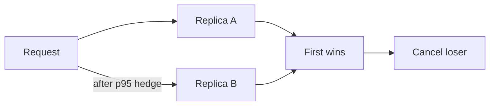
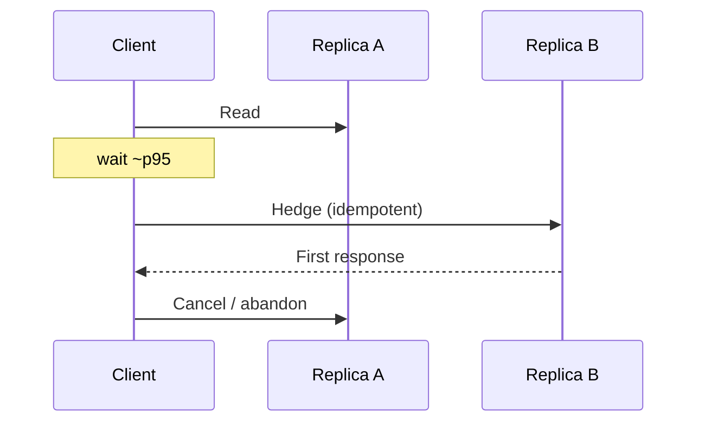
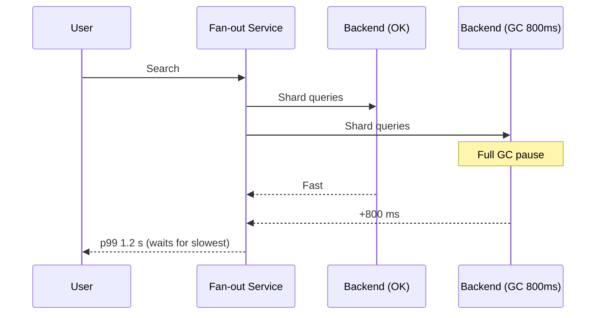

# Lesson 13: Tail Latency at Scale — Fan-Out, p99 & Hedged Requests

> **Prerequisites:** [Lesson 12: Queueing Theory](../12-queueing-theory/README.md).  
> **Estimated Reading Time:** 32–35 minutes  
> **Target Audience:** Backend engineers designing fan-out search/aggregation paths, hedging idempotent reads, and measuring user-facing p99 correctly.  
> **Free PDF Notes:** [Download SD-J-013.pdf](https://backendroadmap.com/notes/system-design/SD-J-013.pdf)

> [!NOTE]
> **In one line:** a request that fans out to many calls waits for the slowest one, so a 1% tail becomes the norm. Fight it with **hedged** and **tied** requests, deadlines with **partial results**, and less variability at the source; measure **p99 / p99.9** at the user-facing level, and **merge histograms**—never average percentiles.

> [!TIP]
> **The Golden Rule of Tail Latency:** $P(\text{at least one slow}) = 1 - 0.99^{N}$. Hedge only **idempotent reads**, after ~p95, with a **hedge budget** so outages do not double load. Cancel losers. Reduce GC pauses, noisy neighbors, and high-$\rho$ queueing at the source.

---

## 1. Core Definition & Taxonomic Comparison

**Tail latency** is the slowest few percent of requests. At scale with fan-out, rare slow calls become the common user experience.

| Term | Precise Meaning | Production Example |
| :--- | :--- | :--- |
| **Fan-out** | One request spawns many parallel calls | Search → 100 shards |
| **Hedged request** | Duplicate after delay (~p95); first wins | ~5% extra load, much smaller tail |
| **Tied request** | Two replicas aware; starter cancels the other | Less wasted work than naive dual-send |
| **Partial results** | Return what finished by the deadline | 98/100 shards OK |
| **p99 / p99.9** | 99th / 99.9th percentile latency | User-facing, not per-pod average |

**Business impact.** Per-service dashboards stay green while users see 1.2 s searches because every request touches a backend mid-GC.

---

## 2. Component Anatomy & The Observability Gap

### Anatomy of Fan-Out Amplification

```text
 user request
   |-- call shard 1 .. N in parallel
   +-- waits for SLOWEST (or deadline)
 P(all fast) = 0.99^N
```



*Figure 1. Hedged request timeline (~5% extra load).*

### The Observability Gap

| Vantage Point | Captures | Hides |
| :--- | :--- | :--- |
| **Per-service p99** | Each backend looks fine | User-facing fan-out p99 |
| **Average of server p99s** | 180 ms “fleet p99” | True merged p99 420 ms |
| **On-CPU only** | — | GC pauses / waits |
| **Metrics to add** | User-facing HDR/t-digest histograms, hedge rate, cancel rate | Averaged percentiles across pods |

---

## 3. Mathematical Model: Tail Compounding

$$
P(\text{at least one slow}) = 1 - (1 - p)^{N}
$$

For $p = 0.01$ (each call slow 1% of the time):

| $N$ calls | $P(\text{hit ≥1 slow})$ |
| :--- | :--- |
| 1 | 1% |
| 10 | ~10% |
| 100 | ~63% |
| 300 | ~95% |

```python
def p_slow(p: float, n: int) -> float:
    return 1 - (1 - p) ** n

for n in (1, 10, 100, 300):
    print(n, f"{p_slow(0.01, n):.0%}")  # 1%, 10%, 63%, 95%
```

**Hedge cost after p95:** roughly **5%** duplicate requests for a large tail reduction (Dean & Barroso).

---

## 4. Metrics, Percentiles & Distributions

| Percentile | Who It Describes |
| :--- | :--- |
| **p50** | Typical OK path |
| **p95** | Hedge delay trigger |
| **p99** | SLO / user pain at moderate scale |
| **p99.9** | Matters when fan-out or high QPS makes “rare” frequent |

**Never average percentiles.** Merge histograms (HDR, t-digest) to compute a true fleet percentile.

| Method | Result (illustrative) |
| :--- | :--- |
| Average of per-server p99s | 180 ms (lie) |
| Merged histogram p99 | 420 ms (truth) |

---

## 5. Compounding Effects at Scale

| Cause of slow call | At fan-out $N$ |
| :--- | :--- |
| GC pause on 1 of 60 | Many user requests catch it |
| Noisy neighbor | Same |
| Queueing at high $\rho$ | Same ([Lesson 12](../12-queueing-theory/README.md)) |
| Background compaction | Same |
| Cache miss / cold start | Same |
| Retransmits | Same |

Something somewhere is always having a bad moment—fan-out makes it everyone's problem.

---

## 6. Numbers Every Backend Engineer Must Know

| Fact | Number |
| :--- | :--- |
| $0.99^{100}$ all fast | ~37% ⇒ **63%** hit a slow call |
| Hedge after p95 | ~**5%** extra requests |
| GC pause example | 800 ms on one of 60 → user p99 1.2 s |
| Averaged vs merged p99 | 180 vs 420 ms (illustrative) |

---

## 7. Protocol Deep Dive: Hedge, Tie, Cancel



| Technique | How it helps |
| :--- | :--- |
| **Hedged requests** | Duplicate after delay; first wins |
| **Tied requests** | Dual-send with cross-cancel when one starts |
| **Tight timeouts + retries** | Cut slow calls (idempotent only) |
| **Partial results** | Answer with fast shards |
| **Reduce variability** | GC, isolation, avoid noisy neighbors |
| **Outlier ejection** | Remove consistently slow nodes |

---

## 8. Hierarchical Budgets & Deadlines

| Layer | Budget Idea |
| :--- | :--- |
| User SLO | e.g. p99 ≤ 300 ms |
| Fan-out deadline | Return partial at budget |
| Hedge delay | ~ dependency p95 |
| Per-shard timeout | &lt; parent remaining |
| Hedge budget | Cap % duplicated under load |

Propagate remaining deadline so late work stops ([timeouts lesson patterns](../../02-networking-from-zero/30-timeouts-and-502s/README.md)).

---

## 9. Top Engineering Mitigation Techniques

1. Measure **user-facing** p99/p99.9; merge histograms.
2. Cut variability (GC, background jobs, high $\rho$).
3. **Hedge** idempotent reads after p95; cancel losers.
4. **Tied** requests where supported.
5. Deadlines + **partial results**.
6. Limit fan-out; eject outliers.
7. Cap hedges during incidents.

---

## 10. Production War Story (SEV-1 Post-Mortem)

**Severity & Impact:** Fine average and per-service p99; users complained. End-user p99 **1.2 s**.

**What Happened:** Every few minutes one of **60** backends paused **800 ms** in full GC. Each user request touched all backends.



**The Fix:** Tune GC / spread restarts; hedged reads after p95; user-facing percentile dashboards.

**Lesson:** fan-out makes every backend's worst moment everyone's problem.

---

## 11. Multi-Language Production Code — Hedged Reads

````carousel
```go
package hedge

import (
	"context"
	"time"
)

// Hedged calls primary, then replica after delay; first result wins; cancel the rest.
func Hedged[T any](ctx context.Context, delay time.Duration, primary, secondary func(context.Context) (T, error)) (T, error) {
	ctx, cancel := context.WithCancel(ctx)
	defer cancel()
	type res struct {
		v   T
		err error
	}
	ch := make(chan res, 2)
	go func() { v, err := primary(ctx); ch <- res{v, err} }()
	select {
	case r := <-ch:
		return r.v, r.err
	case <-time.After(delay):
		go func() { v, err := secondary(ctx); ch <- res{v, err} }()
	case <-ctx.Done():
		var zero T
		return zero, ctx.Err()
	}
	r := <-ch
	cancel()
	return r.v, r.err
}
```
<!-- slide -->
```typescript
/** Hedge after ~p95; cancel the loser. Idempotent reads only. */
export async function hedged<T>(
  call: (replica: string) => Promise<T>,
  replicas: [string, string],
  delayMs: number
): Promise<T> {
  const ac = new AbortController();
  const first = call(replicas[0]);
  const raced = await Promise.race([
    first.then((v) => ({ v, done: true as const })),
    new Promise<{ done: false }>((r) => setTimeout(() => r({ done: false }), delayMs)),
  ]);
  if (raced.done) return raced.v;
  const second = call(replicas[1]);
  try {
    return await Promise.any([first, second]);
  } finally {
    ac.abort();
  }
}
```
<!-- slide -->
```python
"""Hedged request: wait ~p95, then duplicate; first wins; cancel pending."""
import asyncio
from collections.abc import Awaitable, Callable
from typing import TypeVar

T = TypeVar("T")


async def hedged(
    call: Callable[[str], Awaitable[T]],
    replicas: tuple[str, str],
    delay: float = 0.05,  # ~p95 seconds
) -> T:
    first = asyncio.create_task(call(replicas[0]))
    done, _ = await asyncio.wait({first}, timeout=delay)
    if done:
        return first.result()
    second = asyncio.create_task(call(replicas[1]))
    done, pending = await asyncio.wait({first, second}, return_when=asyncio.FIRST_COMPLETED)
    for t in pending:
        t.cancel()
    return done.pop().result()
```
<!-- slide -->
```csharp
using System;
using System.Threading;
using System.Threading.Tasks;

public static class HedgedCall
{
    /// <summary>After delay (~p95), fan a second idempotent read; first wins.</summary>
    public static async Task<T> RunAsync<T>(
        Func<CancellationToken, Task<T>> primary,
        Func<CancellationToken, Task<T>> secondary,
        TimeSpan delay,
        CancellationToken ct = default)
    {
        using var linked = CancellationTokenSource.CreateLinkedTokenSource(ct);
        var first = primary(linked.Token);
        var completed = await Task.WhenAny(first, Task.Delay(delay, ct));
        if (completed == first) return await first;

        var second = secondary(linked.Token);
        var winner = await Task.WhenAny(first, second);
        linked.Cancel(); // cancel loser
        return await winner;
    }
}
```
````

---

## 12. Hands-On CLI Verification Workflows

### 1. Fan-out probability table

```bash
python -c "p=0.01
for n in (1,10,100,300):
 print(n, f'{1-(1-p)**n:.0%}')"
```

### 2. Why averaging percentiles fails (toy)

```bash
python -c "print('avg of p99s', (100+100+500)/3, '!= true tail')"
```

### 3. Enforce hedge budget in metrics

```text
hedge_requests / total_requests  ≤ 0.05  (steady)
disable or tighten under overload
```

---

## 13. Common Mistakes to Avoid

- Judging by averages or per-service p99 only.
- Averaging percentiles across servers.
- Hedging **non-idempotent writes**.
- Hedging with no limit (doubling load in outages).
- Ignoring GC and background jobs.
- Huge fan-out without deadlines or partial results.
- Skipping cancellation of loser requests.

---

## 14. Key Terms Glossary

| Term | Interview-Ready Definition |
| :--- | :--- |
| **Tail latency** | Slowest few percent of requests. |
| **p99 / p99.9** | 99th / 99.9th percentile latency. |
| **Fan-out** | One request spawning many calls. |
| **Hedged request** | Duplicate after a delay; first wins. |
| **Tied request** | Two replicas aware of each other; cancel loser. |
| **Deadline propagation** | Passing remaining time downstream. |
| **Partial results** | Answering with some shards missing. |
| **HDR histogram** | Mergeable latency histogram. |
| **Noisy neighbor** | Co-tenant stealing resources. |
| **Outlier ejection** | Removing consistently slow nodes. |

---

## 15. Complete 12 System Design Interview Q&As

### Basic Conceptual Questions (Q1–Q4)

<details>
<summary><strong>Q1: Why does fan-out amplify tail latency? [BASIC]</strong></summary>

<strong>What a strong answer covers:</strong>
A request waits for its slowest call. With 100 calls each slow 1% of the time, about 63% of requests hit at least one slow call ($1 - 0.99^{100}$).

</details>

<details>
<summary><strong>Q2: What are hedged requests? [BASIC]</strong></summary>

<strong>What a strong answer covers:</strong>
After a short delay (~p95), send a duplicate to another replica and use the first response—cutting the tail for a small extra load (~5%). Idempotent reads only; cancel the loser.

</details>

<details>
<summary><strong>Q3: Where do slow calls come from? [BASIC]</strong></summary>

<strong>What a strong answer covers:</strong>
GC pauses, noisy neighbors, queueing, background work, cache misses, cold starts, and network retransmits—mostly random and short.

</details>

<details>
<summary><strong>Q4: Which percentiles do you track? [BASIC]</strong></summary>

<strong>What a strong answer covers:</strong>
p95, p99, and p99.9—measured at the **user-facing** level, from merged histograms.

</details>

### Scenario-Based Architecture Questions (Q5–Q8)

<details>
<summary><strong>Q5: Per-service p99 is fine but users see slowness. [SCENARIO]</strong></summary>

<strong>What a strong answer covers:</strong>
Fan-out. Measure end-to-end, then hedge, add deadlines and partial results, and reduce variability (GC, $\rho$).

</details>

<details>
<summary><strong>Q6: Reduce tail for a 100-shard search. [SCENARIO]</strong></summary>

<strong>What a strong answer covers:</strong>
Hedge after p95, set a deadline and return partial results, eject slow nodes, tune GC / isolate background work.

</details>

<details>
<summary><strong>Q7: Can you hedge writes? [SCENARIO]</strong></summary>

<strong>What a strong answer covers:</strong>
Only if idempotent. Otherwise use tied requests with careful cancellation—or avoid hedging writes.

</details>

<details>
<summary><strong>Q8: Hedging increased load during an incident. [SCENARIO]</strong></summary>

<strong>What a strong answer covers:</strong>
Cap hedges with a budget and disable or tighten under overload so hedging does not amplify the outage.

</details>

### Advanced & Tricky Interview Questions (Q9–Q12)

<details>
<summary><strong>Q9: Why not average percentiles? [TRICKY]</strong></summary>

<strong>What a strong answer covers:</strong>
Percentiles are not additive. Merge histograms (HDR/t-digest) to get a correct fleet percentile.

</details>

<details>
<summary><strong>Q10: Hedge after p95 — cost? [TRICKY]</strong></summary>

<strong>What a strong answer covers:</strong>
About 5% extra requests—typically a good trade for a large tail reduction when canceling losers.

</details>

<details>
<summary><strong>Q11: How does deadline propagation help? [TRICKY]</strong></summary>

<strong>What a strong answer covers:</strong>
Downstream calls know the remaining budget and stop working on requests that are already too late—freeing capacity for live work.

</details>

<details>
<summary><strong>Q12: Is p99.9 worth tracking? [TRICKY]</strong></summary>

<strong>What a strong answer covers:</strong>
Yes at scale: with many calls per user request, “one in a thousand” becomes frequent in absolute terms.

</details>

---

## 16. One-Page Master Cheat Sheet

```text
====================================================================================================
                         TAIL LATENCY AT SCALE  —  CHEAT SHEET
====================================================================================================
IN ONE LINE   Fan-out: 0.99^100≈37% all fast → 63% slow. Hedge/tie, deadlines, partials; merge histograms.

MATH          P(≥1 slow)=1-(1-p)^N | N=100,p=1% → ~63% | hedge@p95 ≈ +5% load
CAUSES        GC · noisy neighbor · queues (high ρ) · compaction · cache miss · retransmits
TOOLS         Hedged + tied requests | tight timeouts | partial results | outlier ejection | less variance
MEASURE       User-facing p99/p99.9 | NEVER average percentiles | merge HDR/t-digest
SAFETY        Idempotent reads only | cancel losers | hedge budget | disable under overload

ANTI-PATTERNS X avg latency  X avg of p99s  X hedge writes  X unlimited hedges  X no deadline
NEXT          Make-it-faster strategy → [SD-J-014] Lesson 14
====================================================================================================
```

---

## Free PDF notes

Download these notes as a printable PDF with the fan-out math, hedging timeline, and interview answers: [SD-J-013.pdf](https://backendroadmap.com/notes/system-design/SD-J-013.pdf).

---

## Sources

- [Dean & Barroso — The Tail at Scale](https://research.google/pubs/pub40801/)
- [Gil Tene — How NOT to Measure Latency](https://www.youtube.com/watch?v=lJ8ydIuPFeU)
- [Envoy — Request hedging](https://www.envoyproxy.io/docs/envoy/latest/intro/arch_overview/http/http_routing#arch-overview-http-routing-hedge)
- [Lesson 14: Make It Faster](../14-make-it-faster/README.md)

---

## Next

Next → [Lesson 14: Make It Faster — A Performance Optimization Strategy (2 s → 400 ms)](../14-make-it-faster/README.md)

Track overview: [Performance and Traffic](../README.md)
