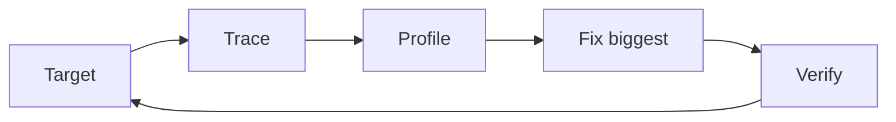
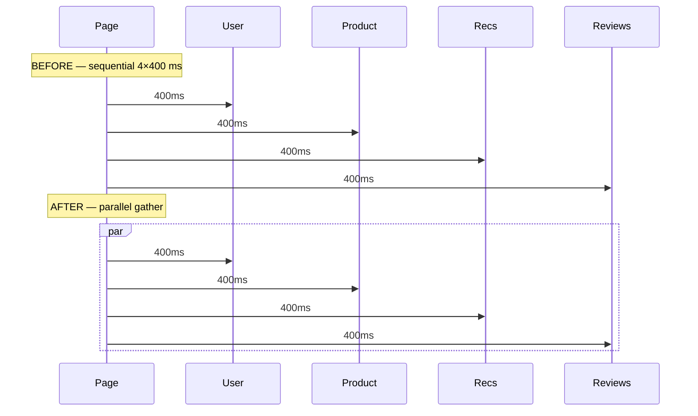
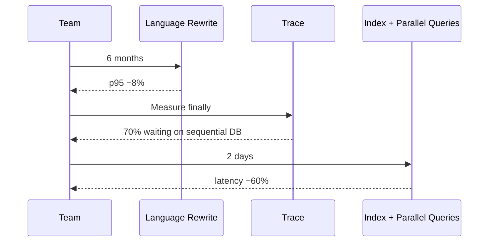

# Lesson 14: Make It Faster — A Performance Optimization Strategy (2 s → 400 ms)

> **Prerequisites:** [Lesson 10: Profiling](../10-profiling-python/README.md), [Lesson 11: Load Testing](../11-load-testing-vs-stress-soak-spike-tests/README.md), [Lesson 13: Tail Latency](../13-tail-latency-at-scale/README.md).  
> **Estimated Reading Time:** 30–35 minutes  
> **Target Audience:** Backend engineers given a vague “make it faster” mandate who need a repeatable measure–fix–verify loop grounded in Amdahl's Law.  
> **Free PDF Notes:** [Download SD-J-014.pdf](https://backendroadmap.com/notes/system-design/SD-J-014.pdf)

> [!NOTE]
> **In one line:** set a measurable target, **trace and profile before touching code**, optimize the biggest part of the **critical path** first (Amdahl's Law), win on round trips, caching, and less data, then verify under realistic load and keep the measurement in place.

> [!TIP]
> **The Golden Rule of Performance Strategy:** Measure → change **one** thing on the critical path → measure again. Most slowness is **waiting and round trips**, not language choice. Prefer parallel independent calls, kill N+1, cache/precompute, index, trim payloads—*before* a rewrite.

---

## 1. Core Definition & Taxonomic Comparison

**A performance optimization strategy is a repeatable loop**, not a rewrite impulse.

| Term | Precise Meaning | Production Example |
| :--- | :--- | :--- |
| **Critical path** | Longest chain of dependent work | Four sequential 400 ms calls → 1.6 s |
| **Amdahl's Law** | Speedup limited by the unimproved fraction | 5% step even ∞-fast → ~5% overall |
| **Span** | One timed operation in a trace | `db.query`, `get_recs` |
| **Target** | Measurable goal | p95 ≤ 500 ms under stated load |
| **Regression** | Performance getting worse over time | CI threshold + dashboard alerts |

**Business impact.** Six-month language rewrites that gain 8% while a two-day index + parallelization cut 60% are expensive strategy failures.

---

## 2. Component Anatomy & The Observability Gap

### Anatomy of the Loop

```text
 target (p95 ≤ 500 ms)
   → trace (where is the time?)
   → profile (what is hot inside spans?)
   → fix biggest critical-path span
   → verify under realistic load
   → keep monitoring
```



*Figure 1. Measure, change one thing, measure again.*

### Example Trace: 2,000 ms Page

| Span | Time | Dependent? |
| :--- | :--- | :--- |
| recommendations | 400 ms | Independent |
| reviews | 400 ms | Independent |
| product | 400 ms | Independent |
| user | 400 ms | Independent |
| rendering | 400 ms | After data |

Sequential → ~1,600 ms + render. Parallel → wait for max(400) + render.

### The Observability Gap

| Vantage Point | Captures | Hides |
| :--- | :--- | :--- |
| **Guess / rewrite itch** | Activity | Real waiting spans |
| **Single local curl** | One sample | p95/p99 under load |
| **Off-critical-path micro-opt** | Local win | Zero end-to-end change |
| **Metrics to add** | Trace coverage, p50/p95/p99, error rate, cost | “Feels faster” anecdotes |

---

## 3. Mathematical Model: Amdahl's Law

$$
\text{Speedup} = \frac{1}{(1-p) + \frac{p}{s}}
$$

where $p$ = fraction improved, $s$ = local speedup.

| $p$ | $s$ | Overall speedup | Overall time saved |
| :--- | :--- | :--- | :--- |
| 0.20 | ∞ | 1.25× | 20% |
| 0.05 | 10× | ~1.047× | ~4.5% |
| 0.70 (waiting on DB) | 4× | ~2.1× | Big win |

**Worked Q9:** Speeding a 5% step by 10× → $1 / (0.95 + 0.05/10) = 1.047$ (~4.5% overall).

---

## 4. Metrics, Percentiles & Verification

| Metric | Role |
| :--- | :--- |
| **p50 / p95 / p99** | Compare before/after under load |
| **Error rate** | Faster but broken is a fail |
| **Cost / CPU** | Efficiency, not only latency |
| **Trace span %** | Where to apply Amdahl |

Never declare victory from a single local run—use [load tests](../11-load-testing-vs-stress-soak-spike-tests/README.md).

---

## 5. Compounding Effects of Bad Strategy

| Anti-pattern | Compounded waste |
| :--- | :--- |
| Optimize off critical path | Zero user-visible gain |
| Cache before measuring | Wrong layer cached; stampede risk |
| Sequential “independent” calls | Linear sum of latencies |
| N+1 queries | Latency × N rows |
| Rewrite first | Months for single-digit % |

---

## 6. Numbers Every Backend Engineer Must Know

| Scenario | Before → After |
| :--- | :--- |
| 4×400 ms sequential | 1,600 ms → **400 ms** parallel |
| + cache recommendations | → **~400 ms** page |
| N+1 join fix (example) | 1.2 s → 0.15 s |
| JSON trim + gzip | 0.2 s → 0.05 s |
| Total path | **2.0 s → ~0.4 s** |

---

## 7. Deep Dive: Round Trips Are Usually the Win



**Toolbox (cheaper than a rewrite):**

| Tool | Example |
| :--- | :--- |
| Cache | Recommendations for 5 minutes |
| Precompute | Aggregates ahead of time |
| Paginate / trim | Needed fields and rows only |
| Index | Hot query index |
| Better structures | Set vs list for membership |
| Background jobs | Non-urgent work off request path |
| Batch / join | Kill N+1 ([Lesson 06](../06-batching/README.md)) |

---

## 8. Hierarchical Budgets on a Request

| Slice of 2.0 s | Action |
| :--- | :--- |
| 1.2 s DB / N+1 | One query / join / index |
| 0.4 s two sequential HTTP | `gather` / parallel |
| 0.2 s serialization | Trim + compress / faster codec |
| 0.2 s other | Only if still over target |

Stop when the **target** is met—further gains cost more.

---

## 9. Top Engineering Mitigation Techniques

1. **Target first** (percentile + load).
2. **Trace end-to-end**, then profile hot spans.
3. **Critical path only** (Amdahl).
4. **Round trips:** parallel, batch, N+1 kill.
5. **Cache / precompute / index / trim**.
6. **Verify** under realistic load; keep dashboards/alerts.
7. **Rewrite last**, when measurement proves runtime is the bottleneck.

---

## 10. Production War Story (SEV-1 Post-Mortem)

**Severity & Impact:** Team rewrote Python → Go for slowness. Six months later p95 improved only **8%**. Later trace: **70%** of time waiting on three sequential DB calls + missing index. Two-day fix cut latency **60%**.



**The Fix:** Require trace + profile before optimization projects; prefer cheap wins; track targets.

**Lesson:** most slowness is waiting and round trips, not language speed.

---

## 11. Multi-Language Production Code — Parallelize the Critical Path

````carousel
```go
package page

import (
	"context"
	"golang.org/x/sync/errgroup"
)

func LoadProductPage(ctx context.Context) (Page, error) {
	var user User
	var product Product
	var recs Recs
	var reviews Reviews
	g, ctx := errgroup.WithContext(ctx)
	g.Go(func() error { var err error; user, err = getUser(ctx); return err })
	g.Go(func() error { var err error; product, err = getProduct(ctx); return err })
	g.Go(func() error { var err error; recs, err = getRecs(ctx); return err })
	g.Go(func() error { var err error; reviews, err = getReviews(ctx); return err })
	if err := g.Wait(); err != nil {
		return Page{}, err
	}
	return Page{User: user, Product: product, Recs: recs, Reviews: reviews}, nil
}

// N+1 fix: one query with ANY/IN, not per-id get_order in a loop.
```
<!-- slide -->
```typescript
/** Independent calls in parallel — wait only for the slowest (~400ms, not 1600ms). */
export async function loadProductPage(): Promise<Page> {
  const [user, product, recs, reviews] = await Promise.all([
    getUser(),
    getProduct(),
    getRecs(), // then cache
    getReviews(),
  ]);
  return { user, product, recs, reviews };
}

// N+1: await db.query("select * from orders where id = any($1)", [ids])
```
<!-- slide -->
```python
"""From 2s → ~400ms: parallelize independent I/O; then cache the slow span."""
import asyncio
from typing import Any


async def slow() -> list[Any]:
    # 4 × 400 ms = 1,600 ms
    return [await get_user(), await get_product(), await get_recs(), await get_reviews()]


async def fast() -> list[Any]:
    # waits only for the slowest ≈ 400 ms
    return await asyncio.gather(get_user(), get_product(), get_recs(), get_reviews())


# N+1 fix:
# bad:  for oid in ids: db.get_order(oid)
# good: db.execute("select * from orders where id = any(%s)", (ids,))
```
<!-- slide -->
```csharp
using System.Threading.Tasks;

public static class ProductPageLoader
{
    public static async Task<Page> LoadAsync()
    {
        // Independent I/O — parallel, not sequential awaits
        var userTask = GetUserAsync();
        var productTask = GetProductAsync();
        var recsTask = GetRecsAsync();
        var reviewsTask = GetReviewsAsync();
        await Task.WhenAll(userTask, productTask, recsTask, reviewsTask);
        return new Page(
            await userTask, await productTask, await recsTask, await reviewsTask);
    }
}
```
````

---

## 12. Hands-On CLI Verification Workflows

### 1. Amdahl toy calculation

```bash
python -c "p,s=0.05,10; print(1/((1-p)+p/s))"  # ~1.047
```

### 2. Compare sequential vs parallel timings locally

```bash
python -c "import asyncio,time
async def s(d): await asyncio.sleep(d)
async def seq():
 t=time.perf_counter();
 for _ in range(4): await s(0.05);
 print('seq',time.perf_counter()-t)
async def par():
 t=time.perf_counter();
 await asyncio.gather(*[s(0.05) for _ in range(4)]);
 print('par',time.perf_counter()-t)
asyncio.run(seq()); asyncio.run(par())"
```

### 3. Re-run load test after each change

```bash
k6 run load.js  # compare p95/p99 + errors to baseline
```

---

## 13. Common Mistakes to Avoid

- Optimizing without a target or measurement.
- Optimizing something off the critical path.
- Sequential calls that could be parallel.
- N+1 queries.
- Caching before understanding the bottleneck.
- No regression monitoring after the fix.
- Rewrite-first culture.
- Declaring win from one local request.

---

## 14. Key Terms Glossary

| Term | Interview-Ready Definition |
| :--- | :--- |
| **Critical path** | Longest chain of dependent work. |
| **Amdahl's Law** | Overall speedup limited by the unimproved part. |
| **Span** | One timed operation in a trace. |
| **Distributed tracing** | Follow a request across services. |
| **N+1 query** | One query per item instead of a set query. |
| **asyncio.gather / Task.WhenAll** | Run independent async work concurrently. |
| **Precompute** | Calculate ahead of the request. |
| **Pagination** | Return data in pages. |
| **Regression** | Performance worsening over time. |
| **Target** | Measurable goal (e.g. p95 ≤ 500 ms). |

---

## 15. Complete 12 System Design Interview Q&As

### Basic Conceptual Questions (Q1–Q4)

<details>
<summary><strong>Q1: How do you approach a make-it-faster task? [BASIC]</strong></summary>

<strong>What a strong answer covers:</strong>
Set a measurable target, measure with tracing and profiling, optimize the biggest part of the critical path first, then verify under realistic load.

</details>

<details>
<summary><strong>Q2: What are the usual big wins? [BASIC]</strong></summary>

<strong>What a strong answer covers:</strong>
Fewer round trips, parallel independent calls, caching and precomputation, indexes, and returning less data.

</details>

<details>
<summary><strong>Q3: What does Amdahl's Law say? [BASIC]</strong></summary>

<strong>What a strong answer covers:</strong>
Overall speedup is limited by the portion you do not improve—so optimize the biggest share first.

</details>

<details>
<summary><strong>Q4: What is the critical path? [BASIC]</strong></summary>

<strong>What a strong answer covers:</strong>
The longest chain of dependent work; only speeding it up reduces total latency.

</details>

### Scenario-Based Architecture Questions (Q5–Q8)

<details>
<summary><strong>Q5: A page makes four sequential calls of 400 ms. [SCENARIO]</strong></summary>

<strong>What a strong answer covers:</strong>
If independent, run them in parallel (`gather` / `WhenAll`) to wait only for the slowest; then cache the slow ones.

</details>

<details>
<summary><strong>Q6: An endpoint is slow only at p99. [SCENARIO]</strong></summary>

<strong>What a strong answer covers:</strong>
Look at tail causes (GC, queueing, cold caches) and use tracing for slow outliers ([Lesson 13](../13-tail-latency-at-scale/README.md)).

</details>

<details>
<summary><strong>Q7: When is a rewrite justified? [SCENARIO]</strong></summary>

<strong>What a strong answer covers:</strong>
After measurement shows the language/runtime itself is the proven bottleneck and cheaper fixes are exhausted.

</details>

<details>
<summary><strong>Q8: When do you stop optimizing? [SCENARIO]</strong></summary>

<strong>What a strong answer covers:</strong>
When the target is met and remaining gains cost more than they are worth.

</details>

### Advanced & Tricky Interview Questions (Q9–Q12)

<details>
<summary><strong>Q9: Speeding up a 5% step by 10× yields what? [TRICKY]</strong></summary>

<strong>What a strong answer covers:</strong>
About 4.5% overall: $1 / (0.95 + 0.05/10) \approx 1.047$.

</details>

<details>
<summary><strong>Q10: Why trace instead of guess? [TRICKY]</strong></summary>

<strong>What a strong answer covers:</strong>
Tracing shows real waiting—often in places teams do not expect (sequential deps, missing indexes).

</details>

<details>
<summary><strong>Q11: Can parallel calls hurt? [TRICKY]</strong></summary>

<strong>What a strong answer covers:</strong>
They add load and can exceed pool limits—cap concurrency and size pools with Little's Law.

</details>

<details>
<summary><strong>Q12: How do you prevent regressions? [TRICKY]</strong></summary>

<strong>What a strong answer covers:</strong>
Performance tests in CI, dashboards, and alerts on the target metrics.

</details>

---

## 16. One-Page Master Cheat Sheet

```text
====================================================================================================
                    PERFORMANCE OPTIMIZATION STRATEGY  —  CHEAT SHEET
====================================================================================================
IN ONE LINE   Target → trace → profile → fix biggest critical-path win → verify → keep monitoring.

LOOP          measure · change ONE thing · measure again | stop at target
AMDAHL        speedup=1/((1-p)+p/s) | tiny p ⇒ tiny overall gain | attack largest span first
CRITICAL PATH longest dependent chain | parallelize independent spans (gather/WhenAll)
USUAL WINS    kill N+1 · batch · parallel · cache/precompute · index · trim/paginate · compress
VERIFY        realistic load · p50/p95/p99 · errors · cost | CI + dashboards against regressions

WORKED        4×400ms seq=1600 → parallel≈400 → +cache recs ≈400ms page (2s→0.4s class)
REWRITE LAST  after proof runtime is the bottleneck; waiting/round-trips usually dominate

ANTI-PATTERNS X no target  X off critical path  X sequential independents  X N+1
              X cache-first guess  X no regression watch  X rewrite-first
NEXT          Backpressure → [SD-J-015] Lesson 15
====================================================================================================
```

---

## Free PDF notes

Download these notes as a printable PDF with the optimization loop, Amdahl examples, and interview answers: [SD-J-014.pdf](https://backendroadmap.com/notes/system-design/SD-J-014.pdf).

---

## Sources

- Amdahl, *Validity of the single processor approach*
- [OpenTelemetry — Traces](https://opentelemetry.io/docs/concepts/signals/traces/)
- [Google Web Vitals](https://web.dev/articles/vitals)
- [Lesson 15: Backpressure](../15-backpressure/README.md)

---

## Next

Next → [Lesson 15: Backpressure — Bounded Queues, 429/503 & Retry-After Explained](../15-backpressure/README.md)

Track overview: [Performance and Traffic](../README.md)
