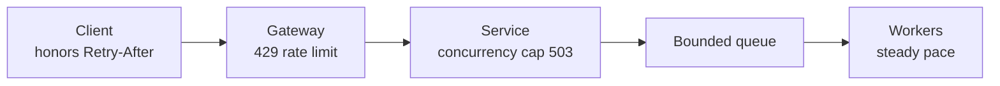
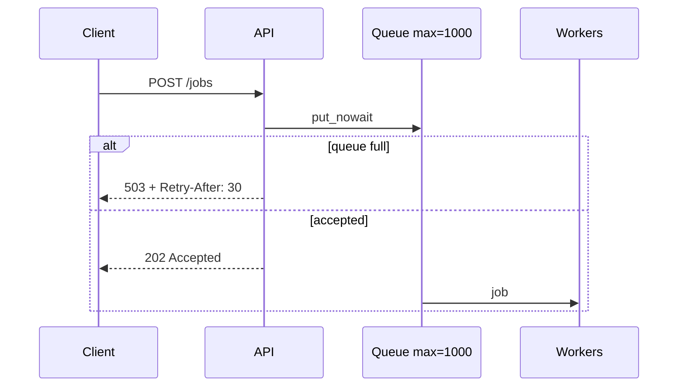
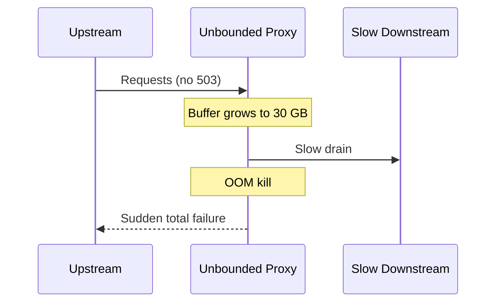

# Lesson 15: Backpressure — Bounded Queues, 429/503 & Retry-After Explained

> **Prerequisites:** [Lesson 12: Queueing Theory](../12-queueing-theory/README.md), [Lesson 14: Make It Faster](../14-make-it-faster/README.md).  
> **Estimated Reading Time:** 30–35 minutes  
> **Target Audience:** Backend engineers designing overload behavior—bounded queues, HTTP 429/503 + Retry-After, and end-to-end pushback to the source.  
> **Free PDF Notes:** [Download SD-J-015.pdf](https://backendroadmap.com/notes/system-design/SD-J-015.pdf)

> [!NOTE]
> **In one line:** backpressure lets a slow consumer signal producers to slow down, so the system stays within capacity. **Bound every queue** and choose to **block, reject, or drop** when full; over HTTP use **429** or **503** with **Retry-After**, and propagate the signal to the source.

> [!TIP]
> **The Golden Rule of Backpressure:** An unbounded queue turns overload into an OOM time bomb. Size bounds with Little's Law (acceptable wait × service rate). At the edge prefer **reject with Retry-After**; clients must use **backoff + jitter + retry budgets**. Limits at **every hop**—a “helpful” middle buffer with no limit is a SEV-1 waiting to happen.

---

## 1. Core Definition & Taxonomic Comparison

**Backpressure is how a system says “slow down”** before memory and latency explode.

| Term | Precise Meaning | Production Example |
| :--- | :--- | :--- |
| **Backpressure** | Consumer signals producers to slow | Full queue → block or 503 |
| **Bounded queue** | Queue with a hard max size | `asyncio.Queue(maxsize=1000)` |
| **Block / reject / drop** | Choices when full | In-process block; HTTP reject; metrics drop |
| **429** | Client exceeded *its* limit | Per-API-key rate limit |
| **503 + Retry-After** | Server overloaded | Queue full; try in 30 s |
| **Rate limit vs backpressure** | Cap per client vs reflect live capacity | Both needed |

**Business impact.** Without pushback, producers fill an unbounded queue to millions of jobs—memory dies, accepted work waits hours, then everything crashes.

---

## 2. Component Anatomy & The Observability Gap

### Anatomy: Without vs With Backpressure

```text
 WITHOUT: producers → unbounded queue → workers → OOM / hour-long latency
 WITH:    producers ← signal ← bounded queue ← workers (steady)
          edge returns 429/503 + Retry-After when full
```



*Figure 1. Limits at every hop push back toward the source.*

### When Full: Three Choices

| Choice | When it fits |
| :--- | :--- |
| **Block** producer | Natural inside one process |
| **Reject** with error | Natural across a network (HTTP) |
| **Drop** items | Metrics/telemetry where newest matters |

### The Observability Gap

| Vantage Point | Captures | Hides |
| :--- | :--- | :--- |
| **Unbounded queue depth** | Looks “absorbing spikes” | Pending OOM; hour latency |
| **Only CPU green** | Workers busy | Reject rate / wait of accepted work |
| **Silent drops** | Pipeline “stable” | Missing metrics / lost jobs |
| **Metrics to add** | Queue depth, reject rate, Retry-After counts, lag | “We buffer everything” vanity |

---

## 3. Mathematical Model: Sizing the Bound

Use Little's Law for an acceptable wait $W_{\max}$ and service rate $\mu$:

$$
L_{\max} \approx \mu \times W_{\max}
$$

| $\mu$ (jobs/s) | $W_{\max}$ | Bound $L_{\max}$ |
| :--- | :--- | :--- |
| 10 | 120 s (2 min) | ~1,200 |
| 50 | 60 s | ~3,000 |
| 5 | 30 s | ~150 |

Accepted work stays within a latency budget; excess is rejected early instead of queued forever.

When $\rho \ge 1$ without shedding, queue growth is unbounded ([Lesson 12](../12-queueing-theory/README.md)).

---

## 4. Metrics, Percentiles & Overload Signals

| Metric | Why |
| :--- | :--- |
| **Queue depth** | Approaching bound |
| **Rejection rate** | Active backpressure |
| **Wait time of accepted jobs** | Bound is sized correctly? |
| **429 vs 503 counts** | Client limit vs server overload |
| **Consumer lag** (Kafka) | Pull-based buffering still needs watching |

---

## 5. Compounding Effects Without Pushback

| Failure | Cascade |
| :--- | :--- |
| Unbounded buffer | 30 GB proxy buffer → OOM kill → total drop |
| Immediate client retries | Rejected load returns as a retry storm |
| One-layer-only limits | Next hop buffers forever |
| Silent drops | Undetected data loss |

---

## 6. Numbers Every Backend Engineer Must Know

| Item | Guidance |
| :--- | :--- |
| Example job queue | `maxsize=1000` |
| Retry-After | Seconds (e.g. 5–30) + client jitter |
| HTTP codes | **429** client limit; **503** server overload |
| TCP window | Receiver shrinks window → sender stops |
| Kafka | Consumers pull—but **monitor lag** |

---

## 7. Protocol Deep Dive: Built-in Backpressure

| Mechanism | How it works |
| :--- | :--- |
| **TCP flow control** | Receive window shrinks when receiver is slow |
| **HTTP/2 & gRPC** | Per-stream flow-control windows |
| **Reactive Streams** | Consumer requests exactly N items |
| **Kafka consumers** | Pull at their own pace (log still buffers) |
| **asyncio.Queue(maxsize)** | Producers wait when full |



---

## 8. Hierarchical Budgets: Limits at Every Hop

| Hop | Limit |
| :--- | :--- |
| Client | Honor Retry-After; backoff + jitter; retry budget |
| Gateway | Rate limits → **429** |
| Service | Concurrency cap → **503** |
| Queue | Hard `maxsize` |
| Workers | Steady concurrency ≤ downstream capacity |
| Downstream pools | Sized & timed out |

Combine with autoscaling so capacity grows **while** excess load is shed.

---

## 9. Top Engineering Mitigation Techniques

1. **Bound every queue and buffer.**
2. **Reject early** with 429/503 + Retry-After.
3. **Propagate** pushback to the source—no infinite middle buffers.
4. **Cap concurrency** to downstream capacity.
5. **Client discipline:** exponential backoff, jitter, budgets.
6. **Monitor** depth + rejection rate; alert before OOM.
7. **Drop/sample** telemetry rather than fail the pipeline.

---

## 10. Production War Story (SEV-1 Post-Mortem)

**Severity & Impact:** A “helpful” proxy buffered requests with **no limit**. Downstream slowdown → proxy held **30 GB** → OOM killer → everything dropped. Upstream saw no pushback until the crash.

```python
# Flaw: unbounded middle buffer absorbs until death
buffer: list[Request] = []  # no maxsize

def on_request(req: Request) -> None:
    buffer.append(req)  # hides overload from clients
```



**The Fix:** Bound buffers; return **503 + Retry-After** when full; alert on depth and rejection rate.

**Lesson:** a system that says no early stays healthy under any load.

---

## 11. Multi-Language Production Code — Bounded Queue + 503

````carousel
```go
package backpressure

import (
	"net/http"
	"time"
)

// BoundedGateway rejects when the job queue is full.
type BoundedGateway struct {
	jobs chan Job
}

func NewBoundedGateway(n int) *BoundedGateway {
	return &BoundedGateway{jobs: make(chan Job, n)}
}

func (g *BoundedGateway) Submit(w http.ResponseWriter, r *http.Request) {
	select {
	case g.jobs <- Job{}:
		w.WriteHeader(http.StatusAccepted)
	default:
		w.Header().Set("Retry-After", "30")
		http.Error(w, "busy", http.StatusServiceUnavailable)
	}
}

// Block with timeout instead of forever:
func (g *BoundedGateway) SubmitWait(j Job, d time.Duration) bool {
	select {
	case g.jobs <- j:
		return true
	case <-time.After(d):
		return false
	}
}

type Job struct{}
```
<!-- slide -->
```typescript
/** Bounded in-memory queue: reject with 503 + Retry-After when full. */
export class BoundedJobQueue {
  private q: Job[] = [];
  constructor(private readonly max = 1000) {}

  tryEnqueue(job: Job): boolean {
    if (this.q.length >= this.max) return false;
    this.q.push(job);
    return true;
  }
}

export function submitHandler(queue: BoundedJobQueue, job: Job): Response {
  if (!queue.tryEnqueue(job)) {
    return new Response("busy", {
      status: 503,
      headers: { "Retry-After": "30" },
    });
  }
  return Response.json({ queued: true }, { status: 202 });
}

type Job = { id: string };
```
<!-- slide -->
```python
"""Bounded asyncio queue: block in-process or reject over HTTP."""
import asyncio
from fastapi import FastAPI, HTTPException

app = FastAPI()
queue: asyncio.Queue = asyncio.Queue(maxsize=1000)


async def try_enqueue(item: object) -> bool:
    try:
        queue.put_nowait(item)
        return True
    except asyncio.QueueFull:
        return False


@app.post("/jobs", status_code=202)
async def submit(job: dict) -> dict:
    if not await try_enqueue(job):
        raise HTTPException(
            status_code=503,
            detail="busy",
            headers={"Retry-After": "30"},
        )
    return {"queued": True}


# In-process backpressure: await queue.put(item) blocks when full.
```
<!-- slide -->
```csharp
using System.Threading.Channels;
using Microsoft.AspNetCore.Mvc;

[ApiController]
[Route("jobs")]
public sealed class JobsController : ControllerBase
{
    private readonly Channel<Job> _jobs;

    public JobsController(Channel<Job> jobs) => _jobs = jobs;

    [HttpPost]
    public IActionResult Submit([FromBody] Job job)
    {
        if (!_jobs.Writer.TryWrite(job))
        {
            Response.Headers["Retry-After"] = "30";
            return StatusCode(StatusCodes.Status503ServiceUnavailable, "busy");
        }
        return Accepted(new { queued = true });
    }
}

// Registration: Channel.CreateBounded<Job>(new BoundedChannelOptions(1000)
// { FullMode = BoundedChannelFullMode.Wait }); // or DropWrite / drop oldest for telemetry
public record Job(string Id);
```
````

---

## 12. Hands-On CLI Verification Workflows

### 1. Size a bound from Little's Law

```bash
python -c "mu,W=10,120; print('L_max', int(mu*W))"  # 1200
```

### 2. Prove put_nowait raises when full

```bash
python -c "import asyncio
async def main():
 q=asyncio.Queue(maxsize=1); await q.put(1)
 try: q.put_nowait(2); print('unexpected')
 except asyncio.QueueFull: print('QueueFull OK')
asyncio.run(main())"
```

### 3. Inspect Retry-After on a 503

```bash
curl -i -X POST https://httpbin.org/status/503
# In your API: expect Retry-After header when shedding
```

---

## 13. Common Mistakes to Avoid

- Unbounded queues or buffers.
- A middle layer that buffers forever.
- Clients retrying immediately without backoff.
- Dropping data silently with no metric.
- Applying backpressure at one layer but not the next.
- Forgetting to size the bound from capacity and latency targets.
- Blocking forever while holding locks (deadlock risk)—use timeouts.
- Treating Kafka pull as “no lag monitoring needed.”

---

## 14. Key Terms Glossary

| Term | Interview-Ready Definition |
| :--- | :--- |
| **Backpressure** | Consumer signals producers to slow down. |
| **Bounded queue** | Queue with a maximum size. |
| **Block / reject / drop** | Choices when the bound is hit. |
| **429** | Client exceeded its limit. |
| **503** | Server overloaded / unavailable. |
| **Retry-After** | Header telling clients when to retry. |
| **Flow control** | Protocol-level pacing (TCP, HTTP/2, gRPC). |
| **Reactive Streams** | Demand-driven streaming API. |
| **Load shedding** | Reject excess load on purpose. |
| **Rejection rate** | Share of requests refused. |

---

## 15. Complete 12 System Design Interview Q&As

### Basic Conceptual Questions (Q1–Q4)

<details>
<summary><strong>Q1: What is backpressure and how do you implement it? [BASIC]</strong></summary>

<strong>What a strong answer covers:</strong>
A consumer signaling producers to slow down—bounded queues that block or reject when full, HTTP 429/503 with Retry-After, and protocol flow control—propagated toward the source.

</details>

<details>
<summary><strong>Q2: Why not just use an unbounded queue? [BASIC]</strong></summary>

<strong>What a strong answer covers:</strong>
It hides overload until memory runs out and latency grows to hours—then crashes, dropping everything at once.

</details>

<details>
<summary><strong>Q3: What do you do when a queue is full? [BASIC]</strong></summary>

<strong>What a strong answer covers:</strong>
Block the producer, reject the item, or drop items—depending on in-process vs network vs telemetry context.

</details>

<details>
<summary><strong>Q4: Which status codes and headers? [BASIC]</strong></summary>

<strong>What a strong answer covers:</strong>
**429** for client limits, **503** for server overload, with **Retry-After** so well-behaved clients wait (plus backoff/jitter).

</details>

### Scenario-Based Architecture Questions (Q5–Q8)

<details>
<summary><strong>Q5: Workers cannot keep up with a producer. [SCENARIO]</strong></summary>

<strong>What a strong answer covers:</strong>
Bound the queue, reject when full with 503 + Retry-After, scale workers, and shed low-priority work.

</details>

<details>
<summary><strong>Q6: Choose a queue bound. [SCENARIO]</strong></summary>

<strong>What a strong answer covers:</strong>
Little's Law: acceptable wait time × service rate so accepted work still meets its deadline; reject the rest.

</details>

<details>
<summary><strong>Q7: Telemetry floods the pipeline. [SCENARIO]</strong></summary>

<strong>What a strong answer covers:</strong>
Drop oldest or sample—losing some metrics is better than failing the pipeline. Emit a drop counter.

</details>

<details>
<summary><strong>Q8: A gateway buffers unbounded requests. [SCENARIO]</strong></summary>

<strong>What a strong answer covers:</strong>
Bound its buffers and propagate rejection to clients instead of absorbing until OOM.

</details>

### Advanced & Tricky Interview Questions (Q9–Q12)

<details>
<summary><strong>Q9: Backpressure versus rate limiting? [TRICKY]</strong></summary>

<strong>What a strong answer covers:</strong>
Rate limits cap each client; backpressure reflects the system's actual capacity and consumer speed. You usually want both.

</details>

<details>
<summary><strong>Q10: How does TCP implement backpressure? [TRICKY]</strong></summary>

<strong>What a strong answer covers:</strong>
The receiver advertises a window; when it fills, the sender must stop—flow control end to end on the connection.

</details>

<details>
<summary><strong>Q11: Can blocking cause deadlock? [TRICKY]</strong></summary>

<strong>What a strong answer covers:</strong>
Yes—with circular waits or blocked threads holding resources. Use timeouts and bounded waits.

</details>

<details>
<summary><strong>Q12: Do Kafka consumers need backpressure? [TRICKY]</strong></summary>

<strong>What a strong answer covers:</strong>
They pull at their own pace so the log buffers, but **lag must be monitored**—and producers/apps still need bounds elsewhere.

</details>

---

## 16. One-Page Master Cheat Sheet

```text
====================================================================================================
                            BACKPRESSURE  —  CHEAT SHEET
====================================================================================================
IN ONE LINE   Slow consumers signal producers. Bound every queue; block/reject/drop; 429/503+Retry-After.

FOUNDATION    maxsize everywhere | L_max ≈ μ × W_max (Little's Law) | ρ≥1 without shed → unbounded growth
HTTP          429 = client limit | 503 = server overload | Retry-After + client backoff/jitter/budget
PROTOCOLS     TCP window | HTTP/2 & gRPC stream windows | Reactive Streams demand | Kafka pull (+lag)
END-TO-END    client → gateway → service → queue → workers → downstream pools | push back to SOURCE

CHOICES       Block (in-process) | Reject (network) | Drop (telemetry, emit metric)
OBSERVE       queue depth · rejection rate · accepted wait · 429/503 counts · consumer lag

ANTI-PATTERNS X unbounded queues  X helpful infinite buffers  X retry-immediately
              X silent drops  X one-layer-only  X block forever holding locks
====================================================================================================
```

---

## Free PDF notes

Download these notes as a printable PDF with the bounded-queue patterns, hop diagram, and interview answers: [SD-J-015.pdf](https://backendroadmap.com/notes/system-design/SD-J-015.pdf).

---

## Sources

- [Reactive Streams specification](https://www.reactive-streams.org/)
- [Google SRE Book — Handling Overload](https://sre.google/sre-book/handling-overload/)
- Little, *A Proof for $L = \lambda W$*
- [Track: Performance and Traffic](../README.md) · Phase 4 distributed systems next on the playlist

---

## Next — Track Lessons 09–15 Complete

You now have the performance-and-traffic **measurement and control** arc: USE → profile → load tests → queues → tails → optimize → backpressure.

- Revisit the [track overview](../README.md) for lessons 01–08 (stateless design through serialization) as those land.
- Continue into Phase 4 distributed-systems fundamentals when ready.

Track overview: [Performance and Traffic](../README.md)
