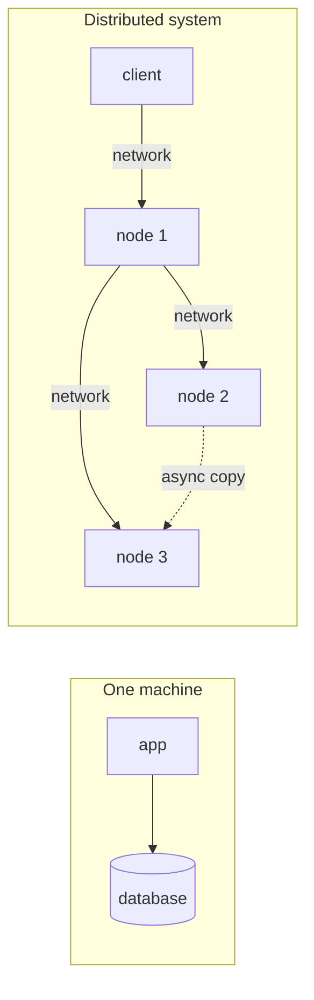
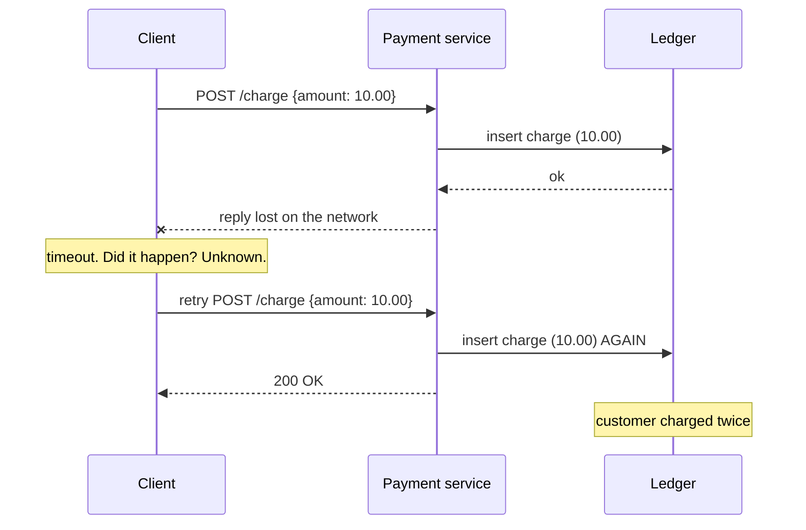
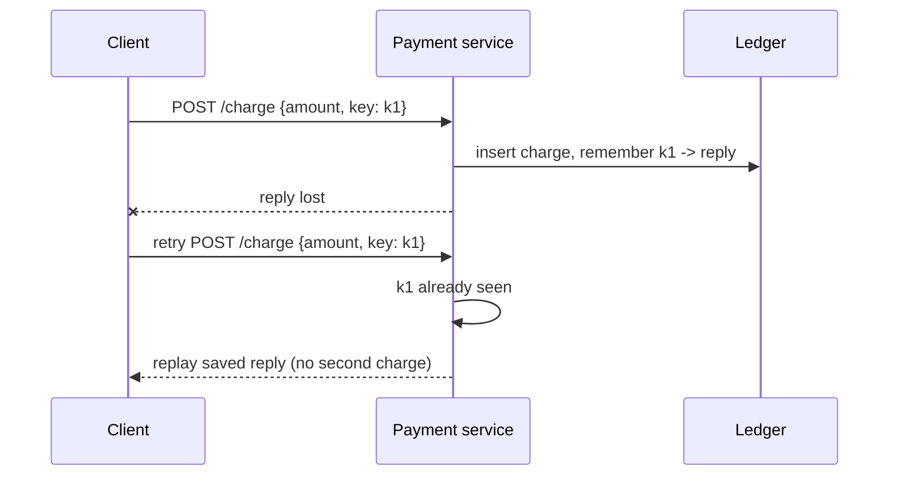
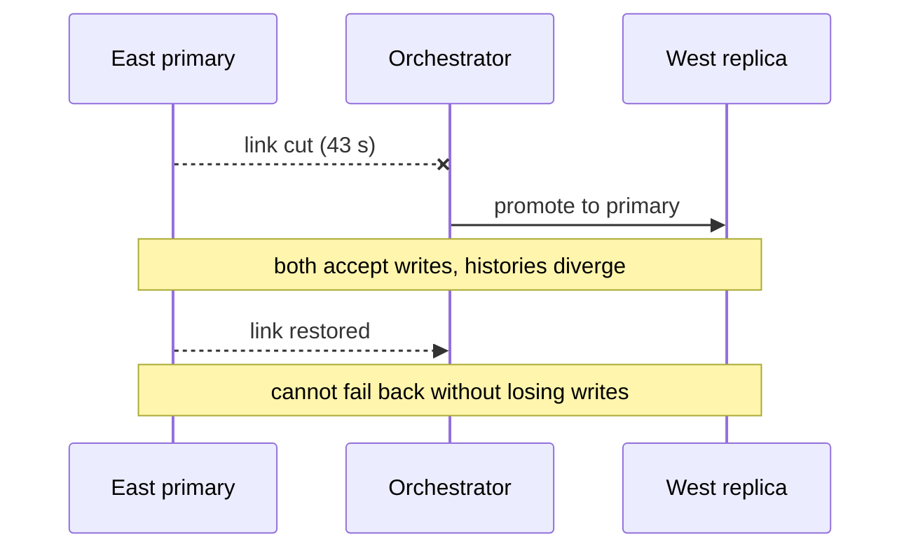

# Distributed Systems 101: Why Distribute & the 8 Fallacies

> **Prerequisites:** [Lesson 12: Scalability](../../01-core-fundamentals/12-scalability/README.md) · [Stateless Service Design (Performance and Traffic)](../../08-performance-and-traffic/01-stateless-service-design/README.md).  
> **Estimated Reading Time:** 20–25 minutes  
> **Target Audience:** Backend engineers moving from "one app, one database" to several services, replicas and regions, and candidates preparing for the distributed-systems round.  
> **Free PDF Notes:** [Download SD-H-001.pdf](https://backendroadmap.com/notes/system-design/SD-H-001.pdf)

> [!NOTE]
> **In one line:** A distributed system is several computers that cooperate over a network to look like one. You build one to scale, to survive failures and to be close to users, and you pay with partial failures, an unreliable network, clocks that disagree and a harder consistency story.

> [!TIP]
> **The Golden Rule:** For every arrow in your diagram ask three questions: *what if this call is slow, what if it fails, and what if it succeeds twice?* Timeouts, retries with backoff, idempotency and replication are the everyday answers. And distribute only when one machine genuinely cannot do the job.

---

## 1. What a Distributed System Is, and What It Isn't

Your app runs on one server with one database. It is simple: one copy of the data, one clock, and a function call either returns or the whole process crashes. Then the database fills up, a single crash takes everything down, and users on another continent wait a second for every page. You add machines. The moment two of them must cooperate over a network, you own a distributed system.

| Term | Precise Meaning | Example |
| :--- | :--- | :--- |
| **Node** | One machine or process that runs part of the system | An API server, a database replica |
| **Message** | The only way nodes interact: bytes sent over the network | An HTTP request, a Kafka record |
| **Distributed system** | Nodes connected only by a network that must behave like one system for the user | A replicated Postgres cluster behind an API |
| **Shared-nothing** | Each node owns its CPU, memory and disk; nothing is shared except messages | Most web-scale architectures |
| **Partial failure** | Some parts fail while the rest keeps running | One replica is down, the others serve |
| **Not distributed** | Several threads or processes on one machine sharing memory | A multi-threaded server on one box |

### Why It Matters
1. Every large system you will be asked to design (feed, chat, payments, search) is distributed, so every interview answer sits on these ideas.
2. The failure modes are **new**, not bigger versions of single-machine bugs: a call can succeed *and* look like it failed.
3. Most outages in later lessons (split brain, duplicate charges, lost updates) trace back to one of the eight assumptions below.

---

## 2. Anatomy: From One Box to Many



On one machine, failure is all or nothing and there is one clock. Across machines the network sits between every pair of parts.

| Reason to distribute | What you gain | What it costs you |
| :--- | :--- | :--- |
| **Scale** | More CPU, memory, disk and connections than one box | Coordination and network hops |
| **Availability** | Survive a machine or zone failure | Failure detection, failover, split brain |
| **Latency** | Serve users from nearby regions | Replication lag and conflicts |
| **Isolation** | One team or tenant cannot crash another | Operational complexity |

> [!WARNING]
> **A well-tuned single database goes a long way.** Every node you add is a new thing that can fail. If one machine meets your scale, availability and latency needs, stay on one machine and say so in the interview.

---

## 3. Mathematical Model: Why Many Nodes Fail More Often

If a single node is up with probability $a$, a request that needs **all** $n$ nodes in a chain is up with probability $a^n$.

$$A_{\text{chain}} = a^{n}$$

| Per-node availability | 1 node | 5 in a chain | 20 in a chain |
| :---: | :---: | :---: | :---: |
| $99.9\%$ | $99.9\%$ | $99.5\%$ | $98.0\%$ |
| $99.99\%$ | $99.99\%$ | $99.95\%$ | $99.8\%$ |

Twenty services each at "three nines" give you roughly $98\%$ end to end, about $7$ days of downtime a year, even though no single service looks bad. Redundancy works the other way: with $k$ independent copies where *any one* is enough,

$$A_{\text{parallel}} = 1-(1-a)^{k}$$

Two replicas at $99.9\%$ each give $1-(0.001)^2 = 99.9999\%$, **if** their failures really are independent. Two replicas in the same rack, behind the same switch, are not.

---

## 4. Metrics & Percentiles

| Metric | Meaning | Why it changes when you distribute |
| :--- | :--- | :--- |
| **Latency $p_{50}$ / $p_{99}$** | Typical and tail response time | A request that fans out to $n$ nodes is as slow as the slowest of them |
| **Availability** | Fraction of requests served successfully | Multiplies down a call chain (section 3) |
| **Error rate by cause** | Timeouts vs refusals vs 5xx | A timeout is *ambiguous*: the work may have happened |
| **Replication lag** | Age of the oldest change a replica has not applied | Readers may see stale data |

### Worked Example
A page makes $10$ parallel calls, each with $p_{99} = 100\text{ ms}$. The chance all ten are faster than their own $p_{99}$ is $0.99^{10}\approx 90\%$, so about **one page in ten** is slower than $100\text{ ms}$. Fan-out turns a rare tail into a common one. Averages hide this; always read percentiles.

---

## 5. The Eight Fallacies of Distributed Computing

The list was started at Sun Microsystems: L. Peter Deutsch wrote the first seven in 1994, building on earlier points by Bill Joy and Dave Lyon, and James Gosling added the eighth around 1997. All eight are assumptions that are true on one machine and **false across a network**.

| # | Fallacy | What really happens | Habit it should create |
| :---: | :--- | :--- | :--- |
| 1 | The network is reliable | Packets are lost, delayed, duplicated, reordered | Timeouts, retries with backoff, idempotent operations |
| 2 | Latency is zero | Same-datacenter round trip is about $0.5\text{ ms}$; a transatlantic one is about $150\text{ ms}$ | Avoid chatty calls, batch, cache, parallelise |
| 3 | Bandwidth is infinite | Links saturate; big fan-out hurts | Compress, paginate, send deltas |
| 4 | The network is secure | Traffic can be read or altered | TLS everywhere, authenticate service calls, least privilege |
| 5 | Topology doesn't change | Nodes join, leave, move, autoscale | Service discovery; never hard-code IPs |
| 6 | There is one administrator | Many teams and providers own parts | Version your APIs, expect partial upgrades |
| 7 | Transport cost is zero | Serialisation, egress and cross-zone traffic cost CPU and money | Measure bytes on the wire; keep traffic in-zone |
| 8 | The network is homogeneous | Different hardware, OSes, protocol versions | Use open formats; test across versions |

> [!TIP]
> **Which two cause the most trouble?** The first two. Almost every duplicate charge and every timeout storm comes from code that assumed a call either works or fails, and that it answers quickly.

---

## 6. Numbers Every Engineer Must Know

Rounded figures in the spirit of Jeff Dean's "latency numbers every programmer should know"; hardware changes, but the ratios hold.

| Item | Typical | Implication |
| :--- | :---: | :--- |
| Main-memory reference | $\sim 100\text{ ns}$ | Local state is nearly free |
| Round trip, same datacenter | $\sim 0.5\text{ ms}$ | 5,000x a memory read: every network call is expensive |
| Round trip, same continent | $\sim 30\text{–}70\text{ ms}$ | Cross-region sync calls break a 100 ms budget |
| Round trip, across an ocean | $\sim 150\text{ ms}$ | Replicate data near users instead |
| One slow node in a fan-out | Sets the tail | Use hedged requests and timeouts |
| Nodes in a chain at 99.9% | 20 → $\sim 98\%$ | Shorten chains; add redundancy |

---

## 7. Protocol Deep Dive: A Call That Succeeds and Looks Like It Failed

This is the single most important picture in the module. The client cannot tell *"the server never got it"* from *"the server did it and the reply was lost"*.



The fix is to make the retry **safe**: the client sends a unique **idempotency key** with the first attempt and every retry, and the server stores the answer under that key.



---

## 8. Hierarchical Budgets & Design Rules

| Slice | Rule of thumb | Control |
| :--- | :--- | :--- |
| Call timeout | Longer than $p_{99}$ of the callee, shorter than the caller's own deadline | Set explicit timeouts on every client |
| Retries | $\le 3$ with exponential backoff and jitter | Retry only idempotent operations |
| Chain depth | Keep synchronous call chains short | Cache, queue or merge services |
| Fan-out | Know the slowest dependency | Parallel calls with a deadline; hedge the tail |
| Consistency | Choose per feature, not globally | Strong for money, eventual for counters |

**Consistency in one paragraph.** With several copies of the data a reader may see an old copy. *Strong consistency* means every read sees the latest write, at the cost of coordination and latency. *Eventual consistency* means copies converge if writes stop, and reads may be briefly stale. The CAP theorem says that during a network partition you must choose between consistency and availability; PACELC adds that even without a partition you trade latency against consistency. Lessons 3, 18 and 22 take this apart.

---

## 9. Top Mitigations

1. **Set a timeout on every remote call.** No timeout means a slow dependency hangs your threads.
2. **Retry with exponential backoff and jitter**, and only operations that are safe to repeat.
3. **Make writes idempotent** with an idempotency key, an upsert or a dedup table.
4. **Keep call chains short**; every hop multiplies failure probability.
5. **Replicate for availability** across independent failure domains (zones, racks), not just copies.
6. **Distribute last.** Tune the single node first; add machines when it genuinely cannot cope.

---

## 10. Production Case Study: GitHub, 21–22 October 2018

This one is a published post-incident report, not a made-up scenario: GitHub's engineering blog, *October 21 post-incident analysis*.

- **Trigger:** At 22:52 UTC, maintenance on failing 100G optical equipment cut connectivity between GitHub's US East Coast network hub and its primary US East Coast data center. Connectivity came back in **43 seconds**.
- **What the automation did:** During those 43 seconds the MySQL failover tool, Orchestrator, de-selected the East Coast leaders and promoted West Coast databases as the new primaries for the affected clusters. Both sides now held writes the other did not have.
- **Why it hurt:** The application tier started writing to the West Coast primaries as soon as connectivity returned, and the cross-country latency was more than the application could tolerate. Failing back safely was impossible, because the two sites had diverged.
- **Impact:** Webhook delivery and Pages builds were paused for most of the incident. GitHub reported **24 hours and 11 minutes** of service degradation in total.



**Lesson:** a partition lasting under a minute was enough to trigger an automatic decision that took a day to unwind. A short network blip is not "nothing", and automated failover has to be designed for the case where the "dead" node is only unreachable. Lessons 3, 4 and 12 cover how.

---

## 11. Multi-Language Production Code Tabs

The pattern in all four tabs is the same: send an idempotency key, retry on timeout, and have the server replay the stored answer instead of repeating the side effect.

````carousel
```go
// Go: client retries with the same key; server stores the first reply per key.
package main

import (
	"errors"
	"sync"
)

var ErrTimeout = errors.New("timeout") // the reply was lost: outcome unknown

type Payment struct {
	mu      sync.Mutex
	seen    map[string]int // idempotency key -> cents charged
	Charged int
}

func NewPayment() *Payment { return &Payment{seen: map[string]int{}} }

func (p *Payment) Charge(key string, cents int) (int, error) {
	p.mu.Lock()
	defer p.mu.Unlock()
	if prior, ok := p.seen[key]; ok {
		return prior, nil // replay: no second charge
	}
	p.Charged += cents
	p.seen[key] = cents
	return cents, nil
}

func ChargeWithRetry(call func() (int, error), attempts int) (int, error) {
	for i := 0; i < attempts; i++ {
		if v, err := call(); err == nil {
			return v, nil
		} else if !errors.Is(err, ErrTimeout) {
			return 0, err // a real refusal: do not retry
		}
	}
	return 0, ErrTimeout
}
```
<!-- slide -->
```typescript
// TypeScript: fetch with a timeout, one key reused for every retry.
import { randomUUID } from "node:crypto";

async function charge(cents: number, attempts = 3): Promise<unknown> {
  const key = randomUUID(); // generated ONCE, reused by every retry
  for (let i = 0; i < attempts; i++) {
    try {
      const res = await fetch("https://payments.internal/charge", {
        method: "POST",
        headers: { "Content-Type": "application/json", "Idempotency-Key": key },
        body: JSON.stringify({ cents }),
        signal: AbortSignal.timeout(2000), // never wait forever
      });
      if (res.status < 500) return res.json(); // success or a real refusal
    } catch {
      /* timeout or network error: outcome unknown, so retry */
    }
    await new Promise((r) => setTimeout(r, 100 * 2 ** i + Math.random() * 100)); // backoff + jitter
  }
  throw new Error("payment outcome unknown after retries");
}
```
<!-- slide -->
```python
# Python: the demo used for the numbers in this lesson (stdlib only).
import random
import uuid


class ReplyLost(Exception):
    """Timeout: the caller cannot know whether the work happened."""


class PaymentService:
    def __init__(self, drop_reply_rate, rng):
        self.charged = 0
        self.seen = {}                       # idempotency key -> saved reply
        self.drop_reply_rate, self.rng = drop_reply_rate, rng

    def charge(self, cents, key=None):
        if key is not None and key in self.seen:
            reply = self.seen[key]           # replay, no second charge
        else:
            self.charged += cents            # the side effect
            reply = {"status": "ok", "charged": cents}
            if key is not None:
                self.seen[key] = reply
        if self.rng.random() < self.drop_reply_rate:
            raise ReplyLost()                # work done, answer lost
        return reply


def call_with_retries(service, cents, key, attempts=5):
    for _ in range(attempts):
        try:
            return service.charge(cents, key)
        except ReplyLost:
            continue
    raise RuntimeError("gave up")
```
<!-- slide -->
```csharp
// C#: HttpClient with a timeout, the same Idempotency-Key on every retry.
using System.Net.Http.Json;

static async Task<HttpResponseMessage> ChargeAsync(HttpClient http, int cents, int attempts = 3)
{
    var key = Guid.NewGuid().ToString("n"); // generated ONCE
    for (var i = 0; i < attempts; i++)
    {
        try
        {
            using var cts = new CancellationTokenSource(TimeSpan.FromSeconds(2));
            using var req = new HttpRequestMessage(HttpMethod.Post, "https://payments.internal/charge")
            {
                Content = JsonContent.Create(new { cents }),
            };
            req.Headers.Add("Idempotency-Key", key);
            var res = await http.SendAsync(req, cts.Token);
            if ((int)res.StatusCode < 500) return res;
        }
        catch (Exception e) when (e is OperationCanceledException or HttpRequestException)
        {
            // outcome unknown: retry with the same key
        }
        await Task.Delay(100 * (1 << i) + Random.Shared.Next(100)); // backoff + jitter
    }
    throw new TimeoutException("payment outcome unknown after retries");
}
```
````

---

## 12. Hands-On CLI Verification Workflows

Run the Python tab's logic yourself. With a $30\%$ chance of losing each reply and 1,000 customers charged 1,000 cents each (Python 3.13, seed 7):

```text
retry, no key  : charged 1,489,000 cents, expected 1,000,000, extra  489,000
retry, with key: charged 1,000,000 cents, expected 1,000,000, extra        0
```

Without a key, retries charged customers **48.9% more than they owed**. With a key, the total is exact. The reply-loss rate only changes how bad the first number is; the second stays correct.

```bash
# Round-trip time to a real service (watch the 'time=' values)
ping -c 4 example.com

# Where does the time go on one HTTPS request?
curl -s -o /dev/null -w "dns=%{time_namelookup}s connect=%{time_connect}s tls=%{time_appconnect}s total=%{time_total}s\n" https://example.com
```

---

## 13. Common Mistakes to Avoid

1. **Calling a remote service like a local function**: no timeout, no retry policy, no error path.
2. **Retrying non-idempotent writes** without an idempotency key.
3. **Treating a timeout as a failure.** It means *unknown*, not *did not happen*.
4. **Hard-coding addresses** instead of using service discovery.
5. **Counting replicas as independent** when they share a rack, a switch or a power feed.
6. **Long synchronous chains**: five hops at 99.9% is already 99.5%.
7. **Distributing too early**: a tuned single database often suffices.
8. **Judging latency by the average** when fan-out makes the tail the common case.

---

## 14. Key Terms Glossary

| Key Term | Definition |
| :--- | :--- |
| **Node** | One machine or process in the system. |
| **Shared-nothing** | Nodes share no memory or disk, only messages. |
| **Partial failure** | Some components fail while others keep working. |
| **Fallacies of distributed computing** | Eight false assumptions about networks (Deutsch, Gosling). |
| **Timeout** | A deadline after which a caller stops waiting; the outcome is unknown. |
| **Idempotent operation** | Repeating it has the same effect as doing it once. |
| **Idempotency key** | A unique client-chosen token that lets the server detect a repeat. |
| **Backoff and jitter** | Growing, randomised delays between retries. |
| **Replication lag** | How far a replica trails the primary. |
| **Strong vs eventual consistency** | Reads see the latest write vs copies converge over time. |
| **CAP / PACELC** | Trade-offs: consistency vs availability under partition; latency vs consistency otherwise. |

---

## 15. System Design Interview Questions & Answers

### Basic Conceptual Questions

<details>
<summary><strong>Q1: What is a distributed system? [BASIC]</strong></summary>

**Answer:**
Several computers connected only by a network that cooperate to look like a single system to the user. Nodes share no memory; they interact by sending messages, which can be delayed, lost or duplicated.
</details>

<details>
<summary><strong>Q2: Why would you distribute a system? [BASIC]</strong></summary>

**Answer:**
Four reasons: **scale** (more capacity than one machine), **availability** (survive a machine or zone failure), **latency** (serve from near the user) and **isolation** (teams and tenants do not crash each other). Each one has a price: coordination, failover, replication lag and operational complexity.
</details>

<details>
<summary><strong>Q3: Name the eight fallacies. [BASIC]</strong></summary>

**Answer:**
The network is reliable; latency is zero; bandwidth is infinite; the network is secure; topology does not change; there is one administrator; transport cost is zero; the network is homogeneous. The first two cause most outages.
</details>

<details>
<summary><strong>Q4: What is shared-nothing? [BASIC]</strong></summary>

**Answer:**
Each node owns its CPU, memory and disk. The only thing nodes share is messages over the network. It removes shared bottlenecks and makes scaling by adding nodes possible.
</details>

### Scenario-Based Architecture Questions

<details>
<summary><strong>Q5: A payment call times out. What do you do? [SCENARIO]</strong></summary>

**Answer:**
A timeout means the outcome is unknown. Retry with the **same idempotency key** so the server replays the first result instead of charging again, use exponential backoff with jitter, and cap the attempts. If it still fails, check status by key rather than creating a new charge.
</details>

<details>
<summary><strong>Q6: Your monolith's database is full. What is the first move? [SCENARIO]</strong></summary>

**Answer:**
Do not jump to distribution. Check indexes, queries, archiving and a bigger instance first. If that is not enough, add **read replicas** (read scale, availability), then partition. Mention that replicas bring lag, failover and split-brain questions with them.
</details>

<details>
<summary><strong>Q7: A page calls ten services and is slow one time in ten. Why? [SCENARIO]</strong></summary>

**Answer:**
Fan-out amplifies the tail: if each call is slower than $p_{99}$ one time in a hundred, ten parallel calls make some call slow about $1-0.99^{10}\approx 10\%$ of the time. Fix with a per-call deadline, hedged requests, caching and fewer calls per page.
</details>

<details>
<summary><strong>Q8: Twenty microservices, each 99.9% available. What is the end-to-end availability? [SCENARIO]</strong></summary>

**Answer:**
If all twenty are in the synchronous path, $0.999^{20}\approx 98\%$, about a week of downtime a year. Reduce the chain, make some dependencies optional with fallbacks, and add redundancy where failures are independent.
</details>

### Advanced & Tricky Interview Questions

<details>
<summary><strong>Q9: Why is a timeout different from an error? [TRICKY]</strong></summary>

**Answer:**
An error is a definite answer: it did not happen. A timeout is **no answer**: the request may have been lost, may still be running, or may have completed with the reply lost. That ambiguity is the root of partial failure and the reason for idempotency.
</details>

<details>
<summary><strong>Q10: Can you build exactly-once over an unreliable network? [TRICKY]</strong></summary>

**Answer:**
Not delivery, but you can get an **exactly-once effect**: at-least-once delivery plus idempotent processing. Lesson 21 goes deeper.
</details>

<details>
<summary><strong>Q11: What did the GitHub 2018 incident teach? [TRICKY]</strong></summary>

**Answer:**
A 43-second connectivity loss made an automated failover promote databases in another coast; the two sites then diverged and 24 hours of degradation followed. Automated failover must tolerate an unreachable-but-alive primary, and the application must cope with the new topology's latency.
</details>

<details>
<summary><strong>Q12: Do replicas make a system more available or less? [TRICKY]</strong></summary>

**Answer:**
Both. Independent replicas raise availability ($1-(1-a)^k$), but they add lag, failover logic and split-brain risk, and correlated failures (same rack or bug) erase the benefit. The design must say which failures it survives.
</details>

---

## 16. One-Page Master Cheat Sheet

```
+---------------------------------------------------------------------------------------------------------+
|                       DISTRIBUTED SYSTEMS 101 — MASTER CHEAT SHEET                                      |
+---------------------------------------------------------------------------------------------------------+
| 1. WHAT: many nodes, only a network between them, one system to the user.                               |
+---------------------------------------------------------------------------------------------------------+
| 2. WHY: scale · availability · latency · isolation.  COST: partial failure, lag, clocks, agreement.     |
+---------------------------------------------------------------------------------------------------------+
| 3. FALLACIES: reliable · zero latency · infinite bandwidth · secure · static topology · one admin ·     |
|    free transport · homogeneous.  The first two cause most outages.                                     |
+---------------------------------------------------------------------------------------------------------+
| 4. RULE: timeout = UNKNOWN, not failed. Retry with backoff + jitter AND an idempotency key.             |
+---------------------------------------------------------------------------------------------------------+
| 5. MATH: chain = a^n (20 x 99.9% = 98%) · parallel = 1-(1-a)^k · fan-out of 10 hits p99 one time in 10. |
+---------------------------------------------------------------------------------------------------------+
| 6. DEFAULT: stay on one well-tuned machine until it truly cannot cope.                                  |
+---------------------------------------------------------------------------------------------------------+
```

---

## Further Reading & Sources

- GitHub Engineering, [October 21 post-incident analysis](https://github.blog/news-insights/company-news/oct21-post-incident-analysis/) (the 43-second partition and 24 h 11 min of degradation).
- Wikipedia, [Fallacies of distributed computing](https://en.wikipedia.org/wiki/Fallacies_of_distributed_computing) (origin and the list of eight).
- Martin Kleppmann, *Designing Data-Intensive Applications*, chapter 8, "The Trouble with Distributed Systems".

---

## Free PDF Notes

[SD-H-001.pdf](https://backendroadmap.com/notes/system-design/SD-H-001.pdf)

---

## Next

Continue with [Lesson 02: Partial Failures](../02-partial-failures/README.md): why a slow node is worse than a dead one.
