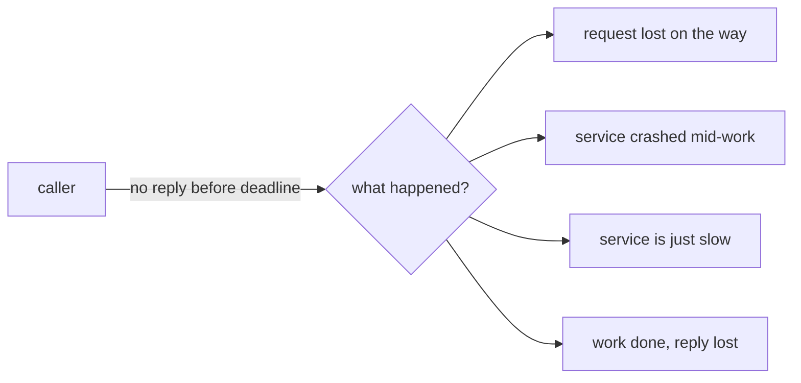
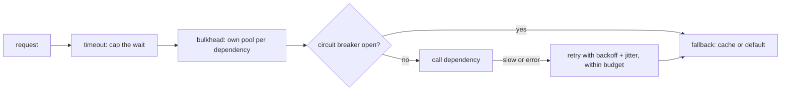
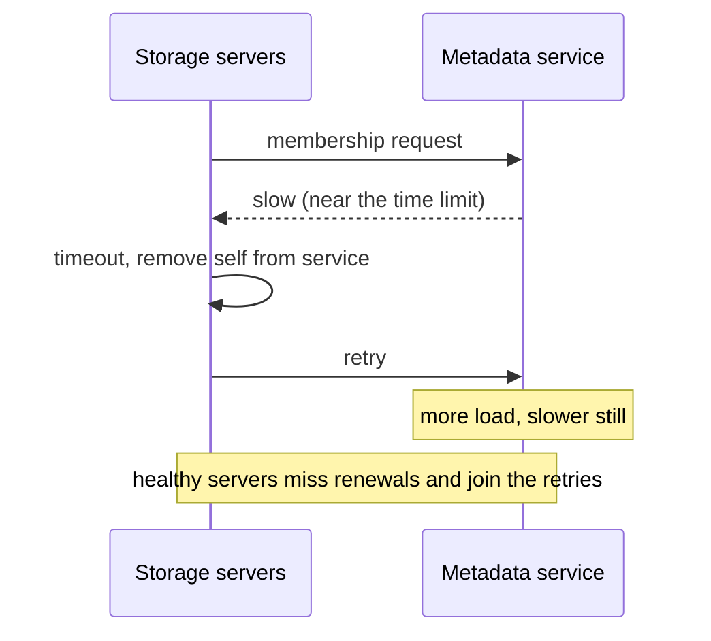

# Partial Failures: Why a Slow Node Is Worse Than a Dead One

> **Prerequisites:** [Lesson 01: Distributed Systems 101](../01-distributed-systems-101/README.md).  
> **Estimated Reading Time:** 22–28 minutes  
> **Target Audience:** Backend engineers who call other services and want their API to survive a slow dependency, and candidates preparing for resilience questions.  
> **Free PDF Notes:** [Download SD-H-002.pdf](https://backendroadmap.com/notes/system-design/SD-H-002.pdf)

> [!NOTE]
> **In one line:** In a distributed system some parts fail while the rest keep running, and a caller often cannot tell a lost request from a slow or crashed service. Bound every call with a timeout, retry only what is safe, and isolate failures so one bad dependency cannot take everything down.

> [!TIP]
> **The Golden Rule:** A dead service fails *fast* and callers move on. A slow service holds every caller's thread, connection and memory while it thinks, and the caller dies too. **Slowness spreads; death does not.**

---

## 1. What a Partial Failure Is, and What It Isn't

On one machine things usually work or crash completely. Across machines, a request can succeed in three services and fail in the fourth, and a database can accept a write and lose the connection before it replies. With thousands of machines, something is broken somewhere at every moment: partial failure is the *normal* state of a large system.

| Term | Precise Meaning | Example |
| :--- | :--- | :--- |
| **Partial failure** | Some components fail while others keep working | One replica is down, the other two serve |
| **Timeout** | A deadline after which the caller stops waiting | `GET /profile` gets no reply within 1 s |
| **Cascading failure** | A failure in one part overloads the next and spreads | A slow database exhausts the API's threads |
| **Gray failure** | A component is degraded but still looks healthy to its monitors | A disk takes 5 s per write while `/health` answers in 2 ms |
| **Fail-stop** | A component either works or halts cleanly (the easy case) | A process that crashes and is restarted |
| **Brownout** | The system is up but slow or partly broken | Searches work, checkout times out |

### Why It Matters
1. Interviewers ask "what if this dependency is slow?" far more often than "what if it is down?"
2. Most large outages begin with *one* degraded component and end with everything down.
3. The defences (timeouts, retry budgets, breakers, bulkheads) are cheap to add and expensive to forget.

---

## 2. Anatomy: A Timeout Tells You Almost Nothing

When a call gets no answer in time, the caller cannot know which of four things happened:



The last case is the dangerous one: if you retry a charge, you may charge twice. That is why retries need idempotency (lesson 20), and why lesson 01 ended on idempotency keys.

| Failure | Caller sees | Safe to retry? |
| :--- | :--- | :--- |
| Connection refused (process down) | Immediate error | Yes: nothing ran |
| Request lost | Timeout | Yes: nothing ran |
| Service crashed mid-work | Timeout | Only if idempotent |
| Work done, reply lost | Timeout | Only if idempotent |
| Service slow | Timeout (or a late success) | Only if idempotent |

> [!WARNING]
> **Slow is worse than dead.** A refused connection costs microseconds. A hanging one costs a thread for as long as your timeout is (and the default is often *no* timeout at all).

---

## 3. Mathematical Model: Little's Law and Thread Exhaustion

Little's Law: the number of requests in flight equals arrival rate times time in the system.

$$L = \lambda \cdot W$$

If a request holds a worker thread while it waits for a dependency, threads needed $= \lambda_B \times W_B$, where $\lambda_B$ is the rate of calls to the dependency and $W_B$ is how long each takes.

| Rate to dependency | Dependency latency | Threads held | Pool of 200 |
| :---: | :---: | :---: | :--- |
| $20$/s | $50\text{ ms}$ | $1$ | Fine |
| $20$/s | $1\text{ s}$ (timeout cap) | $20$ | Fine |
| $20$/s | $30\text{ s}$ (no timeout) | $600$ | **Exhausted in about 10 s** |

A pool of 200 threads is exhausted once $\lambda_B W_B > 200$. At 20 calls per second to a dependency that now takes 30 s, the pool is gone in roughly $200/20 = 10$ seconds. Note what happens to everything else: the other 80% of requests never touch the dependency, yet they now wait for a thread too.

---

## 4. Metrics & Percentiles

| Metric | Meaning | What it tells you in a brownout |
| :--- | :--- | :--- |
| **Latency $p_{99}$ of each dependency** | Tail response time as the caller sees it | The first signal of a slow dependency |
| **In-flight requests / pool utilisation** | Busy threads or connections | Rising toward 100% means exhaustion is coming |
| **Timeout rate** | Calls that hit the deadline | Rising before error rate does |
| **Queue wait** | Time a request waits for a thread | Users feel this, health checks may not |
| **Retry rate** | Retries divided by first attempts | Above ~10% means retries are amplifying load |

### Worked Example
A `/health` endpoint answering in $2\text{ ms}$ proves nothing: it reads from memory. Real-traffic metrics (the latency and error rate **callers** see) are the only reliable gray-failure detector.

---

## 5. Compounding: Retry Storms

If a dependency is failing and every caller retries $r$ times immediately, the offered load is multiplied.

$$\text{Load}_{\text{offered}} = \lambda\,(1 + r)$$

| Base load | Retries per call | Load on the struggling service |
| :---: | :---: | :---: |
| $1{,}000$/s | 0 | $1{,}000$/s |
| $1{,}000$/s | 3 | $4{,}000$/s |
| $1{,}000$/s (with 3 layers each retrying 3x) | $3\times3\times3$ | up to $64\times$ at the bottom layer |

Layered retries multiply: if the client, the gateway and the service each retry three times, a single user action can become $4^3 = 64$ calls to the database. A **retry budget** (for example "retries may be at most 10% of requests") stops this.

---

## 6. Numbers Every Engineer Must Know

| Item | Typical | Implication |
| :--- | :---: | :--- |
| Healthy service call, same datacenter | $\sim 1\text{–}10\text{ ms}$ | Set timeouts from the real p99, not a guess |
| Default timeout in many HTTP clients | none, or minutes | Always set one explicitly |
| Timeout choice | $\approx 2\text{–}3\times\ p_{99}$ of the callee | Long enough for healthy tails, short enough to free threads |
| Retries | $\le 2\text{–}3$, with backoff and jitter | More just means more load |
| Breaker open time | $\sim 5\text{–}30\text{ s}$ | Gives the dependency room to recover |
| Retry budget | $\sim 10\%$ of requests | Caps amplification |

---

## 7. Protocol Deep Dive: The Defences, in the Order to Apply Them



| Defence | What it does | When it helps |
| :--- | :--- | :--- |
| **Timeout** | Caps how long any call can hold a resource | Always; nothing else works without it |
| **Bulkhead** | Separate thread or connection pool per dependency | One slow dependency cannot starve the others |
| **Circuit breaker** | After N failures, fail fast for a while, then probe | Stops hammering a struggling service and saves the wait |
| **Retry with backoff and jitter** | Second attempt after a growing, randomised delay | Transient errors; only for idempotent calls |
| **Load shedding** | Reject excess work early | Keeps useful throughput under overload |
| **Fallback** | Return cached or default data, or hide a feature | The user sees a degraded page, not an error |
| **Hedged request** | A second try to another replica after a short delay | Tail latency; use carefully, within a budget |

**Deadline propagation.** Pass the remaining time budget downstream (the caller's deadline minus time already spent), so a server does not keep working on a request the client abandoned. Google's SRE book (chapter 22) recommends this.

---

## 8. Hierarchical Budgets & Sizing

| Slice | Budget | Control |
| :--- | :--- | :--- |
| End-to-end request | $p_{99} \le 500\text{ ms}$ | Set at the edge |
| Each dependency call | Timeout $\approx 1\text{ s}$ or less, below the caller's deadline | Client timeout + deadline propagation |
| Pool per dependency | Sized by $\lambda W$ plus headroom | Bulkhead |
| Retries | At most 2, only idempotent, budgeted | Backoff + jitter |
| Breaker | Opens after ~5 consecutive failures or a failure ratio | Cooldown, then probe |
| Fallback | Defined per feature: block, degrade or skip | Decide in advance, test on purpose |

---

## 9. Top Mitigations

1. **A timeout on every network call**, derived from the callee's measured p99.
2. **Bulkheads**: one pool per dependency, so one cannot starve the rest.
3. **Circuit breakers** that fail fast and probe for recovery.
4. **Retries only for idempotent work**, with exponential backoff, jitter and a budget.
5. **Fallbacks and graceful degradation** chosen in advance for each feature.
6. **Measure from the caller's side** (latency percentiles, error rate), not a synthetic ping.
7. **Fault injection**: slow a dependency on purpose in staging, because failure paths are the code that never runs in a demo.

---

## 10. Production Case Study: AWS DynamoDB, 20 September 2015

A published AWS post-event summary ("Summary of the Amazon DynamoDB Service Disruption and Related Impacts in the US-East Region"), not an invented scenario.

- **Trigger (02:19 PDT):** a brief network disruption affected some DynamoDB storage servers. Normally that is handled without any visible effect.
- **The slow part:** the internal metadata service that tells each storage server its partition assignments. Rapid adoption of Global Secondary Indexes had grown the membership lists, and the service lacked monitoring and capacity for that growth, so its responses approached the storage servers' time limit.
- **Timeouts and retries:** some responses exceeded the limit, so those servers removed themselves from service and **retried** their membership requests. The retries slowed the metadata service further. Servers that had not been affected missed their renewals and dropped out too, and they also retried.
- **Impact:** by 02:37 PDT the error rate was about 55%. Adding capacity to the metadata service was blocked by the very overload. At 05:06 PDT AWS paused metadata requests to cut retry traffic, added capacity and resumed; normal service returned around 07:10 PDT, with a small residual error rate until Monday.



**Lesson:** a slow dependency plus retries from every caller turned a capacity problem into a 55% error rate, and the fix required *stopping* the retries. This is the cascade this lesson describes.

---

## 11. Multi-Language Production Code Tabs

Each tab is a small circuit breaker around a call with a timeout: after five failures it fails fast for ten seconds, then lets one probe through.

````carousel
```go
// Go: breaker + per-call timeout using context.
package main

import (
	"context"
	"errors"
	"sync"
	"time"
)

var ErrOpen = errors.New("circuit open")

type Breaker struct {
	mu        sync.Mutex
	fails     int
	openUntil time.Time
	Threshold int
	Cooldown  time.Duration
}

func (b *Breaker) Call(ctx context.Context, fn func(context.Context) error) error {
	b.mu.Lock()
	if time.Now().Before(b.openUntil) {
		b.mu.Unlock()
		return ErrOpen // fail fast: hold no resources
	}
	b.mu.Unlock()

	ctx, cancel := context.WithTimeout(ctx, time.Second) // never wait forever
	defer cancel()
	err := fn(ctx)

	b.mu.Lock()
	defer b.mu.Unlock()
	if err != nil {
		b.fails++
		if b.fails >= b.Threshold {
			b.openUntil = time.Now().Add(b.Cooldown)
			b.fails = 0
		}
		return err
	}
	b.fails = 0
	return nil
}
```
<!-- slide -->
```typescript
// TypeScript: breaker + AbortSignal timeout.
class Breaker {
  private fails = 0;
  private openUntil = 0;
  private threshold: number;
  private cooldownMs: number;

  constructor(threshold = 5, cooldownMs = 10_000) {
    this.threshold = threshold;
    this.cooldownMs = cooldownMs;
  }

  async call<T>(fn: (signal: AbortSignal) => Promise<T>): Promise<T> {
    if (Date.now() < this.openUntil) throw new Error("circuit open"); // fail fast
    try {
      const result = await fn(AbortSignal.timeout(1000)); // never wait forever
      this.fails = 0;
      return result;
    } catch (e) {
      if (++this.fails >= this.threshold) {
        this.openUntil = Date.now() + this.cooldownMs;
        this.fails = 0;
      }
      throw e;
    }
  }
}

// usage: await breaker.call((signal) => fetch(url, { signal }));
```
<!-- slide -->
```python
# Python: asyncio breaker with a 1 s timeout (stdlib only).
import asyncio
import time


class CircuitOpen(Exception):
    pass


class Breaker:
    def __init__(self, fails=5, cooldown=10.0, timeout=1.0):
        self.fails, self.cooldown, self.timeout = fails, cooldown, timeout
        self.count, self.open_until = 0, 0.0

    async def call(self, fn, *args):
        if time.monotonic() < self.open_until:
            raise CircuitOpen()                  # fail fast, do not even try
        try:
            result = await asyncio.wait_for(fn(*args), timeout=self.timeout)
            self.count = 0
            return result
        except Exception:
            self.count += 1
            if self.count >= self.fails:
                self.open_until = time.monotonic() + self.cooldown
                self.count = 0
            raise
```
<!-- slide -->
```csharp
// C#: breaker + CancellationTokenSource timeout.
public sealed class Breaker
{
    private readonly object _gate = new();
    private int _fails;
    private DateTime _openUntil = DateTime.MinValue;
    public int Threshold { get; init; } = 5;
    public TimeSpan Cooldown { get; init; } = TimeSpan.FromSeconds(10);

    public async Task<T> CallAsync<T>(Func<CancellationToken, Task<T>> fn)
    {
        lock (_gate)
        {
            if (DateTime.UtcNow < _openUntil) throw new InvalidOperationException("circuit open");
        }
        using var cts = new CancellationTokenSource(TimeSpan.FromSeconds(1)); // never wait forever
        try
        {
            var result = await fn(cts.Token);
            lock (_gate) _fails = 0;
            return result;
        }
        catch
        {
            lock (_gate)
            {
                if (++_fails >= Threshold) { _openUntil = DateTime.UtcNow + Cooldown; _fails = 0; }
            }
            throw;
        }
    }
}
```
````

---

## 12. Hands-On CLI Verification Workflows

A small simulation (Python 3.13, stdlib only): 200 worker threads, 100 requests per second, 20% of them call dependency B, for 60 simulated seconds. B normally answers in 50 ms; in the incident it takes 30 s.

```text
scenario                                served  still queued  p99 wait (s)
B healthy (0.05 s)                        6001             0          0.00
B slow 30 s, no timeout                   1999          4002         20.91
B slow 30 s, 1 s timeout                  6001             0          0.00
B slow 30 s, 1 s timeout + breaker        6001             0          0.00
```

Read it honestly:

- With **no timeout**, the API served 1,999 of 6,001 requests in a minute and left 4,002 waiting, with a $p_{99}$ wait of about 21 seconds. Most of those requests never needed B.
- A plain **1 s timeout** alone restored throughput in this model, because $\lambda_B W_B = 20 \times 1 = 20$ threads, far below 200. The timeout did the heavy lifting.
- The **breaker** did not change throughput here. Its value is the wait it removes: each call to B still burns up to 1 s of a user's time without it. Do not claim a breaker "saves the pool" when a timeout already does.

```bash
# See how long a real call takes, and make it fail fast instead of hanging
curl --max-time 1 -s -o /dev/null -w "total=%{time_total}s code=%{http_code}\n" https://example.com
```

---

## 13. Common Mistakes to Avoid

1. **No timeout** (or the client's default, which can be infinite).
2. **One shared thread pool** for every dependency.
3. **Retrying immediately** and from every layer, which multiplies load (the DynamoDB cascade).
4. **Retrying non-idempotent calls.**
5. **Health checks that only prove the process is alive**: they pass during gray failure.
6. **Timeouts longer than the caller's own deadline**: the work finishes after the user left.
7. **No fallback decided in advance**: the first incident is the first time anyone chooses.
8. **Testing only the happy path** and never injecting latency.

---

## 14. Key Terms Glossary

| Key Term | Definition |
| :--- | :--- |
| **Partial failure** | Some components fail while others keep working. |
| **Gray failure** | Degraded but still passing health checks. |
| **Cascading failure** | One overloaded part pushes load onto the next until everything fails. |
| **Timeout** | A deadline for a call; expiry means *unknown*, not *failed*. |
| **Deadline propagation** | Passing the remaining time budget to downstream calls. |
| **Bulkhead** | Isolated resource pool per dependency. |
| **Circuit breaker** | Stops calls to a failing dependency for a cooldown, then probes. |
| **Retry budget** | A cap on retries as a fraction of traffic. |
| **Load shedding** | Rejecting excess work early to protect the rest. |
| **Hedged request** | A duplicate request to another replica to cut tail latency. |
| **Little's Law** | $L = \lambda W$: in-flight requests equal rate times time. |

---

## 15. System Design Interview Questions & Answers

### Basic Conceptual Questions

<details>
<summary><strong>Q1: What is a partial failure? [BASIC]</strong></summary>

**Answer:**
Some components fail while the rest keep running, so the system is neither fully up nor fully down. In a large system it is the normal state, not a rare event.
</details>

<details>
<summary><strong>Q2: Why is a timeout a weak signal? [BASIC]</strong></summary>

**Answer:**
Because the caller sees the same thing in four cases: the request was lost, the service crashed, the service is slow, or the work was done and the reply was lost. It tells you the deadline passed, not what happened.
</details>

<details>
<summary><strong>Q3: What are the standard defences? [BASIC]</strong></summary>

**Answer:**
Timeouts, bulkheads, circuit breakers, retries with backoff and jitter (idempotent only, within a budget), load shedding and fallbacks. A timeout comes first, because without it none of the others can act.
</details>

<details>
<summary><strong>Q4: What is a circuit breaker? [BASIC]</strong></summary>

**Answer:**
A wrapper that counts failures; after a threshold it opens and fails calls instantly for a cooldown, then lets a few probe requests through. If they succeed it closes again.
</details>

### Scenario-Based Architecture Questions

<details>
<summary><strong>Q5: A dependency that normally takes 50 ms now takes 30 s. What happens to your API? [SCENARIO]</strong></summary>

**Answer:**
Each request that calls it holds a worker for 30 s. With 20 calls per second to it, $20\times30=600$ threads are needed against a pool of 200, so the pool is exhausted in about 10 s and even endpoints that never use the dependency stop responding. Fix with a ~1 s timeout, a separate pool (bulkhead), a breaker and a fallback.
</details>

<details>
<summary><strong>Q6: Why is a slow node worse than a dead one? [SCENARIO]</strong></summary>

**Answer:**
A dead node refuses connections, so callers fail fast and move on. A slow node accepts work and holds the caller's thread, connection and memory until a timeout, so resources run out upstream and the failure spreads.
</details>

<details>
<summary><strong>Q7: Every caller retries three times during an outage. What goes wrong? [SCENARIO]</strong></summary>

**Answer:**
Load on the struggling service becomes $1+3=4\times$, and if three layers each retry, up to $4^3=64\times$ at the bottom. It cannot recover. Use exponential backoff with jitter, a retry budget (about 10% of traffic), retries at one layer only, and a breaker.
</details>

<details>
<summary><strong>Q8: The health check is green but users see errors. Why? [SCENARIO]</strong></summary>

**Answer:**
A gray failure: the node answers a shallow health check (memory only) while real work is degraded (a slow disk, a saturated pool). Measure caller-side latency and error rate, and use deeper checks that exercise real dependencies.
</details>

### Advanced & Tricky Interview Questions

<details>
<summary><strong>Q9: How do you pick a timeout value? [TRICKY]</strong></summary>

**Answer:**
From the callee's measured latency: roughly 2–3 times its p99, always below the caller's own deadline. Too short and healthy tails fail and trigger retries; too long and threads pile up. Pass the remaining deadline downstream.
</details>

<details>
<summary><strong>Q10: Is a circuit breaker enough on its own? [TRICKY]</strong></summary>

**Answer:**
No. It needs a timeout to know what counts as a failure, and a fallback to give the user something. In a simple model a timeout alone prevents thread exhaustion; the breaker removes the wait and protects the dependency from further load while it recovers.
</details>

<details>
<summary><strong>Q11: What did the 2015 DynamoDB event show? [TRICKY]</strong></summary>

**Answer:**
A metadata service that was merely slow made storage servers time out and retry, which slowed it further and dragged healthy servers in; the error rate reached about 55%. Recovery meant pausing the retries. Retry traffic is part of the load, so budget it.
</details>

<details>
<summary><strong>Q12: When should a retry be hedged instead? [TRICKY]</strong></summary>

**Answer:**
When tail latency matters and the operation is idempotent: send a second request to another replica after a short delay (around the p95) and take the first reply. It must be rate-limited, or it becomes the retry storm you were avoiding.
</details>

---

## 16. One-Page Master Cheat Sheet

```
+---------------------------------------------------------------------------------------------------------+
|                          PARTIAL FAILURES — MASTER CHEAT SHEET                                          |
+---------------------------------------------------------------------------------------------------------+
| 1. NORMAL: something is always broken. Failure is partial, not all-or-nothing.                          |
+---------------------------------------------------------------------------------------------------------+
| 2. TIMEOUT = unknown: lost · crashed · slow · done-but-reply-lost. Same symptom.                        |
+---------------------------------------------------------------------------------------------------------+
| 3. SLOW > DEAD: slow holds threads (threads = rate x duration), dead fails fast.                        |
+---------------------------------------------------------------------------------------------------------+
| 4. DEFENCES (in order): timeout · bulkhead · breaker · retry+backoff+jitter+budget · shed · fallback.   |
+---------------------------------------------------------------------------------------------------------+
| 5. MATH: L = lambda x W · retries multiply load (1+r), layered 4^3 = 64x · pool gone at lambda W > N.   |
+---------------------------------------------------------------------------------------------------------+
| 6. GRAY FAILURE: health check green, work broken. Measure what callers see.                             |
+---------------------------------------------------------------------------------------------------------+
```

---

## Further Reading & Sources

- Amazon Web Services, [Summary of the Amazon DynamoDB Service Disruption and Related Impacts in the US-East Region](https://aws.amazon.com/message/5467D2/) (September 2015).
- Huang et al., [Gray Failure: The Achilles' Heel of Cloud-Scale Systems](https://www.microsoft.com/en-us/research/publication/gray-failure-achilles-heel-cloud-scale-systems/), HotOS 2017.
- Google SRE book, [Chapter 22: Addressing Cascading Failures](https://sre.google/sre-book/addressing-cascading-failures/).
- Michael Nygard, *Release It!* (circuit breaker and bulkhead patterns).

---

## Free PDF Notes

[SD-H-002.pdf](https://backendroadmap.com/notes/system-design/SD-H-002.pdf)

---

## Next

Continue with [Lesson 03: Network Partitions](../03-network-partitions/README.md): CP vs AP, split brain and reconciliation.
