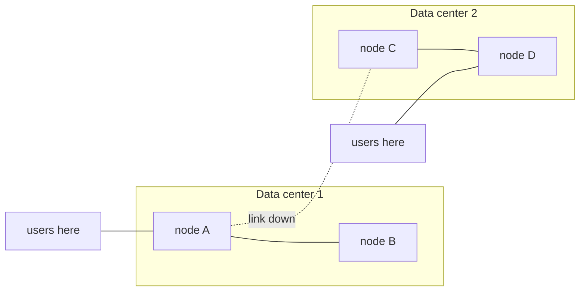
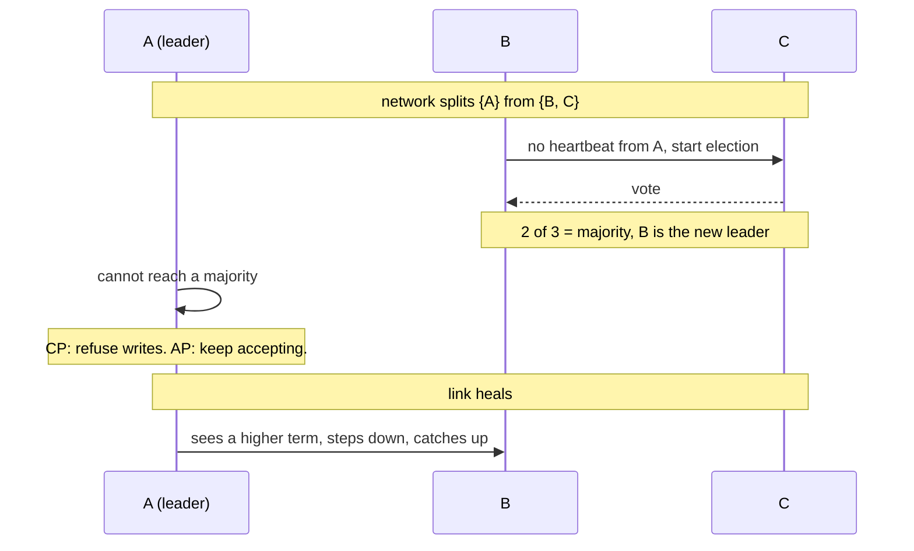
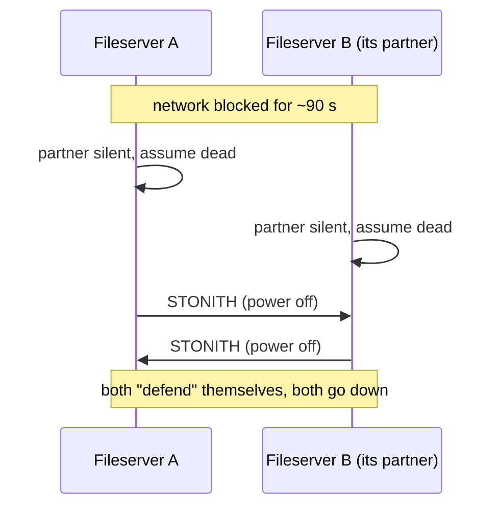

# Network Partitions: CP vs AP, Split Brain & Reconciliation

> **Prerequisites:** [Lesson 01: Distributed Systems 101](../01-distributed-systems-101/README.md) · [Lesson 02: Partial Failures](../02-partial-failures/README.md).  
> **Estimated Reading Time:** 22–28 minutes  
> **Target Audience:** Backend engineers designing replicated databases, caches and services, and candidates answering "what happens when the network splits?"  
> **Free PDF Notes:** [Download SD-H-003.pdf](https://backendroadmap.com/notes/system-design/SD-H-003.pdf)

> [!NOTE]
> **In one line:** A network partition splits running nodes into groups that cannot reach each other. During one you must choose between **consistency** (only a majority side serves writes) and **availability** (every side serves and the copies diverge), and you should make that choice *before* it happens.

> [!TIP]
> **The Golden Rule:** From inside, a partition looks exactly like a crash. Node A cannot tell "C died" from "the path to C broke", so every node must make the **same safe choice either way**, usually by counting how many nodes it can still reach.

---

## 1. What a Partition Is, and What It Isn't

Two data centers run one database cluster. The link between them fails. Both sides are healthy and both can still serve their users, but neither can reach the other. The ordinary causes are a cut fibre, a bad switch or firewall rule, a cloud networking incident, or a node so overloaded or paused (a long GC pause) that it looks unreachable.

| Term | Precise Meaning | Example |
| :--- | :--- | :--- |
| **Network partition** | Nodes are split into groups that only reach their own group | Rack 1 cannot reach rack 2 |
| **Quorum** | A majority of the nodes: $\lfloor n/2 \rfloor + 1$ | 3 of 5 |
| **CP choice** | Stay consistent: the minority side refuses writes | etcd, ZooKeeper, Spanner |
| **AP choice** | Stay available: both sides keep serving, then reconcile | Dynamo-style stores at low consistency levels |
| **Split brain** | Two nodes both act as the leader (lesson 12) | Two primaries accept conflicting writes |
| **Reconciliation** | Merging divergent copies after the partition heals | Last-write-wins, vector clocks, CRDTs |
| **Not a partition** | One node down, or one slow dependency | That is a partial failure (lesson 02) |

### Why It Matters
1. Partitions are not optional: links fail, and cloud providers say so in their own post-mortems.
2. The CP/AP choice shows up in almost every storage design interview.
3. The expensive bugs happen *after* the heal: two histories, one of which has to lose.

---

## 2. Anatomy: Both Sides Alive, Neither Can See the Other



Users on both sides are still connected, so both sides keep receiving requests. The only question is what each side is *allowed* to do with them.

| Partition shape | What it looks like | Why it is hard |
| :--- | :--- | :--- |
| **Clean split** | {A,B,C} cannot reach {D,E} | The easy case; one side has a majority |
| **Partial** | A sees B, B sees C, A cannot see C | Nodes disagree about who is alive |
| **Asymmetric** | A can send to B but not receive from B | One-way heartbeats look healthy |
| **Flapping** | The link goes up and down every few seconds | Leaders change repeatedly |

> [!WARNING]
> **Asymmetric partitions are the trickiest.** If heartbeats work in only one direction, one node believes the cluster is healthy while the other believes the leader is gone. Use two-way checks and quorum-based decisions, never "I can send to it, so it is fine".

---

## 3. Mathematical Model: Why a Majority Is Enough

A quorum is $q = \lfloor n/2 \rfloor + 1$ nodes. Any two quorums overlap in at least one node, so two sides of a partition **cannot both** hold a majority.

| Cluster size $n$ | Quorum $q$ | Failures survived $n-q$ | Possible splits (majority side wins) |
| :---: | :---: | :---: | :--- |
| 3 | 2 | 1 | 2 / 1 |
| 4 | 3 | 1 | 3 / 1, **2 / 2 (nobody wins)** |
| 5 | 3 | 2 | 3 / 2, 4 / 1 |
| 7 | 4 | 3 | 4 / 3, 5 / 2, 6 / 1 |

This is why clusters have an **odd size**: 4 nodes survive no more failures than 3 and add a 2/2 split where *neither* side can write. For $n=5$ a 3/2 split always leaves exactly one writable side.

The CAP theorem (Brewer's conjecture, proved by Gilbert and Lynch in 2002) says that while a partition lasts, a replicated system cannot be both **consistent** (every read sees the latest write) and **available** (every non-failed node answers). PACELC adds the other case: with no partition, you still trade **latency** against consistency.

---

## 4. Metrics & Percentiles

| Metric | Meaning | What it tells you |
| :--- | :--- | :--- |
| **Leader changes per hour** | Elections that completed | Flapping links or timeouts that are too tight |
| **Writes rejected for no quorum** | CP side refusing | The cost of consistency, as users feel it |
| **Replication lag** | Age of the oldest unapplied change | How far behind a minority node is |
| **Conflict count after heal** | Divergent versions found | The cost of availability |
| **Partition duration** | From first missed heartbeat to heal | Sizing for timeouts and reconciliation |

### Worked Example
A 5-node database splits 3/2 for 60 seconds. Writes that reach the 3-node side succeed; writes that reach the 2-node side fail with "no quorum". Under CP the *error rate* is roughly the fraction of traffic landing on the minority side, but there are **zero conflicts** after the heal. Under AP the error rate is zero and the conflict count is not.

---

## 5. Compounding: What Divergence Costs

Under AP, every write accepted on the minority side during the partition is a write that may have to be merged, or lost.

| Merge strategy | What happens to the minority side's writes | Risk |
| :--- | :--- | :--- |
| **Last-write-wins (LWW)** | The newest timestamp wins; everything else is dropped | Silent data loss, and timestamps need synchronised clocks (lesson 05) |
| **Vector clocks + app merge** | Both versions kept as siblings; the app merges | Complexity moves to the client |
| **CRDTs** | Merge function is built into the data type (lesson 19) | Only some data types fit |
| **Ask the user** | Show both versions | Poor UX for most data |

The longer the partition, the more writes diverge: $\text{conflicts} \approx \lambda_{\text{minority}} \times T_{\text{partition}}$. A 10-minute partition on a side taking 100 writes a second leaves up to 60,000 writes to reconcile.

---

## 6. Numbers Every Engineer Must Know

| Item | Typical | Implication |
| :--- | :---: | :--- |
| Cluster size | 3 or 5 | Odd, so one side can always win |
| Heartbeat interval | $\sim 100\text{ ms}\text{–}1\text{ s}$ | Detection speed vs false alarms (lesson 04) |
| Election timeout | $\sim 1\text{–}10\text{ s}$ | Writes pause for about this long on failover |
| Quorum for $n=5$ | 3 | Survives 2 failures |
| Real partition lengths | seconds to hours | Both ends of that range have occurred in practice |
| Cross-zone link | Where partitions concentrate | Spread across zones but expect splits there |

---

## 7. Protocol Deep Dive: A Partition in a Three-Node Database



1. Nodes A, B, C form a cluster; A leads. The network splits {A} from {B, C}.
2. B and C stop hearing A, time out, and elect B. $\{B,C\}$ is 2 of 3, a majority.
3. A still believes it is leader. A **CP** design makes A refuse writes because it cannot reach a majority. An **AP** design lets it keep accepting writes.
4. If A accepted writes, there are now two histories; after the heal they must be discarded, merged or surfaced.
5. A **fenced** design also makes storage reject A's stale writes even if A still believes it leads (lesson 08).

| | During the partition | After healing | Examples |
| :--- | :--- | :--- | :--- |
| **CP** | Minority side refuses writes (and maybe reads) | Minority just catches up from the leader's log | etcd, ZooKeeper, Spanner, most relational HA setups |
| **AP** | Both sides keep serving | Divergent data must be merged | Cassandra and DynamoDB at low consistency, Riak, DNS |

---

## 8. Hierarchical Budgets & Design Rules

| Slice | Rule | Control |
| :--- | :--- | :--- |
| Choose C or A | **Per feature**, not per company | Payments, inventory, locks lean CP; carts, likes, presence lean AP |
| Cluster size | 3 or 5 voters | Odd, in 3 failure domains |
| Failover | Requires a quorum **and** fencing | A detector cannot tell dead from cut off |
| Reconciliation | Decided before launch | Merge functions or CRDTs; avoid silent LWW for important data |
| Visibility | Make it part of the API | Errors (CP) vs possibly stale data (AP), documented |
| Testing | Inject partitions on purpose | `iptables`, Toxiproxy, `tc`, Jepsen-style tests |

---

## 9. Top Mitigations

1. **Decide CP or AP per data type** and write it down.
2. **Require a majority** for leadership and for commits in CP data.
3. **Use odd cluster sizes** spread over independent failure domains.
4. **Fence old leaders** so a stale primary cannot write to storage (lesson 08).
5. **Have a reconciliation plan** (CRDTs, merge functions) for AP data, not just last-write-wins.
6. **Two-way health checks** to catch asymmetric partitions.
7. **Test partitions deliberately**; the first real one should not be the first test.

---

## 10. Production Case Study: GitHub, 22 December 2012

Reported in *The Network Is Reliable* by Kyle Kingsbury and Peter Bailis (2013), which collects real partitions from public post-mortems.

- **Trigger:** during a maintenance window a software agent on a switch was killed. The failover of the redundant switch pair forced spanning-tree reconvergence, and traffic between access switches was blocked for **about 90 seconds**.
- **What the automation did:** the fileserver pairs could not see each other, so each node of a pair tried to take over by sending the other a **STONITH** ("shoot the other node in the head") message, as designed for a failed partner.
- **Why it hurt:** both nodes of many pairs acted on a partition, not a failure. Recovering the affected pairs took about **five hours**.



The same source lists other partitions with numbers: an AWS EBS event in April 2011 (EC2 unavailable for about 12 hours in one US-East zone, EBS unavailable or degraded for over 80 hours) and a July 2013 Twilio billing incident where a partition isolated a Redis primary from its secondaries, leading to about 1.1% of customers being over-billed over roughly 40 minutes.

**Lesson:** the failure detector cannot tell "dead" from "cut off", so any automatic action taken on silence (promote, kill, fail over) must be safe when the other side is *alive*. Lesson 12 covers quorums, witnesses and STONITH in depth. (The 2018 GitHub incident in lesson 01 is the same lesson from the other direction.)

---

## 11. Multi-Language Production Code Tabs

The core of a CP node: only accept a write when you can still reach a quorum of the cluster. An AP node skips that check and accepts anything.

````carousel
```go
// Go: quorum gate for a CP write path.
package main

import "errors"

var ErrNoQuorum = errors.New("no quorum: refusing write")

type Cluster struct {
	Total     int
	Reachable func() int // peers (including self) this node can currently reach
}

func (c Cluster) Quorum() int { return c.Total/2 + 1 }

func (c Cluster) Write(apply func() error) error {
	if c.Reachable() < c.Quorum() {
		return ErrNoQuorum // minority side: refuse rather than diverge
	}
	return apply()
}
```
<!-- slide -->
```typescript
// TypeScript: the same gate, with a CP / AP switch.
type Mode = "CP" | "AP";

class Node {
  constructor(
    private total: number,
    private reachable: () => number, // peers incl. self that answered recently
    private mode: Mode,
  ) {}

  get quorum(): number {
    return Math.floor(this.total / 2) + 1;
  }

  write<T>(apply: () => T): T {
    if (this.mode === "CP" && this.reachable() < this.quorum) {
      throw new Error("no quorum: refusing write");
    }
    return apply(); // AP accepts and reconciles later
  }
}
```
<!-- slide -->
```python
# Python: quorum gate plus the partition simulation used for this lesson's numbers.
import random

NODES = ["A", "B", "C", "D", "E"]
SIDE = {"A": 0, "B": 0, "C": 0, "D": 1, "E": 1}      # {A,B,C} | {D,E}
QUORUM = len(NODES) // 2 + 1


def run(mode, writes=1000, seed=11):
    rng = random.Random(seed)
    log = {n: [] for n in NODES}
    accepted = rejected = 0
    for i in range(writes):
        node = rng.choice(NODES)
        reachable = [n for n in NODES if SIDE[n] == SIDE[node]]
        if mode == "CP" and len(reachable) < QUORUM:
            rejected += 1                              # minority refuses
            continue
        for n in reachable:                            # replicate inside the side only
            log[n].append(i)
        accepted += 1
    major, minor = set(log["A"]), set(log["D"])        # heal: two histories for one key
    newest_on_major = max(major | minor) in major
    dropped = len(minor) if newest_on_major else len(major)   # what last-write-wins loses
    return accepted, rejected, len(major), len(minor), dropped
```
<!-- slide -->
```csharp
// C#: quorum gate for a CP write path.
public sealed class QuorumGate
{
    private readonly int _total;
    private readonly Func<int> _reachable; // peers (including self) currently reachable

    public QuorumGate(int total, Func<int> reachable)
    {
        _total = total;
        _reachable = reachable;
    }

    public int Quorum => _total / 2 + 1;

    public T Write<T>(Func<T> apply)
    {
        if (_reachable() < Quorum)
            throw new InvalidOperationException("no quorum: refusing write");
        return apply();
    }
}
```
````

---

## 12. Hands-On CLI Verification Workflows

A simulation (Python 3.13, stdlib only): five nodes, split $\{A,B,C\}$ / $\{D,E\}$. 1,000 writes to the **same key** each land on a random node during the partition.

```text
mode  accepted  rejected  on {A,B,C}  on {D,E}  dropped by LWW
CP         587       413         587         0               0
AP        1000         0         587       413             413
```

- **CP:** 413 writes (those that landed on D or E) were **refused**, nothing was written on the minority side, and there is **nothing to reconcile**: D and E simply catch up.
- **AP:** every write was accepted, but the two sides now hold different histories for the same key. Last-write-wins keeps the newest value; in this run it was on the majority side, so **413 writes were dropped silently** (had the newest write landed on the other side it would have been 587).

This is a model with uniform random clients, not a measurement of any real database; its job is to show the shape of the trade-off.

To test a real cluster, drop traffic between nodes and watch elections, error rates and client latency, then heal and check for divergence:

```bash
# on node D: drop traffic from A, B, C to simulate the rack split
for ip in 10.0.1.1 10.0.1.2 10.0.1.3; do sudo iptables -A INPUT -s "$ip" -j DROP; done

# observe leader elections, write errors, client latency ...

sudo iptables -F INPUT   # heal, then verify (checksums, read repair)
```

Tools such as Jepsen automate this: they run concurrent operations during injected partitions and check the recorded history against the promised consistency model.

---

## 13. Common Mistakes to Avoid

1. **Assuming the network is reliable** (fallacy 1).
2. **Choosing "CA"**: a distributed system does not get to opt out of partitions.
3. **Even-sized clusters**: a 2/2 split leaves nobody with a majority.
4. **Automatic failover without a quorum or fencing**: you create the second primary yourself.
5. **Last-write-wins on data that matters**, with unsynchronised clocks.
6. **Treating CP vs AP as one global setting** instead of a per-feature decision.
7. **Health checks that only look one way**, missing asymmetric partitions.
8. **Never testing a partition**, so the first one happens in production.

---

## 14. Key Terms Glossary

| Key Term | Definition |
| :--- | :--- |
| **Network partition** | Running nodes split into groups that cannot communicate. |
| **Quorum** | A majority, $\lfloor n/2 \rfloor + 1$ nodes. |
| **CAP theorem** | During a partition, choose consistency or availability. |
| **PACELC** | Without a partition, trade latency against consistency. |
| **CP / AP** | Refuse on the minority side / serve on both sides. |
| **Split brain** | Two nodes both believe they are the leader. |
| **Fencing** | Rejecting a stale leader's writes at the storage layer. |
| **STONITH** | "Shoot the other node in the head": forcibly power off a presumed-dead peer. |
| **Reconciliation** | Merging divergent copies after the heal. |
| **LWW** | Last-write-wins; newest timestamp survives, others are dropped. |
| **Asymmetric partition** | Messages flow in only one direction. |

---

## 15. System Design Interview Questions & Answers

### Basic Conceptual Questions

<details>
<summary><strong>Q1: What is a network partition? [BASIC]</strong></summary>

**Answer:**
Nodes that are all running are split into groups that can only communicate within their group, by a failed link, switch or firewall rule. Both sides are healthy and both may still receive client requests.
</details>

<details>
<summary><strong>Q2: State the CAP theorem precisely. [BASIC]</strong></summary>

**Answer:**
For a replicated data store, when a network partition occurs you must choose between **consistency** (every read sees the latest write) and **availability** (every non-failed node answers). It is not "pick two of three": partitions happen, so the real choice is C or A *during* a partition.
</details>

<details>
<summary><strong>Q3: What is a quorum and why a majority? [BASIC]</strong></summary>

**Answer:**
A quorum is $\lfloor n/2\rfloor+1$ nodes. Any two majorities overlap in at least one node, so two sides of a partition cannot both have one: at most one side can accept writes, which prevents conflicting histories.
</details>

<details>
<summary><strong>Q4: Give examples of CP and AP systems. [BASIC]</strong></summary>

**Answer:**
CP: etcd, ZooKeeper, Spanner, most leader-based relational HA setups. AP: Dynamo-style stores such as Cassandra at low consistency levels, Riak, DNS. Many systems are tunable per operation.
</details>

### Scenario-Based Architecture Questions

<details>
<summary><strong>Q5: A 5-node database splits 3/2. What happens to each side? [SCENARIO]</strong></summary>

**Answer:**
The 3-node side holds a quorum, keeps (or elects) a leader and accepts writes. The 2-node side cannot reach 3 votes, so it cannot elect a leader and rejects writes (it may serve stale reads). After the heal the minority sees a higher term and catches up from the log, with no conflict because it never accepted writes.
</details>

<details>
<summary><strong>Q6: Would you choose CP or AP for a shopping cart? For a bank balance? [SCENARIO]</strong></summary>

**Answer:**
A cart is AP: a briefly stale or divergent cart is better than refusing to add an item, and carts merge naturally (union of items, the classic Dynamo example). A balance is CP: two sides must never both approve a withdrawal. The decision is per feature.
</details>

<details>
<summary><strong>Q7: Why are clusters 3 or 5 nodes, not 4? [SCENARIO]</strong></summary>

**Answer:**
Four nodes need 3 for a quorum, so they survive one failure, same as three, and add a 2/2 split in which neither side can write. Odd sizes give the most failure tolerance per node and guarantee one side can win a clean split.
</details>

<details>
<summary><strong>Q8: The old leader was only cut off, not dead. How do you stop it from corrupting data? [SCENARIO]</strong></summary>

**Answer:**
A CP leader steps down when it loses its quorum. Because that is not guaranteed (a paused process may wake up believing it leads), also **fence**: give each leader a monotonically increasing term or token and have storage reject writes carrying an older one (lesson 08).
</details>

### Advanced & Tricky Interview Questions

<details>
<summary><strong>Q9: Can a system be "CA"? [TRICKY]</strong></summary>

**Answer:**
Only if it never partitions, which a distributed system over a real network cannot promise. A single-node database is trivially "CA", but it is not tolerating partitions because it has none. For a distributed system, the question is what it does when one occurs.
</details>

<details>
<summary><strong>Q10: How do you reconcile after an AP partition? [TRICKY]</strong></summary>

**Answer:**
Options by increasing safety: last-write-wins (simple, silently loses writes, needs good clocks), vector clocks with application merge (keeps siblings), CRDTs (merge built into the type), or surfacing the conflict. Choose by how much the data is worth.
</details>

<details>
<summary><strong>Q11: What is an asymmetric partition and why is it dangerous? [TRICKY]</strong></summary>

**Answer:**
Messages flow one way only: A reaches B but B cannot reach A. A one-directional heartbeat looks healthy while the other direction is dead, so nodes disagree about who is alive. Use two-way checks and quorum decisions.
</details>

<details>
<summary><strong>Q12: What did the 2012 GitHub incident show? [TRICKY]</strong></summary>

**Answer:**
About 90 seconds of blocked traffic made redundant fileserver pairs each treat a partition as a partner failure and send each other STONITH messages, and recovery took about five hours. A failure detector cannot tell "dead" from "cut off", so automatic actions must be safe when the other side is alive.
</details>

---

## 16. One-Page Master Cheat Sheet

```
+---------------------------------------------------------------------------------------------------------+
|                          NETWORK PARTITIONS — MASTER CHEAT SHEET                                        |
+---------------------------------------------------------------------------------------------------------+
| 1. WHAT: nodes alive, groups cannot talk. From inside it looks like a crash.                            |
+---------------------------------------------------------------------------------------------------------+
| 2. CHOICE (CAP): during a partition pick C (minority refuses) or A (both serve, then reconcile).        |
+---------------------------------------------------------------------------------------------------------+
| 3. QUORUM: floor(n/2)+1 · two majorities overlap · odd sizes (3, 5) · 4 nodes add a 2/2 dead split.     |
+---------------------------------------------------------------------------------------------------------+
| 4. HEAL: CP minority catches up. AP must merge: LWW (loses data) · vector clocks · CRDTs · ask user.    |
+---------------------------------------------------------------------------------------------------------+
| 5. SAFE FAILOVER: quorum + fencing. The detector cannot tell dead from cut off.                         |
+---------------------------------------------------------------------------------------------------------+
| 6. DECIDE per feature (money, locks = CP · carts, likes = AP). TEST with injected partitions.           |
+---------------------------------------------------------------------------------------------------------+
```

---

## Further Reading & Sources

- Kyle Kingsbury and Peter Bailis, [The Network Is Reliable](https://aphyr.com/posts/288-the-network-is-reliable) (2013), a survey of real partitions including GitHub 2012, AWS EBS 2011 and Twilio 2013.
- Seth Gilbert and Nancy Lynch, "Brewer's conjecture and the feasibility of consistent, available, partition-tolerant web services" (2002), the proof of CAP.
- Martin Kleppmann, *Designing Data-Intensive Applications*, chapters 5 and 9.
- Jepsen, [jepsen.io](https://jepsen.io), analyses of real databases under partitions.

---

## Free PDF Notes

[SD-H-003.pdf](https://backendroadmap.com/notes/system-design/SD-H-003.pdf)

---

## Next

Continue with [Lesson 04: Failure Detection](../04-failure-detection/README.md): heartbeats, timeouts and phi accrual.
