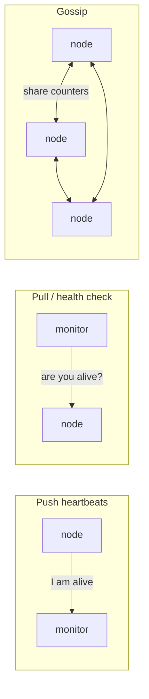
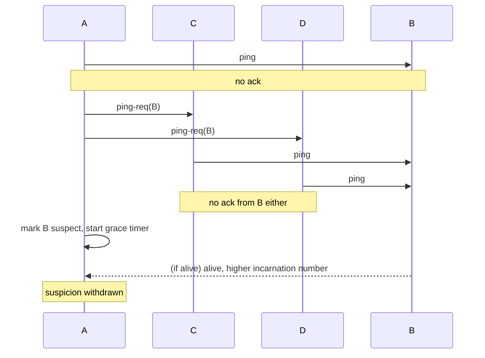
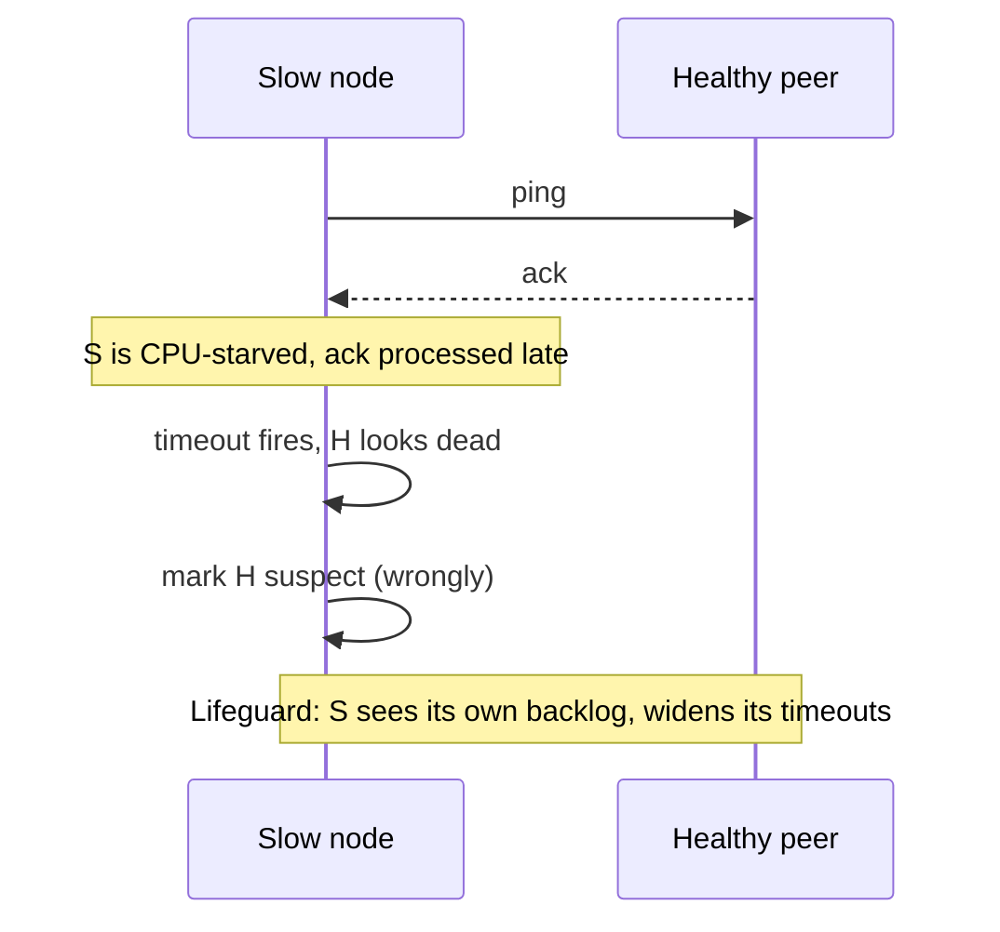

# Failure Detection: Heartbeats, Timeouts & Phi Accrual

> **Prerequisites:** [Lesson 02: Partial Failures](../02-partial-failures/README.md) · [Lesson 03: Network Partitions](../03-network-partitions/README.md).  
> **Estimated Reading Time:** 22–26 minutes  
> **Target Audience:** Backend engineers building or operating clusters, load balancers and health checks, and candidates asked "how does the cluster know a node died?"  
> **Free PDF Notes:** [Download SD-H-004.pdf](https://backendroadmap.com/notes/system-design/SD-H-004.pdf)

> [!NOTE]
> **In one line:** Nodes send periodic heartbeats, and a node that stays silent past a timeout is *suspected* dead. There is no perfect detector, so you trade detection speed against false alarms, often with an adaptive detector such as phi accrual and a suspicion phase before acting.

> [!TIP]
> **The Golden Rule:** A failure detector is a smoke alarm, not a fact. Whatever it says, the action that follows (failover, re-replication, killing the node) must be **safe even when the detector is wrong**.

---

## 1. What a Failure Detector Is, and What It Isn't

In a cluster of fifty nodes, one dies at 3 a.m. How fast do the others notice? Too slowly, and requests keep going to a dead node. Too fast, and a healthy node that merely paused for garbage collection is thrown out, triggering a failover nobody needed.

| Term | Precise Meaning | Example |
| :--- | :--- | :--- |
| **Heartbeat** | A small periodic "I'm alive" message | One UDP packet per second |
| **Timeout** | Silence longer than this makes a node *suspected* | 3 s of no heartbeat |
| **Completeness** | Every crashed node is eventually suspected | A dead node cannot stay "alive" forever |
| **Accuracy** | Healthy nodes are not wrongly suspected | A GC pause is not a death |
| **Suspicion** | A verdict that can be withdrawn | "B looks dead, ask others" |
| **Liveness vs readiness** | "Is it running?" vs "should it get traffic?" | Process up, cache still warming |
| **Not a failure detector** | A consensus decision | Agreeing *who* leads is lesson 09 |

### Why It Matters
1. Every failover, rebalance and load-balancer removal begins with a detector's verdict.
2. In an asynchronous network a slow node and a dead node look identical, so detectors are always guessing.
3. Many real outages are **false positives**: a healthy node declared dead, whose work causes more load, which causes more false positives.

---

## 2. Anatomy: Three Ways to Collect Liveness



| Style | How it works | Used by | Weak spot |
| :--- | :--- | :--- | :--- |
| **Push** | Each node sends "I'm alive" to a monitor or peers | Many agents, leases | A single monitor can fail or be partitioned |
| **Pull** | The monitor probes each node | Load balancers, Kubernetes probes | Monitor load grows with the cluster |
| **Gossip** | Nodes swap heartbeat counters with random peers (lesson 14) | Cassandra, Consul/Serf | Eventually consistent view |

> [!WARNING]
> **Do not send heartbeats down the same congested path as data.** Under load the heartbeats queue behind the traffic, the node looks dead, and "busy" turns into "declared dead".

---

## 3. Mathematical Model: The Timeout Trade-off, and Phi

A fixed timeout $T$ over a heartbeat interval $\Delta$ tolerates $\lfloor T/\Delta \rfloor - 1$ missed beats. A real crash is detected after at most $T$. Any healthy pause longer than $T$ is a false alarm:

$$\text{detection time} \approx T \qquad \text{false alarm if pause} > T$$

Shortening $T$ speeds up detection and increases false alarms; lengthening it does the reverse. A fixed number cannot be right for both a calm LAN and a noisy WAN.

**Phi accrual** (Hayashibara et al., 2004) replaces the yes/no verdict with a *suspicion level* that grows with silence, measured against how this particular peer's heartbeats normally arrive:

$$\varphi(t) = -\log_{10} P_{\text{later}}(t)$$

With the exponential approximation, where heartbeats arrive on average every $\bar{\Delta}$ seconds:

$$\varphi(t) \approx \frac{t}{\bar{\Delta}}\log_{10} e \approx 0.434\,\frac{t}{\bar{\Delta}}$$

$\varphi=8$ means the chance that the node is merely late is about $10^{-8}$ under the model. Cassandra's `phi_convict_threshold` defaults to 8, so a node is convicted at about $8/0.434 \approx 18.4$ mean intervals of silence.

| Silence $t$ (mean interval 1 s) | $\varphi$ |
| :---: | :---: |
| 2 s | 0.87 |
| 5 s | 2.17 |
| 10 s | 4.34 |
| 18.4 s | 8.0 (convict) |
| 30 s | 13.0 |

The same 18.4 s of silence on a link whose mean interval is 3 s gives $\varphi\approx 2.7$, so the node is **not** convicted: the detector adapted. The price: on that link a real crash takes about 55 s to convict.

---

## 4. Metrics & Percentiles

| Metric | Meaning | What it tells you |
| :--- | :--- | :--- |
| **Detection time** | Crash to "suspected" | How long traffic keeps going to a dead node |
| **False-positive rate** | Healthy nodes convicted per hour | Whether the threshold is too tight |
| **Flap rate** | Nodes marked dead, then alive again | A bad threshold or a bad network |
| **Heartbeat interval $p_{99}$** | Tail of arrival gaps | Sets the minimum safe timeout |
| **Suspect-to-dead time** | Length of the grace period | How reversible the verdict still is |

### Worked Example
A node with heartbeats every 1 s has a GC pause of 4 s. A 3-second timeout convicts it (a false positive). A 10-second timeout does not. But a real crash is now noticed after 10 s instead of 3 s. Every timeout is a bet on the longest healthy pause you expect.

---

## 5. Compounding: How False Positives Become Outages


| Step | What happens | Defence |
| :--- | :--- | :--- |
| 1 | A pause makes a healthy node miss heartbeats | Timeout above the longest normal pause |
| 2 | It is convicted | A **suspicion** state before conviction |
| 3 | Data moves | Treat "dead" as reversible until data actually must move; rate-limit rebalancing |
| 4 | Load rises, more nodes slow down | Hinted handoff instead of full re-replication |

---

## 6. Numbers Every Engineer Must Know

| Item | Typical | Implication |
| :--- | :---: | :--- |
| Heartbeat interval | $\sim 1\text{ s}$ (LAN) | Cheap, gives a few seconds of resolution |
| Fixed timeout | $3\text{–}10\times$ the interval | Above the longest healthy pause |
| Phi threshold | 8 (Cassandra default) | About $18\times$ the mean interval of silence |
| Long GC / VM pause | up to several seconds, rarely more | Set timeouts above it, or fix the pause |
| Kubernetes liveness probe | tens of seconds is common | Slow on purpose to avoid restart loops |
| SWIM indirect probes | $k\approx 3$ other nodes | Rules out a broken link between two nodes |

---

## 7. Protocol Deep Dive: SWIM, Ask Others Before You Accuse

SWIM (Das, Gupta and Motivala, 2002) is a gossip-based membership protocol. If A's direct ping to B gets no ack, A does **not** convict B: it asks $k$ other nodes to ping B for it. Only if *all* fail does A mark B **suspect**, and B is declared dead only after a grace period in which it can refute the suspicion.



| Detector | Pros | Cons | Used by |
| :--- | :--- | :--- | :--- |
| **Fixed timeout** | Simple, predictable | One number is wrong for both calm and noisy links | Simple health checks |
| **Phi accrual** | Adapts per link, tunable threshold | Needs history, model assumptions | Cassandra, Akka |
| **SWIM + suspicion** | Scales to thousands, low per-node load | Probabilistic; gossip delay | Consul, Serf, memberlist |
| **Lease / TTL** | Ties liveness to a quorum store | Depends on that store and on clocks | etcd, Kubernetes node leases |

---

## 8. Hierarchical Budgets & Design Rules

| Slice | Rule | Control |
| :--- | :--- | :--- |
| Heartbeat path | Separate from data traffic | Dedicated port or priority queue |
| Detector | Adaptive or generous, never a single hair-trigger | Phi, or timeout above the longest pause |
| Verdict | Two states: suspect, then dead | Grace period; indirect probes |
| Cost of a false positive | Small and reversible | Rejoin cleanly; hints instead of full moves |
| Dangerous actions | Never on the detector's word alone | Quorum + leases + fencing (lessons 08, 12) |
| Monitoring | Alert on flap rate | Flapping means a bad threshold or network |

---

## 9. Top Mitigations

1. **Choose the timeout from the longest healthy pause**, not the average beat.
2. **Use an adaptive detector** (phi accrual) when links differ or are noisy.
3. **Suspect first, convict later**, and ask other nodes to probe the suspect (SWIM).
4. **Make a false positive cheap**: rejoin without data loss, hint instead of re-replicating.
5. **Rate-limit rebalancing** so one convicted node cannot start a storm.
6. **Separate liveness from readiness** in health checks.
7. **Combine detection with leases and fencing** for leaders.

---

## 10. Production Case Study: HashiCorp Lifeguard (Consul, Serf, memberlist)

A published design study, *Lifeguard: Local Health Awareness for More Accurate Failure Detection* (Dadgar, Phillips and Currey, 2017), about HashiCorp's SWIM implementation.

- **The finding:** the paper observes that *slow message processing* can make SWIM mark **healthy** members as failed. The suspect is the **local** node being slow (CPU starved, busy), not a failed peer.
- **The twist:** a slow node's own detector is unreliable, so it falsely accuses others, who then refute it, creating noise and flapping.
- **The fix:** Lifeguard adds *local health awareness*: a node that notices it is itself behind becomes more patient with its peers. The authors report that this "drastically reduces the rate of false positives" (the abstract gives no specific figure).



**Lesson:** the detector's own health is part of the system. A detector that cannot tell "the peer is slow" from "I am slow" will generate false accusations exactly when the cluster is under load.

---

## 11. Multi-Language Production Code Tabs

A phi accrual detector over a sliding window of heartbeat gaps, using the exponential model.

````carousel
```go
// Go: phi accrual (exponential model) over a sliding window.
package main

import (
	"math"
	"time"
)

type Phi struct {
	window    []float64 // recent gaps in seconds
	max       int
	last      time.Time
	Threshold float64 // 8 is Cassandra's default
}

func NewPhi(threshold float64) *Phi { return &Phi{max: 100, Threshold: threshold} }

func (p *Phi) Heartbeat(now time.Time) {
	if !p.last.IsZero() {
		p.window = append(p.window, now.Sub(p.last).Seconds())
		if len(p.window) > p.max {
			p.window = p.window[1:]
		}
	}
	p.last = now
}

func (p *Phi) Phi(now time.Time) float64 {
	if len(p.window) == 0 {
		return 0
	}
	var sum float64
	for _, g := range p.window {
		sum += g
	}
	mean := sum / float64(len(p.window))
	return now.Sub(p.last).Seconds() / mean * math.Log10(math.E)
}

func (p *Phi) Suspect(now time.Time) bool { return p.Phi(now) > p.Threshold }
```
<!-- slide -->
```typescript
// TypeScript: phi accrual (exponential model).
class PhiDetector {
  private gaps: number[] = [];
  private last: number | null = null;
  private maxWindow = 100;
  private threshold: number;

  constructor(threshold = 8) {
    this.threshold = threshold;
  }

  heartbeat(nowMs: number): void {
    if (this.last !== null) {
      this.gaps.push((nowMs - this.last) / 1000);
      if (this.gaps.length > this.maxWindow) this.gaps.shift();
    }
    this.last = nowMs;
  }

  phi(nowMs: number): number {
    if (this.last === null || this.gaps.length === 0) return 0;
    const mean = this.gaps.reduce((a, b) => a + b, 0) / this.gaps.length;
    return ((nowMs - this.last) / 1000 / mean) * Math.LOG10E;
  }

  suspect(nowMs: number): boolean {
    return this.phi(nowMs) > this.threshold;
  }
}
```
<!-- slide -->
```python
# Python: phi accrual detector and the comparison used for this lesson's numbers.
import math
import time
from collections import deque


class Phi:
    def __init__(self, window=100, threshold=8.0):
        self.gaps = deque(maxlen=window)
        self.last = None
        self.threshold = threshold

    def heartbeat(self, now=None):
        now = time.monotonic() if now is None else now
        if self.last is not None:
            self.gaps.append(now - self.last)
        self.last = now

    def phi(self, now=None):
        if not self.gaps:
            return 0.0
        now = time.monotonic() if now is None else now
        mean = sum(self.gaps) / len(self.gaps)
        return (now - self.last) / mean * math.log10(math.e)

    def suspect(self, now=None):
        return self.phi(now) > self.threshold


# silence needed to convict = threshold * mean / log10(e)
def convict_after(mean_interval, threshold=8.0):
    return threshold * mean_interval / math.log10(math.e)
```
<!-- slide -->
```csharp
// C#: phi accrual (exponential model).
public sealed class PhiDetector
{
    private readonly Queue<double> _gaps = new();
    private readonly int _window;
    private DateTime? _last;

    public double Threshold { get; init; } = 8.0;

    public PhiDetector(int window = 100) => _window = window;

    public void Heartbeat(DateTime now)
    {
        if (_last is { } last)
        {
            _gaps.Enqueue((now - last).TotalSeconds);
            if (_gaps.Count > _window) _gaps.Dequeue();
        }
        _last = now;
    }

    public double Phi(DateTime now)
    {
        if (_last is not { } last || _gaps.Count == 0) return 0;
        var mean = _gaps.Average();
        return (now - last).TotalSeconds / mean * Math.Log10(Math.E);
    }

    public bool Suspect(DateTime now) => Phi(now) > Threshold;
}
```
````

---

## 12. Hands-On CLI Verification Workflows

A simulation (Python 3.13, stdlib only): one hour of heartbeats; a healthy node pauses once every five minutes (12 pauses). False alarms counted per detector.

```text
scenario                                   fixed 3 s fixed 10 s phi >= 8
LAN: beat every 1 s, 4 s GC pauses                12          0        0
LAN: beat every 1 s, 12 s GC pauses               12         12        0
slow link: beat every 3 s, jitter 1 s            609          0        0

real crash on the LAN, time to convict: fixed 3 s -> 3.0 s | fixed 10 s -> 10.0 s | phi >= 8 -> 19.0 s
real crash on the slow link:            fixed 3 s -> 3.0 s | fixed 10 s -> 10.0 s | phi >= 8 -> 56.6 s
```

What it shows, honestly:

- A **3 s** timeout is wrong everywhere: it convicts on every GC pause and (609 false alarms) on almost every other beat of a slow link.
- A well-chosen **10 s** timeout is perfect against 4 s pauses *and faster than phi*, but fails the moment pauses reach 12 s.
- **Phi** had zero false alarms in all three, at the price of slower detection (19 s on the LAN, 57 s on the slow link). It buys robustness, not speed. If you know your longest pause and your network is stable, a fixed timeout is simpler and faster.

This is a synthetic model with Gaussian jitter, not a measurement of Cassandra.

To see the real knobs, look at your own system:

```bash
# Cassandra: which nodes does this node consider up or down?
nodetool status
# the threshold lives in cassandra.yaml (default 8)
grep -n "phi_convict_threshold" cassandra.yaml
```

---

## 13. Common Mistakes to Avoid

1. **Timeouts shorter than a normal GC pause or deploy restart.**
2. **Heartbeats on the same congested path as data.**
3. **Failing over on a single missed heartbeat.**
4. **One central monitor** that can itself fail or be partitioned.
5. **Letting a detector's verdict alone authorise a dangerous action** (no quorum, no fencing).
6. **Re-replicating data the moment a node is suspected.**
7. **Ignoring the detector's own health** (a slow observer accuses healthy peers).
8. **Treating liveness and readiness as the same check.**

---

## 14. Key Terms Glossary

| Key Term | Definition |
| :--- | :--- |
| **Failure detector** | Component that decides which nodes are suspected dead. |
| **Heartbeat** | Periodic "I'm alive" message. |
| **Completeness / accuracy** | Dead nodes are suspected / healthy nodes are not. |
| **Phi accrual** | Adaptive detector that outputs a suspicion level $\varphi$ rather than yes/no. |
| **SWIM** | Gossip membership protocol with indirect probes and a suspicion phase. |
| **Indirect probe (`ping-req`)** | Asking other nodes to ping a suspect for you. |
| **Incarnation number** | Counter a node bumps to refute a false suspicion. |
| **Flapping** | A node repeatedly marked dead, then alive. |
| **Hinted handoff** | Storing writes for a down node and replaying them when it returns. |
| **Liveness vs readiness** | Running vs ready to receive traffic. |

---

## 15. System Design Interview Questions & Answers

### Basic Conceptual Questions

<details>
<summary><strong>Q1: How do heartbeats detect failure? [BASIC]</strong></summary>

**Answer:**
Each node sends a small message at a fixed interval. If a peer hears nothing for longer than a timeout, it marks the node *suspected*. The timeout trades detection speed for false alarms.
</details>

<details>
<summary><strong>Q2: Why can't failure detection be perfect? [BASIC]</strong></summary>

**Answer:**
Network delays have no fixed upper bound, so a slow, paused or partitioned node looks exactly like a dead one. You can have completeness (every dead node is eventually suspected) or perfect accuracy, but not both in an asynchronous network.
</details>

<details>
<summary><strong>Q3: What are completeness and accuracy? [BASIC]</strong></summary>

**Answer:**
Completeness: every crashed node is eventually suspected. Accuracy: healthy nodes are not wrongly suspected. Real detectors tune the balance.
</details>

<details>
<summary><strong>Q4: Push, pull or gossip? [BASIC]</strong></summary>

**Answer:**
Push: nodes announce themselves (cheap, needs a monitor). Pull: a monitor probes (load balancers, Kubernetes). Gossip: nodes swap counters with random peers; it scales best because no single monitor sees everything.
</details>

### Scenario-Based Architecture Questions

<details>
<summary><strong>Q5: A GC pause makes a healthy node get evicted. What do you change? [SCENARIO]</strong></summary>

**Answer:**
Set the timeout above the longest normal pause (or use an adaptive detector), add a suspicion phase before conviction, make eviction cheap to undo (hints rather than full re-replication), and fix or tune the pause itself.
</details>

<details>
<summary><strong>Q6: How do you pick a heartbeat timeout? [SCENARIO]</strong></summary>

**Answer:**
Measure the interval distribution and the longest healthy pause, then choose a value comfortably above them (often $3$–$10\times$ the interval). If links vary, use phi accrual with a threshold, because one number cannot suit both a calm and a noisy link.
</details>

<details>
<summary><strong>Q7: Two nodes cannot reach each other but both reach everyone else. Is B dead? [SCENARIO]</strong></summary>

**Answer:**
Probably not: it is a broken link between A and B. SWIM's indirect probe settles it: ask C and D to ping B; if they get an ack, the problem is A's link, and B is not suspected.
</details>

<details>
<summary><strong>Q8: What stops a false positive from becoming an outage? [SCENARIO]</strong></summary>

**Answer:**
A suspect-then-dead state machine, conservative thresholds, rate limits on rebalancing, hinted handoff instead of moving data on first suspicion, and alerting on flap rate.
</details>

### Advanced & Tricky Interview Questions

<details>
<summary><strong>Q9: Explain phi accrual in one minute. [TRICKY]</strong></summary>

**Answer:**
Keep a window of recent heartbeat gaps for each peer. $\varphi$ measures how surprising the current silence is: $\varphi=-\log_{10}$ of the probability that a heartbeat is still going to arrive. It rises smoothly with silence and adapts to jitter; at $\varphi=8$ the node is convicted. Under the exponential model $\varphi\approx0.434\,t/\bar\Delta$.
</details>

<details>
<summary><strong>Q10: Is a faster detector always better? [TRICKY]</strong></summary>

**Answer:**
No. Faster detection means more false positives, and each false positive can start a failover or rebalance. The right speed depends on how expensive a wrong verdict is compared with the cost of sending traffic to a dead node a few more seconds.
</details>

<details>
<summary><strong>Q11: Can the detector authorise a leader failover on its own? [TRICKY]</strong></summary>

**Answer:**
No. It cannot tell dead from cut off. Failover needs a quorum vote and fencing (a term or token) so the old leader's late writes are rejected (lessons 08 and 12).
</details>

<details>
<summary><strong>Q12: What does Lifeguard add to SWIM? [TRICKY]</strong></summary>

**Answer:**
Local health awareness: a node that is itself slow, because of CPU starvation or a backlog, would otherwise accuse healthy peers. Lifeguard lets it detect its own degradation and become more patient, which the authors report drastically reduces false positives.
</details>

---

## 16. One-Page Master Cheat Sheet

```
+---------------------------------------------------------------------------------------------------------+
|                          FAILURE DETECTION — MASTER CHEAT SHEET                                         |
+---------------------------------------------------------------------------------------------------------+
| 1. HEARTBEAT + TIMEOUT: silence past T = suspected. Detection ~ T. False alarm if pause > T.            |
+---------------------------------------------------------------------------------------------------------+
| 2. NO PERFECT DETECTOR: completeness vs accuracy. Dead, slow and cut off look the same.                 |
+---------------------------------------------------------------------------------------------------------+
| 3. PHI ACCRUAL: phi = 0.434 x silence / mean gap. Convict at 8 (~18 mean gaps). Adapts, but slower.     |
+---------------------------------------------------------------------------------------------------------+
| 4. SWIM: indirect probes (ping-req), suspect -> dead after a grace period, refute with incarnation.     |
+---------------------------------------------------------------------------------------------------------+
| 5. SAFETY: cheap reversible verdicts, rate-limit rebalances, leases + fencing for leaders.              |
+---------------------------------------------------------------------------------------------------------+
| 6. WATCH: flap rate; heartbeat path separate from data; the detector's own health.                      |
+---------------------------------------------------------------------------------------------------------+
```

---

## Further Reading & Sources

- Hayashibara, Défago, Yared and Katayama, "The φ accrual failure detector" (SRDS 2004).
- Das, Gupta and Motivala, "SWIM: Scalable Weakly-consistent Infection-style process group Membership protocol" (DSN 2002).
- Dadgar, Phillips and Currey, [Lifeguard: Local Health Awareness for More Accurate Failure Detection](https://arxiv.org/abs/1707.00788) (2017).
- Apache Cassandra, [`cassandra.yaml`](https://github.com/apache/cassandra/blob/trunk/conf/cassandra.yaml) (`phi_convict_threshold`, default 8).

---

## Free PDF Notes

[SD-H-004.pdf](https://backendroadmap.com/notes/system-design/SD-H-004.pdf)

---

## Next

Continue with [Lesson 05: Clock Skew](../05-clock-skew/README.md): why you cannot trust timestamps (NTP, TrueTime).
