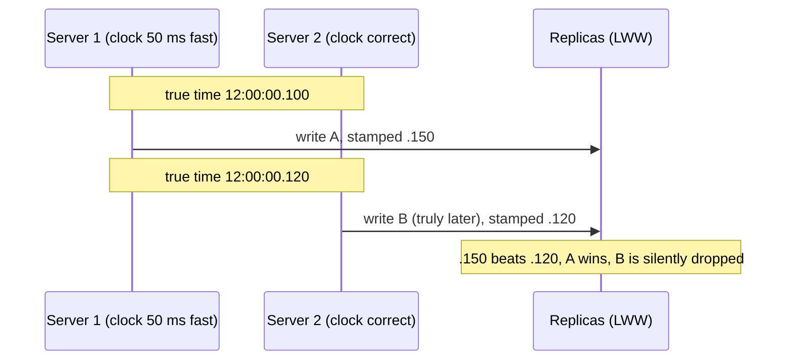
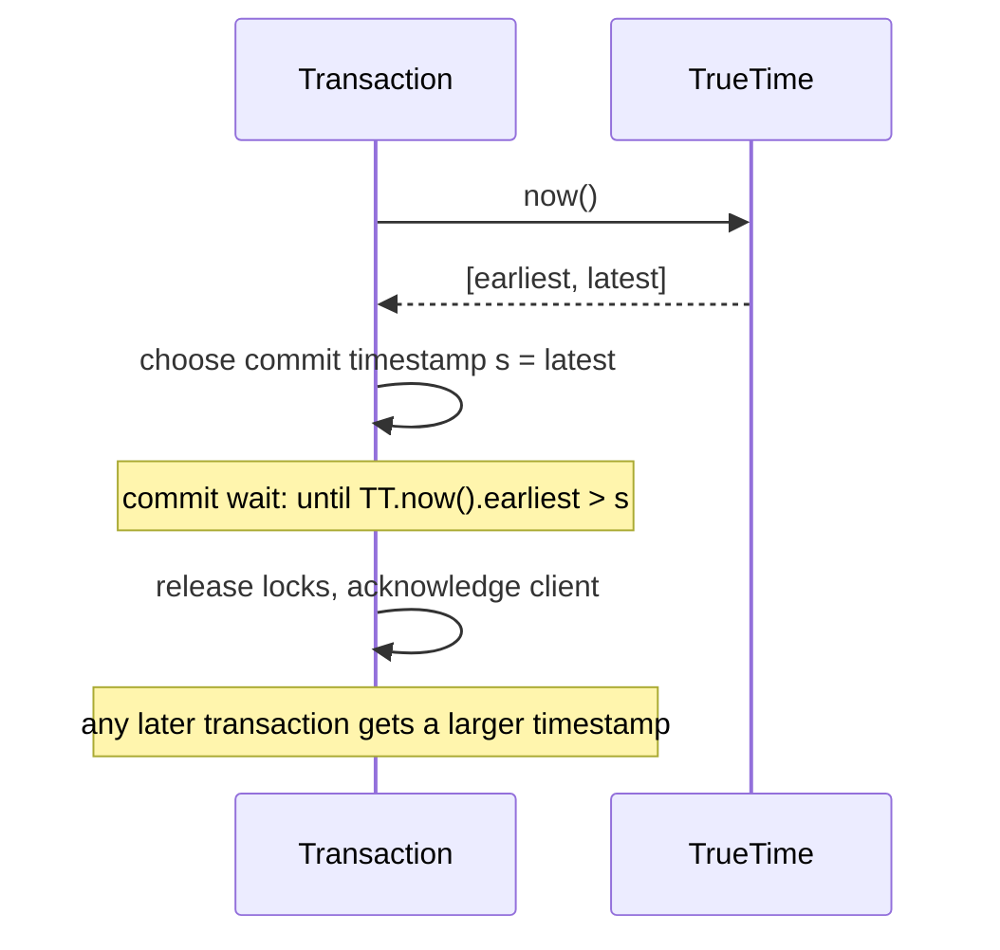
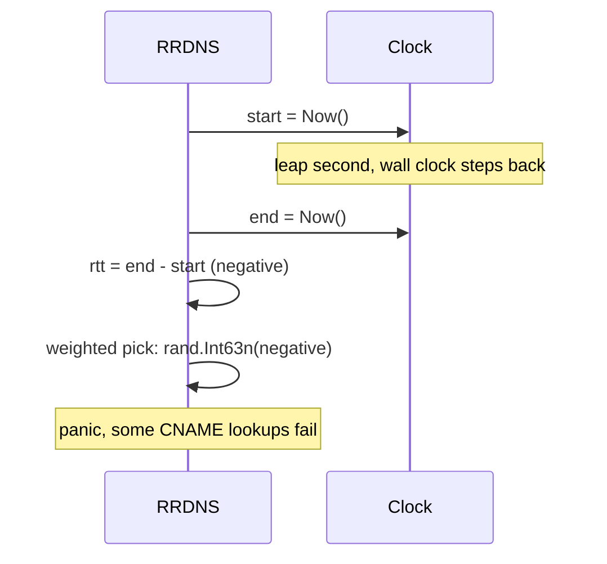

# Clock Skew: Why You Can't Trust Timestamps (NTP, TrueTime)

> **Prerequisites:** [Lesson 03: Network Partitions](../03-network-partitions/README.md) · [Lesson 04: Failure Detection](../04-failure-detection/README.md).  
> **Estimated Reading Time:** 22–26 minutes  
> **Target Audience:** Backend engineers who store timestamps, resolve conflicts with "latest wins", or set lease and lock expiries, and candidates asked "can you order events by timestamp?"  
> **Free PDF Notes:** [Download SD-H-005.pdf](https://backendroadmap.com/notes/system-design/SD-H-005.pdf)

> [!NOTE]
> **In one line:** Every machine's clock drifts and NTP keeps clocks only within milliseconds of each other, so timestamps from different servers cannot reliably order events. Use **monotonic** clocks for durations, and logical clocks, version numbers or bounded-uncertainty clocks when order matters.

> [!TIP]
> **The Golden Rule:** Wall-clock time is for *showing a date to a human*. Never use it to decide which of two writes from different machines wins, and never to measure how long something took.

---

## 1. What Clock Skew Is, and What It Isn't

Two servers write to the same record a few milliseconds apart, and you keep the one with the later timestamp. But if the second server's clock is 50 ms behind, the newer write carries the older timestamp and is silently thrown away. Across machines, timestamps lie by small, unpredictable amounts.

| Term | Precise Meaning | Example |
| :--- | :--- | :--- |
| **Clock drift** | One clock running slightly fast or slow | Quartz at 50 ppm gains 4.3 s a day |
| **Clock skew** | The difference between two clocks at the same instant | Server 1 is 50 ms ahead of server 2 |
| **Wall clock** | Time of day (`time.time()`, `DateTime.UtcNow`) | Can jump when NTP corrects it |
| **Monotonic clock** | A counter that only moves forward (`time.monotonic()`) | Right for timeouts and durations; meaningless across machines |
| **NTP** | Protocol that corrects clocks against time servers | About 1 ms on a good LAN, tens of ms over the internet |
| **Last-write-wins (LWW)** | Keep the write with the highest timestamp | Silently wrong under skew |
| **Not skew** | A slow network or a slow node | That is latency (lesson 02) |

### Why It Matters
1. "Order by timestamp" is the most natural wrong answer to "which write came last?"
2. The failures are **silent**: no error, no log, the user's update just vanishes.
3. Lease expiry, rate limiting, token validity and log ordering all depend on time, and all break under skew or clock jumps.

---

## 2. Anatomy: Why Clocks Disagree

Each server counts time with a quartz crystal whose frequency depends on temperature, so clocks drift by tens of microseconds per second. NTP periodically corrects each clock, but network delay limits its accuracy. Corrections can also make a clock jump **backwards**, and leap seconds add their own surprises.



| Clock | What it is for | Do not use it for |
| :--- | :--- | :--- |
| **Wall clock** | Showing dates to humans, rough logging | Durations, ordering across machines |
| **Monotonic clock** | Timeouts and durations on **one** machine | Comparing across machines |
| **Logical clocks** (lessons 06, 07) | Ordering events by causality | Real time |
| **Bounded-error clock** (TrueTime) | Ordering with a known uncertainty window | Needs special hardware |

> [!WARNING]
> **"Synchronised by NTP" does not mean "equal".** It means *probably within some milliseconds*, with no hard guarantee. A gap between two writes of a few milliseconds is smaller than the error.

---

## 3. Mathematical Model: How Often Does the Newer Write Lose?

Let each server's clock error be a normal random variable with standard deviation $\sigma$. Write 1 happens at true time $0$, write 2 at true time $g$ (the true gap). Write 2 loses under LWW when its stamp is smaller:

$$P(\text{newer loses}) = P\big(g + e_2 < e_1\big) = \Phi\!\left(-\frac{g}{\sigma\sqrt{2}}\right)$$

where $\Phi$ is the standard normal CDF. It is large when the gap $g$ is small compared with the clock error $\sigma$.

| Clock error $\sigma$ | Gap 5 ms | Gap 20 ms | Gap 100 ms | Gap 1 s |
| :---: | :---: | :---: | :---: | :---: |
| 1 ms | 0.02% | 0.00% | 0.00% | 0.00% |
| 5 ms | 23.91% | 0.23% | 0.00% | 0.00% |
| 10 ms | 36.07% | 7.86% | 0.00% | 0.00% |
| 50 ms | 47.18% | 38.77% | 7.89% | 0.00% |

(Monte Carlo, 200,000 trials per cell; the formula gives 0.23%, 7.86% and 38.86% for the 20 ms column.) In the limit of a tiny gap it approaches **50%**: when two writes are essentially simultaneous, the order is a coin flip.

**Drift on its own.** At $d$ parts per million a clock gains or loses $d\times10^{-6}\times86{,}400$ seconds a day. At 50 ppm that is $4.32$ s per machine, and two machines drifting opposite ways differ by $8.64$ s per day if never corrected.

---

## 4. Metrics & Percentiles

| Metric | Meaning | Alert when |
| :--- | :--- | :--- |
| **NTP offset** | Local clock minus the reference | Above a few milliseconds on a LAN |
| **NTP jitter / dispersion** | Noise in the offset estimate | Rising: the time source is unhealthy |
| **Clock step events** | Times the clock jumped | Any step on a production host |
| **Skew between two services** | Largest gap between hosts | Exceeds the smallest gap you rely on |
| **Lease margin** | Lease length minus skew and pause allowance | Margin below your worst pause |

### Worked Example
A store resolves conflicts by LWW. A user fixes their address on server 1 (clock 50 ms fast), then 20 ms later fixes a typo through server 2 (clock correct). The typo fix carries the smaller stamp, so every replica keeps the version with the typo, and nothing reports an error. Fixes: a version number or compare-and-set on the record, routing a user's writes through one leader, or logical or hybrid clocks (lessons 06 and 07).

---

## 5. Compounding: Skew Meets Leases and Timeouts

| Situation | What goes wrong | Defence |
| :--- | :--- | :--- |
| LWW on wall-clock stamps | Newer write dropped | Version numbers, CAS, a single leader |
| Lock lease "expires at $T$" | A holder with a slow clock keeps using it after others see it expire | Short leases plus **fencing tokens** (lessons 08, 13) |
| Timeout measured with `time.time()` | An NTP step makes the elapsed time negative or huge | Monotonic clock |
| Sorting logs from many hosts by local stamp | Effects appear before causes | Trace IDs and causal order, not clock order |
| Token "valid from" and "valid until" | Early or late rejection near the edges | Allow a skew margin (for example 60 s) |

---

## 6. Numbers Every Engineer Must Know

| Item | Typical | Implication |
| :--- | :---: | :--- |
| Quartz drift | tens of ppm (50 ppm is about 4.3 s/day) | Unsynced clocks diverge in seconds per day |
| NTP, good LAN | $\sim 1\text{ ms}$ | Still larger than many gaps between writes |
| NTP, internet | $\sim 10\text{–}50\text{ ms}$ | Do not order events with it |
| PTP with hardware timestamps | microseconds | Needs support in NICs and switches |
| Spanner TrueTime uncertainty $\varepsilon$ | about 4 ms most of the time, 1–7 ms sawtooth | Commit wait is about $2\varepsilon$ |
| Leap second | adds or repeats one second | Wall clock can step or repeat; many providers smear it over hours |

---

## 7. Protocol Deep Dive: TrueTime and Commit Wait

Google Spanner's TrueTime returns an **interval**, not a point: `TT.now()` is $[\text{earliest},\ \text{latest}]$, and the true time is guaranteed to be inside it. Time masters with GPS receivers and atomic clocks sit in each data center, and every machine runs a daemon that polls them. According to the Spanner paper, the uncertainty $\varepsilon$ is a sawtooth between about 1 and 7 ms over each 30-second poll interval, which is **4 ms most of the time**.

To make commit order match real-time order (external consistency), a transaction **waits out the uncertainty** before it becomes visible:



The cost is roughly $2\varepsilon$ per commit: about 8 ms at $\varepsilon=4$ ms and 14 ms at 7 ms. The benefit is that timestamp order equals real-time order. Without such hardware, assume skew of at least several milliseconds and design so that correctness does **not** depend on it: order writes at one place (a leader, a database sequence, a log offset).

---

## 8. Hierarchical Budgets & Design Rules

| Slice | Rule | Control |
| :--- | :--- | :--- |
| Durations and timeouts | Monotonic clock only | `time.monotonic()`, `Stopwatch`, `performance.now()` |
| Ordering of writes | Never wall-clock stamps from different machines | Version number, CAS, single sequencer, logical clock |
| Storage | UTC everywhere, convert at the edge | One zone in the database |
| Monitoring | NTP offset on every host | Alert above a few ms |
| Leases | Length well above skew plus the longest pause | Fencing token on every protected write |
| Tokens and caches | Allow a skew margin | $\pm 60\text{ s}$ on JWT `nbf` and `exp`, for example |

---

## 9. Top Mitigations

1. **Monotonic clocks for every duration.**
2. **Generate order at one place**: a leader, a sequence or a log offset.
3. **Version numbers or compare-and-set** instead of LWW for data that matters.
4. **Logical or hybrid clocks** when you need causal order without a central sequencer (lessons 06, 07).
5. **Bounded-uncertainty clocks** (TrueTime, cloud time-sync services) if you truly need real-time order, and wait out $\varepsilon$.
6. **Monitor NTP offset and step events**; run time sync on every host.
7. **Fencing tokens** on leases and locks so a slow clock cannot cause damage.

---

## 10. Production Case Study: Cloudflare, 1 January 2017

A published post-mortem: *How and why the leap second affected Cloudflare DNS*.

- **Trigger:** at 00:00 UTC on 1 January 2017 a leap second made some servers' clocks step **backwards**.
- **The code:** Cloudflare's DNS software, RRDNS, measures the round-trip time to an upstream resolver by subtracting a start time from `time.Now()`. Go's `time.Now()` at that time did not guarantee monotonicity. Because Cloudflare's resolvers answered in a few milliseconds, a one-second backward step made the measured time **negative**. Smoothed values eventually carried the negative number into the weighted choice of upstream, which passed it to `rand.Int63n()`, and that **panics on a negative argument**.
- **Impact:** only customers using CNAME records were affected, at peak about 0.2% of DNS queries, and fewer than 1% of HTTP requests saw an error. It lasted about six hours forty-five minutes (00:00 to 06:45 UTC); the most affected machines were patched within about 90 minutes.
- **The root cause, in the post-mortem's own words:** the belief that "time cannot go backwards".



**Lesson:** measure durations with a monotonic clock. Later Go versions use a monotonic reading for time differences automatically; the Cloudflare fix also discards bad data when time moves backwards.

---

## 11. Multi-Language Production Code Tabs

Each tab measures a duration the *right* way (monotonic) and shows the version-number alternative to last-write-wins.

````carousel
```go
// Go: time.Since uses the monotonic reading (Go 1.9+). Version check, not timestamp.
package main

import (
	"errors"
	"time"
)

func timed(work func()) time.Duration {
	start := time.Now() // carries a monotonic reading
	work()
	return time.Since(start) // computed from it, immune to wall-clock steps
}

var ErrConflict = errors.New("version conflict")

type Record struct {
	Version int
	Value   string
}

// Update succeeds only if the caller saw the latest version (compare-and-set).
func (r *Record) Update(expected int, value string) error {
	if r.Version != expected {
		return ErrConflict
	}
	r.Version++
	r.Value = value
	return nil
}
```
<!-- slide -->
```typescript
// TypeScript: performance.now() is monotonic; Date.now() is not.
function timed(work: () => void): number {
  const start = performance.now(); // monotonic, immune to clock changes
  work();
  return performance.now() - start;
}

interface Row {
  version: number;
  value: string;
}

// Compare-and-set instead of last-write-wins.
function update(row: Row, expectedVersion: number, value: string): Row {
  if (row.version !== expectedVersion) {
    throw new Error("version conflict: re-read and retry");
  }
  return { version: row.version + 1, value };
}
```
<!-- slide -->
```python
# Python: monotonic durations, plus the skew simulation behind this lesson's table.
import math
import random
import time


def timed(work):
    t0 = time.monotonic()            # right: immune to NTP steps
    work()
    return time.monotonic() - t0     # time.time() here can go backwards or jump


def lost_updates(gap_ms, sigma_ms, trials=200_000, seed=42):
    """Share of truly-later writes that last-write-wins drops."""
    rng = random.Random(seed)
    lost = 0
    for _ in range(trials):
        ts1 = rng.gauss(0, sigma_ms)             # write 1 at true time 0
        ts2 = gap_ms + rng.gauss(0, sigma_ms)    # write 2 at true time `gap_ms`
        lost += ts2 < ts1
    return lost / trials


def analytic(gap_ms, sigma_ms):
    return 0.5 * (1 + math.erf(-gap_ms / (sigma_ms * math.sqrt(2)) / math.sqrt(2)))
```
<!-- slide -->
```csharp
// C#: Stopwatch is monotonic; DateTime.UtcNow is not. Version check for updates.
using System.Diagnostics;

public static class Clocks
{
    public static TimeSpan Timed(Action work)
    {
        var start = Stopwatch.GetTimestamp(); // monotonic
        work();
        return Stopwatch.GetElapsedTime(start);
    }
}

public sealed class Record
{
    public int Version { get; private set; }
    public string Value { get; private set; } = "";

    // Compare-and-set: succeeds only if the caller saw the latest version.
    public bool TryUpdate(int expectedVersion, string value)
    {
        if (Version != expectedVersion) return false;
        Version++;
        Value = value;
        return true;
    }
}
```
````

---

## 12. Hands-On CLI Verification Workflows

The numbers in section 3 come from running the Python tab's `lost_updates` (Python 3.13, 200,000 trials per cell) and comparing with the formula. The two agree: for a 20 ms gap the simulation gives $0.23\%$, $7.86\%$ and $38.77\%$ for $\sigma = 5, 10, 50$ ms against $0.23\%$, $7.86\%$ and $38.86\%$ analytically.

```bash
# How far off is this machine's clock right now? (Linux with chrony)
chronyc tracking          # "System time" is the current offset from the reference

# With ntpd instead:
ntpq -p                   # offset column, in milliseconds

# Windows
w32tm /query /status
```

Interpretation: an offset of $\pm 1$ ms is healthy on a LAN; tens of milliseconds means the time source is far away or unhealthy, and any LWW-on-timestamps design on that host is already losing updates.

---

## 13. Common Mistakes to Avoid

1. **Measuring a timeout or latency with the wall clock.**
2. **Sorting events from many services by their local timestamps** and trusting the order.
3. **Assuming NTP means "exactly synchronised".**
4. **Last-write-wins on data where a lost update matters.**
5. **Leases and token expiry with no skew margin.**
6. **Storing local time instead of UTC.**
7. **Assuming time never goes backwards** (the Cloudflare root cause).
8. **Not monitoring NTP offset**, so skew grows unseen.

---

## 14. Key Terms Glossary

| Key Term | Definition |
| :--- | :--- |
| **Clock drift** | A clock running slightly fast or slow. |
| **Clock skew** | Difference between two clocks at the same moment. |
| **NTP** | Network Time Protocol: corrects clocks against time servers. |
| **PTP** | Precision Time Protocol: microsecond sync with hardware timestamps. |
| **Wall clock** | Time of day; can jump. |
| **Monotonic clock** | Never goes backwards; durations only. |
| **Last-write-wins** | Keep the write with the highest timestamp. |
| **TrueTime** | Spanner's clock API returning an interval $[\text{earliest}, \text{latest}]$. |
| **Commit wait** | Delaying a commit until its timestamp is surely in the past. |
| **External consistency** | Transaction order matches real-time order. |
| **Leap second smearing** | Spreading the extra second over hours. |

---

## 15. System Design Interview Questions & Answers

### Basic Conceptual Questions

<details>
<summary><strong>Q1: Why can't you order events across servers by timestamp? [BASIC]</strong></summary>

**Answer:**
Clocks drift and are only roughly synchronised, so skew of milliseconds or more is normal. An event that happened later can carry an earlier timestamp, and events within the skew window cannot be ordered at all.
</details>

<details>
<summary><strong>Q2: Wall clock vs monotonic clock? [BASIC]</strong></summary>

**Answer:**
The wall clock is time of day and can jump forward or backward when NTP corrects it. A monotonic clock only moves forward, so it is right for durations and timeouts, but it has no meaning across machines.
</details>

<details>
<summary><strong>Q3: What is NTP and how accurate is it? [BASIC]</strong></summary>

**Answer:**
A protocol that corrects a clock against time servers. About a millisecond on a good LAN and tens of milliseconds over the internet, with no hard guarantee.
</details>

<details>
<summary><strong>Q4: What is last-write-wins and when is it acceptable? [BASIC]</strong></summary>

**Answer:**
Keep the write with the highest timestamp. It is acceptable where losing a concurrent write does not matter (a cache, a "last seen" value) and unacceptable for data such as profiles or balances, because under skew it silently drops the newer write.
</details>

### Scenario-Based Architecture Questions

<details>
<summary><strong>Q5: Two users edit a document a few ms apart and one edit vanishes. Why and how do you fix it? [SCENARIO]</strong></summary>

**Answer:**
LWW on skewed timestamps kept the wrong write. Fix with a version number and compare-and-set (reject a stale write and let the client retry), a single leader that sequences writes, or logical or hybrid clocks that detect concurrency instead of guessing.
</details>

<details>
<summary><strong>Q6: Your timeout code uses `time.time()`. What can go wrong? [SCENARIO]</strong></summary>

**Answer:**
An NTP step or a leap second can make the elapsed time negative or huge, so timeouts never fire or fire at once. Use the monotonic clock. Cloudflare's 2017 DNS failure was exactly a negative duration reaching `rand.Int63n`.
</details>

<details>
<summary><strong>Q7: How do you set a distributed lock's lease safely? [SCENARIO]</strong></summary>

**Answer:**
Make the lease long relative to expected skew and pauses, and never rely on the holder's clock alone: issue a fencing token with each lease and have the protected resource reject writes carrying an older token (lessons 08, 13).
</details>

<details>
<summary><strong>Q8: How would you order log lines from 50 services? [SCENARIO]</strong></summary>

**Answer:**
Do not sort by local timestamp. Propagate a trace or correlation ID and a causal order (parent and child spans, or a logical or hybrid clock), and use timestamps only as a rough hint.
</details>

### Advanced & Tricky Interview Questions

<details>
<summary><strong>Q9: How does Spanner get real-time ordering? [TRICKY]</strong></summary>

**Answer:**
TrueTime returns an interval $[\text{earliest},\text{latest}]$ built from GPS and atomic-clock time masters. A transaction picks a commit timestamp at `latest`, then waits until `earliest` has passed it (commit wait, about $2\varepsilon$, a few milliseconds), so any later transaction gets a larger timestamp. That gives external consistency.
</details>

<details>
<summary><strong>Q10: Is a hybrid logical clock the same as a wall clock? [TRICKY]</strong></summary>

**Answer:**
No. It combines a physical time component with a logical counter so timestamps stay close to real time yet never go backwards and respect causality; lesson 07 covers it. It still does not give real-time order across machines.
</details>

<details>
<summary><strong>Q11: What is the probability that LWW drops the newer write? [TRICKY]</strong></summary>

**Answer:**
With independent normal clock errors of standard deviation $\sigma$ and a true gap $g$, it is $\Phi(-g/(\sigma\sqrt2))$. It approaches 50% as $g\to0$ and is negligible when $g\gg\sigma$; with $\sigma=10$ ms and $g=20$ ms it is about 7.9%.
</details>

<details>
<summary><strong>Q12: How should a system handle a leap second? [TRICKY]</strong></summary>

**Answer:**
Assume the wall clock can repeat or step back, use monotonic clocks for intervals, and prefer providers that smear the second over hours. Test code with a clock that moves backwards.
</details>

---

## 16. One-Page Master Cheat Sheet

```
+---------------------------------------------------------------------------------------------------------+
|                          CLOCK SKEW — MASTER CHEAT SHEET                                                |
+---------------------------------------------------------------------------------------------------------+
| 1. CLOCKS LIE: drift (50 ppm = 4.3 s/day) and skew. NTP: ~1 ms LAN, tens of ms internet. No guarantee.  |
+---------------------------------------------------------------------------------------------------------+
| 2. WALL vs MONOTONIC: wall = show dates (can jump). Monotonic = durations on ONE machine.               |
+---------------------------------------------------------------------------------------------------------+
| 3. LWW ON TIMESTAMPS: newer write loses with probability Phi(-g / (sigma sqrt 2)); 50% as gap -> 0.     |
+---------------------------------------------------------------------------------------------------------+
| 4. ORDER SOMEWHERE ELSE: leader, sequence, log offset, version + CAS, logical / hybrid clocks.          |
+---------------------------------------------------------------------------------------------------------+
| 5. REAL TIME NEEDED: TrueTime interval + commit wait (~2 epsilon, epsilon ~4 ms).                       |
+---------------------------------------------------------------------------------------------------------+
| 6. OPERATE: monitor NTP offset, leases with margin + fencing tokens, UTC everywhere.                    |
+---------------------------------------------------------------------------------------------------------+
```

---

## Further Reading & Sources

- Cloudflare, [How and why the leap second affected Cloudflare DNS](https://blog.cloudflare.com/how-and-why-the-leap-second-affected-cloudflare-dns/) (January 2017).
- Corbett et al., [Spanner: Google's Globally-Distributed Database](https://research.google/pubs/spanner-googles-globally-distributed-database-2/) (OSDI 2012), section 3 for TrueTime.
- Martin Kleppmann, *Designing Data-Intensive Applications*, chapter 8, "Unreliable Clocks".
- Leslie Lamport, "Time, Clocks, and the Ordering of Events in a Distributed System" (1978), next lesson.

---

## Free PDF Notes

[SD-H-005.pdf](https://backendroadmap.com/notes/system-design/SD-H-005.pdf)

---

## Next

Continue with [Lesson 06: Lamport Clocks & Happens-Before](../06-lamport-clocks-happens-before-explained-simply/README.md).
