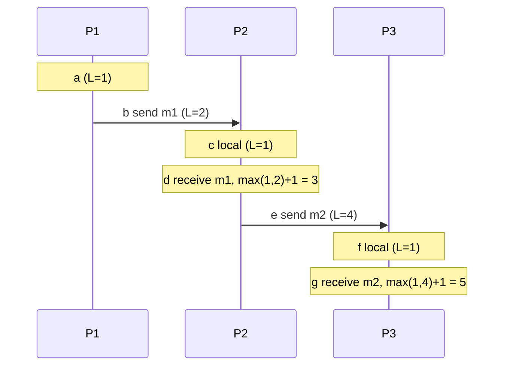
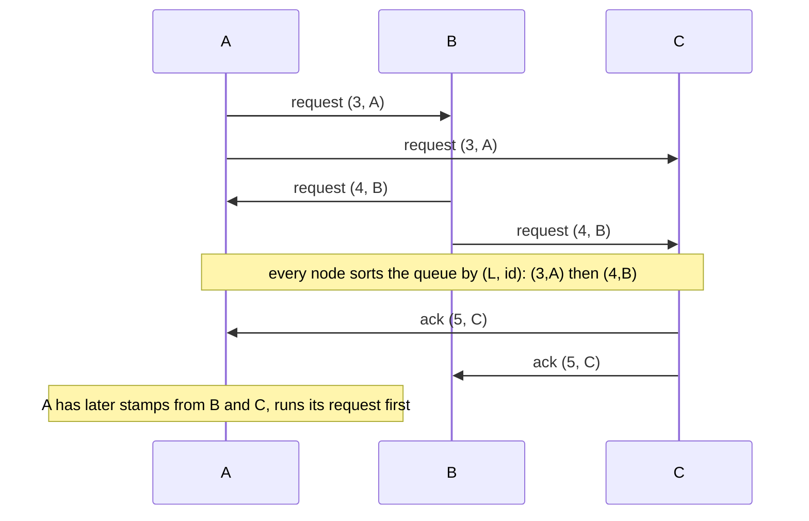
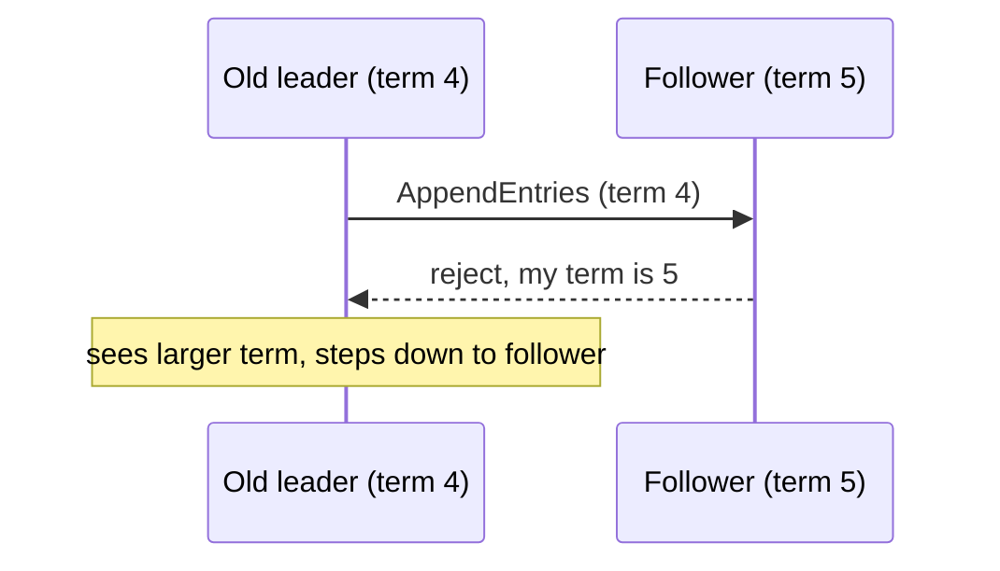

# Lamport Clocks & Happens-Before, Explained Simply

> **Prerequisites:** [Lesson 05: Clock Skew](../05-clock-skew/README.md).  
> **Estimated Reading Time:** 20–24 minutes  
> **Target Audience:** Backend engineers who need to order events across machines without trusting wall clocks, and candidates asked "how do you order events in a distributed system?"  
> **Free PDF Notes:** [Download SD-H-006.pdf](https://backendroadmap.com/notes/system-design/SD-H-006.pdf)

> [!NOTE]
> **In one line:** A Lamport clock is a counter on each node, incremented on every event and carried on every message, so that if event *a* could have caused *b* then *a*'s timestamp is smaller. Ties broken by node ID give a total order every replica agrees on, but the timestamps alone cannot tell you whether two events were concurrent.

> [!TIP]
> **The Golden Rule:** If I send you a letter and you reply, my letter happened before your reply, whatever any watch says. A Lamport clock turns that into a counter: causes always get smaller numbers than their effects. The reverse does **not** hold.

---

## 1. What a Lamport Clock Is, and What It Isn't

If wall clocks cannot order events across machines (lesson 05), what can? In 1978 Leslie Lamport showed that you do not need real time at all. What matters is **causality**: which events could have influenced which.

| Term | Precise Meaning | Example |
| :--- | :--- | :--- |
| **Event** | Something that happens on one process: a local step, a send or a receive | "Process 2 receives message m1" |
| **Happens-before** ($a\to b$) | $a$ could have influenced $b$ (rules below) | A message send precedes its receive |
| **Concurrent** ($a \parallel b$) | Neither $a\to b$ nor $b\to a$ | Two unrelated events on different nodes |
| **Lamport clock** | An integer counter per process following three rules | $L=5$ |
| **Total order** | Every pair of events has a definite order | Sort by $(L, \text{process id})$ |
| **Not a clock in the usual sense** | It does not measure time at all | Cannot answer "what happened at 3 p.m.?" |

**Happens-before** is defined by three rules. Event $a$ happens before $b$ if:
1. $a$ and $b$ are on the **same process** and $a$ comes first; or
2. $a$ is the **sending** of a message and $b$ is its **receipt**; or
3. there is a **chain** of such steps from $a$ to $b$ (transitivity).

### Why It Matters
1. It is the basis for logical ordering in replicated logs, consensus protocols (Raft terms) and version vectors.
2. It teaches the right question: not "what time was it?" but "could this event have known about that one?"
3. Its limits motivate vector clocks (lesson 07), a frequent follow-up in interviews.

---

## 2. Anatomy: Three Rules Are the Whole Algorithm

Each process keeps one integer $L$, starting at 0.

| Event | Rule |
| :--- | :--- |
| **Local event** | $L \leftarrow L + 1$, stamp the event with $L$ |
| **Send** | $L \leftarrow L + 1$, attach $L$ to the message |
| **Receive** a message stamped $M$ | $L \leftarrow \max(L, M) + 1$, stamp the receive with $L$ |



Reading it: $a\to b\to d\to e\to g$ is a causal chain and the timestamps rise $1,2,3,4,5$. Events $a$, $c$ and $f$ all have $L=1$ and are **concurrent**: they share a value because none knew about the others.

> [!WARNING]
> **One direction only.** $a \to b \Rightarrow L(a) < L(b)$. But $L(a) < L(b)$ does **not** mean $a$ caused $b$: they may be completely unrelated. Never conclude causality from a smaller number.

---

## 3. Mathematical Model: What Is Guaranteed

The **clock condition**:

$$a \to b \;\Longrightarrow\; L(a) < L(b)$$

and its contrapositive, useful for reasoning: if $L(a) \ge L(b)$ then $a$ did **not** happen before $b$.

To get a *total* order, break ties with the process ID. Compare the pair $(L, p)$ lexicographically:

$$(L_a, p_a) < (L_b, p_b) \iff L_a < L_b \ \text{ or }\ (L_a = L_b \text{ and } p_a < p_b)$$

| Question | Lamport clock answers | Why |
| :--- | :--- | :--- |
| Order causally related events? | **Yes** | The clock condition |
| Is the order the same on every node? | **Yes**, with the $(L,p)$ tie-break | Total, deterministic |
| Tell whether two events are concurrent? | **No** | Needs vector clocks (lesson 07) |
| Match real time? | **No** | No link to wall time |
| Order events when a node is down or silent? | Only after hearing from everyone | Needs consensus to be fault tolerant (lesson 09) |

---

## 4. Metrics & Percentiles

| Metric | Meaning | Why you care |
| :--- | :--- | :--- |
| **Counter growth rate** | How fast $L$ increases | A runaway counter suggests a bug or a malicious huge value |
| **Counter gap between nodes** | Largest $L$ difference across replicas | Shows how lagging a replica is, roughly |
| **Concurrent pairs** | Events with no causal relation | Candidates for conflict handling |
| **Ties broken by node ID** | Events with equal $L$ | These are exactly the concurrent ones: the order is arbitrary but agreed |

### Worked Example
Three replicas accept operations and exchange them; each entry carries a Lamport timestamp and the creating replica's ID. Replica A creates `set x=1` at $(3, A)$. Replica B, which had already received A's earlier messages, creates `set x=2` at $(4, B)$. Every replica applies entries sorted by $(L, p)$, so all finish with $x=2$, and an operation that depends on another is always applied after it. Lamport's paper used this idea to build a mutual-exclusion algorithm with a shared request queue.

---

## 5. Compounding: How Often Does the Order Mislead?

Timestamps look like an order even for events that are not related. A simulation of five processes passing random messages (400 events, 79,800 pairs) counted, for every pair, the ground truth from vector clocks:

| Pair type | Count | What Lamport order says |
| :--- | :---: | :--- |
| **Causally ordered** | 58,951 | Always correct: **0 violations** |
| **Concurrent** | 20,849 | Looks ordered in **20,170** of them (96.7%); tied in 679 |

So the one-way guarantee holds perfectly, and yet **about 97% of concurrent pairs would be misread as "one happened first"** if you treated a smaller timestamp as causality. That is the practical reason vector clocks exist.

---

## 6. Numbers Every Engineer Must Know

| Item | Typical | Implication |
| :--- | :---: | :--- |
| Size of a Lamport timestamp | 8 bytes (one integer) | Cheap to attach to every message |
| Size of a vector clock | $n$ integers | Grows with the number of nodes (lesson 07) |
| Cost per event | one increment, one `max` | Negligible |
| Needs synchronised clocks? | No | The whole point |
| Origin | Lamport, *CACM*, July 1978 | One of the most cited papers in the field |
| Real systems using the idea | Raft terms, version numbers, logical sequence IDs | See the case study |

---

## 7. Protocol Deep Dive: From Partial Order to a Replicated Log

Lamport's use of the clock: to serve requests in the same order everywhere, each node broadcasts timestamped requests, keeps them in a queue sorted by $(L,p)$, and acts on the head only once it has seen a later-timestamped message from **every** other node.



The catch (limits): the total order is fixed only after you have heard from everyone, so one silent node blocks progress. Tolerating failures needs **consensus** (lesson 09).

| Can a Lamport clock do this? | Answer |
| :--- | :--- |
| Order causally related events | Yes |
| Tell whether two events are concurrent | No (vector clocks) |
| Give a global total order | Yes, with the process-ID tie-break |
| Match real time | No |

---

## 8. Hierarchical Budgets & Design Rules

| Slice | Rule | Control |
| :--- | :--- | :--- |
| Order across nodes | Use $(L, \text{node id})$ pairs | Deterministic tie-break |
| Conflict detection | Do not use Lamport stamps for it | Vector clocks or version vectors |
| Real-time questions | Keep a wall-clock field as well, for humans | Store both; order by the logical one |
| Counter safety | Reject absurd jumps from untrusted peers | A single huge value would push every counter up |
| Persistence | Save the counter (or recover it on restart) | A node that restarts at 0 breaks the condition |
| Scale | Fine for any number of nodes | One integer per message |

---

## 9. Top Mitigations

1. **Stamp every message** with the sender's counter and apply the $\max+1$ rule on receipt.
2. **Break ties by node ID** to make the order total and identical everywhere.
3. **Do not infer causality** from "smaller timestamp".
4. **Use vector clocks** (or version vectors) when you must detect concurrent updates.
5. **Persist the counter** so a restart never reuses or lowers values.
6. **Keep wall time as metadata**, not as the ordering key.

---

## 10. Production Case Study: Raft Terms

Raft is a consensus algorithm used by etcd, Consul and many databases. Its paper (Ongaro and Ousterhout, *In Search of an Understandable Consensus Algorithm*) says it directly: **"Terms act as a logical clock [14] in Raft"**, and reference 14 is Lamport's paper.

- **The mechanism:** each server stores a *current term* number that increases monotonically. Terms are exchanged whenever servers communicate; if a server's term is smaller than the other's, it updates to the larger value (the same idea as $\max(\text{local}, \text{received})$).
- **What it buys:** servers can detect **obsolete information such as stale leaders**. A leader or candidate that sees a larger term immediately reverts to follower; a server that receives a request with a stale term rejects it.
- **No wall clock needed** for the correctness of "who is the latest leader".



**Lesson:** a logical counter that is exchanged and maxed is enough to make stale actors identify themselves, which is exactly what you needed in lesson 03 when an isolated old leader woke up believing it still led. Lesson 08 turns the same idea into **fencing tokens**.

---

## 11. Multi-Language Production Code Tabs

````carousel
```go
// Go: Lamport clock, safe for concurrent use.
package main

import "sync"

type Lamport struct {
	mu sync.Mutex
	t  uint64
}

// Tick is called for a local event or just before sending.
func (l *Lamport) Tick() uint64 {
	l.mu.Lock()
	defer l.mu.Unlock()
	l.t++
	return l.t
}

// Receive merges the timestamp carried by an incoming message.
func (l *Lamport) Receive(msgT uint64) uint64 {
	l.mu.Lock()
	defer l.mu.Unlock()
	if msgT > l.t {
		l.t = msgT
	}
	l.t++
	return l.t
}

type Stamp struct {
	T    uint64
	Node string
}

// Less is the total order: by counter, then by node id.
func (a Stamp) Less(b Stamp) bool {
	if a.T != b.T {
		return a.T < b.T
	}
	return a.Node < b.Node
}
```
<!-- slide -->
```typescript
// TypeScript: Lamport clock plus the (counter, node) total order.
class Lamport {
  private t = 0;

  tick(): number {
    return ++this.t; // local event or send
  }

  receive(msgT: number): number {
    this.t = Math.max(this.t, msgT) + 1;
    return this.t;
  }
}

interface Stamp {
  t: number;
  node: string;
}

const compare = (a: Stamp, b: Stamp): number =>
  a.t - b.t || (a.node < b.node ? -1 : a.node > b.node ? 1 : 0);

// log.sort(compare) gives every replica the same sequence.
```
<!-- slide -->
```python
# Python: Lamport clock and the simulation behind section 5.
import itertools
import random


class Lamport:
    def __init__(self, pid):
        self.t, self.pid = 0, pid

    def tick(self):                       # local event or just before sending
        self.t += 1
        return (self.t, self.pid)

    def receive(self, msg_t):             # message carries the sender's timestamp
        self.t = max(self.t, msg_t) + 1
        return (self.t, self.pid)


# every replica sorts the same entries into the same total order
# log.sort(key=lambda e: (e.t, e.pid))


def simulate(n=5, steps=400, seed=1):
    """Return (causal pairs, violations, concurrent pairs, concurrent pairs that look ordered)."""
    rng = random.Random(seed)
    lam, vec = [0] * n, [[0] * n for _ in range(n)]
    inbox, events = [[] for _ in range(n)], []
    for _ in range(steps):
        p, action = rng.randrange(n), rng.choice(["local", "send", "recv"])
        if action == "recv" and inbox[p]:
            l, v = inbox[p].pop(rng.randrange(len(inbox[p])))
            lam[p] = max(lam[p], l) + 1
            vec[p] = [max(a, b) for a, b in zip(vec[p], v)]
        else:
            lam[p] += 1
        vec[p][p] += 1
        events.append((lam[p], tuple(vec[p])))
        if action == "send":
            inbox[rng.choice([x for x in range(n) if x != p])].append((lam[p], tuple(vec[p])))
    before = lambda a, b: all(x <= y for x, y in zip(a, b)) and a != b
    causal = bad = conc = looks = 0
    for (la, va), (lb, vb) in itertools.combinations(events, 2):
        if before(va, vb) or before(vb, va):
            causal += 1
            bad += (la >= lb) if before(va, vb) else (lb >= la)
        else:
            conc += 1
            looks += la != lb
    return causal, bad, conc, looks
```
<!-- slide -->
```csharp
// C#: Lamport clock and a comparer for the (counter, node) total order.
public sealed class Lamport
{
    private long _t;
    private readonly object _gate = new();

    public long Tick()
    {
        lock (_gate) return ++_t;           // local event or send
    }

    public long Receive(long msgT)
    {
        lock (_gate)
        {
            _t = Math.Max(_t, msgT) + 1;
            return _t;
        }
    }
}

public readonly record struct Stamp(long T, string Node) : IComparable<Stamp>
{
    public int CompareTo(Stamp other)
    {
        var c = T.CompareTo(other.T);
        return c != 0 ? c : string.CompareOrdinal(Node, other.Node);
    }
}
```
````

---

## 12. Hands-On CLI Verification Workflows

The Python tab's `simulate()` (Python 3.13, five processes, 400 random events, seed 1) checks the guarantee against vector-clock ground truth:

```text
events 400, pairs 79,800
causally ordered pairs: 58,951  -> Lamport order violated: 0
concurrent pairs:       20,849  -> look ordered by Lamport: 20,170 (96.7%), tied: 679
```

Two takeaways: the **clock condition never fails** (0 of 58,951), and **most concurrent pairs are not ties**: their numbers differ, so a smaller timestamp tells you nothing about causality.

Try the by-hand example from section 2:

```python
p1, p2, p3 = Lamport("P1"), Lamport("P2"), Lamport("P3")
p1.tick(); m1 = p1.tick()            # a (1), send b (2)
p2.tick(); p2.receive(m1[0])         # c (1), receive d = max(1,2)+1 = 3
m2 = p2.tick()                       # send e = 4
p3.tick(); print(p3.receive(m2[0]))  # f (1), receive g = max(1,4)+1 = 5  -> (5, 'P3')
```

---

## 13. Common Mistakes to Avoid

1. **Concluding "$a$ caused $b$" from $L(a) < L(b)$.**
2. **Using Lamport stamps to detect conflicts**: you need vector clocks.
3. **Forgetting the receive rule** ($\max$, then $+1$).
4. **Not persisting the counter**, so a restart goes backwards.
5. **Using only the counter as the sort key**, leaving ties ordered differently on different nodes.
6. **Trusting a huge counter from a peer** and letting it run every node's clock up.
7. **Expecting the order to match real time.**
8. **Assuming a total order makes the system fault tolerant**: it needs consensus (lesson 09).

---

## 14. Key Terms Glossary

| Key Term | Definition |
| :--- | :--- |
| **Happens-before ($\to$)** | Partial order: same process order, send before receive, and transitivity. |
| **Concurrent ($\parallel$)** | Neither event happened before the other. |
| **Lamport clock** | Per-process counter: tick on events, `max + 1` on receive. |
| **Clock condition** | $a\to b \Rightarrow L(a)<L(b)$. |
| **Partial order** | Some pairs are unordered (concurrent). |
| **Total order** | Every pair is ordered, here by $(L, \text{id})$. |
| **Term (Raft)** | A logical epoch that acts as a Lamport clock. |
| **Causality** | One event could have influenced another. |
| **Vector clock** | Per-node counters that can detect concurrency (lesson 07). |

---

## 15. System Design Interview Questions & Answers

### Basic Conceptual Questions

<details>
<summary><strong>Q1: What does "happens-before" mean? [BASIC]</strong></summary>

**Answer:**
$a\to b$ if $a$ could have influenced $b$: both on one process with $a$ first, or $a$ sends a message that $b$ receives, or a chain of such steps. If neither $a\to b$ nor $b\to a$, the events are concurrent.
</details>

<details>
<summary><strong>Q2: How does a Lamport clock work? [BASIC]</strong></summary>

**Answer:**
Each process keeps a counter. Increment it on every local event and send, attach it to messages, and on receipt set it to $\max(\text{local}, \text{received})+1$.
</details>

<details>
<summary><strong>Q3: What does it guarantee? [BASIC]</strong></summary>

**Answer:**
If $a$ happened before $b$ then $L(a)<L(b)$, so sorting by timestamp never puts an effect before its cause.
</details>

<details>
<summary><strong>Q4: What does it not guarantee? [BASIC]</strong></summary>

**Answer:**
$L(a)<L(b)$ does not imply $a\to b$; they may be concurrent. It cannot detect concurrency and has no relation to real time.
</details>

### Scenario-Based Architecture Questions

<details>
<summary><strong>Q5: How do you get the same order of operations on every replica? [SCENARIO]</strong></summary>

**Answer:**
Stamp each operation with $(L, \text{replica id})$ and apply operations sorted by that pair. Ties (concurrent operations) break by ID, so the order is arbitrary but identical everywhere, and dependent operations always come after their causes.
</details>

<details>
<summary><strong>Q6: Why not just use timestamps from `now()`? [SCENARIO]</strong></summary>

**Answer:**
Wall clocks drift and can step backwards, so an effect could carry an earlier stamp than its cause (lesson 05). A logical clock respects causality by construction and needs no synchronisation.
</details>

<details>
<summary><strong>Q7: Two edits get stamps 7 and 9. Did the first cause the second? [SCENARIO]</strong></summary>

**Answer:**
Not necessarily. Smaller means *possibly* earlier, never *definitely* causal. To know, compare vector clocks: if neither dominates, the edits are concurrent and must be merged.
</details>

<details>
<summary><strong>Q8: A node restarts and its counter resets to 0. What breaks? [SCENARIO]</strong></summary>

**Answer:**
Its new events may get lower stamps than events it has already caused, violating the clock condition. Persist the counter, or recover it by taking the max of everything seen before sending.
</details>

### Advanced & Tricky Interview Questions

<details>
<summary><strong>Q9: Lamport clock vs vector clock? [TRICKY]</strong></summary>

**Answer:**
Lamport: one integer, gives a causality-respecting total order, cannot detect concurrency. Vector: one integer per node, detects concurrency exactly, but grows with the number of nodes. Use Lamport to order, vector to find conflicts.
</details>

<details>
<summary><strong>Q10: Is a Raft term a Lamport clock? [TRICKY]</strong></summary>

**Answer:**
Essentially yes: the Raft paper says terms act as a logical clock. Servers exchange terms and adopt the larger one, which lets a stale leader recognise that it is out of date and step down.
</details>

<details>
<summary><strong>Q11: Does a total order from Lamport clocks give you consensus? [TRICKY]</strong></summary>

**Answer:**
No. The order is final only after hearing from every process, so one silent node blocks progress. Fault-tolerant agreement needs a consensus protocol such as Raft or Paxos.
</details>

<details>
<summary><strong>Q12: How often is "smaller timestamp" wrong as a causality test? [TRICKY]</strong></summary>

**Answer:**
Never for causally related pairs, but for concurrent pairs it looks like an order almost always. In a five-process simulation, 96.7% of concurrent pairs had different Lamport values, so they would be misread as ordered.
</details>

---

## 16. One-Page Master Cheat Sheet

```
+---------------------------------------------------------------------------------------------------------+
|                          LAMPORT CLOCKS — MASTER CHEAT SHEET                                            |
+---------------------------------------------------------------------------------------------------------+
| 1. HAPPENS-BEFORE: same-process order · send before receive · transitive. Else concurrent.              |
+---------------------------------------------------------------------------------------------------------+
| 2. RULES: local/send: L = L + 1 · receive(M): L = max(L, M) + 1 · attach L to every message.            |
+---------------------------------------------------------------------------------------------------------+
| 3. GUARANTEE: a -> b implies L(a) < L(b).   NOT the reverse.                                            |
+---------------------------------------------------------------------------------------------------------+
| 4. TOTAL ORDER: sort by (L, node id). Same everywhere; concurrent events ordered arbitrarily.           |
+---------------------------------------------------------------------------------------------------------+
| 5. LIMITS: cannot detect concurrency (vector clocks) · no real time · needs consensus for fault tolerance. |
+---------------------------------------------------------------------------------------------------------+
| 6. IN PRACTICE: Raft terms, logical sequence numbers, ordering replicated logs.                         |
+---------------------------------------------------------------------------------------------------------+
```

---

## Further Reading & Sources

- Leslie Lamport, "Time, Clocks, and the Ordering of Events in a Distributed System", *Communications of the ACM*, July 1978.
- Diego Ongaro and John Ousterhout, [In Search of an Understandable Consensus Algorithm](https://raft.github.io/raft.pdf), section 5.1 ("Terms act as a logical clock").
- Martin Kleppmann, *Designing Data-Intensive Applications*, chapter 8, "Ordering and causality" and chapter 9.

---

## Free PDF Notes

[SD-H-006.pdf](https://backendroadmap.com/notes/system-design/SD-H-006.pdf)

---

## Next

Continue with [Lesson 07: Vector Clocks & Hybrid Logical Clocks](../07-vector-clocks-hybrid-logical-clocks/README.md): detecting conflicts.
