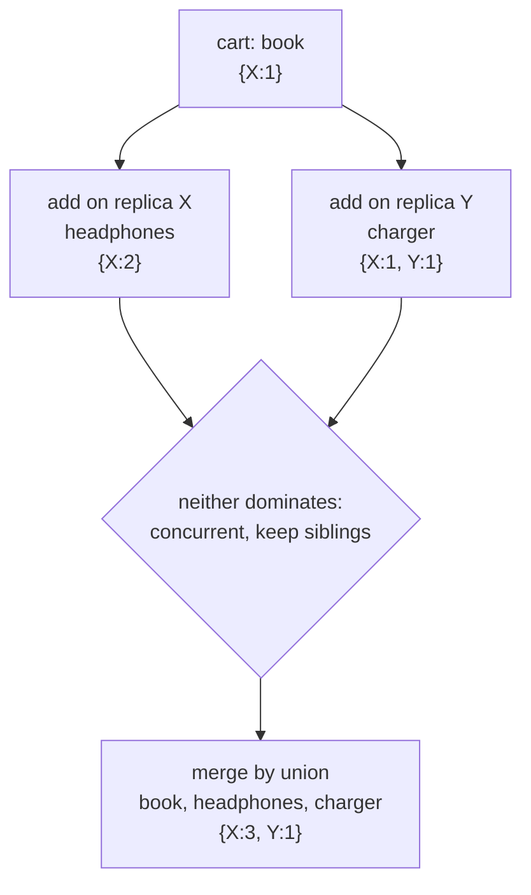
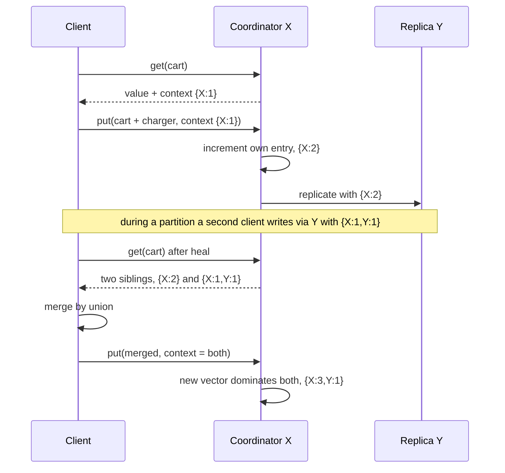
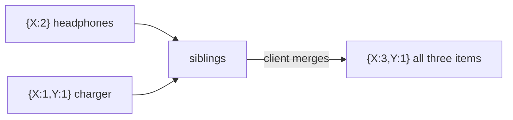

# Vector Clocks & Hybrid Logical Clocks: Detecting Conflicts

> **Prerequisites:** [Lesson 05: Clock Skew](../05-clock-skew/README.md) · [Lesson 06: Lamport Clocks](../06-lamport-clocks-happens-before-explained-simply/README.md).  
> **Estimated Reading Time:** 22–26 minutes  
> **Target Audience:** Backend engineers building replicated stores, offline-first apps or multi-writer systems, and candidates asked "how do you detect concurrent updates?"  
> **Free PDF Notes:** [Download SD-H-007.pdf](https://backendroadmap.com/notes/system-design/SD-H-007.pdf)

> [!NOTE]
> **In one line:** A vector clock keeps one counter per node, so comparing two versions tells you whether one came after the other or whether they were **concurrent** and conflict. A hybrid logical clock combines physical time with a counter to give timestamps close to real time that still respect causality.

> [!TIP]
> **The Golden Rule:** Lamport clocks *order*; vector clocks *detect conflicts*; hybrid logical clocks *order while staying near wall time*. Detecting a conflict is only half the job: you still need a merge rule.

---

## 1. What They Are, and What They Aren't

Two users add items to the same shopping cart on two different replicas at the same moment. Neither update saw the other. With last-write-wins one item silently disappears. To merge correctly, the system must first know that the two versions were **concurrent**. A Lamport clock cannot tell (lesson 06); a vector clock can.

| Term | Precise Meaning | Example |
| :--- | :--- | :--- |
| **Vector clock** | One counter per node, carried with each version | `{X:2, Y:1}` |
| **Version vector** | A vector clock attached to a *replica's copy of a key* | Per-key, per-replica counters |
| **Sibling** | A concurrent version kept alongside others until merged | Two carts after a partition |
| **Dominates** | Every counter is at least as large, one strictly larger | `{X:2,Y:1}` dominates `{X:2}` |
| **Concurrent** | Neither dominates the other | `{X:2}` vs `{X:1,Y:1}` |
| **Hybrid logical clock (HLC)** | `(physical time, logical counter)` | `(1050, 3)` |
| **Not a CRDT** | A clock *detects* conflicts, it does not merge them | Merging is your job (or a CRDT's, lesson 19) |

### Why It Matters
1. Any system that accepts writes on more than one node (Dynamo-style stores, offline apps, multi-region writes) must decide what "conflict" means.
2. Without concurrency detection, you can only guess, and last-write-wins guesses wrong silently.
3. HLCs are how several modern databases get timestamps that are both causal and human-readable without special hardware.

---

## 2. Anatomy: How a Vector Clock Works

Each version of a value carries a vector, one counter per node, like `{X:2, Y:1}`.

| Event | Rule |
| :--- | :--- |
| **Node N updates the value** | Increment N's own entry |
| **Versions meet** | Compare entry by entry (below) |
| **Merging two versions** | New vector is the element-wise maximum, then the writer increments its own entry |

Compare two vectors $V_1$ and $V_2$, treating a missing entry as 0:

| Condition | Meaning | Action |
| :--- | :--- | :--- |
| $V_1 \le V_2$ everywhere and at least one smaller | $V_1$ happened before $V_2$ | Keep $V_2$, drop $V_1$ |
| Equal everywhere | Same version | Keep one |
| Larger in some entries, smaller in others | **Concurrent**: a real conflict | Keep both as siblings, merge |



> [!WARNING]
> **Detecting is not resolving.** The clock tells you two versions are concurrent. *What* the merged value should be (union, max, last-by-business-rule) is application logic. A union of carts can resurrect an item the user deleted.

---

## 3. Mathematical Model: Why Vector Clocks Capture Causality Exactly

Write $V(a)$ for the vector of event $a$. Then:

$$a \to b \iff V(a) < V(b)$$

where $V(a) < V(b)$ means every entry of $V(a)$ is $\le$ that of $V(b)$ and at least one is strictly smaller. Compare with Lamport clocks, which only give the one-way implication $a\to b \Rightarrow L(a) < L(b)$. Concurrency is $V(a)\not\le V(b)$ and $V(b)\not\le V(a)$.

**Cost.** A vector has one entry per writing node: $O(n)$ space per version.

**Hybrid logical clock update** (Kulkarni et al.): keep $(pt, c)$ where $pt$ is the largest physical time seen. On a local event or send with wall time $w$:

$$pt' = \max(pt, w), \qquad c' = \begin{cases} 0 & \text{if } pt' > pt \\ c + 1 & \text{otherwise}\end{cases}$$

On receiving $(pt_m, c_m)$, take $pt' = \max(pt, w, pt_m)$ and bump the counter if physical time did not advance.

| Clock | Size | Detects concurrency | Close to real time | Needs synced clocks |
| :--- | :---: | :---: | :---: | :---: |
| Wall clock | 8 bytes | No | Yes, but skewed | Yes |
| Lamport | 8 bytes | No | No | No |
| **Vector** | $n$ integers | **Yes** | No | No |
| **HLC** | 8–12 bytes | No | **Yes** (within clock error) | Loosely |

---

## 4. Metrics & Percentiles

| Metric | Meaning | Why you care |
| :--- | :--- | :--- |
| **Sibling count per key** | Concurrent versions returned on a read | Rising means conflicts are common or unmerged |
| **Fraction of reads with $>1$ version** | How often reconciliation is needed | In Dynamo's cart service, tiny (see case study) |
| **Vector size** | Entries per clock | Growth means many writers or no pruning |
| **Merge failures** | Merges that lose data or loop | Application bug indicator |
| **HLC drift from wall time** | $pt - \text{wall}$ | Large drift means a peer with a fast clock |

### Worked Example
Replica X holds a cart with a book at `{X:1}`. During a partition a session adds headphones on X (`{X:2}`), and another session reads the old cart and adds a charger on Y (`{X:1,Y:1}`). After the heal, neither vector is greater, so the store keeps both siblings. The cart logic merges by union and writes `{book, headphones, charger}` at `{X:3,Y:1}`, which dominates both.

---

## 5. Compounding: What the Clock Saves You

A simulation of 10,000 concurrent "add to cart" pairs, one branch with headphones, one with a charger, resolved two ways:

| Strategy | Items lost per 1,000 concurrent adds |
| :--- | :---: |
| **Last-write-wins** (timestamps effectively a coin flip for near-simultaneous writes) | **1,000** (one added item dropped every time) |
| **Vector clock + union merge** | **0** |

The price of the second row: the application must write a merge function, and a union can bring back deleted items. The first row is what you get for free.

---

## 6. Numbers Every Engineer Must Know

| Item | Typical | Implication |
| :--- | :---: | :--- |
| Vector clock size | $n$ entries | Per writer node (or client) |
| Dynamo's truncation threshold | about 10 pairs | Oldest pair dropped when it grows past it |
| HLC size | 8–12 bytes, depending on the layout | Compares like a timestamp: physical part first, then counter |
| Divergent reads in a real cart service | $\approx 0.06\%$ | Conflicts are rare but must be handled |
| CockroachDB: node out of sync by 80% of the max offset | Crashes itself | Bounded clock error is an explicit precondition |
| Cost of compare | $O(n)$ | Cheap for small $n$ |

---

## 7. Protocol Deep Dive: Dynamo-Style Read and Write With Vector Clocks



The client passes the **context** (the vector it read) back on write. That is how the store knows which versions the new write *supersedes* and which it did not see.

**Variants and fixes for the cost:** use version vectors per *replica* rather than per client, prune old entries (with the accuracy trade-off below), or use **dotted version vectors** (Riak) to avoid false conflicts. Many stores give up and use last-write-wins, which is fine only when losing a concurrent write is acceptable.

---

## 8. Hierarchical Budgets & Design Rules

| Slice | Rule | Control |
| :--- | :--- | :--- |
| Detect conflict | Vector clocks / version vectors | Per key, per replica |
| Resolve conflict | Application merge, or a CRDT (lesson 19) | Decide per data type |
| Size | Bound the vector | Prune with care, or track replicas not clients |
| Stay near wall time | HLC | Store HLC instead of raw `now()` |
| Clock sanity | Bound maximum offset | Reject or crash on excessive skew |
| Delete handling | Tombstones with clocks | Otherwise deleted items resurface |

---

## 9. Top Mitigations

1. **Attach a vector (or version vector) to every versioned value** in a multi-writer store.
2. **Return all siblings** to the client or merge function; never silently pick one.
3. **Write a merge function per data type** (union for sets, max for counters, or a CRDT).
4. **Track replicas, not clients**, and prune carefully to keep the vector small.
5. **Use HLCs** when you want timestamps near real time that never go backwards.
6. **Bound the maximum clock offset** and monitor it; HLC ordering is only as good as that bound.
7. **Use tombstones** with clocks for deletes.

---

## 10. Production Case Study: Amazon Dynamo's Shopping Cart

From the paper *Dynamo: Amazon's Highly Available Key-value Store* (SOSP 2007), which is the origin of vector clocks in mainstream system design.

- **The design:** Dynamo "treats the result of each modification as a new and immutable version of the data", allowing several versions to exist at once. Most of the time a new version *subsumes* the previous ones (syntactic reconciliation). When failures combine with concurrent updates, versions branch, and **the client must reconcile** (semantic reconciliation). The paper's example is merging different versions of a customer's shopping cart.
- **The trade-off stated in the paper:** with this mechanism "an 'add to cart' operation is never lost. However, deleted items can resurface."
- **How often it happened:** over a 24-hour profile of the shopping-cart service, **99.94%** of requests saw exactly one version; 0.00057% saw two, 0.00047% three and 0.00009% four.
- **Keeping the clock small:** Dynamo stores a timestamp with each `(node, counter)` pair and, when the clock reaches a threshold (the paper says "say 10"), removes the oldest pair. The paper notes this can make descendant relationships inaccurate but that "this problem has not surfaced in production".



**Lesson:** conflicts are rare but the cost of dropping an item is a lost sale, so Dynamo chose to *surface* concurrent versions and let business logic merge them. For HLCs the case study is CockroachDB: its docs describe an HLC as having "a physical component (always close to local wall time) and a logical component", and a node whose clock is out of sync with at least half the other nodes by 80% of the maximum allowed offset crashes itself, because beyond the bound single-key linearizability can be violated.

---

## 11. Multi-Language Production Code Tabs

````carousel
```go
// Go: vector clock compare and merge.
package main

type VC map[string]int

type Order int

const (
	Equal Order = iota
	Before
	After
	Concurrent
)

func Compare(a, b VC) Order {
	le, ge := true, true
	seen := map[string]bool{}
	for n := range a {
		seen[n] = true
	}
	for n := range b {
		seen[n] = true
	}
	for n := range seen {
		if a[n] > b[n] {
			le = false
		}
		if a[n] < b[n] {
			ge = false
		}
	}
	switch {
	case le && ge:
		return Equal
	case le:
		return Before
	case ge:
		return After
	}
	return Concurrent
}

// Merge is the element-wise maximum; the writer then increments its own entry.
func Merge(a, b VC) VC {
	out := VC{}
	for n, v := range a {
		out[n] = v
	}
	for n, v := range b {
		if v > out[n] {
			out[n] = v
		}
	}
	return out
}
```
<!-- slide -->
```typescript
// TypeScript: vector clock compare/merge and a hybrid logical clock.
type VC = Record<string, number>;
type Order = "equal" | "before" | "after" | "concurrent";

export function compare(a: VC, b: VC): Order {
  let le = true;
  let ge = true;
  for (const n of new Set([...Object.keys(a), ...Object.keys(b)])) {
    const x = a[n] ?? 0;
    const y = b[n] ?? 0;
    if (x > y) le = false;
    if (x < y) ge = false;
  }
  if (le && ge) return "equal";
  if (le) return "before";
  if (ge) return "after";
  return "concurrent";
}

export function merge(a: VC, b: VC): VC {
  const out: VC = { ...a };
  for (const [n, v] of Object.entries(b)) out[n] = Math.max(out[n] ?? 0, v);
  return out;
}

export class HLC {
  private pt = 0;
  private c = 0;
  private wall: () => number;

  constructor(wall: () => number = Date.now) {
    this.wall = wall;
  }

  now(): [number, number] {
    const w = this.wall();
    if (w > this.pt) {
      this.pt = w;
      this.c = 0;
    } else {
      this.c++;
    }
    return [this.pt, this.c];
  }

  receive(m: [number, number]): [number, number] {
    const w = this.wall();
    const pt = Math.max(this.pt, w, m[0]);
    if (pt === this.pt && pt === m[0]) this.c = Math.max(this.c, m[1]) + 1;
    else if (pt === this.pt) this.c++;
    else if (pt === m[0]) this.c = m[1] + 1;
    else this.c = 0;
    this.pt = pt;
    return [this.pt, this.c];
  }
}
```
<!-- slide -->
```python
# Python: the code behind this lesson's numbers (stdlib only).
def compare(a, b):
    nodes = set(a) | set(b)
    le = all(a.get(n, 0) <= b.get(n, 0) for n in nodes)
    ge = all(a.get(n, 0) >= b.get(n, 0) for n in nodes)
    if le and ge:
        return "equal"
    return "a_before_b" if le else "b_before_a" if ge else "concurrent"


def merge(a, b):
    return {n: max(a.get(n, 0), b.get(n, 0)) for n in set(a) | set(b)}


class HLC:
    """Hybrid logical clock: (physical ms, counter)."""

    def __init__(self, wall):
        self.wall, self.pt, self.c = wall, 0, 0

    def now(self):
        w = self.wall()
        if w > self.pt:
            self.pt, self.c = w, 0
        else:
            self.c += 1
        return (self.pt, self.c)

    def receive(self, msg):
        w = self.wall()
        pt = max(self.pt, w, msg[0])
        if pt == self.pt == msg[0]:
            self.c = max(self.c, msg[1]) + 1
        elif pt == self.pt:
            self.c += 1
        elif pt == msg[0]:
            self.c = msg[1] + 1
        else:
            self.c = 0
        self.pt = pt
        return (self.pt, self.c)
```
<!-- slide -->
```csharp
// C#: vector clock compare and merge.
public enum Order { Equal, Before, After, Concurrent }

public static class VectorClock
{
    public static Order Compare(IReadOnlyDictionary<string, int> a, IReadOnlyDictionary<string, int> b)
    {
        bool le = true, ge = true;
        foreach (var n in a.Keys.Union(b.Keys))
        {
            var x = a.GetValueOrDefault(n);
            var y = b.GetValueOrDefault(n);
            if (x > y) le = false;
            if (x < y) ge = false;
        }
        if (le && ge) return Order.Equal;
        if (le) return Order.Before;
        if (ge) return Order.After;
        return Order.Concurrent;
    }

    public static Dictionary<string, int> Merge(
        IReadOnlyDictionary<string, int> a, IReadOnlyDictionary<string, int> b)
    {
        var result = new Dictionary<string, int>(a);
        foreach (var (n, v) in b)
            result[n] = Math.Max(result.GetValueOrDefault(n), v);
        return result;
    }
}
```
````

---

## 12. Hands-On CLI Verification Workflows

Running the Python tab's functions (Python 3.13):

```text
headphones vs charger: concurrent
merged version {'Y': 1, 'X': 3} | vs headphones: a_before_b | vs charger: a_before_b
items lost per 1,000 concurrent adds: LWW 1000, vector clock + union 0
send (1050, 0) receive (1050, 1) next local (1050, 2) | causal order kept: True
after a 5 ms backwards step: (1050, 3) (still increasing)
```

- The two cart updates are correctly classed as **concurrent**, and the merged version dominates both.
- The HLC example has a sender whose wall clock runs 50 ms ahead. The receiver's HLC jumps to $pt=1050$ and bumps the counter, so receive and later events stay causally after the send. When the receiver's wall clock then steps back 5 ms, the HLC **still increases**.

The LWW row is a model, not a measurement: it assumes near-simultaneous writes get effectively random timestamps, so exactly one of two concurrent additions is kept.

---

## 13. Common Mistakes to Avoid

1. **Using last-write-wins** where concurrent writes must both survive.
2. **Detecting conflicts but not writing a merge function.**
3. **Forgetting to pass the read context back** on write, so the store cannot tell what the write supersedes.
4. **Unbounded vectors** (one entry per client forever).
5. **Pruning entries without understanding the false-conflict cost.**
6. **Deletes without tombstones**: merged siblings resurrect removed items.
7. **Treating HLC time as true time**: it is within clock error, not exact.
8. **No bound on clock offset**, so one fast clock drags every HLC forward.

---

## 14. Key Terms Glossary

| Key Term | Definition |
| :--- | :--- |
| **Vector clock** | Per-node counters carried with a version. |
| **Version vector** | Vector kept per key per replica to track versions. |
| **Dominates / descends from** | Every counter $\ge$ and at least one $>$. |
| **Concurrent** | Neither version dominates. |
| **Sibling** | A conflicting version kept until a merge. |
| **Syntactic reconciliation** | The system picks the dominating version. |
| **Semantic reconciliation** | The application merges concurrent versions. |
| **Dotted version vector** | Variant that avoids false conflicts (Riak). |
| **HLC** | Hybrid logical clock: `(physical time, counter)`. |
| **Tombstone** | A marker recording a delete, with a clock. |

---

## 15. System Design Interview Questions & Answers

### Basic Conceptual Questions

<details>
<summary><strong>Q1: What does a vector clock tell you that a Lamport clock does not? [BASIC]</strong></summary>

**Answer:**
Whether two events are concurrent. $a\to b$ if and only if $V(a)<V(b)$; if neither dominates, they are concurrent.
</details>

<details>
<summary><strong>Q2: How do you compare two vector clocks? [BASIC]</strong></summary>

**Answer:**
Entry by entry, treating missing as 0. All $\le$ with one $<$: before. All $\ge$ with one $>$: after. All equal: same. Otherwise concurrent.
</details>

<details>
<summary><strong>Q3: What is a sibling? [BASIC]</strong></summary>

**Answer:**
A version kept because it is concurrent with another. Reads return all siblings and the application (or a CRDT) merges them into a new version that dominates both.
</details>

<details>
<summary><strong>Q4: What is a hybrid logical clock? [BASIC]</strong></summary>

**Answer:**
A pair of (largest physical time seen, logical counter). It stays close to wall time, never goes backwards and respects causality like a Lamport clock, in one compact number.
</details>

### Scenario-Based Architecture Questions

<details>
<summary><strong>Q5: Two replicas accept writes during a partition. How do you merge afterwards? [SCENARIO]</strong></summary>

**Answer:**
Version each write with a vector clock. After the heal compare: if one dominates, keep it. If concurrent, keep both as siblings and merge with a per-type function (union for sets, max for counters), then write the result with a clock that dominates both.
</details>

<details>
<summary><strong>Q6: When is last-write-wins acceptable? [SCENARIO]</strong></summary>

**Answer:**
When losing a concurrent write does not matter: cache entries, "last seen" values, sensor readings. Not for carts, profiles or balances.
</details>

<details>
<summary><strong>Q7: Your vector clocks keep growing. What do you do? [SCENARIO]</strong></summary>

**Answer:**
Track replicas (a few) instead of clients (many), prune the oldest entries with a threshold as Dynamo does (accepting a small risk of false conflicts), or use dotted version vectors. If conflicts are rare and cheap, consider a different design altogether.
</details>

<details>
<summary><strong>Q8: A user deletes an item on one replica and adds another on another replica. What happens on merge? [SCENARIO]</strong></summary>

**Answer:**
Union-merge brings the deleted item back (Dynamo accepted this: "deleted items can resurface"). Use tombstones carrying clocks, or a CRDT such as an OR-Set (lesson 19), so the delete is part of the data.
</details>

### Advanced & Tricky Interview Questions

<details>
<summary><strong>Q9: Why use HLC instead of a plain wall clock or a Lamport clock? [TRICKY]</strong></summary>

**Answer:**
A wall clock can go backwards and break causality; a Lamport clock respects causality but is far from real time, so "as of" reads and TTLs are awkward. HLC gives both: close to wall time, always increasing, causal.
</details>

<details>
<summary><strong>Q10: Does an HLC detect concurrency? [TRICKY]</strong></summary>

**Answer:**
No. Like a Lamport clock it gives a causality-respecting order, not exact concurrency detection. It is for ordering and snapshots, not for finding conflicts; use vector clocks for that.
</details>

<details>
<summary><strong>Q11: What happens to an HLC database when a node's clock runs too fast? [TRICKY]</strong></summary>

**Answer:**
It drags other nodes' $pt$ forward, so timestamps drift from real time. Systems bound the allowed offset: CockroachDB, for example, crashes a node that is out of sync with at least half the cluster by 80% of the maximum offset, since beyond the bound it can violate single-key linearizability.
</details>

<details>
<summary><strong>Q12: How common were conflicts in Dynamo's cart service? [TRICKY]</strong></summary>

**Answer:**
Rare: over 24 hours, 99.94% of requests saw exactly one version and about 0.001% saw two or more. Rare is not never, and since a dropped add costs a sale, Dynamo surfaced and merged them.
</details>

---

## 16. One-Page Master Cheat Sheet

```
+---------------------------------------------------------------------------------------------------------+
|                    VECTOR CLOCKS & HLC — MASTER CHEAT SHEET                                             |
+---------------------------------------------------------------------------------------------------------+
| 1. VECTOR CLOCK: one counter per node. Update: bump your own. Merge: element-wise max, then bump.       |
+---------------------------------------------------------------------------------------------------------+
| 2. COMPARE: all <= and one < : before · all >= and one > : after · else CONCURRENT (keep siblings).     |
+---------------------------------------------------------------------------------------------------------+
| 3. EXACT CAUSALITY: a -> b  iff  V(a) < V(b).  Lamport gives only one direction.                        |
+---------------------------------------------------------------------------------------------------------+
| 4. DETECTING != RESOLVING: write a merge (union, max) or use a CRDT. Beware resurrected deletes.        |
+---------------------------------------------------------------------------------------------------------+
| 5. COST: O(n) per version. Track replicas not clients, prune, or dotted version vectors.                |
+---------------------------------------------------------------------------------------------------------+
| 6. HLC: (max physical time, counter). Near wall time, never backwards, causal. Bound clock offset.      |
+---------------------------------------------------------------------------------------------------------+
```

---

## Further Reading & Sources

- DeCandia et al., [Dynamo: Amazon's Highly Available Key-value Store](https://www.allthingsdistributed.com/files/amazon-dynamo-sosp2007.pdf), SOSP 2007 (vector clocks, shopping cart, 99.94%).
- Kulkarni, Demirbas et al., "Logical Physical Clocks and Consistent Snapshots in Globally Distributed Databases" (2014), the hybrid logical clock paper.
- CockroachDB docs, [Transaction layer](https://docs.cockroachlabs.com/docs/stable/architecture/transaction-layer) (hybrid logical clocks and maximum clock offset).
- Riak documentation on dotted version vectors.

---

## Free PDF Notes

[SD-H-007.pdf](https://backendroadmap.com/notes/system-design/SD-H-007.pdf)

---

## Next

Continue with [Lesson 08: Leader Election](../08-leader-election/README.md): leases, etcd and fencing tokens against zombies.
