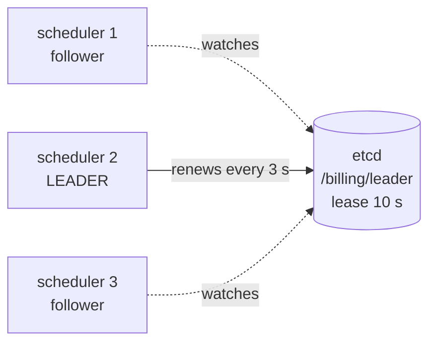
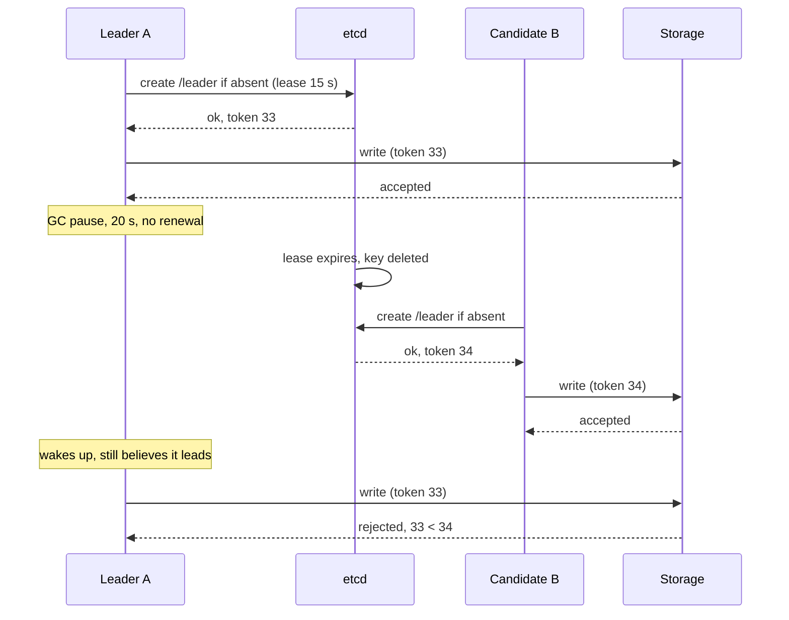
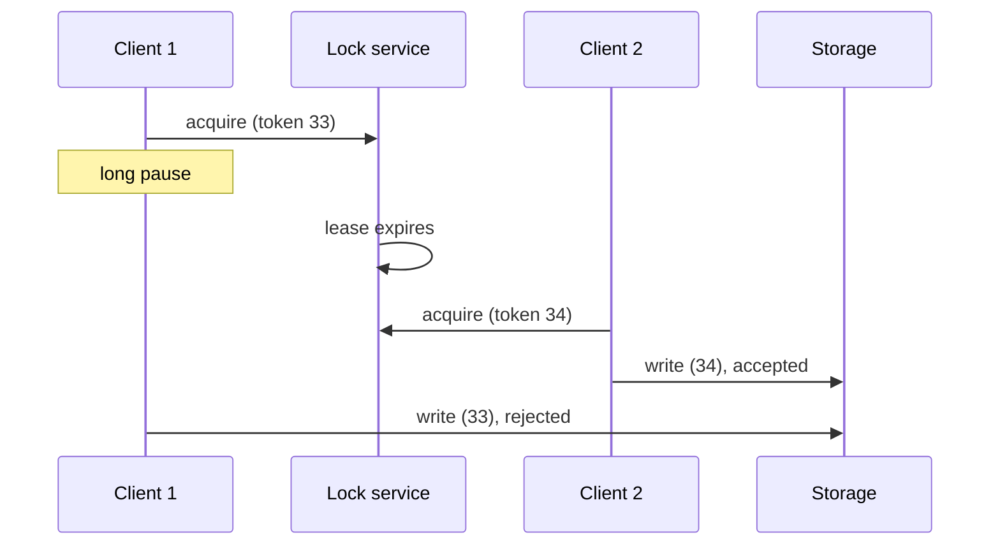

# Leader Election: Leases, etcd & Fencing Tokens vs Zombies

> **Prerequisites:** [Lesson 03: Network Partitions](../03-network-partitions/README.md) · [Lesson 04: Failure Detection](../04-failure-detection/README.md) · [Lesson 05: Clock Skew](../05-clock-skew/README.md).  
> **Estimated Reading Time:** 24–28 minutes  
> **Target Audience:** Backend engineers running singleton jobs, primaries and controllers, and candidates asked "how do you make sure exactly one node is in charge?"  
> **Free PDF Notes:** [Download SD-H-008.pdf](https://backendroadmap.com/notes/system-design/SD-H-008.pdf)

> [!NOTE]
> **In one line:** Leader election picks exactly one node to do a job or accept writes. Do it with a **lease** in a consensus-backed store such as etcd or ZooKeeper, renew it while you work, and use **fencing tokens** so a leader that lost its lease without knowing it cannot do damage.

> [!TIP]
> **The Golden Rule:** A lease tells *other nodes* when they may take over. It cannot stop the *old leader* from acting, because a paused process does not know time has passed. Only the **resource being written** can check, with a token that increases on every election.

---

## 1. What Leader Election Is, and What It Isn't

Your system runs a nightly billing job. For availability you deploy three instances. Now all three run the job, and every customer is charged three times. You need exactly one active instance, and if it dies another must take over automatically.

| Term | Precise Meaning | Example |
| :--- | :--- | :--- |
| **Leader** | The one node allowed to do a job or accept writes | The database primary, the scheduler |
| **Campaign** | A node trying to become leader | Creating `/billing/leader` if it does not exist |
| **Lease** | Leadership that **expires** unless renewed | 15 s TTL, renewed every 5 s |
| **Watch** | Being notified when a key changes | Followers watch the leader key |
| **Zombie leader** | An old leader that does not know it lost | Paused 20 s by GC, wakes up and writes |
| **Fencing token** | A number that increases with each election, checked by storage | etcd revision, ZooKeeper `zxid` |
| **Not the same as** | Consensus on a value (lessons 09, 10), or a lock for short critical sections (lesson 13) | Election *uses* consensus underneath |

### Where You Need One
- **Singleton jobs:** schedulers, cron-like tasks, cleanup workers.
- **Single-writer replication:** one primary database accepts writes.
- **Coordination:** Kafka's controller, Kubernetes controllers, a partition's leader.

> [!WARNING]
> **Prefer designs that do not need a leader** when the work can be made idempotent or partitioned: fewer moving parts, no zombie problem. Elect only when one owner is genuinely required.

---

## 2. Anatomy: A Lease in a Strongly Consistent Store



| Approach | How it elects | Strength | Weakness |
| :--- | :--- | :--- | :--- |
| **Lease in etcd / ZooKeeper / Consul** | Create a key with a TTL if absent; first wins | Easy from any app; the store runs consensus | Clock and pause issues, needs fencing |
| **Built-in consensus (Raft, Paxos)** | Term-based votes, majority wins | Safe under partitions | Needs a quorum, embedded in the system |
| **Bully / ring algorithms** | Highest ID wins by message passing | Simple, textbook | Assumes reliable failure detection, split-brain risk |
| **Database row lock** | `UPDATE ... WHERE owner IS NULL` | No new infrastructure | Database becomes the coordinator; same zombie issue |

Candidates try to create a key in the store; the store guarantees that only one succeeds. The winner renews before expiry. If it crashes or is cut off, the lease expires, the key is deleted and the watchers race to become the next leader.

---

## 3. Mathematical Model: Lease Timing

Let the lease TTL be $T$, the renewal period $R$, and the longest process pause $P$.

| Quantity | Meaning |
| :--- | :--- |
| Time before another node may take over | up to $T$ after the last successful renewal |
| Failover time after a crash | $\approx T$ (followers wait it out) |
| Safe renewal | $R \le T/3$, so a few renewals can be lost |
| Leader must step down by | $T_{\text{renewDeadline}} < T$, before followers can take over |

**The zombie window.** The leader checks "do I still hold the lease?" and then does the write. Between the check and the write a pause of length $P$ can occur. If $P$ exceeds the lease time that remained at the check, the lease has expired and a new leader exists, yet the old leader writes:

$$\text{stale write} \iff P > T - a, \quad a = \text{age of the lease at the check}$$

Making $T$ longer *reduces* the chance but never removes it, because $P$ has no upper bound (a frozen VM, a swapped-out process). Only a check at the **resource** removes it.

---

## 4. Metrics & Percentiles

| Metric | Meaning | Alert when |
| :--- | :--- | :--- |
| **Leader changes per hour** | Elections that completed | More than expected: flapping |
| **Time without a leader** | Gap between old lease expiry and new leader acting | Longer than your failover budget |
| **Lease renewal latency $p_{99}$** | Time to refresh the lease | Approaching the renew deadline |
| **Longest pause (GC, stall) $p_{99.9}$** | Process stalls | Longer than the lease |
| **Fenced (rejected) writes** | Writes dropped by the token check | Any non-zero value means a zombie was caught |

### Worked Example
Three scheduler instances campaign through an etcd election with a 10-second lease. Instance 2 wins and runs the billing job, renewing every few seconds. At 2:13 a.m. its machine dies. Ten seconds later the lease expires, etcd deletes the key, instance 3 wins the next campaign and resumes from the last checkpoint. Failover took about the lease length.

---

## 5. Compounding: How Often Does a Zombie Write?

An illustrative simulation: a leader checks its lease at a random point in its lifetime, then pauses for a heavy-tailed random time (lognormal, median 0.1 s, $\sigma=1.5$), then writes. One million leader writes per lease length:

| Lease length | Stale writes accepted, **no fencing** | Stale writes accepted, **fencing token** |
| :---: | :---: | :---: |
| 1 s | 221,030 | **0** |
| 3 s | 92,176 | **0** |
| 15 s | 20,340 | **0** |
| 60 s | 5,147 | **0** |

The trend is the point, not the absolute numbers (real pause distributions differ and renewals keep the lease young): **longer leases cut the zombie rate but never to zero, while the token check makes it zero at every length.**

---

## 6. Numbers Every Engineer Must Know

| Item | Typical | Implication |
| :--- | :---: | :--- |
| Kubernetes `leaseDuration` | 15 s | Followers wait this long before taking over |
| Kubernetes `renewDeadline` | 10 s | Leader must renew within this or step down |
| Kubernetes `retryPeriod` | 2 s | How often candidates retry |
| Failover after a crash | about the lease length | A 15 s lease means up to ~15 s without a leader |
| Renewal period | $\le$ one third of the TTL | Tolerates lost renewals |
| Fencing token | grows on every election | etcd revision, ZooKeeper `zxid`, a database counter |
| Cluster size for the store | 3 or 5 | A 2-node store cannot form a majority after a split |

---

## 7. Protocol Deep Dive: Lease Election With Fencing



Timeline with a 15 s lease renewed every 5 s: A renews at $t=10$ (valid until 25), then freezes for 20 s. At $t=25$ the lease expires and B wins with token 34. At $t=30$ A wakes, believes it leads (its local check passed at $t=10$) and writes with token 33. Without the check at storage, A's write overwrites B's. With it, storage rejects it.

**Kubernetes shape.** Controllers use a `Lease` object in the API server (backed by etcd). The leader steps down at the renew deadline (10 s), five seconds *before* followers may take over (15 s), which narrows the zombie window but, as above, cannot close it.

```yaml
apiVersion: coordination.k8s.io/v1
kind: Lease
metadata: {name: payments-controller, namespace: prod}
spec:
  holderIdentity: payments-7d9f-abc12   # current leader
  leaseDurationSeconds: 15              # followers wait this long after the last renewal
  renewTime: "2026-11-24T10:15:03Z"     # the leader updates this regularly
  leaseTransitions: 12                  # increases each time leadership changes
```

---

## 8. Hierarchical Budgets & Design Rules

| Slice | Rule | Control |
| :--- | :--- | :--- |
| Election store | A consensus-backed store, 3 or 5 nodes | etcd, ZooKeeper, Consul; **not** a single Redis node |
| Lease length | Above your longest normal pause, below your failover budget | Renew every $T/3$ |
| Leader behaviour | Step down when it cannot renew by the deadline | Do not keep working "just in case" |
| Writes | Every protected write carries the fencing token | Storage rejects older tokens |
| Work | Checkpoint often | The next leader resumes from the checkpoint |
| Idempotency | Make the job idempotent anyway | Two leaders for a moment must not double-charge |

---

## 9. Top Mitigations

1. **Use a lease in a quorum-backed store** (etcd, ZooKeeper, Consul, a Kubernetes `Lease`).
2. **Renew early** (every third of the TTL) and **step down** if renewal fails.
3. **Fence at the resource**: send an increasing token with every write and have storage reject older ones.
4. **Make the work idempotent**, so a brief double-leader overlap does no harm.
5. **Set leases above the longest pause**, and fix the pauses (GC tuning, no swap).
6. **Checkpoint** progress so the new leader resumes, not restarts.
7. **Run an odd number of store nodes** (3 or 5).

---

## 10. Production Case Study: Kleppmann on Distributed Locks, and HBase

In *How to do distributed locking* (2016), Martin Kleppmann describes exactly this failure, which also applies to leader leases: a client takes a lock with a lease, pauses (GC, in his example), the lease expires, another client takes the lock, and the first client wakes and writes anyway. He states that "**This bug is not theoretical: HBase used to have this problem**".

- **The fix he describes:** a **fencing token**, "a number that increases" each time a client acquires the lock. The storage server remembers it has already processed a write with a higher token (34), so it rejects the stale write that carries token 33.
- **The criticism of Redlock:** he points out that it "does not have any facility for generating fencing tokens", so a Redis-based lock cannot protect against the pause scenario by itself.
- **What it means for election:** check *at the resource*. Checking the lease in the client before writing does not help, because the pause can happen right after the check.



**Lesson:** a lease gives you liveness (someone takes over); a fencing token gives you safety (the stale holder is harmless). You need both. Lesson 13 applies this to locks.

---

## 11. Multi-Language Production Code Tabs

A dependency-free model of the pattern: a lease store that hands out increasing tokens, and a storage that rejects stale ones. In production the store is etcd, ZooKeeper or a Kubernetes `Lease`; the *storage check* is the part you write yourself.

````carousel
```go
// Go: lease store with increasing tokens, and fenced storage.
package main

import (
	"errors"
	"sync"
	"time"
)

var ErrStale = errors.New("stale token")

type Lease struct {
	mu      sync.Mutex
	owner   string
	expires time.Time
	token   uint64
}

// Acquire grants the lease if free or expired; the token increases on every grant.
func (l *Lease) Acquire(id string, ttl time.Duration, now time.Time) (uint64, bool) {
	l.mu.Lock()
	defer l.mu.Unlock()
	if l.owner != "" && now.Before(l.expires) && l.owner != id {
		return 0, false
	}
	if l.owner != id || !now.Before(l.expires) {
		l.token++ // a new leadership term
	}
	l.owner, l.expires = id, now.Add(ttl)
	return l.token, true
}

type Storage struct {
	mu    sync.Mutex
	High  uint64
	Value string
}

// Write is fenced: it rejects a token older than the newest one seen.
func (s *Storage) Write(token uint64, v string) error {
	s.mu.Lock()
	defer s.mu.Unlock()
	if token < s.High {
		return ErrStale
	}
	s.High, s.Value = token, v
	return nil
}
```
<!-- slide -->
```typescript
// TypeScript: lease store and fenced storage.
class Lease {
  private owner: string | null = null;
  private expires = 0;
  private token = 0;

  acquire(id: string, ttlMs: number, now: number): number | null {
    if (this.owner !== null && now < this.expires && this.owner !== id) return null;
    if (this.owner !== id || now >= this.expires) this.token++; // new term
    this.owner = id;
    this.expires = now + ttlMs;
    return this.token;
  }
}

class Storage {
  high = 0;
  value = "";

  write(token: number, v: string): void {
    if (token < this.high) throw new Error(`stale token ${token} < ${this.high}`);
    this.high = token;
    this.value = v;
  }
}

// const a = lease.acquire("A", 15000, 0);      // token 1
// const b = lease.acquire("B", 15000, 25000);  // A expired -> token 2
// storage.write(b!, "B");  storage.write(a!, "A");  // second call throws
```
<!-- slide -->
```python
# Python: lease store, fenced storage, and the simulation behind section 5.
import math
import random


class Lease:
    def __init__(self):
        self.owner, self.expires, self.token = None, 0.0, 0

    def acquire(self, who, ttl, now):
        if self.owner is not None and now < self.expires and self.owner != who:
            return None
        if self.owner != who or now >= self.expires:
            self.token += 1                      # a new leadership term
        self.owner, self.expires = who, now + ttl
        return self.token


class Storage:
    def __init__(self):
        self.high, self.value = 0, None

    def write(self, token, value):
        if token < self.high:
            raise PermissionError(f"stale token {token} < {self.high}")
        self.high, self.value = token, value


def stale_writes(lease_s, writes=1_000_000, seed=8):
    """Writes accepted from an expired leader when storage does NOT fence."""
    rng, stale = random.Random(seed), 0
    for _ in range(writes):
        remaining = lease_s - rng.uniform(0, lease_s)           # lease still valid at the check
        pause = rng.lognormvariate(math.log(0.1), 1.5)          # then the process stalls
        stale += pause > remaining
    return stale
```
<!-- slide -->
```csharp
// C#: lease store and fenced storage.
public sealed class Lease
{
    private readonly object _gate = new();
    private string? _owner;
    private DateTime _expires = DateTime.MinValue;
    private ulong _token;

    public ulong? Acquire(string id, TimeSpan ttl, DateTime now)
    {
        lock (_gate)
        {
            if (_owner is not null && now < _expires && _owner != id) return null;
            if (_owner != id || now >= _expires) _token++; // new term
            _owner = id;
            _expires = now + ttl;
            return _token;
        }
    }
}

public sealed class Storage
{
    private readonly object _gate = new();
    private ulong _high;
    public string Value { get; private set; } = "";

    public bool Write(ulong token, string value)
    {
        lock (_gate)
        {
            if (token < _high) return false; // stale: rejected
            _high = token;
            Value = value;
            return true;
        }
    }
}
```
````

---

## 12. Hands-On CLI Verification Workflows

Running the lesson's timeline with the Python tab's classes (Python 3.13): A acquires at $t=0$ (token 1), pauses past the 15 s lease, B acquires at $t=25$ (token 2), and then A wakes and writes.

```text
tokens: A = 1, B = 2
fenced storage:   B writes "B" -> accepted;  A (token 1) writes "A" -> rejected: stale token 1 < 2;  final value: B
unfenced storage: B writes "B" -> accepted;  A writes "A" -> accepted;                              final value: A
```

Without the check at storage, the zombie's write overwrites the real leader's data (`final value: A`, in the unfenced line: the same two writes against a store that does not compare tokens). With it, the final value is the legitimate leader's. The section 5 table is the same model repeated a million times per lease length.

Against a real etcd cluster you can watch an election from a shell:

```bash
# campaign for leadership; blocks until this node is elected
etcdctl elect payments-leader node-a

# in another terminal: observe who currently leads
etcdctl elect --listen payments-leader
```

and in Kubernetes:

```bash
kubectl get lease -n prod payments-controller -o yaml   # holderIdentity, renewTime, leaseTransitions
```

---

## 13. Common Mistakes to Avoid

1. **Electing with a lock in a single Redis node**, which can lose the lock on failover.
2. **No fencing token**, so a paused ex-leader still writes.
3. **Checking the lease in the client right before the write** and calling it safe.
4. **A lease shorter than a normal GC pause**, causing leadership flapping.
5. **A two-node store**, where neither side holds a majority after a split.
6. **Leaders that keep working after failing to renew.**
7. **Non-idempotent jobs**, so a brief overlap double-charges.
8. **Needing a leader at all** when partitioned, idempotent work would do.

---

## 14. Key Terms Glossary

| Key Term | Definition |
| :--- | :--- |
| **Leader** | The one node allowed to act (do the job, accept writes). |
| **Lease** | Time-limited leadership that must be renewed. |
| **Campaign** | Attempt to become leader. |
| **Watch** | Notification when a key changes. |
| **Zombie leader** | An old leader that does not know it has lost leadership. |
| **Fencing token** | Monotonically increasing number that storage uses to reject stale leaders. |
| **Renew deadline** | Time within which the leader must renew or step down. |
| **Term / epoch** | One period of one leader's reign; a Lamport-style logical clock. |
| **Compare-and-set** | Create or update only if the current value matches. |
| **Split brain** | Two leaders at once (lesson 12). |

---

## 15. System Design Interview Questions & Answers

### Basic Conceptual Questions

<details>
<summary><strong>Q1: What is leader election and why do we need it? [BASIC]</strong></summary>

**Answer:**
Choosing exactly one node to do a job or accept writes, with automatic takeover if it fails. Needed for singleton jobs (billing, schedulers), single-writer replication and coordination roles such as Kafka's controller.
</details>

<details>
<summary><strong>Q2: What is a lease? [BASIC]</strong></summary>

**Answer:**
Leadership with an expiry. The holder must renew it before it runs out; if it crashes or is cut off, the lease expires and another node can win. It turns "is the leader alive?" into a time-bounded promise.
</details>

<details>
<summary><strong>Q3: How do etcd or ZooKeeper elect a leader? [BASIC]</strong></summary>

**Answer:**
Candidates try to create a key (compare-and-set: only if absent) tied to a lease. The store runs consensus, so exactly one create succeeds. Others watch the key and campaign when it disappears.
</details>

<details>
<summary><strong>Q4: What is a fencing token? [BASIC]</strong></summary>

**Answer:**
A number that increases with every new leadership (etcd revision, ZooKeeper `zxid`). The leader sends it with each write and storage rejects any token lower than the highest it has seen.
</details>

### Scenario-Based Architecture Questions

<details>
<summary><strong>Q5: Three instances run a billing job. How do you make sure only one charges customers? [SCENARIO]</strong></summary>

**Answer:**
Campaign for a lease in etcd or ZooKeeper; only the winner runs the job and renews the lease. Followers watch. Also make the job idempotent (an idempotency key per customer per cycle) and fence writes with the lease's token.
</details>

<details>
<summary><strong>Q6: The leader pauses for 20 s with a 15 s lease. What happens? [SCENARIO]</strong></summary>

**Answer:**
The lease expires at 15 s and another node wins with a higher token. When the old leader wakes it still believes it leads. Without fencing its write corrupts data; with fencing, storage sees token 33 < 34 and rejects it.
</details>

<details>
<summary><strong>Q7: Why not just check the lease before each write? [SCENARIO]</strong></summary>

**Answer:**
Because the pause can happen right after the check, before the write lands. The check and the write are not atomic. Only the resource can compare tokens atomically with the write.
</details>

<details>
<summary><strong>Q8: How do you size the lease and renewal? [SCENARIO]</strong></summary>

**Answer:**
Lease above the longest normal pause (so it does not flap) but low enough for your failover budget, since failover takes about the lease length. Renew every third of the TTL and make the leader step down at a deadline shorter than the lease. Kubernetes defaults: 15 s lease, 10 s renew deadline, 2 s retry.
</details>

### Advanced & Tricky Interview Questions

<details>
<summary><strong>Q9: Is a Redis lock a safe way to elect a leader? [TRICKY]</strong></summary>

**Answer:**
Not by itself. A single Redis node can lose the lock on failover, and Redlock, as Kleppmann notes, has no facility for generating fencing tokens. Use a consensus-backed store, or add a token from a monotonic source and check it at the resource.
</details>

<details>
<summary><strong>Q10: Can a longer lease remove the zombie problem? [TRICKY]</strong></summary>

**Answer:**
It reduces how often it happens but never to zero, because pauses are unbounded. In the simulation above, the stale-write rate fell from 221,030 to 5,147 per million as the lease went from 1 s to 60 s, but the fencing check gave 0 at every length. Longer leases also slow failover.
</details>

<details>
<summary><strong>Q11: Why is a two-node cluster a bad election store? [TRICKY]</strong></summary>

**Answer:**
A majority of two is two, so one failure or a split leaves neither side able to form a quorum. Use 3 or 5.
</details>

<details>
<summary><strong>Q12: How does Raft's election differ from a lease in etcd? [TRICKY]</strong></summary>

**Answer:**
Raft elects inside the replicated system using terms and majority votes (lesson 09), and stale leaders are detected by higher terms. A lease uses an external consensus store as the arbiter. Both rely on an increasing number to expose stale leaders.
</details>

---

## 16. One-Page Master Cheat Sheet

```
+---------------------------------------------------------------------------------------------------------+
|                          LEADER ELECTION — MASTER CHEAT SHEET                                           |
+---------------------------------------------------------------------------------------------------------+
| 1. NEED ONE OWNER? singleton job, primary DB, controller. Else prefer idempotent / leaderless designs.  |
+---------------------------------------------------------------------------------------------------------+
| 2. LEASE in a quorum store (etcd, ZooKeeper, Consul, k8s Lease): CAS-create key, renew every T/3.       |
+---------------------------------------------------------------------------------------------------------+
| 3. FAILOVER ~ lease length. Leader steps down at renewDeadline < lease. k8s: 15 s / 10 s / 2 s.         |
+---------------------------------------------------------------------------------------------------------+
| 4. ZOMBIE: pause > remaining lease. Checking before write does NOT help (not atomic).                   |
+---------------------------------------------------------------------------------------------------------+
| 5. FENCING: increasing token on every election, checked by STORAGE. Lease = liveness, token = safety.   |
+---------------------------------------------------------------------------------------------------------+
| 6. ALSO: idempotent work, checkpoints, 3 or 5 store nodes, never a lone Redis lock.                     |
+---------------------------------------------------------------------------------------------------------+
```

---

## Further Reading & Sources

- Martin Kleppmann, [How to do distributed locking](https://martin.kleppmann.com/2016/02/08/how-to-do-distributed-locking.html) (2016): the pause problem, HBase, fencing tokens and Redlock.
- Kubernetes `client-go`, [`tools/leaderelection`](https://github.com/kubernetes/client-go/tree/master/tools/leaderelection) (`LeaseDuration` 15 s, `RenewDeadline` 10 s, `RetryPeriod` 2 s for core clients).
- etcd documentation, `etcdctl elect` and the `concurrency` election API.
- Apache ZooKeeper, leader election recipe.

---

## Free PDF Notes

[SD-H-008.pdf](https://backendroadmap.com/notes/system-design/SD-H-008.pdf)

---

## Next

Continue with [Lesson 09: Raft Consensus Explained](../09-raft-consensus-explained/README.md): leader election and log replication.
