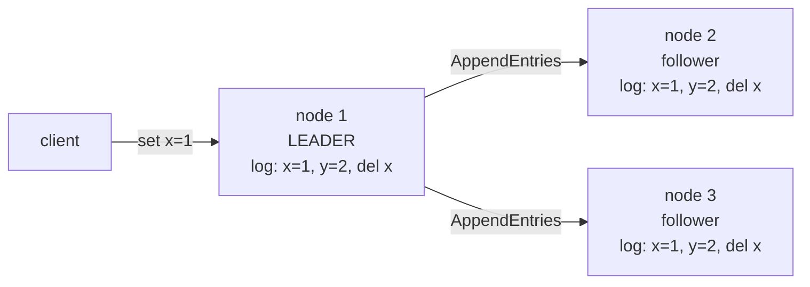
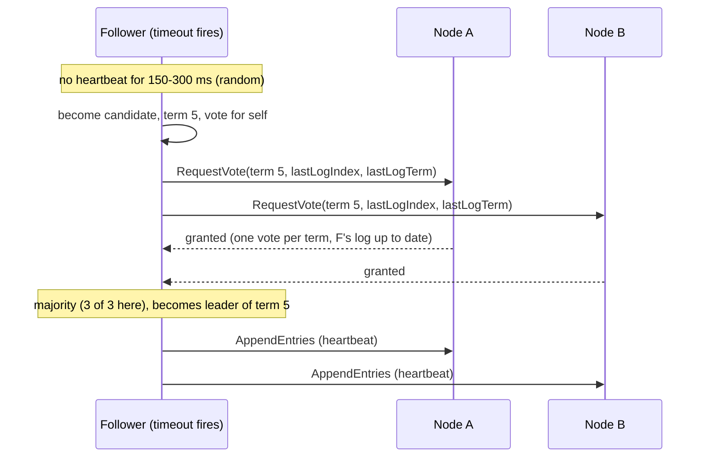
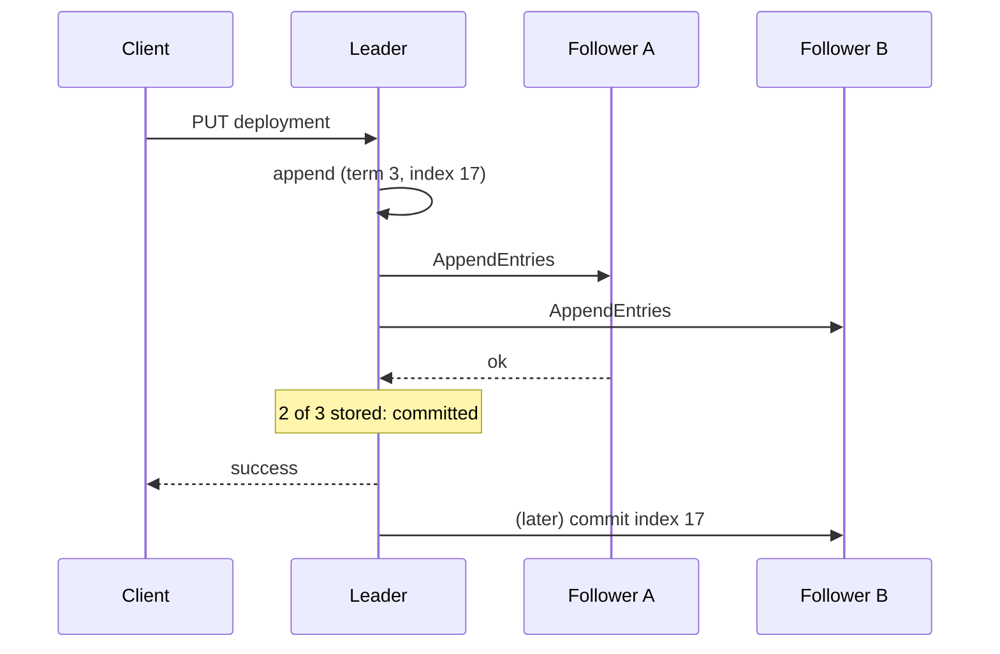
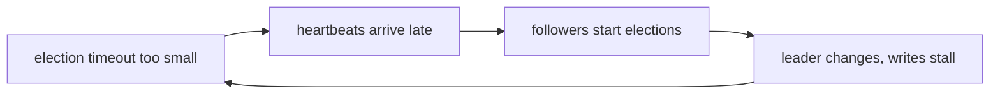

# Raft Consensus Explained: Leader Election & Log Replication

> **Prerequisites:** [Lesson 03: Network Partitions](../03-network-partitions/README.md) · [Lesson 06: Lamport Clocks](../06-lamport-clocks-happens-before-explained-simply/README.md) · [Lesson 08: Leader Election](../08-leader-election/README.md).  
> **Estimated Reading Time:** 28–34 minutes  
> **Target Audience:** Backend engineers who use etcd, Consul, CockroachDB or Kafka KRaft and want to know what "consensus" actually does, and candidates asked "how does Raft work?"  
> **Free PDF Notes:** [Download SD-H-009.pdf](https://backendroadmap.com/notes/system-design/SD-H-009.pdf)

> [!NOTE]
> **In one line:** Consensus lets a group of nodes agree on one ordered log of commands even when some crash. Raft elects a leader per **term**, the leader replicates log entries, and an entry is **committed** once a majority stores it, so a cluster of $2f+1$ nodes survives $f$ failures.

> [!TIP]
> **The Golden Rule:** Two majorities of the same cluster always share at least one node. That one overlap is why a committed entry can never be lost and why only one side of a partition can ever commit.

---

## 1. What Raft Is, and What It Isn't

Kubernetes stores every pod, service and secret in etcd. If that data were lost or inconsistent the cluster would fall apart, yet any etcd node can crash at any time. How do several machines agree on one history despite crashes, lost messages and partitions? With a **consensus algorithm**. Raft (Ongaro and Ousterhout, 2014) was designed to be understandable; it powers etcd, Consul, CockroachDB, TiKV and Kafka's KRaft mode.

| Term | Precise Meaning | Example |
| :--- | :--- | :--- |
| **Replicated state machine** | Every node applies the same commands in the same order from the same start, so they reach the same state | Each etcd node applies the same log |
| **Log** | The ordered list of commands | `set x=1`, `set y=2`, `del x` |
| **Term** | A numbered period with at most one leader; a logical clock | Term 5 |
| **Leader / follower / candidate** | The three roles | One leader, others follow |
| **Commit** | An entry stored on a majority; it will never be lost | Entry 17 on 2 of 3 nodes |
| **Quorum** | A majority: $\lfloor n/2\rfloor+1$ | 3 of 5 |
| **Not Raft's job** | Speed, or tolerating a *majority* failing | Every write costs a majority round trip |

### Why It Matters
1. Almost every system that needs "one source of truth" (config stores, schedulers, metadata services) sits on a Raft or Paxos group.
2. Raft's guarantees map directly to interview questions: leader per term, committed entries survive, same order everywhere.
3. It explains the cost of consistency: why clusters are 3 or 5 nodes, and why writes are slower than a single node's.

---

## 2. Anatomy: One Log, Many Copies



Raft has one leader; everyone else is a follower. Time is divided into numbered **terms**, each with at most one leader. The leader sends regular heartbeats (empty `AppendEntries`). Raft splits the problem in three: **leader election**, **log replication** and **safety**.

| Role | Does | Becomes the next role when |
| :--- | :--- | :--- |
| **Follower** | Responds to the leader and to vote requests | No heartbeat before its election timeout, so it becomes a candidate |
| **Candidate** | Increments the term, votes for itself, asks for votes | Wins a majority, becomes leader; sees a higher term, becomes follower; times out, starts a new term |
| **Leader** | Accepts client commands, replicates, sends heartbeats | Sees a higher term, steps down to follower |

> [!WARNING]
> **Raft is not fast.** Every committed write needs a round trip to a majority and a durable write (`fsync`) on each. Disk latency and network distance set your write latency. Keep clusters small and in nearby zones.

---

## 3. Mathematical Model: Quorums and Failures

A cluster of $n=2f+1$ nodes needs a quorum $q=f+1$, so it tolerates $f$ failures.

| Cluster size $n$ | Quorum $q$ | Failures tolerated | Note |
| :---: | :---: | :---: | :--- |
| 3 | 2 | 1 | Common default |
| 4 | 3 | 1 | Costs more, tolerates no more than 3 |
| 5 | 3 | 2 | Common for important data |
| 7 | 4 | 3 | Rarely worth it: slower commits |

**Why it is safe.** Any two quorums intersect: $q + q > n$. A new leader must collect votes from a quorum, and every committed entry lives on a quorum, so at least one voter knows each committed entry. Raft adds the **election restriction**: a voter refuses a candidate whose log is *less up to date* than its own. Together they give the **Leader Completeness** property: a committed entry is present in the logs of all leaders of later terms.

**Up to date** (Raft paper, section 5.4.1): compare the last entries. A later last *term* wins; if terms are equal, the longer log wins.

---

## 4. Metrics & Percentiles

| Metric | Meaning | Why you care |
| :--- | :--- | :--- |
| **Commit latency $p_{99}$** | Time to reach a majority durably | Dominated by `fsync` and the second-fastest follower |
| **Leader changes per hour** | Elections | Frequent means timeouts too tight or a flaky network |
| **Time without a leader** | Election duration | Writes are unavailable meanwhile |
| **Follower lag** | Leader's last index minus follower's match index | A slow follower delays nothing until it matters for quorum |
| **`fsync` latency** | Disk flush time | Every commit needs one on a majority |
| **Proposals failed** | Writes rejected (no leader / no quorum) | The cost of consistency |

### Worked Example
A three-node etcd. The Kubernetes API server writes a new deployment to the leader. The leader appends it and replicates. Follower A acknowledges within a millisecond; follower B is slow. With 2 of 3 stored, the entry commits and the API server gets its answer **without waiting for B**. If the leader then crashes, A or B times out and starts term 6, and the up-to-date-log rule makes sure the winner has the deployment.

---

## 5. Compounding: Two Experiments

I ran two small simulations (Python 3.13, stdlib only; models, not measurements of etcd).

**A. How randomised timeouts avoid split votes.** Five nodes, one-way message delay 5 to 25 ms, 20,000 elections per row. A "split vote" is a term in which no candidate reaches 3 votes:

| Election timeout | Terms needed (avg) | First term splits | No leader after 100 terms |
| :---: | :---: | :---: | :---: |
| Fixed 150 ms (all equal) | never | 100% | 100% |
| 150–155 ms (narrow) | never | 100% | 100% |
| 150–175 ms | 4.19 | 76.3% | 0% |
| 150–200 ms | 1.42 | 29.8% | 0% |
| **150–300 ms** | **1.04** | **4.0%** | 0% |

If the random spread is *smaller than the message delay*, every node times out before it hears the first request, so every term splits. The Raft paper recommends a conservative 150–300 ms for exactly this reason.

**B. Why the up-to-date voting rule matters.** The leader and one other node crash; the remaining three of five nodes elect a leader. Followers hold prefixes of the leader's log, and an entry is committed when it is on a majority. 100,000 trials:

| Voting rule | New leader is missing a committed entry |
| :--- | :---: |
| **Vote only for a candidate at least as up to date** (Raft) | **0 of 100,000** |
| Vote for anyone (rule removed) | **40,067 of 100,000** |

Without the restriction, about 40% of failovers in this model would lose acknowledged writes.

---

## 6. Numbers Every Engineer Must Know

| Item | Typical | Implication |
| :--- | :---: | :--- |
| Election timeout (Raft paper) | 150–300 ms, randomised | Rare split votes, quick recovery |
| etcd heartbeat interval | 100 ms (default) | "Around the round-trip time between members" |
| etcd election timeout | 1,000 ms (default) | "At least 10 times the round-trip time" |
| Raft paper: 12–24 ms timeouts | about 35 ms average to elect a leader | Faster, but leaders can lose to timeouts and flap |
| `fsync` on SSD | 1–10 ms | A floor under every commit |
| Cluster size | 3 or 5 | More nodes: more tolerance, slower writes |

---

## 7. Protocol Deep Dive

### Leader election



A node votes **at most once per term**, and only for a candidate whose log is at least as up to date as its own. A majority of votes makes the candidate leader; random timeouts make split votes rare, and a split simply starts a new term.

### Log replication and commit



Once a majority has the entry the leader applies it, replies to the client and tells followers the new commit index.

### Repairing a follower's log

After a leader change the new leader makes every follower's log match its own: it backs up `nextIndex` until the logs agree, then overwrites conflicting entries and appends the rest. Overwriting is safe because conflicting entries were never committed.

| Server | Log terms | Action |
| :--- | :--- | :--- |
| New leader (term 3) | 1 1 1 2 2 3 3 | |
| Follower F1 | 1 1 1 2 2 | Append 2 missing entries |
| Follower F2 | 1 1 1 2 2 2 2 | Overwrite 2 uncommitted term-2 entries |
| Follower F3 | 1 1 1 2 2 3 3 | Nothing to do |

**Reads.** A leader must not serve a linearizable read from a stale belief that it still leads. The Raft paper has the leader commit a no-op at the start of its term and exchange heartbeats with a majority before answering a read (the *read index* approach); a lease-based shortcut relies on bounded clock skew.

---

## 8. Hierarchical Budgets & Design Rules

| Slice | Rule | Control |
| :--- | :--- | :--- |
| Cluster size | 3 or 5 voters | Odd, in separate failure zones |
| Placement | Nearby zones, not distant regions | Commit latency is a majority round trip |
| Heartbeat | About the network RTT | etcd default 100 ms |
| Election timeout | At least 10x the heartbeat, randomised | etcd default 1,000 ms |
| Disk | Fast, dedicated for the log | `fsync` is on every commit |
| Membership changes | One node at a time, or joint consensus | Never swap a majority at once |
| Log size | Snapshots and compaction | Otherwise the log grows forever |

---

## 9. Top Mitigations

1. **Run 3 or 5 voters** across failure domains.
2. **Keep the cluster close** (same region, multiple zones) so commits are fast.
3. **Tune heartbeat and election timeout** from the measured RTT, not the defaults blindly.
4. **Put the log on fast, dedicated storage.**
5. **Never change membership by more than one node** without joint consensus.
6. **Snapshot** regularly and watch log size.
7. **Do not put a hot application workload through the consensus group**; use it for metadata and coordination.

---

## 10. Production Case Study: The Raft Paper's Own Evidence

Raft's paper, *In Search of an Understandable Consensus Algorithm* (Ongaro and Ousterhout, USENIX ATC 2014), is itself an experiment, with two measurements worth knowing.

- **A user study of understandability.** With 43 students at two universities, "33 of these students were able to answer questions about Raft better than questions about Paxos". The authors note the study favoured Paxos in two ways (15 of 43 participants had prior Paxos experience and the Paxos video was 14% longer) and that self-reported feelings are less reliable than quiz scores.
- **How fast it elects a leader.** Section 9.3 measured downtime. With a 12–24 ms election timeout it took **about 35 ms on average** to elect a leader (longest trial 152 ms), but "lowering the timeouts beyond this point violates Raft's timing requirement: leaders have difficulty broadcasting heartbeats before other servers start new elections", causing needless leader changes. They recommend a conservative **150–300 ms**.
- **The safety argument:** the *Leader Completeness* property is proved in section 5.4.3 and rests on the election restriction your experiment B above isolates.



**Lesson:** consensus does not remove timing assumptions; it confines them to *liveness* (can we make progress) while *safety* (committed entries are never lost) holds regardless of timing. Tune the timeouts for availability; the protocol protects correctness.

---

## 11. Multi-Language Production Code Tabs

The two rules that make Raft safe, as plain functions: whether to **grant a vote**, and how a leader computes the **commit index** from followers' acknowledgements.

````carousel
```go
// Go: RequestVote decision and commit index.
package main

import "sort"

type Log struct{ LastTerm, LastIndex int }

// UpToDate reports whether the candidate's log is at least as up to date as ours.
func UpToDate(cand, mine Log) bool {
	if cand.LastTerm != mine.LastTerm {
		return cand.LastTerm > mine.LastTerm
	}
	return cand.LastIndex >= mine.LastIndex
}

type Node struct {
	CurrentTerm int
	VotedFor    string // "" = none this term
	Log         Log
}

// HandleRequestVote returns the (possibly updated) term and whether the vote is granted.
func (n *Node) HandleRequestVote(term int, candidate string, cand Log) (int, bool) {
	if term < n.CurrentTerm {
		return n.CurrentTerm, false
	}
	if term > n.CurrentTerm {
		n.CurrentTerm, n.VotedFor = term, "" // newer term: forget the old vote
	}
	if (n.VotedFor == "" || n.VotedFor == candidate) && UpToDate(cand, n.Log) {
		n.VotedFor = candidate
		return n.CurrentTerm, true
	}
	return n.CurrentTerm, false
}

// CommitIndex is the largest index stored on a majority (matchIndex includes the leader).
func CommitIndex(matchIndex []int) int {
	s := append([]int(nil), matchIndex...)
	sort.Sort(sort.Reverse(sort.IntSlice(s)))
	return s[len(s)/2] // the (majority)-th largest
}
```
<!-- slide -->
```typescript
// TypeScript: RequestVote decision and commit index.
interface LogInfo {
  lastTerm: number;
  lastIndex: number;
}

const upToDate = (cand: LogInfo, mine: LogInfo): boolean =>
  cand.lastTerm !== mine.lastTerm ? cand.lastTerm > mine.lastTerm : cand.lastIndex >= mine.lastIndex;

class Node {
  currentTerm = 0;
  votedFor: string | null = null;
  log: LogInfo = { lastTerm: 0, lastIndex: 0 };

  handleRequestVote(term: number, candidate: string, cand: LogInfo): { term: number; granted: boolean } {
    if (term < this.currentTerm) return { term: this.currentTerm, granted: false };
    if (term > this.currentTerm) {
      this.currentTerm = term;
      this.votedFor = null; // newer term: forget the old vote
    }
    const free = this.votedFor === null || this.votedFor === candidate;
    if (free && upToDate(cand, this.log)) {
      this.votedFor = candidate;
      return { term: this.currentTerm, granted: true };
    }
    return { term: this.currentTerm, granted: false };
  }
}

// matchIndex includes the leader's own last index.
export function commitIndex(matchIndex: number[]): number {
  const sorted = [...matchIndex].sort((a, b) => b - a);
  return sorted[Math.floor(sorted.length / 2)]; // stored on a majority
}
```
<!-- slide -->
```python
# Python: vote decision, commit index, and the experiments behind section 5.
import random


def up_to_date(cand, mine):
    """cand and mine are (last_term, last_index); tuples compare term first, then index."""
    return cand >= mine


class Node:
    def __init__(self):
        self.term, self.voted_for, self.log = 0, None, (0, 0)

    def request_vote(self, term, candidate, cand_log):
        if term < self.term:
            return self.term, False
        if term > self.term:
            self.term, self.voted_for = term, None        # newer term: forget the old vote
        if self.voted_for in (None, candidate) and up_to_date(cand_log, self.log):
            self.voted_for = candidate
            return self.term, True
        return self.term, False


def commit_index(match_index):
    """Largest index stored on a majority (match_index includes the leader)."""
    return sorted(match_index, reverse=True)[len(match_index) // 2]


def terms_to_elect(lo, hi, n=5, trials=20_000, delay=(5.0, 25.0), max_terms=100, seed=14):
    """Experiment A: average terms needed, and share of first terms that split."""
    rng, maj = random.Random(seed), n // 2 + 1

    def one_term():
        to = [rng.uniform(lo, hi) for _ in range(n)]
        first = min(range(n), key=lambda i: to[i])
        cands = {first} | {j for j in range(n) if j != first and to[j] < to[first] + rng.uniform(*delay)}
        if len(cands) == 1:
            return True
        votes = {c: 1 for c in cands}
        for v in range(n):
            if v not in cands:
                votes[min(cands, key=lambda c: to[c] + rng.uniform(*delay))] += 1
        return max(votes.values()) >= maj

    total = split = 0
    for _ in range(trials):
        k = 1
        while not one_term() and k < max_terms:
            k += 1
        total += k
        split += k > 1
    return total / trials, 100 * split / trials


def lost_committed(rule, n=5, trials=100_000, seed=14):
    """Leader + one node crash; 3 of 5 elect. Count new leaders missing a committed entry."""
    rng, maj, lost = random.Random(seed), n // 2 + 1, 0
    for _ in range(trials):
        k = rng.randint(1, 10)
        lens = [k] + [rng.randint(0, k) for _ in range(n - 1)]
        commit = sorted(lens, reverse=True)[maj - 1]
        crashed = {0, rng.randrange(1, n)}                 # the leader and one more node
        alive = [i for i in range(n) if i not in crashed]
        cand = rng.choice(alive)
        if rule and any(lens[v] > lens[cand] for v in alive):
            cand = max(alive, key=lambda v: lens[v])
        lost += lens[cand] < commit
    return lost
```
<!-- slide -->
```csharp
// C#: RequestVote decision and commit index.
public readonly record struct LogInfo(int LastTerm, int LastIndex)
{
    public bool AtLeastAsUpToDateAs(LogInfo other) =>
        LastTerm != other.LastTerm ? LastTerm > other.LastTerm : LastIndex >= other.LastIndex;
}

public sealed class RaftNode
{
    public int CurrentTerm { get; private set; }
    public string? VotedFor { get; private set; }
    public LogInfo Log { get; set; }

    public (int Term, bool Granted) HandleRequestVote(int term, string candidate, LogInfo cand)
    {
        if (term < CurrentTerm) return (CurrentTerm, false);
        if (term > CurrentTerm)
        {
            CurrentTerm = term;
            VotedFor = null; // newer term: forget the old vote
        }
        if ((VotedFor is null || VotedFor == candidate) && cand.AtLeastAsUpToDateAs(Log))
        {
            VotedFor = candidate;
            return (CurrentTerm, true);
        }
        return (CurrentTerm, false);
    }

    // matchIndex includes the leader's own last index.
    public static int CommitIndex(IEnumerable<int> matchIndex)
    {
        var sorted = matchIndex.OrderByDescending(x => x).ToArray();
        return sorted[sorted.Length / 2];
    }
}
```
````

---

## 12. Hands-On CLI Verification Workflows

The numbers in section 5 come from running the Python tab's `terms_to_elect` (experiment A) and `lost_committed` (experiment B) with Python 3.13 and their default seeds. The commit-index function can be checked by hand: with five match indexes `[7, 7, 5, 3, 2]` the third-largest is 5, so index 5 is on a majority and committed.

```python
print(commit_index([7, 7, 5, 3, 2]))   # 5
print(commit_index([7, 4, 4, 1, 0]))   # 4
```

Against a real etcd cluster:

```bash
# who is the leader, which term, how far has each member replicated?
etcdctl endpoint status --cluster -w table

# the timing knobs (defaults: heartbeat 100 ms, election timeout 1000 ms)
etcd --heartbeat-interval=100 --election-timeout=1000

# per-member health
etcdctl endpoint health --cluster
```

If `endpoint status` shows the leader or `RAFT TERM` changing repeatedly, the election timeout is too tight for your network or disks, or the leader is being starved.

---

## 13. Common Mistakes to Avoid

1. **Even-sized clusters** (4 nodes tolerate 1, same as 3).
2. **Spreading voters across distant regions** and accepting hundreds of milliseconds per write unknowingly.
3. **Election timeouts shorter than the heartbeat path** (leader flapping).
4. **Slow or shared disks** under the log (every commit waits on `fsync`).
5. **Changing the membership by several nodes at once.**
6. **Serving reads from a leader without confirming leadership**, returning stale data.
7. **Treating Raft as a database** for hot application data.
8. **Assuming a minority can still write.** It cannot; that is the point.

---

## 14. Key Terms Glossary

| Key Term | Definition |
| :--- | :--- |
| **Consensus** | Agreement of nodes on a value or log despite failures. |
| **Replicated state machine** | Same commands, same order, same state on every node. |
| **Term** | Numbered period with at most one leader. |
| **RequestVote** | RPC a candidate uses to ask for a vote. |
| **AppendEntries** | RPC for replication and heartbeats. |
| **Commit index** | Highest log index known to be stored on a majority. |
| **Election restriction** | Vote only for a candidate with an at-least-as-up-to-date log. |
| **Leader Completeness** | A committed entry is in all later leaders' logs. |
| **Snapshot** | Compacted state replacing a log prefix. |
| **Joint consensus** | Safe way to change cluster membership. |
| **Read index** | Leader confirms leadership with a majority before serving a read. |

---

## 15. System Design Interview Questions & Answers

### Basic Conceptual Questions

<details>
<summary><strong>Q1: What problem does Raft solve? [BASIC]</strong></summary>

**Answer:**
Getting a group of nodes to agree on one ordered log of commands even when some crash or messages are lost, so that all nodes apply the same commands in the same order and reach the same state.
</details>

<details>
<summary><strong>Q2: How does Raft elect a leader? [BASIC]</strong></summary>

**Answer:**
A follower that hears no heartbeat within a randomised election timeout becomes a candidate, increments the term, votes for itself and requests votes. Each node votes at most once per term, only for a candidate whose log is at least as up to date as its own. A majority wins; random timeouts make split votes rare.
</details>

<details>
<summary><strong>Q3: When is a log entry committed? [BASIC]</strong></summary>

**Answer:**
When the leader has stored it on a majority of the cluster (including itself). The leader then applies it, replies to the client and tells followers the commit index.
</details>

<details>
<summary><strong>Q4: Why are cluster sizes odd? [BASIC]</strong></summary>

**Answer:**
$n$ nodes tolerate $\lfloor (n-1)/2\rfloor$ failures, so 4 nodes tolerate 1, the same as 3, while costing more and adding a 2/2 split in which neither side has a quorum. Odd sizes give the most fault tolerance per node.
</details>

### Scenario-Based Architecture Questions

<details>
<summary><strong>Q5: The leader crashes after a write committed. Is the write lost? [SCENARIO]</strong></summary>

**Answer:**
No. A committed entry is on a majority. Any new leader needs votes from a majority, so at least one voter has the entry, and the election restriction only lets a candidate win if its log is at least as up to date as the voters', so the winner holds it (Leader Completeness).
</details>

<details>
<summary><strong>Q6: A 5-node cluster splits 3/2. What happens? [SCENARIO]</strong></summary>

**Answer:**
The 3-node side keeps or elects a leader and commits. The 2-node side cannot reach a quorum, so it elects no leader and rejects writes. After the heal the minority sees a higher term and catches up from the log, with nothing to reconcile.
</details>

<details>
<summary><strong>Q7: Writes to your etcd cluster got slow after you moved a node to another continent. Why? [SCENARIO]</strong></summary>

**Answer:**
Commit latency is the round trip to a majority plus `fsync`. With 3 nodes the leader needs one follower; with 5 it needs two, and a far node is on the critical path when it is among the fastest majority. Keep voters in nearby zones, and set heartbeat and election timeout from the new RTT.
</details>

<details>
<summary><strong>Q8: How do you serve a linearizable read? [SCENARIO]</strong></summary>

**Answer:**
Route it to the leader, which first commits a no-op at the start of its term and then confirms with a majority that it is still leader (read index) before answering. A lease-based variant skips the round trip but depends on bounded clock skew. Reading from a follower may be stale.
</details>

### Advanced & Tricky Interview Questions

<details>
<summary><strong>Q9: Why can a leader overwrite a follower's entries safely? [TRICKY]</strong></summary>

**Answer:**
Conflicting entries were never committed (a committed entry would be on a majority and the new leader must have it). Followers adopt the leader's log from the first point of disagreement, so only uncommitted entries are ever replaced.
</details>

<details>
<summary><strong>Q10: What happens if you remove the up-to-date voting rule? [TRICKY]</strong></summary>

**Answer:**
A candidate with a short log could win and then overwrite committed entries. In the simulation above, with the leader and one more node crashed, 40,067 of 100,000 elections produced a leader missing a committed entry without the rule and 0 with it.
</details>

<details>
<summary><strong>Q11: Raft vs Paxos? [TRICKY]</strong></summary>

**Answer:**
Both are majority-quorum consensus with the same fault tolerance. Raft decomposes the problem (election, replication, safety), keeps a strong leader and a single log, and was designed to be understandable; its authors' study had 33 of 43 students answering Raft questions better. Paxos is older and more general; multi-Paxos in practice looks similar. Lesson 10 compares them.
</details>

<details>
<summary><strong>Q12: Does consensus mean the system is always available? [TRICKY]</strong></summary>

**Answer:**
No. Raft is CP: with no quorum or no leader it refuses writes. Timing affects liveness only; safety (no lost committed entry, one leader per term) holds even if timeouts are badly tuned.
</details>

---

## 16. One-Page Master Cheat Sheet

```
+---------------------------------------------------------------------------------------------------------+
|                          RAFT — MASTER CHEAT SHEET                                                      |
+---------------------------------------------------------------------------------------------------------+
| 1. GOAL: replicated log -> same commands, same order, same state. 2f+1 nodes survive f failures.        |
+---------------------------------------------------------------------------------------------------------+
| 2. ROLES + TERMS: follower -> candidate -> leader. One leader per term. Higher term wins, always.       |
+---------------------------------------------------------------------------------------------------------+
| 3. ELECTION: random timeout (150-300 ms) · vote once per term · only for an up-to-date log.             |
+---------------------------------------------------------------------------------------------------------+
| 4. REPLICATION: leader appends, AppendEntries, committed when a MAJORITY stored it, then apply + reply. |
+---------------------------------------------------------------------------------------------------------+
| 5. SAFETY: any two majorities overlap + election restriction = committed entries never lost.            |
+---------------------------------------------------------------------------------------------------------+
| 6. COST: every write = majority round trip + fsync. 3 or 5 nodes, nearby zones. etcd 100 ms / 1000 ms. |
+---------------------------------------------------------------------------------------------------------+
```

---

## Further Reading & Sources

- Diego Ongaro and John Ousterhout, [In Search of an Understandable Consensus Algorithm](https://raft.github.io/raft.pdf) (USENIX ATC 2014): election (section 5.2), safety (5.4), evaluation (9).
- The Raft site, [raft.github.io](https://raft.github.io) (visualisations and the implementations list).
- etcd documentation, [Tuning](https://etcd.io/docs/v3.5/tuning/) (heartbeat interval and election timeout).
- Diego Ongaro, *Consensus: Bridging Theory and Practice* (PhD thesis, 2014).

---

## Free PDF Notes

[SD-H-009.pdf](https://backendroadmap.com/notes/system-design/SD-H-009.pdf)

---

## Next

Continue with [Lesson 10: Paxos Explained](../10-paxos-explained/README.md): prepare, promise, accept, and Paxos versus Raft.
