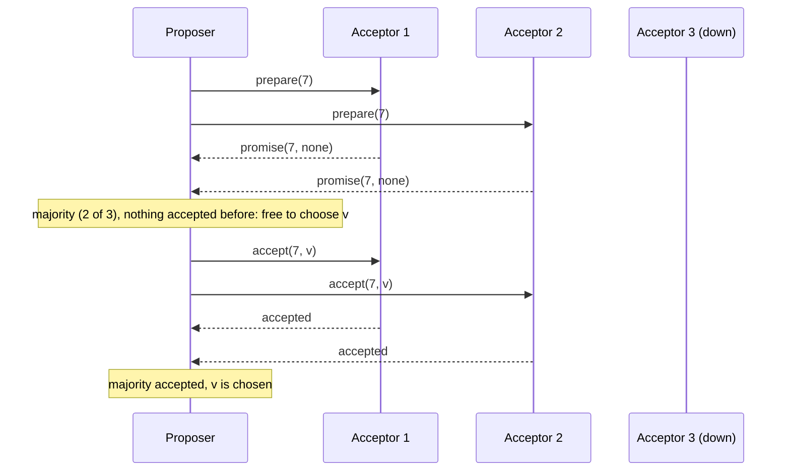
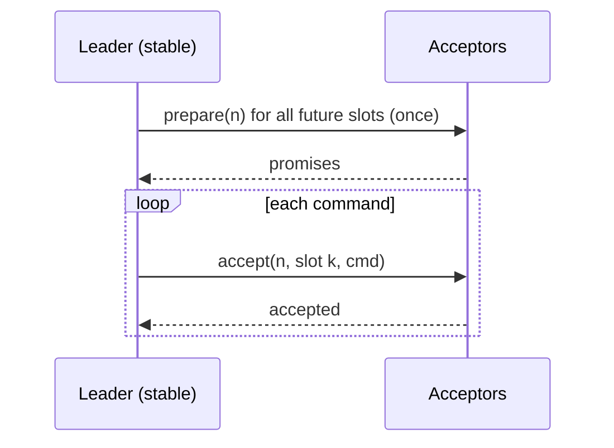
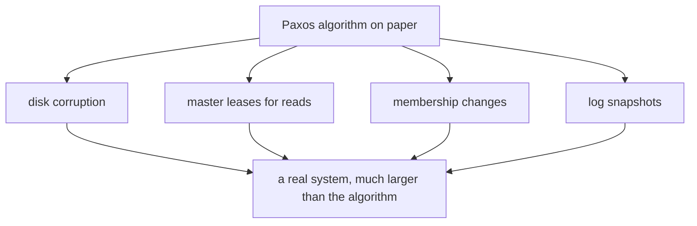

# Paxos Explained: Prepare, Promise, Accept — and vs Raft

> **Prerequisites:** [Lesson 09: Raft Consensus Explained](../09-raft-consensus-explained/README.md).  
> **Estimated Reading Time:** 24–28 minutes  
> **Target Audience:** Backend engineers who keep seeing "Paxos" in papers and interviews (Chubby, Spanner, Cassandra's lightweight transactions) and want the core idea without the mystique.  
> **Free PDF Notes:** [Download SD-H-010.pdf](https://backendroadmap.com/notes/system-design/SD-H-010.pdf)

> [!NOTE]
> **In one line:** Paxos makes a majority of **acceptors** agree on one value in two phases (**prepare/promise**, then **accept/accepted**) using increasing proposal numbers, and a proposer **must adopt any value already accepted**. Multi-Paxos runs it per log slot with a stable leader, which is what Raft spelled out and simplified.

> [!TIP]
> **The Golden Rule:** Once a value *could* have been chosen, no later proposer can change it. The prepare phase exists to find out whether that happened, and the adoption rule forces the new proposer to re-propose the old value.

---

## 1. What Paxos Is, and What It Isn't

Before Raft there was Paxos. Leslie Lamport described it in the late 1980s, and it became the foundation of Google's Chubby, Spanner and Megastore. It has a reputation for being hard to understand. You will rarely implement it yourself, but interviews and papers refer to it constantly, and it shows the core idea every consensus algorithm uses.

| Term | Precise Meaning | Example |
| :--- | :--- | :--- |
| **Proposer** | Suggests a value with a unique proposal number $n$ | A node trying to set the leader |
| **Acceptor** | Votes; a majority of acceptors decides | 3 of 5 replicas |
| **Learner** | Finds out which value was chosen | Any client or replica |
| **Proposal number** | A unique, increasing number $n$ | $(\text{round}, \text{node id})$ |
| **Chosen** | A value accepted by a majority at the same proposal number; permanent | "X" |
| **Multi-Paxos** | One Paxos instance per log slot, with a stable leader | A replicated log |
| **Not** | A leader election protocol by itself, or a database | It agrees on *values* |

In practice one server plays all three roles.

### Why It Matters
1. It is the proof that agreement under failures is possible without timing assumptions for *safety* (only liveness needs timers).
2. "Paxos" appears in the names of real features (Cassandra lightweight transactions, Spanner, Chubby, Megastore).
3. Comparing Paxos and Raft is a standard senior-level interview question.

---

## 2. Anatomy: Basic Paxos, Two Phases

**Phase 1, prepare.** A proposer picks $n$ higher than any it has used and sends `prepare(n)`. An acceptor that has not promised a higher number replies with a **promise** never to accept proposals below $n$, and reports the highest-numbered value it has already accepted, if any.

**Phase 2, accept.** With promises from a majority, the proposer sends `accept(n, v)`. **The key rule:** $v$ must be the value of the highest-numbered accepted proposal reported; only if none was reported may it choose its own. An acceptor accepts unless it has since promised a higher number. When a majority accepts, the value is **chosen**, permanently.



| Acceptor stores | Meaning |
| :--- | :--- |
| `promised` | Highest $n$ it has promised not to go below |
| `accepted = (n, v)` | Highest-numbered proposal it has accepted, if any |

> [!WARNING]
> **Both must be on durable storage.** If an acceptor forgets a promise after a crash it may accept something it promised not to, which breaks safety (the case study below).

---

## 3. Mathematical Model: Why It Is Safe

Two facts give safety:

1. **Majorities overlap.** Any two majorities share at least one acceptor: $q+q>n$.
2. **Promises are monotone.** An acceptor that promised $n$ rejects anything lower.

Suppose $v$ was chosen at number $n_1$ (accepted by a majority $M_1$). A later proposer with $n_2>n_1$ gets promises from a majority $M_2$. $M_1\cap M_2\neq\emptyset$, so some acceptor in $M_2$ already accepted $(n_1, v)$ and reports it. By the adoption rule the proposer proposes $v$ (or an even later accepted value, which by induction is also $v$). So **every later chosen value equals $v$**.

| Cluster | Majority | Acceptors that may be down |
| :---: | :---: | :---: |
| 3 | 2 | 1 |
| 5 | 3 | 2 |
| 7 | 4 | 3 |

**Why it might not finish.** Two proposers can keep pre-empting each other with higher numbers: P1 prepares $n=1$, P2 prepares $n=2$ (invalidating P1's accept), P1 retries with $n=3$, and so on. Safe, but no progress (**livelock**). A distinguished proposer (leader) and randomised backoff break the cycle. The FLP impossibility result means no deterministic asynchronous protocol can guarantee both safety and termination, so Paxos gives up guaranteed termination, not safety.

---

## 4. Metrics & Percentiles

| Metric | Meaning | Why you care |
| :--- | :--- | :--- |
| **Rounds per decision** | Prepare + accept round trips | Basic Paxos needs two; Multi-Paxos with a stable leader needs one |
| **Proposal restarts** | Times a proposer is pre-empted | Rising means dueling proposers |
| **Acceptor `fsync` latency** | Durable write of `promised` and `accepted` | On the critical path of both phases |
| **Time to a new leader** | Failover duration | Writes stall meanwhile |
| **Chosen-value disagreements** | Must be 0 | Any non-zero value is a safety bug |

### Worked Example (why adoption is mandatory)
Acceptors A1, A2, A3. P1 got value **X** accepted by A1 and A2 (a majority) at $n=1$, then crashed before telling anyone. P2 wants to propose **Y** with $n=2$. P2 sends `prepare(2)` to A2 and A3; both promise. A2 reports "I accepted (1, X)"; A3 reports nothing. The highest accepted value is X, so P2 **must** propose X, not Y. X stays chosen, and every later proposer will learn X as well.

---

## 5. Compounding: Break a Rule, See What Happens

A simulation of single-decree Paxos: 5 acceptors, 3 competing proposers, 25% of messages lost, random delivery order, 20,000 runs per row. "Two values chosen" means two different values each reached a majority, which is a safety violation.

| Variant | Runs deciding a value | Runs with **two different values chosen** |
| :--- | :---: | :---: |
| **Full Paxos** | 100% | **0** |
| Proposer ignores accepted values (always its own) | 100% | 19,442 |
| Acceptor ignores its promise (accepts any $n$) | 100% | 2,653 |
| Both rules removed | 100% | 19,901 |

Safety needs both rules. Note that all variants *reach a decision*; the broken ones decide **wrongly**. That is why consensus proofs matter: a protocol that "works" in testing can still be unsafe.

---

## 6. Numbers Every Engineer Must Know

| Item | Typical | Implication |
| :--- | :---: | :--- |
| Chubby cell | 5 replicas, 3 must run | Tolerates 2 failures |
| Basic Paxos round trips | 2 | Prepare, then accept |
| Multi-Paxos steady state | 1 | Leader skips phase 1 for later slots |
| Chubby master lease | maintained for "several days at a time" (Paxos Made Live) | Leases make local reads possible |
| Quorum | $\lfloor n/2\rfloor+1$ | Same as Raft |
| Durable state per acceptor | 2 fields | `promised`, `accepted` |

---

## 7. Protocol Deep Dive: Multi-Paxos and Paxos vs Raft

**Multi-Paxos.** A replicated log needs a value *per slot*. Run a Paxos instance for each slot. A stable leader runs phase 1 **once** for all future slots, so each new command needs a single accept round trip. In steady state it looks very much like Raft.



| | Paxos | Raft |
| :--- | :--- | :--- |
| **Decides** | One value (Multi-Paxos: a log) | A log, from the start |
| **Leader** | Optional in basic Paxos; Multi-Paxos uses a stable one | Built in, one per term, required |
| **Log gaps** | Allowed; filled later | Not allowed; the leader keeps the log contiguous |
| **Specification** | Short paper, many gaps for implementers | Full algorithm including membership and snapshots |
| **Understandability** | Famously hard, many variants | Designed to be teachable (33 of 43 students scored higher on Raft questions) |
| **Used in** | Chubby, Spanner, Megastore, many Google systems | etcd, Consul, CockroachDB, TiKV |

Same guarantees, same fault tolerance, same cost. Raft fixes what Paxos leaves open.

---

## 8. Hierarchical Budgets & Design Rules

| Slice | Rule | Control |
| :--- | :--- | :--- |
| Acceptor state | Durable before replying | `fsync` `promised` and `accepted` |
| Proposal numbers | Unique and increasing per proposer | $(\text{round}, \text{node id})$ pairs |
| Liveness | One distinguished proposer | Leader election plus randomised backoff |
| Cluster | 3 or 5 acceptors | Odd, separate failure zones |
| Disk corruption | Detect it; an acceptor that lost state must not vote | Checksums and a restart marker |
| Membership changes | Use a proven procedure | The literature is thin; do not invent one |
| Build vs buy | Use etcd, ZooKeeper or Spanner | Do not write your own Paxos |

---

## 9. Top Mitigations

1. **Persist `promised` and `accepted` before replying.**
2. **Always adopt the highest-numbered accepted value** reported in phase 1.
3. **Use a stable leader** (Multi-Paxos) to avoid dueling proposers and skip phase 1.
4. **Add jittered backoff** to proposers that lose.
5. **Detect and handle disk corruption**: a replica that lost its state must rejoin as a new member.
6. **Test with a model checker or Jepsen**, because Paxos bugs are subtle.
7. **Prefer an existing library** to a handwritten implementation.

---

## 10. Production Case Study: Google's "Paxos Made Live" (Chubby)

*Paxos Made Live: An Engineering Perspective* (Chandra, Griesemer and Redstone, PODC 2007) describes building a fault-tolerant database on Paxos for Chubby, Google's lock service. The Chubby paper (Burrows, OSDI 2006) describes the service: a cell is usually **five replicas, of which three must be running** for the cell to be up, and it states that "all working protocols for asynchronous consensus we have so far encountered have Paxos at their core".

What the paper reports about turning the algorithm into a system:

- **Disk corruption breaks the model.** "When a replica's disk is corrupted and it loses its persistent state, it may renege on promises it has made to other replicas in the past. This violates a key assumption in the Paxos algorithm." Their fix: checksums on files, and a marker left in GFS so a replica that restarts with an empty disk knows it lost state, and must rejoin as a *new* replica rather than vote.
- **Master leases** for fast reads: while the master holds the lease, no other replica can successfully submit values, so the master can serve reads from local state. Masters "successfully maintain leases for several days at a time".
- **Group membership** changes: the authors note that "the literature does not spell this out, nor does it contain a proof of correctness" for membership changes with Multi-Paxos, so they had to fill in the gaps themselves.
- **Snapshots** to truncate the log, taken by the application and not synchronised across replicas.



**Lesson:** the algorithm is the small part. The engineering around it (durable state you can trust, membership, snapshots, leases) is why people reach for etcd or ZooKeeper instead of writing Paxos, and why Raft's authors specified those parts in the paper.

---

## 11. Multi-Language Production Code Tabs

The acceptor's two handlers and the proposer's value-choice rule, the heart of Basic Paxos.

````carousel
```go
// Go: Paxos acceptor and the proposer's value choice.
package main

type Accepted struct {
	N int
	V string
}

type Acceptor struct {
	Promised int
	Acc      *Accepted // highest-numbered accepted proposal, if any
}

// Prepare: promise not to accept below n, and report what we accepted.
func (a *Acceptor) Prepare(n int) (ok bool, prior *Accepted) {
	if n > a.Promised {
		a.Promised = n // persist before replying in a real system
		return true, a.Acc
	}
	return false, nil
}

// Accept: accept unless we promised a higher number.
func (a *Acceptor) Accept(n int, v string) bool {
	if n >= a.Promised {
		a.Promised = n
		a.Acc = &Accepted{N: n, V: v}
		return true
	}
	return false
}

// ChooseValue applies the key rule: adopt the highest-numbered accepted value.
func ChooseValue(promises []*Accepted, own string) string {
	var best *Accepted
	for _, p := range promises {
		if p != nil && (best == nil || p.N > best.N) {
			best = p
		}
	}
	if best != nil {
		return best.V
	}
	return own
}
```
<!-- slide -->
```typescript
// TypeScript: Paxos acceptor and the proposer's value choice.
interface Accepted {
  n: number;
  v: string;
}

class Acceptor {
  promised = 0;
  accepted: Accepted | null = null;

  prepare(n: number): { ok: boolean; prior: Accepted | null } {
    if (n > this.promised) {
      this.promised = n; // persist before replying in a real system
      return { ok: true, prior: this.accepted };
    }
    return { ok: false, prior: null };
  }

  accept(n: number, v: string): boolean {
    if (n >= this.promised) {
      this.promised = n;
      this.accepted = { n, v };
      return true;
    }
    return false;
  }
}

// The key rule: adopt the highest-numbered accepted value reported by the majority.
export function chooseValue(promises: (Accepted | null)[], own: string): string {
  let best: Accepted | null = null;
  for (const p of promises) if (p && (!best || p.n > best.n)) best = p;
  return best ? best.v : own;
}
```
<!-- slide -->
```python
# Python: acceptor, value choice, and the safety simulation behind section 5 (condensed).
import random


class Acceptor:
    def __init__(self):
        self.promised, self.accepted = 0, None          # accepted = (n, v) or None

    def prepare(self, n):
        if n > self.promised:
            self.promised = n                            # persist before replying in a real system
            return True, self.accepted
        return False, None

    def accept(self, n, v):
        if n >= self.promised:
            self.promised, self.accepted = n, (n, v)
            return True
        return False


def choose_value(promises, own):
    """The key rule: adopt the highest-numbered accepted value, else use your own."""
    prior = [p for p in promises if p]
    return max(prior)[1] if prior else own


def run(rng, adopt=True, honor_promise=True, A=5, P=3, drop=0.25, steps=400):
    maj, promised, accepted, votes, chosen = A // 2 + 1, [0] * A, [None] * A, {}, set()
    prop = [{"n": 0, "phase": 0, "promises": {}, "value": f"V{p}"} for p in range(P)]
    net, rounds = [], [0]

    def new_round(p):
        rounds[0] += 1
        prop[p].update(n=rounds[0] * P + p, phase=1, promises={})
        net.extend(("prepare", p, a, prop[p]["n"]) for a in range(A))

    for p in range(P):
        if rng.random() < 0.7:
            new_round(p)
    for _ in range(steps):
        if rng.random() < 0.05:
            new_round(rng.randrange(P))
        if not net:
            continue
        kind, p, a, x = net.pop(rng.randrange(len(net)))
        if rng.random() < drop:
            continue
        if kind == "prepare" and x > promised[a]:
            promised[a] = x
            net.append(("promise", p, a, (x, accepted[a])))
        elif kind == "promise":
            n, acc = x
            st = prop[p]
            if st["phase"] == 1 and st["n"] == n:
                st["promises"][a] = acc
                if len(st["promises"]) >= maj:
                    st["phase"] = 2
                    prior = [v for v in st["promises"].values() if v]
                    v = max(prior)[1] if (prior and adopt) else st["value"]
                    net.extend(("accept", p, b, (n, v)) for b in range(A))
        elif kind == "accept":
            n, v = x
            if (not honor_promise) or n >= promised[a]:
                promised[a] = max(promised[a], n)
                accepted[a] = (n, v)
                s = votes.setdefault((n, v), set())
                s.add(a)
                if len(s) >= maj:
                    chosen.add(v)
    return chosen
```
<!-- slide -->
```csharp
// C#: Paxos acceptor and the proposer's value choice.
public sealed record Accepted(int N, string V);

public sealed class Acceptor
{
    public int Promised { get; private set; }
    public Accepted? Acc { get; private set; }

    public (bool Ok, Accepted? Prior) Prepare(int n)
    {
        if (n > Promised)
        {
            Promised = n; // persist before replying in a real system
            return (true, Acc);
        }
        return (false, null);
    }

    public bool Accept(int n, string v)
    {
        if (n < Promised) return false;
        Promised = n;
        Acc = new Accepted(n, v);
        return true;
    }

    // The key rule: adopt the highest-numbered accepted value, else use your own.
    public static string ChooseValue(IEnumerable<Accepted?> promises, string own)
    {
        var best = promises.Where(p => p is not null).OrderByDescending(p => p!.N).FirstOrDefault();
        return best is null ? own : best.V;
    }
}
```
````

---

## 12. Hands-On CLI Verification Workflows

The Python tab's `run()` (Python 3.13, 20,000 runs per variant, seed 10) produces the table in section 5. The per-run check is one line: `len(run(rng)) > 1` means two different values were chosen.

The by-hand example from section 4, with the tab's classes:

```python
a1, a2, a3 = Acceptor(), Acceptor(), Acceptor()
a1.accept(1, "X"); a2.accept(1, "X")                    # P1 got X accepted by a majority, then crashed
ok2, prior2 = a2.prepare(2)                              # P2 asks A2 and A3 with n = 2
ok3, prior3 = a3.prepare(2)
print(choose_value([prior2, prior3], own="Y"))           # X, not Y
```

For real systems: Cassandra's lightweight transactions (`INSERT ... IF NOT EXISTS`) run Paxos per partition, and etcd and ZooKeeper-style services give you consensus without writing it.

---

## 13. Common Mistakes to Avoid

1. **Not persisting `promised` and `accepted`** before replying.
2. **Letting a proposer choose its own value** when promises reported one.
3. **Reusing or non-unique proposal numbers.**
4. **Two proposers with no backoff**, causing livelock.
5. **An acceptor that lost its disk rejoining with its old identity.**
6. **Changing membership ad hoc** without a proven procedure.
7. **Writing your own Paxos** when etcd, ZooKeeper or Spanner exist.
8. **Confusing "decides" with "decides correctly":** a protocol that always terminates can still be unsafe.

---

## 14. Key Terms Glossary

| Key Term | Definition |
| :--- | :--- |
| **Proposer / acceptor / learner** | Suggests a value / votes / learns the result. |
| **Proposal number** | Unique, increasing $n$ attached to a proposal. |
| **Prepare / promise** | Phase 1: ask for, and give, a promise not to accept lower numbers. |
| **Accept / accepted** | Phase 2: propose a value, and acceptance of it. |
| **Chosen** | Accepted by a majority at one proposal number; permanent. |
| **Adoption rule** | A proposer must use the highest-numbered accepted value reported. |
| **Multi-Paxos** | A Paxos instance per log slot with a stable leader. |
| **Livelock** | Safe but endless pre-emption between proposers. |
| **FLP impossibility** | No deterministic asynchronous consensus can guarantee termination under even one crash. |
| **Master lease** | Time-limited leadership that allows local reads. |

---

## 15. System Design Interview Questions & Answers

### Basic Conceptual Questions

<details>
<summary><strong>Q1: What are the phases of Basic Paxos? [BASIC]</strong></summary>

**Answer:**
Phase 1: the proposer sends `prepare(n)`; acceptors reply `promise` (not to accept below $n$) plus any value they have accepted. Phase 2: with a majority of promises the proposer sends `accept(n, v)`, where $v$ is the highest-numbered accepted value reported, or its own if none; a majority accepting means the value is chosen.
</details>

<details>
<summary><strong>Q2: What are the roles? [BASIC]</strong></summary>

**Answer:**
Proposers suggest values, acceptors vote (a majority decides), learners find out the result. One server usually plays all three.
</details>

<details>
<summary><strong>Q3: Why must a proposer adopt an already-accepted value? [BASIC]</strong></summary>

**Answer:**
Because that value might already have been chosen by a majority. Any new majority overlaps it in at least one acceptor, which reports it; adopting it guarantees that a chosen value never changes.
</details>

<details>
<summary><strong>Q4: What is Multi-Paxos? [BASIC]</strong></summary>

**Answer:**
Paxos run once per log slot, with a stable leader that runs phase 1 once for many slots, so each command needs just one accept round trip. In steady state it resembles Raft.
</details>

### Scenario-Based Architecture Questions

<details>
<summary><strong>Q5: Two proposers keep failing. What is happening and how do you fix it? [SCENARIO]</strong></summary>

**Answer:**
Dueling proposers: each pre-empts the other with a higher number so no accept succeeds (livelock). It is safe but stalls. Elect a distinguished proposer (leader) and add randomised backoff, as Multi-Paxos does.
</details>

<details>
<summary><strong>Q6: An acceptor crashes and restarts with an empty disk. Can it just rejoin? [SCENARIO]</strong></summary>

**Answer:**
No. It may have promised or accepted things it no longer remembers, so it could renege on promises and break safety. Google's Chubby team detected this with checksums and a marker and made the replica rejoin as a new member.
</details>

<details>
<summary><strong>Q7: Which cluster size for a Chubby-like lock service? [SCENARIO]</strong></summary>

**Answer:**
Five replicas, three needed. It survives two failures. Seven slows commits for little gain, and an even number adds cost without tolerance.
</details>

<details>
<summary><strong>Q8: How do you serve reads quickly under Multi-Paxos? [SCENARIO]</strong></summary>

**Answer:**
Give the master a lease: while it holds it, no other replica can submit values, so the master can read from local state without a round trip. The lease relies on bounded clock skew for safety.
</details>

### Advanced & Tricky Interview Questions

<details>
<summary><strong>Q9: Why is Paxos safe? [TRICKY]</strong></summary>

**Answer:**
Majorities overlap and promises are monotone. If $v$ was chosen at $n_1$, any later proposer's majority includes an acceptor that accepted $(n_1,v)$, reports it, and the adoption rule makes the proposer re-propose $v$. By induction every later chosen value is $v$.
</details>

<details>
<summary><strong>Q10: What happens if acceptors ignore their promises or proposers ignore accepted values? [TRICKY]</strong></summary>

**Answer:**
Safety breaks. In a simulation of 5 acceptors and 3 proposers with message loss, full Paxos produced two different chosen values in 0 of 20,000 runs, while ignoring accepted values did in 19,442 and ignoring promises in 2,653. All variants still "decided", just wrongly.
</details>

<details>
<summary><strong>Q11: Paxos vs Raft in one answer? [TRICKY]</strong></summary>

**Answer:**
Same guarantees and quorum cost. Raft has a mandatory strong leader, a contiguous log and a complete specification including membership and snapshots; Paxos is a minimal agreement protocol, with Multi-Paxos filling logs and allowing gaps. Raft is easier to implement correctly.
</details>

<details>
<summary><strong>Q12: Does FLP mean consensus is impossible? [TRICKY]</strong></summary>

**Answer:**
It means no deterministic asynchronous protocol can guarantee *termination* if even one node may crash. Paxos and Raft keep safety always and ensure liveness with timeouts and leaders under reasonable timing, so in practice they work, but they can stall.
</details>

---

## 16. One-Page Master Cheat Sheet

```
+---------------------------------------------------------------------------------------------------------+
|                          PAXOS — MASTER CHEAT SHEET                                                     |
+---------------------------------------------------------------------------------------------------------+
| 1. ROLES: proposer · acceptor (majority decides) · learner. Unique increasing proposal number n.        |
+---------------------------------------------------------------------------------------------------------+
| 2. PHASE 1: prepare(n) -> promise(n) + highest accepted value. Acceptor ignores anything below n.       |
+---------------------------------------------------------------------------------------------------------+
| 3. PHASE 2: accept(n, v). v = highest accepted value reported, ELSE own. Majority accepts = chosen.     |
+---------------------------------------------------------------------------------------------------------+
| 4. SAFE: majorities overlap + monotone promises -> a chosen value never changes.                        |
+---------------------------------------------------------------------------------------------------------+
| 5. NOT LIVE ALWAYS: dueling proposers livelock. Fix: one leader + backoff (Multi-Paxos).                |
+---------------------------------------------------------------------------------------------------------+
| 6. REAL WORLD: persist promised/accepted, handle disk loss, leases, membership. Use etcd/ZooKeeper.     |
+---------------------------------------------------------------------------------------------------------+
```

---

## Further Reading & Sources

- Leslie Lamport, "Paxos Made Simple" (2001), and "The Part-Time Parliament" (1998).
- Chandra, Griesemer and Redstone, "Paxos Made Live: An Engineering Perspective" (PODC 2007), sections 5.1 to 5.5.
- Mike Burrows, [The Chubby lock service for loosely-coupled distributed systems](https://research.google.com/archive/chubby-osdi06.pdf) (OSDI 2006).
- Ongaro and Ousterhout, [In Search of an Understandable Consensus Algorithm](https://raft.github.io/raft.pdf) (Raft, for the comparison).

---

## Free PDF Notes

[SD-H-010.pdf](https://backendroadmap.com/notes/system-design/SD-H-010.pdf)

---

## Next

Continue with [Lesson 11: Quorums Explained](../11-quorums-explained/README.md): $W + R > N$, sloppy quorums and hinted handoff.
