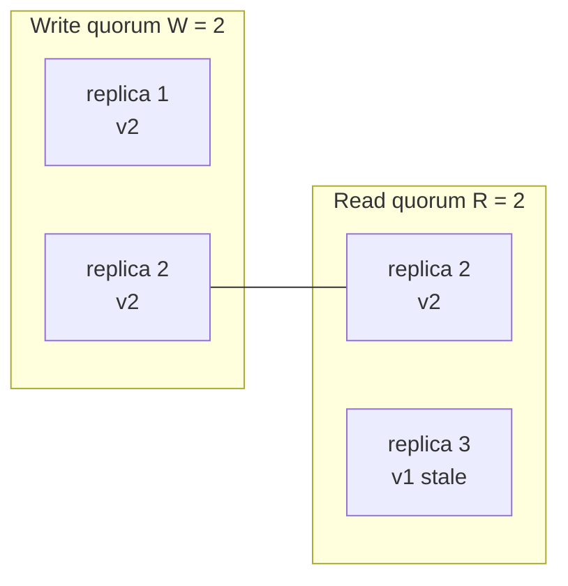
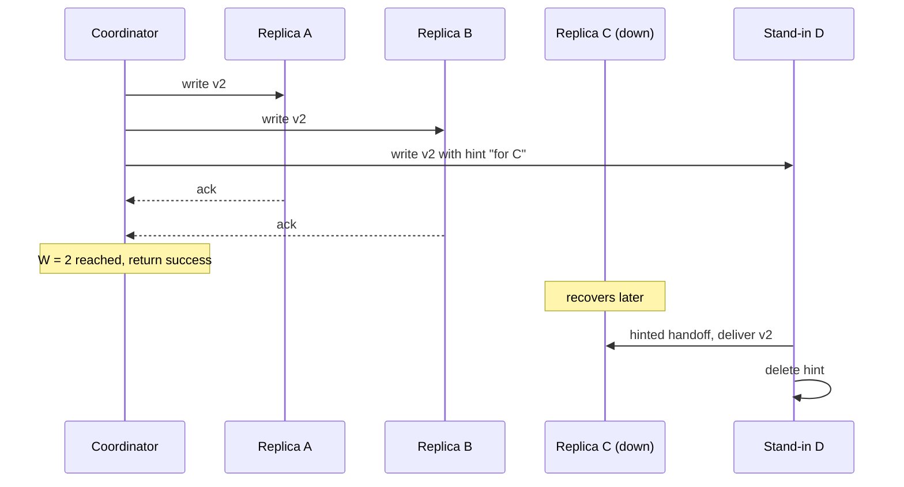

# Quorums Explained: W + R Exceeds N, Sloppy Quorums & Hinted Handoff

> **Prerequisites:** [Lesson 03: Network Partitions](../03-network-partitions/README.md) · [Lesson 07: Vector Clocks](../07-vector-clocks-hybrid-logical-clocks/README.md) · [Lesson 09: Raft](../09-raft-consensus-explained/README.md).  
> **Estimated Reading Time:** 22–26 minutes  
> **Target Audience:** Backend engineers using Cassandra, DynamoDB-style stores, Riak or any replicated database with tunable consistency, and candidates asked "what does QUORUM actually guarantee?"  
> **Free PDF Notes:** [Download SD-H-011.pdf](https://backendroadmap.com/notes/system-design/SD-H-011.pdf)

> [!NOTE]
> **In one line:** With $N$ replicas, a write waits for $W$ acknowledgements and a read asks $R$ replicas. If $R+W>N$, every read set overlaps the latest write set, so tuning $W$ and $R$ trades latency and availability against consistency, and repair mechanisms bring stale replicas back up to date.

> [!TIP]
> **The Golden Rule:** $R+W>N$ gives *overlap*, not linearizability. Overlap means a read will *contain* the latest acknowledged write; you still need versions to know which reply is newest, and sloppy quorums can void the guarantee until hinted data arrives.

---

## 1. What a Quorum Is, and What It Isn't

You store every value on three replicas. A write succeeds on two of them; the third is still missing it. Now a read arrives. If it asks only the stale replica, the user sees old data. If it waits for all three, one slow node makes every read slow. Quorums are the middle way.

| Term | Precise Meaning | Example |
| :--- | :--- | :--- |
| **$N$** | Number of replicas holding each key | 3 |
| **$W$** | Replicas that must acknowledge a write | 2 |
| **$R$** | Replicas a read asks (returns the newest reply) | 2 |
| **Quorum overlap** | $R+W>N$: read and write sets share at least one replica | $2+2>3$ |
| **Read repair** | A read that sees a stale replica writes the newest value back | Fixes lag lazily |
| **Anti-entropy** | Background comparison of replicas (Merkle trees) | Fixes data nobody reads |
| **Sloppy quorum** | A write may go to stand-in nodes when home replicas are unreachable | Dynamo's "always writeable" |
| **Hinted handoff** | The stand-in keeps a hint and hands data back later | Hint for replica C held by D |
| **Not** | A consensus protocol; no leader, no log | Lesson 09 is the strong version |

### Why It Matters
1. Cassandra, DynamoDB, Riak and Voldemort expose $N/W/R$ directly; knowing what each setting guarantees is a daily design choice.
2. "Quorum" is overloaded: Raft's majority commit and Dynamo's tunable $R/W$ are different mechanisms with different guarantees.
3. Interviewers probe the gaps: what quorums do *not* give you.

---

## 2. Anatomy: N, W and R

A write goes to all $N$ replicas and succeeds once $W$ confirm; the others may lag. A read queries $R$ replicas and returns the newest version among their answers.



With $N=3$, $W=2$, $R=2$ any two replicas you read include at least one with the new value (replica 2 here). A coordinator then compares versions (timestamps or vector clocks) and returns the newest.

| Setting ($N=3$) | $R+W>N$? | Behaviour | Good for |
| :--- | :---: | :--- | :--- |
| $W=1, R=1$ | No | Fastest; may read stale data | Caches, logs, anything staleness-tolerant |
| $W=2, R=2$ | **Yes** | Overlap guaranteed; tolerates one node down for both | Default balance (Cassandra `QUORUM`) |
| $W=3, R=1$ | **Yes** | Fast reads, slow writes; one down node blocks writes | Read-heavy, rare writes |
| $W=1, R=3$ | **Yes** | Fast writes, slow reads; one down node blocks reads | Write-heavy, rare reads |
| $N=5, W=3, R=3$ | **Yes** | Survives two nodes down | Higher durability |

> [!WARNING]
> **Latency follows the slowest of the $W$ or $R$ replicas you wait for.** That is why $W$ and $R$ are usually below $N$ (the Dynamo paper says so explicitly), and why tail latency matters.

---

## 3. Mathematical Model: Overlap and the Miss Probability

If $R+W>N$ the sets must intersect (pigeonhole: $R+W>N$ elements cannot fit in $N$ slots without a repeat). If $R+W\le N$ they might not. For a write set chosen uniformly and a read set chosen uniformly, the probability that the read **misses** the write entirely is

$$P(\text{miss}) = \frac{\binom{N-W}{R}}{\binom{N}{R}}$$

(0 whenever $R>N-W$, which is exactly $R+W>N$).

| $N$ | $W$ | $R$ | $R+W>N$ | $P(\text{miss})$ |
| :---: | :---: | :---: | :---: | :---: |
| 3 | 1 | 1 | no | 66.67% |
| 3 | 1 | 2 | no | 33.33% |
| 3 | 2 | 1 | no | 33.33% |
| 3 | 2 | 2 | **yes** | **0%** |
| 3 | 3 | 1 | **yes** | **0%** |
| 3 | 1 | 3 | **yes** | **0%** |
| 5 | 2 | 2 | no | 30.00% |
| 5 | 3 | 3 | **yes** | **0%** |

Fault tolerance: writes survive $N-W$ failures and reads survive $N-R$. With $N=3$, $W=R=2$ both survive one.

---

## 4. Metrics & Percentiles

| Metric | Meaning | Why you care |
| :--- | :--- | :--- |
| **Write latency $p_{99}$** | Time to the $W$-th fastest acknowledgement | Tail of the $W$-th order statistic |
| **Read latency $p_{99}$** | Time to the $R$-th fastest reply | Same for $R$ |
| **Stale-read rate** | Reads returning an old version | Rises when $R+W\le N$ or hints are pending |
| **Read-repair rate** | Reads that found disagreeing replicas | A proxy for replication lag |
| **Hint backlog** | Stored hints not yet delivered | Large means replicas are down or slow |
| **Unavailable requests** | Fewer than $W$ (or $R$) replicas reachable | The cost of strict quorums |

### Worked Example (Cassandra QUORUM)
A keyspace has replication factor 3. The application writes and reads at `QUORUM`: 2 of 3 replicas must acknowledge each. One replica can be down or slow and both reads and writes still succeed, and every read includes the latest acknowledged write. Writing and reading at `ONE` would be faster, but a read could land on a replica that has not received the write. Across data centres, `LOCAL_QUORUM` keeps the quorum inside the local data centre to avoid cross-region latency.

---

## 5. Compounding: Latency and Sloppy Quorums

**Latency of waiting for $k$ of 3 replicas** (illustrative: each replica's latency lognormal with a 2 ms median and a heavy tail; 100,000 requests per row):

| Wait for | p50 | p99 |
| :--- | :---: | :---: |
| 1 of 3 ($W=1$ or $R=1$) | 0.88 ms | 4.39 ms |
| **2 of 3 (quorum)** | **2.00 ms** | **9.50 ms** |
| 3 of 3 (all) | 4.53 ms | 29.79 ms |

Waiting for all replicas roughly triples the p99 compared with waiting for a quorum.

**Strict vs sloppy quorum** ($N=3$, $W=R=2$). In 10% of writes two home replicas are unreachable. A strict quorum fails that write. A sloppy quorum accepts it on one home replica plus a stand-in with a hint, and hands the data back after a delay. 200,000 operations, half writes:

| Mode | Hint delay (operations) | Writes accepted | Reads returning stale data |
| :--- | :---: | :---: | :---: |
| Strict | n/a | 90.0% (89.97) | 0.00% |
| Sloppy | 0 | 100% | 0.00% |
| Sloppy | 5 | 100% | 3.05% |
| Sloppy | 50 | 100% | 3.27% |

That is the trade in one table: sloppy quorums buy write **availability** (100% vs 90%) and pay with **staleness** while hints are undelivered. Even with $R+W>N$, the overlap guarantee does not hold during that window, because the write set contains a replica outside the home set. (A model; later full writes overwrite earlier staleness, which caps the stale rate.)

---

## 6. Numbers Every Engineer Must Know

| Item | Typical | Implication |
| :--- | :---: | :--- |
| Dynamo's common $(N,R,W)$ | $(3,2,2)$ | The paper's default for several instances |
| Typical $N$ | 3 | Each object on three nodes |
| Read-heavy tuning in Dynamo | $R=1$, $W=N$ | Product catalogue and promotional items |
| Always-writeable setting | $W=1$ | Accepted as long as one node durably writes it |
| Cassandra `QUORUM` at RF 3 | 2 of 3 | $W=R=2$ |
| Latency | slowest of the $W$ (or $R$) replies | Tail latency matters |

---

## 7. Protocol Deep Dive: Coordinator, Repair and Hinted Handoff



**Keeping replicas in sync.** Quorums let replicas fall behind, so systems repair them: **read repair** (a read that sees disagreement writes the newest value back), **anti-entropy** (a background process compares replicas using **Merkle trees**, hash trees whose roots match when data matches, so only differing ranges are exchanged) and **hinted handoff** as above.

**Step by step for $N=3,\ W=2,\ R=2$:**
1. The coordinator sends the write to all 3 and waits for 2 acknowledgements; the third may lag or be down.
2. Later, a read asks 2 replicas; at least one took the latest write.
3. The coordinator compares versions and returns the newest.
4. If the replicas disagreed, read repair writes the newest value back to the stale one.

**What quorums do not give you:**
- **Not linearizable in general.** Concurrent writes, writes that fail after landing on some replicas, and clock-based conflict resolution can still produce odd results.
- **Sloppy quorums weaken overlap** until handoff completes.
- **A failed write may still be visible.** If it reached fewer than $W$ replicas, a later read may or may not return it.

---

## 8. Hierarchical Budgets & Design Rules

| Slice | Rule | Control |
| :--- | :--- | :--- |
| Choose $N$ | 3 for most data, 5 for higher durability | Replication factor |
| Choose $W, R$ | $W+R>N$ for read-your-writes style behaviour | `QUORUM` / `LOCAL_QUORUM` |
| Cross-region | Keep the quorum local | `LOCAL_QUORUM`, replicate async across regions |
| Versions | Timestamps or vector clocks to pick the newest | Lesson 07 |
| Repair | Read repair plus scheduled anti-entropy | Repair jobs, Merkle trees |
| Hints | Bound hint storage and lifetime | Dynamo notes hinted handoff works best when churn is low |
| Need strict consistency? | Use consensus (Raft/Paxos), not tunable quorums | Lesson 09 |

---

## 9. Top Mitigations

1. **Use $W+R>N$** (typically `QUORUM` both ways, $N=3$) when readers must see recent writes.
2. **Keep quorums within one region** and replicate asynchronously across regions.
3. **Carry versions** (timestamps or vector clocks) so the coordinator can pick the newest reply.
4. **Run read repair and scheduled anti-entropy**, since data nobody reads never repairs itself.
5. **Know when you are sloppy**: where write availability is the priority, accept staleness until hints land.
6. **Hedge or time out** slow replicas so tail latency does not set your p99.
7. **For linearizable operations** (locks, uniqueness) use a consensus-backed path.

---

## 10. Production Case Study: Amazon Dynamo's Knobs

Amazon's *Dynamo* paper (SOSP 2007) is where these ideas became mainstream, and it is explicit about the trade-offs.

- **The protocol:** "R is the minimum number of nodes that must participate in a successful read operation. W is the minimum number... in a successful write operation. Setting R and W such that R + W > N yields a quorum-like system." The paper adds that the latency of an operation "is dictated by the slowest of the R (or W) replicas", so $R$ and $W$ are usually less than $N$.
- **The common configuration:** "The common (N,R,W) configuration used by several instances of Dynamo is (3,2,2)."
- **A different tuning:** services with high read rates and few updates, such as the **product catalogue and promotional items**, run as a "high performance read engine" with **$R=1$ and $W=N$**.
- **Always writeable:** Dynamo targets an "always writeable" store, because rejecting a customer's update (the shopping cart) is a worse experience than reconciling later. Instead of a strict quorum it uses a **sloppy quorum**: operations are performed on "the first N healthy nodes from the preference list". Hinted handoff ensures operations "are not failed due to temporary node or network failures", and applications that need the highest availability can set $W=1$ (though "most Amazon services in production set a higher W to meet the desired level of durability").
- **Repair:** anti-entropy using **Merkle trees**, where "if the hash values of the root of two trees are equal, then the values of the leaf nodes in the tree are equal".
- **A limit it states:** "Hinted handoff works best if the system membership churn is low and node failures are transient."

**Lesson:** $N$, $R$, $W$ are product decisions: catalogue reads, cart writes and durability each want a different setting, and the paper pairs every availability gain with a consistency cost the application must handle.

---

## 11. Multi-Language Production Code Tabs

A tiny in-memory quorum store: write to $W$ replicas, read from $R$, return the newest version, and repair stale replicas.

````carousel
```go
// Go: quorum write/read with read repair (in-memory model).
package main

import "math/rand"

type Versioned struct {
	Version int
	Value   string
}

type Cluster struct {
	Replicas []*Versioned // one per replica; nil = never written
	W, R     int
	rng      *rand.Rand
}

func New(n, w, r int, seed int64) *Cluster {
	return &Cluster{Replicas: make([]*Versioned, n), W: w, R: r, rng: rand.New(rand.NewSource(seed))}
}

// Write lands on W random replicas (the rest lag).
func (c *Cluster) Write(v Versioned) {
	for _, i := range c.rng.Perm(len(c.Replicas))[:c.W] {
		cp := v
		c.Replicas[i] = &cp
	}
}

// Read asks R random replicas, returns the newest, and repairs stale ones.
func (c *Cluster) Read() (Versioned, bool) {
	picked := c.rng.Perm(len(c.Replicas))[:c.R]
	var best *Versioned
	for _, i := range picked {
		if r := c.Replicas[i]; r != nil && (best == nil || r.Version > best.Version) {
			best = r
		}
	}
	if best == nil {
		return Versioned{}, false
	}
	for _, i := range picked { // read repair
		if c.Replicas[i] == nil || c.Replicas[i].Version < best.Version {
			cp := *best
			c.Replicas[i] = &cp
		}
	}
	return *best, true
}
```
<!-- slide -->
```typescript
// TypeScript: quorum write/read with read repair (in-memory model).
interface Versioned {
  version: number;
  value: string;
}

function sample<T>(items: T[], k: number): T[] {
  const copy = [...items];
  for (let i = copy.length - 1; i > 0; i--) {
    const j = Math.floor(Math.random() * (i + 1));
    [copy[i], copy[j]] = [copy[j], copy[i]];
  }
  return copy.slice(0, k);
}

class Cluster {
  replicas: (Versioned | null)[];
  private w: number;
  private r: number;

  constructor(n: number, w: number, r: number) {
    this.replicas = Array.from({ length: n }, () => null);
    this.w = w;
    this.r = r;
  }

  write(v: Versioned): void {
    for (const i of sample([...this.replicas.keys()], this.w)) this.replicas[i] = { ...v };
  }

  read(): Versioned | null {
    const picked = sample([...this.replicas.keys()], this.r);
    let best: Versioned | null = null;
    for (const i of picked) {
      const rep = this.replicas[i];
      if (rep && (!best || rep.version > best.version)) best = rep;
    }
    if (best) for (const i of picked) this.replicas[i] = { ...best }; // read repair
    return best;
  }
}
```
<!-- slide -->
```python
# Python: the code behind this lesson's tables (stdlib only).
import random
from math import comb


def miss_probability(n, w, r):
    """Chance a random read set misses a random write set: C(N-W, R) / C(N, R)."""
    return comb(n - w, r) / comb(n, r) if n - w >= r else 0.0


def simulate_miss(n, w, r, trials=200_000, seed=21):
    rng, miss = random.Random(seed), 0
    for _ in range(trials):
        wset, rset = set(rng.sample(range(n), w)), set(rng.sample(range(n), r))
        miss += not (wset & rset)
    return miss / trials


def quorum_latency(k, n=3, trials=100_000, seed=21):
    """p50 and p99 of waiting for k of n replicas (each lognormal, median 2 ms, heavy tail)."""
    import math
    rng = random.Random(seed)
    xs = sorted(sorted(rng.lognormvariate(math.log(2.0), 1.0) for _ in range(n))[k - 1] for _ in range(trials))
    return xs[len(xs) // 2], xs[int(len(xs) * 0.99)]


def sloppy_vs_strict(mode, delay, ops=200_000, seed=5):
    """N=3, W=R=2. In 10% of writes two home replicas are unreachable."""
    rng, ver, hints, latest = random.Random(seed), [0, 0, 0], [], 0
    writes = accepted = reads = stale = 0
    for op in range(ops):
        while hints and hints[0][0] <= op:                 # hinted handoff delivered
            _, rep, v = hints.pop(0)
            ver[rep] = max(ver[rep], v)
        if rng.random() < 0.5:
            writes += 1
            if rng.random() < 0.10:
                if mode == "strict":
                    continue                               # cannot reach W home replicas
                latest += 1
                ver[0] = latest                            # one home replica + stand-in acknowledge
                hints += [(op + delay, 1, latest), (op + delay, 2, latest)]
                hints.sort()
            else:
                latest += 1
                ver = [latest] * 3
            accepted += 1
        else:
            reads += 1
            stale += max(ver[i] for i in rng.sample(range(3), 2)) < latest
    return 100 * accepted / writes, 100 * stale / reads
```
<!-- slide -->
```csharp
// C#: quorum write/read with read repair (in-memory model).
public sealed record Versioned(int Version, string Value);

public sealed class Cluster
{
    private readonly Versioned?[] _replicas;
    private readonly int _w, _r;
    private readonly Random _rng = new(21);

    public Cluster(int n, int w, int r)
    {
        _replicas = new Versioned?[n];
        (_w, _r) = (w, r);
    }

    private IEnumerable<int> Pick(int k) =>
        Enumerable.Range(0, _replicas.Length).OrderBy(_ => _rng.Next()).Take(k);

    public void Write(Versioned v)
    {
        foreach (var i in Pick(_w)) _replicas[i] = v; // the rest lag
    }

    public Versioned? Read()
    {
        var picked = Pick(_r).ToArray();
        Versioned? best = null;
        foreach (var i in picked)
            if (_replicas[i] is { } rep && (best is null || rep.Version > best.Version)) best = rep;
        if (best is not null)
            foreach (var i in picked) _replicas[i] = best; // read repair
        return best;
    }
}
```
````

---

## 12. Hands-On CLI Verification Workflows

The Python tab reproduces the tables in sections 3 and 5 (Python 3.13). The miss-probability column is exact; the simulation agrees with it to within about 0.2 of a point (for example 33.51% against 33.33%). The by-hand check for $N=5$, $W=2$, $R=2$: $\binom{3}{2}/\binom{5}{2}=3/10=30\%$.

```python
print(miss_probability(5, 2, 2))      # 0.3
print(miss_probability(3, 2, 2))      # 0.0
print(sloppy_vs_strict("strict", 0))  # (about 90.0, 0.0)
print(sloppy_vs_strict("sloppy", 5))  # (100.0, about 3)
```

On a Cassandra cluster you set the level per query:

```sql
CONSISTENCY QUORUM;        -- with RF=3 this is W=2 and R=2
INSERT INTO carts (user_id, items) VALUES (7, {'book'});
SELECT * FROM carts WHERE user_id = 7;

CONSISTENCY LOCAL_QUORUM;  -- quorum inside the local data centre only
```

and run repair to fix replicas nobody reads: `nodetool repair <keyspace>`.

---

## 13. Common Mistakes to Avoid

1. **Believing $R+W>N$ means linearizable.** It guarantees overlap, not a single global order.
2. **Forgetting versions:** without timestamps or vector clocks the coordinator cannot tell which reply is newest.
3. **Cross-region quorums** that put a continent in every request.
4. **Waiting for all replicas** and inheriting the slowest one's tail.
5. **Relying on read repair alone** for data that is rarely read.
6. **Assuming overlap during sloppy quorums**, when the write set includes a stand-in.
7. **Treating a failed write as "did not happen"**: it may have landed on some replicas.
8. **Using tunable quorums for locks or uniqueness** that need consensus.

---

## 14. Key Terms Glossary

| Key Term | Definition |
| :--- | :--- |
| **$N$, $W$, $R$** | Replicas per key, write acknowledgements required, replicas read. |
| **Quorum overlap** | $R+W>N$: any read set intersects any write set. |
| **Read repair** | Writing the newest value back to a stale replica found during a read. |
| **Anti-entropy** | Background replica comparison and repair. |
| **Merkle tree** | Hash tree used to find differing key ranges cheaply. |
| **Sloppy quorum** | Writes may go to nodes outside the key's home replicas. |
| **Hinted handoff** | Stand-in stores a hint and delivers it when the home replica returns. |
| **`LOCAL_QUORUM`** | Quorum within the local data centre. |
| **Always writeable** | Design goal of never rejecting writes (Dynamo). |
| **Linearizability** | Behaves like a single copy with real-time order (lesson 22). |

---

## 15. System Design Interview Questions & Answers

### Basic Conceptual Questions

<details>
<summary><strong>Q1: What are N, W and R? [BASIC]</strong></summary>

**Answer:**
$N$ is the replication factor, $W$ is how many replicas must acknowledge a write, and $R$ is how many replicas a read queries. The read returns the newest version among those it hears from.
</details>

<details>
<summary><strong>Q2: Why does $R+W>N$ matter? [BASIC]</strong></summary>

**Answer:**
Because then any read set and any write set must share at least one replica, so a read is guaranteed to contact a replica that has the latest acknowledged write.
</details>

<details>
<summary><strong>Q3: What does Cassandra `QUORUM` mean at RF=3? [BASIC]</strong></summary>

**Answer:**
2 of 3 replicas must respond, for writes and reads alike, so $W=R=2$ and $R+W=4>3$. One replica can be down and everything still works.
</details>

<details>
<summary><strong>Q4: What is read repair? [BASIC]</strong></summary>

**Answer:**
When a read sees replicas disagree, the coordinator writes the newest value back to the stale replicas, so frequently read data converges without a separate process.
</details>

### Scenario-Based Architecture Questions

<details>
<summary><strong>Q5: Read-heavy catalogue, rare updates, a few seconds of staleness is fine. Which settings? [SCENARIO]</strong></summary>

**Answer:**
$N=3$ with $R=1$ (fast reads, eventual consistency, or $R=2$ when freshness matters) and a quorum write. Dynamo ran its product catalogue as a read engine with $R=1$, $W=N$. For a stock counter use quorum for both.
</details>

<details>
<summary><strong>Q6: A replica is down for an hour. What happens to writes and reads at QUORUM, RF=3? [SCENARIO]</strong></summary>

**Answer:**
Both keep working with the other two. When the replica returns it is stale; hinted handoff, read repair and anti-entropy (repair) bring it up to date. A second failure would make quorum operations fail.
</details>

<details>
<summary><strong>Q7: Why is `QUORUM` across three regions a bad idea for latency? [SCENARIO]</strong></summary>

**Answer:**
Each operation waits for the second-fastest reply, which usually crosses a region (tens to hundreds of milliseconds). Use `LOCAL_QUORUM` and replicate asynchronously between regions.
</details>

<details>
<summary><strong>Q8: Your shopping cart must never reject an add. How do you design the store? [SCENARIO]</strong></summary>

**Answer:**
Dynamo-style: sloppy quorum with hinted handoff, so writes succeed on stand-ins when home replicas are unreachable, vector clocks to detect conflicting versions, and application-level merge on read. The cost is that reads may be stale or show siblings until handoff and repair complete.
</details>

### Advanced & Tricky Interview Questions

<details>
<summary><strong>Q9: Is $R+W>N$ linearizable? [TRICKY]</strong></summary>

**Answer:**
No. Overlap ensures the read *contains* the latest acknowledged write, but concurrent writes, partially applied failed writes, and timestamp-based conflict resolution can still give anomalies (for example two concurrent readers seeing different orders). Linearizability needs consensus or extra mechanisms.
</details>

<details>
<summary><strong>Q10: What does a sloppy quorum break? [TRICKY]</strong></summary>

**Answer:**
The overlap guarantee. The write set may include a stand-in that is not among the replicas a read asks, so a read can miss it until hinted handoff delivers the data. In a simulation with 10% of writes hitting two unreachable home replicas, strict quorum rejected 10% of writes and returned no stale reads, while sloppy accepted all writes and returned about 3% stale reads while hints were pending.
</details>

<details>
<summary><strong>Q11: How likely is a stale read at $W=1$, $R=1$, $N=3$? [TRICKY]</strong></summary>

**Answer:**
If the write landed on one random replica and the read asks one random replica, the read misses with probability $\binom{2}{1}/\binom{3}{1}=2/3$, about 67%, until replication or repair catches up. In practice replication is also asynchronous, so the real figure depends on lag.
</details>

<details>
<summary><strong>Q12: When would you pick Raft over tunable quorums? [TRICKY]</strong></summary>

**Answer:**
When you need a single ordered history and linearizable operations: locks, unique constraints, configuration. Tunable quorums fit high-availability, high-throughput key-value workloads that can tolerate conflicts and staleness and resolve them with versions.
</details>

---

## 16. One-Page Master Cheat Sheet

```
+---------------------------------------------------------------------------------------------------------+
|                          QUORUMS — MASTER CHEAT SHEET                                                   |
+---------------------------------------------------------------------------------------------------------+
| 1. N replicas · write waits for W acks · read asks R replicas · newest version wins.                    |
+---------------------------------------------------------------------------------------------------------+
| 2. R + W > N  =>  read set overlaps the latest write set. Miss chance = C(N-W, R) / C(N, R).            |
+---------------------------------------------------------------------------------------------------------+
| 3. COMMON: N=3,W=2,R=2 (Cassandra QUORUM, Dynamo default). Catalogue: R=1, W=N. LOCAL_QUORUM cross-DC.  |
+---------------------------------------------------------------------------------------------------------+
| 4. REPAIR: read repair · anti-entropy (Merkle trees) · hinted handoff.                                  |
+---------------------------------------------------------------------------------------------------------+
| 5. SLOPPY QUORUM: always writeable, but overlap is void until hints are delivered.                      |
+---------------------------------------------------------------------------------------------------------+
| 6. NOT LINEARIZABLE. Latency = slowest of W or R. Use consensus for locks and uniqueness.               |
+---------------------------------------------------------------------------------------------------------+
```

---

## Further Reading & Sources

- DeCandia et al., [Dynamo: Amazon's Highly Available Key-value Store](https://www.allthingsdistributed.com/files/amazon-dynamo-sosp2007.pdf) (SOSP 2007), sections 4.5, 4.6, 4.7 and 6.
- Apache Cassandra documentation, "Dynamo" and "Consistency levels" (`QUORUM`, `LOCAL_QUORUM`).
- Martin Kleppmann, *Designing Data-Intensive Applications*, chapter 5, "Quorums for reading and writing" and its limitations.
- Riak documentation on hinted handoff and read repair.

---

## Free PDF Notes

[SD-H-011.pdf](https://backendroadmap.com/notes/system-design/SD-H-011.pdf)

---

## Next

Continue with [Lesson 12: Split Brain](../12-split-brain/README.md): two leaders, and how quorums, witnesses and STONITH stop it.
