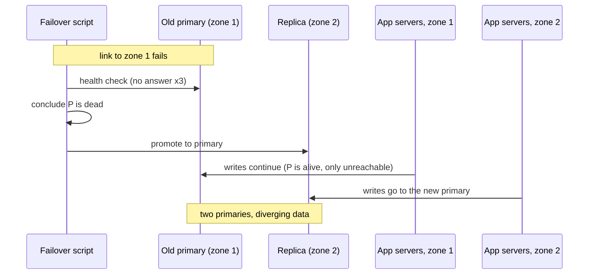
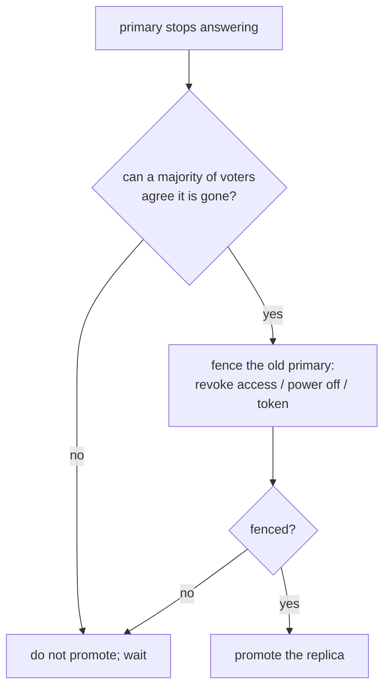
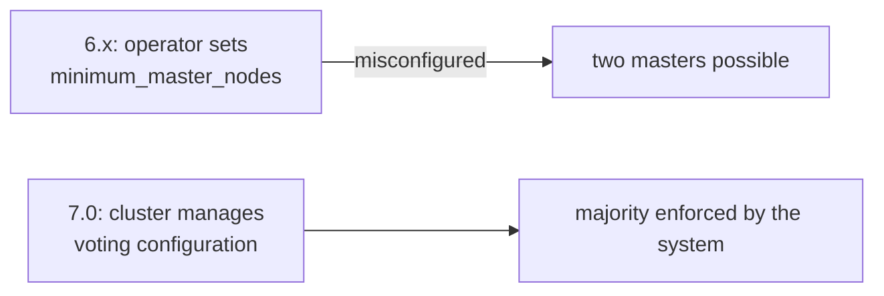

# Split Brain: Two Leaders, and How Quorums, Witnesses & STONITH Stop It

> **Prerequisites:** [Lesson 03: Network Partitions](../03-network-partitions/README.md) · [Lesson 08: Leader Election](../08-leader-election/README.md) · [Lesson 11: Quorums](../11-quorums-explained/README.md).  
> **Estimated Reading Time:** 22–26 minutes  
> **Target Audience:** Backend and platform engineers running primary/replica databases, HA pairs and clustered services, and candidates asked "how do you prevent two primaries?"  
> **Free PDF Notes:** [Download SD-H-012.pdf](https://backendroadmap.com/notes/system-design/SD-H-012.pdf)

> [!NOTE]
> **In one line:** Split brain happens when a cluster splits and **both sides act as leader**, accepting conflicting writes. Prevent it with **majority quorums**, an **odd number of voters (or a witness)**, and **fencing** that stops the old leader, because "it stopped answering" never proves it stopped working.

> [!TIP]
> **The Golden Rule:** A promotion decision is only as safe as the guarantee that the *old* leader has stopped. Quorum decides who *may* lead; fencing makes sure the loser *cannot*. Use both.

---

## 1. What Split Brain Is, and What It Isn't

Your database primary stops answering health checks. The failover system promotes a replica. But the old primary was not dead: it was cut off from the monitor, and app servers next to it are still writing to it. Now there are two primaries accepting writes, and their data diverges. It is one of the most damaging failures in distributed systems because it silently **corrupts data** instead of just causing downtime.

| Term | Precise Meaning | Example |
| :--- | :--- | :--- |
| **Split brain** | Two nodes both believe they are the leader and both accept writes | Two Postgres primaries |
| **Quorum** | A majority of voters; only that side may lead | 3 of 5 |
| **Witness (arbiter)** | A lightweight extra voter, often storing no data, in a third location | A small node in a third zone |
| **Fencing** | Making it impossible for the old leader to do harm | Token check, revoked credentials, power off |
| **STONITH** | "Shoot the other node in the head": forcibly power off the presumed-dead node | Pacemaker clusters |
| **Demote on lost lease** | A leader that cannot renew its lease steps down | Patroni with etcd |
| **Not split brain** | A failover with a *dead* old primary | One leader, no conflict |

### Why It Matters
1. A split brain gives you two histories that often *cannot* be merged safely; cleanup is manual, row by row.
2. It is the typical failure of home-made failover scripts and two-node clusters.
3. Every defence here is a standard interview answer, and weak answers ("just check if it is alive") are the usual trap.

---

## 2. Anatomy: How Two Primaries Appear



The monitor cannot tell "dead" from "unreachable" (lessons 03 and 04). **Why it happens:**
- Failover decided by **one observer** that is itself partitioned.
- **Two-node clusters**: after a split each side is exactly half, and a naive rule lets both win.
- A leader **paused** by GC or a frozen VM wakes up still believing it leads (lesson 08).
- **Manual failover** during an incident, without first making sure the old primary is down.

### Worked Example: A Homemade Failover Script
A Postgres cluster has a primary and one replica, plus a script that promotes the replica if the primary fails three health checks. A network glitch hides the primary from the script for 20 seconds. The replica is promoted and DNS is switched, but some app servers keep their old connections to the original primary. For ten minutes orders are written to both. Cleaning up means comparing two databases row by row. The fix: a tool such as Patroni that keeps the leader key in etcd with a lease, a primary that **demotes itself** when it cannot renew the key, and **fencing** (revoke its network access or kill it) before promotion.

---

## 3. Mathematical Model: Why a Majority Rules Out Two Leaders

With $n$ voters and a rule "lead only if you can reach more than $n/2$ voters", two disjoint sides cannot both exceed $n/2$:

$$a > \tfrac{n}{2} \ \text{and}\ b > \tfrac{n}{2} \ \Rightarrow\ a + b > n$$

but two disjoint sides satisfy $a+b\le n$, a contradiction. So **at most one side can hold a majority**. The cost is availability: if neither side does (an even split), nobody leads.

| Voters | Majority | Clean 2-way splits | Outcome |
| :---: | :---: | :--- | :--- |
| 2 | 2 | 1/1 | Nobody leads (or both, with a naive rule) |
| 3 | 2 | 2/1 | Always exactly one leader |
| 4 | 3 | 2/2 or 3/1 | 2/2 leaves nobody |
| 5 | 3 | 3/2, 4/1 | Always exactly one leader |
| 2 data + 1 witness | 2 | each data node plus the witness | The side with the witness leads |

---

## 4. Metrics & Percentiles

| Metric | Meaning | Alert when |
| :--- | :--- | :--- |
| **Writers per shard** | Nodes currently accepting writes for a dataset | More than 1, ever |
| **Time since last successful lease renewal** | On the leader | Approaching the TTL |
| **Promotions per day** | Failovers | More than expected (flapping) |
| **Fenced writes rejected** | Writes dropped by a fencing check | Non-zero means a zombie was caught |
| **Replication divergence** | Rows or LSNs present on only one node | Any divergence between supposed copies |
| **Time without a leader** | Unavailability after a split | Longer than your budget |

### Worked Example (witness)
A database runs 2 nodes in DC1 and 2 nodes in DC2. A link failure isolates the data centres. Each side has exactly 2 of 4 votes, so neither has a majority and the whole cluster stops (or, worse, both sides promote themselves). Add one small **witness** in a third location: 5 votes. Whichever data centre can still reach the witness has 3 of 5 and continues; the other side steps down.

---

## 5. Compounding: Random Partitions, Counted

A simulation (Python 3.13, 100,000 random partitions per row): each voter lands on one of two sides at random; a witness is cut off from both sides 20% of the time. "Naive" means "promote if you cannot see the other side"; "majority" means "lead only with more than half of all voters". "Two leaders" is split brain; "no leader" is an outage.

| Layout | Rule | Two leaders (split brain) | No leader | Exactly one |
| :--- | :--- | :---: | :---: | :---: |
| 2 data nodes | naive | **49.9%** | 0.0% | 50.1% |
| 2 data nodes | majority | 0.0% | 49.9% | 50.1% |
| 2 data nodes + witness | majority | 0.0% | 9.9% | 90.1% |
| 4 data nodes (2+2 in two DCs) | majority | 0.0% | 37.3% | 62.7% |
| 4 data nodes + witness | majority | 0.0% | 7.4% | 92.6% |
| 3 data nodes | majority | 0.0% | 0.0% | 100% |
| 5 data nodes | majority | 0.0% | 0.0% | 100% |

Read it as three lessons. The naive rule produces split brain in **half** of all partitions. The majority rule **eliminates** split brain at every size, but even-sized or two-node layouts pay for it with outages (about half of partitions). A **witness** or an odd size recovers most of that availability. (A model with uniformly random partitions, not a measurement.)

---

## 6. Numbers Every Engineer Must Know

| Item | Typical | Implication |
| :--- | :---: | :--- |
| Voters | 3 or 5, odd | One side can always win a clean split |
| Witness cost | A small VM or lightweight node | Turns 2 data nodes into 3 voters |
| Failover decision time | about the lease TTL (e.g. 30 s in a Patroni config) | The unavailability window |
| Lease TTL vs pause | TTL above your longest pause | Avoids false demotions |
| STONITH power-off | seconds | Slowest part of a fenced failover |
| Divergence cleanup | hours to days | The price of one missed fence |

---

## 7. Protocol Deep Dive: Three Defences, Used Together

| Defence | How it prevents two primaries | Note |
| :--- | :--- | :--- |
| **Majority quorum** | Promotion needs votes from more than half of the voters | Needs 3 or 5 voters; used by Raft, etcd, Patroni with a DCS |
| **Witness (tie-breaker)** | A small third node in a third location votes but stores no data | Makes two data nodes safe, cheaply |
| **Fencing** | The old primary is cut off: token rejected by storage, VM powered off, network isolated | A stale primary can no longer do harm |
| **STONITH** | The new primary forcibly powers off the old one | Used in Pacemaker clusters |



Quorum decides who may be primary; fencing makes sure the loser is truly stopped, because **a decision is useless if the old primary has not noticed it**. The old primary must also *demote itself* when it loses its lease or its majority, which covers the case where fencing is slow.

```yaml
# Patroni (Postgres HA) uses a distributed config store (etcd) as the majority:
# the leader key with a TTL is the lease; only the holder may be primary.
scope: shop
etcd3:
  hosts: 10.0.1.5:2379,10.0.2.5:2379,10.0.3.5:2379   # 3 nodes in 3 zones
bootstrap:
  dcs: {ttl: 30, loop_wait: 10, retry_timeout: 10}
```

---

## 8. Hierarchical Budgets & Design Rules

| Slice | Rule | Control |
| :--- | :--- | :--- |
| Voters | 3 or 5 across failure domains | Never an even number without a witness |
| Decision | Promotion needs a majority | etcd/ZooKeeper/Consul or a Raft group |
| Old leader | Demotes itself when it cannot renew its lease | Lease shorter than the promotion delay |
| Fencing | Token at storage, STONITH, or revoked access | Before promotion, not after |
| Clients | Discover the primary from the quorum store | Not from DNS alone, which lags |
| Manual failover | Verify the old primary is down first | Runbook step, not a hunch |
| Testing | Partition the network on purpose | Game days, Jepsen-style tests |

---

## 9. Top Mitigations

1. **Use an odd number of voters** (3 or 5), or add a **witness** to a two-node setup.
2. **Require a majority** for promotion, through a consensus-backed store.
3. **Make leaders demote themselves** when they cannot renew their lease.
4. **Fence before promoting**: tokens checked at storage, STONITH, revoked network access.
5. **Route clients through the quorum store**, so they find the *current* leader.
6. **Never fail over by hand** without confirming the old primary is stopped.
7. **Rehearse partitions**; the first real one should not be the first test.

---

## 10. Production Case Study: Elasticsearch's `minimum_master_nodes`

Elasticsearch 6.x and earlier (Zen Discovery) prevented split brain with a **user-configured** setting, `minimum_master_nodes`, the quorum size. The Elastic engineering post *A new era for cluster coordination in Elasticsearch* (for 7.0) explains what went wrong with putting that choice in the operator's hands:

- **The risk it names:** discovery could fail and "might form two or more independent clusters instead", which is the split-brain pattern, and the quorum rule is what ensures "the cluster cannot elect two independent masters which make inconsistent decisions".
- **Why the setting was fragile:** "It is vitally important to configure this setting correctly on every node", and "it is not possible for the system to detect if a user has misconfigured this setting".
- **What 7.0 changed:** the setting "is removed in favour of allowing Elasticsearch itself to choose which nodes can form a quorum". A **voting configuration**, "a set of master-eligible nodes whose votes are counted when making a decision", is managed by the cluster itself, so it "can avoid any chance of misconfigurations that might lead to data loss".
- **A safety trade-off it states:** a 7.0 cluster "will not automatically recover if half or more of the master-eligible nodes are permanently lost" (it prefers refusing over proceeding unsafely).



**Lesson:** the quorum size is a safety parameter, so do not make humans maintain it by hand. Put it in the system, derive it from the member list, and fail closed (refuse to proceed) when a majority is lost.

---

## 11. Multi-Language Production Code Tabs

A guard for the leader: it may act only while it holds a **majority** and an **unexpired lease**, and a storage check rejects stale fencing tokens.

````carousel
```go
// Go: a leader that demotes itself when it loses its majority or lease.
package main

import "time"

type Leader struct {
	Voters       int
	Reachable    func() int // voters (including self) currently reachable
	LeaseExpires time.Time
	Token        uint64
}

// MayLead is checked before every write, not only at election time.
func (l *Leader) MayLead(now time.Time) bool {
	return l.Reachable() > l.Voters/2 && now.Before(l.LeaseExpires)
}

type Storage struct{ High uint64 }

// Accept rejects writes from a fenced (stale) leader.
func (s *Storage) Accept(token uint64) bool {
	if token < s.High {
		return false
	}
	s.High = token
	return true
}
```
<!-- slide -->
```typescript
// TypeScript: leader guard and fenced storage.
class Leader {
  constructor(
    private voters: number,
    private reachable: () => number,
    private leaseExpiresAt: number,
    public token: number,
  ) {}

  // Checked before every write.
  mayLead(now: number): boolean {
    return this.reachable() > Math.floor(this.voters / 2) && now < this.leaseExpiresAt;
  }
}

class Storage {
  high = 0;

  accept(token: number): boolean {
    if (token < this.high) return false; // fenced: stale leader
    this.high = token;
    return true;
  }
}
```
<!-- slide -->
```python
# Python: the partition experiment behind section 5 (stdlib only).
import random


def leaders_after_split(data_nodes, witness, rule, rng, p_witness_isolated=0.2):
    """Randomly put each voter on side 0 or 1 (the witness may be cut off from both).
    Return how many sides decide they may lead."""
    sides = [rng.randrange(2) for _ in range(data_nodes)]
    voters = list(sides)
    if witness:
        voters.append(2 if rng.random() < p_witness_isolated else rng.randrange(2))
    if len(set(voters)) == 1:
        return 1                                            # no real split: one primary
    count = 0
    for side in (0, 1):
        members, has_data = voters.count(side), side in sides
        if rule == "naive":
            count += has_data                               # promote if you cannot see the other side
        else:
            count += has_data and members > len(voters) // 2   # majority of ALL voters
    return count


def split_outcomes(data_nodes, witness, rule, trials=100_000, seed=12):
    """Percent of partitions with no leader, one leader, two leaders."""
    rng, tally = random.Random(seed), [0, 0, 0]
    for _ in range(trials):
        tally[leaders_after_split(data_nodes, witness, rule, rng)] += 1
    return [100 * x / trials for x in tally]
```
<!-- slide -->
```csharp
// C#: leader guard and fenced storage.
public sealed class Leader
{
    private readonly int _voters;
    private readonly Func<int> _reachable;
    private readonly DateTime _leaseExpires;
    public ulong Token { get; }

    public Leader(int voters, Func<int> reachable, DateTime leaseExpires, ulong token)
    {
        (_voters, _reachable, _leaseExpires, Token) = (voters, reachable, leaseExpires, token);
    }

    // Checked before every write, not only at election time.
    public bool MayLead(DateTime now) => _reachable() > _voters / 2 && now < _leaseExpires;
}

public sealed class Storage
{
    private ulong _high;

    public bool Accept(ulong token)
    {
        if (token < _high) return false; // fenced: stale leader
        _high = token;
        return true;
    }
}
```
````

---

## 12. Hands-On CLI Verification Workflows

Section 5's table comes from the Python tab's `split_outcomes` (Python 3.13, seed 12):

```python
for label, dn, wit, rule in (("2 nodes naive", 2, False, "naive"), ("2 nodes majority", 2, False, "majority"),
                             ("2 + witness", 2, True, "majority"), ("4 nodes", 4, False, "majority"),
                             ("4 + witness", 4, True, "majority"), ("3 nodes", 3, False, "majority"),
                             ("5 nodes", 5, False, "majority")):
    none, one, two = split_outcomes(dn, wit, rule)
    print(f"{label:18} none {none:5.1f}%  one {one:5.1f}%  two {two:5.1f}%")
```

```text
2 nodes naive      none   0.0%  one  50.1%  two  49.9%
2 nodes majority   none  49.9%  one  50.1%  two   0.0%
2 + witness        none   9.9%  one  90.1%  two   0.0%
4 nodes            none  37.3%  one  62.7%  two   0.0%
4 + witness        none   7.4%  one  92.6%  two   0.0%
3 nodes            none   0.0%  one 100.0%  two   0.0%
5 nodes            none   0.0%  one 100.0%  two   0.0%
```

On a real Patroni cluster you can check who thinks they lead, and watch the etcd leader key:

```bash
patronictl -c /etc/patroni.yml list        # one Leader per cluster, always
etcdctl get /service/shop/leader           # the lease-backed key (path depends on your scope)
```

If two nodes ever show `Leader`, treat it as an incident: stop writes, identify the divergence point, and fence one side before anything else.

---

## 13. Common Mistakes to Avoid

1. **Failover by one observer** that can itself be partitioned.
2. **Two-node clusters** with no witness.
3. **Promoting before fencing** the old primary.
4. **A primary that does not demote itself** when it loses its lease or quorum.
5. **Even-sized voter sets** (a 2/2 split stops the cluster).
6. **Relying on DNS** to move clients: caches keep sending writes to the old primary.
7. **Hand-maintained quorum settings** that drift out of date (the Elasticsearch lesson).
8. **Never testing a partition.**

---

## 14. Key Terms Glossary

| Key Term | Definition |
| :--- | :--- |
| **Split brain** | Two nodes both acting as leader, with diverging data. |
| **Quorum** | A majority of voters; at most one side can hold it. |
| **Witness / arbiter** | Extra tie-breaking voter, often without data. |
| **Fencing** | Making an old leader unable to do harm. |
| **STONITH** | Forcibly powering off the presumed-dead node. |
| **Lease** | Time-limited leadership; expiry forces demotion. |
| **Voting configuration** | The set of nodes whose votes count (Elasticsearch 7.0). |
| **Demotion** | A leader stepping down to follower. |
| **DCS** | Distributed configuration store (etcd, ZooKeeper, Consul). |
| **Divergence** | Two copies hold different, conflicting writes. |

---

## 15. System Design Interview Questions & Answers

### Basic Conceptual Questions

<details>
<summary><strong>Q1: What is split brain? [BASIC]</strong></summary>

**Answer:**
A cluster splits and both sides act as leader, accepting conflicting writes, so the data diverges. It usually corrupts data silently rather than causing a visible outage.
</details>

<details>
<summary><strong>Q2: How does a majority quorum prevent it? [BASIC]</strong></summary>

**Answer:**
A node may lead only while it can reach more than half of the voters. Two disjoint groups cannot both be more than half, so at most one side can lead; the minority stops.
</details>

<details>
<summary><strong>Q3: What is a witness? [BASIC]</strong></summary>

**Answer:**
A lightweight extra voter in a third location, usually storing no data. With two data nodes it creates three voters so one side of any split has a majority.
</details>

<details>
<summary><strong>Q4: What is STONITH? [BASIC]</strong></summary>

**Answer:**
"Shoot the other node in the head": the new primary forcibly powers off (or otherwise isolates) the old one before taking over, so the old one cannot write.
</details>

### Scenario-Based Architecture Questions

<details>
<summary><strong>Q5: Your two-node database pair lost the link between zones. What should happen? [SCENARIO]</strong></summary>

**Answer:**
With a majority rule and only two voters, neither side has a majority, so nobody should be promoted automatically (an outage, but no corruption). Add a witness in a third zone so exactly one side can win, and fence the other.
</details>

<details>
<summary><strong>Q6: Two data centres with two nodes each, link cut. What happens and how do you fix it? [SCENARIO]</strong></summary>

**Answer:**
Each side has 2 of 4 votes: no majority, so the cluster stops (or both promote under a naive rule). Add a witness in a third location: 5 voters, the side that reaches the witness has 3 and continues.
</details>

<details>
<summary><strong>Q7: Why is "promote if the primary fails three health checks" unsafe? [SCENARIO]</strong></summary>

**Answer:**
Health checks cannot tell dead from unreachable. If the old primary is only cut off it keeps accepting writes from nearby app servers, creating two primaries. In a simple model with two nodes this rule produced two leaders in about half of random partitions.
</details>

<details>
<summary><strong>Q8: How does Patroni avoid split brain? [SCENARIO]</strong></summary>

**Answer:**
The leader holds a key with a TTL in a distributed store (etcd, ZooKeeper, Consul) that runs consensus. A primary that cannot renew the key demotes itself, and a replica is promoted only after the key expires or is released; fencing or a watchdog covers a primary that fails to demote.
</details>

### Advanced & Tricky Interview Questions

<details>
<summary><strong>Q9: Quorum or fencing: which do you need? [TRICKY]</strong></summary>

**Answer:**
Both. Quorum decides who is allowed to lead, but a paused or isolated old leader may not have received that decision. Fencing (tokens at storage, STONITH, revoked access) makes sure it cannot write regardless of what it believes.
</details>

<details>
<summary><strong>Q10: Why does a majority rule cost availability? [TRICKY]</strong></summary>

**Answer:**
Because if neither side of a split has a majority, nobody leads. With two voters about half of random partitions leave no leader in the simulation; with 3 or 5 voters a clean two-way split always leaves exactly one side with a majority.
</details>

<details>
<summary><strong>Q11: What did Elasticsearch change in 7.0 about split-brain protection? [TRICKY]</strong></summary>

**Answer:**
It removed the operator-set `minimum_master_nodes`, which was easy to misconfigure and could not be validated, and let the cluster manage a voting configuration of master-eligible nodes itself. It also refuses to recover automatically if half or more of those nodes are permanently lost.
</details>

<details>
<summary><strong>Q12: How do you recover after split brain happened? [TRICKY]</strong></summary>

**Answer:**
Stop writes to both sides, pick the authoritative history (usually the side with the most important or most recent committed data), fence the other, then reconcile: replay or manually merge the divergent writes into the survivor, and rebuild the loser as a replica. This is slow and error-prone, which is why prevention matters.
</details>

---

## 16. One-Page Master Cheat Sheet

```
+---------------------------------------------------------------------------------------------------------+
|                          SPLIT BRAIN — MASTER CHEAT SHEET                                               |
+---------------------------------------------------------------------------------------------------------+
| 1. WHAT: two leaders accept writes, data diverges. Cause: dead vs unreachable can't be told apart.      |
+---------------------------------------------------------------------------------------------------------+
| 2. CAUSES: single observer · 2-node clusters · paused leaders · hasty manual failover.                  |
+---------------------------------------------------------------------------------------------------------+
| 3. QUORUM: lead only with > n/2 voters. Two sides can't both. Costs availability on even splits.        |
+---------------------------------------------------------------------------------------------------------+
| 4. WITNESS: tiny third voter in a third zone turns 2 data nodes into 3 voters.                          |
+---------------------------------------------------------------------------------------------------------+
| 5. FENCING: tokens at storage, STONITH, revoked access. Fence BEFORE promote. Leader demotes on lost    |
|    lease.                                                                                               |
+---------------------------------------------------------------------------------------------------------+
| 6. SIM: naive 2-node failover = split brain in ~50% of partitions; majority rule = 0%.                  |
+---------------------------------------------------------------------------------------------------------+
```

---

## Further Reading & Sources

- Elastic, [A new era for cluster coordination in Elasticsearch](https://www.elastic.co/blog/a-new-era-for-cluster-coordination-in-elasticsearch) (7.0), `minimum_master_nodes` and voting configurations.
- Patroni documentation, [patroni.readthedocs.io](https://patroni.readthedocs.io), the leader key, TTL and watchdog.
- ClusterLabs Pacemaker documentation on fencing and STONITH.
- Kyle Kingsbury and Peter Bailis, [The Network Is Reliable](https://aphyr.com/posts/288-the-network-is-reliable) (real partitions, including STONITH failures).

---

## Free PDF Notes

[SD-H-012.pdf](https://backendroadmap.com/notes/system-design/SD-H-012.pdf)

---

## Next

Continue with [Lesson 13: Distributed Locks](../13-distributed-locks/README.md): is Redis Redlock safe? Leases and fencing tokens.
