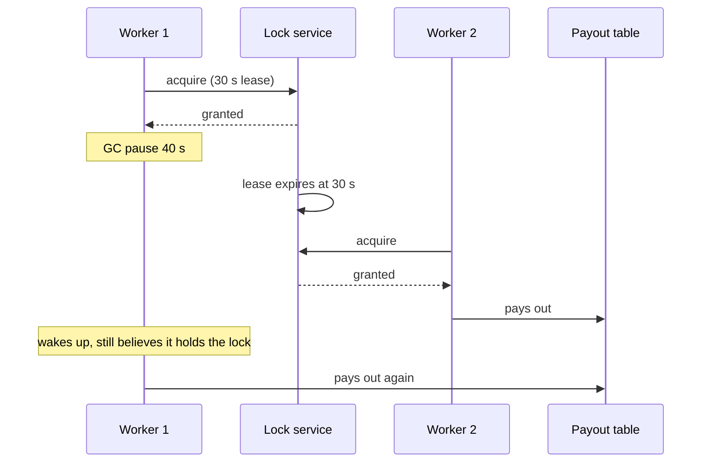
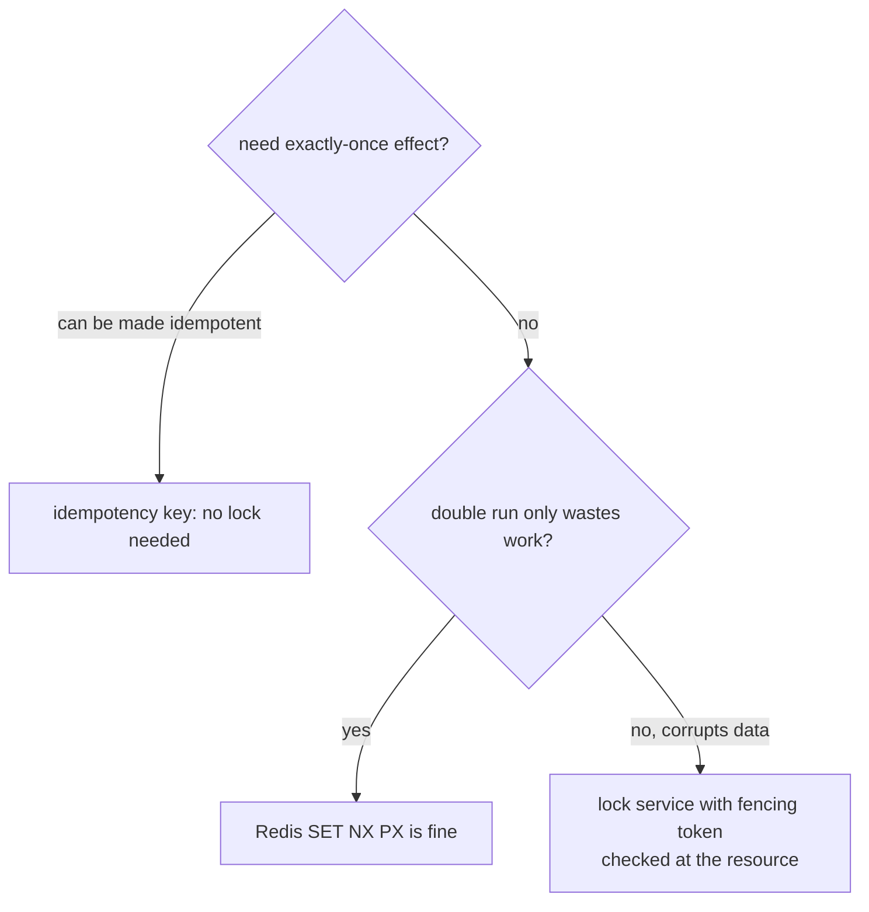
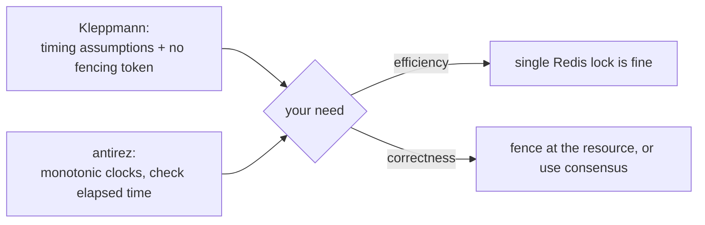

# Distributed Locks: Is Redis Redlock Safe? Leases & Fencing Tokens

> **Prerequisites:** [Lesson 05: Clock Skew](../05-clock-skew/README.md) · [Lesson 08: Leader Election](../08-leader-election/README.md).  
> **Estimated Reading Time:** 24–28 minutes  
> **Target Audience:** Backend engineers who have written `SET lock NX PX` and wondered whether it is safe, and candidates asked "how do you implement a distributed lock?"  
> **Free PDF Notes:** [Download SD-H-013.pdf](https://backendroadmap.com/notes/system-design/SD-H-013.pdf)

> [!NOTE]
> **In one line:** A lock with a timeout alone is not safe, because the holder can pause past its lease without noticing. Use locks to save *effort*; for *correctness* pair them with **fencing tokens** checked by the protected resource, prefer consensus-backed stores, and often skip the lock by making the operation idempotent.

> [!TIP]
> **The Golden Rule:** Ask first: *efficiency* or *correctness*? If a double run just wastes work, a simple Redis lock is fine. If two holders would corrupt data or move money twice, the lock must be backed by a fencing check at the resource, or replaced by idempotency or a database constraint.

---

## 1. What a Distributed Lock Is, and What It Isn't

Only one worker should process the nightly payout job, so you add a lock in Redis. It works for months, until one night a worker pauses, its lock expires, another worker takes the lock and starts paying out, and then the first one wakes up and continues. Every merchant is paid twice.

| Term | Precise Meaning | Example |
| :--- | :--- | :--- |
| **Distributed lock** | Mutual exclusion across processes on different machines | "Only one payout worker" |
| **Lease / TTL** | A lock that expires if not renewed | `PX 30000` = 30 s |
| **Fencing token** | An increasing number issued per lock grant, checked by the resource | etcd revision, a counter |
| **Efficiency lock** | Avoids duplicate *work*; an occasional failure is tolerable | Rebuilding a cache |
| **Correctness lock** | Two holders would corrupt data | Moving money |
| **Redlock** | Redis's multi-node lock algorithm | Majority of 5 independent nodes |
| **Not** | A substitute for idempotency or database constraints | The best lock is often none |

### Why It Matters
1. Locks are the first tool people reach for to stop duplicates, and the failure mode (a paused holder) is invisible until it costs money.
2. "Is Redlock safe?" is a famous, nuanced interview question with two serious sides.
3. The robust answer is rarely "a better lock": it is fencing and idempotency.

---

## 2. Anatomy: Locks Need Expiry, and Expiry Is the Danger

A lock without an expiry is held forever if its owner crashes, so locks get a lease. But the holder can be paused by GC, a VM migration or a slow disk past its TTL, and it cannot detect that from inside: it might check "do I still hold the lock?" and then pause right after the check.



| Reason to lock | If the lock occasionally fails | What you need |
| :--- | :--- | :--- |
| **Efficiency** (avoid duplicate work) | You waste some work | A simple lock (Redis `SET NX PX`) |
| **Correctness** (avoid corruption) | Data corrupted or money moved twice | Fencing token at the resource, a consensus store, or idempotency |

> [!WARNING]
> **Checking the lock before writing does not help.** The pause can happen between the check and the write. Only the resource can reject a stale writer atomically.

---

## 3. Mathematical Model: Fencing and Clock Assumptions

**Fencing.** Each grant returns a token that only increases. The holder sends it with every write; the resource keeps the highest token seen and rejects anything lower:

$$\text{accept write with token } t \iff t \ge t_{\max}, \quad t_{\max} \leftarrow t$$

A paused ex-holder has $t < t_{\max}$ once a new holder has written, so its late write is refused. In SQL this is one statement: `UPDATE payouts SET ..., last_token = :t WHERE batch_id = :b AND last_token < :t`.

**Redlock's assumptions.** A client acquires the lock on a majority ($\ge \lfloor N/2\rfloor+1$ of $N=5$) of independent Redis nodes, within a validity time that subtracts elapsed time and a drift allowance. Its safety depends on **bounded clock drift and bounded pauses**: if one node's clock jumps forward, its lock expires early. Then a second client can gather a majority from that node plus the nodes the first client did not lock.

| Property | Redis docs claim | Where it can fail |
| :--- | :--- | :--- |
| **Mutual exclusion** | "At any given moment, only one client can hold a lock" | A node's clock jumps; a client pauses after acquiring |
| **Deadlock free** | Locks expire even if the client crashes | None, by construction |
| **Fault tolerant** | Works while a majority of nodes are up | Fewer than a majority reachable |

---

## 4. Metrics & Percentiles

| Metric | Meaning | Alert when |
| :--- | :--- | :--- |
| **Lock hold time $p_{99}$** | How long critical sections run | Approaching the TTL |
| **Lease renewals failed** | Holder could not extend | Any, while still working |
| **Contention (acquire wait)** | Time to get the lock | Rising: lock is a bottleneck |
| **Fenced (rejected) writes** | Stale-token writes blocked at the resource | Non-zero means a zombie holder was caught |
| **Duplicate effects** | Same business effect applied twice | Must be 0; non-zero means no real protection |
| **Longest process pause** | GC, stalls | Longer than the TTL |

### Worked Example (payouts with an etcd lock)
Three workers can run the nightly payout job. Each tries to acquire an etcd lock with a 30-second lease and the winner gets a token, the lock key's revision, say 34. It keeps the lease alive while working and writes each payout with `UPDATE payouts SET ... WHERE batch_id = $1 AND last_token < 34`, storing 34. If it pauses and a new holder gets revision 35, the old worker's updates match no rows. Each payout also carries an idempotency key, so a retried payout is never sent twice.

---

## 5. Compounding: Two Experiments

**A. A paused ex-holder writes late (real SQL).** Worker 2 holds the lock with token 34 and pays 100. Worker 1 wakes from a 40 s pause with token 33 and writes again. Run against an in-memory SQLite table (Python 3.13):

| Write path | Rows touched by worker 2 / worker 1 | Amount paid (should be 100) | Last writer |
| :--- | :---: | :---: | :--- |
| No fencing check | 1 / 1 | **200** | worker-1 |
| `WHERE ... last_token < :token` | 1 / **0** | **100** | worker-2 |

The lock existed in both runs. Only the token check at the resource stopped the double payment.

**B. A clock jump under a Redlock-style lock.** Five nodes, each responding 90% of the time, majority 3. Client 1 locks the nodes that respond; then one random node's clock jumps forward so its lock expires early; client 2 tries to lock every node that is free (those client 1 does not hold, plus the jumped one). In 200,000 simulated events where client 1 got a majority, **both clients held a majority in 3.24%**. An illustrative model, not a measurement of Redis; the point is that mutual exclusion here depends on clocks behaving, which is the heart of the debate in the case study.

---

## 6. Numbers Every Engineer Must Know

| Item | Typical | Implication |
| :--- | :---: | :--- |
| Redis single lock | `SET key token NX PX 30000` | Atomic acquire with expiry |
| Safe release | Compare-and-delete in Lua | Never delete someone else's lock |
| Redlock | Majority of 5 independent Redis nodes | Not a replica set |
| Redis replication | Asynchronous | A failover can lose a just-acquired lock |
| etcd lock | Lease + revision as token | Consensus-backed |
| Typical lease | 10–30 s, renewed at about a third of the TTL | Short enough to fail over, longer than normal pauses |
| Database advisory lock | One DB, `SELECT ... FOR UPDATE` | Strong, but only inside that database |

---

## 7. Protocol Deep Dive: Which Lock, and How

| Option | Fine for | Not enough for | Notes |
| :--- | :--- | :--- | :--- |
| **Redis `SET NX PX`** (one node) | Efficiency locks | Correctness | Fast; replica failover can lose the lock |
| **Redlock** (5 Redis nodes) | Debated | Correctness without fencing | No built-in fencing token |
| **etcd / ZooKeeper** | Correctness, with fencing | Hot-path locking at huge rates | Consensus, leases, increasing revisions |
| **Database row/advisory lock** | Anything inside one DB | Cross-system effects | `SELECT ... FOR UPDATE`, unique constraints |
| **Idempotency** (no lock) | Most "run once" jobs | Mutual exclusion of side effects with no key | A unique key per (customer, date) |



**Safe single-node acquire and release** (the part everyone gets wrong):

```text
acquire:  SET lock:payout <random-token> NX PX 30000        # unique value per holder
release:  if GET lock:payout == <my-token> then DEL lock:payout   # atomically, as a Lua script
```

Without the unique value and the compare-and-delete, a slow holder can delete a lock now owned by someone else.

---

## 8. Hierarchical Budgets & Design Rules

| Slice | Rule | Control |
| :--- | :--- | :--- |
| Decide | Efficiency vs correctness first | Document which one |
| Lease | Above the longest pause, renewed at TTL/3 | Watchdog renewal |
| Resource | Rejects stale tokens | `last_token < :t` or conditional write |
| Work | Idempotent by key | Unique constraint per business effect |
| Store | Consensus-backed for correctness | etcd, ZooKeeper, a database |
| Clocks | Use monotonic time for lease arithmetic | Never wall-clock for TTLs |
| Failure | If the lock service is down, fail safe | Do not "proceed anyway" for correctness locks |

---

## 9. Top Mitigations

1. **Make the operation idempotent**; the best lock is often none.
2. **Fence at the resource** with an increasing token from the lock service.
3. **Use a unique value** per holder and a compare-and-delete release.
4. **Use etcd, ZooKeeper or the database** for correctness locks.
5. **Renew the lease** from a watchdog and abort if renewal fails.
6. **Use monotonic clocks** for lease timing.
7. **Test with injected pauses** (SIGSTOP a holder past its TTL).

---

## 10. Production Case Study: The Redlock Debate (Kleppmann vs antirez, 2016)

In February 2016 Martin Kleppmann published *How to do distributed locking* and Redis's author, Salvatore Sanfilippo (antirez), answered with *Is Redlock safe?*. Both are worth reading, and the interview answer is to know both sides.

**Kleppmann's argument.**
- A lock with a lease is unsafe against process pauses: the holder pauses (GC), the lease expires, another client takes the lock, then the first writes anyway. He writes that "this bug is not theoretical: HBase used to have this problem".
- The fix is a **fencing token**, "a number that increases" on each acquisition, with the storage server rejecting a write that carries a lower number than one already processed (33 after 34).
- His criticism: Redlock "does not have any facility for generating fencing tokens", and it relies on timing assumptions (bounded clock jumps and pauses).
- His conclusion: for efficiency a single Redis node is enough; for correctness do not use Redlock.

**antirez's response.**
- He agrees that clock jumps are a problem and that Redis and Redlock implementations should use the **monotonic** time API.
- He holds that Redlock only needs processes to measure elapsed time at roughly the same rate, not to agree on absolute time, and that pauses *during acquisition* do not affect correctness because Redlock checks the elapsed time after acquiring the majority. A pause after acquisition shortens the usable time, as with any auto-expiring lock.
- On fencing tokens he argues that a store that accepts writes only for increasing tokens is itself linearizable, so a simpler mechanism may do; he suggests a random per-lock token with check-and-set can serve the same purpose.
- He rejects the conclusion that Redlock should not be used where mutual exclusion matters.



**Lesson:** you do not have to pick a winner to be safe. Use Redis locks for efficiency; for correctness, put the guard where it cannot be bypassed (a fencing check in the database, a unique constraint, an idempotency key), and do not let the lock be the only line of defence.

---

## 11. Multi-Language Production Code Tabs

Each tab shows the resource-side guard: a conditional write that rejects stale fencing tokens.

````carousel
```go
// Go: fenced update. Works with any SQL driver through database/sql.
package main

import (
	"context"
	"database/sql"
)

// PayOut applies a payout only if token is newer than the last one stored.
// It returns false when the caller is a stale (fenced) lock holder.
func PayOut(ctx context.Context, db *sql.DB, batchID int64, token int64, worker string) (bool, error) {
	res, err := db.ExecContext(ctx,
		`UPDATE payouts SET amount = amount + 100, paid_by = ?, last_token = ?
		 WHERE batch_id = ? AND last_token < ?`,
		worker, token, batchID, token)
	if err != nil {
		return false, err
	}
	n, err := res.RowsAffected()
	return n == 1, err
}
```
<!-- slide -->
```typescript
// TypeScript: fenced update with node-postgres style parameters.
interface Db {
  query(sql: string, params: unknown[]): Promise<{ rowCount: number | null }>;
}

// Returns false when the caller is a stale (fenced) lock holder.
export async function payOut(db: Db, batchId: number, token: number, worker: string): Promise<boolean> {
  const res = await db.query(
    `UPDATE payouts
        SET amount = amount + 100, paid_by = $1, last_token = $2
      WHERE batch_id = $3 AND last_token < $2`,
    [worker, token, batchId],
  );
  return res.rowCount === 1;
}
```
<!-- slide -->
```python
# Python: the SQL fencing experiment (sqlite3 is in the standard library),
# the Redlock clock-jump model, and the safe single-node lock commands.
import random
import sqlite3


def fenced_demo(fenced):
    db = sqlite3.connect(":memory:")
    db.execute("CREATE TABLE payouts (batch_id INTEGER PRIMARY KEY, amount INTEGER, paid_by TEXT, last_token INTEGER)")
    db.execute("INSERT INTO payouts VALUES (1, 0, NULL, 0)")

    def pay(worker, token):
        where = "WHERE batch_id = 1 AND last_token < ?" if fenced else "WHERE batch_id = 1 AND ? IS NOT NULL"
        return db.execute(f"UPDATE payouts SET amount = amount + 100, paid_by = ?, last_token = ? {where}",
                          (worker, token, token)).rowcount

    r2 = pay("worker-2", 34)            # holds the lock, pays
    r1 = pay("worker-1", 33)            # wakes from a 40 s pause with the stale token
    amount, paid_by = db.execute("SELECT amount, paid_by FROM payouts").fetchone()
    return r2, r1, amount, paid_by


def two_holders(n=5, p_respond=0.9, trials=200_000, seed=13):
    """Percent of clock-jump events in which two clients both hold a majority."""
    rng, maj, both = random.Random(seed), n // 2 + 1, 0
    for _ in range(trials):
        c1 = {i for i in range(n) if rng.random() < p_respond}
        if len(c1) < maj:
            continue
        jumped = rng.randrange(n)                       # its lock expires early
        free = {i for i in range(n) if i not in c1} | {jumped}
        both += len({i for i in free if rng.random() < p_respond}) >= maj
    return 100 * both / trials


# Single-node Redis lock (commands shown, not executed here):
#   acquire:  SET lock:payout <random-token> NX PX 30000
#   release:  EVAL "if redis.call('get',KEYS[1])==ARGV[1] then return redis.call('del',KEYS[1]) else return 0 end" 1 lock:payout <random-token>
```
<!-- slide -->
```csharp
// C#: fenced update with ADO.NET-style parameters (any provider).
using System.Data.Common;

public static class Payouts
{
    // Returns false when the caller is a stale (fenced) lock holder.
    public static async Task<bool> PayOutAsync(DbConnection conn, long batchId, long token, string worker)
    {
        await using var cmd = conn.CreateCommand();
        cmd.CommandText =
            @"UPDATE payouts SET amount = amount + 100, paid_by = @worker, last_token = @token
              WHERE batch_id = @batch AND last_token < @token";
        foreach (var (name, value) in new (string, object)[] { ("@worker", worker), ("@token", token), ("@batch", batchId) })
        {
            var p = cmd.CreateParameter();
            p.ParameterName = name;
            p.Value = value;
            cmd.Parameters.Add(p);
        }
        return await cmd.ExecuteNonQueryAsync() == 1;
    }
}
```
````

---

## 12. Hands-On CLI Verification Workflows

The fencing experiment runs with nothing but Python:

```python
print(fenced_demo(False))   # (1, 1, 200, 'worker-1')   no check: paid twice
print(fenced_demo(True))    # (1, 0, 100, 'worker-2')   fenced:   paid once
print(round(two_holders(), 2))   # 3.24
```

To see the real thing on a Redis instance:

```bash
# acquire: succeeds only if the key does not exist; auto-expires in 30 s
redis-cli SET lock:payout "$(uuidgen)" NX PX 30000

# observe the TTL, and what happens when it expires
redis-cli PTTL lock:payout

# etcd: a lock that returns a key whose revision you can use as a fencing token
etcdctl lock payout-lock        # blocks until acquired; prints the key
etcdctl get "$(etcdctl lock payout-lock)" -w json | head -c 300   # "mod_revision" is the token
```

To reproduce the pause, `kill -STOP` the holder for longer than its TTL, then `kill -CONT` it and watch whether the resource accepts its late write.

---

## 13. Common Mistakes to Avoid

1. **Treating a TTL lock as mutual exclusion** for correctness.
2. **Releasing with a plain `DEL`**, deleting a lock someone else now holds.
3. **Checking the lock in the client** and then writing.
4. **A lock with no fencing token** protecting money or inventory.
5. **Using Redis replicas as the lock's high availability**: replication is asynchronous, so a failover can lose the lock.
6. **Wall-clock lease arithmetic** instead of monotonic time.
7. **Proceeding without the lock** "if Redis is down" for a correctness lock.
8. **Reaching for a lock** when an idempotency key or unique constraint would do.

---

## 14. Key Terms Glossary

| Key Term | Definition |
| :--- | :--- |
| **Distributed lock** | Mutual exclusion across machines. |
| **Lease** | A lock with an expiry that must be renewed. |
| **Fencing token** | Increasing number from the lock service, checked by the resource. |
| **Efficiency vs correctness lock** | Saves work vs protects data. |
| **Redlock** | Redis majority-of-N lock algorithm. |
| **Compare-and-delete** | Atomic release that checks ownership. |
| **Advisory lock** | A database-level lock by convention (`pg_advisory_lock`). |
| **Idempotency key** | Unique key that makes repeating an operation harmless. |
| **Watchdog** | Background renewal of a lease. |
| **Monotonic clock** | Clock that never goes backwards; use for TTL arithmetic. |

---

## 15. System Design Interview Questions & Answers

### Basic Conceptual Questions

<details>
<summary><strong>Q1: How do you implement a distributed lock in Redis? [BASIC]</strong></summary>

**Answer:**
`SET lock key <unique-token> NX PX <ttl>` to acquire atomically with an expiry, and release with a Lua script that deletes the key only if its value equals your token. Renew the TTL while working. This is fine for efficiency locks.
</details>

<details>
<summary><strong>Q2: Why does a lock need an expiry? [BASIC]</strong></summary>

**Answer:**
Without one a crashed holder would keep the lock forever. The expiry brings its own danger: a paused holder's lock can expire while it still believes it holds it.
</details>

<details>
<summary><strong>Q3: What is a fencing token? [BASIC]</strong></summary>

**Answer:**
An increasing number returned each time the lock is granted. The holder sends it with every write and the resource rejects any token lower than the highest it has seen, so a stale holder's writes fail.
</details>

<details>
<summary><strong>Q4: Efficiency lock or correctness lock? [BASIC]</strong></summary>

**Answer:**
Efficiency: avoiding duplicate work; an occasional double run just wastes effort, so a simple lock is fine. Correctness: two holders would corrupt data or move money twice, so you need a fencing check, a consensus-backed store, or idempotency.
</details>

### Scenario-Based Architecture Questions

<details>
<summary><strong>Q5: Two workers paid the same batch. A lock existed. What happened? [SCENARIO]</strong></summary>

**Answer:**
Almost certainly a pause or stall past the lease: the first worker's lock expired, the second took it, and the first resumed and wrote. Fix with a fencing token enforced in the database (`UPDATE ... WHERE last_token < :t`) and an idempotency key per payout.
</details>

<details>
<summary><strong>Q6: Is a single Redis node with replicas a safe lock? [SCENARIO]</strong></summary>

**Answer:**
Not for correctness. Replication is asynchronous, so if the master fails right after granting a lock and a replica without it is promoted, another client can acquire the same lock. Use Redlock-style independent nodes (with their debated assumptions) or, better, a consensus store.
</details>

<details>
<summary><strong>Q7: How would you make a nightly job run once without any lock? [SCENARIO]</strong></summary>

**Answer:**
Make it idempotent: a unique key per (customer, date) enforced by a unique constraint, so a second run has no effect. Combine with a leader or a database row lock to avoid wasted work.
</details>

<details>
<summary><strong>Q8: Which lock service would you pick for money movement? [SCENARIO]</strong></summary>

**Answer:**
A consensus-backed one (etcd or ZooKeeper, or a database) that provides leases and increasing revisions, plus the fencing check and idempotency at the payment table. Redis is acceptable only for the efficiency layer.
</details>

### Advanced & Tricky Interview Questions

<details>
<summary><strong>Q9: Summarise the Kleppmann vs antirez debate. [TRICKY]</strong></summary>

**Answer:**
Kleppmann: Redlock depends on timing assumptions (bounded clock jumps and pauses) and has no fencing token, so it is unsafe for correctness; a single Redis lock is enough for efficiency. antirez: clock jumps are a real issue and monotonic time should be used, but Redlock only needs similar elapsed-time rates, pauses during acquisition are handled by re-checking elapsed time, and fencing tokens can be replaced by simpler mechanisms such as check-and-set. A safe design does not depend on who is right: fence at the resource.
</details>

<details>
<summary><strong>Q10: Why does checking the lease before writing not work? [TRICKY]</strong></summary>

**Answer:**
The pause can occur between the check and the write, so the check and the write are not atomic. Only the resource can compare the token atomically with the write.
</details>

<details>
<summary><strong>Q11: How can a clock jump break Redlock? [TRICKY]</strong></summary>

**Answer:**
If a Redis node's clock jumps forward its key expires early. Client 1 holds the lock on nodes A, B, C; node C's lock expires early; client 2 gets C, D, E, a majority, so both hold the lock. In a simple simulation with 5 nodes this happened in about 3% of clock-jump events. Monotonic time reduces but does not remove the risk.
</details>

<details>
<summary><strong>Q12: What if the resource cannot check tokens? [TRICKY]</strong></summary>

**Answer:**
Move the effect behind something that can: a database table with a conditional update, an idempotent API with a key, or a queue with deduplication. If it truly cannot be guarded, treat the lock as best-effort and accept the residual risk.
</details>

---

## 16. One-Page Master Cheat Sheet

```
+---------------------------------------------------------------------------------------------------------+
|                          DISTRIBUTED LOCKS — MASTER CHEAT SHEET                                         |
+---------------------------------------------------------------------------------------------------------+
| 1. ASK FIRST: efficiency (wasted work) or correctness (corrupt data)?                                   |
+---------------------------------------------------------------------------------------------------------+
| 2. TTL LOCK ALONE IS UNSAFE: pause past the lease, holder wakes up believing it still holds it.         |
+---------------------------------------------------------------------------------------------------------+
| 3. FENCE AT THE RESOURCE: increasing token; UPDATE ... WHERE last_token < :t. Client checks don't work. |
+---------------------------------------------------------------------------------------------------------+
| 4. REDIS: SET NX PX + unique value + Lua compare-and-delete. Async replicas can lose it. Efficiency.    |
+---------------------------------------------------------------------------------------------------------+
| 5. REDLOCK: majority of 5, timing assumptions, no fencing token. Debated. Don't rely on it alone.       |
+---------------------------------------------------------------------------------------------------------+
| 6. BEST LOCK = NO LOCK: idempotency keys, unique constraints, then etcd/ZooKeeper/DB if needed.         |
+---------------------------------------------------------------------------------------------------------+
```

---

## Further Reading & Sources

- Martin Kleppmann, [How to do distributed locking](https://martin.kleppmann.com/2016/02/08/how-to-do-distributed-locking.html) (2016).
- Salvatore Sanfilippo (antirez), [Is Redlock safe?](http://antirez.com/news/101) (2016), the reply.
- Redis documentation, [Distributed Locks with Redis](https://redis.io/docs/latest/develop/clients/patterns/distributed-locks/) (safety and liveness properties).
- etcd, [`etcdctl lock`](https://etcd.io/docs/) and the `concurrency` package.

---

## Free PDF Notes

[SD-H-013.pdf](https://backendroadmap.com/notes/system-design/SD-H-013.pdf)

---

## Next

Continue with [Lesson 14: Gossip Protocols](../14-gossip-protocols/README.md): how clusters spread news (Merkle trees, SWIM).
