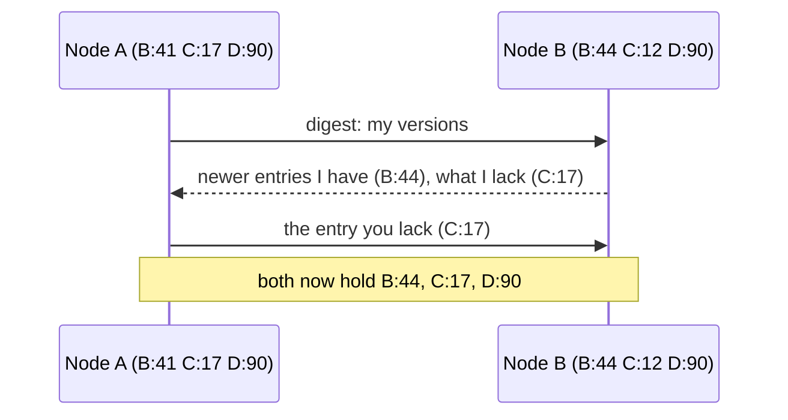
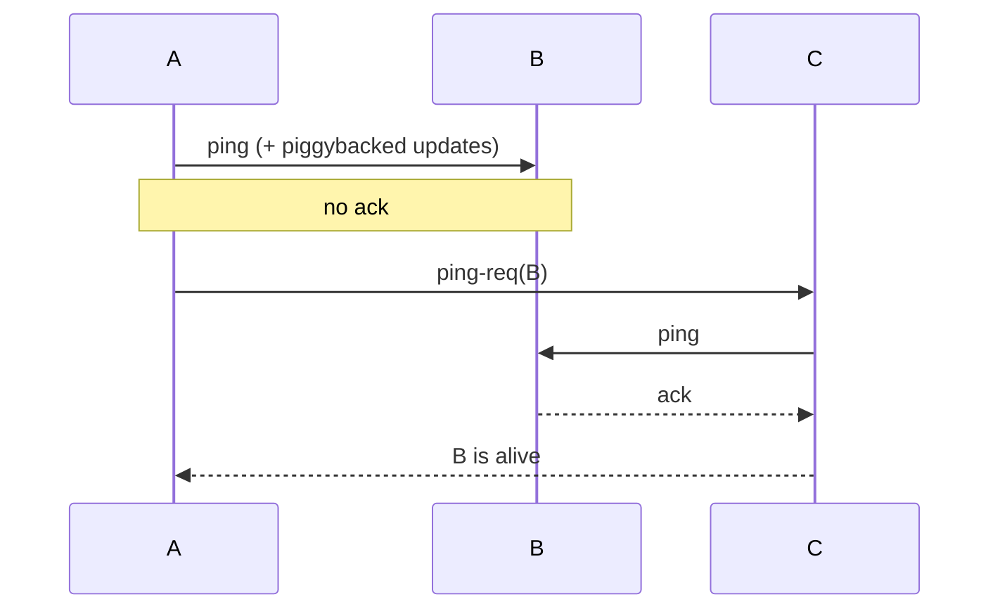
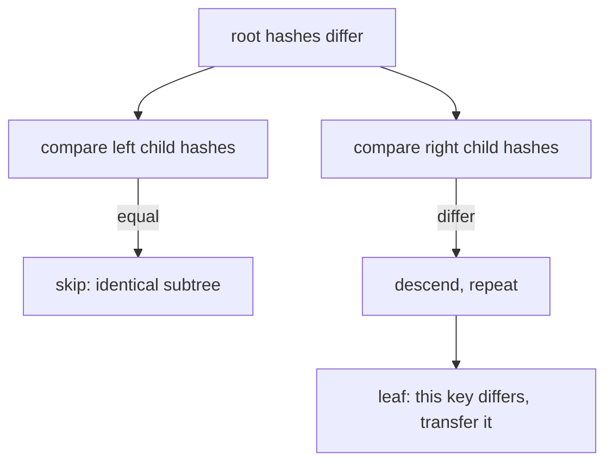
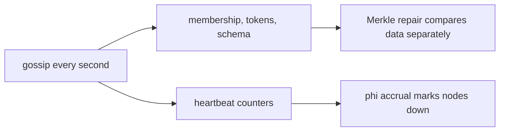

# Gossip Protocols: How Clusters Spread News (Merkle Trees, SWIM)

> **Prerequisites:** [Lesson 04: Failure Detection](../04-failure-detection/README.md) · [Lesson 11: Quorums](../11-quorums-explained/README.md).  
> **Estimated Reading Time:** 22–26 minutes  
> **Target Audience:** Backend engineers running Cassandra, Consul, Serf or any peer-to-peer cluster, and candidates asked "how does every node learn about a join or a failure without a central server?"  
> **Free PDF Notes:** [Download SD-H-014.pdf](https://backendroadmap.com/notes/system-design/SD-H-014.pdf)

> [!NOTE]
> **In one line:** In a gossip (epidemic) protocol each node periodically tells a few random peers what it knows, so news reaches the whole cluster in about $O(\log n)$ rounds while every node does constant work per round. It is used for membership, failure detection and metadata, and gives *eventual*, not instant, agreement.

> [!TIP]
> **The Golden Rule:** Gossip trades *immediacy* for *robustness and scale*: no coordinator, no bottleneck, lost messages repaired by later rounds, but for a few seconds nodes may disagree. Use it for small, slowly changing metadata; big data goes through normal replication.

---

## 1. What Gossip Is, and What It Isn't

A cluster has a thousand nodes. A new node joins, or one dies. How does everyone find out? A central server could tell everyone, but it becomes a bottleneck and a single point of failure. Instead nodes spread the news the way a rumour spreads: each tells a few others, who tell a few others.

| Term | Precise Meaning | Example |
| :--- | :--- | :--- |
| **Gossip / epidemic protocol** | Periodic random peer-to-peer exchange of state | Each node picks a peer every second |
| **Push / pull / push-pull** | Send what I know / ask what you know / both | Push-pull converges fastest |
| **Anti-entropy** | Comparing full state to repair differences | Merkle-tree comparison |
| **Heartbeat counter** | A per-node number that only increases; stale means suspect | `B:41` |
| **SWIM** | Gossip membership with indirect probes (lesson 04) | Consul, Serf |
| **Seed node** | A well-known starting point for joiners, not an authority | First nodes in a Cassandra ring |
| **Not** | A way to transfer bulk data or give strong consistency | Use replication for that |

### Why It Matters
1. It is how Cassandra, Dynamo, Consul and Serf keep a view of the cluster with no coordinator.
2. It is the standard interview answer for "membership at thousands of nodes".
3. Merkle trees (below) are the standard answer for "how do two replicas find what differs without comparing everything?"

---

## 2. Anatomy: One Exchange

Every interval (say 1 s) each node picks a random peer and exchanges a **digest**: each entry tagged with a version, such as a heartbeat counter. Each side keeps the newer version of every entry.



| Style | Each round | Strength | Weakness |
| :--- | :--- | :--- | :--- |
| **Push** | Informed nodes send to random peers | Simple | Slow tail: the last few nodes take longest |
| **Pull** | Every node asks a random peer | Fast tail | Slow start (few know yet) |
| **Push-pull** | Both | Fastest overall | Slightly more bandwidth |

What clusters gossip about: **membership** (joins, leaves), **liveness** (heartbeat counters, suspected failures) and **metadata** (token ranges, schema versions, load).

> [!WARNING]
> **Gossip payloads must stay small.** Bandwidth grows with state size: send digests first and only the differences. Large data goes through normal replication.

---

## 3. Mathematical Model: Why It Is Logarithmic

If $k$ of $n$ nodes know a fact and each informed node tells one random peer per round, the informed set roughly **doubles** while it is small: $k \to 2k$. That is exponential growth, so about $\log_2 n$ rounds to inform most nodes. The last stragglers add a further $\ln n$ rounds, because late in the process a random peer is usually already informed. A classic result for push gossip (Pittel, 1987) gives

$$T_{\text{push}}(n) \approx \log_2 n + \ln n$$

Pull has the mirror-image profile (slow start, fast end) and push-pull combines them to roughly $\log_2 n$ rounds plus a very small tail.

| Cluster size $n$ | $\log_2 n$ | $\log_2 n + \ln n$ | Per-node work per round |
| :---: | :---: | :---: | :---: |
| 10 | 3.3 | 5.6 | 1 message |
| 100 | 6.6 | 11.3 | 1 message |
| 1,000 | 10.0 | 16.9 | 1 message |
| 10,000 | 13.3 | 22.5 | 1 message |

A thousand nodes learn something in about 17 one-second rounds with *constant* load per node. Doubling the cluster adds roughly **one** round.

**Merkle tree anti-entropy.** A Merkle tree is a hash tree whose leaves are hashes of keys and whose parents hash their children. If two replicas' roots match, their data match; if not, descend only into the differing branches. Finding $k$ differing keys among $n$ costs about $O(k\log n)$ hash comparisons instead of $O(n)$.

---

## 4. Metrics & Percentiles

| Metric | Meaning | Why you care |
| :--- | :--- | :--- |
| **Convergence time** | From a change to every node knowing | The window of inconsistent membership |
| **Messages per node per round** | Load from gossip | Should be constant in $n$ |
| **Gossip digest size** | Bytes per exchange | Grows with cluster state |
| **Flap rate** | Nodes marked down then up | Bad thresholds or networks (lesson 04) |
| **Merkle comparisons per repair** | Hash checks to find differences | Shows how out of sync replicas are |
| **Seeds reachable** | Joiners that can contact a seed | A cluster whose seeds are all down cannot admit new nodes |

### Worked Example (Cassandra)
Every second, each Cassandra node picks a random other node and exchanges its view of node states: heartbeat generation and version, status (joining, normal, leaving), token ranges and schema version. When node 12 joins, a seed node hears it first; within a few seconds every node knows node 12 and which data it owns. If node 7's heartbeat version stops increasing in everyone's gossip, the phi accrual detector (lesson 04) marks it down. Seed nodes are well-known starting points for new nodes, not a central authority.

---

## 5. Compounding: Two Experiments

I ran two simulations (Python 3.13, stdlib only).

**A. Rounds until every node knows one fact.** One random peer per node per round, mean of 100 runs, maximum in brackets:

| Nodes | $\log_2 n$ | Push, no loss | Push, 30% message loss | Push-pull |
| :---: | :---: | :---: | :---: | :---: |
| 10 | 3.3 | 6.3 (10) | 8.6 (19) | 3.4 (5) |
| 100 | 6.6 | 12.2 (18) | 16.8 (25) | 6.6 (8) |
| 1,000 | 10.0 | 18.2 (23) | 24.3 (31) | 9.1 (10) |
| 5,000 | 12.3 | 22.0 (27) | 29.9 (36) | 10.8 (12) |

Push matches the $\log_2 n+\ln n$ prediction (about 17 for 1,000 nodes, measured 18.2). **Push-pull roughly halves it.** Even losing 30% of all messages only adds about a third more rounds, which is the robustness argument in one column.

**B. Merkle tree over 1,048,576 ($2^{20}$) keys.** Number of hash comparisons to find every differing key (SHA-256 tree):

| Keys that differ | Hash comparisons | Versus comparing every key |
| :---: | :---: | :---: |
| 1 | 41 | 25,575x fewer |
| 10 | 323 | 3,246x fewer |
| 1,000 | 20,385 | 51x fewer |

One changed key among a million costs 41 comparisons ($\approx 2\log_2 n = 40$). The advantage shrinks as more keys differ, which is why anti-entropy is cheap when replicas are *mostly* in sync.

---

## 6. Numbers Every Engineer Must Know

| Item | Typical | Implication |
| :--- | :---: | :--- |
| Gossip interval | about 1 s | Cassandra runs it every second |
| Peers per round | 1 to 3 | Constant per-node load |
| Rounds to spread | about $\log_2 n+\ln n$ (push) | 1,000 nodes: ~17 rounds, about 17 s at 1 s intervals |
| Push-pull | about half of push | Use both directions |
| Tolerance to loss | 30% loss adds about a third more rounds | Robust by design |
| Merkle compare | $O(k\log n)$ | 41 hashes to find 1 key in $2^{20}$ |
| Failure detection by gossip | phi accrual or SWIM suspicion | Lesson 04 |

---

## 7. Protocol Deep Dive: SWIM and Anti-Entropy

**SWIM** (Das, Gupta and Motivala, 2002) separates *failure detection* from *dissemination*. Each period a node pings one random member; if no ack, it asks $k$ others to ping it (indirect probe); if still nothing it marks the member **suspect**, and suspicion is gossiped. The member can refute it before being declared dead. Membership updates **piggyback** on the ping and ack messages, so dissemination costs no extra messages. Consul and Serf's `memberlist` implement it (with the Lifeguard extensions from lesson 04).



**Anti-entropy with Merkle trees** (Dynamo): "Each node maintains a separate Merkle tree for each key range it hosts", two nodes exchange the roots of the ranges they share in common, and "using the tree traversal scheme... the nodes determine if they have any differences". If the roots are equal, no data needs to move.



The Dynamo paper also notes the cost: many key ranges change when a node joins or leaves, so the trees must be recalculated.

---

## 8. Hierarchical Budgets & Design Rules

| Slice | Rule | Control |
| :--- | :--- | :--- |
| Interval | About 1 s | Faster means more load, slower means slower convergence |
| Fanout | 1 to 3 peers | Constant load |
| Payload | Digests plus deltas only | Keep entries small and versioned |
| Failure detection | SWIM-style suspicion or phi accrual | Never convict on one missed beat |
| Seeds | A few well-known, in different zones | Joiners need at least one reachable |
| Repair | Scheduled Merkle anti-entropy | Gossip alone does not repair data |
| Consistency expectation | Eventual, seconds-scale | Do not use gossip for decisions needing agreement |

---

## 9. Top Mitigations

1. **Gossip small, versioned state**, with digest-first exchange.
2. **Use push-pull** for fastest convergence and tail.
3. **Add indirect probes and a suspicion state** (SWIM) before declaring failures.
4. **Run Merkle-tree anti-entropy** on a schedule to repair data gossip does not carry.
5. **Keep several seed nodes** across zones.
6. **Do not use gossip for agreement**: elections and commits need consensus (lessons 08, 09).
7. **Alert on flapping** and on divergent membership views.

---

## 10. Production Case Study: Cassandra's Gossip

Apache Cassandra's documentation describes gossip as the cluster's membership and state mechanism, and it is a good model of the design choices above.

- **Cadence:** "Every node in the Cassandra cluster runs the gossip task independently and periodically. **Every second**, every node in the cluster" exchanges state: it "picks a random other node in the cluster to exchange gossip endpoint state with", and may also probabilistically try unreachable nodes and contact a seed.
- **What it carries:** "nodes exchange state information not only about themselves but also about other nodes they know about", including endpoint membership, internode protocol versions, token metadata and the schema version.
- **Seeds are not authorities:** "when an operator first bootstraps a Cassandra cluster, they designate certain nodes as seed nodes". Seeds "are allowed to bootstrap into the ring without seeing any other seed nodes", and non-seed nodes need to reach at least one seed to join.
- **Failure detection on top:** a node whose heartbeat stops increasing in everyone's gossip is judged by the phi accrual detector (lesson 04).
- **Data repair is separate:** Dynamo-style anti-entropy uses Merkle trees to compare replicas' data, and read repair and hinted handoff (lesson 11) cover the rest.

(Older descriptions, including this course's PDF notes, say each node gossips with "up to three" peers per round; the current Cassandra documentation describes one random peer per round plus the unreachable-node and seed contacts above. The scaling argument is the same either way.)



**Lesson:** gossip is the *control plane's* news service: small, constant-rate and eventually consistent. Correctness-critical decisions and bulk data travel on different paths.

---

## 11. Multi-Language Production Code Tabs

The core of any gossip protocol: merge a received digest into local state, keeping the newest version of each entry.

````carousel
```go
// Go: gossip state merge (newest version wins) and a push round.
package main

import "math/rand"

type Entry struct {
	Version int
	Value   string
}

type Node struct {
	ID    int
	State map[string]Entry
}

// Merge keeps the higher version of every entry and returns how many changed.
func (n *Node) Merge(other map[string]Entry) int {
	changed := 0
	for k, e := range other {
		if cur, ok := n.State[k]; !ok || e.Version > cur.Version {
			n.State[k] = e
			changed++
		}
	}
	return changed
}

// PushRound: every node sends its state to one random other node.
func PushRound(nodes []*Node, rng *rand.Rand) {
	for _, n := range nodes {
		p := nodes[(n.ID+1+rng.Intn(len(nodes)-1))%len(nodes)]
		p.Merge(n.State)
	}
}
```
<!-- slide -->
```typescript
// TypeScript: gossip state merge and a push-pull round.
interface Entry {
  version: number;
  value: string;
}

class GossipNode {
  state = new Map<string, Entry>();
  constructor(public id: number) {}

  // Keep the higher version of every entry; returns how many entries changed.
  merge(other: Map<string, Entry>): number {
    let changed = 0;
    for (const [k, e] of other) {
      const cur = this.state.get(k);
      if (!cur || e.version > cur.version) {
        this.state.set(k, e);
        changed++;
      }
    }
    return changed;
  }
}

export function pushPullRound(nodes: GossipNode[]): void {
  for (const n of nodes) {
    const peer = nodes[(n.id + 1 + Math.floor(Math.random() * (nodes.length - 1))) % nodes.length];
    peer.merge(n.state); // push
    n.merge(peer.state); // pull
  }
}
```
<!-- slide -->
```python
# Python: the code behind this lesson's numbers (stdlib only).
import hashlib
import random


def rounds_to_all(n, loss=0.0, mode="push", trials=100, seed=14):
    """Rounds until all n nodes know a rumour that starts at node 0 (one random peer per node per round)."""
    rng, total, worst = random.Random(seed), 0, 0
    for _ in range(trials):
        know, r = {0}, 0
        while len(know) < n:
            r += 1
            new = set()
            for i in (know if mode == "push" else range(n)):
                p = (i + 1 + rng.randrange(n - 1)) % n             # a random peer other than i
                if rng.random() < loss:
                    continue
                if mode in ("push", "push-pull") and i in know:
                    new.add(p)
                if mode in ("pull", "push-pull") and p in know:
                    new.add(i)
            know |= new
        total, worst = total + r, max(worst, r)
    return total / trials, worst


def build(leaves):
    """Merkle tree as a list of levels, leaves first."""
    level = [hashlib.sha256(x).digest() for x in leaves]
    tree = [level]
    while len(level) > 1:
        level = [hashlib.sha256(level[i] + level[i + 1]).digest() for i in range(0, len(level), 2)]
        tree.append(level)
    return tree


def diff(a, b, level, idx, stats, out):
    """Descend only into subtrees whose hashes differ; stats[0] counts hash comparisons."""
    stats[0] += 1
    if a[level][idx] == b[level][idx]:
        return
    if level == 0:
        out.append(idx)
        return
    for child in (2 * idx, 2 * idx + 1):
        diff(a, b, level - 1, child, stats, out)
```
<!-- slide -->
```csharp
// C#: gossip state merge (newest version wins).
public sealed record Entry(int Version, string Value);

public sealed class GossipNode
{
    public int Id { get; }
    public Dictionary<string, Entry> State { get; } = new();

    public GossipNode(int id) => Id = id;

    // Keep the higher version of every entry; returns how many entries changed.
    public int Merge(IReadOnlyDictionary<string, Entry> other)
    {
        var changed = 0;
        foreach (var (key, entry) in other)
        {
            if (!State.TryGetValue(key, out var cur) || entry.Version > cur.Version)
            {
                State[key] = entry;
                changed++;
            }
        }
        return changed;
    }

    public static void PushRound(IList<GossipNode> nodes, Random rng)
    {
        foreach (var n in nodes)
        {
            var peer = nodes[(n.Id + 1 + rng.Next(nodes.Count - 1)) % nodes.Count];
            peer.Merge(n.State);
        }
    }
}
```
````

---

## 12. Hands-On CLI Verification Workflows

Run the Python tab's functions (Python 3.13). The by-hand Merkle check, one changed key among 1,024:

```python
base = [str(i).encode() for i in range(1024)]
other = list(base); other[700] = b"changed"
a, b = build(base), build(other)
stats, found = [0], []
diff(a, b, len(a) - 1, 0, stats, found)
print(found, stats[0])          # [700] 21   (about 2 x log2(1024) + 1 comparisons)
print(rounds_to_all(1000))      # (18.2, 23)
```

The tables in section 5 come from `rounds_to_all` (`loss=0.3` and `mode="push-pull"` for the other columns) and from `build`/`diff` over $2^{20}$ keys with 1, 10 and 1,000 random differences (the random keys come from a separate script, so only the 1-key figure is exact: it is $2\log_2 n+1$ comparisons wherever the changed key sits, 41 for $n=2^{20}$).

On real clusters:

```bash
# Cassandra: the gossip view of every node (state, load, schema version, tokens)
nodetool gossipinfo
nodetool status

# Consul / Serf: SWIM members and their state
consul members
serf members
```

If `nodetool gossipinfo` shows different schema versions on different nodes for more than a few seconds, gossip has not converged; look for a down node, a network problem, or a node that cannot reach a seed.

---

## 13. Common Mistakes to Avoid

1. **Gossiping large payloads** instead of digests and deltas.
2. **Using gossip where agreement is required** (leader choice, commits).
3. **No indirect probing**, so a single bad link marks healthy nodes dead.
4. **One seed node**, or all seeds in one zone.
5. **Assuming immediate convergence**: during the window nodes disagree.
6. **Relying on gossip to repair data**: it carries metadata; use anti-entropy and read repair for data.
7. **Never running Merkle repair**, so rarely read data stays out of sync.
8. **Ignoring that Merkle trees must be rebuilt** when ranges change.

---

## 14. Key Terms Glossary

| Key Term | Definition |
| :--- | :--- |
| **Gossip / epidemic protocol** | Periodic random peer exchange that spreads state exponentially. |
| **Push / pull / push-pull** | Direction of the exchange. |
| **Digest** | Compact summary of versions used to find differences. |
| **Heartbeat counter** | Per-node increasing number; staleness signals failure. |
| **SWIM** | Scalable weakly-consistent membership with indirect probes and suspicion. |
| **Piggybacking** | Attaching membership updates to ping and ack messages. |
| **Anti-entropy** | Periodically reconciling replica state. |
| **Merkle tree** | Hash tree used to locate differences with $O(k\log n)$ comparisons. |
| **Seed node** | Well-known contact point for joining nodes. |
| **Convergence** | The point at which all nodes hold the same view. |

---

## 15. System Design Interview Questions & Answers

### Basic Conceptual Questions

<details>
<summary><strong>Q1: What is a gossip protocol? [BASIC]</strong></summary>

**Answer:**
Every interval each node picks one or a few random peers and exchanges state (versioned entries), keeping the newer version of each. Information spreads exponentially, reaching all nodes in about $O(\log n)$ rounds with constant work per node.
</details>

<details>
<summary><strong>Q2: Why is it logarithmic? [BASIC]</strong></summary>

**Answer:**
The number of informed nodes roughly doubles each round while few are informed, so most nodes know after about $\log_2 n$ rounds; stragglers add about $\ln n$ more. In a simulation, 1,000 nodes took about 18 rounds with push and 9 with push-pull.
</details>

<details>
<summary><strong>Q3: What do clusters gossip about? [BASIC]</strong></summary>

**Answer:**
Membership (joins and leaves), liveness (heartbeat counters and suspicions) and small metadata such as token ranges and schema versions. Bulk data goes through normal replication.
</details>

<details>
<summary><strong>Q4: What is a Merkle tree used for? [BASIC]</strong></summary>

**Answer:**
Anti-entropy: finding which keys differ between two replicas without comparing everything. Equal root hashes mean identical data; otherwise compare children and descend only into differing branches.
</details>

### Scenario-Based Architecture Questions

<details>
<summary><strong>Q5: A node joins a 1,000-node cluster. How long until everyone knows? [SCENARIO]</strong></summary>

**Answer:**
Roughly $\log_2 n+\ln n\approx17$ rounds for push gossip, about 9 to 10 for push-pull. At a one-second interval that is on the order of 10 to 20 seconds, with each node sending one message per round.
</details>

<details>
<summary><strong>Q6: Why gossip instead of a central membership server? [SCENARIO]</strong></summary>

**Answer:**
A central server is a bottleneck and a single point of failure, and it must be told about every change. Gossip has no coordinator, constant per-node load, tolerates lost messages (30% loss added only about a third more rounds in the simulation), and scales to thousands of nodes. The price is eventual consistency of the view.
</details>

<details>
<summary><strong>Q7: Two replicas of a 1 TB range might differ. How do you repair cheaply? [SCENARIO]</strong></summary>

**Answer:**
Merkle-tree anti-entropy: compare root hashes, descend into mismatching subtrees, and stream only the differing keys. With one differing key among about a million, that was 41 hash comparisons instead of a million key comparisons.
</details>

<details>
<summary><strong>Q8: How does gossip detect failures reliably? [SCENARIO]</strong></summary>

**Answer:**
Heartbeat counters gossiped with phi accrual (Cassandra) or SWIM's ping, indirect ping and suspicion phase with refutation (Consul, Serf). Either way a node is convicted only after missing evidence from several sources, not one missed beat.
</details>

### Advanced & Tricky Interview Questions

<details>
<summary><strong>Q9: Push, pull or push-pull? [TRICKY]</strong></summary>

**Answer:**
Push is quick at the start but slow in the tail (many informed nodes pushing to already informed peers); pull is slow at the start but fast at the end; push-pull combines both and converged in about half the rounds of push in the simulation. It costs slightly more bandwidth per round.
</details>

<details>
<summary><strong>Q10: Can you elect a leader using gossip alone? [TRICKY]</strong></summary>

**Answer:**
Not safely. Gossip is eventually consistent, so two nodes may hold different views at the same time; electing from them risks two leaders. Use consensus (Raft, Paxos) or a lease in a consensus store; gossip can distribute the *result*.
</details>

<details>
<summary><strong>Q11: What is piggybacking in SWIM? [TRICKY]</strong></summary>

**Answer:**
Membership updates (joined, suspect, alive, dead) are attached to the regular ping and ack messages, so dissemination needs no extra messages. Each node still sends a constant number of messages per protocol period.
</details>

<details>
<summary><strong>Q12: What are seed nodes and are they a central authority? [TRICKY]</strong></summary>

**Answer:**
Seeds are well-known contact points that let new nodes find the cluster. They are not authorities: once a node has joined it learns the full membership through gossip. A cluster still needs at least one reachable seed to admit new nodes.
</details>

---

## 16. One-Page Master Cheat Sheet

```
+---------------------------------------------------------------------------------------------------------+
|                          GOSSIP PROTOCOLS — MASTER CHEAT SHEET                                          |
+---------------------------------------------------------------------------------------------------------+
| 1. EVERY INTERVAL: pick random peer(s), swap versioned digests, keep the newer entry.                   |
+---------------------------------------------------------------------------------------------------------+
| 2. SPEED: ~log2(n) + ln(n) rounds (push), ~half with push-pull. 1,000 nodes: ~18 vs ~9 rounds.          |
+---------------------------------------------------------------------------------------------------------+
| 3. COST: constant per node (1-3 messages/round). Robust: 30% loss adds ~1/3 more rounds.                |
+---------------------------------------------------------------------------------------------------------+
| 4. CARRIES: membership, heartbeats, tokens, schema. NOT bulk data, NOT agreement.                       |
+---------------------------------------------------------------------------------------------------------+
| 5. SWIM: ping, indirect ping-req, suspect, refute. Updates piggyback on pings.                          |
+---------------------------------------------------------------------------------------------------------+
| 6. MERKLE ANTI-ENTROPY: equal roots = identical; ~O(k log n) hashes to find k diffs (41 for 1 in 2^20). |
+---------------------------------------------------------------------------------------------------------+
```

---

## Further Reading & Sources

- Demers et al., "Epidemic Algorithms for Replicated Database Maintenance" (PODC 1987), the original gossip and anti-entropy paper.
- Das, Gupta and Motivala, "SWIM: Scalable Weakly-consistent Infection-style Process Group Membership Protocol" (DSN 2002).
- Apache Cassandra documentation, [Dynamo architecture: gossip](https://cassandra.apache.org/doc/latest/cassandra/architecture/dynamo.html).
- DeCandia et al., [Dynamo](https://www.allthingsdistributed.com/files/amazon-dynamo-sosp2007.pdf), section 4.7, anti-entropy using Merkle trees.
- HashiCorp, [Serf and memberlist](https://github.com/hashicorp/memberlist), SWIM with Lifeguard.

---

## Free PDF Notes

[SD-H-014.pdf](https://backendroadmap.com/notes/system-design/SD-H-014.pdf)

---

## Next

Continue with [Lesson 15: Distributed Transactions in Microservices](../15-distributed-transactions-in-microservices/README.md): 2PC vs sagas vs outbox.
