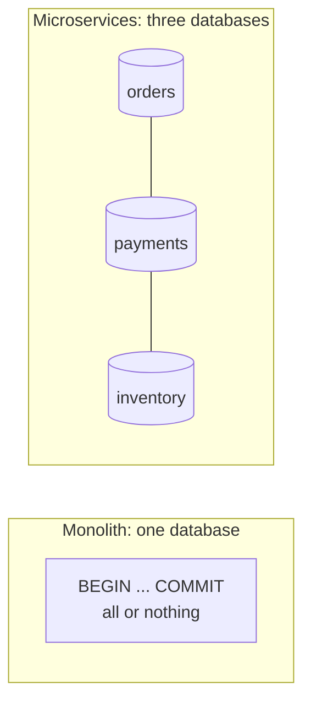
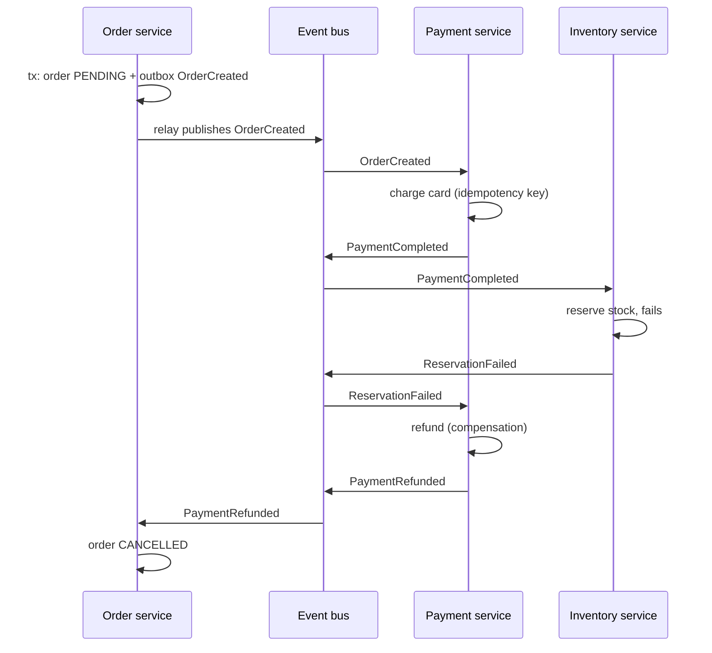
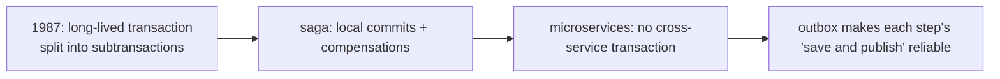

# Distributed Transactions in Microservices: 2PC vs Sagas vs Outbox

> **Prerequisites:** [Lesson 01: Distributed Systems 101](../01-distributed-systems-101/README.md) · [Lesson 02: Partial Failures](../02-partial-failures/README.md) · [Lesson 13: Distributed Locks](../13-distributed-locks/README.md).  
> **Estimated Reading Time:** 24–28 minutes  
> **Target Audience:** Backend engineers splitting a monolith into services, and candidates asked "how do you keep an order, a payment and a stock reservation consistent across services?"  
> **Free PDF Notes:** [Download SD-H-015.pdf](https://backendroadmap.com/notes/system-design/SD-H-015.pdf)

> [!NOTE]
> **In one line:** Once data lives in several databases there is no single transaction across them. You either coordinate a vote (**two-phase commit**: atomic, blocking, coupled), run **local transactions with compensating undo steps** (a **saga**: eventually consistent), make each step reliable with a **transactional outbox**, or **redesign** so data that must change together stays together.

> [!TIP]
> **The Golden Rule:** Before reaching for any distributed transaction, ask whether the data really belongs in different services. Distributed transactions are often a sign that a service boundary cuts through one consistency boundary.

---

## 1. What the Problem Is, and What It Isn't

A customer places an order. You must create the order, charge the card and reserve the stock. In a monolith with one database that is one transaction: all or nothing. Split into order, payment and inventory services, each with its own database, and no transaction covers all three. If the charge succeeds and the stock reservation fails, the customer pays for nothing.

| Term | Precise Meaning | Example |
| :--- | :--- | :--- |
| **ACID transaction** | Atomic, consistent, isolated, durable, inside one database | `BEGIN ... COMMIT` |
| **Distributed transaction** | One logical operation spanning several databases or services | Order + payment + stock |
| **2PC / XA** | A coordinator asks all to *prepare*, then *commit* only if all agree (lesson 16) | Atomic but blocking |
| **Saga** | A sequence of local transactions with compensating actions (lesson 17) | Refund if stock fails |
| **Compensation** | A business-level undo of a completed step | Refund, release stock |
| **Transactional outbox** | Write the event to an outbox table in the *same local transaction*, publish it afterwards | Reliable "save and publish" |
| **Not** | The same as a distributed lock or consensus | Those solve different problems |

### Why It Matters
1. Splitting a database splits the transaction; this is the main hidden cost of microservices.
2. Interviewers expect you to name the options and pick one with reasons, not recite 2PC.
3. The answer you will usually give, **saga + outbox + idempotent consumers**, ties lessons 15 to 20 together.

---

## 2. Anatomy: What "Atomic" Means Across Services

We want **atomicity** (all steps happen or none do, from the business point of view) and usually **isolation** (nobody sees half-done states). Across services you can get atomicity with coordination, or settle for steps that are *eventually* all done or all undone. Full isolation across services is rarely affordable.



| Approach | Atomicity | Isolation | Coupling | Cost |
| :--- | :---: | :---: | :---: | :--- |
| **Keep it in one service/database** | Yes | Yes | None | Redesign the boundary |
| **2PC / XA** | Yes | Yes (locks held) | Tight, blocking | Locks across network round trips; coordinator failure blocks |
| **Saga** | Eventually | No | Loose | Compensations, idempotency, brief inconsistency |
| **Outbox + events** | Per service | n/a | Loose | Relay, duplicates, idempotent consumers |

> [!WARNING]
> **Two-phase commit is a poor fit for independent microservices and external APIs** such as a card processor: locks are held across round trips, a coordinator failure can leave participants blocked, and every participant must support XA. It is reasonable *inside* one database cluster or a few cooperating databases.

---

## 3. Mathematical Model: Why Sequential Calls Go Wrong

Suppose an order makes $k$ remote calls in sequence and each succeeds independently with probability $s_i$. The chance **all** succeed is $\prod s_i$, and the chance of ending in a **partial** state (some succeeded, some not) is

$$P(\text{partial}) = 1 - \prod_{i} s_i - P(\text{first step fails})$$

(the first step failing leaves nothing to undo). With a 3% card decline, 8% stock shortage and 3% shipment failure, about $1-0.97\times0.92\times0.97\approx 13.4\%$ of orders fail somewhere, and about **10.4%** fail *after* the card was charged. At volume that is thousands of customers paying for nothing a day unless something undoes the charge.

A saga bounds the damage: every step has a **compensation**, and compensations are retried until they succeed, so the end state is "all done" or "all undone". **2PC** instead pays in latency and availability: with $n$ participants and a coordinator, a commit needs two round trips to *every* participant, and any one failing during the prepared window blocks the others holding locks.

---

## 4. Metrics & Percentiles

| Metric | Meaning | Why you care |
| :--- | :--- | :--- |
| **Saga completion rate** | Sagas that end "all done" | The success path |
| **Compensation rate** | Sagas that rolled back | Business signal (out of stock) |
| **Stuck sagas** | Not finished after a deadline | The alert that matters most |
| **Saga duration $p_{99}$** | Start to terminal state | User-visible delay |
| **Outbox lag** | Age of the oldest unpublished event | Delay between a commit and its effects |
| **Duplicate deliveries** | Events processed more than once | Must be harmless (idempotent consumers) |
| **Compensation failures** | Refunds that failed | Needs retries and human escalation |

### Worked Example (order, payment, inventory as a saga)
The order service creates the order as `PENDING` and writes an `OrderCreated` event to its outbox in the same transaction. The payment service consumes it, charges the card with an idempotency key and emits `PaymentCompleted`. The inventory service tries to reserve stock and fails: `OutOfStock`. The payment service reacts by refunding, and the order service marks the order `CANCELLED` and emails the customer. No step ever held a lock across services.

---

## 5. Compounding: Three Experiments

**A. Orders with and without compensation.** 200,000 orders; card declines 3%, stock unavailable 8%, shipment failure 3% (Python 3.13):

| Design | Fulfilled | Refunded | **Charged for nothing** |
| :--- | :---: | :---: | :---: |
| Naive sequence of calls | 173,304 | 0 | **20,751** |
| Saga, refund tried **once** (5% of refunds fail) | 173,153 | 19,796 | **1,045** |
| Saga, refund **retried** until it succeeds | 173,304 | 20,751 | **0** |

A saga only helps if compensations are **reliable**: one unretried refund path left 1,045 customers charged. Retries are safe because the refund is idempotent.

**B. Dual write vs transactional outbox.** The service commits the order, then publishes `OrderCreated`; with a 0.1% crash chance between those two steps, over 200,000 orders:

| Publishing design | Events lost | Events delivered twice |
| :--- | :---: | :---: |
| Dual write (save, then publish) | **199** | 0 |
| Transactional outbox (relay retries until acknowledged) | **0** | about 220 |

The outbox swaps *loss* for *duplicates*, and duplicates are cheap to neutralise with idempotent consumers (lesson 20). Lost events are not.

---

## 6. Numbers Every Engineer Must Know

| Item | Typical | Implication |
| :--- | :---: | :--- |
| 2PC round trips | 2 per participant (prepare, commit) | Latency is the slowest participant, twice |
| 2PC lock hold time | from prepare to commit | Contention and blocking on coordinator failure |
| Saga steps | 3 to 7 per business flow | More steps, more compensations |
| Outbox publish lag | milliseconds to seconds | The delay before downstream sees the event |
| Duplicate rate | about the crash rate of the relay | Always design for at-least-once |
| Orders failing after charge (example above) | about 10% | The need for compensation, in numbers |

---

## 7. Protocol Deep Dive: Saga with Outbox



1. The order service creates the order as `PENDING` and records an outbox event in the same local transaction.
2. The payment service charges the card, then emits `PaymentSucceeded` (or `PaymentFailed`).
3. The inventory service reserves stock; on failure it emits `ReservationFailed`.
4. On failure the saga runs **compensations in reverse**: refund the payment, mark the order `CANCELLED`.
5. On success the order becomes `CONFIRMED`.

**Choreography vs orchestration.** In **choreography** "each local transaction publishes domain events that trigger local transactions in other services" (no central coordinator); in **orchestration** "an orchestrator (object) tells the participants what local transactions to execute" (lesson 17). **Isolation** is the saga's weakness: because intermediate states are visible, concurrent sagas can interfere, and designs use *countermeasures* such as a `PENDING` state acting as a semantic lock, commutative updates, or re-reading a value before acting.

---

## 8. Hierarchical Budgets & Design Rules

| Slice | Rule | Control |
| :--- | :--- | :--- |
| Boundaries | Keep data that must change together in one service | Revisit boundaries first |
| Each step | A local ACID transaction | One database per service |
| Publishing | Outbox in the same transaction | Relay with retries |
| Consumers | Idempotent (dedup table, upsert, idempotency key) | Lesson 20 |
| Undo | Every step has a compensation, retried until done | Idempotent refunds |
| Timeouts | A deadline per saga; escalate when stuck | "Stuck sagas" alert |
| External APIs | Idempotency keys on every call | Payment processors |
| 2PC | Only inside one cluster of cooperating databases | Never across external APIs |

---

## 9. Top Mitigations

1. **Redesign first**: merge services whose data must change together.
2. **Use sagas** with explicit compensations for cross-service business flows.
3. **Use the transactional outbox** so "save and publish" cannot lose events.
4. **Make consumers idempotent**, since the outbox delivers at least once.
5. **Retry compensations** until they succeed and alert on stuck sagas.
6. **Put the intermediate state in the data** (`PENDING`, `RESERVED`) so other flows can see it.
7. **Use 2PC only** where participants are few, trusted and XA-capable.

---

## 10. Reference Case: The Saga Pattern, From Its Origin to Today's Microservices

This is a design reference, not an incident report.

- **Origin.** Hector Garcia-Molina and Kenneth Salem introduced *Sagas* in 1987 (SIGMOD) for **long-lived transactions** in a single database: instead of one transaction holding locks for hours, split the work into subtransactions that commit independently, each with a compensating transaction to undo it.
- **Today's definition.** Chris Richardson's microservices.io describes a saga as "a reliably coordinated sequence of local transactions", where if a step fails a business rule "the changes made by the completed steps are undone by compensating transactions". Its problem statement is that a service "cannot use the traditional mechanism of a distributed transaction that spans the database and the message broker", with "2PC is not an option" among the forces.
- **Its stated drawback:** "the lack of isolation means that there's risk that the concurrent execution of multiple sagas" can interfere, so developers must apply countermeasures that implement isolation themselves.
- **The two coordination styles:** choreography and orchestration (above).



**Lesson:** the saga is old; what is new is applying it *across services*, where you also need the outbox (reliable publishing) and idempotent consumers (safe retries). Lessons 16 and 17 cover 2PC's blocking and the saga in detail.

---

## 11. Multi-Language Production Code Tabs

A minimal saga orchestrator: run steps in order; on failure, run the compensations of completed steps in reverse, retrying each until it succeeds.

````carousel
```go
// Go: saga orchestrator with retried, idempotent compensations.
package main

import "errors"

type Step struct {
	Name       string
	Do         func() error
	Compensate func() error // must be idempotent
}

// RunSaga returns nil on success, or the error after fully compensating.
func RunSaga(steps []Step, maxCompRetries int) error {
	var done []Step
	for _, s := range steps {
		if err := s.Do(); err != nil {
			for i := len(done) - 1; i >= 0; i-- {
				c := done[i]
				for try := 0; try < maxCompRetries; try++ {
					if c.Compensate() == nil {
						break
					}
					if try == maxCompRetries-1 {
						return errors.New("compensation stuck: " + c.Name) // escalate to a human
					}
				}
			}
			return err
		}
		done = append(done, s)
	}
	return nil
}
```
<!-- slide -->
```typescript
// TypeScript: saga orchestrator with retried, idempotent compensations.
interface Step {
  name: string;
  run: () => Promise<void>;
  compensate: () => Promise<void>; // must be idempotent
}

export async function runSaga(steps: Step[], maxCompRetries = 5): Promise<void> {
  const done: Step[] = [];
  for (const step of steps) {
    try {
      await step.run();
      done.push(step);
    } catch (err) {
      for (const c of done.reverse()) {
        for (let attempt = 1; ; attempt++) {
          try {
            await c.compensate();
            break;
          } catch {
            if (attempt >= maxCompRetries) throw new Error(`compensation stuck: ${c.name}`);
          }
        }
      }
      throw err;
    }
  }
}
```
<!-- slide -->
```python
# Python: the order experiments behind section 5 (stdlib only) and a tiny outbox.
import random
import sqlite3


def run_orders(mode, n=200_000, seed=15, p_card=0.03, p_stock=0.08, p_ship=0.03, p_refund_fail=0.05):
    """mode: 'naive' | 'saga_once' | 'saga_retry'. Returns (fulfilled, refunded, charged_for_nothing)."""
    rng = random.Random(seed)
    fulfilled = refunded = stuck = 0
    for _ in range(n):
        if rng.random() < p_card:
            continue                                        # card declined: nothing to undo
        if rng.random() < p_stock or rng.random() < p_ship:     # a later step failed after the charge
            if mode == "naive":
                stuck += 1                                  # nobody undoes the charge
            elif mode == "saga_once" and rng.random() < p_refund_fail:
                stuck += 1                                  # the refund failed and was never retried
            else:
                refunded += 1                               # compensation (retried until it succeeds in saga_retry)
            continue
        fulfilled += 1
    return fulfilled, refunded, stuck


def event_delivery(n=200_000, p_crash=0.001, seed=15):
    """Crash between 'commit' and 'publish'. Returns (lost with dual write, lost with outbox, duplicated by outbox)."""
    rng = random.Random(seed)
    lost_dual = sum(rng.random() < p_crash for _ in range(n))
    duplicated_outbox = sum(rng.random() < p_crash for _ in range(n))
    return lost_dual, 0, duplicated_outbox


# Transactional outbox: the order row and its event commit atomically.
def place_order(db, order_id):
    with db:                                                # one local transaction
        db.execute("INSERT INTO orders (id, status) VALUES (?, 'PENDING')", (order_id,))
        db.execute("INSERT INTO outbox (order_id, event, sent) VALUES (?, 'OrderCreated', 0)", (order_id,))


def relay(db, publish):
    """Publish unsent events; mark them sent only after publish succeeded (at-least-once)."""
    for rowid, order_id, event in db.execute("SELECT rowid, order_id, event FROM outbox WHERE sent = 0").fetchall():
        publish(order_id, event)                            # may raise; the row stays unsent and is retried
        with db:
            db.execute("UPDATE outbox SET sent = 1 WHERE rowid = ?", (rowid,))
```
<!-- slide -->
```csharp
// C#: saga orchestrator with retried, idempotent compensations.
public sealed record SagaStep(string Name, Func<Task> Run, Func<Task> Compensate);

public static class Saga
{
    public static async Task RunAsync(IReadOnlyList<SagaStep> steps, int maxCompRetries = 5)
    {
        var done = new Stack<SagaStep>();
        foreach (var step in steps)
        {
            try
            {
                await step.Run();
                done.Push(step);
            }
            catch
            {
                while (done.Count > 0)
                {
                    var c = done.Pop();
                    for (var attempt = 1; ; attempt++)
                    {
                        try { await c.Compensate(); break; }
                        catch when (attempt < maxCompRetries) { }
                        catch { throw new InvalidOperationException($"compensation stuck: {c.Name}"); }
                    }
                }
                throw;
            }
        }
    }
}
```
````

---

## 12. Hands-On CLI Verification Workflows

Section 5's numbers come from the Python tab (Python 3.13, seed 15, defaults):

```python
for m in ("naive", "saga_once", "saga_retry"):
    print(m, run_orders(m))
print(event_delivery())
```

```text
naive (173304, 0, 20751)
saga_once (173153, 19796, 1045)
saga_retry (173304, 20751, 0)
(199, 0, 220)
```

The outbox in the same tab is real SQL. Try it:

```python
db = sqlite3.connect(":memory:")
db.execute("CREATE TABLE orders (id TEXT PRIMARY KEY, status TEXT)")
db.execute("CREATE TABLE outbox (order_id TEXT, event TEXT, sent INTEGER)")
place_order(db, "o-1")
sent = []
relay(db, lambda oid, ev: sent.append((oid, ev)))
print(sent, db.execute("SELECT sent FROM outbox").fetchall())   # [('o-1', 'OrderCreated')] [(1,)]
```

To see saga state in a real system, query the saga log or the orchestrator's workflow history (Temporal, Camunda and similar tools expose it) and alert on any saga older than its deadline.

---

## 13. Common Mistakes to Avoid

1. **Calling services in sequence** with no compensation for the earlier steps.
2. **Publishing after commit** with no outbox (lost events).
3. **Compensations that are not idempotent** or are tried only once.
4. **Using 2PC across external APIs** such as card processors.
5. **Ignoring isolation**: reading `PENDING` data as final.
6. **No saga deadline**, so stuck flows are never noticed.
7. **Assuming exactly-once delivery** instead of designing idempotent consumers.
8. **Splitting services along the wrong boundary**, then fighting distributed transactions forever.

---

## 14. Key Terms Glossary

| Key Term | Definition |
| :--- | :--- |
| **Distributed transaction** | One logical operation spanning several data stores. |
| **2PC / XA** | Prepare then commit across participants (lesson 16). |
| **Saga** | Local transactions plus compensating actions. |
| **Compensating transaction** | A business-level undo of a completed step. |
| **Choreography / orchestration** | Event-driven vs centrally directed saga coordination. |
| **Transactional outbox** | Event stored in the same local transaction, then relayed. |
| **Dual write** | Writing to a database and a broker separately (unsafe). |
| **Semantic lock** | A state such as `PENDING` marking a record as mid-saga. |
| **Idempotent consumer** | Processing a message twice has the same effect as once. |
| **At-least-once delivery** | Messages may be delivered more than once, never lost. |

---

## 15. System Design Interview Questions & Answers

### Basic Conceptual Questions

<details>
<summary><strong>Q1: Why can't you use a normal transaction across microservices? [BASIC]</strong></summary>

**Answer:**
Each service owns its own database, and no single transaction spans them. A charge can commit while the stock reservation fails, leaving the system inconsistent unless something coordinates or undoes it.
</details>

<details>
<summary><strong>Q2: What is a saga? [BASIC]</strong></summary>

**Answer:**
A sequence of local transactions, one per service, each committing independently. If a later step fails, earlier steps are undone by compensating actions (refund, release stock). The system is briefly inconsistent but ends fully done or fully compensated.
</details>

<details>
<summary><strong>Q3: What is the transactional outbox? [BASIC]</strong></summary>

**Answer:**
The service writes the business change and an event row in the same local transaction; a relay publishes outbox rows to the broker and marks them sent. It makes "save and publish" atomic in effect and prevents lost events at the cost of possible duplicates.
</details>

<details>
<summary><strong>Q4: What is wrong with 2PC for microservices? [BASIC]</strong></summary>

**Answer:**
It holds locks across network round trips, a coordinator failure can block participants, every participant must support XA, and external APIs such as card processors do not take part. It suits one database cluster, not independent services.
</details>

### Scenario-Based Architecture Questions

<details>
<summary><strong>Q5: Design order, payment and inventory consistency. [SCENARIO]</strong></summary>

**Answer:**
A saga: order `PENDING` plus outbox event in one transaction; payment charges with an idempotency key; inventory reserves stock; on `OutOfStock` the payment service refunds and the order is `CANCELLED`; on success it is `CONFIRMED`. Each step is a local transaction, events go through outboxes, consumers are idempotent, and sagas have a deadline.
</details>

<details>
<summary><strong>Q6: The refund fails after the stock reservation fails. What now? [SCENARIO]</strong></summary>

**Answer:**
Retry the refund (idempotent, with backoff) until it succeeds; if it stays stuck, raise an alert and a manual-intervention task. In the simulation, a one-shot refund path left 1,045 of 200,000 customers charged for nothing; retries brought it to 0.
</details>

<details>
<summary><strong>Q7: Two orders compete for the last item. [SCENARIO]</strong></summary>

**Answer:**
Make the reservation step atomic in the inventory service (a conditional decrement in one local transaction), mark the order `PENDING` until it succeeds (a semantic lock), and compensate the loser. Isolation across the saga is not automatic, so the state must be visible in the data.
</details>

<details>
<summary><strong>Q8: When would you choose 2PC? [SCENARIO]</strong></summary>

**Answer:**
Inside one database cluster or a few cooperating, XA-capable databases under your control, when you need real atomicity and isolation and can tolerate blocking. Not across independent services or external APIs.
</details>

### Advanced & Tricky Interview Questions

<details>
<summary><strong>Q9: Choreography or orchestration? [TRICKY]</strong></summary>

**Answer:**
Choreography: each service reacts to events, no central coordinator, simple for 2 or 3 steps but hard to follow as flows grow. Orchestration: a coordinator tells participants what to do, easier to see and test the whole flow and to handle timeouts, at the cost of a central component. Many teams start with choreography and move to orchestration as flows grow.
</details>

<details>
<summary><strong>Q10: Why not publish the event right after the commit? [TRICKY]</strong></summary>

**Answer:**
A crash between commit and publish loses the event: the order exists but nothing downstream ever hears. With a 0.1% crash chance over 200,000 orders, 199 events were lost in the simulation. The outbox removes the gap at the price of duplicates.
</details>

<details>
<summary><strong>Q11: What does a saga give up compared with an ACID transaction? [TRICKY]</strong></summary>

**Answer:**
Isolation (and strictly, atomicity at any instant): intermediate states are visible, so concurrent sagas can interfere and reads may see half-done work. You compensate with explicit states, commutative operations and re-reads. What you keep is eventual atomicity: all done or all undone.
</details>

<details>
<summary><strong>Q12: How do you make compensation safe? [TRICKY]</strong></summary>

**Answer:**
Make each compensation idempotent (a refund keyed by the original payment ID), retry with backoff until success, record saga state durably, define a deadline and alert on stuck sagas. Design steps so compensation is possible, and put the irreversible step (shipping, emailing) last.
</details>

---

## 16. One-Page Master Cheat Sheet

```
+---------------------------------------------------------------------------------------------------------+
|                    DISTRIBUTED TRANSACTIONS — MASTER CHEAT SHEET                                        |
+---------------------------------------------------------------------------------------------------------+
| 1. PROBLEM: one DB per service = no transaction across them. Charge ok + stock fail = paid for nothing. |
+---------------------------------------------------------------------------------------------------------+
| 2. FIRST: redesign. Keep data that must change together in one service.                                 |
+---------------------------------------------------------------------------------------------------------+
| 3. 2PC/XA: atomic + isolated, but blocking, tightly coupled. One cluster only, never external APIs.     |
+---------------------------------------------------------------------------------------------------------+
| 4. SAGA: local txns + compensations (retried, idempotent). Choreography or orchestration. No isolation. |
+---------------------------------------------------------------------------------------------------------+
| 5. OUTBOX: event row in the same local txn, relay publishes. Dual write loses events; outbox dupes them.|
+---------------------------------------------------------------------------------------------------------+
| 6. ALWAYS: idempotency keys, idempotent consumers, saga deadlines, stuck-saga alerts.                   |
+---------------------------------------------------------------------------------------------------------+
```

---

## Further Reading & Sources

- Hector Garcia-Molina and Kenneth Salem, "Sagas" (SIGMOD 1987).
- Chris Richardson, [Pattern: Saga](https://microservices.io/patterns/data/saga.html), and the Transactional outbox pattern on microservices.io.
- Pat Helland, "Life beyond Distributed Transactions: an Apostate's Opinion" (CIDR 2007).
- Martin Kleppmann, *Designing Data-Intensive Applications*, chapters 7 and 9 (distributed transactions and consensus).

---

## Free PDF Notes

[SD-H-015.pdf](https://backendroadmap.com/notes/system-design/SD-H-015.pdf)

---

## Next

Continue with [Lesson 16: Two-Phase Commit Explained and Why It Blocks](../16-two-phase-commit-explained-and-why-it-blocks/README.md).
