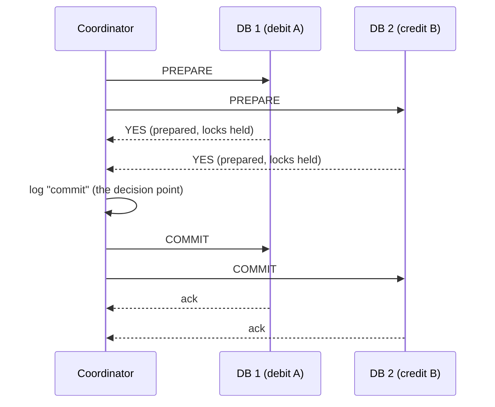
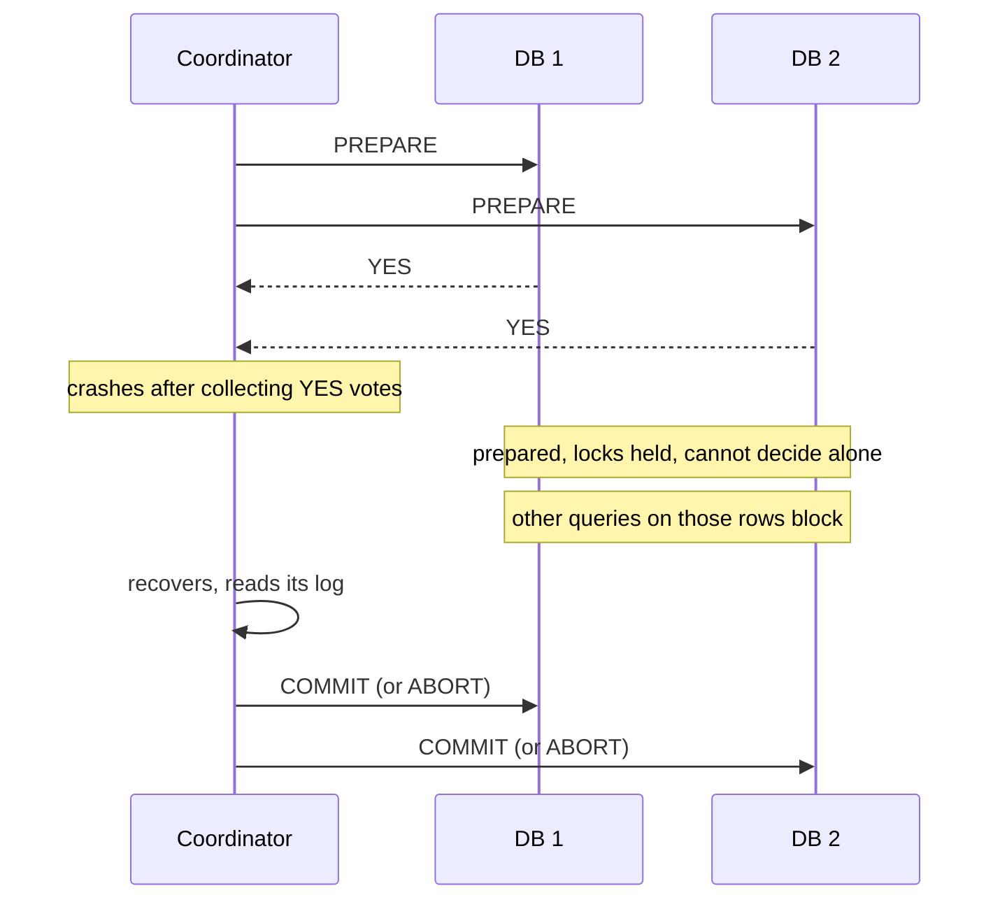
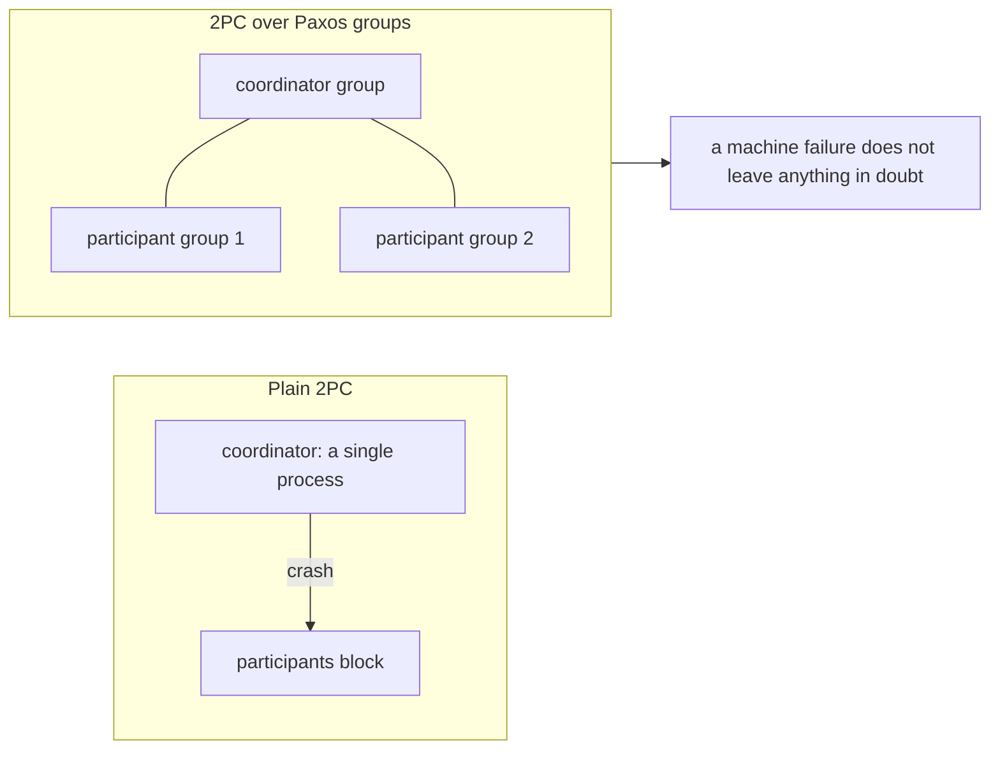

# Two-Phase Commit (2PC) Explained — and Why It Blocks

> **Prerequisites:** [Lesson 09: Raft Consensus](../09-raft-consensus-explained/README.md) · [Lesson 15: Distributed Transactions in Microservices](../15-distributed-transactions-in-microservices/README.md).  
> **Estimated Reading Time:** 22–26 minutes  
> **Target Audience:** Backend engineers using XA, JTA or `PREPARE TRANSACTION`, and candidates asked "how does two-phase commit work, and what happens when the coordinator crashes?"  
> **Free PDF Notes:** [Download SD-H-016.pdf](https://backendroadmap.com/notes/system-design/SD-H-016.pdf)

> [!NOTE]
> **In one line:** In 2PC a coordinator asks every participant to **prepare** (do the work, write it durably, hold locks, vote yes or no), then tells all to **commit** only if everyone said yes. It is truly atomic, but participants that voted yes cannot decide alone if the coordinator disappears, so they **block** holding their locks.

> [!TIP]
> **The Golden Rule:** Once a participant votes YES it has given up the right to decide: it must wait for the coordinator's verdict, however long that takes. Everything bad about 2PC follows from that one promise.

---

## 1. What 2PC Is, and What It Isn't

Move $100 from an account in one database to an account in another. The debit and the credit must both happen, or neither. Two separate databases, one atomic outcome. Two-phase commit is the classic protocol for it.

| Term | Precise Meaning | Example |
| :--- | :--- | :--- |
| **Coordinator (transaction manager)** | Drives the protocol and records the decision | An application server, JTA manager |
| **Participant (resource manager)** | A database or queue that does part of the work | Postgres, MySQL, a message broker |
| **Prepare / vote** | Participant does the work, logs it durably, holds locks, votes YES or NO | `PREPARE TRANSACTION 'tx-81'` |
| **Commit / abort** | The coordinator's decision, then applied by every participant | `COMMIT PREPARED 'tx-81'` |
| **In doubt** | A prepared participant that has not yet heard the decision | Holding row locks |
| **XA** | The standard interface between a transaction manager and resource managers | Java JTA, MySQL XA |
| **Not** | A consensus protocol that tolerates coordinator failure by itself | Paxos Commit and Raft-backed variants do |

### Why It Matters
1. It is the textbook answer to atomic commit and the first thing interviewers contrast with sagas.
2. Real databases use it internally (Spanner, CockroachDB), so you should know *why* it works there and not between microservices.
3. The blocking problem is the standard follow-up question.

---

## 2. Anatomy: The Two Phases

**Phase 1, prepare (voting).** The coordinator sends `PREPARE` to every participant. Each does all the work, writes it durably to its log, **holds its locks**, and votes YES (it promises it can commit, even after a crash) or NO.

**Phase 2, commit.** If every vote is YES, the coordinator **writes its decision to its own log** and sends `COMMIT`; if any vote is NO or missing, it sends `ABORT`. Participants apply the decision and release their locks.



| Participant state | Meaning | Can it decide alone? |
| :--- | :--- | :--- |
| **Working** | Executing the transaction | Yes: it may abort |
| **Prepared (voted YES)** | Promised to commit; locks held | **No**: must wait for the coordinator |
| **Committed / aborted** | Verdict applied | Done |

The decision point is when the coordinator durably logs "commit": before it, the outcome can still be abort; after it, the transaction *will* commit, even across crashes.

> [!WARNING]
> **The blocking window.** Between a participant's YES vote and the verdict, it holds its locks and cannot unilaterally commit (the others may have voted NO) or abort (the coordinator may have decided commit).

---

## 3. Mathematical Model: Latency and Availability

**Latency.** A commit waits for the *slowest* participant twice (prepare, then commit), plus an `fsync` in each phase and one for the coordinator's decision:

$$T_{2PC} \approx \max_i (t^{\text{prep}}_i + f) + \max_i (t^{\text{commit}}_i + f) + f$$

where $t$ is a network round trip and $f$ is an `fsync`. The max over $n$ participants grows with $n$, so tails matter.

**Availability.** Every participant must be up for the transaction to commit:

$$A = a^{\,n}$$

| Participants | Each 99.9% available | Minutes per year unable to commit |
| :---: | :---: | :---: |
| 1 | 99.900% | 526 |
| 2 | 99.800% | 1,051 |
| 3 | 99.700% | 1,575 |
| 5 | 99.501% | 2,623 |
| 10 | 99.004% | 5,232 |

**Blocking cost.** If the coordinator crashes after collecting YES votes, each prepared participant holds its locks for the *recovery time* $R$. The number of other transactions that queue behind those locks is about $\lambda \cdot R \cdot P(\text{touch a locked row})$, which explodes when access is skewed toward hot rows.

---

## 4. Metrics & Percentiles

| Metric | Meaning | Alert when |
| :--- | :--- | :--- |
| **In-doubt (prepared) transactions** | Prepared, no verdict yet | Any older than seconds |
| **Prepared-transaction age** | Time since `PREPARE` | Minutes: something is orphaned |
| **Commit latency $p_{99}$** | Slowest participant, twice | Rising with participant count |
| **Lock wait time** | Queries waiting on locks held by prepared transactions | Spikes after a coordinator restart |
| **Coordinator recovery time** | Crash to verdict re-sent | Longer than your lock tolerance |
| **Abort rate** | NO votes or timeouts | Indicates conflicts or an unhealthy participant |

### Worked Example (an XA transfer between two Postgres databases)
The transaction manager debits account A in database 1 and credits account B in database 2, then runs `PREPARE TRANSACTION 'tx-81'` on both. Both succeed. It records `commit tx-81` in its own log, then runs `COMMIT PREPARED 'tx-81'` on both. If database 2 had failed the credit (say, account closed) it would vote NO and both would run `ROLLBACK PREPARED`. If the manager crashes after the prepares, both transactions stay **in doubt**, holding row locks on A and B, until it recovers and reads its log.

---

## 5. Compounding: Three Numbers

Simulations (Python 3.13, stdlib only; models, not benchmarks of any product).

**A. Latency.** Each network round trip lognormal (median 1 ms, heavy tail), 2 ms `fsync` per phase, 100,000 commits per row:

| Commit | p50 | p99 |
| :--- | :---: | :---: |
| One local database commit | 2.50 ms | 3.60 ms |
| 2PC, 2 participants | 9.43 ms | 17.84 ms |
| 2PC, 3 participants | 10.19 ms | 19.17 ms |
| 2PC, 5 participants | 11.31 ms | 21.38 ms |
| 2PC, 10 participants | 13.07 ms | 24.39 ms |

Even two participants cost about **4x** a local commit at the median and 5x at p99 (two phases, three `fsync`s). More participants add slowly because the maximum of independent tails grows slowly.

**B. Blocking behind one crashed coordinator.** The coordinator dies after the YES votes; its two rows stay locked for 30 s at 200 transactions per second over 10,000 rows. Other two-row transactions that need a locked row:

| Access pattern | Transactions blocked behind one in-doubt transaction |
| :--- | :---: |
| Uniform | 2.4 |
| 20% of traffic on 10 hot rows | 92.3 |
| 50% of traffic on 10 hot rows | 587.0 |

With uniform access one crash is a nuisance; with hot rows (a counter, a popular product) it becomes an outage, and blocked transactions pile up their own locks.

---

## 6. Numbers Every Engineer Must Know

| Item | Typical | Implication |
| :--- | :---: | :--- |
| Round trips | 2 (prepare, commit) per participant, in parallel | Latency is the slowest participant, twice |
| `fsync`s | One per participant per phase, plus the coordinator's | Disk latency is on the critical path |
| Locks held | From prepare to commit | Contention and blocking |
| Availability | $a^n$ | More participants, more downtime |
| Spanner 2PC scaling | Reasonable up to 50 participants, rising noticeably at 100 | Reported in the Spanner paper (Table 4) |
| Postgres | `max_prepared_transactions` default 0 | Prepared transactions are opt-in |

---

## 7. Protocol Deep Dive: Failure Cases and Recovery

| Failure | What happens | Recovery |
| :--- | :--- | :--- |
| Participant crashes **before** voting | Coordinator times out and aborts | Participant forgets the transaction |
| Participant crashes **after** voting YES | It recovers from its log still **prepared** | Asks the coordinator for the verdict |
| Coordinator crashes **before** logging the decision | Participants are in doubt | On recovery it aborts (no decision logged) |
| Coordinator crashes **after** logging "commit" | Participants are in doubt | On recovery it re-sends COMMIT from its log |
| Coordinator crashes and **never** recovers | Participants block indefinitely | Manual intervention (heuristic commit/abort), risking inconsistency |



**Why not 3PC?** Three-phase commit adds a pre-commit phase to avoid blocking, but it assumes bounded delays and is not safe under network partitions, so it is rarely used. The practical fix is to make the **coordinator and participants fault tolerant**: each is itself a Raft or Paxos group, so they do not disappear. Gray and Lamport's *Paxos Commit* formalises this: the commit decision is made by consensus instead of a single coordinator.

---

## 8. Hierarchical Budgets & Design Rules

| Slice | Rule | Control |
| :--- | :--- | :--- |
| Where to use | One cluster or a few cooperating databases | Not across independent services or external APIs |
| Coordinator | Durable log and fast recovery | Replicated, or backed by Raft/Paxos |
| Timeouts | Bound the prepare phase | Abort on a missing vote |
| Prepared age | Alert and resolve | Never leave prepared transactions around |
| Hot rows | Avoid them in distributed transactions | Redesign counters and hot keys |
| Participants | Few | Latency and availability fall with each one |
| Alternatives | Saga + outbox for microservices (lesson 15) | Accept eventual consistency |

---

## 9. Top Mitigations

1. **Keep 2PC inside systems that make the coordinator fault tolerant** (Spanner, CockroachDB, Kafka transactions).
2. **Keep the participant count small.**
3. **Alert on prepared-transaction age** and resolve stragglers.
4. **Avoid hot rows** in transactions that span participants.
5. **Set a prepare timeout** so a missing vote aborts instead of hanging.
6. **Log the decision durably before sending it**, and re-send on recovery.
7. **Prefer sagas and outboxes** for independent services.

---

## 10. Production Reference: What the Postgres Docs and the Spanner Paper Say

**PostgreSQL's own warning.** The manual for `PREPARE TRANSACTION` states: "`PREPARE TRANSACTION` is not intended for use in applications or interactive sessions. Its purpose is to allow an external transaction manager to perform atomic global transactions across multiple databases or other transactional resources. Unless you're writing a transaction manager, you probably shouldn't be using `PREPARE TRANSACTION`." On blocking, it says "the transaction continues to hold whatever locks it held", that it is "unwise to leave transactions in the prepared state for a long time" because it "will interfere with the ability of `VACUUM` to reclaim storage, and in extreme cases could cause the database to shut down to prevent transaction ID wraparound", and recommends keeping the feature disabled (`max_prepared_transactions = 0`) unless you have a manager that "ensure[s] they get closed out promptly".

**2PC done right inside Spanner.** The Spanner paper explains that each participant is a Paxos group: if a transaction involves only one Paxos group, "as is the case for most transactions", it can bypass the transaction manager. For multi-group transactions it runs two-phase commit across the groups' leaders, and "two-phase commit generates a Paxos write for the prepare phase". Because every participant and the coordinator are replicated, a single machine failure does not leave a transaction in doubt. The paper reports (Table 4) that two-phase commit "can scale to a reasonable number of participants": up to 50 is reasonable in both mean and 99th-percentile latency, and latencies "start to rise noticeably at 100 participants".



**Lesson:** 2PC is not "bad", it is *dangerous when the coordinator is a single point of failure*. Databases that replicate the coordinator and participants with consensus get atomic commit without the blocking; independent microservices usually cannot, which is why they use sagas.

---

## 11. Multi-Language Production Code Tabs

An in-memory 2PC coordinator and participant, with the decision logged before it is sent and a recovery path.

````carousel
```go
// Go: 2PC coordinator (in-memory model).
package main

type Vote int

const (
	No Vote = iota
	Yes
)

type Participant interface {
	Prepare(txID string) Vote // does the work, logs, holds locks, votes
	Commit(txID string)
	Abort(txID string)
}

type Coordinator struct {
	Log map[string]string // txID -> "commit" | "abort": the durable decision
}

// Run executes 2PC. The decision is logged BEFORE it is sent.
func (c *Coordinator) Run(txID string, parts []Participant) bool {
	commit := true
	for _, p := range parts {
		if p.Prepare(txID) != Yes { // a NO (or timeout) aborts everyone
			commit = false
			break
		}
	}
	if commit {
		c.Log[txID] = "commit" // the decision point
	} else {
		c.Log[txID] = "abort"
	}
	for _, p := range parts {
		if commit {
			p.Commit(txID)
		} else {
			p.Abort(txID)
		}
	}
	return commit
}

// Recover resolves an in-doubt transaction after a coordinator restart.
func (c *Coordinator) Recover(txID string) string {
	if d, ok := c.Log[txID]; ok {
		return d // re-send this verdict
	}
	return "abort" // no decision was logged: safe to abort
}
```
<!-- slide -->
```typescript
// TypeScript: 2PC coordinator (in-memory model).
type Vote = "yes" | "no";

interface Participant {
  prepare(tx: string): Promise<Vote>; // does the work, logs, holds locks, votes
  commit(tx: string): Promise<void>;
  abort(tx: string): Promise<void>;
}

class Coordinator {
  log = new Map<string, "commit" | "abort">(); // the durable decision

  async run(tx: string, parts: Participant[]): Promise<boolean> {
    const votes = await Promise.all(parts.map((p) => p.prepare(tx).catch(() => "no" as Vote)));
    const commit = votes.every((v) => v === "yes");
    this.log.set(tx, commit ? "commit" : "abort"); // decision logged BEFORE sending
    await Promise.all(parts.map((p) => (commit ? p.commit(tx) : p.abort(tx))));
    return commit;
  }

  recover(tx: string): "commit" | "abort" {
    return this.log.get(tx) ?? "abort"; // no decision logged: safe to abort
  }
}
```
<!-- slide -->
```python
# Python: simulations behind section 5, and a tiny 2PC (stdlib only).
import math
import random


def commit_latency(n, trials=100_000, fsync_ms=2.0, seed=16):
    """p50 and p99 of a 2PC commit with n participants (n=0 means one local commit).
    Network round trips are lognormal (median 1 ms, heavy tail); every participant does an fsync per phase."""
    rng, xs = random.Random(seed), []
    for _ in range(trials):
        if n == 0:
            xs.append(fsync_ms + rng.lognormvariate(math.log(0.5), 0.5))
            continue
        prepare = max(rng.lognormvariate(0.0, 0.8) + fsync_ms for _ in range(n))   # slowest YES vote
        commit = max(rng.lognormvariate(0.0, 0.8) + fsync_ms for _ in range(n))    # slowest commit ack
        xs.append(prepare + commit + fsync_ms)                                      # + coordinator decision log
    xs.sort()
    return xs[len(xs) // 2], xs[int(len(xs) * 0.99)]


def blocked_per_crash(hot_share=0.0, rows=10_000, rate=200, recovery_s=30, hot_rows=10, trials=2000, seed=16):
    """A coordinator crashes after collecting YES votes: its 2 rows stay locked until it recovers.
    Count new 2-row transactions arriving in that window that need a locked row."""
    rng, total = random.Random(seed), 0

    def pick():
        return rng.randrange(hot_rows) if rng.random() < hot_share else rng.randrange(rows)

    for _ in range(trials):
        locked = {pick(), pick()}
        total += sum(1 for _ in range(int(rate * recovery_s)) if pick() in locked or pick() in locked)
    return total / trials


class Participant:
    def __init__(self, name, can_commit=True):
        self.name, self.can_commit, self.state = name, can_commit, "working"

    def prepare(self, tx):
        self.state = "prepared" if self.can_commit else "aborted"   # a prepared participant holds locks
        return self.can_commit

    def commit(self, tx):
        self.state = "committed"

    def abort(self, tx):
        self.state = "aborted"


def two_phase_commit(tx, participants, log):
    votes = [p.prepare(tx) for p in participants]
    decision = "commit" if all(votes) else "abort"
    log[tx] = decision                                              # logged BEFORE it is sent
    for p in participants:
        p.commit(tx) if decision == "commit" else p.abort(tx)
    return decision
```
<!-- slide -->
```csharp
// C#: 2PC coordinator (in-memory model).
public interface IParticipant
{
    bool Prepare(string tx);   // does the work, logs, holds locks, votes
    void Commit(string tx);
    void Abort(string tx);
}

public sealed class Coordinator
{
    public Dictionary<string, string> Log { get; } = new(); // the durable decision

    public bool Run(string tx, IReadOnlyList<IParticipant> parts)
    {
        var commit = parts.All(p => p.Prepare(tx));        // any NO aborts everyone
        Log[tx] = commit ? "commit" : "abort";             // decision logged BEFORE sending
        foreach (var p in parts)
        {
            if (commit) p.Commit(tx); else p.Abort(tx);
        }
        return commit;
    }

    // After a restart: re-send the logged verdict, or abort if none was logged.
    public string Recover(string tx) => Log.TryGetValue(tx, out var d) ? d : "abort";
}
```
````

---

## 12. Hands-On CLI Verification Workflows

The tables in section 5 come from the Python tab (Python 3.13, default seeds):

```python
for n in (0, 2, 3, 5, 10):
    print(n, [round(x, 2) for x in commit_latency(n)])
# 0 [2.5, 3.6]   2 [9.43, 17.84]   3 [10.19, 19.17]   5 [11.31, 21.38]   10 [13.07, 24.39]

for hot in (0.0, 0.2, 0.5):
    print(hot, round(blocked_per_crash(hot), 1))
# 0.0 2.4   0.2 92.3   0.5 587.0
```

The protocol itself, with one participant voting NO:

```python
log = {}
a, b = Participant("A"), Participant("B", can_commit=False)
print(two_phase_commit("tx-1", [a, b], log), a.state, b.state)   # abort aborted aborted
a, b = Participant("A"), Participant("B")
print(two_phase_commit("tx-2", [a, b], log), a.state, b.state)   # commit committed committed
```

On real PostgreSQL you can see the in-doubt state yourself (needs `max_prepared_transactions > 0`):

```sql
BEGIN;
UPDATE accounts SET balance = balance - 100 WHERE id = 'A';
PREPARE TRANSACTION 'tx-81';                 -- locks are still held after this

SELECT gid, prepared, owner FROM pg_prepared_xacts;   -- in-doubt transactions, with their age

COMMIT PREPARED 'tx-81';                     -- or: ROLLBACK PREPARED 'tx-81';
```

A row in `pg_prepared_xacts` that is minutes old is a bug or an orphaned transaction manager. Resolve it, because it blocks writers and holds back `VACUUM`.

---

## 13. Common Mistakes to Avoid

1. **Using 2PC across independent microservices or external APIs.**
2. **A single-process coordinator** with no durable log or recovery.
3. **Leaving prepared transactions around** (locks, `VACUUM` blockage).
4. **Hot rows in distributed transactions.**
5. **No prepare timeout**, so one slow participant hangs everyone.
6. **Sending the decision before logging it.**
7. **Many participants** in one transaction.
8. **Heuristic commit or abort without a record**, causing silent inconsistency.

---

## 14. Key Terms Glossary

| Key Term | Definition |
| :--- | :--- |
| **2PC** | Two-phase commit: prepare (vote), then commit or abort. |
| **Coordinator** | The process that drives the protocol and logs the decision. |
| **Participant** | A resource manager that votes and applies the verdict. |
| **Prepared / in doubt** | Voted YES, awaiting the verdict, holding locks. |
| **Decision point** | The coordinator's durable "commit" record. |
| **XA** | Standard interface for distributed transactions. |
| **Heuristic decision** | An operator forcing commit or abort on an in-doubt participant. |
| **3PC** | Three-phase commit; avoids blocking only under strong timing assumptions. |
| **Paxos Commit** | Atomic commit where the decision is made by consensus. |
| **Blocking protocol** | One that cannot make progress if certain processes fail. |

---

## 15. System Design Interview Questions & Answers

### Basic Conceptual Questions

<details>
<summary><strong>Q1: Explain two-phase commit. [BASIC]</strong></summary>

**Answer:**
Phase 1: the coordinator sends PREPARE; each participant does the work, logs it durably, holds locks and votes YES or NO. Phase 2: if all vote YES the coordinator logs "commit" and sends COMMIT, otherwise ABORT; participants apply it and release locks.
</details>

<details>
<summary><strong>Q2: Why does 2PC block? [BASIC]</strong></summary>

**Answer:**
A participant that voted YES can neither commit (others might have voted NO) nor abort (the coordinator might have decided commit) on its own. If the coordinator crashes it must wait for it to recover, holding its locks the whole time.
</details>

<details>
<summary><strong>Q3: What is the decision point? [BASIC]</strong></summary>

**Answer:**
The moment the coordinator durably logs its commit decision. Before it, recovery means abort; after it, recovery re-sends COMMIT.
</details>

<details>
<summary><strong>Q4: Where is 2PC used successfully? [BASIC]</strong></summary>

**Answer:**
Inside distributed databases that replicate both coordinator and participants with consensus (Spanner, CockroachDB), in XA between a few cooperating databases, and in Kafka's transactional writes. Not across independent microservices or external APIs.
</details>

### Scenario-Based Architecture Questions

<details>
<summary><strong>Q5: The coordinator crashed after collecting YES votes. What happens? [SCENARIO]</strong></summary>

**Answer:**
Participants stay in doubt, holding row locks, and other queries on those rows wait. When the coordinator restarts it reads its log: if it logged commit it re-sends COMMIT, otherwise it aborts. In a model with 200 txn/s and hot rows, one 30-second in-doubt window blocked hundreds of transactions.
</details>

<details>
<summary><strong>Q6: Why is 2PC slow? [SCENARIO]</strong></summary>

**Answer:**
Two sequential phases, each waiting for the slowest participant, with an `fsync` per participant per phase plus the coordinator's own log write, and locks held throughout. In the simulation a 2-participant commit was about 4x a local commit at p50 and 5x at p99.
</details>

<details>
<summary><strong>Q7: A prepared transaction has been sitting in Postgres for hours. Why do you care? [SCENARIO]</strong></summary>

**Answer:**
It still holds its locks, blocking writers on those rows, and it prevents `VACUUM` from reclaiming storage; in extreme cases it can force a shutdown to prevent transaction ID wraparound. Find it in `pg_prepared_xacts` and `COMMIT PREPARED` or `ROLLBACK PREPARED` after checking the coordinator's log.
</details>

<details>
<summary><strong>Q8: Would you use 2PC for an order spanning order, payment and inventory services? [SCENARIO]</strong></summary>

**Answer:**
No. Locks across network round trips, a coordinator that can block everyone, every participant needing XA, and a card processor that cannot take part make it a poor fit. Use a saga with an outbox and idempotent consumers (lesson 15).
</details>

### Advanced & Tricky Interview Questions

<details>
<summary><strong>Q9: Why not three-phase commit? [TRICKY]</strong></summary>

**Answer:**
3PC adds a pre-commit phase so participants can decide without the coordinator, but only under bounded message delays and no partitions. With partitions it can violate atomicity, so it is rarely used. The practical fix is fault-tolerant coordinators via consensus (Paxos Commit, Spanner).
</details>

<details>
<summary><strong>Q10: How does Spanner avoid 2PC blocking? [TRICKY]</strong></summary>

**Answer:**
Each participant and the coordinator are Paxos groups, so the "coordinator" is replicated and a machine failure does not leave transactions in doubt; the prepare phase itself is a Paxos write. Most transactions touch only one Paxos group and skip 2PC entirely.
</details>

<details>
<summary><strong>Q11: What is the availability of a 2PC transaction across 5 participants? [TRICKY]</strong></summary>

**Answer:**
All participants must be up: $a^5$. With 99.9% each that is 99.5%, about 2,600 minutes a year unable to commit, five times worse than a single database.
</details>

<details>
<summary><strong>Q12: Can 2PC lose atomicity? [TRICKY]</strong></summary>

**Answer:**
Not in the protocol, but operators can: a heuristic commit or abort on an in-doubt participant while the coordinator decided the opposite leaves the databases inconsistent. That is why those decisions must be recorded and reconciled.
</details>

---

## 16. One-Page Master Cheat Sheet

```
+---------------------------------------------------------------------------------------------------------+
|                          TWO-PHASE COMMIT — MASTER CHEAT SHEET                                          |
+---------------------------------------------------------------------------------------------------------+
| 1. PREPARE: participants do the work, log it durably, HOLD LOCKS, vote YES/NO. YES = can't decide alone.|
+---------------------------------------------------------------------------------------------------------+
| 2. COMMIT: coordinator LOGS the decision (decision point), then sends COMMIT (all YES) or ABORT.        |
+---------------------------------------------------------------------------------------------------------+
| 3. BLOCKS: coordinator dies after YES votes -> participants in doubt, locks held. Hot rows = outage.    |
+---------------------------------------------------------------------------------------------------------+
| 4. COSTS: 2 phases, slowest participant twice, fsync each. Availability = a^n. Locks throughout.        |
+---------------------------------------------------------------------------------------------------------+
| 5. WORKS WHEN the coordinator is replicated (Spanner, CockroachDB: 2PC over Paxos/Raft groups).         |
+---------------------------------------------------------------------------------------------------------+
| 6. MICROSERVICES: use saga + outbox. Postgres: leave max_prepared_transactions = 0 without a manager.   |
+---------------------------------------------------------------------------------------------------------+
```

---

## Further Reading & Sources

- PostgreSQL documentation, [PREPARE TRANSACTION](https://www.postgresql.org/docs/current/sql-prepare-transaction.html) (intended use, locks, `VACUUM`, `max_prepared_transactions`).
- Corbett et al., [Spanner: Google's Globally-Distributed Database](https://research.google/pubs/spanner-googles-globally-distributed-database-2/) (OSDI 2012), sections 2 and 4 and Table 4.
- Jim Gray and Leslie Lamport, "Consensus on Transaction Commit" (*ACM TODS*, 2006), Paxos Commit.
- Martin Kleppmann, *Designing Data-Intensive Applications*, chapter 9, "Distributed transactions and consensus".

---

## Free PDF Notes

[SD-H-016.pdf](https://backendroadmap.com/notes/system-design/SD-H-016.pdf)

---

## Next

Continue with [Lesson 17: Saga Pattern](../17-saga-pattern/README.md): choreography vs orchestration and compensations.
