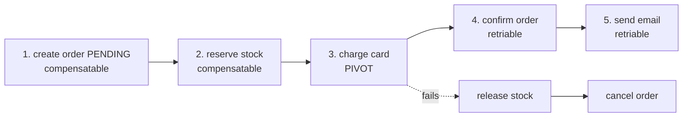
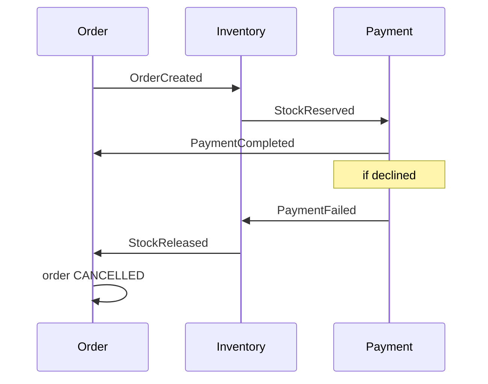
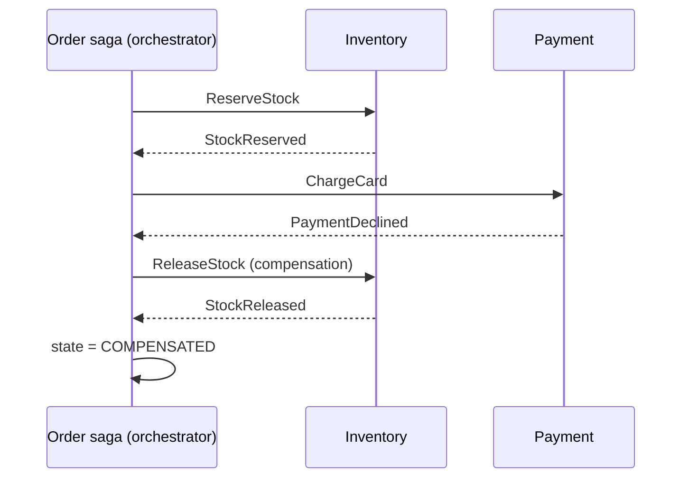
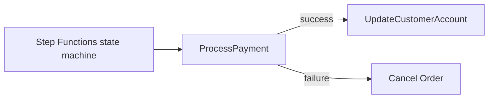

# Saga Pattern: Choreography vs Orchestration & Compensations

> **Prerequisites:** [Lesson 15: Distributed Transactions in Microservices](../15-distributed-transactions-in-microservices/README.md) · [Lesson 16: Two-Phase Commit](../16-two-phase-commit-explained-and-why-it-blocks/README.md).  
> **Estimated Reading Time:** 24–28 minutes  
> **Target Audience:** Backend engineers designing multi-service workflows (orders, bookings, onboarding), and candidates asked "design the order flow across payment, inventory and shipping."  
> **Free PDF Notes:** [Download SD-H-017.pdf](https://backendroadmap.com/notes/system-design/SD-H-017.pdf)

> [!NOTE]
> **In one line:** A saga is a sequence of local transactions where each step has a **compensation** (a business-level undo). It is coordinated by **choreography** (services react to each other's events) or **orchestration** (a coordinator tells each service what to do), and it ends *fully done* or *fully compensated*, never silently half-way.

> [!TIP]
> **The Golden Rule:** Order the steps so the ones that are **easy to undo come first**, the **pivot** (the point of no return) comes next, and the steps after it are **retried until they succeed**. A saga with a durable log can always resume; a saga held only in memory can be abandoned half done.

---

## 1. What a Saga Is, and What It Isn't

Lesson 15 explained *why* sagas exist: no transaction spans several databases. This lesson is how to build one well.

| Term | Precise Meaning | Example |
| :--- | :--- | :--- |
| **Saga** | A reliably coordinated sequence of local transactions | Order → stock → payment → confirm |
| **Local transaction** | An ordinary ACID transaction inside one service | `INSERT INTO reservations` |
| **Compensation** | A business-level undo of a completed step | Release stock, refund |
| **Compensatable step** | Can be undone | Reserve stock |
| **Pivot transaction** | The go/no-go step: after it succeeds the saga will complete | Charge the card |
| **Retriable step** | After the pivot; cannot fail permanently, retried until done | Confirm order, send email |
| **Choreography** | No central coordinator; services publish and react to events | Order service emits `OrderCreated` |
| **Orchestration** | A coordinator (orchestrator) tells participants what to do and tracks state | "Order saga" state machine |
| **Not** | An ACID transaction: intermediate states are visible | `PENDING` orders exist |

### Why It Matters
1. It is the default answer to every cross-service workflow in interviews and in practice.
2. The difference between a saga that works and one that leaks money is in the *details*: step order, idempotent compensations, durable state.
3. Choreography vs orchestration is a standard trade-off question.

---

## 2. Anatomy: Step Types and Step Order

Sagas work best when steps are ordered by how reversible they are:



| Phase | Steps | If a step fails |
| :--- | :--- | :--- |
| **Compensatable** (before the pivot) | Create order, reserve stock | Run compensations of earlier steps in reverse |
| **Pivot** | Charge the card | It decides: success means the saga will finish; failure means compensate |
| **Retriable** (after the pivot) | Confirm order, send email | Retry until success; never roll back |

**Compensations are not rollbacks.** A refund is a *new* transaction, visible to the customer and carrying fees. Put the step most likely to fail, and costliest to undo, as late as possible before the pivot.

---

## 3. Mathematical Model: Step Order and Expected Cost

Let steps 1…k have failure probabilities $f_i$ and *undo costs* $u_i$. If steps run in order and step $j$ fails, the compensations of steps $1\ldots j-1$ run. The expected compensation cost is

$$E[\text{cost}] = \sum_{j} \Big(\prod_{i<j}(1-f_i)\Big) f_j \sum_{i<j} u_i$$

For two steps A then B, $E = (1-f_A) f_B\, u_A$ (only A needs undoing if B fails), plus nothing when A fails first. So the **order matters**: put the step with the larger $u_A f_B$ product *second*.

Example: stock reservation fails 8% of the time and is free to undo (release); card charge fails 3% and undoing it costs a refund. Stock first then card: refunds are never needed (a card failure only releases stock). Card first then stock: $0.97 \times 0.08 \approx 7.8\%$ of sagas need a refund.

**Durability.** If the orchestrator crashes after step $j$ with probability $c$ per step and keeps no persistent state, a saga is abandoned half done with probability about $1-(1-c)^{k}$. With a persisted saga log it resumes instead.

---

## 4. Metrics & Percentiles

| Metric | Meaning | Alert when |
| :--- | :--- | :--- |
| **Sagas by state** | Running / completed / compensating / compensated / failed | "Failed" (compensation stuck) above 0 |
| **Saga age $p_{99}$** | Start to terminal | Exceeds the saga deadline |
| **Compensation rate** | Business rollbacks | Sudden change (a dependency is unhealthy) |
| **Refund rate** | Compensations that cost money | Rising: reorder steps or fix the cause |
| **Retries per step** | Redeliveries | Persistent retries: a bad dependency |
| **Orphaned `PENDING` entities** | Orders older than the deadline | Any |

### Worked Example (orchestrated order saga)
The order orchestrator stores `saga_id`, current step and a step log. It sends `ReserveStock` to inventory and waits for the reply event. On success it sends `ChargeCard` to payment (with an idempotency key); on `PaymentDeclined` it sends `ReleaseStock` and then `CancelOrder`. After the card succeeds it sends `ConfirmOrder` and `SendEmail`, retrying each until acknowledged. If the orchestrator restarts, it reads the log and continues from the last recorded step.

---

## 5. Compounding: Step Order and Durable State, Measured

A simulation of 100,000 sagas (Python 3.13): flow = reserve stock (8% fail), charge card (3% fail), then retriable steps; the orchestrator may crash after any step with probability 2%.

| Order of steps | Persisted saga log | Completed | Compensated | Refunds issued | Sagas **abandoned** half done |
| :--- | :---: | :---: | :---: | :---: | :---: |
| Reserve stock, then charge | yes | 89,212 | 10,788 | **0** | 0 |
| Reserve stock, then charge | **no** | 85,586 | 10,779 | 0 | **3,635** |
| Charge, then reserve stock | yes | 89,212 | 10,788 | **7,793** | 0 |
| Charge, then reserve stock | **no** | 85,640 | 10,612 | 7,638 | **3,748** (all holding a charge) |

Two independent lessons:
- **Step order:** with the same outcomes, charging first created **7,793 refunds** per 100,000 orders (fees, support tickets); reserving first created none.
- **Durability:** without a persisted log, 3.6 to 3.7% of sagas ended abandoned, and in the charge-first design *every one of them* had taken a customer's money.

---

## 6. Numbers Every Engineer Must Know

| Item | Typical | Implication |
| :--- | :---: | :--- |
| Steps per saga | 3 to 7 | Complexity grows quickly with steps |
| Retries for retriable steps | Until success, with backoff | They may not fail permanently |
| Saga deadline | Minutes to hours | Then escalate |
| Compensation | Idempotent, retried | Keyed by the original transaction ID |
| Orchestrator state | One row or event stream per saga | Must be durable |
| Isolation | None | Use `PENDING` states and semantic locks |

---

## 7. Protocol Deep Dive: Choreography vs Orchestration

### Choreography: services react to events



### Orchestration: a coordinator drives the saga



| | Choreography | Orchestration |
| :--- | :--- | :--- |
| **Coordination** | Events between services | A central orchestrator |
| **Pros** | No single coordinator, loose coupling, simple for 2 or 3 steps | The whole flow is visible, easier to test and to add timeouts and retries |
| **Cons** | Hard to follow, cyclic dependencies, no single place for state | The orchestrator is another component (must be durable and replicated) |
| **Best for** | Short, stable flows | Longer or evolving flows with many branches |

**Isolation countermeasures** (sagas lack the "I" in ACID): mark records `PENDING` so other flows see them as in progress (a *semantic lock*), prefer commutative updates, re-read a value before acting on it, and order steps so that early steps are the reversible ones.

---

## 8. Hierarchical Budgets & Design Rules

| Slice | Rule | Control |
| :--- | :--- | :--- |
| Step order | Compensatable first, pivot, then retriable | Design review per saga |
| State | Durable saga log, one per saga | Database table or workflow engine |
| Steps | Each is idempotent (idempotency key) | Dedup at the participant |
| Compensations | Idempotent, retried, alert if stuck | Keyed by original transaction ID |
| Timeouts | Per step and per saga | Deadline then compensate or escalate |
| Visibility | Intermediate states are explicit | `PENDING`, `RESERVED` |
| Choice | Orchestrate anything beyond 3 or 4 steps | Choreography for simple flows |

---

## 9. Top Mitigations

1. **Order steps by reversibility**, with the pivot after the compensatable steps.
2. **Persist the saga state** and resume from it after crashes.
3. **Make every step and every compensation idempotent.**
4. **Retry compensations and retriable steps** with backoff; alert when stuck.
5. **Use explicit intermediate states** instead of hoping nobody reads half-done data.
6. **Set a deadline** per saga and alert on sagas older than it.
7. **Prefer orchestration** (or a workflow engine) as flows grow, with clear observability.

---

## 10. Reference Case: Step Functions and the Official Warnings

AWS's Prescriptive Guidance describes the saga pattern as "a failure management pattern that helps establish consistency in distributed applications, and coordinates transactions between multiple microservices". Its worked illustration is an order-processing flow built with **AWS Step Functions** (an orchestrator): each step, such as `ProcessPayment`, has separate paths for success (`UpdateCustomerAccount`) and failure (`Cancel Order`).

It lists when to use the pattern:
- the application needs data consistency across several microservices without tight coupling;
- there are long-lived transactions and you do not want other microservices blocked if one runs long;
- you need to be able to roll back if an operation fails in the sequence.

And it adds a caution worth repeating in an interview: "The saga pattern is difficult to debug and its complexity increases with the number of microservices. The pattern requires a complex programming model that develops and designs compensating transactions for rolling back and undoing changes."



Chris Richardson's pattern page (microservices.io) lists the same trade-off from the other side: the saga gives "a reliably coordinated sequence of local transactions", but "the lack of isolation means that there's risk that the concurrent execution of multiple sagas" interferes, so teams must add countermeasures.

**Lesson:** an orchestrated saga on a workflow engine gives you the durable state and retries for free, but not the compensation logic, the idempotency or the isolation: those remain your design work.

---

## 11. Multi-Language Production Code Tabs

A resumable orchestrator: each step and compensation is recorded in a log, so a restart continues where it stopped.

````carousel
```go
// Go: resumable saga orchestrator (in-memory log stands in for a durable table).
package main

type Step struct {
	Name       string
	Do         func() error
	Compensate func() error // idempotent
}

type Orchestrator struct {
	Steps []Step
	Log   map[string]bool // "do:<name>" / "undo:<name>" -> done
}

// Run resumes from the log: steps already done are skipped.
func (o *Orchestrator) Run() error {
	for i, s := range o.Steps {
		if o.Log["do:"+s.Name] {
			continue
		}
		if err := s.Do(); err != nil {
			o.compensate(i) // undo completed steps in reverse
			return err
		}
		o.Log["do:"+s.Name] = true // persist after each step
	}
	return nil
}

func (o *Orchestrator) compensate(failedAt int) {
	for i := failedAt - 1; i >= 0; i-- {
		s := o.Steps[i]
		if o.Log["undo:"+s.Name] || !o.Log["do:"+s.Name] {
			continue
		}
		for s.Compensate() != nil { // retried until it works (add backoff and a limit in production)
		}
		o.Log["undo:"+s.Name] = true
	}
}
```
<!-- slide -->
```typescript
// TypeScript: resumable saga orchestrator (the Map stands in for a durable table).
interface Step {
  name: string;
  run: () => Promise<void>;
  compensate: () => Promise<void>; // idempotent
}

export class Orchestrator {
  log = new Map<string, boolean>();
  private steps: Step[];

  constructor(steps: Step[]) {
    this.steps = steps;
  }

  async runSaga(): Promise<void> {
    for (let i = 0; i < this.steps.length; i++) {
      const s = this.steps[i];
      if (this.log.get(`do:${s.name}`)) continue; // resume: already done
      try {
        await s.run();
        this.log.set(`do:${s.name}`, true); // persist after each step
      } catch (err) {
        await this.compensate(i);
        throw err;
      }
    }
  }

  private async compensate(failedAt: number): Promise<void> {
    for (let i = failedAt - 1; i >= 0; i--) {
      const s = this.steps[i];
      if (!this.log.get(`do:${s.name}`) || this.log.get(`undo:${s.name}`)) continue;
      for (;;) {
        try {
          await s.compensate();
          break;
        } catch {
          /* retry with backoff in production */
        }
      }
      this.log.set(`undo:${s.name}`, true);
    }
  }
}
```
<!-- slide -->
```python
# Python: the step-order and durability experiment, and a resumable orchestrator (stdlib only).
import random


def run_sagas(order, n=100_000, seed=17, p_stock=0.08, p_card=0.03, p_crash=0.02, persisted=True):
    """order = 'reserve_first' or 'charge_first'. The orchestrator may crash after any step.
    persisted=True: it resumes from its saga log. persisted=False: the saga is abandoned where it stood."""
    rng = random.Random(seed)
    first, second = ("stock", "card") if order == "reserve_first" else ("card", "stock")
    p_fail = {"stock": p_stock, "card": p_card}
    out = dict(completed=0, compensated=0, refunds=0, abandoned=0, abandoned_charged=0)
    for _ in range(n):
        held = {"stock": False, "card": False}
        crashed = False
        for name in (first, second):
            if rng.random() < p_fail[name]:                         # this step fails: run compensations
                if held[first]:
                    if first == "card":
                        out["refunds"] += 1                          # a refund costs fees and a support ticket
                    held[first] = False
                out["compensated"] += 1
                break
            held[name] = True
            if rng.random() < p_crash:                               # orchestrator crashes after this step
                if persisted:
                    continue                                         # resumes from the log: nothing is lost
                crashed = True
                break
        else:
            out["completed"] += 1
        if crashed:
            out["abandoned"] += 1
            out["abandoned_charged"] += held["card"]
    return out


class Orchestrator:
    """Steps are (name, do, undo). The log makes it resumable after a crash."""

    def __init__(self, steps, log=None):
        self.steps, self.log = steps, log if log is not None else {}

    def run(self):
        for i, (name, do, _) in enumerate(self.steps):
            if self.log.get(("do", name)):
                continue                                            # resume: already done
            try:
                do()
            except Exception:
                self.compensate(i)
                return "COMPENSATED"
            self.log[("do", name)] = True                           # persist after each step
        return "COMPLETED"

    def compensate(self, failed_at):
        for name, _, undo in reversed(self.steps[:failed_at]):
            if self.log.get(("do", name)) and not self.log.get(("undo", name)):
                undo()                                              # idempotent; retried in production
                self.log[("undo", name)] = True
```
<!-- slide -->
```csharp
// C#: resumable saga orchestrator (the dictionary stands in for a durable table).
public sealed record SagaStep(string Name, Func<Task> Run, Func<Task> Compensate);

public sealed class Orchestrator
{
    private readonly IReadOnlyList<SagaStep> _steps;
    public Dictionary<string, bool> Log { get; } = new();

    public Orchestrator(IReadOnlyList<SagaStep> steps) => _steps = steps;

    public async Task RunAsync()
    {
        for (var i = 0; i < _steps.Count; i++)
        {
            var s = _steps[i];
            if (Log.GetValueOrDefault($"do:{s.Name}")) continue; // resume: already done
            try
            {
                await s.Run();
                Log[$"do:{s.Name}"] = true; // persist after each step
            }
            catch
            {
                await CompensateAsync(i);
                throw;
            }
        }
    }

    private async Task CompensateAsync(int failedAt)
    {
        for (var i = failedAt - 1; i >= 0; i--)
        {
            var s = _steps[i];
            if (!Log.GetValueOrDefault($"do:{s.Name}") || Log.GetValueOrDefault($"undo:{s.Name}")) continue;
            while (true)
            {
                try { await s.Compensate(); break; } catch { /* backoff and a limit in production */ }
            }
            Log[$"undo:{s.Name}"] = true;
        }
    }
}
```
````

---

## 12. Hands-On CLI Verification Workflows

Section 5 comes from the Python tab's `run_sagas` (Python 3.13, seed 17):

```python
for order in ("reserve_first", "charge_first"):
    for persisted in (True, False):
        print(order, persisted, run_sagas(order, persisted=persisted))
```

```text
reserve_first True   completed 89212  compensated 10788  refunds    0  abandoned    0
reserve_first False  completed 85586  compensated 10779  refunds    0  abandoned 3635
charge_first  True   completed 89212  compensated 10788  refunds 7793  abandoned    0
charge_first  False  completed 85640  compensated 10612  refunds 7638  abandoned 3748
```

The orchestrator in the same tab, with a failing third step and a restart:

```python
done = []
steps = [("order", lambda: done.append("order"), lambda: done.remove("order")),
         ("stock", lambda: done.append("stock"), lambda: done.remove("stock")),
         ("card",  lambda: (_ for _ in ()).throw(RuntimeError("declined")), lambda: None)]
o = Orchestrator(steps)
print(o.run(), done, sorted(k for k, v in o.log.items() if v))
# COMPENSATED [] [('do', 'order'), ('do', 'stock'), ('undo', 'order'), ('undo', 'stock')]
```

In a real system, query the saga table by state and age (for example `SELECT state, count(*), min(started_at) FROM sagas GROUP BY state`) and alert on anything non-terminal past its deadline.

---

## 13. Common Mistakes to Avoid

1. **No durable saga state**: a crash abandons the saga half done.
2. **Compensations that are not idempotent**, or that are tried once.
3. **Wrong step order**: expensive, failure-prone steps first, causing needless refunds.
4. **Treating a compensation as a rollback**: it is a new, visible transaction.
5. **No timeouts or deadlines.**
6. **Cyclic event chains** in choreography that nobody can trace.
7. **Hiding intermediate state**, so other flows read `PENDING` data as final.
8. **Reaching for sagas where one service and one transaction would do.**

---

## 14. Key Terms Glossary

| Key Term | Definition |
| :--- | :--- |
| **Saga** | Reliable sequence of local transactions with compensations. |
| **Compensating transaction** | A business-level undo of a completed step. |
| **Pivot transaction** | The step after which the saga is committed to finish. |
| **Retriable transaction** | A step after the pivot, retried until it succeeds. |
| **Choreography** | Event-driven coordination with no central controller. |
| **Orchestration** | A central coordinator directs the participants. |
| **Orchestrator** | The component (or workflow engine) that stores and advances saga state. |
| **Semantic lock** | A state flag such as `PENDING` marking a record as mid-saga. |
| **Idempotency key** | A unique key that makes repeating a step harmless. |
| **Saga log** | The durable record of completed steps and compensations. |

---

## 15. System Design Interview Questions & Answers

### Basic Conceptual Questions

<details>
<summary><strong>Q1: What is a saga? [BASIC]</strong></summary>

**Answer:**
A sequence of local transactions, one per service, each with a compensation. If a step fails, the compensations of the completed steps run in reverse, so the business operation ends fully done or fully undone.
</details>

<details>
<summary><strong>Q2: Choreography vs orchestration? [BASIC]</strong></summary>

**Answer:**
In choreography each service publishes events and reacts to others' events; no coordinator. In orchestration a central orchestrator sends commands and tracks state. Choreography suits short flows; orchestration makes longer flows visible, testable and easier to add timeouts to.
</details>

<details>
<summary><strong>Q3: What is a compensating transaction? [BASIC]</strong></summary>

**Answer:**
A new transaction that semantically undoes a completed one: refund a charge, release reserved stock, cancel an order. It is not a database rollback; it is visible and may have side effects such as fees.
</details>

<details>
<summary><strong>Q4: What is a pivot transaction? [BASIC]</strong></summary>

**Answer:**
The step that decides whether the saga will complete. Steps before it are compensatable; steps after it are retriable and must not fail permanently. Charging the card is a typical pivot.
</details>

### Scenario-Based Architecture Questions

<details>
<summary><strong>Q5: Design the order flow with payment and inventory. [SCENARIO]</strong></summary>

**Answer:**
Orchestrated saga: create order `PENDING`; reserve stock (compensation: release); charge the card (pivot, with an idempotency key); then confirm the order and send the email as retriable steps. Persist saga state, make every step and compensation idempotent, set a deadline, and alert on stuck sagas.
</details>

<details>
<summary><strong>Q6: Should you reserve stock before or after charging? [SCENARIO]</strong></summary>

**Answer:**
Reserve first: releasing stock is cheap and free, while refunding a charge costs fees and a support ticket. In the simulation, reserve-first needed 0 refunds per 100,000 sagas and charge-first needed 7,793, with identical outcomes otherwise.
</details>

<details>
<summary><strong>Q7: The orchestrator crashes mid-saga. What happens? [SCENARIO]</strong></summary>

**Answer:**
If saga state is durable, a restarted orchestrator reads the log and continues (steps are idempotent, so re-sending the in-flight step is safe). If state is only in memory the saga is abandoned: in the simulation 3.6% of sagas were left half done, and in the charge-first design every one had taken the customer's money.
</details>

<details>
<summary><strong>Q8: A compensation keeps failing. What now? [SCENARIO]</strong></summary>

**Answer:**
Retry with backoff (the compensation is idempotent), cap the attempts, and escalate to an alert and a manual task with the saga's state, so a human can finish it. Never drop it silently.
</details>

### Advanced & Tricky Interview Questions

<details>
<summary><strong>Q9: How do you handle the lack of isolation? [TRICKY]</strong></summary>

**Answer:**
Make intermediate state explicit (`PENDING`, `RESERVED`) as a semantic lock, prefer commutative updates, re-read before acting, and order steps so early ones are reversible. Accept that other flows may see in-progress data and design them to tolerate it.
</details>

<details>
<summary><strong>Q10: Why is choreography hard at scale? [TRICKY]</strong></summary>

**Answer:**
The flow lives implicitly in many services' event handlers: nobody can see the whole saga, cyclic dependencies appear, and there is no single place for state, timeouts or compensation tracking. Orchestration or a workflow engine centralises that.
</details>

<details>
<summary><strong>Q11: Saga vs 2PC in one sentence each? [TRICKY]</strong></summary>

**Answer:**
2PC gives atomicity and isolation by holding locks across participants and blocking if the coordinator fails; a saga gives eventual atomicity with no cross-service locks, at the cost of visible intermediate states and compensation logic.
</details>

<details>
<summary><strong>Q12: What are the main risks the AWS guidance calls out? [TRICKY]</strong></summary>

**Answer:**
It is difficult to debug and its complexity grows with the number of services, and it needs a complex programming model for designing the compensating transactions. Use it when you need consistency across services without tight coupling and the ability to roll back, not by default.
</details>

---

## 16. One-Page Master Cheat Sheet

```
+---------------------------------------------------------------------------------------------------------+
|                          SAGA PATTERN — MASTER CHEAT SHEET                                              |
+---------------------------------------------------------------------------------------------------------+
| 1. SAGA = local transactions + compensations. Ends fully done or fully compensated.                     |
+---------------------------------------------------------------------------------------------------------+
| 2. STEP ORDER: compensatable (cheap to undo) -> PIVOT -> retriable (retried until done).                |
+---------------------------------------------------------------------------------------------------------+
| 3. CHOREOGRAPHY: events, no coordinator, short flows. ORCHESTRATION: coordinator, visible, testable.    |
+---------------------------------------------------------------------------------------------------------+
| 4. DURABLE LOG: resume after a crash. No log = abandoned half-done sagas (3.6% in the simulation).      |
+---------------------------------------------------------------------------------------------------------+
| 5. IDEMPOTENT steps and compensations, retried; deadlines; alert on stuck sagas.                        |
+---------------------------------------------------------------------------------------------------------+
| 6. NO ISOLATION: explicit PENDING states, semantic locks, commutative updates.                          |
+---------------------------------------------------------------------------------------------------------+
```

---

## Further Reading & Sources

- AWS Prescriptive Guidance, [Saga pattern](https://docs.aws.amazon.com/prescriptive-guidance/latest/modernization-data-persistence/saga-pattern.html) (Step Functions example, when to use, caveats).
- Chris Richardson, [Pattern: Saga](https://microservices.io/patterns/data/saga.html) and *Microservices Patterns* (compensatable, pivot and retriable transactions).
- Hector Garcia-Molina and Kenneth Salem, "Sagas" (SIGMOD 1987).
- Temporal and Camunda documentation on durable workflow execution and saga compensation.

---

## Free PDF Notes

[SD-H-017.pdf](https://backendroadmap.com/notes/system-design/SD-H-017.pdf)

---

## Next

Continue with [Lesson 18: Eventual Consistency in Practice](../18-eventual-consistency-in-practice/README.md): conflicts, guarantees and UX.
