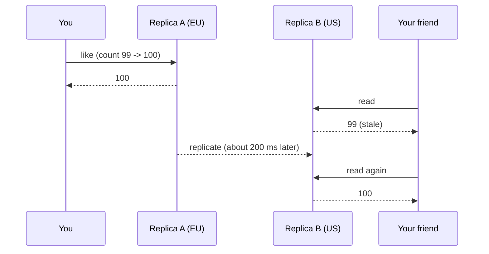
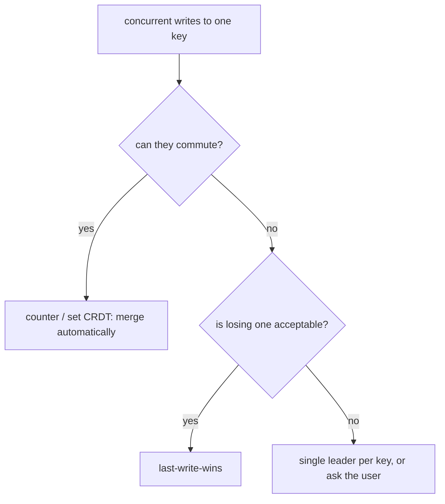
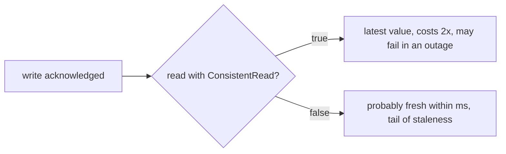

# Eventual Consistency in Practice: Conflicts, Guarantees & UX

> **Prerequisites:** [Lesson 03: Network Partitions](../03-network-partitions/README.md) · [Lesson 07: Vector Clocks](../07-vector-clocks-hybrid-logical-clocks/README.md) · [Lesson 11: Quorums](../11-quorums-explained/README.md).  
> **Estimated Reading Time:** 22–26 minutes  
> **Target Audience:** Backend and full-stack engineers building feeds, carts, counters and multi-region apps, and candidates asked "what does eventual consistency mean for the user?"  
> **Free PDF Notes:** [Download SD-H-018.pdf](https://backendroadmap.com/notes/system-design/SD-H-018.pdf)

> [!NOTE]
> **In one line:** Eventual consistency means that if no new updates arrive, all replicas eventually return the same value. Make it feel consistent with cheap **session guarantees** (read-your-writes, monotonic reads, consistent prefix, causal), handle conflicts with merges or CRDTs rather than last-write-wins, and keep **strong consistency** for the few things that truly need it.

> [!TIP]
> **The Golden Rule:** Users notice inconsistency mostly with *their own actions*. Read-your-writes alone fixes the most common complaint. The design question is always: which data may be briefly stale, and what does the user see while it converges?

---

## 1. What Eventual Consistency Is, and What It Isn't

You like a post and the count goes from 99 to 100. Your friend, on another server, still sees 99 for a few seconds. Nothing is broken: the replicas simply have not caught up. Most of the internet runs this way, from DNS to social feeds to shopping carts.

| Term | Precise Meaning | Example |
| :--- | :--- | :--- |
| **Eventual consistency** | If writes stop, all replicas converge to the same value | A like count after a few seconds |
| **Staleness window** | How long replicas may disagree | Typically milliseconds to a couple of seconds |
| **Read-your-writes** | You always see your own updates | Your like heart never flips back |
| **Monotonic reads** | You never see data go backwards in time | A post you saw does not vanish |
| **Consistent prefix** | You see writes in a valid order | A reply never appears before its question |
| **Causal consistency** | Effects never appear before their causes | A comment after its post |
| **Strong (linearizable) consistency** | Behaves like one copy with real-time order (lesson 22) | A bank balance |
| **Not** | "Inconsistent" or "buggy": it is a *defined* behaviour | Converges when updates stop |

### Why It Matters
1. Strong consistency needs coordination: a write waits for other replicas, often in other regions, and during a partition some requests must fail (lesson 03). Eventual consistency lets each replica answer immediately.
2. The price is staleness and possible conflicts, and the *user experience* of both is a design decision.
3. "Which features need strong consistency?" is a core interview question.

---

## 2. Anatomy: Replicas, Lag and the Session

Replicas accept writes locally and copy them asynchronously; for a short window they disagree.



| Guarantee | What it promises | How to get it |
| :--- | :--- | :--- |
| **Read-your-writes** | You see your own updates | Read from the leader or a replica that has your write; sticky routing; a **version token** |
| **Monotonic reads** | You never go back to older data | Pin a user to one replica for a session |
| **Consistent prefix** | Writes appear in the order they were made | Order within a partition, or causal metadata |
| **Causal consistency** | Effects never precede causes | Vector or hybrid clocks (lesson 07) |

**Implementing read-your-writes.** After a user writes, (a) route them to the same replica (**sticky sessions**), (b) read from the **leader** for a few seconds, or (c) return a **version token** (the log position of their write) and have any replica **wait until it has reached that position** before answering.

> [!WARNING]
> **Eventual consistency does not say how long "eventually" is, or what happens to concurrent writes.** You must decide the conflict policy (merge, CRDT, reject) explicitly; defaulting to last-write-wins silently loses data (lesson 05).

---

## 3. Mathematical Model: How Stale, For How Long?

Let a write be acknowledged at time 0 by the leader and reach each follower after a random delay $D$. A read $t$ ms later from a uniformly random replica among $n$ (leader included) is stale with probability

$$P(\text{stale at } t) = \frac{n-1}{n}\,P(D > t)$$

(the leader never is). With the follower delay distribution known, you can read off the time until $P(\text{stale})$ falls below a target. This is the idea behind **Probabilistically Bounded Staleness** (Bailis et al., VLDB 2012), which models Dynamo-style stores and reports that eventually consistent systems "frequently return consistent data within tens of milliseconds".

For counters, concurrency is the issue: if each region reads $c$, writes $c+1$ and synchronises by **overwriting** the whole number, simultaneous increments are lost. A **counter CRDT** instead keeps *one tally per region* and merges by **adding** (or taking the maximum of each region's tally), so no increment is lost: $\text{value} = \sum_r \text{tally}_r$.

---

## 4. Metrics & Percentiles

| Metric | Meaning | Why you care |
| :--- | :--- | :--- |
| **Replication lag $p_{50}/p_{99}$** | Delay from write to apply, per replica | The staleness window |
| **Stale-read rate** | Reads missing a write older than $t$ | Quantifies the user-visible problem |
| **Read-your-writes violations** | A session missing its own write | The most visible bug |
| **Conflict rate** | Concurrent writes to one key | Sizes the merge problem |
| **Convergence time $p_{99.9}$** | Until all replicas agree | The honest meaning of "eventually" |
| **Lost-update count** | Writes overwritten without merge | Must be 0 for data that matters |

### Worked Example (like counts)
Each like is written to the nearest region's replica, and the count is a **counter CRDT** (lesson 19), so concurrent likes from different regions merge by adding, never by overwriting. The person who liked sees 100 immediately because the app updates the count locally and reads from the region it wrote to. Others see it within a second or two. The "did I like this?" flag uses read-your-writes, so the heart never flips back. Payments for promoted posts, by contrast, go through a strongly consistent ledger.

---

## 5. Compounding: Staleness, Sessions and Lost Likes, Measured

Simulations (Python 3.13, stdlib only). Three replicas; the leader applies a write at time 0; each follower applies it after a lognormal delay (median 20 ms, $\sigma=0.8$, so a heavy tail). 200,000 trials each.

**A. Staleness over time** (read from a random replica $t$ ms after the write was acknowledged):

| $t$ after write | Stale reads |
| :---: | :---: |
| 0 ms | 66.78% |
| 5 ms | 64.03% |
| 20 ms | 33.46% |
| 50 ms | 8.54% |
| 100 ms | 1.45% |
| 200 ms | 0.12% |

Staleness decays quickly but has a **tail**: even at 200 ms about one read in a thousand is stale.

**B. Session guarantees, reading 20 ms after the write:**

| Strategy | Stale own-reads | Monotonic-read violations |
| :--- | :---: | :---: |
| Random replica per read | **33.27%** | **11.08%** |
| Read from the leader (or sticky replica, or wait for the version token) | **0%** | **0%** |

One third of users would not see their own update, and one read in nine would go *backwards*, unless the session is pinned or the read waits for the user's version token.

**C. Likes: overwrite vs counter.** 10,000 likes spread over 3 regions that synchronise every 50 likes:

| Merge strategy | Final count (true value 10,000) |
| :--- | :---: |
| Regions overwrite the whole number | **3,396** |
| Per-region tallies, merged by addition (counter CRDT) | **10,000** |

---

## 6. Numbers Every Engineer Must Know

| Item | Typical | Implication |
| :--- | :---: | :--- |
| DynamoDB global tables, multi-Region eventual consistency | replicated "typically within a second" | The documented order of magnitude |
| DynamoDB eventually consistent read | half the cost of a strongly consistent read | Consistency has a price tag |
| Probabilistically bounded staleness | "tens of milliseconds" is common (PBS) | Often fresh, never guaranteed |
| Cross-region RTT | 70–150 ms | Floor for synchronous cross-region writes |
| Staleness tail | seconds under load or failures | Design for it, not for the median |
| Read-your-writes window | seconds after a write | Common sticky-routing duration |

---

## 7. Protocol Deep Dive: Conflicts and Designing for Them

How to handle concurrent writes to the same key:

| Strategy | How it works | Cost |
| :--- | :--- | :--- |
| **Last-write-wins** | Highest timestamp wins | Loses concurrent updates; depends on clocks (lesson 05) |
| **Merge functions** | Union of cart items, max of timestamps, sum of counters | You must write and test them |
| **CRDTs** | The data type's merge is built in and automatic (lesson 19) | Only some types fit; metadata grows |
| **Ask the user/application** | Surface both versions, as Git merges do | UX burden |
| **Avoid conflicts** | Route all writes for one key to one leader | Gives up multi-region writes |



**Consistency is a spectrum**, from eventual through session and causal to linearizable: faster and more available on one side, stronger and more coordinated on the other. **Pick per feature, not per company.**

| Feature | Needs | Pattern |
| :--- | :--- | :--- |
| Like count, view count | Eventual | Counter CRDT |
| "Did I like it?" flag | Read-your-writes | Sticky session or version token |
| Comment thread | Causal / consistent prefix | Causal metadata |
| Shopping cart | Never lose an add | Merge (union) with vector clocks |
| Account balance, payments | Strong | Single leader or consensus |
| Uniqueness (username) | Strong | Unique constraint on one leader |

---

## 8. Hierarchical Budgets & Design Rules

| Slice | Rule | Control |
| :--- | :--- | :--- |
| Staleness budget | Per feature: e.g. likes 2 s, balance 0 | Documented SLO |
| User's own writes | Always visible to them | Sticky routing or version token |
| Conflicts | Explicit policy per data type | Merge function or CRDT; LWW only if loss is acceptable |
| Money, uniqueness | Strongly consistent path | Leader or consensus |
| UX during convergence | Optimistic local update | Show the user's own change immediately |
| Monitoring | Replication lag and stale-read rate | Alerts on lag above the budget |
| Testing | Inject lag and partitions | Verify the UX holds |

---

## 9. Top Mitigations

1. **Guarantee read-your-writes** with sticky routing, leader reads or version tokens.
2. **Pin sessions** to one replica for monotonic reads.
3. **Choose a conflict policy per data type**; avoid last-write-wins for anything that matters.
4. **Use CRDTs** for counters and sets.
5. **Update the UI optimistically** so the user sees their own change at once.
6. **Keep money and uniqueness on a strongly consistent path.**
7. **Monitor replication lag** and alert against the staleness budget.

---

## 10. Production Reference: DynamoDB's Two Read Modes, and PBS

**DynamoDB** exposes the trade-off as a flag. Its documentation says that when you write and receive an HTTP 200, "the write completed successfully and has been durably persisted", and that reads come in two forms:

- **Eventually consistent** (the default): "the responses might not reflect the results of a recently completed write operation. If you repeat your read request after a short time, the response should eventually return the more recent item." These reads are **half the cost** of strongly consistent reads.
- **Strongly consistent**: set `ConsistentRead` to true and DynamoDB "returns a response with the most up-to-date data, reflecting the updates from all prior write operations that were successful". These are supported only on tables and local secondary indexes; **global secondary indexes and streams are always eventually consistent**.
- **Global tables:** the default multi-Region eventual consistency mode replicates item changes "typically within a second", while the multi-Region strong consistency mode replicates synchronously to another Region before the write returns.

**Probabilistically Bounded Staleness** (Bailis, Venkataraman, Franklin, Hellerstein and Stoica, VLDB 2012) asks the question this lesson's experiments ask: *how eventual is eventual?* It models Dynamo-style quorum stores and reports that they "frequently return consistent data within tens of milliseconds".



**Lesson:** the system tells you which mode you are in; your job is to choose it per read and design the experience around the stale case, because the tail never reaches zero.

---

## 11. Multi-Language Production Code Tabs

Two building blocks: **read-your-writes via a version token** (a replica waits until it has applied the user's write) and a **counter CRDT** that merges by addition.

````carousel
```go
// Go: replica that honours a version token, and a grow-only counter CRDT.
package main

import (
	"errors"
	"time"
)

type Replica struct {
	Applied int64 // log position applied so far
	Values  map[string]string
}

var ErrBehind = errors.New("replica has not reached the token yet")

// ReadAtLeast returns the value only once the replica has applied the user's write (token).
func (r *Replica) ReadAtLeast(key string, token int64, wait time.Duration, poll func()) (string, error) {
	deadline := time.Now().Add(wait)
	for r.Applied < token {
		if time.Now().After(deadline) {
			return "", ErrBehind // fall back to the leader
		}
		poll() // let replication make progress
	}
	return r.Values[key], nil
}

// GCounter: one tally per region; value = sum; merge = per-region max.
type GCounter map[string]int

func (g GCounter) Inc(region string)  { g[region]++ }
func (g GCounter) Value() (n int)     { for _, v := range g { n += v }; return }
func (g GCounter) Merge(o GCounter) {
	for region, v := range o {
		if v > g[region] {
			g[region] = v
		}
	}
}
```
<!-- slide -->
```typescript
// TypeScript: version-token reads and a grow-only counter CRDT.
class Replica {
  applied = 0; // log position applied so far
  values = new Map<string, string>();

  // Returns the value once the replica has applied the user's write, else null (go to the leader).
  async readAtLeast(key: string, token: number, waitMs: number): Promise<string | null> {
    const deadline = Date.now() + waitMs;
    while (this.applied < token) {
      if (Date.now() > deadline) return null;
      await new Promise((r) => setTimeout(r, 5)); // let replication make progress
    }
    return this.values.get(key) ?? null;
  }
}

// One tally per region; value = sum; merge = per-region max (idempotent, commutative).
export class GCounter {
  tallies: Record<string, number> = {};

  inc(region: string): void {
    this.tallies[region] = (this.tallies[region] ?? 0) + 1;
  }

  get value(): number {
    return Object.values(this.tallies).reduce((a, b) => a + b, 0);
  }

  merge(other: GCounter): void {
    for (const [region, v] of Object.entries(other.tallies)) {
      this.tallies[region] = Math.max(this.tallies[region] ?? 0, v);
    }
  }
}
```
<!-- slide -->
```python
# Python: the code behind this lesson's tables (stdlib only).
import math
import random


def applied_delays(rng, followers=2, median_ms=20.0, sigma=0.8):
    """Replication delay to each follower; the leader applies the write at time 0."""
    return [0.0] + [rng.lognormvariate(math.log(median_ms), sigma) for _ in range(followers)]


def stale_read_rate(t_ms, trials=200_000, seed=18):
    """Percent of reads from a RANDOM replica, t ms after the write was acknowledged, that miss the write."""
    rng, stale = random.Random(seed), 0
    for _ in range(trials):
        d = applied_delays(rng)
        stale += d[rng.randrange(3)] > t_ms
    return 100 * stale / trials


def session_guarantees(gap_ms=20.0, trials=200_000, seed=18):
    """(% stale own-reads, % monotonic-read violations) with a random replica per read.
    A pinned or leader read, or a version-token wait, gives 0 for both."""
    rng = random.Random(seed)
    ryw = mono = 0
    for _ in range(trials):
        d = applied_delays(rng)
        ryw += d[rng.randrange(3)] > gap_ms                       # own write missing from a random replica
        first_new = d[rng.randrange(3)] <= 0                      # first read (t=0) hit the leader: sees the new value
        second_new = d[rng.randrange(3)] <= gap_ms                # second read, gap_ms later
        mono += first_new and not second_new                      # new value, then the old one
    return 100 * ryw / trials, 100 * mono / trials


def likes(users=10_000, regions=3, sync_every=50, seed=18):
    """Each like reads the local count and writes +1. Returns (true, overwrite-merge result, counter-merge result)."""
    rng = random.Random(seed)
    local, tally = [0] * regions, [0] * regions
    for i in range(1, users + 1):
        r = rng.randrange(regions)
        local[r] += 1
        tally[r] += 1
        if i % sync_every == 0:                                   # sync by overwriting with the latest writer's number
            local = [local[r]] * regions
    return users, local[0], sum(tally)
```
<!-- slide -->
```csharp
// C#: version-token reads and a grow-only counter CRDT.
public sealed class Replica
{
    public long Applied { get; set; }                       // log position applied so far
    public Dictionary<string, string> Values { get; } = new();

    // Returns the value once the replica has applied the user's write; null means "ask the leader".
    public async Task<string?> ReadAtLeastAsync(string key, long token, TimeSpan wait)
    {
        var deadline = DateTime.UtcNow + wait;
        while (Applied < token)
        {
            if (DateTime.UtcNow > deadline) return null;
            await Task.Delay(5); // let replication make progress
        }
        return Values.GetValueOrDefault(key);
    }
}

public sealed class GCounter
{
    private readonly Dictionary<string, int> _tallies = new();

    public void Inc(string region) => _tallies[region] = _tallies.GetValueOrDefault(region) + 1;

    public int Value => _tallies.Values.Sum();

    // Per-region max: idempotent, commutative, associative.
    public void Merge(GCounter other)
    {
        foreach (var (region, v) in other._tallies)
            _tallies[region] = Math.Max(_tallies.GetValueOrDefault(region), v);
    }
}
```
````

---

## 12. Hands-On CLI Verification Workflows

The tables in section 5 come from the Python tab (Python 3.13, default seeds):

```python
for t in (0, 5, 20, 50, 100, 200):
    print(t, round(stale_read_rate(t), 2))
# 0 66.78   5 64.03   20 33.46   50 8.54   100 1.45   200 0.12
print(session_guarantees())      # (33.27, 11.08)
print(likes())                   # (10000, 3396, 10000)
```

Check the model against the formula: at $t=0$ only the leader is fresh, so $P=\tfrac{2}{3}=66.7\%$, matching 66.78%.

On a real DynamoDB table you can see the two modes yourself:

```bash
# eventually consistent (default, half the read cost)
aws dynamodb get-item --table-name posts --key '{"id":{"S":"p1"}}'

# strongly consistent: the latest committed value
aws dynamodb get-item --table-name posts --key '{"id":{"S":"p1"}}' --consistent-read
```

Write an item and immediately read it both ways in a loop; the eventually consistent read will occasionally return the old value, the strongly consistent one never will.

---

## 13. Common Mistakes to Avoid

1. **Treating "eventually consistent" as "fine"** without defining the staleness budget.
2. **No read-your-writes**: users cannot see their own post, like or edit.
3. **Last-write-wins on counters or carts**, losing concurrent updates.
4. **Reading from random replicas** per request, causing time-travelling reads.
5. **Using eventual consistency for money or uniqueness.**
6. **Ignoring the staleness tail** (p99.9) in tests.
7. **Hiding conflicts** instead of defining a merge policy.
8. **Relying on secondary indexes** that are always eventually consistent for read-after-write flows.

---

## 14. Key Terms Glossary

| Key Term | Definition |
| :--- | :--- |
| **Eventual consistency** | Replicas converge if updates stop. |
| **Read-your-writes** | A client always sees its own writes. |
| **Monotonic reads** | A client never sees older data after newer data. |
| **Consistent prefix** | Reads see writes in a valid order. |
| **Causal consistency** | Causes are visible before their effects. |
| **Version token** | A log position a replica must reach before serving a read. |
| **Sticky session** | Routing a user to the same replica. |
| **CRDT** | Conflict-free replicated data type; merges automatically. |
| **PBS** | Probabilistically Bounded Staleness: how stale, for how long. |
| **Staleness budget** | The maximum acceptable lag for a feature. |

---

## 15. System Design Interview Questions & Answers

### Basic Conceptual Questions

<details>
<summary><strong>Q1: What is eventual consistency? [BASIC]</strong></summary>

**Answer:**
If no new updates are made, all replicas eventually return the same value. Replicas accept writes locally and replicate asynchronously, so for a short window different replicas may return different values.
</details>

<details>
<summary><strong>Q2: Name the session guarantees. [BASIC]</strong></summary>

**Answer:**
Read-your-writes (you see your own updates), monotonic reads (you never see older data after newer), consistent prefix (writes appear in a valid order) and causal consistency (effects never appear before their causes).
</details>

<details>
<summary><strong>Q3: Why choose eventual consistency? [BASIC]</strong></summary>

**Answer:**
Strong consistency needs coordination: writes wait for other replicas, often cross-region, and during partitions some requests must fail. Eventual consistency answers immediately, so it is faster and more available, at the price of staleness and possible conflicts.
</details>

<details>
<summary><strong>Q4: Which features need strong consistency? [BASIC]</strong></summary>

**Answer:**
Money, inventory that must not oversell, uniqueness (usernames), and locks or configuration. Likes, view counts, feeds and presence are fine eventually consistent.
</details>

### Scenario-Based Architecture Questions

<details>
<summary><strong>Q5: A user posts a comment, refreshes, and it is gone. Why, and how do you fix it? [SCENARIO]</strong></summary>

**Answer:**
The refresh hit a replica that had not yet applied the write. Fix with read-your-writes: sticky routing, reading from the leader for a few seconds after a write, or a version token the replica must reach before answering. In the simulation a random replica missed the user's own write 33% of the time 20 ms later.
</details>

<details>
<summary><strong>Q6: Two people like a post at the same time in different regions. What count do you get? [SCENARIO]</strong></summary>

**Answer:**
With overwrite-style sync, one like is lost. With a counter CRDT each region keeps its own tally and the merge adds them, so no like is lost. In a 10,000-like simulation overwrite ended at 3,396 and the CRDT at 10,000.
</details>

<details>
<summary><strong>Q7: Users sometimes see a post, then it disappears, then it comes back. Why? [SCENARIO]</strong></summary>

**Answer:**
Their requests alternate between replicas at different points in the replication stream, a monotonic-reads violation. Pin the session to one replica, or carry a version token and never accept a read older than one already seen.
</details>

<details>
<summary><strong>Q8: How do you design a multi-region shopping cart? [SCENARIO]</strong></summary>

**Answer:**
Accept writes in every region (always writeable), version with vector clocks, merge concurrent carts by union (an add is never lost, though deletes can resurface; use tombstones or an OR-Set to fix that), and keep payment strongly consistent.
</details>

### Advanced & Tricky Interview Questions

<details>
<summary><strong>Q9: How long is "eventually"? [TRICKY]</strong></summary>

**Answer:**
There is no bound in the definition, so measure it. Typical replication takes milliseconds to a second (DynamoDB documents multi-Region replication "typically within a second", and PBS reports consistent data "within tens of milliseconds" frequently), but there is a tail: in the simulation 0.12% of reads were still stale at 200 ms. Design for the tail and set a staleness budget.
</details>

<details>
<summary><strong>Q10: Is eventual consistency the same as no consistency? [TRICKY]</strong></summary>

**Answer:**
No. It guarantees convergence once updates stop, and with session guarantees and merge policies it can give each user a coherent experience. What it does not guarantee is that two clients reading at the same moment agree.
</details>

<details>
<summary><strong>Q11: Why are DynamoDB global secondary index reads never strongly consistent? [TRICKY]</strong></summary>

**Answer:**
Indexes are maintained asynchronously from the base table, so they lag it; the documentation states all GSI and stream reads are eventually consistent. A read-after-write flow must read the base table with `ConsistentRead` or tolerate the lag.
</details>

<details>
<summary><strong>Q12: How would you show the result of a user's action while the system converges? [TRICKY]</strong></summary>

**Answer:**
Update the UI optimistically from the local write (the count goes to 100 immediately), guarantee read-your-writes for that user, and let other users catch up in the background. Reconcile if the server rejects the action.
</details>

---

## 16. One-Page Master Cheat Sheet

```
+---------------------------------------------------------------------------------------------------------+
|                    EVENTUAL CONSISTENCY — MASTER CHEAT SHEET                                            |
+---------------------------------------------------------------------------------------------------------+
| 1. DEFINITION: no new updates -> all replicas converge. Window of staleness, with a tail.               |
+---------------------------------------------------------------------------------------------------------+
| 2. WHY: no cross-region coordination -> fast, available. COST: stale reads, conflicts.                  |
+---------------------------------------------------------------------------------------------------------+
| 3. SESSION GUARANTEES: read-your-writes · monotonic reads · consistent prefix · causal.                 |
|    GET THEM: sticky routing, leader reads after a write, version token.                                 |
+---------------------------------------------------------------------------------------------------------+
| 4. CONFLICTS: LWW (loses data) < merge functions < CRDTs; or single leader per key; or ask the user.    |
+---------------------------------------------------------------------------------------------------------+
| 5. PER FEATURE: likes = eventual · own actions = read-your-writes · money/uniqueness = strong.          |
+---------------------------------------------------------------------------------------------------------+
| 6. MEASURE: replication lag p99, stale-read rate, convergence p99.9. Design for the tail.               |
+---------------------------------------------------------------------------------------------------------+
```

---

## Further Reading & Sources

- Amazon DynamoDB Developer Guide, [Read consistency](https://docs.aws.amazon.com/amazondynamodb/latest/developerguide/HowItWorks.ReadConsistency.html) (eventually vs strongly consistent reads, global tables).
- Bailis, Venkataraman, Franklin, Hellerstein and Stoica, [Probabilistically Bounded Staleness for Practical Partial Quorums](https://arxiv.org/abs/1204.6082) (VLDB 2012).
- Werner Vogels, "Eventually Consistent" (*Communications of the ACM*, 2009), the session guarantees in practice.
- Terry et al., "Session Guarantees for Weakly Consistent Replicated Data" (PDIS 1994).

---

## Free PDF Notes

[SD-H-018.pdf](https://backendroadmap.com/notes/system-design/SD-H-018.pdf)

---

## Next

Continue with [Lesson 19: CRDTs Explained](../19-crdts-explained/README.md): G-counters, OR-Sets and conflict-free merges.
