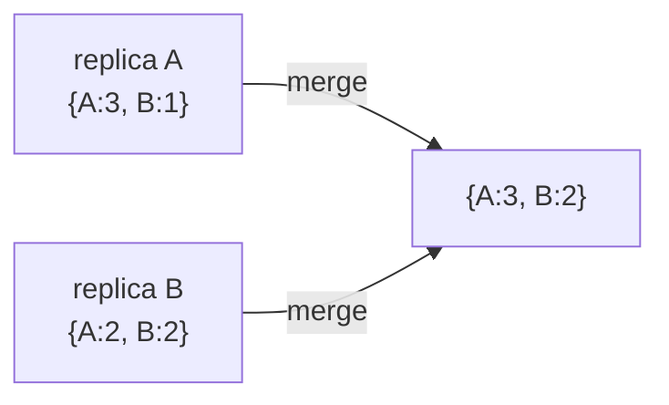
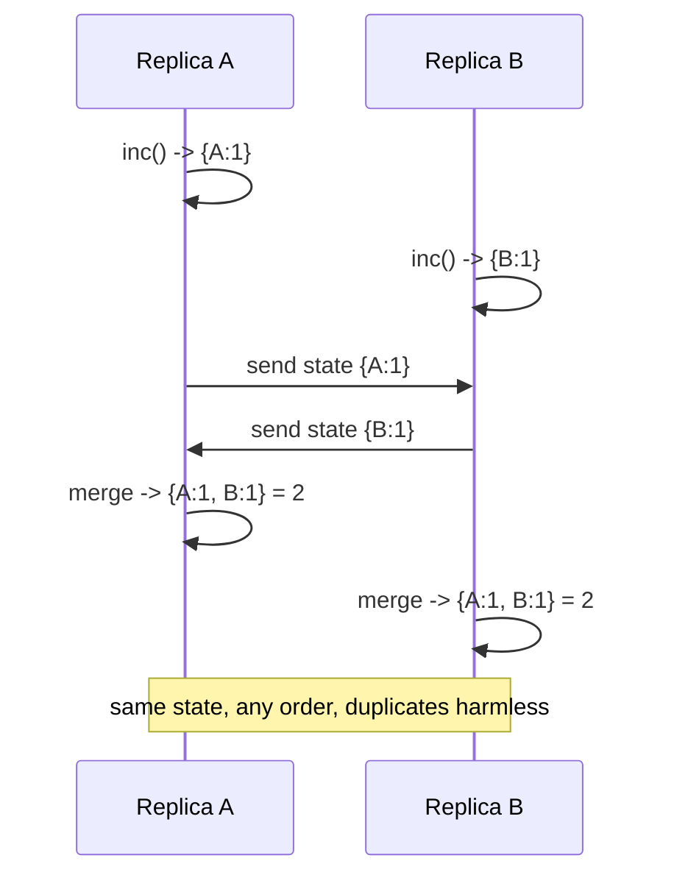
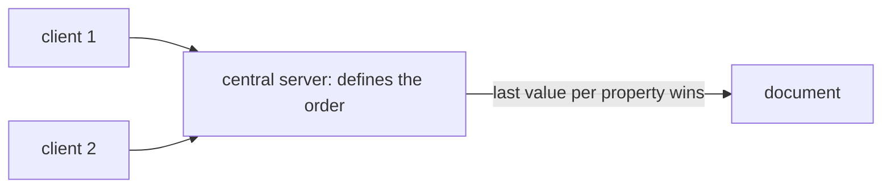

# CRDTs Explained: G-Counters, OR-Sets & Conflict-Free Merges

> **Prerequisites:** [Lesson 07: Vector Clocks](../07-vector-clocks-hybrid-logical-clocks/README.md) · [Lesson 18: Eventual Consistency in Practice](../18-eventual-consistency-in-practice/README.md).  
> **Estimated Reading Time:** 24–28 minutes  
> **Target Audience:** Backend engineers building multi-region counters, collaborative features and offline-first apps, and candidates asked "how do you merge concurrent updates without coordination?"  
> **Free PDF Notes:** [Download SD-H-019.pdf](https://backendroadmap.com/notes/system-design/SD-H-019.pdf)

> [!NOTE]
> **In one line:** A CRDT (conflict-free replicated data type) is a data type whose **merge** is commutative, associative and idempotent, so replicas can apply updates in any order, with duplicates, and still converge to the same state, with no coordination and no lost updates.

> [!TIP]
> **The Golden Rule:** The magic is in the *merge function*, not the data. If merge is **order-independent** (commutative), **grouping-independent** (associative) and **repeat-safe** (idempotent), replicas converge. Design the type so that every operation fits that shape, and test the three laws.

---

## 1. What a CRDT Is, and What It Isn't

Lesson 18 showed that overwrite-style merging loses concurrent likes (3,396 of 10,000 in the simulation). A CRDT fixes that by giving each type a merge that *combines* instead of overwriting.

| Term | Precise Meaning | Example |
| :--- | :--- | :--- |
| **CRDT** | A replicated data type with a conflict-free merge | G-Counter, OR-Set |
| **State-based (CvRDT)** | Replicas send their whole state; merge is a join (least upper bound) | Counter tallies |
| **Operation-based (CmRDT)** | Replicas send operations; delivery must be reliable and causal | Collaborative text edits |
| **Strong eventual consistency (SEC)** | Replicas that received the same updates are in the same state | The CRDT guarantee |
| **Merge laws** | Commutative, associative, idempotent | $a\sqcup b=b\sqcup a$ |
| **Tombstone** | A record that something was removed | In OR-Sets |
| **Not** | Free: they cost metadata, and not everything fits | Uniqueness and bounded counters are hard |

### Why It Matters
1. They give *conflict-free* multi-writer behaviour for the data types that appear in most apps: counters, sets, registers, flags, maps, lists.
2. They make offline-first and multi-region writes practical: no leader, no waiting.
3. "How would you build a like counter or a collaborative cart across regions?" is a standard question, and the strong answer names a counter CRDT and an OR-Set.

---

## 2. Anatomy: The Merge Laws

State-based CRDTs form a **semilattice**: merge is the *join* of two states, and a replica's state only ever moves *up*.

| Law | Meaning | Why it matters |
| :--- | :--- | :--- |
| **Commutative** | $a \sqcup b = b \sqcup a$ | Order of delivery does not matter |
| **Associative** | $(a \sqcup b) \sqcup c = a \sqcup (b \sqcup c)$ | Grouping and gossip topology do not matter |
| **Idempotent** | $a \sqcup a = a$ | Duplicated messages do no harm |



The classic types:

| CRDT | State | Update | Merge | Value |
| :--- | :--- | :--- | :--- | :--- |
| **G-Counter** (grow-only) | One tally per replica | Increment your own tally | Per-replica **max** | Sum of tallies |
| **PN-Counter** | Two G-Counters (P and N) | Inc on P, dec on N | Merge each | $P - N$ |
| **G-Set** | A set | Add | Union | The set |
| **LWW-Register** | (value, timestamp, replica id) | Write with a new stamp | Keep the larger stamp | The value |
| **OR-Set** (observed-remove) | Elements with unique tags, plus removed tags | Add a fresh tag; remove the tags you *have seen* | Union of tags and removals | Elements with a live tag |

> [!WARNING]
> **A merge that is "just a union" is not automatically right.** A plain set that deletes on remove and merges by union brings removed elements back from any replica that still has them (see section 5). Removal needs its own record (tags or tombstones).

---

## 3. Mathematical Model: Why Convergence Follows

Treat the merge as a join on a partial order. Each update moves a replica's state upward, and the merge returns the **least upper bound** of two states. Then for any set of updates delivered in any order, with any duplicates, the final state is the join of all updates:

$$\text{state}_r = \bigsqcup_{u \in \text{updates delivered to } r} u$$

The join is order-independent (commutative and associative) and absorbs repeats (idempotent), so two replicas that have received the same set of updates hold the same state. That is **strong eventual consistency**, stronger than plain eventual consistency because convergence needs no conflict-resolution step.

**Why G-Counters work.** A replica only increments *its own* tally, so tallies are never written by two replicas at once, and `max` is the right merge for a monotonically increasing number. A plain integer counter fails because two replicas both write "5 → 6" and overwrite each other.

**Why OR-Sets give "add wins".** A remove deletes only the tags the remover had **observed**. A concurrent add generates a **new** tag the remover never saw, so it survives the remove.

---

## 4. Metrics & Percentiles

| Metric | Meaning | Why you care |
| :--- | :--- | :--- |
| **State size per object** | Bytes of tallies, tags and tombstones | CRDTs trade metadata for coordination |
| **Tombstone ratio** | Removed tags vs live elements | Growth needs garbage collection |
| **Merge latency** | Time to merge a state or operation | Large states make merges slow |
| **Convergence time** | Until all replicas agree | Bounded by gossip or delivery lag |
| **Replica count** | Entries per counter | Vectors grow with replicas |
| **Merge-law test failures** | Property-test failures | Must be 0 |

### Worked Example (like counts and a shopping cart)
Each like is written to the nearest region, and the count is a **G-Counter** with one tally per region; merging adds nothing twice because `max` is idempotent. A cart is an **OR-Set**: adding the book on a phone and removing the book on a laptop at the same time leaves the book in the cart (add wins) because the laptop only removed the tag it had seen.

---

## 5. Compounding: Property Tests and a Resurrected Cart Item

I ran the merge laws as **property tests** (Python 3.13): 2,000 random replica states per type (three replicas, eight random operations each), checking $a\sqcup b = b\sqcup a$, $(a\sqcup b)\sqcup c = a\sqcup(b\sqcup c)$ and $a\sqcup a = a$:

| Type | Commutativity failures | Associativity failures | Idempotence failures |
| :--- | :---: | :---: | :---: |
| G-Counter | 0 | 0 | 0 |
| PN-Counter | 0 | 0 | 0 |
| OR-Set | 0 | 0 | 0 |
| LWW-Register (stamp + replica id) | 0 | 0 | 0 |
| **Naive overwrite register** (merge = take the incoming value) | **1,835** | 0 | 0 |

The naive register fails commutativity in 92% of trials: merging A into B gives a different answer from merging B into A, so replicas that merge in different orders **diverge**. The CRDTs pass 6,000 checks each.

**Remove, then merge.** A deterministic cart scenario:

| Step | Naive set (remove deletes; merge = union) | OR-Set |
| :--- | :--- | :--- |
| A adds *book*; B receives it | `{book}` on both | `{book}` on both |
| A removes *book* | A: `{}` , B: `{book}` | A: `{}`, B: `{book}` (A recorded B's tag as removed) |
| A and B merge | **`{book}`: the removal is lost** | **`{}`: the removal propagates** |
| *Concurrent* add of *book* on B | `{book}` | **`{book}`**: a tag A never saw survives (add wins) |

---

## 6. Numbers Every Engineer Must Know

| Item | Typical | Implication |
| :--- | :---: | :--- |
| G-Counter size | one integer per replica | Fine for a handful of regions; huge for per-client counters |
| OR-Set size | one tag per add plus removed tags | Grows without garbage collection |
| Merge cost | $O(\text{state})$ for state-based types | Gossip deltas, not whole states |
| Convergence | after all updates are delivered | Bounded by delivery, not by coordination |
| Counters with a floor or cap | not a plain CRDT | "Stock must not go below 0" needs coordination |
| Collaborative text | complex sequence CRDTs (RGA, Logoot, Yjs-style) | Heavy metadata, but conflict-free |

---

## 7. Protocol Deep Dive: State-Based vs Operation-Based, and the Limits



| | State-based (CvRDT) | Operation-based (CmRDT) |
| :--- | :--- | :--- |
| **Sends** | Whole state (or a delta) | The operation |
| **Needs from the network** | Nothing but eventual delivery | Exactly-once, causal-order delivery |
| **Strength** | Robust to loss, duplication, reordering | Small messages |
| **Weakness** | Large states | Needs reliable broadcast |

**What CRDTs cannot do on their own.**
- **Invariants that need coordination:** a counter that must stay $\ge 0$, uniqueness of a username, "exactly one winner". Two replicas can each decrement the last unit.
- **Metadata growth:** tombstones and per-replica vectors need compaction or garbage collection (which itself needs agreement that everyone has seen them).
- **Semantics:** "add wins" and "last write wins" are *policies*; pick the one the product wants.

---

## 8. Hierarchical Budgets & Design Rules

| Slice | Rule | Control |
| :--- | :--- | :--- |
| Choose the type | Counter, set, register, map, sequence | Match the product semantics |
| Merge | Property-test the three laws | Random-state tests in CI |
| Metadata | Budget size per object | Compaction, delta-state gossip |
| Invariants | Keep coordination for bounded or unique values | Leader or consensus for those fields |
| Deletes | OR-Set tags or tombstones | Garbage-collect after global acknowledgment |
| Timestamps | LWW registers need a tie-break | (timestamp, replica id) |
| Use a library | Do not hand-roll sequence CRDTs | Yjs, Automerge, Riak Data Types, Redis CRDTs |

---

## 9. Top Mitigations

1. **Use CRDTs where operations commute** (counters, add-mostly sets, flags, last-writer registers).
2. **Property-test the merge laws** on random states.
3. **Use an OR-Set** (not a delete-on-remove set) for sets with removes.
4. **Keep coordination for invariants** (non-negative stock, uniqueness).
5. **Bound the metadata**: track regions not clients; compact tombstones.
6. **Gossip deltas**, not whole states.
7. **Use a maintained library** for text and sequences.

---

## 10. Production Reference: Figma's "Inspired by CRDTs, Not a True CRDT"

Figma's engineering post *How Figma's multiplayer technology works* is a good reality check on when full CRDTs are, and are not, the right tool.

- **What they say:** their approach is "inspired by something called CRDTs, which stands for conflict-free replicated data types", but "Figma isn't using true CRDTs though".
- **Why not:** true CRDTs target decentralized systems where "there is no single central authority" for the final state. Figma has a **server** that is the authority, so it can drop the extra overhead those designs need and "the server can define the order of events".
- **How conflicts work:** two clients editing *different* properties do not conflict, and neither do edits to the *same property on different objects*. When two clients change the *same property on the same object*, "the document will just end up with the last value that was sent to the server", similar to a last-writer-wins register without timestamps. So "the eventually consistent value for a given property is always a value sent by one of the clients".
- **A stated consequence:** simultaneous edits to the same text value can end up as one client's full value rather than a merge of both.



**Lesson:** CRDTs buy *decentralised* convergence. If you have an authoritative server, a simpler last-writer-wins per property can be enough and much cheaper; reach for counter and set CRDTs where you genuinely need multi-region or offline writes without coordination.

---

## 11. Multi-Language Production Code Tabs

The two workhorses: a **G-Counter** and an **OR-Set**.

````carousel
```go
// Go: G-Counter and OR-Set.
package main

import "crypto/rand"
import "encoding/hex"

type GCounter map[string]int

func (g GCounter) Inc(replica string) { g[replica]++ }
func (g GCounter) Value() (sum int) {
	for _, v := range g {
		sum += v
	}
	return
}
func (g GCounter) Merge(o GCounter) { // per-replica max: commutative, associative, idempotent
	for r, v := range o {
		if v > g[r] {
			g[r] = v
		}
	}
}

type ORSet struct {
	Adds    map[string]map[string]bool // element -> set of tags
	Removed map[string]bool            // removed tags
}

func NewORSet() *ORSet { return &ORSet{Adds: map[string]map[string]bool{}, Removed: map[string]bool{}} }

func tag() string { b := make([]byte, 8); rand.Read(b); return hex.EncodeToString(b) }

func (s *ORSet) Add(x string) {
	if s.Adds[x] == nil {
		s.Adds[x] = map[string]bool{}
	}
	s.Adds[x][tag()] = true // a fresh tag per add
}

func (s *ORSet) Remove(x string) { // removes only the tags this replica has seen
	for t := range s.Adds[x] {
		s.Removed[t] = true
	}
}

func (s *ORSet) Has(x string) bool {
	for t := range s.Adds[x] {
		if !s.Removed[t] {
			return true
		}
	}
	return false
}

func (s *ORSet) Merge(o *ORSet) {
	for x, tags := range o.Adds {
		if s.Adds[x] == nil {
			s.Adds[x] = map[string]bool{}
		}
		for t := range tags {
			s.Adds[x][t] = true
		}
	}
	for t := range o.Removed {
		s.Removed[t] = true
	}
}
```
<!-- slide -->
```typescript
// TypeScript: G-Counter and OR-Set.
import { randomUUID } from "node:crypto";

export class GCounter {
  tallies: Record<string, number> = {};

  inc(replica: string): void {
    this.tallies[replica] = (this.tallies[replica] ?? 0) + 1;
  }

  value(): number {
    return Object.values(this.tallies).reduce((a, b) => a + b, 0);
  }

  merge(o: GCounter): void { // per-replica max
    for (const [r, v] of Object.entries(o.tallies)) {
      this.tallies[r] = Math.max(this.tallies[r] ?? 0, v);
    }
  }
}

export class ORSet {
  adds = new Map<string, Set<string>>(); // element -> tags
  removed = new Set<string>();

  add(x: string): void {
    if (!this.adds.has(x)) this.adds.set(x, new Set());
    this.adds.get(x)!.add(randomUUID()); // a fresh tag per add
  }

  remove(x: string): void { // only the tags this replica has seen
    for (const t of this.adds.get(x) ?? []) this.removed.add(t);
  }

  has(x: string): boolean {
    return [...(this.adds.get(x) ?? [])].some((t) => !this.removed.has(t));
  }

  merge(o: ORSet): void {
    for (const [x, tags] of o.adds) {
      if (!this.adds.has(x)) this.adds.set(x, new Set());
      for (const t of tags) this.adds.get(x)!.add(t);
    }
    for (const t of o.removed) this.removed.add(t);
  }
}
```
<!-- slide -->
```python
# Python: CRDTs, naive counter-examples and the merge-law property test (stdlib only).
import copy
import random
import uuid


class GCounter:
    """Grow-only counter: one tally per replica. value = sum; merge = per-replica max."""
    def __init__(self):
        self.t = {}

    def inc(self, rid, n=1):
        self.t[rid] = self.t.get(rid, 0) + n

    def value(self):
        return sum(self.t.values())

    def merge(self, other):
        for r, v in other.t.items():
            self.t[r] = max(self.t.get(r, 0), v)


class PNCounter:
    """Increment/decrement counter = two G-Counters."""
    def __init__(self):
        self.p, self.n = GCounter(), GCounter()

    def inc(self, rid, k=1):
        self.p.inc(rid, k)

    def dec(self, rid, k=1):
        self.n.inc(rid, k)

    def value(self):
        return self.p.value() - self.n.value()

    def merge(self, o):
        self.p.merge(o.p)
        self.n.merge(o.n)


class ORSet:
    """Observed-remove set (add wins over a concurrent remove). Each add gets a unique tag."""
    def __init__(self):
        self.adds, self.removed = {}, set()        # element -> {tags}; tombstoned tags

    def add(self, x):
        self.adds.setdefault(x, set()).add(uuid.uuid4().hex)

    def remove(self, x):
        self.removed |= self.adds.get(x, set())    # remove only the tags this replica has SEEN

    def elements(self):
        return {x for x, tags in self.adds.items() if tags - self.removed}

    def merge(self, o):
        for x, tags in o.adds.items():
            self.adds.setdefault(x, set()).update(tags)
        self.removed |= o.removed


class NaiveSet:
    """NOT a CRDT in spirit: remove deletes the element and merge is a plain union, so removals are lost."""
    def __init__(self):
        self.s = set()

    def add(self, x):
        self.s.add(x)

    def remove(self, x):
        self.s.discard(x)

    def elements(self):
        return set(self.s)

    def merge(self, o):
        self.s |= o.s


class NaiveRegister:
    """NOT a CRDT: merge overwrites with whatever arrives, so the result depends on message order."""
    def __init__(self):
        self.v = None

    def set(self, x):
        self.v = x

    def merge(self, o):
        if o.v is not None:
            self.v = o.v


class LWWRegister:
    """Last-writer-wins register: the (timestamp, replica id) pair gives a total order."""
    def __init__(self):
        self.stamp, self.v = (0, ""), None

    def set(self, x, ts, rid):
        if (ts, rid) > self.stamp:
            self.stamp, self.v = (ts, rid), x

    def merge(self, o):
        if o.stamp > self.stamp:
            self.stamp, self.v = o.stamp, o.v


def merged(a, b):
    out = copy.deepcopy(a)
    out.merge(copy.deepcopy(b))
    return out


def check_laws(make, apply_op, view, trials=2000, ops=8, seed=19):
    """Property test of the three merge laws on random replica states.
    Returns (commutativity failures, associativity failures, idempotence failures) out of `trials`."""
    rng = random.Random(seed)
    comm = assoc = idem = 0
    for _ in range(trials):
        reps = [make() for _ in range(3)]
        for _ in range(ops):
            apply_op(rng, rng.randrange(3), reps)
        a, b, c = reps
        comm += view(merged(a, b)) != view(merged(b, a))
        assoc += view(merged(merged(a, b), c)) != view(merged(a, merged(b, c)))
        idem += view(merged(a, a)) != view(a)
    return comm, assoc, idem


def op_counter(rng, r, reps):
    if isinstance(reps[r], PNCounter) and rng.random() < 0.4:
        reps[r].dec(f"r{r}")
    else:
        reps[r].inc(f"r{r}")


def op_set(rng, r, reps):
    x = rng.choice("abc")
    (reps[r].add if rng.random() < 0.6 else reps[r].remove)(x)


def op_naive_register(rng, r, reps):
    reps[r].set(rng.randrange(100))


def op_lww_register(rng, r, reps, clock=[0]):
    clock[0] += 1
    reps[r].set(rng.randrange(100), clock[0] + rng.randrange(3), f"r{r}")
```
<!-- slide -->
```csharp
// C#: G-Counter and OR-Set.
public sealed class GCounter
{
    private readonly Dictionary<string, int> _t = new();

    public void Inc(string replica) => _t[replica] = _t.GetValueOrDefault(replica) + 1;

    public int Value => _t.Values.Sum();

    public void Merge(GCounter o) // per-replica max
    {
        foreach (var (r, v) in o._t) _t[r] = Math.Max(_t.GetValueOrDefault(r), v);
    }
}

public sealed class OrSet
{
    private readonly Dictionary<string, HashSet<Guid>> _adds = new();
    private readonly HashSet<Guid> _removed = new();

    public void Add(string x)
    {
        if (!_adds.TryGetValue(x, out var tags)) _adds[x] = tags = new HashSet<Guid>();
        tags.Add(Guid.NewGuid()); // a fresh tag per add
    }

    public void Remove(string x) // only the tags this replica has seen
    {
        if (_adds.TryGetValue(x, out var tags)) _removed.UnionWith(tags);
    }

    public bool Has(string x) => _adds.TryGetValue(x, out var tags) && tags.Any(t => !_removed.Contains(t));

    public void Merge(OrSet o)
    {
        foreach (var (x, tags) in o._adds)
        {
            if (!_adds.TryGetValue(x, out var mine)) _adds[x] = mine = new HashSet<Guid>();
            mine.UnionWith(tags);
        }
        _removed.UnionWith(o._removed);
    }
}
```
````

---

## 12. Hands-On CLI Verification Workflows

The property-test table in section 5 comes from the Python tab (Python 3.13, seed 19):

```python
for name, mk, op, vw in (
    ("G-Counter",    GCounter,      op_counter,        lambda r: r.value()),
    ("PN-Counter",   PNCounter,     op_counter,        lambda r: r.value()),
    ("OR-Set",       ORSet,         op_set,            lambda r: sorted(r.elements())),
    ("LWW register", LWWRegister,   op_lww_register,   lambda r: r.v),
    ("naive register", NaiveRegister, op_naive_register, lambda r: r.v),
):
    print(f"{name:16}", check_laws(mk, op, vw))
```

```text
G-Counter        (0, 0, 0)
PN-Counter       (0, 0, 0)
OR-Set           (0, 0, 0)
LWW register     (0, 0, 0)
naive register   (1835, 0, 0)
```

The cart scenario:

```python
a, b = ORSet(), ORSet()
a.add("book"); b.merge(a)            # B receives the add
a.remove("book"); b.add("book")      # concurrent: A removes the tag it saw, B adds a fresh one
a.merge(b); b.merge(a)
print(sorted(a.elements()), sorted(b.elements()))   # ['book'] ['book']   add wins

n1, n2 = NaiveSet(), NaiveSet()
n1.add("book"); n2.merge(n1); n1.remove("book"); n1.merge(n2)
print(sorted(n1.elements()))         # ['book']   the removal was lost
```

For production, use a library rather than hand-rolling: Redis Enterprise CRDB, Riak data types, Automerge or Yjs for documents.

---

## 13. Common Mistakes to Avoid

1. **A "merge" that overwrites** (not commutative).
2. **Delete-on-remove sets merged by union**, which resurrect removed items.
3. **A plain integer counter** across regions.
4. **Using CRDTs for invariants that need coordination** (non-negative stock, uniqueness).
5. **Unbounded metadata** (tombstones, per-client vectors).
6. **Hand-rolled sequence CRDTs** for collaborative text.
7. **Timestamps without a tie-break** in LWW registers.
8. **Not property-testing the merge laws.**

---

## 14. Key Terms Glossary

| Key Term | Definition |
| :--- | :--- |
| **CRDT** | Conflict-free replicated data type. |
| **Strong eventual consistency** | Replicas with the same updates are in the same state. |
| **State-based / operation-based** | Send state or send operations. |
| **Join / least upper bound** | The merge of two states in a semilattice. |
| **G-Counter / PN-Counter** | Grow-only / increment-decrement counters. |
| **G-Set / OR-Set** | Grow-only set / observed-remove set. |
| **LWW-Register** | Last-writer-wins register with a (timestamp, id) order. |
| **Tombstone** | A marker that an element was removed. |
| **Delta CRDT** | Sends only the change in state. |
| **Causal delivery** | Operations delivered after the ones they depend on. |

---

## 15. System Design Interview Questions & Answers

### Basic Conceptual Questions

<details>
<summary><strong>Q1: What is a CRDT? [BASIC]</strong></summary>

**Answer:**
A replicated data type with a merge that is commutative, associative and idempotent, so replicas can apply updates in any order, with duplicates, and still converge with no coordination.
</details>

<details>
<summary><strong>Q2: How does a G-Counter work? [BASIC]</strong></summary>

**Answer:**
Each replica keeps one tally and increments only its own. The value is the sum of tallies; merge takes the per-replica maximum. Because tallies only grow and each is written by one replica, concurrent increments are never lost.
</details>

<details>
<summary><strong>Q3: How do you do decrements? [BASIC]</strong></summary>

**Answer:**
A PN-Counter: two G-Counters, one for increments and one for decrements; the value is their difference.
</details>

<details>
<summary><strong>Q4: What is an OR-Set? [BASIC]</strong></summary>

**Answer:**
An observed-remove set. Each add gets a unique tag; a remove deletes only the tags the remover has seen. A concurrent add has a tag the remover never saw, so it survives: add wins.
</details>

### Scenario-Based Architecture Questions

<details>
<summary><strong>Q5: Like counts across three regions. What do you use? [SCENARIO]</strong></summary>

**Answer:**
A G-Counter (or a PN-Counter if unlikes exist): one tally per region, merge by max, value is the sum. In the lesson's simulation overwrite-style sync ended at 3,396 of 10,000 likes while the counter CRDT ended at 10,000.
</details>

<details>
<summary><strong>Q6: A cart item is removed on one device and re-added on another at the same time. What happens? [SCENARIO]</strong></summary>

**Answer:**
With an OR-Set the item stays (add wins) because the remove only covers the tags it saw. With a delete-on-remove set merged by union, a removal would be lost on merge. Choose OR-Set and tell users the policy.
</details>

<details>
<summary><strong>Q7: Can you build "stock never goes below zero" as a CRDT? [SCENARIO]</strong></summary>

**Answer:**
Not as a plain CRDT: two replicas can each sell the last unit. You need coordination for that invariant: a single leader for the stock field, escrow (pre-allocating quantities per region), or consensus. Use CRDTs for the commutative parts.
</details>

<details>
<summary><strong>Q8: How would you test a CRDT? [SCENARIO]</strong></summary>

**Answer:**
Property tests on random states for commutativity, associativity and idempotence of merge, plus a convergence test that delivers the same updates in random orders with duplicates. A naive overwrite register failed commutativity in 1,835 of 2,000 random cases; the real CRDTs failed none.
</details>

### Advanced & Tricky Interview Questions

<details>
<summary><strong>Q9: State-based or operation-based? [TRICKY]</strong></summary>

**Answer:**
State-based tolerates loss, duplication and reordering because merge is a join, but sends larger messages (deltas help). Operation-based sends small operations but needs reliable, causal, exactly-once delivery. Many production systems use state or delta-state for robustness.
</details>

<details>
<summary><strong>Q10: What is the cost of CRDTs? [TRICKY]</strong></summary>

**Answer:**
Metadata: per-replica tallies, per-add tags and tombstones that grow, needing compaction or garbage collection, which itself requires knowing every replica has seen an update. Also semantic limits: they cannot enforce invariants such as uniqueness or bounds.
</details>

<details>
<summary><strong>Q11: How does Figma relate to CRDTs? [TRICKY]</strong></summary>

**Answer:**
Figma's approach is "inspired by" CRDTs but "isn't using true CRDTs": a central server defines the order of events, so conflicts on the same property resolve to the last value sent to the server, like a last-writer-wins register. It avoids the overhead true CRDTs need for decentralised systems.
</details>

<details>
<summary><strong>Q12: CRDT vs vector clocks plus application merge (Dynamo)? [TRICKY]</strong></summary>

**Answer:**
Vector clocks only *detect* concurrency and leave siblings for the application to merge. A CRDT *is* the merge: its type guarantees convergence automatically. Use a CRDT when a data type with a suitable merge exists; use clocks plus custom logic when the merge is domain-specific.
</details>

---

## 16. One-Page Master Cheat Sheet

```
+---------------------------------------------------------------------------------------------------------+
|                          CRDTs — MASTER CHEAT SHEET                                                     |
+---------------------------------------------------------------------------------------------------------+
| 1. IDEA: merge is commutative + associative + idempotent -> any order, duplicates OK -> converge.       |
+---------------------------------------------------------------------------------------------------------+
| 2. G-COUNTER: tally per replica, inc own, merge = per-replica max, value = sum. PN = two G-Counters.    |
+---------------------------------------------------------------------------------------------------------+
| 3. OR-SET: unique tag per add; remove kills only SEEN tags; concurrent add wins. Plain union loses removes.|
+---------------------------------------------------------------------------------------------------------+
| 4. REGISTERS: LWW with (timestamp, replica id). Naive overwrite is NOT commutative.                     |
+---------------------------------------------------------------------------------------------------------+
| 5. LIMITS: no invariants (>= 0, unique). Metadata grows (tombstones). Use libraries for text.           |
+---------------------------------------------------------------------------------------------------------+
| 6. TEST THE LAWS with random states. With a central server, LWW per property may be enough (Figma).     |
+---------------------------------------------------------------------------------------------------------+
```

---

## Further Reading & Sources

- Shapiro, Preguiça, Baquero and Zawirski, "Conflict-free Replicated Data Types" (SSS 2011) and the INRIA technical report "A comprehensive study of Convergent and Commutative Replicated Data Types".
- Figma, [How Figma's multiplayer technology works](https://www.figma.com/blog/how-figmas-multiplayer-technology-works/), "inspired by CRDTs" but not true CRDTs.
- Martin Kleppmann, *Designing Data-Intensive Applications*, chapter 5, "Automatic conflict resolution".
- Automerge and Yjs documentation (sequence CRDTs for collaborative text); Riak and Redis Enterprise CRDT documentation.

---

## Free PDF Notes

[SD-H-019.pdf](https://backendroadmap.com/notes/system-design/SD-H-019.pdf)

---

## Next

Continue with [Lesson 20: Idempotent Consumers](../20-idempotent-consumers/README.md): dedup tables, upserts and idempotency keys.
