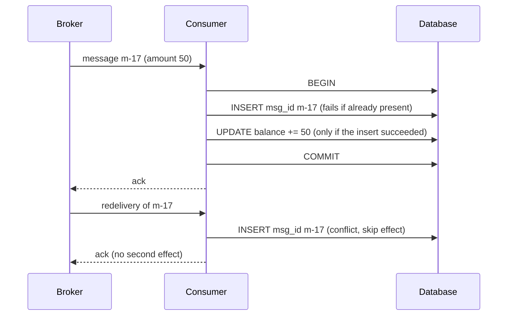
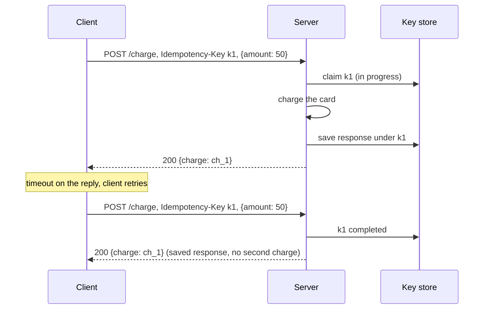
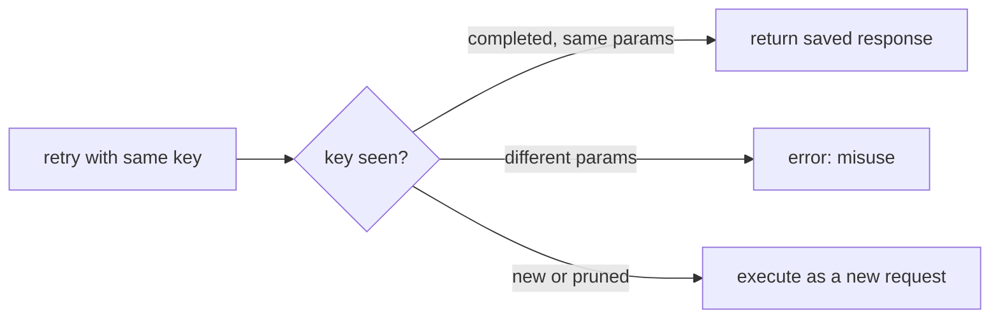

# Idempotent Consumers: Dedup Tables, Upserts & Idempotency Keys

> **Prerequisites:** [Lesson 01: Distributed Systems 101](../01-distributed-systems-101/README.md) · [Lesson 15: Distributed Transactions in Microservices](../15-distributed-transactions-in-microservices/README.md).  
> **Estimated Reading Time:** 22–26 minutes  
> **Target Audience:** Backend engineers writing queue consumers, webhooks and payment APIs, and candidates asked "how do you handle duplicate messages?"  
> **Free PDF Notes:** [Download SD-H-020.pdf](https://backendroadmap.com/notes/system-design/SD-H-020.pdf)

> [!NOTE]
> **In one line:** Messaging and networks give you **at-least-once** delivery, so duplicates are normal. An **idempotent consumer** makes processing a message twice have the same effect as once, using a **dedup table** written *in the same transaction as the effect*, an **upsert** or absolute write, or an **idempotency key**.

> [!TIP]
> **The Golden Rule:** The dedup record and the business effect must commit **atomically**. Check-then-act in separate steps leaves a crash window that either duplicates or *loses* the effect.

---

## 1. What an Idempotent Consumer Is, and What It Isn't

A queue redelivers a message because the consumer crashed before acknowledging it, or because the broker retried. A client retries a payment after a timeout. In all cases the same request can arrive twice, and applying it twice is a bug (double charge, double email).

| Term | Precise Meaning | Example |
| :--- | :--- | :--- |
| **Idempotent operation** | Applying it once or many times gives the same result | `SET balance = 100` |
| **At-least-once delivery** | A message may arrive more than once, never zero | Most queues |
| **Dedup table** | Stores IDs of processed messages | `processed(msg_id PRIMARY KEY)` |
| **Upsert** | Insert or update by key; repeating is harmless | `INSERT ... ON CONFLICT DO UPDATE` |
| **Idempotency key** | A client-chosen unique key per logical request | `Idempotency-Key: 7f3a...` |
| **Natural idempotency** | The operation is idempotent by its meaning | "Set status to SHIPPED" |
| **Not** | Exactly-once *delivery* (impossible in general; lesson 21) | Exactly-once *effect* is the goal |

### Why It Matters
1. It is the practical answer to "exactly once": at-least-once delivery plus idempotent processing gives an exactly-once *effect*.
2. Every retry mechanism you add (queues, HTTP retries, sagas, outboxes) multiplies duplicates; idempotency is what makes them safe.
3. The subtle part, atomicity of dedup and effect, is a frequent interview trap.

---

## 2. Anatomy: Three Techniques

| Technique | How it works | Use when |
| :--- | :--- | :--- |
| **Natural idempotency** | Design the operation so repeats are harmless: set state, don't increment | "Mark order shipped", "set price" |
| **Dedup table** | Record each processed message ID; skip if seen | Increments, sends, any non-idempotent effect |
| **Idempotency key (request level)** | Server stores the response under the client's key and replays it | Payment and create-resource APIs |



> [!WARNING]
> **Order matters inside the transaction boundary, not outside it.** "Check, then act, then mark" as three separate steps can leave the effect applied and the mark missing (a redelivery repeats the effect). "Mark, then act" can leave the mark present and the effect missing (the effect is lost forever). Only one local transaction covering both is safe.

---

## 3. Mathematical Model: Duplicates and Crash Windows

If each delivery crashes after the effect but before the ack with probability $c$, a message is processed an expected $\sum_{k\ge0}(c)^k = \frac{1}{1-c}$ times without dedup (a geometric number of attempts, each of which repeats the effect when the crash is *after* it). With a broker duplicating a fraction $d$ of messages, the expected number of times an effect is applied by a naive consumer is about

$$E[\text{applications}] \approx (1 + d)\cdot\frac{1}{1-c}$$

For $c=2\%$ and $d=5\%$ that is about $1.07$, a 7% over-count; for money or inventory that is unacceptable. A dedup table drives it to exactly 1 *only if* mark and effect are atomic. The two non-atomic orderings fail in opposite directions: check-then-act **over**-applies (crash between effect and mark); mark-first **under**-applies (crash between mark and effect).

---

## 4. Metrics & Percentiles

| Metric | Meaning | Why you care |
| :--- | :--- | :--- |
| **Duplicate rate** | Redelivered or repeated messages skipped | Health of upstream retries |
| **Dedup table size and growth** | Rows of processed IDs | Needs a retention policy |
| **Dedup hit latency** | Time to check an ID | Sits on the hot path |
| **Idempotency-key replays** | Requests answered from the stored response | Shows client retry behaviour |
| **Key conflicts** | Same key, different payload | A client bug; should be rejected |
| **Reconciliation diffs** | Expected vs actual totals | Detects any breakage in the guarantee |

### Worked Example (payments webhook)
A payment provider delivers `payment.succeeded` webhooks at least once. The consumer inserts the event ID into `processed_events` (primary key) and credits the account **in one transaction**. A redelivery hits the primary-key conflict, skips the credit and returns 200. The provider's retry storm after an outage is harmless.

---

## 5. Compounding: Four Designs Under Crashes and Duplicates

Running the code in the tab on SQLite with real transactions (Python 3.13): 20,000 messages, each delivered at least once; 5% of messages are also duplicated by the broker; each processing attempt may crash with probability 2% at the dangerous point (crash means no ack, so it is redelivered):

| Consumer design | Expected total | Actual total | Error |
| :--- | :---: | :---: | :---: |
| Naive: apply the effect every delivery | 996,370 | 1,067,291 | **+70,921 (+7.1%)** |
| Check-then-act, then mark (separate steps) | 997,320 | 1,016,336 | **+19,016 (+1.9%)** |
| Mark first, then act | 1,003,168 | 984,293 | **−18,875 (−1.9%)** |
| **Dedup row + effect in one transaction** | 996,370 | 996,370 | **0** |

(The "expected" column differs slightly between rows because each design consumes the random stream differently; compare each row's error to its own expectation.) The naive design over-counts as the formula predicts; the two non-atomic designs err in opposite directions; **only the atomic design is exact**.

---

## 6. Numbers Every Engineer Must Know

| Item | Typical | Implication |
| :--- | :---: | :--- |
| Stripe idempotency keys | up to 255 characters | Use V4 UUIDs or other high-entropy strings |
| Stripe key retention (API v1) | prunable after 24 hours | Retries after a day are new requests |
| Dedup retention | longer than the maximum redelivery window | Otherwise an old duplicate sneaks in |
| Duplicate rate | about the retry and crash rate (a few percent) | Never zero |
| `INSERT OR IGNORE` / `ON CONFLICT DO NOTHING` | one statement | The atomic "first time?" check |
| Cost per message | one extra indexed insert | Cheap compared with a wrong total |

---

## 7. Protocol Deep Dive: Request-Level Idempotency Keys

For HTTP APIs the **client** generates a unique key per logical operation and sends it with every retry. The server:

1. Looks up the key. If a **completed** record exists, return the **saved response** (status and body).
2. If it exists and is **in progress**, return a conflict or wait.
3. If it does not exist, **record it as in progress**, perform the operation, then **store the response** under the key.
4. If the key exists but the **request payload differs**, reject it: it is a client bug, not a retry.



| Case | Correct behaviour |
| :--- | :--- |
| Same key, same payload, completed | Replay the stored response |
| Same key, still running | 409 Conflict (or wait) |
| Same key, **different** payload | Reject (422/400) |
| Key reused after retention expired | Treated as a new request |

---

## 8. Hierarchical Budgets & Design Rules

| Slice | Rule | Control |
| :--- | :--- | :--- |
| Prefer | Natural idempotency (set, don't increment) | Model state, not deltas |
| Dedup | Insert the ID and apply the effect in **one transaction** | Primary key on the message ID |
| Retention | Keep IDs longer than any redelivery window | TTL job, partitioned tables |
| Message IDs | Stable and unique per business event | Producer assigns; not the broker offset when replays reassign |
| API keys | Client-generated, high entropy, stored with response and payload hash | Replay, in-progress and mismatch handling |
| External effects | Pass your own idempotency key downstream | Emails, payment providers |
| Verification | Reconcile totals | Daily job comparing source and sink |

---

## 9. Top Mitigations

1. **Make operations naturally idempotent** wherever possible.
2. **Dedup atomically**: the ID insert and the effect in one local transaction.
3. **Use database constraints** (`PRIMARY KEY`, `UNIQUE`, `ON CONFLICT`) as the arbiter, not an application `if`.
4. **Require idempotency keys** on every create and payment endpoint.
5. **Store the response** with the key and reject payload mismatches.
6. **Keep dedup records long enough**, then expire them.
7. **Propagate keys** to downstream providers.

---

## 10. Production Reference: Stripe's Idempotency Keys

Stripe's API documentation is the clearest public specification of request-level idempotency.

- **The contract:** "The API supports idempotency for safely retrying requests without accidentally performing the same operation twice. When creating or updating an object, use an idempotency key. Then, if a connection error occurs, you can safely repeat the request without risk of creating a second object or performing the update twice."
- **What the server stores (API v1):** "Stripe saves the status code and body of the first request made with a given idempotency key after endpoint execution begins. Retries with the same key return the saved response, including `500` errors."
- **Keys:** the client generates them; Stripe suggests "V4 UUIDs, or another random string with enough entropy to avoid collisions", up to **255 characters**, and warns to avoid sensitive data such as email addresses.
- **Retention:** keys can be removed "after they're at least 24 hours old"; a reused key after pruning generates a new request.
- **Misuse protection:** "The idempotency layer compares incoming parameters to those of the original request and errors if they're not the same to prevent accidental misuse."
- **What is not saved:** if parameters fail validation, or the request conflicts with another executing concurrently, "we don't save the idempotent result because no API endpoint initiates the execution", so you can retry those.
- **Which methods:** all `POST` requests accept keys; do not send them on `GET` and `DELETE`, "because it has no effect. These requests are idempotent by definition."



**Lesson:** idempotency is an *API contract*: client generates the key, server persists key, payload fingerprint and response, and retries become safe, even for `500`s.

---

## 11. Multi-Language Production Code Tabs

The atomic consumer: insert the message ID and apply the effect in one transaction.

````carousel
```go
// Go: atomic dedup + effect with database/sql.
package main

import (
	"context"
	"database/sql"
)

// Credit applies amount once per msgID. Returns false if it was a duplicate.
func Credit(ctx context.Context, db *sql.DB, msgID string, accountID int64, amount int64) (bool, error) {
	tx, err := db.BeginTx(ctx, nil)
	if err != nil {
		return false, err
	}
	defer tx.Rollback() // no-op after Commit

	res, err := tx.ExecContext(ctx, `INSERT INTO processed (msg_id) VALUES (?) ON CONFLICT DO NOTHING`, msgID)
	if err != nil {
		return false, err
	}
	if n, _ := res.RowsAffected(); n == 0 {
		return false, nil // duplicate: skip the effect, still ack the message
	}
	if _, err := tx.ExecContext(ctx, `UPDATE account SET balance = balance + ? WHERE id = ?`, amount, accountID); err != nil {
		return false, err
	}
	return true, tx.Commit()
}
```
<!-- slide -->
```typescript
// TypeScript: atomic dedup + effect with a transaction callback (pg-style).
interface Tx {
  query(sql: string, params: unknown[]): Promise<{ rowCount: number | null }>;
}

// Returns false when the message was already processed.
export async function credit(
  withTransaction: <T>(fn: (tx: Tx) => Promise<T>) => Promise<T>,
  msgId: string,
  accountId: number,
  amount: number,
): Promise<boolean> {
  return withTransaction(async (tx) => {
    const ins = await tx.query(
      "INSERT INTO processed (msg_id) VALUES ($1) ON CONFLICT DO NOTHING",
      [msgId],
    );
    if (ins.rowCount === 0) return false; // duplicate: skip the effect
    await tx.query("UPDATE account SET balance = balance + $1 WHERE id = $2", [amount, accountId]);
    return true;
  });
}
```
<!-- slide -->
```python
# Python: four consumer designs on SQLite, and an idempotency-key store (stdlib only).
import hashlib
import json
import random
import sqlite3


class Crash(Exception):
    """Simulated process crash (before the message is acknowledged, so the broker redelivers it)."""


def make_db():
    db = sqlite3.connect(":memory:", isolation_level=None)      # we manage transactions explicitly
    db.execute("CREATE TABLE account (id INTEGER PRIMARY KEY, balance INTEGER)")
    db.execute("INSERT INTO account VALUES (1, 0)")
    db.execute("CREATE TABLE processed (msg_id INTEGER PRIMARY KEY)")
    return db


def handle(db, mode, msg_id, amount, crash_after_effect, crash_after_mark):
    """Process one delivery of message (msg_id, amount). May raise Crash."""
    if mode == "naive":
        db.execute("UPDATE account SET balance = balance + ? WHERE id = 1", (amount,))
        if crash_after_effect:
            raise Crash
    elif mode == "check_then_act":                              # separate transactions: not atomic
        if db.execute("SELECT 1 FROM processed WHERE msg_id = ?", (msg_id,)).fetchone():
            return
        db.execute("UPDATE account SET balance = balance + ? WHERE id = 1", (amount,))
        if crash_after_effect:
            raise Crash                                          # effect applied, not yet marked
        db.execute("INSERT INTO processed VALUES (?)", (msg_id,))
    elif mode == "mark_first":
        if db.execute("SELECT 1 FROM processed WHERE msg_id = ?", (msg_id,)).fetchone():
            return
        db.execute("INSERT INTO processed VALUES (?)", (msg_id,))
        if crash_after_mark:
            raise Crash                                          # marked, effect never applied
        db.execute("UPDATE account SET balance = balance + ? WHERE id = 1", (amount,))
    elif mode == "atomic_dedup":                                 # dedup row and effect in ONE transaction
        db.execute("BEGIN")
        try:
            cur = db.execute("INSERT OR IGNORE INTO processed VALUES (?)", (msg_id,))
            if cur.rowcount == 1:                                # first time we see this message id
                db.execute("UPDATE account SET balance = balance + ? WHERE id = 1", (amount,))
            if crash_after_effect:
                raise Crash                                      # nothing committed: rolled back
            db.execute("COMMIT")
        except Crash:
            db.execute("ROLLBACK")
            raise


def run(mode, n=20_000, p_crash=0.02, p_dup=0.05, seed=20):
    """Deliver n messages at least once. Crashes cause redelivery; the broker also duplicates 5%.
    Returns (expected balance, actual balance)."""
    rng = random.Random(seed)
    db = make_db()
    expected = 0
    for msg_id in range(1, n + 1):
        amount = rng.randrange(1, 100)
        expected += amount
        deliveries = 1 + (rng.random() < p_dup)                  # broker-side duplicate
        attempt, crashed = 0, False
        while attempt < deliveries or crashed:
            crashed = False
            attempt += 1
            try:
                handle(db, mode, msg_id, amount,
                       crash_after_effect=rng.random() < p_crash, crash_after_mark=rng.random() < p_crash)
            except Crash:
                crashed = True                                   # not acknowledged: redelivered
            if attempt > 50:
                break
    return expected, db.execute("SELECT balance FROM account").fetchone()[0]


class IdempotencyStore:
    """Request-level idempotency: replay saved responses, reject payload mismatches."""

    def __init__(self):
        self.records = {}                                        # key -> (payload_hash, response or None)

    def execute(self, key, payload, operation):
        h = hashlib.sha256(json.dumps(payload, sort_keys=True).encode()).hexdigest()
        if key in self.records:
            saved_hash, response = self.records[key]
            if saved_hash != h:
                raise ValueError("idempotency key reused with different parameters")
            if response is None:
                raise RuntimeError("request with this key is still in progress")
            return response                                      # replay: no second effect
        self.records[key] = (h, None)                            # claim the key (in progress)
        response = operation(payload)
        self.records[key] = (h, response)                        # persist the response under the key
        return response
```
<!-- slide -->
```csharp
// C#: atomic dedup + effect with ADO.NET.
using System.Data.Common;

public static class Consumer
{
    // Returns false when the message was already processed.
    public static async Task<bool> CreditAsync(DbConnection conn, string msgId, long accountId, long amount)
    {
        await using var tx = await conn.BeginTransactionAsync();

        await using (var ins = conn.CreateCommand())
        {
            ins.Transaction = tx;
            ins.CommandText = "INSERT INTO processed (msg_id) VALUES (@id) ON CONFLICT DO NOTHING";
            var p = ins.CreateParameter(); p.ParameterName = "@id"; p.Value = msgId; ins.Parameters.Add(p);
            if (await ins.ExecuteNonQueryAsync() == 0)
            {
                await tx.RollbackAsync();
                return false; // duplicate: skip the effect
            }
        }

        await using (var upd = conn.CreateCommand())
        {
            upd.Transaction = tx;
            upd.CommandText = "UPDATE account SET balance = balance + @amount WHERE id = @acc";
            var a = upd.CreateParameter(); a.ParameterName = "@amount"; a.Value = amount; upd.Parameters.Add(a);
            var b = upd.CreateParameter(); b.ParameterName = "@acc"; b.Value = accountId; upd.Parameters.Add(b);
            await upd.ExecuteNonQueryAsync();
        }

        await tx.CommitAsync();
        return true;
    }
}
```
````

---

## 12. Hands-On CLI Verification Workflows

The table in section 5 is the Python tab run against SQLite (Python 3.13, seed 20):

```python
for mode in ("naive", "check_then_act", "mark_first", "atomic_dedup"):
    expected, actual = run(mode)
    print(f"{mode:16} expected {expected:>9,} actual {actual:>9,} diff {actual - expected:>+9,}")
```

```text
naive            expected   996,370 actual 1,067,291 diff   +70,921
check_then_act   expected   997,320 actual 1,016,336 diff   +19,016
mark_first       expected 1,003,168 actual   984,293 diff   -18,875
atomic_dedup     expected   996,370 actual   996,370 diff        +0
```

The idempotency-key store from the same tab:

```python
store = IdempotencyStore()
charge = lambda p: {"charge_id": "ch_1", "amount": p["amount"]}
print(store.execute("k1", {"amount": 50}, charge))   # {'charge_id': 'ch_1', 'amount': 50}
print(store.execute("k1", {"amount": 50}, charge))   # the same saved response; charge ran once
try:
    store.execute("k1", {"amount": 99}, charge)
except ValueError as e:
    print(e)                                         # idempotency key reused with different parameters
```

Against a real payment API, send the same request twice with the same header and compare the responses:

```bash
curl https://api.stripe.com/v1/customers -u sk_test_...: -H "Idempotency-Key: demo-123" -d description="first"
curl https://api.stripe.com/v1/customers -u sk_test_...: -H "Idempotency-Key: demo-123" -d description="first"   # same customer id returned
```

---

## 13. Common Mistakes to Avoid

1. **Check-then-act** (or mark-then-act) outside one transaction.
2. **A dedup cache in memory** that is lost on restart.
3. **Keying on the broker offset** when replays re-number messages.
4. **Dedup retention shorter than the redelivery window.**
5. **Incrementing** where a set would do.
6. **No payload check** on reused idempotency keys.
7. **Not passing the key downstream** to payment or email providers.
8. **Assuming the broker's "exactly-once" removes the need** (lesson 21).

---

## 14. Key Terms Glossary

| Key Term | Definition |
| :--- | :--- |
| **Idempotent** | Repeating has the same effect as doing it once. |
| **At-least-once delivery** | Messages may be redelivered, never lost. |
| **Dedup table** | Persistent set of processed message IDs. |
| **Upsert** | Insert-or-update keyed by identity. |
| **Idempotency key** | Client-generated unique key per logical operation. |
| **Natural idempotency** | An operation that is idempotent by its meaning. |
| **Exactly-once effect** | Each message's effect applied once, despite redelivery. |
| **Request fingerprint** | Hash of the payload stored with the key. |
| **Replay** | Returning the stored response for a repeated key. |
| **Retention window** | How long dedup records or keys are kept. |

---

## 15. System Design Interview Questions & Answers

### Basic Conceptual Questions

<details>
<summary><strong>Q1: What is an idempotent consumer? [BASIC]</strong></summary>

**Answer:**
A consumer for which processing the same message more than once has the same effect as processing it once. Needed because queues and retries deliver at least once.
</details>

<details>
<summary><strong>Q2: How do you implement one? [BASIC]</strong></summary>

**Answer:**
Make the operation naturally idempotent (set, not increment), or record each processed message ID in a dedup table with a unique constraint, in the same transaction as the effect, and skip duplicates. For HTTP APIs, accept a client idempotency key and replay the saved response.
</details>

<details>
<summary><strong>Q3: What is an idempotency key? [BASIC]</strong></summary>

**Answer:**
A unique token chosen by the client per logical operation and sent with every retry; the server stores the first result under it and returns that on repeats.
</details>

<details>
<summary><strong>Q4: Is exactly-once delivery possible? [BASIC]</strong></summary>

**Answer:**
Not in general over an unreliable network. You get at-least-once delivery and make processing idempotent, which yields an exactly-once *effect* (lesson 21).
</details>

### Scenario-Based Architecture Questions

<details>
<summary><strong>Q5: Your consumer double-credits accounts after crashes. Fix? [SCENARIO]</strong></summary>

**Answer:**
Insert the message ID into a processed table with a primary key and apply the credit in the same transaction; on a key conflict skip the effect and ack. In a simulation of 20,000 messages with 2% crashes and 5% duplicates, the naive consumer over-credited by 7.1%, and the atomic dedup consumer was exact.
</details>

<details>
<summary><strong>Q6: Why is "check if processed, then process, then mark" wrong? [SCENARIO]</strong></summary>

**Answer:**
A crash between the effect and the mark leaves the effect applied without a record, so the redelivery repeats it (+1.9% in the simulation). Marking first fails the other way: a crash after the mark but before the effect loses the effect forever (−1.9%). Only one transaction around both is safe.
</details>

<details>
<summary><strong>Q7: How long do you keep dedup records? [SCENARIO]</strong></summary>

**Answer:**
At least as long as the longest possible redelivery or retry window (including DLQ replays and client retries), plus a margin, then expire them. Too short lets an old duplicate through; unbounded growth hurts the table.
</details>

<details>
<summary><strong>Q8: A client retries a payment with the same key but a different amount. [SCENARIO]</strong></summary>

**Answer:**
Reject it. Store a fingerprint of the original payload with the key and return an error when a reused key arrives with different parameters, as Stripe does; it is a client bug, not a retry.
</details>

### Advanced & Tricky Interview Questions

<details>
<summary><strong>Q9: Where does the dedup check live when the effect is an external call? [TRICKY]</strong></summary>

**Answer:**
You cannot make a local transaction span an external service. Pass your own idempotency key (derived from the message ID) to the external API so it deduplicates, record the outcome locally, and design the flow as record intent, call with key, record result.
</details>

<details>
<summary><strong>Q10: Why prefer database constraints over application checks? [TRICKY]</strong></summary>

**Answer:**
Two consumers can both pass an application "not seen" check at the same time. A unique constraint with `INSERT ... ON CONFLICT DO NOTHING` is atomic: exactly one insert wins, so exactly one effect is applied.
</details>

<details>
<summary><strong>Q11: How do you make "add 50 to the balance" idempotent? [TRICKY]</strong></summary>

**Answer:**
Attach a transaction ID and use a dedup table, or model the ledger as an append-only table keyed by transaction ID (the balance is derived), so repeating the insert is a no-op. Avoid read-modify-write increments without a guard.
</details>

<details>
<summary><strong>Q12: Does Kafka's idempotent producer make consumers idempotent? [TRICKY]</strong></summary>

**Answer:**
No. It deduplicates producer retries into the log, but a consumer can still reprocess a record after a crash before committing its offset. Consumers still need idempotent effects or transactional offset-and-effect commits.
</details>

---

## 16. One-Page Master Cheat Sheet

```
+---------------------------------------------------------------------------------------------------------+
|                    IDEMPOTENT CONSUMERS — MASTER CHEAT SHEET                                            |
+---------------------------------------------------------------------------------------------------------+
| 1. WHY: at-least-once delivery + retries = duplicates. Goal: exactly-once EFFECT.                       |
+---------------------------------------------------------------------------------------------------------+
| 2. NATURAL: set, don't increment · upsert by key · "mark shipped".                                      |
+---------------------------------------------------------------------------------------------------------+
| 3. DEDUP TABLE: INSERT msg_id (PK) + effect in ONE transaction. Conflict = duplicate, skip, ack.        |
+---------------------------------------------------------------------------------------------------------+
| 4. NEVER: check-then-act or mark-then-act in separate steps (over-apply / lose the effect).             |
+---------------------------------------------------------------------------------------------------------+
| 5. API KEYS: client key + payload hash + saved response; replay, 409 in-progress, reject mismatch.      |
+---------------------------------------------------------------------------------------------------------+
| 6. OPERATE: retention > redelivery window · propagate keys downstream · reconcile totals.               |
+---------------------------------------------------------------------------------------------------------+
```

---

## Further Reading & Sources

- Stripe API reference, [Idempotent requests](https://docs.stripe.com/api/idempotent_requests).
- Chris Richardson, *Microservices Patterns*, "Idempotent consumer" pattern (microservices.io).
- IETF draft, "The Idempotency-Key HTTP Header Field".
- Martin Kleppmann, *Designing Data-Intensive Applications*, chapter 11, "Idempotence" and "Exactly-once message processing".

---

## Free PDF Notes

[SD-H-020.pdf](https://backendroadmap.com/notes/system-design/SD-H-020.pdf)

---

## Next

Continue with [Lesson 21: Exactly-Once Delivery](../21-exactly-once-delivery/README.md): myth vs reality, and what Kafka EOS really means.
