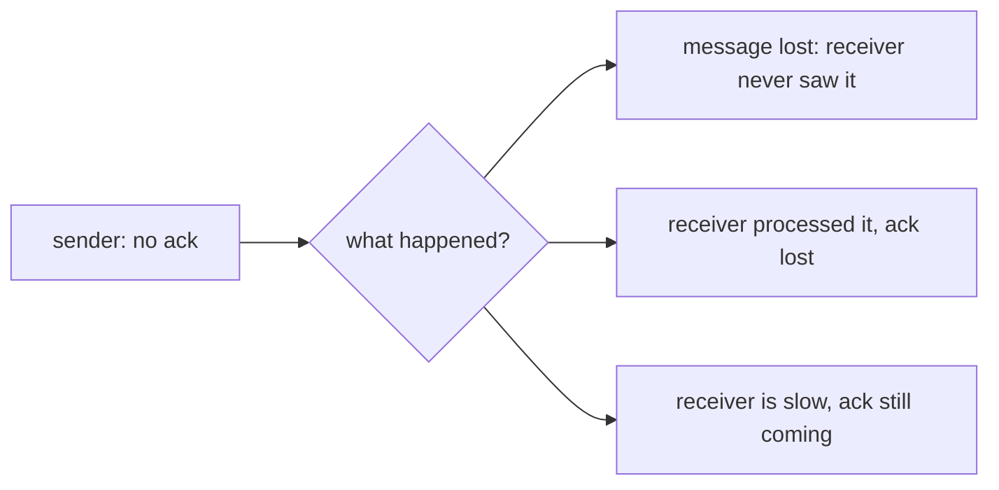
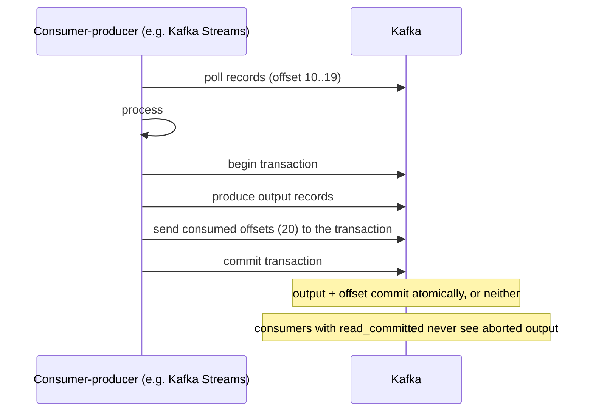
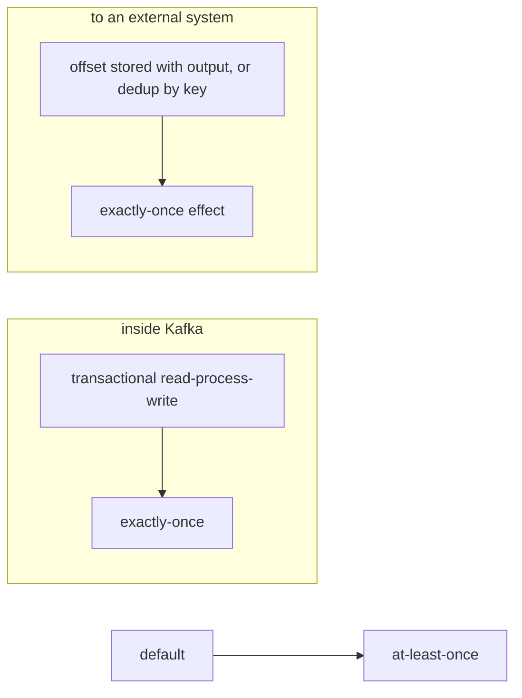

# Exactly-Once Delivery: Myth vs Reality (and What Kafka EOS Really Means)

> **Prerequisites:** [Lesson 01: Distributed Systems 101](../01-distributed-systems-101/README.md) · [Lesson 16: Two-Phase Commit](../16-two-phase-commit-explained-and-why-it-blocks/README.md) · [Lesson 20: Idempotent Consumers](../20-idempotent-consumers/README.md).  
> **Estimated Reading Time:** 22–26 minutes  
> **Target Audience:** Backend engineers using Kafka, SQS, RabbitMQ or webhooks, and candidates asked "does your system guarantee exactly-once?"  
> **Free PDF Notes:** [Download SD-H-021.pdf](https://backendroadmap.com/notes/system-design/SD-H-021.pdf)

> [!NOTE]
> **In one line:** Exactly-once **delivery** over an unreliable network is impossible in general: when an acknowledgement is lost, the sender cannot know whether the message arrived. What you can build is **at-least-once delivery plus idempotent (or transactional) processing**, which gives an exactly-once **effect**. Kafka's "exactly-once semantics" is exactly that, within Kafka.

> [!TIP]
> **The Golden Rule:** When a vendor says "exactly-once", ask three questions: *Where is the boundary* (inside one system or end to end)? *What happens when the consumer, producer or an external sink crashes?* *What must my code still do?*

---

## 1. What Exactly-Once Is, and What It Isn't

There are three delivery guarantees, and only two of them are achievable without extra machinery.

| Term | Precise Meaning | Example |
| :--- | :--- | :--- |
| **At-most-once** | Messages may be lost but are never redelivered | Fire and forget, UDP |
| **At-least-once** | Messages are never lost but may be redelivered | Retry until acknowledged |
| **Exactly-once delivery** | Each message is delivered and processed once and only once | Not achievable in general |
| **Exactly-once effect (processing)** | Duplicates may arrive, but the *effect* happens once | At-least-once + idempotent processing |
| **Two Generals problem** | No protocol over a lossy channel lets both sides be certain of agreement | The reason for the impossibility |
| **Kafka EOS** | Idempotent producer + transactions + `read_committed` consumers | Exactly-once for read-process-write *within Kafka* |
| **Not** | A property of a message broker alone | The consumer's side effects count too |

### Why It Matters
1. Product claims of "exactly-once" are everywhere and usually carry fine print; knowing the fine print separates a good answer from a naive one.
2. The design consequence is concrete: assume duplicates and make your processing safe (lesson 20).
3. It is a classic "myth vs reality" interview question.

---

## 2. Anatomy: Why It Is Impossible, and What You Build Instead

A sender transmits a message and waits for an acknowledgement. If none arrives, it has exactly three possibilities and cannot tell which one occurred:



- If the sender **does not retry**, case A loses the message: **at-most-once**.
- If the sender **retries**, case B delivers it twice: **at-least-once**.
- No amount of extra acknowledging fixes this: the last acknowledgement can always be the one that is lost (the **Two Generals problem**).

So "exactly-once" is achieved one level up: **at-least-once delivery** plus **deduplication or idempotency** on the receiving side, so duplicates arrive but their *effect* is applied once.

| You want | You build |
| :--- | :--- |
| Never lose a message | Retries with acknowledgements (at-least-once) |
| Never apply twice | Idempotent consumer, dedup table, or atomic offset-and-output commit (lesson 20) |
| Both, end to end | Both of the above plus a unique message ID that survives retries |

> [!WARNING]
> **"Exactly-once" is always bounded by a system boundary.** Inside one transactional system (Kafka topics, one database) it can be real. The moment an effect crosses to an external system (an email, a payment API, an HTTP call), it is at-least-once unless that system also deduplicates.

---

## 3. Mathematical Model: What Retries Cost

With message-loss probability $p$ and ack-loss probability $q$ per attempt, and up to $k$ tries:

| Quantity | Formula | With $p=q=0.1$, $k=5$ |
| :--- | :--- | :---: |
| Never delivered after $k$ tries | $p^{k}$ | $0.001\%$ (about 2 per 200,000) |
| At-most-once ($k=1$): lost | $p$ | $10\%$ |
| At-least-once: applied more than once | on the order of $q$ (a lost ack triggers a retry that is delivered) | about $10\%$ measured |
| Delivered, but the sender gave up without an ack | positive for every finite $k$ | 52 of 200,000 measured |

The key point is that **the duplicate rate is on the order of $q$** (the ack-loss rate), and the "sender cannot know" probability is **never zero** for any finite number of tries. Raising $k$ shrinks loss geometrically but cannot remove either ambiguity.

---

## 4. Metrics & Percentiles

| Metric | Meaning | Why you care |
| :--- | :--- | :--- |
| **Duplicate rate** | Deliveries beyond the first | Should match ack-loss and retry rates |
| **Redelivery count per message** | Attempts until ack | Tail shows poison messages |
| **Lost-message rate (end to end)** | Produced minus consumed, after reconciliation | The at-most-once symptom |
| **Unknown-outcome rate** | Sender gave up but the message was applied | The Two Generals residue |
| **Transaction abort rate** | Kafka transactions aborted | Cost of EOS |
| **Reconciliation drift** | Source total vs sink total | The ultimate correctness test |

### Worked Example
A payment event is produced to Kafka and a consumer writes it to a database. With the default at-least-once configuration, a consumer crash after the database write but before the offset commit replays the event, so the write happens twice unless it is idempotent. Using the event ID as the primary key of the target row makes the replay a harmless upsert: an exactly-once *effect* with at-least-once *delivery*.

---

## 5. Compounding: Two Experiments

Simulations (Python 3.13, stdlib only).

**A. A lossy link, three strategies.** 200,000 messages; each transmission is lost with probability 10%, each ack is lost with probability 10%; retry strategies try up to 5 times:

| Strategy | Lost | Applied once | Applied **more than once** | Sender gave up but message **was** applied |
| :--- | :---: | :---: | :---: | :---: |
| At-most-once (one try) | **20,238** (10.1%) | 179,762 | 0 | 18,058 |
| At-least-once (retry; receiver applies every arrival) | 3 | 179,906 | **20,091** (10.0%), 22,251 extra applications | 52 |
| **Retry + receiver dedups by ID** | 3 | **199,997** | **0** | 52 |

Retries removed almost all loss but created 10% duplicates; deduplication removed the duplicates. The last column shows the impossibility in numbers: even with dedup, 52 sends ended with the sender *not knowing* the message had been applied. Nothing finite eliminates that.

**B. A stream job: read a record, write an output, commit the input offset.** 100,000 records, a 1% crash chance between the two steps, restart from the last committed offset:

| Commit order | Missing outputs | Duplicate outputs |
| :--- | :---: | :---: |
| Commit offset, then write output (at-most-once) | **1,014** | 0 |
| Write output, then commit offset (at-least-once) | 0 | **1,024** |
| **Output and offset in one atomic transaction** | **0** | **0** |

This is the whole of Kafka's EOS idea for read-process-write: put the *output* and the *offset* in one atomic commit.

---

## 6. Numbers Every Engineer Must Know

| Item | Typical | Implication |
| :--- | :---: | :--- |
| Duplicate rate under retries | about the ack-loss rate (a few percent) | Never zero |
| Kafka idempotent producer | since 0.11.0.0 | Broker assigns a producer ID and dedups by sequence number |
| Kafka transactions | atomic writes to multiple partitions plus offsets | The basis of EOS |
| `read_committed` | consumers skip aborted transactions | Required for exactly-once reads |
| Committed write latency | on the order of 10 ms (waiting for all in-sync replicas) | Durability costs latency |
| External sinks | at-least-once by default | Needs the sink's cooperation |

---

## 7. Protocol Deep Dive: What Kafka Actually Provides



Straight from Kafka's design documentation, in three layers:

| Layer | Mechanism | Guarantee |
| :--- | :--- | :--- |
| **Producer to broker** | Idempotent producer: broker assigns a producer ID and deduplicates by a per-message sequence number | A retry does not create duplicate log entries |
| **Read-process-write inside Kafka** | Transactions: output records and the consumer's offsets (stored in an internal topic) commit atomically; `read_committed` hides aborted data | Exactly-once for Kafka-to-Kafka processing |
| **Kafka to an external system** | Cooperation: store the offset *with* the output, or deduplicate by a primary key | Exactly-once effect only if the sink participates |

Default Kafka behaviour is **at-least-once**. At-most-once is available by disabling producer retries and committing offsets before processing.

---

## 8. Hierarchical Budgets & Design Rules

| Slice | Rule | Control |
| :--- | :--- | :--- |
| Assume | Duplicates will arrive | At-least-once everywhere |
| Message identity | A unique ID that survives retries | Assigned by the producer, not the broker offset |
| Consumer effects | Idempotent or atomic with the offset | Dedup table, upsert, transactional sink |
| Inside Kafka | Use the transactional API or Kafka Streams with exactly-once processing | `read_committed` consumers |
| External calls | Pass an idempotency key | Payment and email providers |
| Verification | Reconcile counts and totals | Compare source and sink daily |
| Claims | Read the fine print | Boundary, failure modes, what you must still do |

---

## 9. Top Mitigations

1. **Design for at-least-once**: retries on, duplicates assumed.
2. **Give every message a stable unique ID.**
3. **Make consumers idempotent** (lesson 20), or commit output and offset atomically.
4. **Use Kafka transactions and `read_committed`** for Kafka-to-Kafka pipelines.
5. **Store offsets with the output** when the sink is external.
6. **Propagate idempotency keys** to external services.
7. **Reconcile** sources and sinks to catch breakage.

---

## 10. Production Reference: What Kafka's Documentation Says (Including the Warning)

Kafka's design documentation is unusually careful about this topic, and it opens with the warning:

> "Many systems claim to provide 'exactly-once' delivery semantics, but it is important to read the fine print, because sometimes these claims are misleading (i.e. they don't translate to the case where consumers or producers can fail, cases where there are multiple consumer processes, or cases where data written to disk can be lost)."

It defines the three guarantees ("at most once: messages may be lost but are never redelivered; at least once: messages are never lost but may be redelivered; exactly once: each message is processed once and only once") and then explains what Kafka really does:

- **Producer:** "Prior to 0.11.0.0, if a producer failed to receive a response indicating that a message was committed, it had little choice but to resend the message. This provides at-least-once delivery semantics." Since 0.11.0.0 the producer's **idempotent delivery** option guarantees "that resending will not result in duplicate entries in the log": "the broker assigns each producer an ID and deduplicates messages using a sequence number".
- **Consumer, the two orders:** save the position *then* process gives at-most-once ("the consumer process crashes after saving its position but before saving the output"); process *then* save the position gives at-least-once.
- **Exactly-once:** for consume-and-produce between topics, "we can write the offset to Kafka in the same transaction as the output topics receiving the processed data", and with the `read_committed` isolation level aborted output is not visible to consumers.
- **External systems:** "When writing to an external system, the limitation is in the need to coordinate the consumer's position with what is actually stored as output." Rather than two-phase commit, Kafka recommends "letting the consumer store its offset in the same place as its output" (the Kafka Connect HDFS example).
- **Summary from the docs:** "Kafka supports exactly-once delivery in Kafka Streams... Exactly-once delivery for other destination systems generally requires cooperation with such systems... Otherwise, Kafka guarantees at-least-once delivery by default."



**Lesson:** the honest slogan is **"exactly-once processing within a transactional boundary, at-least-once everywhere else"**. The two experiments above (section 5B) are the same trade-off Kafka's docs describe.

---

## 11. Multi-Language Production Code Tabs

Retries with a stable message ID on the sender, and deduplication on the receiver: together they give an exactly-once effect.

````carousel
```go
// Go: sender retries with a stable ID; receiver deduplicates.
package main

import (
	"errors"
	"sync"
)

var ErrAckLost = errors.New("no ack")

type Receiver struct {
	mu      sync.Mutex
	Seen    map[string]bool
	Applied int
}

func NewReceiver() *Receiver { return &Receiver{Seen: map[string]bool{}} }

// Handle applies the message at most once per ID, and returns an ack either way.
func (r *Receiver) Handle(id string) {
	r.mu.Lock()
	defer r.mu.Unlock()
	if r.Seen[id] {
		return // duplicate: ack again, no second effect
	}
	r.Seen[id] = true
	r.Applied++
}

// Send retries until acked or out of tries. The ID is generated once, before the loop.
func Send(id string, tries int, deliver func(id string) error) error {
	for i := 0; i < tries; i++ {
		if err := deliver(id); err == nil {
			return nil // acked
		}
	}
	return ErrAckLost // outcome UNKNOWN: it may or may not have been applied
}
```
<!-- slide -->
```typescript
// TypeScript: sender retries with a stable ID; receiver deduplicates.
class Receiver {
  private seen = new Set<string>();
  applied = 0;

  // Applies a message at most once per id; always acknowledges.
  handle(id: string): void {
    if (this.seen.has(id)) return; // duplicate: ack again, no second effect
    this.seen.add(id);
    this.applied++;
  }
}

// The id is created once by the caller, before the retry loop.
export async function send(id: string, tries: number, deliver: (id: string) => Promise<void>): Promise<boolean> {
  for (let i = 0; i < tries; i++) {
    try {
      await deliver(id);
      return true; // acked
    } catch {
      /* lost message or lost ack: we cannot tell which, so retry with the same id */
    }
  }
  return false; // outcome unknown: it may or may not have been applied
}
```
<!-- slide -->
```python
# Python: the two experiments behind section 5 (stdlib only).
import random


def channel_run(strategy, n=200_000, p_msg_loss=0.10, p_ack_loss=0.10, max_tries=5, seed=21):
    """strategy: 'at_most_once' | 'at_least_once' | 'effectively_once' (retries + receiver dedup by id)."""
    rng = random.Random(seed)
    tries_allowed = 1 if strategy == "at_most_once" else max_tries
    out = dict(lost=0, applied_once=0, applied_twice_or_more=0, extra_applications=0, sender_wrongly_gave_up=0)
    for _ in range(n):
        applied, acked = 0, False
        for _ in range(tries_allowed):
            if rng.random() < p_msg_loss:                       # message lost: receiver never sees it
                continue
            applied = 1 if strategy == "effectively_once" else applied + 1
            if rng.random() >= p_ack_loss:                      # ack arrives
                acked = True
                break
        if applied == 0:
            out["lost"] += 1
        elif applied == 1:
            out["applied_once"] += 1
        else:
            out["applied_twice_or_more"] += 1
            out["extra_applications"] += applied - 1
        if applied > 0 and not acked:
            out["sender_wrongly_gave_up"] += 1                  # delivered, but the sender cannot know it
    return out


def consume_transform_produce(commit_mode, n=100_000, p_crash=0.01, seed=21):
    """Read record i, write output i, commit the input offset; a crash between the two steps restarts from
    the last committed offset. commit_mode: 'offset_then_output' | 'output_then_offset' | 'atomic'.
    Returns (missing outputs, duplicate outputs)."""
    rng, outputs = random.Random(seed), {}
    for i in range(n):
        done = False
        while not done:
            if commit_mode == "atomic":
                if rng.random() < p_crash:                      # the whole transaction aborts: nothing visible
                    continue
                outputs[i] = outputs.get(i, 0) + 1
                done = True
            elif commit_mode == "output_then_offset":
                outputs[i] = outputs.get(i, 0) + 1              # output written first
                if rng.random() < p_crash:                      # crash before the offset commit: record re-read
                    continue
                done = True
            else:                                               # offset_then_output
                if rng.random() < p_crash:                      # offset committed, crash before output: skipped
                    done = True
                    continue
                outputs[i] = outputs.get(i, 0) + 1
                done = True
    missing = sum(1 for i in range(n) if i not in outputs)
    duplicated = sum(c - 1 for c in outputs.values() if c > 1)
    return missing, duplicated
```
<!-- slide -->
```csharp
// C#: sender retries with a stable ID; receiver deduplicates.
public sealed class Receiver
{
    private readonly HashSet<string> _seen = new();
    private readonly object _gate = new();
    public int Applied { get; private set; }

    // Applies a message at most once per id; always acknowledges.
    public void Handle(string id)
    {
        lock (_gate)
        {
            if (!_seen.Add(id)) return; // duplicate: ack again, no second effect
            Applied++;
        }
    }
}

public static class Sender
{
    // The id is created once by the caller, before the retry loop. false = outcome unknown.
    public static async Task<bool> SendAsync(string id, int tries, Func<string, Task> deliver)
    {
        for (var i = 0; i < tries; i++)
        {
            try { await deliver(id); return true; }
            catch { /* lost message or lost ack: retry with the same id */ }
        }
        return false;
    }
}
```
````

---

## 12. Hands-On CLI Verification Workflows

Run the Python tab (Python 3.13, seed 21):

```python
for s in ("at_most_once", "at_least_once", "effectively_once"):
    print(s, channel_run(s))
for m in ("offset_then_output", "output_then_offset", "atomic"):
    print(m, consume_transform_produce(m))
```

```text
at_most_once     {'lost': 20238, 'applied_once': 179762, 'applied_twice_or_more': 0, 'extra_applications': 0, 'sender_wrongly_gave_up': 18058}
at_least_once    {'lost': 3, 'applied_once': 179906, 'applied_twice_or_more': 20091, 'extra_applications': 22251, 'sender_wrongly_gave_up': 52}
effectively_once {'lost': 3, 'applied_once': 199997, 'applied_twice_or_more': 0, 'extra_applications': 0, 'sender_wrongly_gave_up': 52}
offset_then_output (1014, 0)
output_then_offset (0, 1024)
atomic (0, 0)
```

For a real Kafka producer the three settings that matter are:

```properties
# producer: no duplicate log entries from retries
enable.idempotence=true
acks=all
# transactional read-process-write (set a stable id per producer instance)
transactional.id=orders-processor-1
# consumer: do not read data from aborted transactions
isolation.level=read_committed
```

and `kafka-consumer-groups.sh --describe --group <g>` shows the committed offset and lag, which is where at-least-once replays begin.

---

## 13. Common Mistakes to Avoid

1. **Believing "exactly-once" without asking where the boundary is.**
2. **Retrying without a stable message ID.**
3. **Writing to an external system as if Kafka's EOS covered it.**
4. **Committing offsets before processing** and calling it safe (at-most-once).
5. **Disabling retries** to avoid duplicates and accepting silent loss.
6. **`read_uncommitted` consumers** reading transactional output.
7. **Not reconciling**, so quiet duplicates or losses persist.
8. **Treating "the sender got no ack" as "it failed".**

---

## 14. Key Terms Glossary

| Key Term | Definition |
| :--- | :--- |
| **At-most-once** | May lose, never duplicates. |
| **At-least-once** | Never loses, may duplicate. |
| **Exactly-once effect** | Duplicates delivered, effect applied once. |
| **Two Generals problem** | Impossibility of certain agreement over a lossy channel. |
| **Idempotent producer** | Broker dedups producer retries by ID and sequence number. |
| **Transaction (Kafka)** | Atomic writes to several partitions plus consumer offsets. |
| **`read_committed`** | Consumer isolation level that hides aborted data. |
| **Consumer offset** | The consumer's position in the log. |
| **Outbox / dedup** | Patterns that give exactly-once effects (lessons 15, 20). |
| **Reconciliation** | Comparing source and sink to detect drift. |

---

## 15. System Design Interview Questions & Answers

### Basic Conceptual Questions

<details>
<summary><strong>Q1: Is exactly-once delivery possible? [BASIC]</strong></summary>

**Answer:**
Not over an unreliable network in general: if an ack is lost the sender cannot tell whether the message arrived (the Two Generals problem). You can get an exactly-once *effect* with at-least-once delivery plus idempotent or transactional processing.
</details>

<details>
<summary><strong>Q2: Define the three delivery guarantees. [BASIC]</strong></summary>

**Answer:**
At-most-once: may be lost, never redelivered. At-least-once: never lost, may be redelivered. Exactly-once: processed once and only once. The first two are achievable with simple retry choices; the third needs extra machinery and a boundary.
</details>

<details>
<summary><strong>Q3: What does Kafka's exactly-once semantics include? [BASIC]</strong></summary>

**Answer:**
An idempotent producer (broker dedups retries using a producer ID and sequence numbers), transactions (atomic writes to several partitions plus the consumer offsets) and `read_committed` consumers. It gives exactly-once for read-process-write between Kafka topics, for instance in Kafka Streams.
</details>

<details>
<summary><strong>Q4: What is Kafka's default delivery guarantee? [BASIC]</strong></summary>

**Answer:**
At-least-once. At-most-once is available by disabling producer retries and committing offsets before processing.
</details>

### Scenario-Based Architecture Questions

<details>
<summary><strong>Q5: Your Kafka consumer writes to Postgres and sometimes duplicates rows. Why, and how do you fix it? [SCENARIO]</strong></summary>

**Answer:**
A crash after the database write but before the offset commit replays the record. Kafka's EOS does not cover Postgres. Make the write idempotent (primary key from the event ID, `ON CONFLICT DO NOTHING`), or store the offset in the same database transaction as the output.
</details>

<details>
<summary><strong>Q6: Order of "process" and "commit offset"? [SCENARIO]</strong></summary>

**Answer:**
Commit first then process is at-most-once (a crash skips records: 1,014 missing in the simulation). Process then commit is at-least-once (a crash replays: 1,024 duplicates). Putting output and offset in one atomic commit gave 0 and 0.
</details>

<details>
<summary><strong>Q7: A vendor says its queue is "exactly-once". What do you ask? [SCENARIO]</strong></summary>

**Answer:**
Where is the boundary (within the broker or end to end)? What happens if the consumer crashes after processing and before acking? What about multiple consumers and disk loss? What must my code still do to be safe? Kafka's own docs call out that such claims are often misleading.
</details>

<details>
<summary><strong>Q8: How would you design exactly-once payment event processing? [SCENARIO]</strong></summary>

**Answer:**
Producer assigns a unique event ID; the broker delivers at-least-once; the consumer applies the effect and inserts the event ID in the same database transaction; downstream calls carry an idempotency key; a daily reconciliation compares totals.
</details>

### Advanced & Tricky Interview Questions

<details>
<summary><strong>Q9: Why can't more acknowledgements solve it? [TRICKY]</strong></summary>

**Answer:**
Whoever sends the last acknowledgement cannot know it arrived, so certainty needs an acknowledgement of the acknowledgement, indefinitely. That regress is the Two Generals problem. In the simulation, even with dedup, 52 of 200,000 sends ended with the sender not knowing the message had been applied.
</details>

<details>
<summary><strong>Q10: Why does Kafka recommend storing offsets with output rather than two-phase commit for external sinks? [TRICKY]</strong></summary>

**Answer:**
Most sinks do not support 2PC. If the consumer stores its position in the same system as its output, one local transaction updates both, so data and offsets move together, as in Kafka Connect's HDFS connector.
</details>

<details>
<summary><strong>Q11: Does an idempotent producer give exactly-once end to end? [TRICKY]</strong></summary>

**Answer:**
No. It prevents duplicate log entries from producer retries, but consumers can still re-read records after a crash and re-apply effects. Exactly-once processing additionally needs transactions with offsets, or idempotent consumers.
</details>

<details>
<summary><strong>Q12: What is the most honest one-line answer? [TRICKY]</strong></summary>

**Answer:**
"We deliver at-least-once and make processing idempotent, so the effect is exactly-once; inside Kafka we can use transactions to make the read-process-write atomic."
</details>

---

## 16. One-Page Master Cheat Sheet

```
+---------------------------------------------------------------------------------------------------------+
|                    EXACTLY-ONCE DELIVERY — MASTER CHEAT SHEET                                           |
+---------------------------------------------------------------------------------------------------------+
| 1. MYTH: exactly-once DELIVERY over a lossy network. Lost ack = sender can't know (Two Generals).       |
+---------------------------------------------------------------------------------------------------------+
| 2. REALITY: at-least-once delivery + idempotent processing = exactly-once EFFECT.                       |
+---------------------------------------------------------------------------------------------------------+
| 3. ORDER: commit offset first = at-most-once (loses). Process first = at-least-once (dupes).            |
|    Output + offset in ONE transaction = exactly-once.                                                   |
+---------------------------------------------------------------------------------------------------------+
| 4. KAFKA: idempotent producer (PID + sequence) + transactions + read_committed. Kafka-to-Kafka only.    |
+---------------------------------------------------------------------------------------------------------+
| 5. EXTERNAL SINKS: store offset with output or dedup by key. Default Kafka = at-least-once.             |
+---------------------------------------------------------------------------------------------------------+
| 6. ASK: what boundary? what crashes? what must my code still do? Reconcile totals.                      |
+---------------------------------------------------------------------------------------------------------+
```

---

## Further Reading & Sources

- Apache Kafka documentation, [Design: Message Delivery Semantics](https://kafka.apache.org/documentation/#semantics) (the quotes in section 10).
- Chris Richardson, "Idempotent Consumer" (microservices.io); lesson 20 of this course.
- Martin Kleppmann, *Designing Data-Intensive Applications*, chapter 11, "Exactly-once message processing"; chapter 8, "The Two Generals Problem".
- Akkoyunlu, Ekanadham and Huber (1975), "Some constraints and tradeoffs in the design of network communications", the original Two Generals formulation.

---

## Free PDF Notes

[SD-H-021.pdf](https://backendroadmap.com/notes/system-design/SD-H-021.pdf)

---

## Next

Continue with [Lesson 22: Linearizability vs Serializability](../22-linearizability-vs-serializability/README.md) (and strict serializability).
