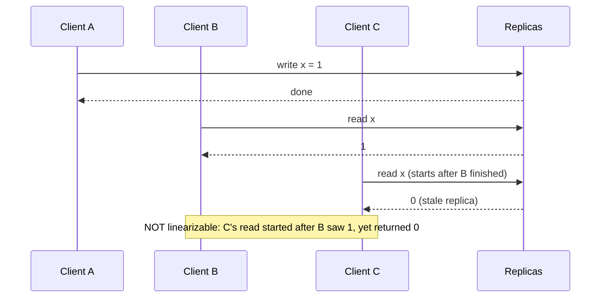
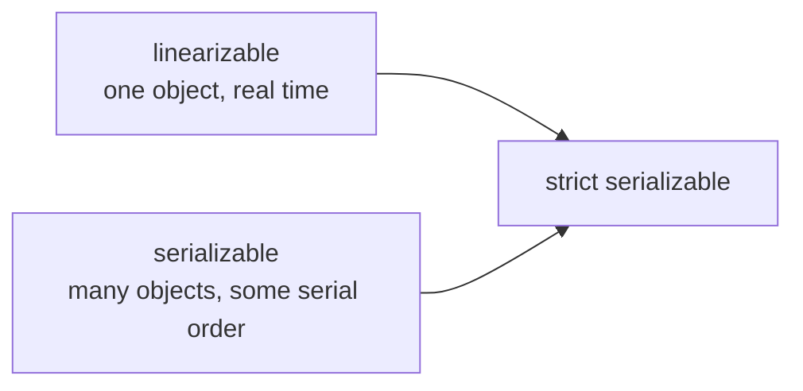
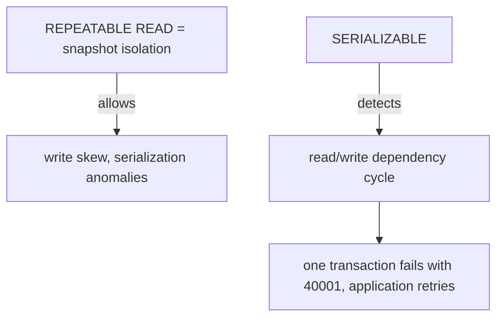

# Linearizability vs Serializability (and Strict Serializability)

> **Prerequisites:** [Lesson 09: Raft Consensus](../09-raft-consensus-explained/README.md) · [Lesson 11: Quorums](../11-quorums-explained/README.md) · [Lesson 18: Eventual Consistency in Practice](../18-eventual-consistency-in-practice/README.md).  
> **Estimated Reading Time:** 24–28 minutes  
> **Target Audience:** Backend engineers choosing databases and isolation levels, and candidates asked "what is the difference between linearizability and serializability?"  
> **Free PDF Notes:** [Download SD-H-022.pdf](https://backendroadmap.com/notes/system-design/SD-H-022.pdf)

> [!NOTE]
> **In one line:** **Linearizability** is about **one object** and **recency** (once a write completes, every later read sees it, as if there were one copy). **Serializability** is about **transactions over many objects** and **isolation** (the result equals *some* serial order, not necessarily real-time order). **Strict serializability** gives both.

> [!TIP]
> **The Golden Rule:** Linearizability is a property of *replicas* (single operations, real-time). Serializability is a property of *transactions* (many operations, some serial order). A system can have either without the other, and the words are constantly confused in interviews.

---

## 1. What They Are, and What They Aren't

Two words, two ideas.

| | Linearizability | Serializability |
| :--- | :--- | :--- |
| **About** | Single operations on one object (a register) | Transactions: groups of operations over many objects |
| **Guarantees** | Real-time order: once a write completes, later reads see it or something newer | The outcome equals *some* serial order of the transactions |
| **Respects real time?** | **Yes** | **No**: the serial order may differ from wall-clock order |
| **Family** | Consistency model (distributed systems) | Isolation level (databases) |
| **Typical systems** | etcd, ZooKeeper, Spanner reads, single-leader reads | PostgreSQL `SERIALIZABLE`, SQL isolation |
| **A violation looks like** | A stale read after a completed write | Write skew, phantoms, lost updates |

| Term | Precise Meaning | Example |
| :--- | :--- | :--- |
| **Linearizable** | Each operation appears to take effect atomically at one instant between its start and end | A register in etcd |
| **Serializable** | Concurrent transactions behave as if run one at a time | Postgres `SERIALIZABLE` |
| **Strict serializable** | Serializable *and* the serial order respects real time | Spanner |
| **Snapshot isolation (SI)** | Each transaction reads a consistent snapshot; weaker than serializable | Postgres `REPEATABLE READ` |
| **Write skew** | Two transactions read overlapping data and write different rows, breaking an invariant | Two doctors both go off call |
| **Not** | The same as CAP "consistency" or ACID "consistency" | Different "C"s |

### Why It Matters
1. Picking the wrong one causes real bugs: a "serializable" database can still return stale reads on replicas; a linearizable key-value store gives you no multi-key transactions.
2. Unique usernames, balances and inventory need *both* ideas in some form.
3. It is a frequent senior-level interview question, and a clean answer shows depth.

---

## 2. Anatomy: Recency vs Isolation

### Linearizability

A linearizable system behaves as if there were **one copy** of the data, and every operation takes effect atomically at some instant between its start and its end. So once a write has completed, any read that *starts afterwards*, from any client, must return that value or a newer one.



You get it from single-leader systems that read from the leader (with care, lesson 09), consensus stores such as etcd, and Spanner. Asynchronous replicas and most quorum setups do not provide it.

### Serializability

A serializable database guarantees that concurrent transactions produce the same result as if they had run **one after another, in some order**. It prevents anomalies like lost updates, write skew and phantoms. It does not promise *which* order, or that the order matches real time: a transaction that committed earlier could be ordered after one that started later. Implementations include two-phase locking, serializable snapshot isolation (Postgres `SERIALIZABLE`) and actual serial execution.

> [!WARNING]
> **"Serializable" does not mean "up to date".** On a replica, a serializable transaction can read old data and still be perfectly serializable (ordered before the newer writes). If you need the latest value you need *linearizability* on top, which is exactly what *strict* serializability adds.

---

## 3. Mathematical Model: Histories and Orders

Both are defined over a **history** of operations, each with a start and end time.

**Linearizability** needs a total order $\prec$ of the operations such that:
1. **Real-time:** if operation $a$ ends before $b$ starts, then $a \prec b$.
2. **Legal sequential behaviour:** every read returns the value of the latest preceding write.

**Serializability** needs a total order of *transactions* such that the result equals executing them serially in that order. There is **no real-time requirement**.

| Model | Real-time order | Multi-object transactions | Example gap |
| :--- | :---: | :---: | :--- |
| Linearizable | **Yes** | No (single objects) | No transactions across keys |
| Serializable | No | **Yes** | May read stale data |
| **Strict serializable** | **Yes** | **Yes** | Cost: coordination (consensus, TrueTime commit wait) |
| Snapshot isolation | No | Yes (weaker) | Write skew |

Checking linearizability is NP-complete in general, but for small histories you can search for a legal order directly, which is what the experiment below does.

---

## 4. Metrics & Percentiles

| Metric | Meaning | Why you care |
| :--- | :--- | :--- |
| **Stale-read rate** | Reads that return a value older than a completed write | The linearizability violation rate |
| **Serialization failures** | Transactions aborted with SQLSTATE `40001` | The cost of true serializability: retries |
| **Retry rate** | Transactions re-run after a failure | Should be low and bounded |
| **Read latency, leader vs follower** | Cost of linearizable reads | Linearizable reads cost a round trip |
| **Commit latency** | Time to commit a strict-serializable transaction | Includes commit wait and replication |
| **Invariant violations** | Counts of broken business rules | The real test (e.g. doctors on call) |

### Worked Example (unique usernames)
Two people try to register `alice` at the same moment, on different servers. The check "is alice taken?" and the insert happen in a transaction. Under snapshot isolation both read "not taken" and both insert: write skew, two Alices. Under serializability one of them aborts. In a replicated system you *also* need the check to see the latest committed data: a linearizable read, or a unique constraint enforced by a single leader. The simplest robust answer is a unique index on `username`, enforced in one place.

---

## 5. Compounding: Two Experiments

Simulations (Python 3.13, stdlib only).

**A. Linearizability of replica reads.** A leader and two followers; one client writes `1` (acknowledged at a random time); four reads follow at random times. Each follower applies the write after an exponentially distributed delay (mean 4 time units). A brute-force checker searches for any total order that respects real time and is a legal register history. 2,000 random histories per row:

| Where reads are served | Non-linearizable histories |
| :--- | :---: |
| **Always from the leader** | **0 of 2,000** |
| From a random replica (followers lag) | **1,002 of 2,000 (50.1%)** |

Reading from followers breaks real-time order in about half of these histories, even though every replica *eventually* converges.

**B. Write skew.** Two doctors are on call; each transaction reads the number on call and, if it is at least 2, takes *itself* off call. The invariant is that at least one doctor remains. The two transactions overlap in time 30% of the time. 10,000 trials:

| Isolation level | Trials where nobody is left on call |
| :--- | :---: |
| Snapshot isolation (`REPEATABLE READ`) | **3,070 (30.7%)** |
| Serializable | **0** |

Snapshot isolation breaks the invariant whenever the transactions overlap, because each decided on a snapshot that did not contain the other's write and they modified *different rows*, so there was no write-write conflict to detect.

---

## 6. Numbers Every Engineer Must Know

| Item | Typical | Implication |
| :--- | :---: | :--- |
| Linearizable read cost | a leader round trip (or a quorum read) | Slower than a local replica read |
| Serializable abort rate | low but non-zero | Applications must retry on `40001` |
| Postgres `REPEATABLE READ` | Snapshot Isolation | Allows write skew |
| Postgres `SERIALIZABLE` | Snapshot isolation plus conflict detection | One transaction fails and must retry |
| Spanner commit wait | about $2\varepsilon$ (a few ms) | The price of external consistency (lesson 05) |
| Strict serializability | consensus round trips per commit | Highest guarantee, highest cost |

---

## 7. Protocol Deep Dive: How Systems Get Each Guarantee

| Goal | Technique | Example |
| :--- | :--- | :--- |
| **Linearizable reads and writes** | Single leader, read from the leader after confirming leadership (read index or lease); consensus | etcd, ZooKeeper `sync`+read, Raft reads |
| **Serializable transactions** | Two-phase locking; serializable snapshot isolation (detect read/write dependency cycles); actual serial execution | Postgres `SERIALIZABLE`, Spanner (2PL), VoltDB |
| **Strict serializable** | Serializable *plus* real-time order: TrueTime commit wait, or a single consensus-ordered log | Spanner, FaunaDB; CockroachDB is close to it |



**Serializable but not strict.** Some implementations (several MVCC databases, replicas serving reads) are serializable but allow a transaction to be ordered *before* one that finished earlier in real time, so a client can see a stale state. Peter Bailis makes the distinction sharply: "Linearizability is a guarantee about single operations on single objects", "Serializability is a guarantee about transactions, or groups of one or more operations over one or more objects", and combining them yields **strict serializability**, where "transaction behavior is equivalent to some serial execution, and the serial order corresponds to real time". Other implementations, he notes, "such as some MVCC implementations may not" provide the real-time part.

---

## 8. Hierarchical Budgets & Design Rules

| Slice | Rule | Control |
| :--- | :--- | :--- |
| Single-key reads that must be fresh | Linearizable read | Leader read, quorum read, `ConsistentRead` |
| Multi-row invariants | Serializable isolation, or explicit constraints and locks | Postgres `SERIALIZABLE`, unique indexes |
| Retries | Handle serialization failures | Retry loop on SQLSTATE `40001` |
| Uniqueness | A unique constraint enforced in one place | Single leader or consensus |
| Cross-region fresh reads | Expect extra latency | Spanner-style, or accept staleness for those reads |
| Choice | Per feature, not per database | Strong where money and uniqueness live |
| Documentation | State the isolation level per transaction | Code review rule |

---

## 9. Top Mitigations

1. **Know which guarantee you need**: fresh single value (linearizable) vs multi-row invariant (serializable) vs both.
2. **Use `SERIALIZABLE`** (or explicit locks and constraints) for write-skew-prone logic, and **retry** on failure.
3. **Enforce uniqueness with a unique index** in one place.
4. **Read from the leader or use a consistent-read option** for read-after-write checks.
5. **Avoid assuming "serializable" means fresh** on replicas.
6. **Use strict serializable stores** for global invariants when the latency is acceptable.
7. **Test invariants** under concurrency, not just single-threaded behaviour.

---

## 10. Production Reference: PostgreSQL's Isolation Levels and Spanner

**PostgreSQL's documentation** is a precise statement of the serializability side.
- `REPEATABLE READ` is "implemented using a technique known... as *Snapshot Isolation*" and "prevents all of the phenomena described in Table 13.1 except for serialization anomalies".
- `SERIALIZABLE` "emulates serial transaction execution for all committed transactions; as if transactions had been executed one after another, serially, rather than concurrently". It "works exactly the same as Repeatable Read except that it also monitors for conditions which could make execution of a concurrent set of serializable transactions behave in a manner inconsistent with all possible serial (one at a time) executions".
- The manual's own anomaly example: transaction A computes the sum of class 1 and inserts it into class 2, while B does the opposite. "If either transaction were running at the Repeatable Read isolation level, both would be allowed to commit; but since there is no serial order of execution consistent with the result, using Serializable transactions will allow one transaction to commit and will roll the other back" with `could not serialize access due to read/write dependencies among transactions`.
- The cost: "applications using this level must be prepared to retry transactions due to serialization failures" (SQLSTATE `40001`).

**Spanner** is the standard example of the combination. Its abstract says it is "the first system to distribute data at global scale and support externally-consistent distributed transactions" (external consistency is strict serializability), and it gets there with TrueTime and commit wait (lesson 05).



**Lesson:** Postgres shows the isolation half concretely (what `SERIALIZABLE` adds over snapshot isolation, and its price, retries); Spanner shows what it takes to add the real-time half across data centres.

---

## 11. Multi-Language Production Code Tabs

Two practical tools: a **serializable transaction with retry** (the application side of serializability) and a **compare-and-set** (the linearizable single-key operation that enforces uniqueness).

````carousel
```go
// Go: retry a transaction on serialization failure (Postgres SQLSTATE 40001).
package main

import (
	"context"
	"database/sql"
	"errors"
)

type pgError interface{ SQLState() string }

func isSerializationFailure(err error) bool {
	var pe pgError
	return errors.As(err, &pe) && pe.SQLState() == "40001"
}

// WithSerializable runs fn in a SERIALIZABLE transaction and retries on 40001.
func WithSerializable(ctx context.Context, db *sql.DB, attempts int, fn func(*sql.Tx) error) error {
	var err error
	for i := 0; i < attempts; i++ {
		var tx *sql.Tx
		tx, err = db.BeginTx(ctx, &sql.TxOptions{Isolation: sql.LevelSerializable})
		if err != nil {
			return err
		}
		if err = fn(tx); err == nil {
			if err = tx.Commit(); err == nil {
				return nil
			}
		} else {
			_ = tx.Rollback()
		}
		if !isSerializationFailure(err) {
			return err
		}
	}
	return err
}
```
<!-- slide -->
```typescript
// TypeScript: retry a serializable transaction (node-postgres style).
interface Client {
  query(sql: string, params?: unknown[]): Promise<unknown>;
}

export async function withSerializable<T>(
  connect: () => Promise<Client>,
  fn: (c: Client) => Promise<T>,
  attempts = 5,
): Promise<T> {
  for (let i = 0; i < attempts; i++) {
    const c = await connect();
    try {
      await c.query("BEGIN ISOLATION LEVEL SERIALIZABLE");
      const result = await fn(c);
      await c.query("COMMIT");
      return result;
    } catch (err: any) {
      await c.query("ROLLBACK").catch(() => undefined);
      if (err?.code !== "40001" || i === attempts - 1) throw err; // only retry serialization failures
    }
  }
  throw new Error("unreachable");
}

// Uniqueness as a compare-and-set: INSERT ... ON CONFLICT DO NOTHING, then check the row count.
```
<!-- slide -->
```python
# Python: the experiments behind section 5 (stdlib only).
import random


class Op:
    def __init__(self, kind, value, start, end):
        self.kind, self.value, self.start, self.end = kind, value, start, end    # kind: 'w' or 'r'


def linearizable(history, initial=0):
    """True if some total order of the operations respects real time (if a ended before b started, a is first)
    and is a legal sequential register history (every read returns the latest preceding write)."""
    n = len(history)
    before = [[history[i].end < history[j].start for j in range(n)] for i in range(n)]

    def search(done, state):
        if len(done) == n:
            return True
        for i in range(n):
            if i in done or any(before[j][i] and j not in done for j in range(n)):
                continue                                          # already placed, or something must precede it
            op = history[i]
            if op.kind == "r" and op.value != state:
                continue                                          # this read would return a wrong value here
            if search(done | {i}, op.value if op.kind == "w" else state):
                return True
        return False

    return search(frozenset(), initial)


def run_register(read_from, trials=2000, seed=22):
    """A leader and two followers (follower apply delay ~ exponential, mean 4). One write of 1, then four reads
    at random times. read_from: 'leader' or 'any'. Returns (non-linearizable histories, trials)."""
    rng, bad = random.Random(seed), 0
    for _ in range(trials):
        w_start = rng.uniform(0, 5)
        w_end = w_start + rng.uniform(1, 3)
        applied = [w_end] + [w_end + rng.expovariate(1 / 4.0) for _ in range(2)]
        history = [Op("w", 1, w_start, w_end)]
        for _ in range(4):
            s = rng.uniform(0, 14)
            e = s + rng.uniform(0.2, 1.0)
            replica = 0 if read_from == "leader" else rng.randrange(3)
            history.append(Op("r", 1 if applied[replica] <= s else 0, s, e))
        bad += not linearizable(history)
    return bad, trials


def on_call_trial(isolation, rng, p_overlap=0.3):
    """Two doctors on call; each transaction reads the count and, if it is at least 2, takes itself off call.
    The transactions overlap in time with probability p_overlap. Returns True if nobody is left on call."""
    on_call = {"alice": True, "bob": True}
    order = ["alice", "bob"]
    rng.shuffle(order)
    if rng.random() >= p_overlap:                                  # no overlap: the second sees the first's commit
        for d in order:
            if sum(on_call.values()) >= 2:
                on_call[d] = False
        return sum(on_call.values()) == 0
    snapshot_reads = sum(on_call.values())                         # overlap: both read the same snapshot
    for d in order:
        if isolation == "snapshot":
            if snapshot_reads >= 2:                                # decided on stale data, different rows written
                on_call[d] = False
        elif sum(on_call.values()) >= 2:                           # serializable: conflict detected, loser re-validates
            on_call[d] = False
    return sum(on_call.values()) == 0


def write_skew(isolation, trials=10_000, seed=22):
    rng = random.Random(seed)
    return sum(on_call_trial(isolation, rng) for _ in range(trials))
```
<!-- slide -->
```csharp
// C#: retry a serializable transaction (Postgres via ADO.NET).
using System.Data;
using System.Data.Common;

public static class Tx
{
    public static async Task<T> WithSerializableAsync<T>(
        Func<Task<DbConnection>> connect, Func<DbTransaction, Task<T>> body, int attempts = 5)
    {
        for (var i = 0; ; i++)
        {
            await using var conn = await connect();
            await using var tx = await conn.BeginTransactionAsync(IsolationLevel.Serializable);
            try
            {
                var result = await body(tx);
                await tx.CommitAsync();
                return result;
            }
            catch (DbException e) when (e.SqlState == "40001" && i < attempts - 1)
            {
                await tx.RollbackAsync(); // serialization failure: run the whole transaction again
            }
        }
    }
}
```
````

---

## 12. Hands-On CLI Verification Workflows

The numbers in section 5 come from the Python tab (Python 3.13, seed 22):

```python
print(run_register("leader"))        # (0, 2000)
print(run_register("any"))           # (1002, 2000)
print(write_skew("snapshot"))        # 3070
print(write_skew("serializable"))    # 0
```

The checker itself on a hand-made history (the stale read from section 2):

```python
w  = Op("w", 1, 0, 1)                # write x=1, completed at t=1
rB = Op("r", 1, 2, 3)                # B reads 1, finishes at t=3
rC = Op("r", 0, 4, 5)                # C starts at t=4 (after B) and reads 0
print(linearizable([w, rB, rC]))     # False: C's read started after the write completed
print(linearizable([w, rB, Op("r", 1, 4, 5)]))   # True
```

On a real PostgreSQL you can reproduce write skew yourself with two `psql` sessions:

```sql
-- both sessions:
BEGIN ISOLATION LEVEL REPEATABLE READ;   -- change to SERIALIZABLE and one will fail with 40001
SELECT count(*) FROM doctors WHERE on_call;          -- both see 2
UPDATE doctors SET on_call = false WHERE name = 'alice';   -- session 1 (session 2 updates 'bob')
COMMIT;                                              -- under REPEATABLE READ both succeed: nobody on call
```

---

## 13. Common Mistakes to Avoid

1. **Using the two words interchangeably.**
2. **Assuming `SERIALIZABLE` means "latest data"** on a replica.
3. **Using `REPEATABLE READ` for check-then-insert** invariants (write skew).
4. **Not retrying** after `40001`.
5. **Reading from followers** where read-after-write freshness matters.
6. **Uniqueness enforced only in application code.**
7. **Believing a linearizable KV store gives multi-key transactions.**
8. **Paying for strict serializability** where per-key linearizability would do.

---

## 14. Key Terms Glossary

| Key Term | Definition |
| :--- | :--- |
| **Linearizability** | Single operations on one object appear to take effect atomically in real-time order. |
| **Serializability** | Transactions behave as if executed one after another in some order. |
| **Strict serializability** | Serializability whose serial order respects real time. |
| **External consistency** | Spanner's name for strict serializability. |
| **Snapshot isolation** | Transactions read a consistent snapshot; allows write skew. |
| **Write skew** | Disjoint writes based on overlapping reads break an invariant. |
| **Serialization failure** | A transaction aborted to preserve serializability (SQLSTATE `40001`). |
| **History** | A record of operations with start and end times. |
| **Real-time order** | If $a$ ends before $b$ starts, $a$ precedes $b$. |
| **Compare-and-set** | An atomic conditional update, a linearizable primitive. |

---

## 15. System Design Interview Questions & Answers

### Basic Conceptual Questions

<details>
<summary><strong>Q1: Linearizability vs serializability? [BASIC]</strong></summary>

**Answer:**
Linearizability is about single operations on a single object: once a write completes, later reads see it (real-time order). Serializability is about transactions over multiple objects: the result equals some serial order, not necessarily real-time. Linearizability is a consistency model for replicas; serializability is an isolation level.
</details>

<details>
<summary><strong>Q2: What is strict serializability? [BASIC]</strong></summary>

**Answer:**
Serializability whose serial order also respects real time (transactions that finish before others start are ordered first). It is linearizability and serializability together; Spanner calls it external consistency.
</details>

<details>
<summary><strong>Q3: Which systems give linearizability? [BASIC]</strong></summary>

**Answer:**
Single-leader systems that read from the leader, consensus stores such as etcd and ZooKeeper, and Spanner. Asynchronous replicas and most quorum setups do not.
</details>

<details>
<summary><strong>Q4: What is write skew? [BASIC]</strong></summary>

**Answer:**
Two concurrent transactions read overlapping data and write different rows, each based on a snapshot that lacks the other's write, breaking an invariant (two doctors both going off call). Snapshot isolation allows it; serializable does not.
</details>

### Scenario-Based Architecture Questions

<details>
<summary><strong>Q5: Two users register the same username at the same time. How do you prevent it? [SCENARIO]</strong></summary>

**Answer:**
A unique index enforced in one place (a single leader or consensus-backed store); an application "check then insert" under snapshot isolation allows both. Serializable isolation would also abort one, and in a replicated system the check must see the latest committed data.
</details>

<details>
<summary><strong>Q6: Your database claims to be serializable but a client read stale data after a write. How? [SCENARIO]</strong></summary>

**Answer:**
Serializable has no real-time requirement: the read transaction can be ordered before the write even though the write finished first, for example when served by a lagging replica. You need linearizable reads, i.e. strict serializability.
</details>

<details>
<summary><strong>Q7: How often do follower reads violate linearizability? [SCENARIO]</strong></summary>

**Answer:**
Depends on lag; in a simulation with a mean 4-unit follower delay and reads from a random replica, 50.1% of the 2,000 histories were not linearizable, while leader-only reads gave 0.
</details>

<details>
<summary><strong>Q8: What does `SERIALIZABLE` cost you in Postgres? [SCENARIO]</strong></summary>

**Answer:**
It works like `REPEATABLE READ` plus monitoring for read/write dependency cycles; one transaction in a cycle fails with SQLSTATE `40001`, so the application must retry. In a doctors-on-call simulation snapshot isolation broke the invariant in 30.7% of trials and serializable in 0.
</details>

### Advanced & Tricky Interview Questions

<details>
<summary><strong>Q9: Can a system be serializable but not linearizable? [TRICKY]</strong></summary>

**Answer:**
Yes: a serializable database may order transactions in a serial order that differs from real time, so a reader can see a state that excludes a write that already finished. Conversely, a linearizable key-value store gives no multi-key transactions at all.
</details>

<details>
<summary><strong>Q10: How does Spanner get strict serializability? [TRICKY]</strong></summary>

**Answer:**
Two-phase commit across Paxos groups for transactions, two-phase locking for isolation, and TrueTime timestamps with commit wait so timestamp order matches real-time order (lesson 05). The cost is roughly $2\varepsilon$ extra per commit and cross-replica round trips.
</details>

<details>
<summary><strong>Q11: Is the "C" in CAP linearizability? [TRICKY]</strong></summary>

**Answer:**
Yes, CAP's consistency is linearizability (atomic consistency). ACID's "C" is something else (application invariants), and the "I" in ACID is the isolation levels such as serializability.
</details>

<details>
<summary><strong>Q12: When is per-key linearizability enough? [TRICKY]</strong></summary>

**Answer:**
For single-row decisions: compare-and-set, a lock, a unique key, a counter with a leader. When an invariant spans several rows or tables you need transactions (serializability) in addition.
</details>

---

## 16. One-Page Master Cheat Sheet

```
+---------------------------------------------------------------------------------------------------------+
|                LINEARIZABILITY vs SERIALIZABILITY — MASTER CHEAT SHEET                                  |
+---------------------------------------------------------------------------------------------------------+
| 1. LINEARIZABLE: ONE object, real-time. Write done -> every later read sees it. A replica property.    |
+---------------------------------------------------------------------------------------------------------+
| 2. SERIALIZABLE: MANY objects, transactions equal SOME serial order. NO real-time promise. An isolation |
|    level. Stops write skew, lost updates, phantoms.                                                     |
+---------------------------------------------------------------------------------------------------------+
| 3. STRICT SERIALIZABLE: both (Spanner "external consistency"). Costs consensus round trips/commit wait. |
+---------------------------------------------------------------------------------------------------------+
| 4. SNAPSHOT ISOLATION (Postgres REPEATABLE READ) allows write skew. SERIALIZABLE fails one txn: RETRY.  |
+---------------------------------------------------------------------------------------------------------+
| 5. FOLLOWER READS break linearizability (50% of histories in the sim). Leader reads: 0.                 |
+---------------------------------------------------------------------------------------------------------+
| 6. UNIQUENESS: unique index in one place. Don't confuse CAP's C, ACID's C and ACID's I.                 |
+---------------------------------------------------------------------------------------------------------+
```

---

## Further Reading & Sources

- Peter Bailis, [Linearizability versus Serializability](http://www.bailis.org/blog/linearizability-versus-serializability/) (2014).
- PostgreSQL documentation, [Transaction Isolation](https://www.postgresql.org/docs/current/transaction-iso.html) (`REPEATABLE READ`, `SERIALIZABLE`, the anomaly example).
- Herlihy and Wing, "Linearizability: A Correctness Condition for Concurrent Objects" (1990).
- Corbett et al., [Spanner](https://research.google/pubs/spanner-googles-globally-distributed-database-2/) (OSDI 2012), external consistency.
- Jepsen, [Consistency models](https://jepsen.io/consistency), a map of the models and their relationships.

---

## Free PDF Notes

[SD-H-022.pdf](https://backendroadmap.com/notes/system-design/SD-H-022.pdf)

---

## Next

This closes the Distributed Systems track. Continue with [Track: Messaging](../../10-messaging/README.md).
