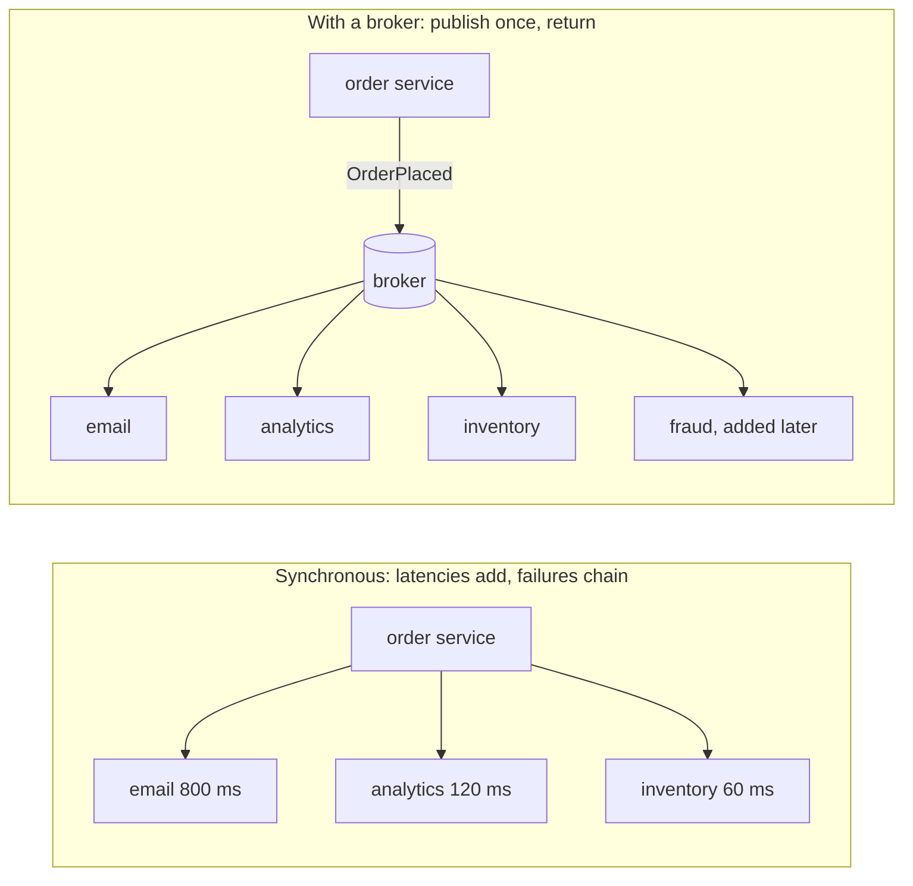
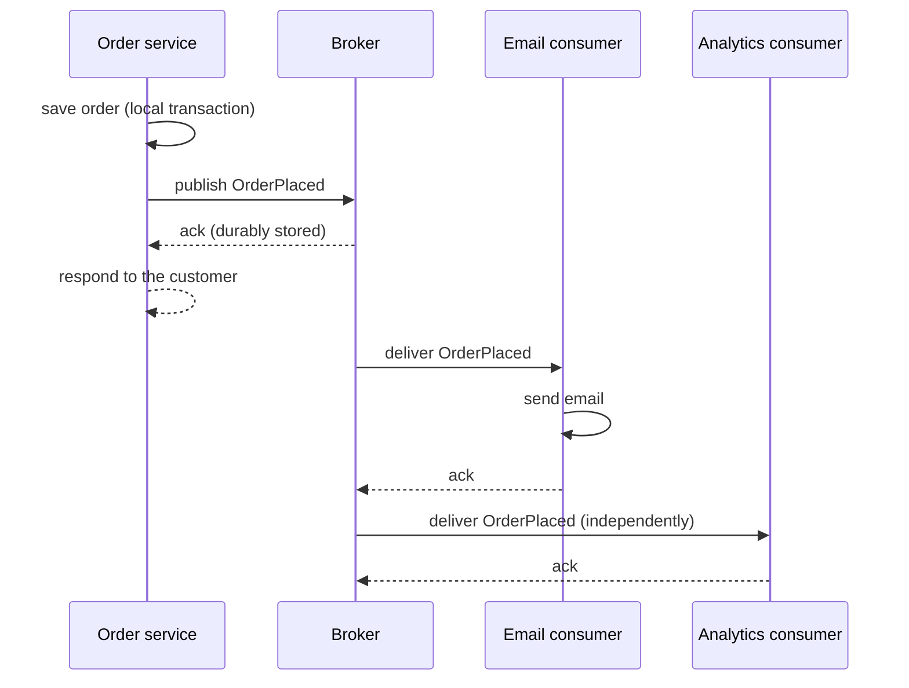
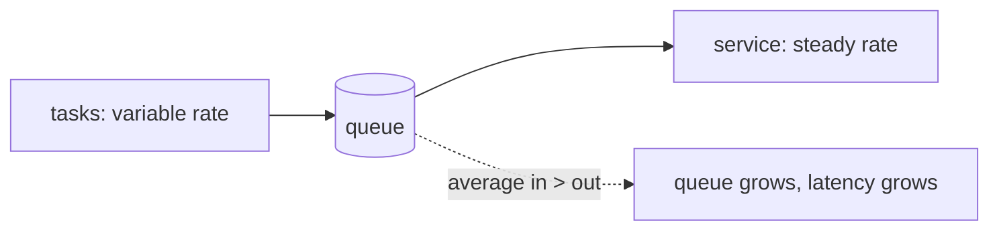

# Why Use a Message Broker? Decoupling, Load Levelling & the Costs

> **Prerequisites:** [Lesson 04: Asynchronous Processing](../../08-performance-and-traffic/04-asynchronous-processing/README.md) · [Lesson 20: Idempotent Consumers](../../09-distributed-systems/20-idempotent-consumers/README.md).  
> **Estimated Reading Time:** 22–26 minutes  
> **Target Audience:** Backend engineers deciding whether a call should be a message, and candidates asked "why would you put a queue or broker between services?"  
> **Free PDF Notes:** [Download SD-I-001.pdf](https://backendroadmap.com/notes/system-design/SD-I-001.pdf)

> [!NOTE]
> **In one line:** A message broker lets a service **publish** work or events and move on, while consumers process them independently. You gain **decoupling** (in space and in time), **buffering** for spikes (load levelling), **resilience** to slow or failed consumers and easy **fan-out**; you pay with **eventual consistency, duplicates, ordering questions and harder debugging**.

> [!TIP]
> **The Golden Rule:** Keep synchronous calls when the caller needs the answer *now* (a price, a payment authorisation). Use messages for work that can happen *after* the response. A broker is a post office, not a phone line.

---

## 1. What a Message Broker Is, and What It Isn't

When an order is placed, the order service calls the email service, the analytics service and the inventory service, one after another. If email is slow, checkout is slow. If analytics is down, checkout fails, even though the customer does not care about analytics. Every new feature adds another call to the chain.

| Term | Precise Meaning | Example |
| :--- | :--- | :--- |
| **Message broker** | A service that stores messages durably and delivers them to consumers | RabbitMQ, SQS, Kafka, Pub/Sub |
| **Producer / consumer** | The sender and the receiver of messages | Order service / email service |
| **Queue** | A buffer where each message goes to one consumer | A work queue |
| **Topic / stream** | A log or channel several consumers can read independently | `orders` topic (lesson 02) |
| **Decoupling in space** | The producer does not know who the consumers are | One `OrderPlaced`, many readers |
| **Decoupling in time** | The consumer may be down or slow; the producer proceeds | Email deployed mid-checkout |
| **Load levelling** | A queue smooths spikes so consumers run at a steady rate | Black Friday orders |
| **Not** | A way to make a slow operation fast, or a free lunch | It moves the work, and adds new problems |

### Why It Matters
1. Most scalable backends push slow, optional or fan-out work through a broker; "should this be a message?" is a daily design question.
2. The benefits and costs both come up in interviews, and the best answers name both.
3. The decisions that follow (queue vs stream, delivery semantics, ordering, DLQs) fill the rest of this track.

---

## 2. Anatomy: Synchronous Chain vs Broker



With messaging the order service publishes one message, `OrderPlaced`, to the broker and returns to the customer. The broker stores it durably and each interested service consumes it when ready. The producer does not know or care who the consumers are.

| Benefit | What it means |
| :--- | :--- |
| **Decoupling** | Producer and consumers evolve independently; a new consumer needs no producer change |
| **Buffering** | Spikes queue up; consumers catch up |
| **Resilience** | A down or slow consumer does not fail the request |
| **Fan-out** | One event, many independent readers |

| Cost | What it means |
| :--- | :--- |
| **Eventual consistency** | The email arrives later; stock is reserved after the response. Design the UX for it |
| **Duplicates and ordering** | Most brokers deliver at-least-once; consumers must be idempotent (lessons 20, 21) |
| **Operations** | A broker to run, monitor lag, dead-letter queues |
| **Debugging** | A flow spread across services needs correlation IDs and tracing |
| **No direct reply** | Messages are one-way; answers need a reply channel |

> [!WARNING]
> **A queue hides overload; it does not remove it.** If the average arrival rate exceeds the consumer rate, the queue grows without bound and latency grows with it. You must watch depth and age and either scale consumers or shed work.

---

## 3. Mathematical Model: Latency, Availability and Backlog

**Latency.** A synchronous chain's latency is the *sum* of its calls; a publish is one fast write:

$$T_{\text{sync}} = \sum_i t_i \qquad T_{\text{async}} \approx t_{\text{save}} + t_{\text{publish}}$$

With email 800 ms, analytics 120 ms and inventory 60 ms, checkout waits 980 ms for the three calls alone.

**Availability.** If checkout needs all $n$ services in the request, its availability is the product $\prod a_i$; with three services at 99.9% each, that is $0.999^3 = 99.70\%$. With a broker in the path, checkout depends on the broker (and the database), not on every consumer.

**Backlog (Little's Law and drain time).** With arrival rate $\lambda$ and consumer rate $\mu$ over a burst of length $T$, the queue grows by $(\lambda-\mu)T$ and then drains at the *spare* capacity $\mu-\lambda_{\text{base}}$:

$$\text{backlog} = (\lambda_{\text{burst}}-\mu)\,T, \qquad T_{\text{drain}} = \frac{\text{backlog}}{\mu-\lambda_{\text{base}}}$$

Spare capacity is the whole story: if $\mu\approx\lambda_{\text{base}}$ a backlog never drains.

---

## 4. Metrics & Percentiles

| Metric | Meaning | Alert when |
| :--- | :--- | :--- |
| **Queue depth** | Messages waiting | Rising for longer than a burst |
| **Message age $p_{99}$** | Time since enqueue for the oldest message | Exceeds the freshness SLO |
| **Consumer lag** | Messages (or time) behind the producer | Sustained growth |
| **Publish latency / error rate** | Time and failures to enqueue | Producer-side impact |
| **Redelivery and DLQ rate** | Duplicates and poison messages | Rising: consumer bugs |
| **End-to-end latency** | Event to effect visible | Beyond what the UX tolerates |

### Worked Example (`OrderPlaced`)
The order service saves the order and publishes one event, `OrderPlaced`. The email service consumes it and sends a confirmation; analytics records it; inventory reserves the stock. On Black Friday orders arrive ten times faster than email can send, so the messages queue up and email catches up over the next twenty minutes while checkout stays fast. When the email service is deployed or crashes, nothing upstream notices. Next month a fraud service subscribes to the same event with no change to the order service.

---

## 5. Compounding: A Burst and an Outage, Simulated

Second-by-second simulations (Python 3.13). Baseline 100 requests/s; the service or consumer handles at most 150/s.

**A. A 10x burst: 1,000 requests/s for 60 seconds.**

| Design | What happens | Result |
| :--- | :--- | :--- |
| **Synchronous calls** (excess rejected or timing out) | 84,000 requests arrive in the 300-second window | **33,000 served, 51,000 failed (60.7%)** |
| **Queue in between** (arrivals always accepted) | Backlog builds during the burst | **0 failed**, peak depth **51,000**, longest wait **340 s**, backlog gone after **1,109 s** |

The queue turned a 61% failure rate into a **delay**: nothing was lost, and users saw latency only for the asynchronous work. The cost is visible too: a 340-second wait at the worst moment, and almost 19 minutes to drain, because spare capacity is only $150-100=50$ per second ($51{,}000/50=1{,}020$ s).

**B. The consumer is down for 10 minutes (no burst).** Arrivals continue at 100/s for 600 s: backlog **60,000**, longest wait **400 s**, fully drained at **1,899 s** (after the restart at 700 s, 60,000 messages at a net 50/s take 1,200 s). A synchronous design would have failed every request for 10 minutes.

**C. Checkout latency and availability.** Three sequential calls (800 + 120 + 60 ms) at 99.9% each: **980 ms** and **99.70%**. With a broker, the checkout path is a database write plus a publish.

---

## 6. Numbers Every Engineer Must Know

| Item | Typical | Implication |
| :--- | :---: | :--- |
| Synchronous chain | sum of the call latencies | Slowest dependencies dominate |
| Publish latency | milliseconds | Checkout returns in tens of ms |
| Committed write in Kafka | about 10 ms (waits for in-sync replicas) | Durability costs a little latency |
| Drain time | backlog / (consumer rate − base rate) | Provision spare capacity |
| Delivery | at-least-once is the common default | Consumers must be idempotent |
| Queue durability | must persist to disk or replicated storage | Otherwise a crash loses messages |

---

## 7. Protocol Deep Dive: What a Broker Does for You



| Question | Answer |
| :--- | :--- |
| **Where is the message while consumers are down?** | Stored durably in the broker until acked |
| **What if a consumer crashes before acking?** | The broker redelivers (at-least-once) |
| **What if the producer crashes after saving but before publishing?** | Use the transactional outbox (lesson 15) |
| **What if processing keeps failing?** | Retry limits, then a dead-letter queue |
| **What about order?** | Per-partition or per-queue order; not global (later lessons) |

**When not to use a broker.** Microsoft's Azure Architecture Center says the pattern "might not be suitable when the caller requires a low-latency, synchronous response" or "the workload volume is predictably low and stable, so adding queueing complexity provides little benefit".

---

## 8. Hierarchical Budgets & Design Rules

| Slice | Rule | Control |
| :--- | :--- | :--- |
| Sync vs async | Sync if the caller needs the answer now; async for the rest | Per call, documented |
| Publish | After the local commit, via an outbox | No dual writes |
| Consumers | Idempotent, with retries and a DLQ | Lessons 20, 21 |
| Capacity | Consumer rate above the average arrival rate with headroom | Depth and age alerts |
| Autoscaling | Bound the consumers' downstream rate | Otherwise the overload moves downstream |
| Durability | Persist messages; know the retention limits | Replicated storage |
| Observability | Correlation IDs and tracing across hops | Propagate in message headers |
| UX | Design for eventual consistency | "Confirmation email on its way" |

---

## 9. Top Mitigations

1. **Use a broker for optional, slow or fan-out work**, not for answers the caller needs.
2. **Publish through a transactional outbox** so events are never lost after a commit.
3. **Make consumers idempotent** and add a dead-letter queue.
4. **Monitor depth, age and lag**, and size consumers for spare capacity.
5. **Bound autoscaling** by what the downstream can take.
6. **Propagate correlation IDs** so a flow can be traced.
7. **Design the user experience** for the delay.

---

## 10. Production Reference: Microsoft's Queue-Based Load Leveling Pattern

The Azure Architecture Center documents this as the *Queue-Based Load Leveling* pattern, and its text reads like a checklist for this lesson.

- **The problem:** "intermittent heavy loads can cause performance or reliability problems for a service". "Flooding a service with many concurrent requests can also cause the service to fail if it can't handle the contention."
- **The solution:** "Place a queue between the task and the service. The task and the service run asynchronously... The queue acts as a buffer and stores the message until the service retrieves it." The queue "decouples the tasks from the service so that the service can handle the messages at its own pace even when concurrent tasks generate a high volume of requests. Also, tasks aren't delayed if the service isn't available."
- **Benefits it lists:** availability ("service delays don't immediately and directly affect the application"), scalability, and **cost control**: "you only need enough service instances to meet the requirements for an average load rather than the peak load".
- **Caveats it lists:**
  - "If your average producer rate exceeds the consumer rate, the queue continues to grow and latency increases. Monitor queue depth and scale consumers within safe limits, or shed work at the producer."
  - "Autoscaling without bounding consumers' aggregate downstream rate only moves the overload to downstream dependencies."
  - "This pattern depends on queue durability to prevent message loss."
  - "Most queue services deliver messages with at-least-once semantics... Design consumer logic to be idempotent."
  - Poison messages should go to a dead-letter queue, and "introducing a queue... doesn't preserve the original submission order under all conditions, especially when multiple consumers process messages in parallel."
  - "Message queues are a one-way communication mechanism. If a task expects a reply from a service, you might need to implement a mechanism that the service can use to send a response."



**Lesson:** the pattern's value is *smoothing*, and every caveat in the list is a place where the smoothing can fail: more arrivals than capacity, unbounded autoscaling, lost messages, duplicates, disorder.

---

## 11. Multi-Language Production Code Tabs

A bounded in-process queue between a producer and a consumer: the same shape as a broker, with **backpressure** when the queue is full.

````carousel
```go
// Go: bounded queue (buffered channel) with a worker; Publish blocks or fails when full.
package main

import (
	"errors"
	"sync"
)

var ErrFull = errors.New("queue full: shed or retry later")

type OrderPlaced struct {
	OrderID string
	Total   int
}

type Broker struct {
	queue chan OrderPlaced
	wg    sync.WaitGroup
}

func NewBroker(capacity int, handle func(OrderPlaced)) *Broker {
	b := &Broker{queue: make(chan OrderPlaced, capacity)}
	b.wg.Add(1)
	go func() { // the consumer runs at its own pace
		defer b.wg.Done()
		for msg := range b.queue {
			handle(msg)
		}
	}()
	return b
}

// Publish never blocks the caller: it returns ErrFull so the producer can degrade or retry.
func (b *Broker) Publish(m OrderPlaced) error {
	select {
	case b.queue <- m:
		return nil
	default:
		return ErrFull
	}
}

func (b *Broker) Close() { close(b.queue); b.wg.Wait() }
```
<!-- slide -->
```typescript
// TypeScript: bounded async queue with one consumer loop.
interface OrderPlaced {
  orderId: string;
  total: number;
}

export class Broker {
  private queue: OrderPlaced[] = [];
  private running = false;

  constructor(private capacity: number, private handle: (m: OrderPlaced) => Promise<void>) {}

  // Returns false when full so the producer can shed load instead of growing without bound.
  publish(m: OrderPlaced): boolean {
    if (this.queue.length >= this.capacity) return false;
    this.queue.push(m);
    void this.drain();
    return true;
  }

  private async drain(): Promise<void> {
    if (this.running) return;
    this.running = true;
    while (this.queue.length > 0) {
      const m = this.queue.shift()!;
      await this.handle(m); // the consumer works at its own pace
    }
    this.running = false;
  }

  get depth(): number {
    return this.queue.length;
  }
}
```
<!-- slide -->
```python
# Python: the burst and outage simulations behind section 5 (stdlib only).
def burst_sync(base=100, burst=1000, burst_s=60, capacity=150, total_s=300, burst_start=30):
    """Synchronous calls: the service handles `capacity` requests per second; the rest fail.
    Returns (requests, served, failed)."""
    served = failed = 0
    for t in range(total_s):
        arrivals = burst if burst_start <= t < burst_start + burst_s else base
        ok = min(arrivals, capacity)
        served += ok
        failed += arrivals - ok
    return served + failed, served, failed


def burst_queue(base=100, burst=1000, burst_s=60, capacity=150, total_s=2000, burst_start=30,
                consumer_down=(None, None)):
    """Queue between producer and consumer (consumer rate = `capacity`/s). Arrivals are always accepted.
    consumer_down = (start_s, end_s) pauses the consumer."""
    depth = peak = peak_t = 0
    max_wait, empty_at = 0.0, None
    for t in range(total_s):
        arrivals = burst if burst_start <= t < burst_start + burst_s else base
        depth += arrivals
        down = consumer_down[0] is not None and consumer_down[0] <= t < consumer_down[1]
        if not down:
            depth -= min(depth, capacity)
        if depth > peak:
            peak, peak_t = depth, t
        max_wait = max(max_wait, depth / capacity)
        if empty_at is None and peak > 0 and t >= peak_t and depth == 0:
            empty_at = t                                    # the backlog built up earlier has fully drained
    return dict(peak_depth=peak, longest_wait_s=round(max_wait, 1), empty_at_s=empty_at)


def sync_checkout(latencies_ms=(800, 120, 60), availabilities=(0.999, 0.999, 0.999)):
    """Checkout latency and availability when it calls every dependency in sequence."""
    avail = 1.0
    for a in availabilities:
        avail *= a
    return sum(latencies_ms), avail
```
<!-- slide -->
```csharp
// C#: bounded queue with System.Threading.Channels; TryWrite fails fast when full.
using System.Threading.Channels;

public sealed record OrderPlaced(string OrderId, int Total);

public sealed class Broker
{
    private readonly Channel<OrderPlaced> _channel;
    private readonly Task _consumer;

    public Broker(int capacity, Func<OrderPlaced, Task> handle)
    {
        _channel = Channel.CreateBounded<OrderPlaced>(new BoundedChannelOptions(capacity)
        {
            FullMode = BoundedChannelFullMode.Wait,
        });
        _consumer = Task.Run(async () =>
        {
            await foreach (var msg in _channel.Reader.ReadAllAsync()) // the consumer works at its own pace
                await handle(msg);
        });
    }

    // false = queue full: shed load or retry later (backpressure).
    public bool Publish(OrderPlaced m) => _channel.Writer.TryWrite(m);

    public async Task CompleteAsync()
    {
        _channel.Writer.Complete();
        await _consumer;
    }
}
```
````

---

## 12. Hands-On CLI Verification Workflows

Run the Python tab (Python 3.13):

```python
print(burst_sync())                                         # (84000, 33000, 51000)
print(burst_queue())                                        # {'peak_depth': 51000, 'longest_wait_s': 340.0, 'empty_at_s': 1109}
print(burst_queue(burst=100, consumer_down=(100, 700)))     # {'peak_depth': 60000, 'longest_wait_s': 400.0, 'empty_at_s': 1899}
print(sync_checkout())                                      # (980, 0.997002999)
```

Check the model against the formulas: backlog $=(1000-150)\times60=51{,}000$; drain $=51{,}000/(150-100)=1{,}020$ s, so empty at $30+60+1{,}020=1{,}110$ s (the simulation says 1,109). For the outage: $100\times600=60{,}000$, drained at $700+60{,}000/50=1{,}900$ s (simulation: 1,899).

On a real broker, the two numbers to watch are depth and lag:

```bash
# RabbitMQ: messages ready/unacknowledged per queue
rabbitmqctl list_queues name messages_ready messages_unacknowledged

# Kafka: consumer lag per partition
kafka-consumer-groups.sh --bootstrap-server localhost:9092 --describe --group email-service

# SQS: approximate queue depth
aws sqs get-queue-attributes --queue-url "$URL" --attribute-names ApproximateNumberOfMessages
```

---

## 13. Common Mistakes to Avoid

1. **Putting a queue in front of a call that needs an immediate answer.**
2. **Assuming a queue removes overload**; it only delays it.
3. **No depth and age alerts**, so a backlog grows silently.
4. **Dual writes** (save, then publish) with no outbox.
5. **Non-idempotent consumers** on an at-least-once broker.
6. **Unbounded autoscaling** that moves the overload downstream.
7. **No dead-letter queue** for poison messages.
8. **No correlation IDs**, so flows cannot be traced.

---

## 14. Key Terms Glossary

| Key Term | Definition |
| :--- | :--- |
| **Message broker** | Service that stores and delivers messages between producers and consumers. |
| **Producer / consumer** | Sender / receiver of messages. |
| **Decoupling in space / time** | Unknown consumers / consumers that may be down or slow. |
| **Load levelling** | Using a queue to smooth bursts into a steady consumer rate. |
| **Fan-out** | One message delivered to many consumers. |
| **Backpressure** | Pushing back on producers when consumers cannot keep up. |
| **Queue depth / lag** | Messages waiting / how far behind consumers are. |
| **At-least-once** | A message may be delivered more than once. |
| **Dead-letter queue** | Holds messages that repeatedly fail. |
| **Eventual consistency** | The effect of a message appears after a delay. |

---

## 15. System Design Interview Questions & Answers

### Basic Conceptual Questions

<details>
<summary><strong>Q1: Why use a message broker? [BASIC]</strong></summary>

**Answer:**
Decoupling (the producer does not know the consumers and consumers can be down), buffering of spikes (load levelling), resilience to slow or failed consumers and easy fan-out. The costs are eventual consistency, duplicates, ordering questions, an extra system to run and harder debugging.
</details>

<details>
<summary><strong>Q2: What is load levelling? [BASIC]</strong></summary>

**Answer:**
A queue between a bursty producer and a service so the service processes at a steady rate. Spikes become delay instead of failures, and you provision for the average load rather than the peak.
</details>

<details>
<summary><strong>Q3: Decoupling in space vs in time? [BASIC]</strong></summary>

**Answer:**
Space: the producer does not know who consumes (add a fraud service without touching the order service). Time: the consumer may be down or slow while the producer carries on.
</details>

<details>
<summary><strong>Q4: When should you not use a broker? [BASIC]</strong></summary>

**Answer:**
When the caller needs a synchronous, low-latency answer (a price lookup, a payment authorisation), or when volume is low and stable so the queue adds complexity for no benefit.
</details>

### Scenario-Based Architecture Questions

<details>
<summary><strong>Q5: Checkout calls email, analytics and inventory in sequence. What do you change? [SCENARIO]</strong></summary>

**Answer:**
Keep only what checkout needs (payment, maybe inventory reservation) synchronous. Publish `OrderPlaced` (through an outbox) and let email, analytics and others consume it. In the example the synchronous chain cost 980 ms and 99.70% availability for three 99.9% services; with a broker checkout waits for a save and a publish.
</details>

<details>
<summary><strong>Q6: Orders spike 10x for a minute. What happens with and without a queue? [SCENARIO]</strong></summary>

**Answer:**
Without one, anything above the service's capacity fails: 51,000 of 84,000 requests in the simulation. With a queue, nothing fails; the backlog peaks at 51,000, the longest wait is 340 s, and it drains at the spare capacity (about 19 minutes), so the product must tolerate that delay.
</details>

<details>
<summary><strong>Q7: The email service is down for 10 minutes. What do users see? [SCENARIO]</strong></summary>

**Answer:**
Checkout continues; confirmation emails are delayed. When the service returns it drains the backlog at its spare capacity (60,000 messages at a net 50/s took 20 minutes in the model). With synchronous calls checkout would have failed for the whole outage.
</details>

<details>
<summary><strong>Q8: The queue keeps growing. What do you do? [SCENARIO]</strong></summary>

**Answer:**
Average arrivals exceed consumer throughput. Scale consumers (within what the downstream can take), speed up processing, shed or defer low-priority work at the producer, and alert on depth and age. A queue only hides sustained overload.
</details>

### Advanced & Tricky Interview Questions

<details>
<summary><strong>Q9: What new failure modes does a broker introduce? [TRICKY]</strong></summary>

**Answer:**
Duplicates (at-least-once), reordering across partitions or consumers, poison messages, lost events if publishing is not atomic with the database write, an extra component that can fail or fill up, and delayed effects that surprise users.
</details>

<details>
<summary><strong>Q10: How do you publish reliably after a database commit? [TRICKY]</strong></summary>

**Answer:**
A transactional outbox: write the event to an outbox table in the same local transaction and let a relay publish it, retrying until acknowledged. It removes lost events at the cost of duplicates, which idempotent consumers absorb (lesson 15).
</details>

<details>
<summary><strong>Q11: How do you do request-reply over a broker? [TRICKY]</strong></summary>

**Answer:**
Put a correlation ID and a reply-to address in the request message; the service publishes its response to that address and the caller matches it by ID. Often it is better to keep that call synchronous if the caller needs the answer immediately.
</details>

<details>
<summary><strong>Q12: Does autoscaling consumers always fix a backlog? [TRICKY]</strong></summary>

**Answer:**
No. It can move the overload to a shared downstream (a database), increasing contention and defeating the leveling. Bound the aggregate downstream rate, per Microsoft's pattern guidance.
</details>

---

## 16. One-Page Master Cheat Sheet

```
+---------------------------------------------------------------------------------------------------------+
|                    WHY A MESSAGE BROKER — MASTER CHEAT SHEET                                            |
+---------------------------------------------------------------------------------------------------------+
| 1. SYNC CHAIN: latency = sum of calls (800+120+60 = 980 ms); availability = product (99.9%^3 = 99.7%).  |
+---------------------------------------------------------------------------------------------------------+
| 2. BROKER: publish once, return. Gains: decoupling (space, time), buffering, resilience, fan-out.       |
+---------------------------------------------------------------------------------------------------------+
| 3. LOAD LEVELLING: spike -> delay not failure. 10x burst: 60.7% failed sync, 0 with a queue.            |
|    Drain time = backlog / (consumer rate - base rate).                                                  |
+---------------------------------------------------------------------------------------------------------+
| 4. COSTS: eventual consistency · duplicates · ordering · ops · debugging · no direct reply.             |
+---------------------------------------------------------------------------------------------------------+
| 5. KEEP SYNC when the caller needs the answer now. Queue hides overload, doesn't remove it.             |
+---------------------------------------------------------------------------------------------------------+
| 6. DO: outbox, idempotent consumers, DLQ, depth/age alerts, bounded autoscaling, correlation IDs.       |
+---------------------------------------------------------------------------------------------------------+
```

---

## Further Reading & Sources

- Microsoft Azure Architecture Center, [Queue-Based Load Leveling pattern](https://learn.microsoft.com/en-us/azure/architecture/patterns/queue-based-load-leveling).
- Gregor Hohpe and Bobby Woolf, *Enterprise Integration Patterns* (messaging fundamentals).
- Martin Kleppmann, *Designing Data-Intensive Applications*, chapter 11, "Messaging systems".
- Chris Richardson, "Messaging" and "Transactional outbox" patterns (microservices.io).

---

## Free PDF Notes

[SD-I-001.pdf](https://backendroadmap.com/notes/system-design/SD-I-001.pdf)

---

## Next

Continue with [Lesson 02: Message Queues vs Event Streams](../02-message-queues-vs-event-streams/README.md): RabbitMQ/SQS vs Kafka.
