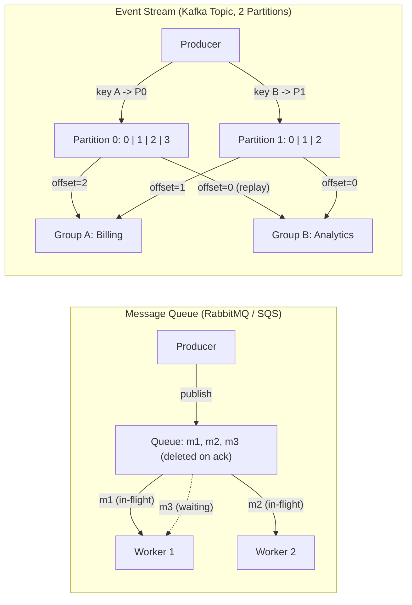
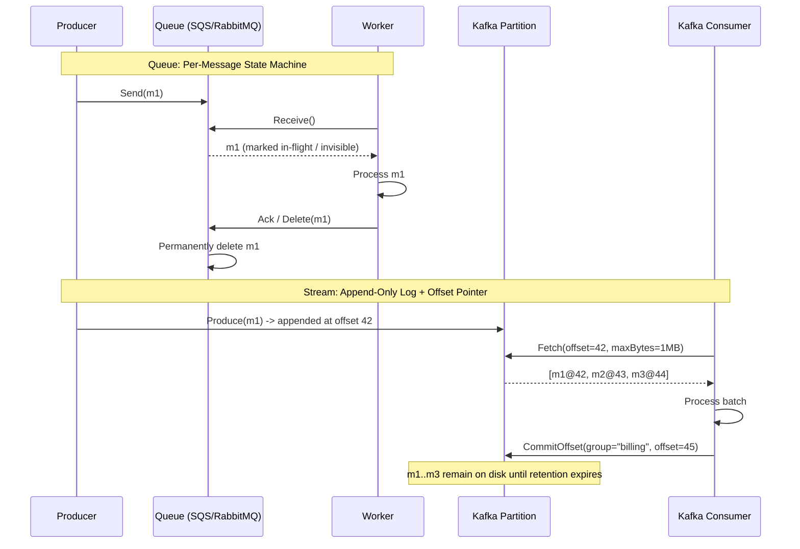
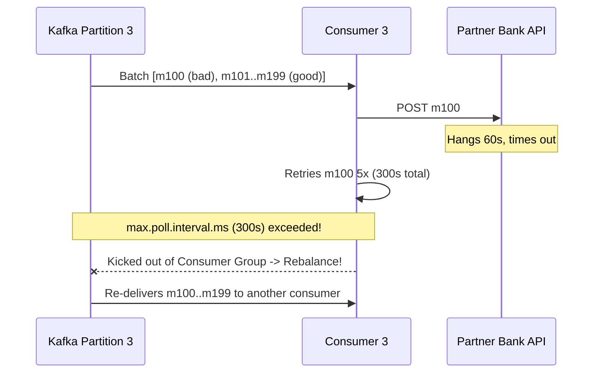

# Message Queues vs Event Streams: RabbitMQ/SQS vs Kafka

> **Prerequisites:** [Lesson 01: Why Use a Message Broker?](../01-why-use-a-message-broker-decoupling-load-levelling-the-costs/README.md).  
> **Estimated Reading Time:** 24–28 minutes  
> **Target Audience:** Backend engineers choosing between RabbitMQ, SQS, and Kafka, and candidates asked "would you use a queue or an event stream here, and why?"  
> **Free PDF Notes:** [Download SD-I-002.pdf](https://backendroadmap.com/notes/system-design/SD-I-002.pdf)

> [!NOTE]
> **In one line:** A **message queue** (RabbitMQ, SQS) is a destructive, per-message work buffer that deletes messages once acknowledged and scales competing workers effortlessly; an **event stream** (Kafka, Pulsar, Kinesis) is an append-only, partitioned commit log that retains events by time/size so multiple independent consumer groups can read, replay, and rewind at their own pace.

> [!TIP]
> **The Golden Rule:** Choose a **queue** when messages are *tasks* to be processed once and forgotten (invoices, emails, background jobs) with per-message routing or variable job durations. Choose an **event stream** when messages are *facts* that multiple services need independently, in partition order, or with replayability (orders, clickstreams, CDC, event sourcing).

---

## 1. What Message Queues and Event Streams Are, and What They Aren't

Suppose your platform processes `OrderPlaced`. The billing team wants to charge the card once and delete the job. Six months later, the ML team wants to retrain a fraud model over the last 30 days of `OrderPlaced` events, and the analytics team wants a real-time dashboard. With a classic queue, the billing worker already deleted those messages—you cannot rewind an emptied mailbox. With an event stream, the log still holds all 30 days on disk, and the ML team simply starts a new consumer group at `offset 0`.

| Term | Precise Meaning | Example |
| :--- | :--- | :--- |
| **Message queue** | A destructive buffer where each message is delivered to one competing consumer and removed on `ack` | RabbitMQ classic queue, Amazon SQS |
| **Event stream (log)** | An append-only, ordered sequence of immutable records partitioned across brokers and retained for a configured window | Apache Kafka, Redpanda, AWS Kinesis |
| **Competing consumers** | Multiple workers pulling from the same queue to share work in parallel | 10 SQS workers processing `SendEmail` |
| **Consumer group** | A logical subscriber in Kafka where each partition is assigned to at most one consumer in the group | `billing-group` and `analytics-group` |
| **Destructive read** | Reading + acknowledging removes the message from the broker | RabbitMQ `basic.ack`, SQS `DeleteMessage` |
| **Non-destructive read** | Reading advances a consumer's offset pointer without deleting the record | Kafka `poll()` + `commitSync()` |
| **Replay / rewind** | Resetting a consumer offset to reprocess historical events | Rebuilding a search index from `offset 0` |
| **Not** | A silver bullet where Kafka is "just a faster RabbitMQ" | Kafka lacks per-message routing, priority queues, and >partition parallelism |

### Why It Matters
1. "RabbitMQ/SQS vs Kafka" is one of the highest-frequency system design follow-ups; picking Kafka for a simple job queue—or SQS for event replay—signals a shallow grasp of broker internals.
2. The storage model (mutable queue vs immutable log) dictates everything downstream: ordering, fan-out cost, backpressure, parallelism limits, and operational burden.
3. Many production architectures use **both**: Kafka as the durable event backbone, and SQS/RabbitMQ for fine-grained task retries, delayed jobs, and dead-letter workflows.

---

## 2. Anatomy: Destructive Queue vs Append-Only Log



In a **queue**, the broker tracks the state of every individual message (`ready`, `unacked`, `requeued`, `deleted`). Workers pull or receive pushes concurrently; if Worker 1 takes 5 seconds on `m1` while Worker 2 finishes `m2` in 50 ms, that is completely fine—and `m2` finishes before `m1`.

In an **event stream**, the broker does **not** track per-message acks. It appends bytes sequentially to partition log segments on disk and tracks only a single integer (`committed offset`) per `(consumer_group, partition)` pair.

| Dimension | Message Queue (RabbitMQ / SQS) | Event Stream (Kafka / Kinesis) |
| :--- | :--- | :--- |
| **Delivery model** | Smart broker, dumb consumer (push or long-poll) | Dumb broker, smart consumer (pull with offsets) |
| **Retention** | Deleted immediately upon `ack` | Retained by time (e.g., 7 days) or size (e.g., 500 GB) |
| **Ordering** | Best-effort (FIFO lost with multiple workers; SQS FIFO caps throughput) | Strict **per-partition** FIFO order |
| **Parallelism cap** | Unlimited workers on one queue | Capped at **number of partitions** per consumer group |
| **Fan-out** | Requires exchange/SNS creating $N$ separate queue copies | Free: $N$ consumer groups read the same log segments |
| **Routing & filtering** | Rich (topic exchanges, headers, priority queues, per-message TTL) | Coarse (topic + partition key; consumer filters in code) |
| **Replay** | Impossible once acked | Trivial: seek offset to timestamp or `0` |
| **Head-of-line blocking** | None across workers; a slow message only ties up one worker | Severe within a partition: one slow/poison message blocks the partition |

> [!WARNING]
> **The #1 Trap: Using Kafka as a per-job work queue with variable 30-second tasks.** Because Kafka commits a single offset per partition, if message #42 takes 30 seconds (or crashes repeatedly), messages #43–#1000 behind it in the same partition are blocked—and you cannot scale past the partition count. If you need per-message acks, arbitrary worker scaling, and non-blocking retries, use a queue.

---

## 3. Mathematical Model: Storage, Fan-Out Cost, and Parallelism Bounds

**1. Storage Footprint (Queue vs Stream).**
A queue stores only the *live backlog* $B(t)$ at rate $\lambda$ with average message size $s$:

$$S_{\text{queue}} \approx B_{\text{peak}} \cdot s$$

An event stream stores *all* events over retention window $T_{\text{ret}}$ multiplied by replication factor $R$:

$$S_{\text{stream}} = \lambda \cdot s \cdot T_{\text{ret}} \cdot R$$

**Worked Example:** Suppose $\lambda = 20{,}000\text{ msg/s}$, $s = 1\text{ KB}$, $T_{\text{ret}} = 7\text{ days} = 604{,}800\text{ s}$, $R = 3$, and normal queue backlog $B_{\text{peak}} = 100{,}000\text{ messages}$.
- **Queue storage:** $100{,}000 \times 1\text{ KB} = 100\text{ MB}$ (tiny, fits in RAM).
- **Stream storage:** $20{,}000 \times 1\text{ KB} \times 604{,}800 \times 3 = 36.29\text{ TB}$ across the cluster.

**2. Fan-Out Write Amplification.**
With $G$ independent downstream consumers:
- **Queue + Fan-out (SNS → $G$ SQS queues / RabbitMQ exchanges):** Each published event is written $G$ times to separate queues: $W_{\text{queue}} = \lambda \cdot G$.
- **Event Stream (Kafka):** Written once to the topic log (replicated $R$ times for durability, independent of $G$): $W_{\text{stream}} = \lambda \cdot R$.

When $G > R$ (e.g., 10 microservices consuming `OrderPlaced` with $R=3$), a stream avoids $3.3\times$ write amplification.

**3. Max Throughput & Parallelism Bound.**
For a Kafka topic with $P$ partitions and average per-message processing time $t_{\text{proc}}$:

$$C_{\max} \le P, \qquad \mu_{\max} = \frac{P}{t_{\text{proc}}}$$

If $P = 12$ and $t_{\text{proc}} = 10\text{ ms}$, $\mu_{\max} = 12 / 0.01 = 1{,}200\text{ msg/s}$—adding a 13th consumer leaves it idle. In SQS/RabbitMQ, adding a 13th worker immediately increases throughput to $1{,}300\text{ msg/s}$.

---

## 4. Metrics & Percentiles

| Metric | Meaning | Alert when |
| :--- | :--- | :--- |
| **Consumer lag (Stream)** | `log_end_offset - committed_offset` per partition | Growing steadily across consecutive scrapes |
| **Queue depth (Queue)** | `messages_ready + messages_unacked` | Exceeds drain capacity for $> 5\text{ min}$ |
| **In-flight / Unacked ratio** | Messages leased to workers but not yet acked | Approaching `MaxInFlight` / prefetch limit (stalled workers) |
| **Partition skew** | $\max(\text{lag}_p) / \text{avg}(\text{lag}_p)$ across partitions | $> 3\times$ (hot key causing single-partition bottleneck) |
| **Disk / Page Cache Hit Ratio** | % of Kafka reads served from OS page cache vs disk | $< 95\%$ (old-offset replay thrashing live tail) |
| **DLQ / Poison rate** | Messages exceeding `maxReceiveCount` or retry budget | $> 0.1\%$ of traffic or sudden spike |

### Worked Example (`Clickstream` vs `InvoicePDF`)
- **Workload A (`InvoicePDF`):** 500 req/s, each PDF takes 400 ms to render, occasional 3rd-party font API timeouts (15 s).
  - Required workers: $500 \times 0.4 = 200$ concurrent workers.
  - **Choice:** **SQS / RabbitMQ.** 200 workers pull independently; a 15-second timeout on one invoice does not block the other 199 workers, and failed jobs route to a DLQ after 3 attempts.
- **Workload B (`Clickstream`):** 100,000 events/s, 5 consumers (fraud, billing, real-time ML, warehouse sink, A/B testing), 7-day replay needed for ML backfills.
  - **Choice:** **Kafka** with 64 partitions. Single write path (no 5x queue duplication), sequential disk I/O + zero-copy `sendfile`, and ML can rewind to `offset 0` anytime.

---

## 5. Compounding & Failure Modes

What happens when a single downstream call stalls for 10 seconds on 1% of messages at $\lambda = 1{,}000\text{ msg/s}$ across 10 workers/partitions?

| Failure Scenario | Message Queue (10 Workers) | Event Stream (10 Partitions, 10 Consumers) |
| :--- | :--- | :--- |
| **1% slow messages (10 s each)** | Only 1 worker is busy for 10 s; the other 9 workers drain the remaining 99% at 900 msg/s. Queue depth barely ripples. | If slow messages hit 3 partitions, those 3 partitions **stall completely** for 10 s. Lag spikes by $3 \times 100 \times 10 = 3{,}000$ messages on those partitions. |
| **Consumer crash mid-batch** | Visibility timeout expires (e.g., 30 s); only that 1 unacked message is redelivered. | Entire uncommitted batch (e.g., 500 records) is re-delivered from last committed offset upon rebalance. |
| **Broker memory pressure** | RabbitMQ hits `vm_memory_high_watermark` and blocks all publishers via TCP backpressure if queues aren't drained. | Kafka spills seamlessly to sequential disk segments; OS page cache absorbs tail reads, though old-offset replays can evict hot pages. |
| **Adding a 4th subscriber** | Must create a new queue + binding; historical messages are gone forever. | New consumer group joins with `auto.offset.reset=earliest` and reads full 7-day history with zero producer changes. |

---

## 6. Numbers Every Engineer Must Know

| Item | Typical | Implication |
| :--- | :---: | :--- |
| Kafka throughput (3-broker cluster, NVMe) | 100k–1M+ msg/s (sequential I/O + batching) | Far higher sustained throughput per node than traditional queues |
| RabbitMQ classic queue throughput | 10k–50k msg/s per queue | Bottlenecked by per-message state tracking & Erlang process |
| AWS SQS Standard throughput | Practically unlimited (distributed) | No strict ordering; at-least-once with occasional duplicates |
| AWS SQS FIFO throughput | 300 msg/s (3,000 batched; higher w/ high-throughput mode) | Strict ordering per `MessageGroupId` caps scale |
| Kafka `sendfile` zero-copy | Bypasses user-space memory copies | Network NIC saturates before CPU on sequential tail reads |
| RabbitMQ `prefetch` / SQS `VisibilityTimeout` | `prefetch` 10–100; visibility 30–300 s | Too low = underutilized workers; too high = uneven load / slow recovery |

---

## 7. Protocol / Mechanism Deep Dive: Ack & Offset Lifecycle



| Question | Answer |
| :--- | :--- |
| **How does RabbitMQ/SQS know a message is done?** | Explicit per-message `basic.ack` / `DeleteMessage`. Unacked messages become visible again after disconnect or `VisibilityTimeout`. |
| **How does Kafka know a message is done?** | It doesn't—it only stores `committed_offset = 45` in `__consumer_offsets`, meaning "this group has processed everything $< 45$." |
| **Can a Kafka consumer skip message #42 and ack #43?** | No. Committing offset 44 implicitly marks #42 as processed. Skipping requires moving #42 to a retry/DLQ topic. |
| **What happens if a consumer group commits too late?** | On crash, all records between the last committed offset and the crash point are replayed (duplicates). |

**When NOT to use an Event Stream:**
- You need **selective/per-message deletion** or **GDPR right-to-be-forgotten** on individual records mid-log (streams are append-only; tombstones require log compaction).
- You need **priority queues** (VIP jobs jump ahead of bulk jobs) or **delayed/scheduled delivery** (e.g., "retry in 17 minutes").
- Your team is small and you just need a background job queue with zero ops—managed **SQS** or **Cloud Tasks** beats operating Kafka.

---

## 8. Hierarchical Budgets & Design Rules

| Slice | Rule | Control |
| :--- | :--- | :--- |
| **Workload classification** | Tasks $\to$ Queue; Facts/Events $\to$ Stream | Architecture review checklist |
| **Partition sizing (Kafka)** | $P \ge \max(\text{target\_throughput} / \text{single\_consumer\_rate})$ | Provision $2\times$–$3\times$ headroom; partitions are hard to shrink |
| **Queue retries & DLQ** | Cap `maxReceiveCount` at 3–5; route poison pills to DLQ | Automated DLQ replay/alerting |
| **Stream retention** | Size disk for `peak_rate * msg_size * retention * RF * 1.5` | Disk usage alert at 70% |
| **Ordering scope** | Never promise global order across partitions/workers | Use partition keys (`order_id`) or SQS `MessageGroupId` |
| **Consumer idempotency** | Both SQS Standard and Kafka default to at-least-once | Deduplicate by `event_id` in DB/Redis |

---

## 9. Top Mitigations

1. **Match broker to access pattern:** Do not force Kafka to behave like Celery/Sidekiq; pair Kafka with a queue or DB-backed job table if you need per-task state.
2. **Use `MessageGroupId` or Partition Keys intentionally:** Pick high-cardinality keys (`user_id`, `order_id`) to prevent hot-partition skew while keeping entity order.
3. **Never block a Kafka consumer thread indefinitely:** Bound downstream HTTP/DB timeouts (`< session.timeout.ms` / `max.poll.interval.ms`) and offload slow retries to a separate retry topic or queue.
4. **Configure DLQs on both queues and streams:** In queues it's native (`RedrivePolicy`); in Kafka, build an explicit `topic.dlq` producer in your consumer error handler.
5. **Isolate replay workloads in Kafka:** If an analytics backfill reads from `offset 0`, rate-limit it or use follower fetching so it doesn't evict the OS page cache for real-time consumers.
6. **Monitor consumer lag in *seconds*, not just message count:** 10,000 messages at 10,000/s is 1 second of lag; at 10/s it is 16 minutes.

---

## 10. Production Reference: The "Kafka as a Job Queue" SEV-1 Outage

A fintech startup used Kafka (8 partitions) to process bank-transfer webhooks. Each webhook took ~50 ms, except when a partner bank's legacy SOAP API hung for 60 seconds.



- **Root Cause:** Blocking retries inside the Kafka `poll()` loop exceeded `max.poll.interval.ms` (5 minutes). The broker assumed the consumer was dead, triggered a group rebalance, and handed Partition 3 to another consumer—which immediately choked on the exact same `m100` poison pill in an infinite "rebalance storm."
- **The Fix:**
  1. Decoupled ingestion from slow external calls: Kafka consumer wrote jobs to an **SQS queue** (or a **non-blocking retry topic** with exponential backoff + DLQ).
  2. Set strict 3-second HTTP timeouts and `max.poll.records=50` so `poll()` always completed well within `max.poll.interval.ms`.

---

## 11. Multi-Language Production Code Tabs

Comparing the two core idioms: a **destructive competing-worker Queue** vs an **append-only offset-tracked Event Stream**.

````carousel
```go
// Go: In-memory Queue (destructive) vs Append-Only Stream (non-destructive offsets)
package main

import (
	"fmt"
	"sync"
)

// Queue: each message is popped once and gone.
type Queue struct {
	ch chan string
}

func (q *Queue) Publish(msg string) { q.ch <- msg }
func (q *Queue) Consume() string    { return <-q.ch }

// Stream: immutable log; each consumer group tracks its own offset.
type Stream struct {
	mu      sync.RWMutex
	log     []string
	offsets map[string]int
}

func NewStream() *Stream {
	return &Stream{offsets: make(map[string]int)}
}

func (s *Stream) Append(event string) int {
	s.mu.Lock()
	defer s.mu.Unlock()
	s.log = append(s.log, event)
	return len(s.log) - 1
}

func (s *Stream) Poll(group string) (string, bool) {
	s.mu.Lock()
	defer s.mu.Unlock()
	off := s.offsets[group]
	if off >= len(s.log) {
		return "", false
	}
	ev := s.log[off]
	s.offsets[group] = off + 1 // commit offset
	return ev, true
}

func (s *Stream) Seek(group string, offset int) {
	s.mu.Lock()
	defer s.mu.Unlock()
	s.offsets[group] = offset // replay!
}

func main() {
	stream := NewStream()
	stream.Append("OrderPlaced#1")
	stream.Append("OrderPlaced#2")

	ev, _ := stream.Poll("billing")
	fmt.Println("billing:", ev) // OrderPlaced#1
	ev2, _ := stream.Poll("analytics")
	fmt.Println("analytics:", ev2) // OrderPlaced#1 (independent!)
	stream.Seek("billing", 0)
	ev3, _ := stream.Poll("billing")
	fmt.Println("billing replay:", ev3) // OrderPlaced#1
}
```
<!-- slide -->
```typescript
// TypeScript: Queue (destructive pop) vs Event Stream (offset-based replay)
class MessageQueue<T> {
  private items: T[] = [];
  publish(msg: T): void {
    this.items.push(msg);
  }
  consume(): T | undefined {
    return this.items.shift(); // destructive read
  }
}

class EventStream<T> {
  private log: T[] = [];
  private offsets = new Map<string, number>();

  append(event: T): number {
    this.log.push(event);
    return this.log.length - 1;
  }

  poll(group: string): T | undefined {
    const offset = this.offsets.get(group) ?? 0;
    if (offset >= this.log.length) return undefined;
    const event = this.log[offset];
    this.offsets.set(group, offset + 1);
    return event;
  }

  seek(group: string, offset: number): void {
    this.offsets.set(group, Math.max(0, offset));
  }
}

const stream = new EventStream<string>();
stream.append("OrderPlaced#1");
console.log("billing:", stream.poll("billing"));
console.log("analytics:", stream.poll("analytics"));
stream.seek("billing", 0);
console.log("billing replay:", stream.poll("billing"));
```
<!-- slide -->
```python
# Python: Queue vs Event Stream with independent consumer group offsets
from collections import deque
from typing import Dict, List, Optional

class MessageQueue:
    def __init__(self) -> None:
        self._q: deque[str] = deque()

    def publish(self, msg: str) -> None:
        self._q.append(msg)

    def consume(self) -> Optional[str]:
        return self._q.popleft() if self._q else None  # destructive

class EventStream:
    def __init__(self) -> None:
        self._log: List[str] = []
        self._offsets: Dict[str, int] = {}

    def append(self, event: str) -> int:
        self._log.append(event)
        return len(self._log) - 1

    def poll(self, group: str) -> Optional[str]:
        offset = self._offsets.get(group, 0)
        if offset >= len(self._log):
            return None
        self._offsets[group] = offset + 1
        return self._log[offset]

    def seek(self, group: str, offset: int) -> None:
        self._offsets[group] = max(0, offset)

stream = EventStream()
stream.append("OrderPlaced#1")
print("billing:", stream.poll("billing"))
print("analytics:", stream.poll("analytics"))
stream.seek("billing", 0)
print("billing replay:", stream.poll("billing"))
```
<!-- slide -->
```csharp
// C#: Destructive Queue vs Append-Only Event Stream with Offset Tracking
using System;
using System.Collections.Generic;

public class EventStream<T>
{
    private readonly List<T> _log = new();
    private readonly Dictionary<string, int> _offsets = new();

    public int Append(T ev)
    {
        _log.Add(ev);
        return _log.Count - 1;
    }

    public bool TryPoll(string group, out T? ev)
    {
        int offset = _offsets.TryGetValue(group, out var cur) ? cur : 0;
        if (offset >= _log.Count)
        {
            ev = default;
            return false;
        }
        ev = _log[offset];
        _offsets[group] = offset + 1;
        return true;
    }

    public void Seek(string group, int offset) => _offsets[group] = Math.Max(0, offset);
}

// Usage:
// var stream = new EventStream<string>();
// stream.Append("OrderPlaced#1");
// stream.TryPoll("billing", out var e1);
// stream.TryPoll("analytics", out var e2); // independent offset
// stream.Seek("billing", 0);               // replay from beginning
```
````

---

## 12. Hands-On CLI Verification Workflows

Inspecting queue depth vs stream offsets and replaying a stream in real CLIs:

```bash
# 1. RabbitMQ: inspect queue depth (destructive: disappears once acked)
rabbitmqctl list_queues name messages_ready messages_unacknowledged consumers

# 2. AWS SQS: inspect approximate visible + in-flight messages
aws sqs get-queue-attributes \
  --queue-url https://sqs.us-east-1.amazonaws.com/123456789012/email-jobs \
  --attribute-names ApproximateNumberOfMessages ApproximateNumberOfMessagesNotVisible

# 3. Kafka: inspect consumer group offsets and lag (non-destructive log)
kafka-consumer-groups.sh --bootstrap-server localhost:9092 \
  --describe --group analytics-service

# 4. Kafka: replay the last 24 hours of events for a consumer group (dry-run first!)
kafka-consumer-groups.sh --bootstrap-server localhost:9092 \
  --group analytics-service --topic orders \
  --reset-offsets --to-datetime 2026-11-24T00:00:00.000 --dry-run
```

---

## 13. Common Mistakes to Avoid

1. **Treating Kafka as a drop-in replacement for RabbitMQ/SQS** when you need per-message acks, priority queues, or $>P$ worker scaling.
2. **Using a message queue when multiple teams need independent replay**—once acked, the data is gone.
3. **Ignoring Kafka's partition limit on parallelism** (deploying 50 pods for a 6-partition topic leaves 44 pods idle).
4. **Blocking Kafka consumer threads on slow/flaky HTTP calls**, triggering `max.poll.interval.ms` rebalance storms.
5. **Assuming SQS Standard preserves order** or delivers exactly once without duplicates.
6. **Underestimating Kafka disk footprint** by forgetting `rate * size * retention * replication_factor`.
7. **Building fan-out in RabbitMQ with 15 bound queues** when a single Kafka topic would avoid 15x write amplification.

---

## 14. Key Terms Glossary

| Key Term | Definition |
| :--- | :--- |
| **Message queue** | Destructive buffer deleting messages once a competing consumer acknowledges them. |
| **Event stream** | Append-only, partitioned commit log retaining immutable records by time or size. |
| **Competing consumers** | Multiple workers sharing a single queue so each message is processed once. |
| **Consumer group** | Set of Kafka consumers sharing a topic's partitions, with its own independent offsets. |
| **Offset** | Monotonically increasing integer identifying a record's position within a partition. |
| **Replay / Rewind** | Resetting a consumer group's offset to re-read historical events from the log. |
| **Head-of-line blocking** | A slow or poison message stalling all subsequent messages in the same partition. |
| **Write amplification** | Multiplying writes when fan-out copies each message into $N$ separate queues. |
| **Visibility timeout** | Duration an SQS message remains hidden from other workers while being processed. |
| **Zero-copy (`sendfile`)** | OS kernel optimization transferring file bytes directly to a network socket without user-space copies. |

---

## 15. System Design Interview Questions & Answers

### Basic Conceptual Questions

<details>
<summary><strong>Q1: What is the fundamental difference between a message queue and an event stream? [BASIC]</strong></summary>

**Answer:**
A message queue (RabbitMQ, SQS) tracks per-message state and deletes a message once a consumer acknowledges it. An event stream (Kafka, Kinesis) is an append-only, partitioned log that retains events for a configured retention period; consumers track their own read position (offset), enabling multiple independent readers and historical replay.
</details>

<details>
<summary><strong>Q2: When would you pick RabbitMQ or SQS over Kafka? [BASIC]</strong></summary>

**Answer:**
When messages are *work items* (emails, PDF rendering, payment retries) that should be deleted after processing, when job durations vary wildly (avoiding head-of-line blocking), when you need per-message routing/priority/delay queues, or when you want to scale workers dynamically without being capped by partition count.
</details>

<details>
<summary><strong>Q3: When would you pick Kafka over RabbitMQ or SQS? [BASIC]</strong></summary>

**Answer:**
When events are *immutable facts* needed by multiple independent services (fan-out without write amplification), when you need strict per-key ordering, when you need historical replay/reprocessing, or when sustaining very high throughput (100k+ msg/s) via sequential I/O and batching.
</details>

<details>
<summary><strong>Q4: Why can't you scale a Kafka consumer group beyond the number of partitions? [BASIC]</strong></summary>

**Answer:**
To preserve per-partition ordering, Kafka assigns each partition to at most one consumer instance within a given consumer group. Any consumers exceeding the partition count sit idle as standbys.
</details>

### Scenario-Based Architecture Questions

<details>
<summary><strong>Q5: You have 10 microservices subscribing to `UserSignedUp`, and a new fraud service needs the last 14 days of signups. Queue or Stream? [SCENARIO]</strong></summary>

**Answer:**
**Event stream (Kafka)** with 14+ days retention. A queue would require 10 separate queues (10x fan-out write amplification) and would have already deleted the past 14 days of events. With Kafka, the fraud service simply starts a new consumer group at the 14-day-ago offset.
</details>

<details>
<summary><strong>Q6: Video transcoding jobs take anywhere from 5 seconds to 20 minutes. Why is Kafka a poor fit here? [SCENARIO]</strong></summary>

**Answer:**
A 20-minute job blocks its partition for 20 minutes (head-of-line blocking) and exceeds `max.poll.interval.ms`, causing endless rebalances and duplicate transcoding. A queue (SQS/RabbitMQ) with heartbeats or long visibility timeouts lets other workers continue draining fast jobs independently.
</details>

<details>
<summary><strong>Q7: How do you get strict ordering in AWS SQS, and what is the catch? [SCENARIO]</strong></summary>

**Answer:**
Use **SQS FIFO** with a `MessageGroupId` (analogous to a Kafka partition key). The catch is throughput: standard SQS FIFO caps at 300 API calls/s (3,000 batched; higher with high-throughput FIFO mode), and messages within the same `MessageGroupId` are processed strictly one at a time, creating head-of-line blocking.
</details>

<details>
<summary><strong>Q8: Your Kafka consumer needs to call a flaky external webhook that sometimes hangs for 30 s. How do you prevent partition stalls? [SCENARIO]</strong></summary>

**Answer:**
Never block the Kafka `poll()` loop on unbounded external calls. Enforce strict timeouts (e.g., 2 s), and either offload failed/slow items to a **non-blocking retry topic** (with backoff) / **DLQ**, or bridge from Kafka into an **SQS worker queue** for per-job execution.
</details>

### Advanced & Tricky Interview Questions

<details>
<summary><strong>Q9: Why does Kafka sustain higher throughput per node than RabbitMQ? [TRICKY]</strong></summary>

**Answer:**
RabbitMQ maintains per-message state in memory/Erlang processes and performs random I/O when messages are acked out of order. Kafka appends batches sequentially to disk (comparable speed to memory sequential writes), leverages OS page cache, and uses `sendfile()` zero-copy to stream bytes straight from page cache to the NIC.
</details>

<details>
<summary><strong>Q10: Can a message queue do fan-out? How does its cost compare to Kafka? [TRICKY]</strong></summary>

**Answer:**
Yes—via RabbitMQ fanout/topic exchanges or AWS SNS → SQS. However, the broker must copy and store each message into $G$ separate queues ($O(G)$ write amplification), whereas Kafka writes the record once ($O(R)$ for replication) and lets $G$ consumer groups read the same log segments.
</details>

<details>
<summary><strong>Q11: What happens to Kafka's performance when a consumer replays from 7 days ago? [TRICKY]</strong></summary>

**Answer:**
Tail consumers normally read from the OS page cache (near-zero disk reads). A 7-day replay reads cold segments from disk, which can thrash disk IOPS and evict hot tail pages from the page cache, slowing down real-time consumers unless isolated via follower fetching, tiered storage, or read quotas.
</details>

<details>
<summary><strong>Q12: Can you combine a queue and an event stream in one architecture? [TRICKY]</strong></summary>

**Answer:**
Yes—it is a common production pattern. Use Kafka as the central event backbone for domain events, analytics, and replay, and have a lightweight consumer bridge specific action events into SQS/RabbitMQ when you need per-job retries, delayed execution, or elastic worker pools $>P$.
</details>

---

## 16. One-Page Master Cheat Sheet

```
+---------------------------------------------------------------------------------------------------------+
|               MESSAGE QUEUES (RABBITMQ / SQS) VS EVENT STREAMS (KAFKA) — CHEAT SHEET                    |
+---------------------------------------------------------------------------------------------------------+
| 1. QUEUE = DESTRUCTIVE BUFFER: per-message ack -> deleted. Great for tasks, priorities, variable jobs.  |
+---------------------------------------------------------------------------------------------------------+
| 2. STREAM = APPEND-ONLY LOG: retained by time/size; consumers track offsets. Great for facts & replay.  |
+---------------------------------------------------------------------------------------------------------+
| 3. PARALLELISM: Queue scales to N workers freely. Kafka caps at P (partitions) per consumer group.      |
+---------------------------------------------------------------------------------------------------------+
| 4. FAN-OUT: Queue = O(G) copies (SNS->SQS). Stream = O(R) writes; G groups read the same log.           |
+---------------------------------------------------------------------------------------------------------+
| 5. FAILURE MODES: Queue = visibility timeout / memory pressure. Stream = HoL blocking & rebalance storm.|
+---------------------------------------------------------------------------------------------------------+
| 6. HYBRID RULE: Kafka for immutable domain backbone; SQS/RabbitMQ for flaky/slow per-job execution.     |
+---------------------------------------------------------------------------------------------------------+
```

---

## Further Reading & Sources

- Martin Kleppmann, *Designing Data-Intensive Applications*, Chapter 11: "Stream Processing" (Message Brokers vs Partitioned Logs).
- Jay Kreps, *I Heart Logs: Event Data, Stream Processing, and Data Integration* (O'Reilly).
- Apache Kafka Documentation, [Design: Motivation & Log Anatomy](https://kafka.apache.org/documentation/#design).
- AWS Architecture Blog, [Choosing Between Messaging Services (SQS, SNS, EventBridge, MSK)](https://aws.amazon.com/blogs/compute/).

---

## Free PDF Notes

[SD-I-002.pdf](https://backendroadmap.com/notes/system-design/SD-I-002.pdf)

---

## Next

Continue with [Lesson 03: Kafka Producers & Consumers](../03-kafka-producers-consumers/README.md): acks=all, Batching, Keys & Prefetch.
