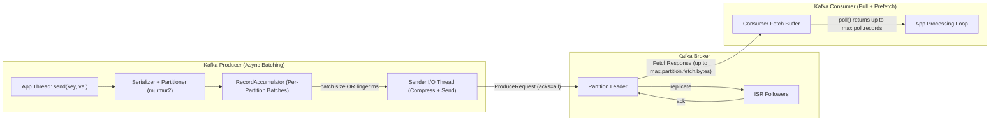
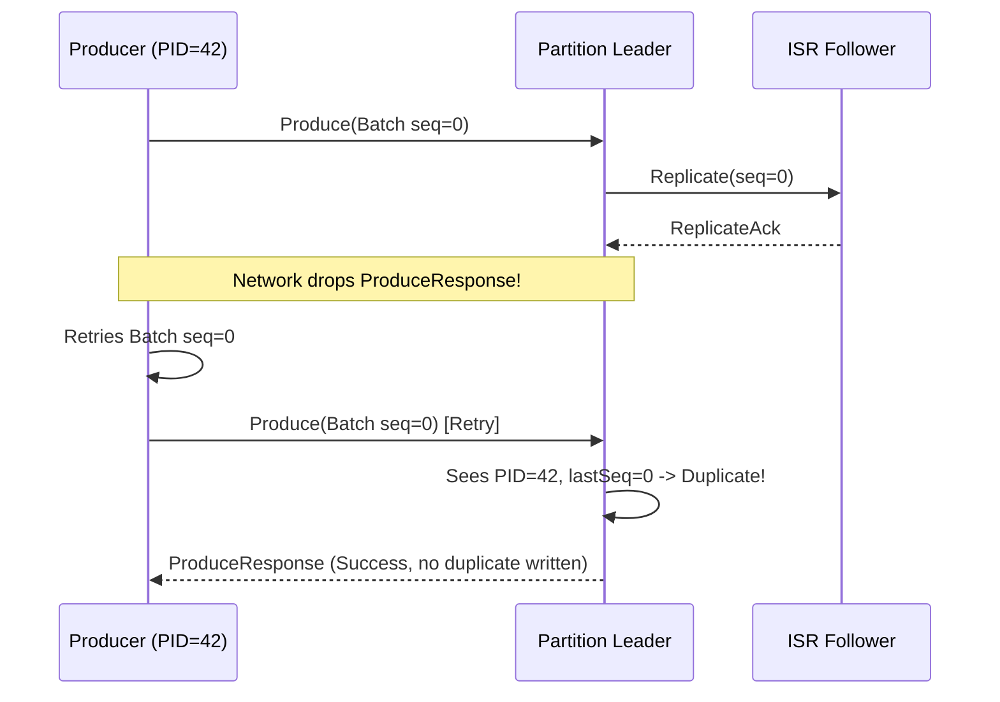
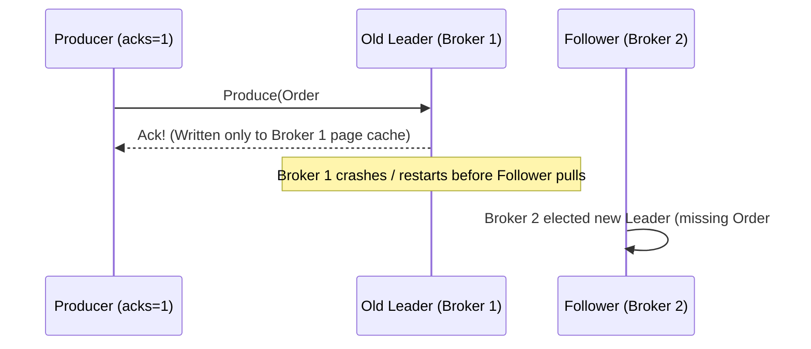

# Kafka Producers & Consumers: acks=all, Batching, Keys & Prefetch

> **Prerequisites:** [Lesson 02: Message Queues vs Event Streams](../02-message-queues-vs-event-streams/README.md).  
> **Estimated Reading Time:** 24–28 minutes  
> **Target Audience:** Backend engineers tuning Kafka throughput/durability, and candidates asked "how do Kafka producers and consumers achieve high throughput without losing data?"  
> **Free PDF Notes:** [Download SD-I-003.pdf](https://backendroadmap.com/notes/system-design/SD-I-003.pdf)

> [!NOTE]
> **In one line:** Kafka achieves massive throughput by **batching** records in producer memory (`linger.ms`, `batch.size`), routing related events to the same partition via **keys**, tuning durability per write via **`acks`** (`0`, `1`, `all`), and letting consumers **pull** batches with controlled **prefetch/fetch** bounds (`max.poll.records`, `fetch.min.bytes`).

> [!TIP]
> **The Golden Rule:** For any data you cannot afford to lose, set `acks=all` + `enable.idempotence=true` on the producer, use a high-cardinality partition key (`order_id`, `user_id`) for ordering without hot spots, and bound `max.poll.records` so a consumer batch never exceeds `max.poll.interval.ms`.

---

## 1. What Producer & Consumer Tuning Is, and What It Isn't

Sending one Kafka message per network round-trip is slow (~1–5 ms per RPC = ~200–1,000 msg/s). Instead, a Kafka producer buffers records per partition in an in-memory **RecordAccumulator**, compresses entire batches (`lz4` or `zstd`), and flushes them in a single network request. On the other side, consumers **pull** batches at their own pace so a fast broker never overwhelms a slow consumer.

| Term | Precise Meaning | Example |
| :--- | :--- | :--- |
| **`acks=0`** | Fire-and-forget; producer does not wait for any broker response | Metrics/logs where occasional loss is acceptable |
| **`acks=1`** | Leader writes to its local log and acks immediately (followers may not have it yet) | Fast, but loses data if leader crashes before replication |
| **`acks=all` (`-1`)** | Leader waits until all In-Sync Replicas (`min.insync.replicas`) persist the batch | Financial transactions, `OrderPlaced` |
| **`linger.ms` / `batch.size`** | How long (ms) or how many bytes the producer waits to group records into one batch | `linger.ms=10`, `batch.size=65536` (64 KB) |
| **Partition key** | Deterministic hash (`murmur2(key) % P`) pinning all events for an entity to one partition | `key = order_id` |
| **Idempotent producer** | Assigns `(ProducerID, SequenceNumber)` so broker deduplicates retried batches | `enable.idempotence=true` (default in Kafka 3.x+) |
| **Consumer prefetch / fetch** | How much data a consumer fetches ahead (`fetch.min.bytes`, `max.partition.fetch.bytes`) | Fetching 1 MB in 1 RPC instead of 1,000 RPCs |
| **Not** | A setting where `acks=all` means "all brokers in the cluster" | It means all replicas currently in the **ISR** |

### Why It Matters
1. The difference between unbatched `acks=1` and tuned batched `acks=all` with compression can be **10x–50x throughput** with **stronger** durability.
2. Misconfigured `acks`, `retries`, or `max.in.flight.requests.per.connection` is the #1 cause of silent data loss or out-of-order events in production.
3. Interviewers routinely ask how Kafka balances latency vs throughput vs durability on the producer and backpressure on the consumer.

---

## 2. Anatomy: Producer Batching & Consumer Pull Pipeline



**How batching works:** Calling `producer.send()` does **not** immediately hit the network. It serializes the record, computes the target partition, and appends it to a per-partition buffer (`batch.size`, default 16 KB). A background `Sender` thread drains ready batches—either as soon as a batch hits `batch.size`, or after `linger.ms` elapses—compresses the batch, and sends it over TCP.

**How consumer pull works:** Unlike RabbitMQ (which pushes messages up to `prefetch` count), Kafka consumers pull using `poll()`. While your application processes batch $N$, the consumer's network client can prefetch batch $N+1$ into memory up to `max.partition.fetch.bytes`, hiding network RTT without risking broker-side push overload.

| `acks` Setting | Latency | Durability | Data Loss Scenario |
| :--- | :--- | :--- | :--- |
| **`acks=0`** | Lowest (no wait) | None | Any network drop or broker crash |
| **`acks=1`** | Low (1 local write) | Moderate | Leader crashes after acking, before followers replicate |
| **`acks=all`** | Higher (+replication RTT) | Highest | Only if all ISR replicas fail simultaneously (or `min.insync.replicas=1`) |

> [!WARNING]
> **The #1 Trap: Setting `acks=all` while `min.insync.replicas=1` (the default).** If 2 followers are lagging and drop out of the ISR, the leader is the *only* in-sync replica left. `acks=all` then succeeds after writing to **just 1 broker**—giving you `acks=1` durability while you think you have `acks=all`! Always pair `acks=all` with `min.insync.replicas=2` (for `RF=3`).

---

## 3. Mathematical Model: Batching Efficiency, Compression, and Memory

**1. Effective Producer Throughput & RPC Reduction.**
Suppose records are $s = 500\text{ bytes}$, arrival rate is $\lambda = 50{,}000\text{ msg/s}$ ($25\text{ MB/s}$ raw), and network RTT is $t_{\text{rtt}} = 2\text{ ms}$.
- **Unbatched (`batch.size=0`, `linger.ms=0`):** Each record needs an RPC (or tiny batch). At 1 RPC per record with 5 concurrent in-flight requests per connection, max rate per connection is $5 / 0.002 = 2{,}500\text{ RPC/s}$—far short of $50{,}000\text{ msg/s}$.
- **Batched (`batch.size=65{,}536` = 64 KB, `linger.ms=10` ms):** Each 64 KB batch holds $\lfloor 65{,}536 / 500 \rfloor \approx 131\text{ records}$.

$$\text{RPC rate} = \frac{50{,}000}{131} \approx 382\text{ RPC/s}$$

With `zstd` or `lz4` compression (typical $3\times$ ratio on JSON), wire bandwidth drops from $25\text{ MB/s}$ to **$8.3\text{ MB/s}$**, and broker CPU/disk I/O drops proportionally because brokers store and replicate the compressed batch *as-is* without decompressing.

**2. Consumer Poll Safety Bound.**
To prevent consumer group eviction during processing:

$$\text{max.poll.records} \times t_{\text{proc, p99}} < \text{max.poll.interval.ms}$$

**Worked Example:** If $t_{\text{proc, p99}} = 150\text{ ms}$ per message and `max.poll.interval.ms = 300{,}000\text{ ms}$ (5 min), you can safely set `max.poll.records = 500` ($500 \times 0.15\text{ s} = 75\text{ s} \ll 300\text{ s}$). If $t_{\text{proc, p99}} = 2\text{ s}$, `max.poll.records = 500` takes $1{,}000\text{ s} > 300\text{ s}$ and **causes a rebalance storm**—you must drop `max.poll.records` to $\le 50$.

---

## 4. Metrics & Percentiles

| Metric | Meaning | Alert when |
| :--- | :--- | :--- |
| **`record-send-rate` / `batch-size-avg`** | Records/s and average bytes per batch | `batch-size-avg` $< 10\%$ of `batch.size` (missing batching gains) |
| **`bufferpool-wait-time-ns-total`** | Time app threads block waiting for `buffer.memory` | $> 0\text{ ms}$ (producer memory exhausted; backpressure active) |
| **`request-latency-avg / p99`** | Time from send to broker `ProduceResponse` | Exceeds SLO (e.g., $> 50\text{ ms}$ for `acks=all`) |
| **`record-error-rate` / `record-retry-rate`** | Failed or retried batches | Rising steadily (broker/ISR issue or `NotEnoughReplicas`) |
| **Consumer `records-per-request-avg`** | Average records returned per `FetchResponse` | Very low during lag (increase `fetch.min.bytes`) |
| **Time between `poll()` calls** | Processing duration per batch | $> 70\%$ of `max.poll.interval.ms` |

### Worked Example (`PaymentEvents` Producer)
- **Requirement:** Zero data loss, strict per-account ordering, $< 20\text{ ms}$ $p_{99}$ publish latency, 20,000 events/s.
- **Config:** `acks=all`, `enable.idempotence=true`, `linger.ms=5`, `batch.size=65536`, `compression.type=lz4`, `key=account_id`.
- **Result:** Average batch accumulates $\approx 20{,}000 \times 0.005 / P$ records; `linger.ms=5` adds at most 5 ms + ~4 ms replication RTT = ~9 ms publish latency, while cutting RPCs by $>10\times$.

---

## 5. Compounding & Failure Modes

| Configuration Mistake | What Happens Under Load / Failure |
| :--- | :--- |
| **`max.in.flight.requests.per.connection > 1` WITHOUT `enable.idempotence=true`** | Batch 1 fails transiently, Batch 2 succeeds, Batch 1 retries and lands **after** Batch 2 $\to$ **out-of-order records**! (Idempotence allows up to 5 in-flight requests *with* strict sequence ordering.) |
| **`linger.ms=0` at 100k msg/s** | Producer sends thousands of tiny 1-record batches; broker I/O threads saturate on request parsing and syscalls. |
| **Null key with Sticky Partitioner vs Round-Robin** | Modern Kafka uses a *sticky partitioner* for null keys (filling one batch before switching partitions) to preserve batching efficiency; naive round-robin destroys batching. |
| **Hot Key (`key="GLOBAL"` or `null` skewed)** | All traffic hashes to 1 partition; 1 broker's disk/NIC saturates while other brokers sit idle. |
| **Consumer `fetch.max.wait.ms` too high on low-traffic topic** | If `fetch.min.bytes=1MB` and `fetch.max.wait.ms=5000`, a low-traffic topic waits 5 seconds before returning 1 message. |

---

## 6. Numbers Every Engineer Must Know

| Item | Typical | Implication |
| :--- | :---: | :--- |
| `acks=all` + `RF=3` write latency | 5–15 ms | Dominated by network RTT to ISR followers + page cache write |
| `acks=1` write latency | 1–5 ms | Fast, but vulnerable to leader crash data loss |
| Default `batch.size` | 16 KB (often tuned to 64–128 KB) | Larger batches improve compression & throughput |
| Typical `linger.ms` | 0 ms (default) $\to$ 5–20 ms (tuned) | Adding 5–10 ms linger often boosts throughput 5x–10x |
| `buffer.memory` | 32 MB (default) | If full, `send()` blocks up to `max.block.ms` (60 s) then throws |
| `max.in.flight.requests.per.connection` | 5 (with `enable.idempotence=true`) | Safe pipelining without reordering |
| `max.poll.interval.ms` | 300,000 ms (5 min) | Exceeding it triggers consumer eviction & rebalance |

---

## 7. Protocol / Mechanism Deep Dive: Idempotent Producer & Sequence Numbers



| Question | Answer |
| :--- | :--- |
| **How does `enable.idempotence=true` prevent duplicates?** | Each producer gets a `ProducerID` (`PID`). Each batch carries a per-partition monotonic `SequenceNumber`. The broker tracks the last 5 sequence numbers per PID and discards retries of already-committed batches. |
| **Does `enable.idempotence=true` deduplicate across producer restarts?** | No! A new process gets a new `PID`. Cross-restart deduplication requires business-key idempotency on the consumer (or Kafka Transactions). |
| **What does `delivery.timeout.ms` cover?** | Total time from `send()` until either ack or permanent failure, including `linger.ms`, retries, and `request.timeout.ms`. |
| **How does `fetch.min.bytes` vs `fetch.max.wait.ms` work?** | The broker waits until *either* `fetch.min.bytes` of data is available *or* `fetch.max.wait.ms` expires—whichever comes first. |

**When NOT to tune for huge batches:**
- Ultra-low-latency trading or real-time fraud scoring where 20 ms of `linger.ms` violates your SLA—keep `linger.ms=0` or `1` and scale partitions/brokers instead.

---

## 8. Hierarchical Budgets & Design Rules

| Slice | Rule | Control |
| :--- | :--- | :--- |
| **Durability** | `acks=all` + `enable.idempotence=true` + `min.insync.replicas=2` | Cluster & client config lint |
| **Batching** | `linger.ms=5..10`, `batch.size=64KB..128KB`, `compression=lz4/zstd` | Monitor `batch-size-avg` |
| **Partition Keys** | High-cardinality entity ID (`order_id`, `user_id`); salt hot keys | Partition skew alert ($>3\times$) |
| **Backpressure** | Bound `buffer.memory` & `max.block.ms`; shed/fail fast if full | `bufferpool-wait-time` alert |
| **Consumer Poll** | `max.poll.records * p99_proc < 0.5 * max.poll.interval.ms` | Consumer rebalance alert |
| **Offset Commits** | Disable `enable.auto.commit` for critical work; commit after DB/sink write | Manual `commitSync` / `commitAsync` |

---

## 9. Top Mitigations

1. **Enable idempotence (`enable.idempotence=true`) and `acks=all`:** Eliminates retry duplicates and reordering within a producer session.
2. **Use `lz4` or `zstd` compression:** Shrinks network and disk usage 2x–4x with minimal CPU overhead.
3. **Never use `enable.auto.commit=true` for at-least-once correctness:** Auto-commit can commit offsets on a timer *before* your thread finishes processing the batch, causing silent data loss on crash.
4. **Salt hot partition keys if ordering isn't strict:** Append a shard suffix (`merchant_id + "#" + (rand % 8)`) when a single tenant generates 40% of traffic.
5. **Size `max.poll.records` conservatively:** Start at 50–100 if each record makes a DB/HTTP call; only raise to 500+ for fast in-memory aggregation.
6. **Handle `Callback` / async errors explicitly:** Never ignore the future/callback of `producer.send()`, or failed batches will vanish silently.

---

## 10. Production Reference: The Silent Data Loss from Auto-Commit + `acks=1`

An e-commerce analytics pipeline lost ~0.4% of purchase events during rolling broker restarts.



- **Root Cause:** Two compounding defaults:
  1. Producer used `acks=1`, so the broker acked before followers replicated, losing records on sudden leader failover.
  2. Consumers used `enable.auto.commit=true` (every 5 s), committing offsets for records still sitting in an internal async worker pool when pods scaled down.
- **The Fix:**
  1. Switched producer to `acks=all`, `enable.idempotence=true`, and topic `min.insync.replicas=2`.
  2. Disabled `enable.auto.commit`, processed batches synchronously, and called `commitSync()` only after the sink database transaction committed.

---

## 11. Multi-Language Production Code Tabs

Production-shaped Kafka producer (batched, keyed, `acks=all`, idempotent) and manual-commit consumer across 4 languages.

````carousel
```go
// Go (confluent-kafka-go / librdkafka idiom): Idempotent batched producer + manual commit consumer
package main

import (
	"fmt"
	"github.com/confluentinc/confluent-kafka-go/v2/kafka"
)

func produceOrder(orderID string, payload []byte) error {
	p, err := kafka.NewProducer(&kafka.ConfigMap{
		"bootstrap.servers":  "localhost:9092",
		"acks":               "all",
		"enable.idempotence": true,
		"linger.ms":          10,
		"batch.size":         65536,
		"compression.type":   "lz4",
	})
	if err != nil {
		return err
	}
	defer p.Close()

	deliveryChan := make(chan kafka.Event, 1)
	topic := "orders"
	err = p.Produce(&kafka.Message{
		TopicPartition: kafka.TopicPartition{Topic: &topic, Partition: kafka.PartitionAny},
		Key:            []byte(orderID), // guarantees per-order partition ordering
		Value:          payload,
	}, deliveryChan)
	if err != nil {
		return err
	}

	ev := (<-deliveryChan).(*kafka.Message)
	return ev.TopicPartition.Error
}

func consumeOrders() error {
	c, err := kafka.NewConsumer(&kafka.ConfigMap{
		"bootstrap.servers":  "localhost:9092",
		"group.id":           "billing-service",
		"enable.auto.commit": false,
		"auto.offset.reset":  "earliest",
		"fetch.min.bytes":    1024,
	})
	if err != nil {
		return err
	}
	defer c.Close()

	_ = c.SubscribeTopics([]string{"orders"}, nil)
	msg, err := c.ReadMessage(-1)
	if err == nil {
		fmt.Printf("Processed key=%s offset=%v\n", string(msg.Key), msg.TopicPartition.Offset)
		_, _ = c.CommitMessage(msg) // commit only after processing succeeds
	}
	return err
}
```
<!-- slide -->
```typescript
// TypeScript (KafkaJS): acks=-1 (all), idempotent batching producer & manual commit consumer
import { Kafka, CompressionTypes } from "kafkajs";

const kafka = new Kafka({ clientId: "order-svc", brokers: ["localhost:9092"] });

async function produceOrder(orderId: string, payload: object): Promise<void> {
  const producer = kafka.producer({
    idempotent: true,
    maxInFlightRequests: 5,
  });
  await producer.connect();
  await producer.send({
    topic: "orders",
    acks: -1, // acks=all
    compression: CompressionTypes.LZ4,
    messages: [{ key: orderId, value: JSON.stringify(payload) }],
  });
  await producer.disconnect();
}

async function consumeOrders(): Promise<void> {
  const consumer = kafka.consumer({
    groupId: "billing-service",
    minBytes: 1024,
    maxWaitTimeInMs: 100,
  });
  await consumer.connect();
  await consumer.subscribe({ topic: "orders", fromBeginning: false });

  await consumer.run({
    autoCommit: false,
    eachMessage: async ({ topic, partition, message }) => {
      // Process idempotently...
      console.log(`Order key=${message.key?.toString()} offset=${message.offset}`);
      await consumer.commitOffsets([
        { topic, partition, offset: (Number(message.offset) + 1).toString() },
      ]);
    },
  });
}
```
<!-- slide -->
```python
# Python (confluent-kafka): acks=all, linger.ms batching, and explicit commit
from confluent_kafka import Producer, Consumer

def produce_order(order_id: str, payload: bytes) -> None:
    producer = Producer({
        "bootstrap.servers": "localhost:9092",
        "acks": "all",
        "enable.idempotence": True,
        "linger.ms": 10,
        "batch.size": 65536,
        "compression.type": "lz4",
    })
    def on_delivery(err, msg):
        if err is not None:
            raise RuntimeError(f"Delivery failed: {err}")

    producer.produce("orders", key=order_id.encode(), value=payload, callback=on_delivery)
    producer.flush(timeout=10)

def consume_orders() -> None:
    consumer = Consumer({
        "bootstrap.servers": "localhost:9092",
        "group.id": "billing-service",
        "enable.auto.commit": False,
        "auto.offset.reset": "earliest",
        "fetch.min.bytes": 1024,
    })
    consumer.subscribe(["orders"])
    msg = consumer.poll(timeout=5.0)
    if msg and not msg.error():
        # Process record idempotently before committing
        print(f"Processed key={msg.key()} offset={msg.offset()}")
        consumer.commit(message=msg, asynchronous=False)
    consumer.close()
```
<!-- slide -->
```csharp
// C# (Confluent.Kafka): Idempotent acks=All Producer & Manual-Commit Consumer
using System;
using System.Threading.Tasks;
using Confluent.Kafka;

public static class KafkaClients
{
    public static async Task ProduceOrderAsync(string orderId, string json)
    {
        var config = new ProducerConfig
        {
            BootstrapServers = "localhost:9092",
            Acks = Acks.All,
            EnableIdempotence = true,
            LingerMs = 10,
            BatchSize = 65536,
            CompressionType = CompressionType.Lz4
        };
        using var producer = new ProducerBuilder<string, string>(config).Build();
        var result = await producer.ProduceAsync("orders", new Message<string, string>
        {
            Key = orderId,
            Value = json
        });
        Console.WriteLine($"Delivered to {result.TopicPartitionOffset}");
    }

    public static void ConsumeOnce()
    {
        var config = new ConsumerConfig
        {
            BootstrapServers = "localhost:9092",
            GroupId = "billing-service",
            EnableAutoCommit = false,
            AutoOffsetReset = AutoOffsetReset.Earliest,
            FetchMinBytes = 1024
        };
        using var consumer = new ConsumerBuilder<string, string>(config).Build();
        consumer.Subscribe("orders");
        var cr = consumer.Consume(TimeSpan.FromSeconds(5));
        if (cr != null)
        {
            Console.WriteLine($"Processed key={cr.Message.Key} offset={cr.Offset}");
            consumer.Commit(cr); // explicit sync commit after processing
        }
    }
}
```
````

---

## 12. Hands-On CLI Verification Workflows

Benchmarking producer batching/`acks` and inspecting consumer lag:

```bash
# 1. Benchmark producer throughput with acks=all, 64KB batches, linger.ms=10, lz4
kafka-producer-perf-test.sh \
  --topic orders \
  --num-records 500000 \
  --record-size 512 \
  --throughput -1 \
  --producer-props bootstrap.servers=localhost:9092 acks=all linger.ms=10 batch.size=65536 compression.type=lz4

# 2. Verify topic-level min.insync.replicas (must be >= 2 for acks=all safety)
kafka-configs.sh --bootstrap-server localhost:9092 \
  --entity-type topics --entity-name orders --describe

# 3. Inspect consumer group committed offsets vs log-end-offset
kafka-consumer-groups.sh --bootstrap-server localhost:9092 \
  --describe --group billing-service
```

---

## 13. Common Mistakes to Avoid

1. **Setting `acks=all` without checking `min.insync.replicas >= 2`**—silently degrades to `acks=1` during ISR shrinkage.
2. **Leaving `enable.auto.commit=true`** in consumers that write to external databases, risking lost records on crash.
3. **Using `max.in.flight.requests.per.connection > 1` without `enable.idempotence=true`**, causing out-of-order writes on retry.
4. **Setting `linger.ms=0` on high-throughput services**, starving batching and compression.
5. **Using a low-cardinality partition key** (e.g., `country="US"`), creating a massive hot partition.
6. **Ignoring `max.poll.interval.ms`** when `max.poll.records` is 500 and each record makes a 1-second HTTP call.
7. **Forgetting to handle producer delivery callbacks**, letting `NotEnoughReplicasException` fail silently.

---

## 14. Key Terms Glossary

| Key Term | Definition |
| :--- | :--- |
| **`acks`** | Producer durability setting (`0`, `1`, `all`) controlling when a write is acknowledged. |
| **ISR (In-Sync Replicas)** | Set of replicas caught up with the leader within `replica.lag.time.max.ms`. |
| **`RecordAccumulator`** | Producer in-memory buffer grouping records into per-partition batches before sending. |
| **`linger.ms` / `batch.size`** | Time and byte thresholds controlling when a producer flushes a batch. |
| **Partitioner** | Function mapping a record's key (typically via Murmur2 hash) to a partition index. |
| **Sticky partitioner** | Strategy for null-key records that fills a batch on one partition before rotating. |
| **Idempotent producer** | Producer mode using `(PID, SequenceNumber)` so broker deduplicates retried batches. |
| **Prefetch (`fetch.min.bytes`)** | Consumer-side pull tuning that batches network fetches from the broker. |
| **`max.poll.records`** | Maximum records returned by a single `poll()` call. |
| **`max.poll.interval.ms`** | Maximum allowed time between `poll()` calls before the broker evicts the consumer. |

---

## 15. System Design Interview Questions & Answers

### Basic Conceptual Questions

<details>
<summary><strong>Q1: What is the difference between `acks=0`, `acks=1`, and `acks=all`? [BASIC]</strong></summary>

**Answer:**
`acks=0` waits for nothing (fastest, can lose data). `acks=1` waits for the partition leader's local write (fast, loses data if leader crashes before replication). `acks=all` waits for the leader and all In-Sync Replicas (`min.insync.replicas`) to persist the batch (highest durability, adds replication RTT).
</details>

<details>
<summary><strong>Q2: How do `linger.ms` and `batch.size` work together? [BASIC]</strong></summary>

**Answer:**
The producer sends a partition's batch as soon as *either* the batch reaches `batch.size` bytes *or* `linger.ms` milliseconds have elapsed since the first record entered the batch. Tuning both trades a few milliseconds of latency for fewer RPCs and better compression.
</details>

<details>
<summary><strong>Q3: How does Kafka decide which partition a message goes to? [BASIC]</strong></summary>

**Answer:**
If a key is provided, the default partitioner hashes it (`murmur2(key) % num_partitions`) so all messages with the same key land in the same partition in order. If the key is `null`, modern Kafka uses a sticky partitioner to fill a batch on one partition before switching.
</details>

<details>
<summary><strong>Q4: Why do Kafka consumers pull instead of the broker pushing? [BASIC]</strong></summary>

**Answer:**
Pulling lets each consumer control its own rate (`max.poll.records`, `fetch.max.bytes`), preventing fast brokers from flooding slow consumers, and allows consumers to batch fetches efficiently when catching up on lag.
</details>

### Scenario-Based Architecture Questions

<details>
<summary><strong>Q5: You need zero data loss for payment events. What exact producer and topic configs do you set? [SCENARIO]</strong></summary>

**Answer:**
Topic: `replication.factor=3`, `min.insync.replicas=2`. Producer: `acks=all`, `enable.idempotence=true`, `retries=Integer.MAX_VALUE` (bounded by `delivery.timeout.ms`). Consumer: `enable.auto.commit=false`, committing only after idempotent DB persistence.
</details>

<details>
<summary><strong>Q6: A producer's throughput is stuck at 2,000 msg/s despite 100k msg/s capacity on the cluster. What do you check? [SCENARIO]</strong></summary>

**Answer:**
Check `batch-size-avg` and `linger.ms`. If `linger.ms=0` or the caller calls `flush()` / `.get()` synchronously after every single `send()`, every message incurs a full network RTT instead of batching. Enabling `linger.ms=10`, `batch.size=65536`, and `lz4` compression typically fixes this immediately.
</details>

<details>
<summary><strong>Q7: One partition has 500k lag while the other 15 partitions have 0 lag. What happened and how do you fix it? [SCENARIO]</strong></summary>

**Answer:**
A **hot partition key** (e.g., `key="default"` or one whale customer generating 80% of traffic). Fix by choosing a higher-cardinality key (`order_id` instead of `merchant_id`), or salting the key (`merchant_id + "#" + hash(order_id) % 4`) if strict per-merchant global order isn't required.
</details>

<details>
<summary><strong>Q8: Your consumer group keeps rebalancing every 5 minutes during traffic spikes. Why? [SCENARIO]</strong></summary>

**Answer:**
Processing a single `poll()` batch is taking longer than `max.poll.interval.ms` (default 5 min), causing the Group Coordinator to evict the consumer. Fix by lowering `max.poll.records`, optimizing downstream calls, or offloading slow work to an async/retry pipeline.
</details>

### Advanced & Tricky Interview Questions

<details>
<summary><strong>Q9: Does `acks=all` guarantee zero data loss if `min.insync.replicas=1`? [TRICKY]</strong></summary>

**Answer:**
No. `acks=all` means "all replicas currently in the ISR." If both followers fall behind and are removed from the ISR, the ISR shrinks to just the leader (`size=1`). With `min.insync.replicas=1`, the leader acks alone—equivalent to `acks=1`—and a crash loses data.
</details>

<details>
<summary><strong>Q10: How can retries cause out-of-order messages, and how does Kafka fix it? [TRICKY]</strong></summary>

**Answer:**
If `max.in.flight.requests.per.connection > 1` without idempotence, Batch 1 can fail transiently while Batch 2 succeeds; Batch 1's retry then appends *after* Batch 2. Enabling `enable.idempotence=true` assigns monotonic sequence numbers per `(PID, partition)` so the broker rejects out-of-sequence batches and forces strict ordering up to 5 in-flight requests.
</details>

<details>
<summary><strong>Q11: What happens when `buffer.memory` fills up on the producer? [TRICKY]</strong></summary>

**Answer:**
The application thread calling `send()` blocks for up to `max.block.ms` (default 60 s) waiting for the `Sender` thread to drain batches. If still full, `send()` throws `TimeoutException`. This is how Kafka propagates backpressure to the producer.
</details>

<details>
<summary><strong>Q12: Why doesn't the Kafka broker decompress batches on produce? [TRICKY]</strong></summary>

**Answer:**
End-to-end batch compression: the producer compresses the batch, the broker validates/appends the compressed bytes directly to disk and replicates them compressed, and the consumer decompresses. This saves broker CPU, network bandwidth, and disk I/O simultaneously.
</details>

---

## 16. One-Page Master Cheat Sheet

```
+---------------------------------------------------------------------------------------------------------+
|                  KAFKA PRODUCERS & CONSUMERS — MASTER CHEAT SHEET                                       |
+---------------------------------------------------------------------------------------------------------+
| 1. DURABILITY: acks=all + enable.idempotence=true + min.insync.replicas=2 (with RF=3).                  |
|    Never use acks=all with min.insync.replicas=1!                                                       |
+---------------------------------------------------------------------------------------------------------+
| 2. BATCHING: linger.ms=5..10 + batch.size=64KB..128KB + compression=lz4/zstd -> 10x-50x fewer RPCs.     |
+---------------------------------------------------------------------------------------------------------+
| 3. KEYS & ORDER: murmur2(key) % P pins entity to 1 partition. Null key uses sticky partitioner.         |
+---------------------------------------------------------------------------------------------------------+
| 4. IDEMPOTENCE: (PID, SeqNum) deduplicates retries & prevents reordering with max.in.flight <= 5.       |
+---------------------------------------------------------------------------------------------------------+
| 5. CONSUMER PULL: max.poll.records * p99_proc < max.poll.interval.ms (else rebalance storm!).           |
+---------------------------------------------------------------------------------------------------------+
| 6. COMMITS: Disable enable.auto.commit; commitSync() only after idempotent DB/sink write succeeds.      |
+---------------------------------------------------------------------------------------------------------+
```

---

## Further Reading & Sources

- Apache Kafka Documentation, [Producer Configs & Consumer Configs](https://kafka.apache.org/documentation/#producerconfigs).
- Neha Narkhede, Gwen Shapira, Todd Palino, *Kafka: The Definitive Guide* (2nd ed.), Chapters 3 & 4.
- Confluent Blog, [Exactly-Once Semantics and Idempotent Producers in Kafka](https://www.confluent.io/blog/exactly-once-semantics-are-possible-heres-how-apache-kafka-does-it/).

---

## Free PDF Notes

[SD-I-003.pdf](https://backendroadmap.com/notes/system-design/SD-I-003.pdf)

---

## Next

Continue with [Lesson 04: Kafka Topics, Partitions & Offsets](../04-kafka-topics-partitions-offsets/README.md): Retention + Log Compaction.
