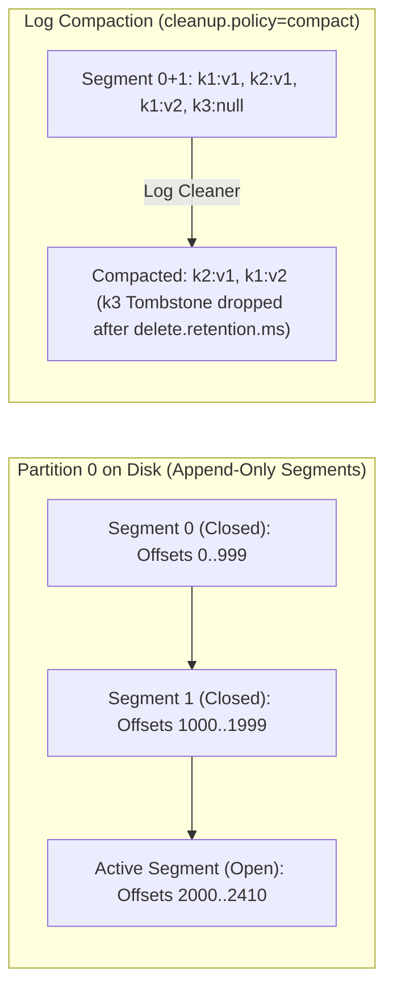
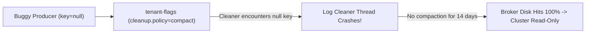

# Kafka Topics, Partitions & Offsets (Retention + Log Compaction)

> **Prerequisites:** [Lesson 03: Kafka Producers & Consumers](../03-kafka-producers-consumers/README.md).  
> **Estimated Reading Time:** 24–28 minutes  
> **Target Audience:** Backend engineers designing Kafka topic topologies, sizing partition counts, and choosing between time/size retention and log compaction.  
> **Free PDF Notes:** [Download SD-I-004.pdf](https://backendroadmap.com/notes/system-design/SD-I-004.pdf)

> [!NOTE]
> **In one line:** A Kafka **topic** is a logical feed split into **partitions**—each an ordered, immutable, append-only commit log split into disk **segments** where every record gets a monotonic **offset**. Topics expire old data either via **delete retention** (time/size) or **log compaction** (retaining only the latest value per key).

> [!TIP]
> **The Golden Rule:** Use `cleanup.policy=delete` for *event logs* (orders, clicks, metrics) and `cleanup.policy=compact` for *state snapshots / changelogs* (user profiles, config tables, CDC) where you always need the latest value for every key. Never set partition counts arbitrarily high—each partition consumes file handles, memory, and leader-election time.

---

## 1. What Topics, Partitions, and Offsets Are, and What They Aren't

A topic is not a single giant file on one machine—if it were, a single broker's disk and NIC would cap your throughput. Instead, Kafka splits a topic into $P$ **partitions** distributed across brokers. Each partition is an append-only directory of **log segments** (`.log` data files + `.index` / `.timeindex` sparse indexes). Inside a partition, every record receives a permanent, gapless (in normal writes) 64-bit **offset** (`0, 1, 2, ...`).

| Term | Precise Meaning | Example |
| :--- | :--- | :--- |
| **Topic** | Logical category or stream name to which producers publish and consumers subscribe | `orders`, `user-profiles` |
| **Partition** | An ordered, immutable, append-only log that is the unit of parallelism and replication | `orders-0`, `orders-1`, `orders-2` |
| **Offset** | Monotonically increasing 64-bit integer uniquely identifying a record within a partition | `offset=1042` in `orders-1` |
| **Log segment** | A bounded chunk of a partition on disk (default `segment.bytes=1 GB`) | `00000000000000000000.log` |
| **`cleanup.policy=delete`** | Drops whole closed segments once older than `retention.ms` or exceeding `retention.bytes` | Keep 7 days of `clickstream` |
| **`cleanup.policy=compact`** | Background cleaner deduplicates older segments, keeping at least the latest value per key | `user-settings` (latest per `user_id`) |
| **Tombstone** | A record with a `key` and `null` value that deletes the key during compaction | `(key="u123", value=null)` |
| **Not** | A system with global ordering across partitions, or instant deletion of a single record | Offsets are per-partition; deletes happen asynchronously at segment roll |

### Why It Matters
1. **Partition count** is the hardest Kafka decision to change later: increasing $P$ breaks `hash(key) % P` ordering for existing keys, and decreasing $P$ is not supported in-place.
2. **Log compaction** turns Kafka into a durable key-value changelog—powering Kafka Streams state stores, CDC (Debezium), and `__consumer_offsets` itself.
3. Understanding **segments** explains why Kafka never deletes a single message immediately and why active segments are never deleted or compacted.

---

## 2. Anatomy: Partition Segments, Indexes, and Log Compaction



**Why segments matter:** Kafka never rewrites a live `.log` file in place. It appends to the **active segment** until `segment.bytes` (1 GB) or `segment.ms` (7 days) is reached, then rolls a new active segment. Retention (`delete`) and compaction (`compact`) operate *only* on closed segments:
- **Delete policy:** Once the *newest* timestamp in a closed segment is older than `retention.ms`, the broker unlinks the entire `.log`/`.index` files in $O(1)$ time—no random disk seeks.
- **Compact policy:** A background **Log Cleaner** thread reads closed ("dirty") segments, builds an in-memory offset map of `hash(key) -> latest_offset`, and writes out clean segments containing only the latest record for each key.

| Policy | `cleanup.policy=delete` | `cleanup.policy=compact` | `compact,delete` |
| :--- | :--- | :--- | :--- |
| **Primary use** | Event streams, logs, metrics | Entity state, CDC, config snapshots | Bounded state changelogs |
| **Space bound** | `retention.ms` / `retention.bytes` | Proportional to unique keys ($K$) | Bounded by both keys and time |
| **Null value** | Stored as normal record | **Tombstone** (deletes key after `delete.retention.ms`) | Same |
| **Missing key** | Allowed | **Rejected** (`InvalidRecordException`) | Rejected |

> [!WARNING]
> **The #1 Trap: Adding partitions to an existing keyed topic (`orders`).** If you double partitions from 6 to 12, `murmur2("order-42") % 6` changes to `murmur2("order-42") % 12`. New events for `order-42` land on a *different* partition than historical events—breaking per-key ordering until old data expires. Provision $2\times$–$3\times$ partition headroom up front!

---

## 3. Mathematical Model: Partition Sizing, Segment Roll, and Compaction Footprint

**1. Target Partition Count ($P$).**
Let $T_{\text{target}}$ be desired topic throughput (MB/s), $T_p$ be single-partition producer throughput, and $T_c$ be single-consumer throughput:

$$P = \max\left(\left\lceil \frac{T_{\text{target}}}{T_p} \right\rceil,\; \left\lceil \frac{T_{\text{target}}}{T_c} \right\rceil\right)$$

**Worked Example:** Target throughput is $120\text{ MB/s}$. A single producer hits $30\text{ MB/s}$ per partition, while a consumer doing DB lookups processes only $5\text{ MB/s}$ per partition.

$$P = \max\left(\left\lceil \frac{120}{30} \right\rceil,\; \left\lceil \frac{120}{5} \right\rceil\right) = \max(4,\; 24) = 24\text{ partitions}$$

Consumer throughput almost always dominates $P$.

**2. Disk Footprint: Delete vs Compacted.**
- **Delete retention:** $S_{\text{del}} = \lambda \cdot s \cdot T_{\text{ret}} \cdot R$. At $10{,}000\text{ msg/s}$, $s = 1\text{ KB}$, $T_{\text{ret}} = 7\text{ days}$, $R = 3$: $S_{\text{del}} \approx 18.14\text{ TB}$.
- **Compacted topic:** Depends on unique keys $K$, not total historical writes:

$$S_{\text{compact}} \approx (K \cdot s + \text{dirty\_tail}) \cdot R$$

If $K = 10{,}000{,}000\text{ users}$ at $1\text{ KB}$ each ($10\text{ GB}$ unique state) with $R = 3$, compacted size is $\approx 30\text{ GB}$—even if users update profiles 100 times a day!

**3. Offset Index Lookup.**
Kafka's `.index` file is sparse (an entry every `index.interval.bytes = 4096` bytes). To find `offset=1042`:
1. Binary search the `.index` file in memory ($O(\log N)$) to find the largest offset $\le 1042$ and its physical byte position.
2. Scan sequentially in the `.log` file from that byte offset (at most 4 KB).

---

## 4. Metrics & Percentiles

| Metric | Meaning | Alert when |
| :--- | :--- | :--- |
| **Log size per partition** | Disk bytes used by partition segments | $> 70\%$ of disk or uneven across partitions |
| **`max-dirty-percent` (Log Cleaner)** | Ratio of uncompacted bytes to total log bytes | $> 70\%$ (cleaner falling behind or crashed) |
| **Cleaner thread dead (`OfflineLogDirectory` / cleaner error)** | Log compaction thread stopped (e.g., OOM on `dedupeBuffer`) | Any occurrence (compacted topic grows unbounded!) |
| **Under-replicated partitions** | Partitions where ISR $< RF$ | $> 0$ for $> 1\text{ min}$ |
| **Total partitions per broker** | Sum of leader + follower replicas on a broker | $> 4{,}000$ (classic) or approaching metadata/FD limits |

### Worked Example (`user-profiles` Compacted Topic)
- **Setup:** 5M active users, 500 profile updates/s, `segment.bytes=100 MB` (instead of 1 GB), `min.cleanable.dirty.ratio=0.5`, `delete.retention.ms=86400000` (24 h).
- **Why `segment.bytes=100 MB`?** On a low-volume compacted topic (500 msg/s $\times$ 500 B = 250 KB/s), a default 1 GB segment takes **46 days** to roll! Until it rolls, it's the active segment and **never compacts**. Lowering `segment.bytes` to 100 MB rolls segments every ~6.6 hours, keeping compaction fresh.

---

## 5. Compounding & Failure Modes

| Failure Mode | What Happens |
| :--- | :--- |
| **Too many partitions per broker (e.g., 10,000+)** | Each partition opens `.log`, `.index`, `.timeindex` file descriptors; controller metadata & leader elections slow down on broker restart; page cache fragments into tiny buffers. |
| **Log Cleaner OOM / Crash** | If `log.cleaner.dedupe.buffer.size` is too small or a corrupt/keyless record appears, the cleaner thread dies silently—compacted topics grow indefinitely until disk hits 100%. |
| **`retention.ms` on a low-traffic topic with 1 GB segments** | Old data sits in the active segment past `retention.ms` because Kafka only deletes *closed* segments. |
| **Deleting a key without `delete.retention.ms` awareness** | A consumer offline for $> 24\text{ h}$ (`delete.retention.ms`) misses the tombstone after compaction removes it, leaving stale state in its local cache! |

---

## 6. Numbers Every Engineer Must Know

| Item | Typical | Implication |
| :--- | :---: | :--- |
| Default `segment.bytes` | 1 GB | Active segment is never deleted or compacted until it rolls |
| Default `retention.ms` | 7 days (168 h) | Size disks for peak rate $\times$ 7 days $\times$ RF |
| Default `index.interval.bytes` | 4,096 bytes | Binary search `.index` + $\le 4\text{ KB}$ sequential scan |
| Recommended max partitions per broker | 2,000–4,000 (ZooKeeper) / higher in KRaft | Excess partitions inflate failover recovery time & FDs |
| Default `delete.retention.ms` | 24 hours | Tombstones kept for 24 h so slow consumers see deletes |
| `min.cleanable.dirty.ratio` | 0.5 (50%) | Compaction runs when dirty bytes $\ge 50\%$ of log |

---

## 7. Protocol / Mechanism Deep Dive: Offset Lookup & Compaction Tombstones

```mermaid
sequenceDiagram
    participant C as Consumer
    participant B as Broker (Partition 0)
    participant Cleaner as Log Cleaner Thread

    Note over B: Active Segment: [k1:v2@105, k2:null@106]
    C->>B: OffsetForTimes(timestamp=yesterday)
    B->>B: Binary search .timeindex -> physical offset 40
    B-->>C: Offset 40
    C->>B: Fetch(offset=40)
    B-->>C: Records 40..106 (includes k2:null tombstone)
    Note over Cleaner: Segment closes; Cleaner runs
    Cleaner->>Cleaner: Keeps latest k1:v2@105; keeps k2:null until delete.retention.ms
    Note over Cleaner: After 24h, k2:null tombstone is purged
```

| Question | Answer |
| :--- | :--- |
| **Are offsets global across a topic?** | No! Offsets are strictly per-partition. `(topic, partition, offset)` is the unique coordinate. |
| **Can two records in a compacted topic temporarily have the same key?** | Yes. The active segment and uncompacted dirty segments can hold older versions until the Log Cleaner runs. Consumers must still process idempotently. |
| **How does `retention.bytes` work?** | It is **per-partition**, not per-topic! A 10-partition topic with `retention.bytes=10GB` can use up to $10 \times 10\text{ GB} \times RF = 300\text{ GB}$. |
| **What is Tiered Storage (KIP-405)?** | Moves closed segments from broker NVMe disks to S3/GCS, decoupling retention duration from broker disk capacity. |

**When NOT to use Log Compaction:**
- For **audit trails or event sourcing** where you need *every* historical state transition (`Created` $\to$ `Paid` $\to$ `Refunded`), not just the final state—compaction erases intermediate events.

---

## 8. Hierarchical Budgets & Design Rules

| Slice | Rule | Control |
| :--- | :--- | :--- |
| **Partition sizing** | Size for peak consumer throughput with $2\times$–$3\times$ headroom | Never add partitions lightly to keyed topics |
| **Broker density** | Keep replicas per broker $< 4{,}000$; monitor FD count | Cluster capacity dashboard |
| **`retention.bytes`** | Remember it is **per-partition** $\times RF$ | Calculate total cluster disk before setting |
| **Compacted segments** | Lower `segment.bytes` (64–256 MB) on low-traffic compacted topics | Otherwise active segment never compacts |
| **Tombstone TTL** | Set `delete.retention.ms` $\ge$ max expected consumer downtime | Prevents stale local caches |
| **Cleaner health** | Alert if `max-dirty-percent > 70%` or cleaner thread dies | JMX `LogCleanerManager` metrics |

---

## 9. Top Mitigations

1. **Over-provision partitions modestly ($2\times$–$3\times$) at topic creation** so you rarely have to re-partition keyed topics.
2. **Always set `retention.bytes` alongside `retention.ms`** so a sudden 10x traffic spike cannot fill broker disks before 7 days elapse.
3. **Never emit keyless records to a compacted topic**; enforce non-null keys in producer validation.
4. **Emit tombstones (`value=null`)** for deletes in compacted topics and keep `delete.retention.ms` long enough for all consumers to observe them.
5. **Tune `segment.bytes` down on low-throughput compacted topics** so segments roll and compact regularly.
6. **Use `cleanup.policy=compact,delete`** if you want key-based deduplication *and* a hard upper bound on key age.

---

## 10. Production Reference: The Silent Disk-Full Outage from a Dead Log Cleaner

A SaaS platform stored tenant feature flags in a compacted topic `tenant-flags` (`cleanup.policy=compact`). One day, a buggy microservice accidentally produced a batch of records with `key=null`.



- **Root Cause:** Although modern Kafka rejects null keys on compacted topics, an older broker version accepted them (or a topic was altered to `compact` after creation). When the Log Cleaner hit a record without a key, it threw an uncaught exception and terminated its background thread. With no alert on `LogCleaner` thread liveness, `tenant-flags` and `__consumer_offsets` stopped compacting for 14 days until disks filled to 100%.
- **The Fix:**
  1. Added JMX alerts on `kafka.log:type=LogCleanerManager,name=max-dirty-percent` and cleaner thread state.
  2. Enabled broker-side `retention.bytes` safety caps and automated disk-usage alerts at 70% / 85%.

---

## 11. Multi-Language Production Code Tabs

Simulating a **partitioned, segment-based append-only log** with **offset lookup** and **log compaction + tombstone purge**.

````carousel
```go
// Go: Partitioned Log with Offset Lookup and Log Compaction (including Tombstones)
package main

import "fmt"

type Record struct {
	Offset int64
	Key    string
	Value  *string // nil = Tombstone
}

type PartitionLog struct {
	records []Record
}

func (p *PartitionLog) Append(key string, val *string) int64 {
	off := int64(len(p.records))
	p.records = append(p.records, Record{Offset: off, Key: key, Value: val})
	return off
}

// Compact keeps only the latest record per key, preserving relative order of latest offsets.
func (p *PartitionLog) Compact(dropTombstones bool) {
	latest := make(map[string]int64)
	for _, r := range p.records {
		latest[r.Key] = r.Offset
	}
	var cleaned []Record
	for _, r := range p.records {
		if latest[r.Key] == r.Offset {
			if dropTombstones && r.Value == nil {
				continue // tombstone expired past delete.retention.ms
			}
			cleaned = append(cleaned, r)
		}
	}
	p.records = cleaned
}

func strPtr(s string) *string { return &s }

func main() {
	log := &PartitionLog{}
	log.Append("u1", strPtr("plan=free"))
	log.Append("u2", strPtr("plan=pro"))
	log.Append("u1", strPtr("plan=pro"))
	log.Append("u2", nil) // Tombstone!

	log.Compact(true)
	for _, r := range log.records {
		fmt.Printf("offset=%d key=%s val=%s\n", r.Offset, r.Key, *r.Value)
	}
}
```
<!-- slide -->
```typescript
// TypeScript: Partition Log with Offset Tracking & Compaction
interface LogRecord {
  offset: number;
  key: string;
  value: string | null; // null = tombstone
}

class PartitionLog {
  private records: LogRecord[] = [];
  private nextOffset = 0;

  append(key: string, value: string | null): number {
    const offset = this.nextOffset++;
    this.records.push({ offset, key, value });
    return offset;
  }

  compact(dropTombstones = false): LogRecord[] {
    const latestOffset = new Map<string, number>();
    for (const r of this.records) {
      latestOffset.set(r.key, r.offset);
    }
    this.records = this.records.filter((r) => {
      if (latestOffset.get(r.key) !== r.offset) return false;
      if (dropTombstones && r.value === null) return false;
      return true;
    });
    return this.records;
  }
}

const part = new PartitionLog();
part.append("u1", "free");
part.append("u2", "pro");
part.append("u1", "enterprise");
part.append("u2", null); // tombstone
console.log(part.compact(true)); // [{ offset: 2, key: 'u1', value: 'enterprise' }]
```
<!-- slide -->
```python
# Python: Partition Log with Sparse Offset Lookup and Log Compaction
from dataclasses import dataclass
from typing import Dict, List, Optional

@dataclass
class Record:
    offset: int
    key: str
    value: Optional[str]  # None = Tombstone

class PartitionLog:
    def __init__(self) -> None:
        self._records: List[Record] = []
        self._next_offset = 0

    def append(self, key: str, value: Optional[str]) -> int:
        off = self._next_offset
        self._next_offset += 1
        self._records.append(Record(off, key, value))
        return off

    def compact(self, drop_tombstones: bool = False) -> List[Record]:
        latest: Dict[str, int] = {r.key: r.offset for r in self._records}
        self._records = [
            r for r in self._records
            if latest[r.key] == r.offset and not (drop_tombstones and r.value is None)
        ]
        return self._records

log = PartitionLog()
log.append("u1", "free")
log.append("u2", "pro")
log.append("u1", "enterprise")
log.append("u2", None)
print(log.compact(drop_tombstones=True))  # [Record(offset=2, key='u1', value='enterprise')]
```
<!-- slide -->
```csharp
// C#: Partition Log with Compaction & Tombstone Handling
using System;
using System.Collections.Generic;
using System.Linq;

public record LogRecord(long Offset, string Key, string? Value);

public class PartitionLog
{
    private List<LogRecord> _records = new();
    private long _nextOffset = 0;

    public long Append(string key, string? value)
    {
        var off = _nextOffset++;
        _records.Add(new LogRecord(off, key, value));
        return off;
    }

    public IReadOnlyList<LogRecord> Compact(bool dropTombstones = false)
    {
        var latest = new Dictionary<string, long>();
        foreach (var r in _records) latest[r.Key] = r.Offset;

        _records = _records
            .Where(r => latest[r.Key] == r.Offset && !(dropTombstones && r.Value is null))
            .ToList();
        return _records;
    }
}
```
````

---

## 12. Hands-On CLI Verification Workflows

Creating compacted vs deleted topics, inspecting segments, and checking offsets:

```bash
# 1. Create a compacted topic with 100 MB segments and 24h tombstone retention
kafka-topics.sh --bootstrap-server localhost:9092 --create \
  --topic user-profiles \
  --partitions 12 --replication-factor 3 \
  --config cleanup.policy=compact \
  --config segment.bytes=104857600 \
  --config delete.retention.ms=86400000

# 2. Inspect partition leaders, replicas, and ISR
kafka-topics.sh --bootstrap-server localhost:9092 --describe --topic user-profiles

# 3. Check earliest and latest offsets per partition
kafka-get-offsets.sh --bootstrap-server localhost:9092 --topic user-profiles --time -2 # earliest
kafka-get-offsets.sh --bootstrap-server localhost:9092 --topic user-profiles --time -1 # latest

# 4. Inspect on-disk segment files and sparse index entries
kafka-dump-log.sh --files /var/lib/kafka/data/user-profiles-0/00000000000000000000.log --print-data-log | head -n 20
```

---

## 13. Common Mistakes to Avoid

1. **Adding partitions to a keyed topic mid-flight**, silently breaking per-key ordering.
2. **Assuming `retention.bytes` is topic-wide**—it is *per-partition* ($\times$ partitions $\times$ RF).
3. **Expecting `compact` to delete keys immediately** when `value=null` is written; tombstones persist until segment roll + compaction + `delete.retention.ms`.
4. **Using 1 GB `segment.bytes` on a low-traffic compacted topic**, causing the active segment to never roll or compact.
5. **Creating thousands of tiny topics/partitions** ("one topic per tenant"), exhausting file descriptors and slowing controller failover.
6. **Using log compaction for an audit log**, losing intermediate state transitions.
7. **Forgetting to monitor Log Cleaner thread health**, allowing compacted topics to grow unbounded.

---

## 14. Key Terms Glossary

| Key Term | Definition |
| :--- | :--- |
| **Topic** | Logical stream name composed of one or more partitions. |
| **Partition** | Ordered, immutable, append-only log; the unit of parallelism and replication. |
| **Offset** | Unique 64-bit sequential ID assigned to each record within a partition. |
| **Log segment** | Bounded `.log` file + `.index`/`.timeindex` files forming part of a partition. |
| **Active segment** | The current open segment receiving appends; never deleted or compacted. |
| **`cleanup.policy=delete`** | Retention mode dropping closed segments older than `retention.ms` or larger than `retention.bytes`. |
| **`cleanup.policy=compact`** | Retention mode keeping at least the latest record per key across closed segments. |
| **Tombstone** | Record with a non-null key and `null` value signaling key deletion in a compacted topic. |
| **Sparse index** | `.index` file mapping periodic offsets to physical file positions for fast $O(\log N)$ seeks. |
| **Tiered storage** | Offloading closed log segments to object storage (S3/GCS) for cheap long-term retention. |

---

## 15. System Design Interview Questions & Answers

### Basic Conceptual Questions

<details>
<summary><strong>Q1: What is a Kafka partition, and why do topics have multiple partitions? [BASIC]</strong></summary>

**Answer:**
A partition is an ordered, append-only commit log. Splitting a topic into multiple partitions lets Kafka distribute storage and I/O across multiple brokers and lets multiple consumers in a group read in parallel—while preserving strict ordering within each partition.
</details>

<details>
<summary><strong>Q2: What is a Kafka offset? Is it global across a topic? [BASIC]</strong></summary>

**Answer:**
An offset is a monotonically increasing 64-bit integer assigned to each record as it is appended to a partition. It is **per-partition**, not global; a record is uniquely identified by `(topic, partition, offset)`.
</details>

<details>
<summary><strong>Q3: Explain the difference between `cleanup.policy=delete` and `cleanup.policy=compact`. [BASIC]</strong></summary>

**Answer:**
`delete` removes entire closed segments once they exceed `retention.ms` or `retention.bytes`. `compact` retains the latest value for every key indefinitely (ignoring time) by deduplicating older closed segments in the background.
</details>

<details>
<summary><strong>Q4: How do you delete a key from a log-compacted topic? [BASIC]</strong></summary>

**Answer:**
Produce a **tombstone** record with that key and a `null` value. Consumers see the delete, and after `delete.retention.ms` elapses following compaction, the cleaner removes the tombstone itself.
</details>

### Scenario-Based Architecture Questions

<details>
<summary><strong>Q5: How do you choose the number of partitions for a new topic? [SCENARIO]</strong></summary>

**Answer:**
Calculate $P = \max(\lceil T_{\text{target}} / T_p \rceil, \lceil T_{\text{target}} / T_c \rceil)$, where $T_p$ is single-partition producer throughput and $T_c$ is single-consumer throughput (usually the bottleneck). Add $2\times$–$3\times$ headroom for future growth while keeping total replicas per broker under ~2,000–4,000.
</details>

<details>
<summary><strong>Q6: You have a 10-partition topic with `retention.bytes=50GB` and `RF=3`. What is the max disk space it can consume? [SCENARIO]</strong></summary>

**Answer:**
`retention.bytes` is **per partition**. So $10\text{ partitions} \times 50\text{ GB} \times 3\text{ replicas} = 1{,}500\text{ GB}$ ($1.5\text{ TB}$) plus active segments.
</details>

<details>
<summary><strong>Q7: Why would a compacted topic still have duplicate keys when a consumer reads it? [SCENARIO]</strong></summary>

**Answer:**
Compaction is asynchronous and only runs on *closed* segments once dirty bytes exceed `min.cleanable.dirty.ratio`. The active segment and uncompacted tail always contain recent updates, so consumers reading from `offset 0` see older values followed by newer ones.
</details>

<details>
<summary><strong>Q8: You want to store 1 year of audit events in Kafka without buying huge NVMe disks. What do you do? [SCENARIO]</strong></summary>

**Answer:**
Enable **Kafka Tiered Storage (KIP-405)** so closed segments are offloaded to S3/GCS while hot tail segments stay on local NVMe, or sink the events to a data lake (Iceberg/Parquet) via Kafka Connect.
</details>

### Advanced & Tricky Interview Questions

<details>
<summary><strong>Q9: Why is increasing the partition count of an existing keyed topic dangerous? [TRICKY]</strong></summary>

**Answer:**
The default partitioner uses `murmur2(key) % P`. Changing $P$ remaps existing keys to new partitions, so new events for `order-42` go to a different partition than older events for `order-42`—violating per-key ordering until the old segments expire.
</details>

<details>
<summary><strong>Q10: Why can't you just create 100,000 partitions on a 3-broker cluster? [TRICKY]</strong></summary>

**Answer:**
Each partition opens multiple file descriptors (`.log`, `.index`, `.timeindex`), fragments the OS page cache, increases replication RPC overhead, and lengthens controller metadata propagation and leader failover times during broker restarts.
</details>

<details>
<summary><strong>Q11: How does Kafka find a message by timestamp or offset in $O(\log N)$ without scanning gigabytes of logs? [TRICKY]</strong></summary>

**Answer:**
Each segment has a sparse `.index` (offset $\to$ byte position) and `.timeindex` (timestamp $\to$ offset) memory-mapped via `mmap`. Kafka binary-searches the small index in RAM and then scans at most `index.interval.bytes` (4 KB) sequentially in the `.log` file.
</details>

<details>
<summary><strong>Q12: What happens if a consumer is offline for 3 days when `delete.retention.ms` is 24 hours on a compacted topic? [TRICKY]</strong></summary>

**Answer:**
If compaction runs and purges the tombstones after 24 hours, the offline consumer will never see the tombstone when it reconnects—meaning deleted keys remain in the consumer's local state store indefinitely. Set `delete.retention.ms` greater than your maximum expected consumer outage.
</details>

---

## 16. One-Page Master Cheat Sheet

```
+---------------------------------------------------------------------------------------------------------+
|               KAFKA TOPICS, PARTITIONS & OFFSETS — MASTER CHEAT SHEET                                   |
+---------------------------------------------------------------------------------------------------------+
| 1. HIERARCHY: Topic -> P Partitions (distributed) -> Segments (.log + .index + .timeindex) -> Offsets.  |
+---------------------------------------------------------------------------------------------------------+
| 2. SIZING P: max(target / producer_rate, target / consumer_rate) * 2-3x headroom.                       |
|    Never increase P casually on keyed topics (breaks hash(key) % P ordering).                           |
+---------------------------------------------------------------------------------------------------------+
| 3. DELETE POLICY: Drops closed segments > retention.ms or retention.bytes (per-partition * RF!).        |
+---------------------------------------------------------------------------------------------------------+
| 4. COMPACT POLICY: Keeps latest value per key. Tombstone (key, null) deletes after delete.retention.ms. |
+---------------------------------------------------------------------------------------------------------+
| 5. ACTIVE SEGMENT RULE: Current open segment is NEVER deleted or compacted until segment.bytes rolls.   |
+---------------------------------------------------------------------------------------------------------+
| 6. LOOKUP: Sparse .index (every 4 KB) -> O(log N) binary search + tiny sequential scan.                 |
+---------------------------------------------------------------------------------------------------------+
```

---

## Further Reading & Sources

- Apache Kafka Documentation, [Log Compaction & Topic-Level Configs](https://kafka.apache.org/documentation/#compaction).
- Jay Kreps, [The Log: What every software engineer should know about real-time data's unifying abstraction](https://engineering.linkedin.com/distributed-systems/log-what-every-software-engineer-should-know-about-real-time-datas-unifying).
- Confluent Documentation, [Apache Kafka Partition Sizing & Tiered Storage](https://docs.confluent.io/platform/current/kafka/design.html).

---

## Free PDF Notes

[SD-I-004.pdf](https://backendroadmap.com/notes/system-design/SD-I-004.pdf)

---

## Next

Continue with [Lesson 05: Kafka Consumer Groups & Rebalancing](../05-kafka-consumer-groups-rebalancing/README.md): Why More Consumers Don't Help.
