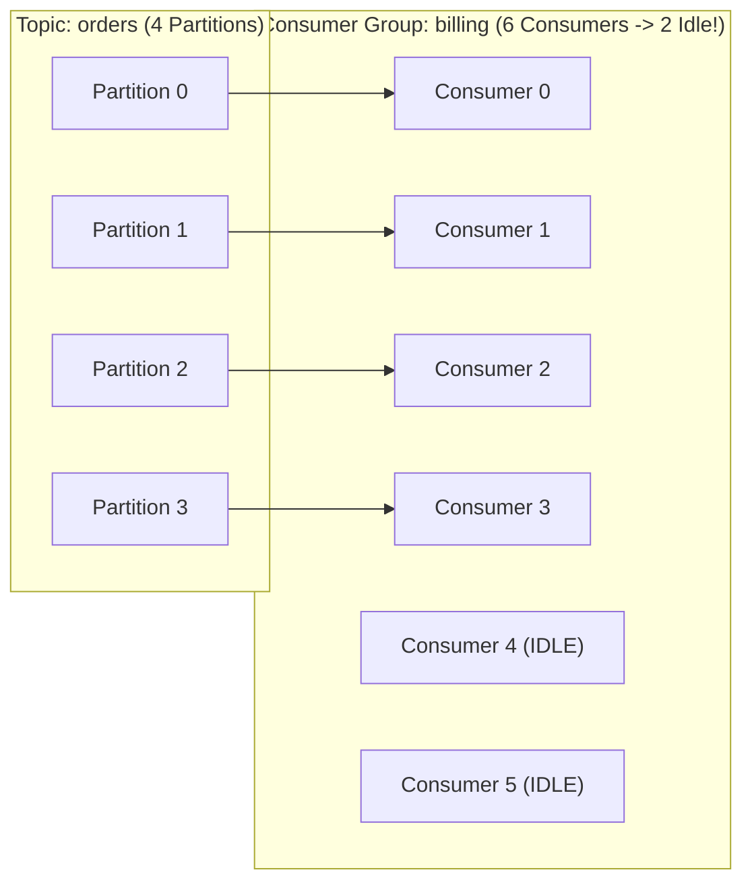
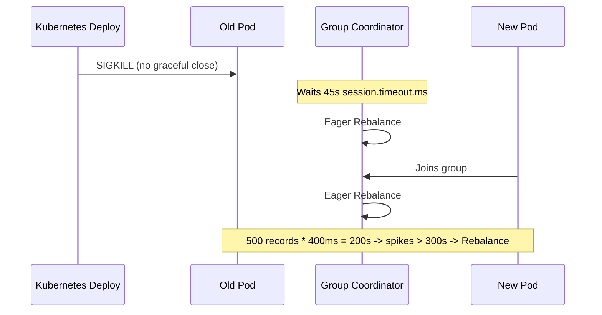

# Kafka Consumer Groups & Rebalancing (Why More Consumers Don't Help)

> **Prerequisites:** [Lesson 04: Kafka Topics, Partitions & Offsets](../04-kafka-topics-partitions-offsets/README.md).  
> **Estimated Reading Time:** 24–28 minutes  
> **Target Audience:** Backend engineers scaling Kafka consumers, debugging rebalance storms, and candidates asked "what happens when we add 20 more pods to a 6-partition Kafka topic?"  
> **Free PDF Notes:** [Download SD-I-005.pdf](https://backendroadmap.com/notes/system-design/SD-I-005.pdf)

> [!NOTE]
> **In one line:** A **consumer group** distributes a topic's $P$ partitions across up to $P$ active consumer instances so each partition is owned by **at most one** consumer in that group; adding consumers beyond $P$ leaves them **idle**, and any membership change triggers a **rebalance** to reassign partition ownership.

> [!TIP]
> **The Golden Rule:** To scale a Kafka consumer group, you need $C \le P$ consumers. Always use **Cooperative Sticky Assignor** (`CooperativeStickyAssignor`) + **Static Group Membership** (`group.instance.id`) in production to eliminate stop-the-world rebalance pauses during rolling deploys.

---

## 1. What Consumer Groups and Rebalancing Are, and What They Aren't

In a classic queue, adding more worker pods always increases parallelism. In Kafka, **partitions are the unit of parallelism**. If a topic has $P = 6$ partitions and you deploy $C = 10$ pods in the same consumer group, 6 pods get 1 partition each and **4 pods sit completely idle**. Worse, if one of the 6 active pods crashes or restarts, the **Group Coordinator** triggers a **rebalance**, redistributing partitions among the remaining instances.

| Term | Precise Meaning | Example |
| :--- | :--- | :--- |
| **Consumer group** | A named logical subscriber (`group.id`) sharing a topic's partitions | `billing-service` |
| **Partition ownership** | Each partition is assigned to **exactly one** consumer within a group | `C1 -> [P0, P1]`, `C2 -> [P2, P3]` |
| **Group Coordinator** | The Kafka broker hosting the `__consumer_offsets` partition for `hash(group.id)` | Manages heartbeats, joins, and offset commits |
| **Rebalance** | Protocol redistributing partition ownership when consumers join, leave, or time out | Rolling deploy, autoscaling, crash |
| **Eager (Stop-the-World) Rebalance** | Every consumer revokes *all* partitions, pauses, and waits for new assignments | `RangeAssignor`, `RoundRobinAssignor` |
| **Cooperative (Incremental) Rebalance** | Only the partitions that *must* move are revoked; others keep processing uninterrupted | `CooperativeStickyAssignor` (default in modern Kafka) |
| **Static Membership** | Assigning a persistent `group.instance.id` so brief restarts don't trigger rebalances | K8s StatefulSet pod restarts within `session.timeout.ms` |
| **Not** | A way to scale past $P$ consumers, or a free operation | $C > P$ wastes pods; eager rebalances pause the whole group |

### Why It Matters
1. "Why didn't autoscaling my pods from 6 to 24 reduce Kafka lag?" is a classic real-world incident and interview question.
2. **Rebalance storms** (caused by `max.poll.interval.ms` timeouts or frequent pod churn) can halt a consumer group completely while burning CPU.
3. Knowing **Cooperative Sticky** + **Static Membership** + **KIP-848** separates senior distributed systems engineers from beginners.

---

## 2. Anatomy: Partition Assignment ($C < P$, $C = P$, $C > P$)



**Why can't two consumers in the same group read Partition 0 simultaneously?**
Because Kafka guarantees **per-partition ordering** and tracks a single **committed offset** per `(group.id, partition)`. If `C0` and `C1` both read `P0`:
- `C1` might finish `offset 101` before `C0` finishes `offset 100`, breaking order.
- If `C1` commits `102` and `C0` crashes, `offset 100` is permanently skipped (data loss)!

| Relationship | Partition Distribution | Effect |
| :--- | :--- | :--- |
| **$C < P$** (e.g., 2 consumers, 6 partitions) | Each consumer owns multiple partitions (3 each) | Works fine; scale up to $P$ if CPU/network bound |
| **$C = P$** (e.g., 6 consumers, 6 partitions) | 1-to-1 mapping; maximum parallelism | Optimal steady state for max throughput |
| **$C > P$** (e.g., 10 consumers, 6 partitions) | 6 consumers get 1 partition; **4 sit idle** | Wasted compute; extra consumers only act as hot standbys |

> [!WARNING]
> **The #1 Trap: Eager Rebalances + Autoscaling Thrashing.** Under eager rebalancing (`RangeAssignor`), when 1 pod scales up or restarts, *all* 50 consumers stop consuming, revoke their partitions, rejoin, and wait—creating a 5–30 second global pause and a lag spike, which triggers the HPA to autoscale *again*, causing an endless rebalance loop!

---

## 3. Mathematical Model: Rebalance Cost, Idle Ratio, and Heartbeat Bounds

**1. Consumer Utilization & Idle Ratio.**
Given $P$ partitions and $C$ consumers in a group:

$$\text{Active consumers} = \min(C, P), \qquad \text{Idle fraction} = \max\left(0,\; \frac{C - P}{C}\right)$$

If $P = 12$ and HPA scales to $C = 30$, **60% of your pods ($18/30$) do zero work**.

**2. Lag Accumulated During an Eager Rebalance.**
If a topic receives $\lambda = 20{,}000\text{ msg/s}$ and an eager rebalance pauses the entire group for $T_{\text{reb}} = 15\text{ s}$:

$$\text{Lag}_{\text{spike}} = \lambda \cdot T_{\text{reb}} = 20{,}000 \times 15 = 300{,}000\text{ messages}$$

With **Cooperative Sticky** rebalancing on a 10-consumer group where 1 consumer joins, only $\approx 1/10$ of partitions pause briefly ($\sim 1\text{ s}$), cutting the lag spike from $300{,}000$ to $\approx 2{,}000$ messages ($150\times$ smaller).

**3. Liveness Detection Bounds.**
Two independent timers govern consumer eviction:
- **Background heartbeat thread:** `heartbeat.interval.ms` (e.g., 3 s) must be $< \frac{1}{3}\text{session.timeout.ms}$ (e.g., 45 s). Detects dead processes/network splits.
- **Application `poll()` loop:** `max.poll.interval.ms` (default 300 s). Detects *livelock* (heartbeat thread is alive, but app thread is stuck processing).

---

## 4. Metrics & Percentiles

| Metric | Meaning | Alert when |
| :--- | :--- | :--- |
| **`rebalance-rate-per-hour`** | Frequency of group rebalances | $> 2\text{ per hour}$ (excluding planned deploys) |
| **`rebalance-latency-avg / max`** | Duration of each rebalance | $> 10\text{ s}$ (eager) or $> 3\text{ s}$ (cooperative) |
| **Assigned partitions per consumer** | Count of partitions owned by each pod | `0` (over-provisioned pods) or uneven skew |
| **Consumer lag per partition** | `log_end_offset - committed_offset` | Growing on a subset of partitions (stuck consumer / hot key) |
| **`commit-latency-avg`** | Time for `OffsetCommit` to `__consumer_offsets` | $> 100\text{ ms}$ (coordinator broker overloaded) |

### Worked Example (HPA Autoscaling Mistake)
- **Setup:** `checkout-events` has $P = 8$ partitions. Normal load is 4,000 msg/s (4 pods @ 1,000 msg/s each).
- **Incident:** A flash sale pushes traffic to 12,000 msg/s. Kubernetes HPA sees CPU/lag high and scales pods from 4 $\to$ 8 $\to$ 16 $\to$ 24.
- **Outcome:** Scaling from 4 $\to$ 8 doubled throughput to 8,000 msg/s. Scaling from 8 $\to$ 24 added **0 throughput** (16 pods sat idle) while triggering 3 consecutive rebalances that made lag *worse*!

---

## 5. Compounding & Failure Modes

| Failure Mode | What Happens |
| :--- | :--- |
| **Rebalance Storm** | A slow batch exceeds `max.poll.interval.ms` $\to$ consumer evicted $\to$ partition reassigned $\to$ new consumer gets the same slow batch and also times out $\to$ infinite loop. |
| **Rolling Deploy Without Static Membership** | Deploying 20 pods one-by-one triggers 20 sequential rebalances in 5 minutes, repeatedly pausing consumption. |
| **Split-Brain / Zombie Consumer** | Consumer `C1` pauses (GC/network), gets evicted, and `C2` takes `P0`. `C1` wakes up and tries to commit `offset 50`—rejected with `CommitFailedException` (fenced by **generation ID**). |
| **Different `group.id` by mistake** | Each pod uses a random UUID `group.id` $\to$ every pod reads **100% of all partitions** (accidental broadcast instead of load sharing!). |

---

## 6. Numbers Every Engineer Must Know

| Item | Typical | Implication |
| :--- | :---: | :--- |
| Max active consumers per group | $P$ (partition count) | Extra consumers sit idle |
| `session.timeout.ms` | 45,000 ms (45 s) | Time before missed heartbeats evict a consumer |
| `heartbeat.interval.ms` | 3,000 ms (3 s) | Should be $\le \frac{1}{3}$ of `session.timeout.ms` |
| `max.poll.interval.ms` | 300,000 ms (5 min) | Max time between `poll()` calls before eviction |
| Eager rebalance pause | 5–30 seconds (all consumers) | Causes noticeable lag spikes during deploys |
| Cooperative rebalance pause | $< 1$ second (only moved partitions) | Keeps unaffected partitions flowing |

---

## 7. Protocol / Mechanism Deep Dive: Eager vs Cooperative Rebalance

```mermaid
sequenceDiagram
    participant C1 as Consumer 1 (owns P0, P1)
    participant C2 as Consumer 2 (new!)
    participant GC as Group Coordinator

    Note over C1,GC: Cooperative Sticky Rebalance (2-Phase)
    C2->>GC: JoinGroup(group="billing")
    GC-->>C1: SyncGroup (keep P0, revoke P1)
    Note over C1: C1 keeps processing P0! Only commits & revokes P1.
    C1->>GC: Rejoin(revoked P1)
    GC-->>C1: Assigned [P0]
    GC-->>C2: Assigned [P1]
    Note over C1,C2: P0 had near-zero downtime; only P1 moved!
```

| Question | Answer |
| :--- | :--- |
| **How does Kafka prevent a zombie consumer from committing stale offsets after rebalance?** | Every rebalance increments a **Generation ID**. `OffsetCommit` requests carry `(member.id, generation.id)`; stale generations are rejected with `ILLEGAL_GENERATION` (`CommitFailedException`). |
| **What is `CooperativeStickyAssignor`?** | A partition assignor that minimizes partition movement ("sticky") and revokes only the partitions that need to move across two quick rebalance rounds, leaving all other partitions running. |
| **What is KIP-848 (Next-Gen Consumer Rebalance Protocol)?** | Introduced in Kafka 3.7+/4.0: moves assignment logic from the client leader to the **Group Coordinator** on the broker, making rebalances incremental, server-driven, and instant even for 1,000+ consumers. |
| **How do I scale beyond $P$ consumers without adding partitions?** | Use the **Decoupled Worker Pool** pattern: let $P$ Kafka consumer threads pull quickly and hand off to an internal bounded worker pool (or SQS) — *only* if per-partition ordering isn't required, or key-shard across $N$ worker queues. |

**When NOT to use Static Membership (`group.instance.id`):**
- In ephemeral auto-scaling groups where pods are permanently terminated and replaced with *new* identities—if the old `group.instance.id` never returns, its partitions stay unassigned until `session.timeout.ms` expires.

---

## 8. Hierarchical Budgets & Design Rules

| Slice | Rule | Control |
| :--- | :--- | :--- |
| **Scaling cap** | Set HPA `maxReplicas <= P` (partition count) | K8s HPA / KEDA config |
| **Assignor** | Always set `partition.assignment.strategy=CooperativeStickyAssignor` | Consumer config template |
| **Static membership** | Use `group.instance.id` + `session.timeout.ms=45s` for StatefulSets | Eliminates deploy rebalances |
| **Poll budget** | `max.poll.records * p99_proc < 0.5 * max.poll.interval.ms` | Prevents rebalance storms |
| **Graceful shutdown** | Call `consumer.close()` on `SIGTERM` so it sends `LeaveGroup` immediately | Instant handoff without waiting for `session.timeout.ms` |
| **Cleanup on revoke** | Commit offsets in `onPartitionsRevoked` callback | Prevents duplicate work on rebalance |

---

## 9. Top Mitigations

1. **Switch to `CooperativeStickyAssignor`:** Eliminates stop-the-world pauses across unaffected partitions.
2. **Cap autoscaling at $P$:** Never let K8s HPA/KEDA scale consumers past the topic's partition count.
3. **Send `LeaveGroup` on graceful shutdown (`SIGTERM`):** A clean `consumer.close()` triggers an immediate rebalance instead of waiting 45 seconds for `session.timeout.ms`.
4. **Use Static Membership for rolling deploys:** With `group.instance.id`, a pod restarting in $< 45\text{ s}$ reclaims its exact partitions with zero rebalance.
5. **Handle `CommitFailedException`:** If a consumer is fenced mid-batch, roll back local state and let the new owner process from the last committed offset.
6. **Separate slow processing from `poll()`** (or shrink `max.poll.records`) so `max.poll.interval.ms` is never breached.

---

## 10. Production Reference: The K8s Rolling-Deploy Rebalance Storm

A logistics company ran 30 consumer pods on a 30-partition topic using default `RangeAssignor` and `max.poll.records=500`. Each message took 400 ms to enrich via a downstream gRPC call.



- **Root Cause:**
  1. Pods lacked `SIGTERM` graceful `consumer.close()`, forcing 45-second timeouts.
  2. `RangeAssignor` paused all 30 consumers on every single pod swap.
  3. `500 * 400 ms = 200 s` left almost no headroom under `max.poll.interval.ms=300 s`; any gRPC jitter triggered extra rebalances.
- **The Fix:**
  1. Switched to `CooperativeStickyAssignor` + `group.instance.id` (StatefulSet).
  2. Added `SIGTERM` hook calling `consumer.close()`.
  3. Reduced `max.poll.records` from 500 to 100 (40 s max batch time). Rolling deploys went from 15-minute outages to zero lag spikes.

---

## 11. Multi-Language Production Code Tabs

Configuring **Cooperative Sticky** rebalancing, **Static Membership**, **Rebalance Listeners**, and **Graceful Shutdown** across 4 languages.

````carousel
```go
// Go (confluent-kafka-go): CooperativeStickyAssignor + Rebalance Callback + Graceful Close
package main

import (
	"fmt"
	"os"
	"os/signal"
	"syscall"

	"github.com/confluentinc/confluent-kafka-go/v2/kafka"
)

func main() {
	c, err := kafka.NewConsumer(&kafka.ConfigMap{
		"bootstrap.servers":             "localhost:9092",
		"group.id":                      "billing-service",
		"group.instance.id":             "billing-pod-0", // static membership
		"partition.assignment.strategy": "cooperative-sticky",
		"session.timeout.ms":            45000,
		"max.poll.interval.ms":          300000,
		"enable.auto.commit":            false,
	})
	if err != nil {
		panic(err)
	}

	_ = c.SubscribeTopics([]string{"orders"}, func(c *kafka.Consumer, ev kafka.Event) error {
		switch e := ev.(type) {
		case kafka.AssignedPartitions:
			fmt.Println("Assigned:", e.Partitions)
			return c.IncrementalAssign(e.Partitions)
		case kafka.RevokedPartitions:
			fmt.Println("Revoked:", e.Partitions)
			_, _ = c.Commit() // flush committed offsets before losing ownership
			return c.IncrementalUnassign(e.Partitions)
		}
		return nil
	})

	sig := make(chan os.Signal, 1)
	signal.Notify(sig, syscall.SIGINT, syscall.SIGTERM)
	<-sig
	_ = c.Close() // triggers immediate LeaveGroup
}
```
<!-- slide -->
```typescript
// TypeScript (KafkaJS): Partition Assigner, Session Timeout & Graceful Shutdown
import { Kafka, PartitionAssigners } from "kafkajs";

const kafka = new Kafka({ clientId: "billing-pod-0", brokers: ["localhost:9092"] });

async function run(): Promise<void> {
  const consumer = kafka.consumer({
    groupId: "billing-service",
    partitionAssigners: [PartitionAssigners.roundRobin],
    sessionTimeout: 45000,
    heartbeatInterval: 3000,
  });

  await consumer.connect();
  await consumer.subscribe({ topic: "orders" });

  const shutdown = async () => {
    await consumer.disconnect(); // sends LeaveGroup immediately
    process.exit(0);
  };
  process.on("SIGTERM", shutdown);

  await consumer.run({
    autoCommit: false,
    eachMessage: async ({ topic, partition, message }) => {
      console.log(`p=${partition} offset=${message.offset}`);
      await consumer.commitOffsets([
        { topic, partition, offset: (Number(message.offset) + 1).toString() },
      ]);
    },
  });
}

run().catch(console.error);
```
<!-- slide -->
```python
# Python (confluent-kafka): CooperativeStickyAssignor + Static Membership + SIGTERM Close
import signal
from confluent_kafka import Consumer

running = True
def stop(*_):
    global running
    running = False

signal.signal(signal.SIGTERM, stop)

consumer = Consumer({
    "bootstrap.servers": "localhost:9092",
    "group.id": "billing-service",
    "group.instance.id": "billing-pod-0",
    "partition.assignment.strategy": "cooperative-sticky",
    "session.timeout.ms": 45000,
    "max.poll.interval.ms": 300000,
    "enable.auto.commit": False,
})

def on_revoke(c, partitions):
    c.commit(asynchronous=False)  # commit processed work before handing off

consumer.subscribe(["orders"], on_revoke=on_revoke)
try:
    while running:
        msg = consumer.poll(1.0)
        if msg and not msg.error():
            consumer.commit(message=msg, asynchronous=False)
finally:
    consumer.close()  # sends LeaveGroup cleanly
```
<!-- slide -->
```csharp
// C# (Confluent.Kafka): CooperativeSticky + Static Membership + Revoke Handler
using System;
using System.Threading;
using Confluent.Kafka;

var config = new ConsumerConfig
{
    BootstrapServers = "localhost:9092",
    GroupId = "billing-service",
    GroupInstanceId = "billing-pod-0",
    PartitionAssignmentStrategy = PartitionAssignmentStrategy.CooperativeSticky,
    SessionTimeoutMs = 45000,
    MaxPollIntervalMs = 300000,
    EnableAutoCommit = false
};

using var consumer = new ConsumerBuilder<string, string>(config)
    .SetPartitionsRevokedHandler((c, partitions) =>
    {
        try { c.Commit(); } catch (KafkaException) { }
    })
    .Build();

consumer.Subscribe("orders");
using var cts = new CancellationTokenSource();
Console.CancelKeyPress += (_, e) => { e.Cancel = true; cts.Cancel(); };

try
{
    while (!cts.Token.IsCancellationRequested)
    {
        var cr = consumer.Consume(cts.Token);
        consumer.Commit(cr);
    }
}
catch (OperationCanceledException) { }
finally
{
    consumer.Close(); // leaves group cleanly
}
```
````

---

## 12. Hands-On CLI Verification Workflows

Inspecting group state, partition-to-consumer mapping, and idle consumers:

```bash
# 1. Describe a consumer group: see CONSUMER-ID, HOST, CLIENT-ID, and LAG per partition
kafka-consumer-groups.sh --bootstrap-server localhost:9092 \
  --describe --group billing-service

# 2. Check group state (Stable, PreparingRebalance, CompletingRebalance, Empty) and member count
kafka-consumer-groups.sh --bootstrap-server localhost:9092 \
  --describe --state --group billing-service

# 3. List all active consumer groups in the cluster
kafka-consumer-groups.sh --bootstrap-server localhost:9092 --list
```

---

## 13. Common Mistakes to Avoid

1. **Scaling consumers above $P$**, leaving extra pods idle and wasting compute.
2. **Using eager `RangeAssignor` in large consumer groups**, causing global stop-the-world pauses on every deploy.
3. **Omitting `SIGTERM` graceful `consumer.close()`**, forcing 45-second `session.timeout.ms` waits.
4. **Setting `max.poll.records` too high** relative to `max.poll.interval.ms`, causing rebalance storms.
5. **Ignoring `CommitFailedException`**, assuming a fenced consumer still owns its partition.
6. **Accidentally generating a unique `group.id` per pod**, turning load-sharing into full broadcast.
7. **Using Static Membership (`group.instance.id`) with dynamic random pod names**, which creates ghost members that block partitions for `session.timeout.ms`.

---

## 14. Key Terms Glossary

| Key Term | Definition |
| :--- | :--- |
| **Consumer group** | Logical subscriber (`group.id`) sharing a topic's partitions across instances. |
| **Group Coordinator** | Broker managing group membership, heartbeats, and offset commits. |
| **Rebalance** | Protocol reassigning partitions when consumers join, leave, or time out. |
| **Eager rebalance** | Stop-the-world rebalance revoking all partitions from all consumers at once. |
| **Cooperative sticky rebalance** | Incremental rebalance revoking only partitions that must move. |
| **Static membership** | Persistent `group.instance.id` avoiding rebalances on brief consumer restarts. |
| **Generation ID** | Monotonic epoch incremented on each rebalance to fence zombie consumers. |
| **`session.timeout.ms`** | Heartbeat timeout before a consumer is declared dead. |
| **`max.poll.interval.ms`** | Max interval between `poll()` calls before a consumer is declared livelocked. |
| **KIP-848** | Server-side incremental consumer rebalance protocol in modern Kafka. |

---

## 15. System Design Interview Questions & Answers

### Basic Conceptual Questions

<details>
<summary><strong>Q1: Why doesn't adding 20 consumers to a 6-partition topic speed up processing? [BASIC]</strong></summary>

**Answer:**
Within a consumer group, each partition can be assigned to at most one consumer at a time to preserve per-partition ordering. With 6 partitions and 20 consumers, 6 consumers get 1 partition each and 14 consumers sit completely idle.
</details>

<details>
<summary><strong>Q2: How do two different services (e.g., billing and analytics) both read all messages from `orders`? [BASIC]</strong></summary>

**Answer:**
They use **different `group.id` values** (`billing-group` and `analytics-group`). Each consumer group independently receives a full copy of the topic's partitions and tracks its own offsets.
</details>

<details>
<summary><strong>Q3: What triggers a Kafka consumer group rebalance? [BASIC]</strong></summary>

**Answer:**
A consumer joining the group, a consumer leaving cleanly (`LeaveGroup`), a consumer crashing (`session.timeout.ms` missed heartbeats), a consumer taking too long between `poll()` calls (`max.poll.interval.ms`), or the topic's partition count changing.
</details>

<details>
<summary><strong>Q4: What is the difference between `session.timeout.ms` and `max.poll.interval.ms`? [BASIC]</strong></summary>

**Answer:**
`session.timeout.ms` is checked by a background heartbeat thread to detect dead processes/network partitions. `max.poll.interval.ms` measures time between `poll()` calls on the main thread to detect slow/hung processing logic.
</details>

### Scenario-Based Architecture Questions

<details>
<summary><strong>Q5: Your consumer group lags during a flash sale, so Kubernetes autoscales from 8 to 24 pods—and lag gets *worse*. Why? [SCENARIO]</strong></summary>

**Answer:**
If the topic only has 8 partitions, pods 9–24 sit idle while every scale-up event triggers a rebalance that pauses consumption and spikes lag further. Cap HPA at `maxReplicas = P` (8) or increase partitions beforehand.
</details>

<details>
<summary><strong>Q6: How do you eliminate 20-second pauses during rolling Kubernetes deployments of Kafka consumers? [SCENARIO]</strong></summary>

**Answer:**
Enable `CooperativeStickyAssignor` (incremental rebalance), implement graceful `SIGTERM` shutdown (`consumer.close()`), and for StatefulSets, enable Static Membership (`group.instance.id`) so pods restarting within `session.timeout.ms` reclaim their partitions with zero rebalance.
</details>

<details>
<summary><strong>Q7: You have 6 partitions, cannot add more partitions right now, and your 6 consumers are CPU-bound on slow DB/HTTP calls. How do you scale beyond 6 threads? [SCENARIO]</strong></summary>

**Answer:**
Decouple `poll()` from processing: have the 6 Kafka consumer threads read batches quickly and dispatch work to a larger internal worker pool (or shard by key into $N$ in-memory worker queues to preserve per-key order), pausing the consumer (`pause()`) if the internal queue fills up—while only committing offsets once all prior work completes.
</details>

<details>
<summary><strong>Q8: A single message fails repeatedly, causing a rebalance every 5 minutes. What is happening? [SCENARIO]</strong></summary>

**Answer:**
A poison pill + blocking retries inside `poll()` exceeds `max.poll.interval.ms`. The consumer is evicted, the partition moves to another consumer, and that consumer hits the same poison pill. Fix by bounding retries and routing failures to a retry topic or DLQ.
</details>

### Advanced & Tricky Interview Questions

<details>
<summary><strong>Q9: How does Kafka prevent a paused "zombie" consumer from overwriting offsets committed by the new owner? [TRICKY]</strong></summary>

**Answer:**
Every rebalance increments a `generation.id`. When the zombie consumer wakes up and sends `OffsetCommit` with its stale `generation.id`, the Group Coordinator rejects it with `ILLEGAL_GENERATION` (`CommitFailedException`).
</details>

<details>
<summary><strong>Q10: Why can't two consumers in the same group read different offsets of the same partition? [TRICKY]</strong></summary>

**Answer:**
Kafka stores a single `committed_offset` integer per `(group.id, partition)`. If two consumers processed `offset 10` and `offset 11` concurrently and `offset 11` finished and committed `12` while `offset 10` crashed, `offset 10` would be permanently lost on restart—and per-partition ordering would break.
</details>

<details>
<summary><strong>Q11: What problem does KIP-848 solve compared to classic client-side rebalancing? [TRICKY]</strong></summary>

**Answer:**
In classic Kafka, the broker picks one consumer as the "group leader" to compute assignments and uses global sync barriers (`JoinGroup`/`SyncGroup`). KIP-848 moves assignment calculation to the **Group Coordinator** on the broker and eliminates global sync barriers, making large-group rebalances fast and incremental.
</details>

<details>
<summary><strong>Q12: What is the trade-off of setting `session.timeout.ms` very low (e.g., 2 seconds)? [TRICKY]</strong></summary>

**Answer:**
Faster failure detection on real crashes, but any brief GC pause or transient network hiccup triggers false-positive evictions and unnecessary rebalances. Typical production values are 15–45 seconds.
</details>

---

## 16. One-Page Master Cheat Sheet

```
+---------------------------------------------------------------------------------------------------------+
|              KAFKA CONSUMER GROUPS & REBALANCING — MASTER CHEAT SHEET                                   |
+---------------------------------------------------------------------------------------------------------+
| 1. PARALLELISM CAP: Max active consumers in a group = P (partitions). If C > P, (C - P) sit IDLE.      |
+---------------------------------------------------------------------------------------------------------+
| 2. FAN-OUT: Different group.id = independent copy + offsets. Same group.id = shared partitions.         |
+---------------------------------------------------------------------------------------------------------+
| 3. TWO TIMERS: session.timeout.ms (heartbeat thread, dead) vs max.poll.interval.ms (poll loop, stuck).  |
+---------------------------------------------------------------------------------------------------------+
| 4. REBALANCES: Eager (stop-the-world) vs CooperativeSticky (incremental, only moved partitions pause).   |
+---------------------------------------------------------------------------------------------------------+
| 5. STATIC MEMBERSHIP: group.instance.id avoids rebalances on brief pod restarts (< session.timeout.ms). |
+---------------------------------------------------------------------------------------------------------+
| 6. FENCING: Generation ID increments on every rebalance -> zombie OffsetCommit fails safely.            |
+---------------------------------------------------------------------------------------------------------+
```

---

## Further Reading & Sources

- Apache Kafka Documentation, [Consumer Group Protocol & KIP-429 Incremental Cooperative Rebalancing](https://kafka.apache.org/documentation/#consumerconfigs).
- Apache Kafka KIP-848, [The Next Generation of the Consumer Rebalance Protocol](https://cwiki.apache.org/confluence/display/KAFKA/KIP-848%3A+The+Next+Generation+of+the+Consumer+Rebalance+Protocol).
- Confluent Blog, [Static Membership in Apache Kafka](https://www.confluent.io/blog/kafka-rebalance-protocol-static-membership/).

---

## Free PDF Notes

[SD-I-005.pdf](https://backendroadmap.com/notes/system-design/SD-I-005.pdf)

---

## Next

Continue with [Lesson 06: Kafka Replication & Durability](../06-kafka-replication-durability/README.md): ISR, min.insync.replicas, acks=all.
