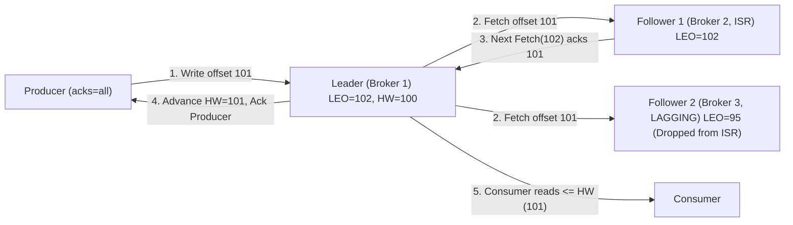
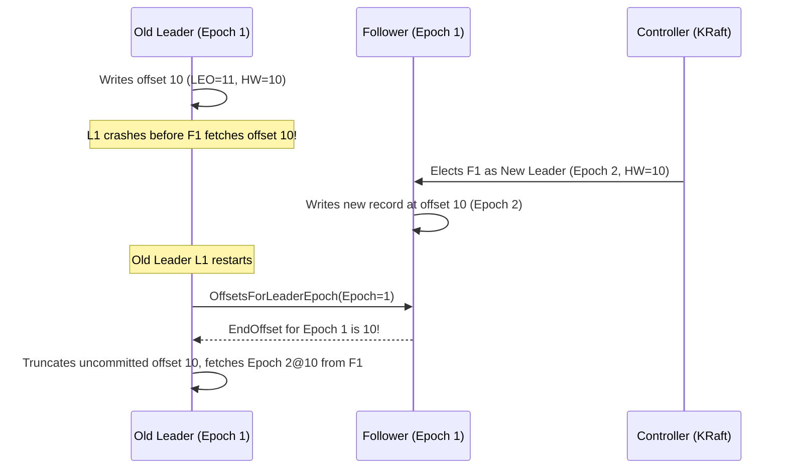
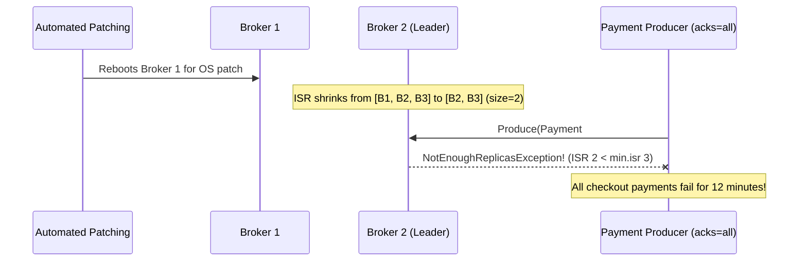

# Kafka Replication & Durability: ISR, min.insync.replicas, acks=all

> **Prerequisites:** [Lesson 05: Kafka Consumer Groups & Rebalancing](../05-kafka-consumer-groups-rebalancing/README.md).  
> **Estimated Reading Time:** 25–28 minutes  
> **Target Audience:** Backend and platform engineers designing zero-data-loss Kafka clusters, and candidates asked "how does Kafka guarantee durability when a broker dies—and when can it still lose data?"  
> **Free PDF Notes:** [Download SD-I-006.pdf](https://backendroadmap.com/notes/system-design/SD-I-006.pdf)

> [!NOTE]
> **In one line:** Kafka achieves durability by replicating each partition across $RF$ brokers (1 **Leader**, $RF - 1$ **Followers**), tracking which followers are caught up in the **In-Sync Replicas (ISR)** set, advancing the **High Watermark (HW)** only once all ISR members persist a record, and gating `acks=all` writes on **`min.insync.replicas`**—explicitly choosing **CP (consistency/durability)** over **AP (availability)** when `unclean.leader.election.enable=false`.

> [!TIP]
> **The Golden Rule:** The production durability triad is **`replication.factor = 3`**, **`min.insync.replicas = 2`**, **`acks = all`**, and **`unclean.leader.election.enable = false`**. That survives **1** broker failure with zero data loss and zero downtime, and halts writes rather than losing or diverging data if **2** brokers fail simultaneously.

---

## 1. What Kafka Replication and Durability Are, and What They Aren't

Disks fail, EC2 instances terminate, and kernels panic. If a partition lived on only 1 broker, any hardware failure would cause permanent data loss and outage. Kafka replicates every partition to $RF$ brokers across distinct failure domains (availability zones / racks). One replica is elected **Leader** (handling all client produces and tail reads), while the rest are **Followers** that continuously pull from the leader like consumers.

| Term | Precise Meaning | Example |
| :--- | :--- | :--- |
| **Replication Factor ($RF$)** | Total number of copies of each partition across the cluster | `RF=3` (1 Leader + 2 Followers) |
| **ISR (In-Sync Replicas)** | Subset of replicas currently caught up with the leader within `replica.lag.time.max.ms` | `[Broker 1, Broker 2, Broker 3]` |
| **High Watermark (HW)** | Highest offset replicated to **all** members of the ISR; consumers cannot read past HW | `HW = 100` even if Leader's `LEO = 105` |
| **Log End Offset (LEO)** | Offset of the next record to be written to a replica's local log | Leader `LEO = 105`, Follower `LEO = 100` |
| **`min.insync.replicas`** | Minimum ISR size required to accept an `acks=all` write | `min.insync.replicas=2` |
| **Unclean Leader Election** | Allowing an out-of-sync (non-ISR) replica to become leader if all ISR replicas die | `unclean.leader.election.enable=false` (safe default) |
| **Leader Epoch** | Monotonic generation counter incremented on each leader election to prevent log divergence | Replaces HW-only truncation races |
| **Not** | Quorum voting on every write like Raft/Paxos | Kafka uses **ISR-based replication**, not majority-quorum per write |

### Why It Matters
1. "How does Kafka avoid losing messages when a broker crashes?" is a foundational distributed systems interview question.
2. Misunderstanding the interplay between **`RF`**, **`ISR`**, **`min.insync.replicas`**, **`acks=all`**, and **`unclean.leader.election.enable`** leads directly to either silent data loss or unexpected `NotEnoughReplicasException` outages.
3. This is a textbook **CAP theorem** trade-off in action: `min.insync.replicas=2` + `unclean.leader.election=false` deliberately sacrifices availability during a 2-broker failure to guarantee zero committed data loss.

---

## 2. Anatomy: Leader, Followers, ISR, and High Watermark



**How ISR & High Watermark work together:**
1. The Leader appends `offset 101` to its local log (`LEO` becomes `102`). At this moment, `HW` is still `100`—consumers **cannot** see `offset 101` yet (preventing dirty reads if the leader crashes before replication).
2. Follower 1 (`Broker 2`) fetches `offset 101`, writes it, and sends its next fetch request for `offset 102`. Seeing that all current ISR members (`[Broker 1, Broker 2]`) have `LEO >= 102`, the Leader advances **`HW = 101`** and sends `ProduceResponse` (`acks=all`) back to the producer.
3. Meanwhile, Follower 2 (`Broker 3`) stalled for $> 30\text{ s}$ (`replica.lag.time.max.ms`). The Leader removes `Broker 3` from the ISR so it cannot hold back `HW` or `acks=all` indefinitely!

| Configuration Triad | Fault Tolerance (Zero Loss) | Availability Under 1 Broker Down | Availability Under 2 Brokers Down |
| :--- | :--- | :--- | :--- |
| `RF=3, min.isr=1, acks=all` | **0** (unsafe if ISR shrinks to 1!) | Writes succeed | Writes succeed (risks data loss) |
| **`RF=3, min.isr=2, acks=all`** | **1 broker failure** | **Writes succeed** | **Writes rejected (`NotEnoughReplicas`)** |
| `RF=3, min.isr=3, acks=all` | 2 brokers (if synced) | **Writes rejected** (0 tolerance!) | Writes rejected |

> [!WARNING]
> **The #1 Trap: Setting `min.insync.replicas = RF` (e.g., `RF=3, min.insync.replicas=3`).** If *any* single broker reboots for a routine OS patch or rolling upgrade, ISR drops from 3 to 2, which is $< 3$, and **every `acks=all` producer in your company fails with `NotEnoughReplicasException`**! Always leave at least 1 broker of headroom (`min.insync.replicas = RF - 1`, typically `3 - 1 = 2`).

---

## 3. Mathematical Model: Quorum Math, Availability, and Lag Bounds

**1. Durability & Availability Inequalities ($RF$, $M = \text{min.insync.replicas}$).**
For a partition with replication factor $RF$ and `min.insync.replicas` $= M$:
- **Tolerable simultaneous broker failures while staying available for writes:**

$$F_{\text{avail}} = RF - M$$

- **Tolerable simultaneous broker failures without losing committed `acks=all` data:**

$$F_{\text{dur}} = M - 1$$

**Worked Example:**
- With $RF = 3, M = 2$: $F_{\text{avail}} = 3 - 2 = 1$ (survives 1 broker down for writes) and $F_{\text{dur}} = 2 - 1 = 1$ (data is on at least 2 brokers, so 1 broker can die permanently without losing committed records).
- With $RF = 5, M = 3$: $F_{\text{avail}} = 5 - 3 = 2$ and $F_{\text{dur}} = 3 - 1 = 2$ (survives 2 simultaneous broker/AZ failures, at the cost of $5\times$ disk and network replication).

**2. Probability of Losing Availability (Annualized).**
Suppose each broker has availability $a = 0.999$ (unavailability $u = 1 - a = 10^{-3}$) across 3 independent AZs:
- With $RF=3, M=2$, writes fail only when $\ge 2$ of the 3 brokers are down simultaneously:

$$P(\text{unavailable}) = \binom{3}{2} u^2 (1-u) + u^3 \approx 3 \times 10^{-6} \quad (99.9997\%\text{ availability})$$

- With $RF=3, M=3$ (the misconfiguration trap), writes fail whenever *any* 1 broker is down:

$$P(\text{unavailable}) \approx 3 u = 3 \times 10^{-3} \quad (99.7\%\text{ availability} \to 1{,}000\times\text{ worse!})$$

---

## 4. Metrics & Percentiles

| Metric | Meaning | Alert when |
| :--- | :--- | :--- |
| **`UnderReplicatedPartitions`** | Partitions where `len(ISR) < RF` | $> 0$ for $> 2\text{ min}$ (follower lagging or down) |
| **`OfflinePartitionsCount`** | Partitions with **no** active leader | $> 0$ (**SEV-1**: reads & writes blocked!) |
| **`IsrShrinksPerSec` / `IsrExpandsPerSec`** | Rate of followers leaving/rejoining ISR | Frequent flapping (network/GC/disk saturation) |
| **`UnderMinIsrPartitionCount`** | Partitions where `len(ISR) < min.insync.replicas` | $> 0$ (**SEV-1**: `acks=all` writes are failing!) |
| **`UncleanLeaderElectionsPerSec`** | Non-ISR replica promoted to leader | $> 0$ (**data loss / log divergence occurred!**) |

### Worked Example (AZ Outage Simulation)
- **Cluster:** 6 brokers spread evenly across 3 AZs (`us-east-1a`, `1b`, `1c`), `broker.rack` configured, `RF=3`, `min.insync.replicas=2`, `acks=all`.
- **Event:** `us-east-1b` loses power (2 brokers go offline).
- **Result:** Because `broker.rack` placed 1 replica of every partition in each AZ, every partition loses *at most* 1 replica. `ISR` shrinks from 3 to 2 ($\ge \text{min.insync.replicas}=2$). Leaders in `1b` fail over to `1a`/`1c` in $< 5\text{ s}$. **Zero data loss, zero write downtime.**

---

## 5. Compounding & Failure Modes

| Failure Scenario | What Happens |
| :--- | :--- |
| **OS Page Cache Flush vs Replication** | Kafka does *not* `fsync()` every produce to physical disk by default—it writes to the OS page cache and relies on **replication across independent brokers** for durability. A single-broker crash loses only page cache; a simultaneous 3-broker power loss (without UPS/fsync) can lose un-flushed page-cache records. |
| **Unclean Leader Election (`true`)** | All ISR brokers die; an out-of-date follower becomes leader. It truncates or diverges from committed offsets—**silently losing committed data** and confusing consumers whose offsets are now ahead of the new leader's LEO! |
| **Missing `broker.rack` Awareness** | All 3 replicas of Partition 0 happen to land in `AZ-1`. A single AZ outage takes down all 3 replicas simultaneously despite `RF=3`. |
| **Disk Thrashing Causes ISR Flapping** | Heavy old-offset replay or compaction saturates a follower's disk $\to$ follower fetch stalls $> 30\text{ s}$ $\to$ dropped from ISR $\to$ catches up $\to$ rejoins $\to$ repeats. |

---

## 6. Numbers Every Engineer Must Know

| Item | Typical | Implication |
| :--- | :---: | :--- |
| Production `replication.factor` | 3 (or 5 for ultra-critical) | Survives 1 (or 2) broker failures |
| Production `min.insync.replicas` | 2 (for `RF=3`) | `RF - 1` balances durability & rolling-upgrade availability |
| `replica.lag.time.max.ms` | 30,000 ms (30 s) | Time a follower can lag before eviction from ISR |
| `unclean.leader.election.enable` | `false` (default in Kafka 1.0+) | Never sacrifice committed data for availability |
| Leader failover time | 1–5 seconds (KRaft) / 5–15 s (ZooKeeper) | Clients retry seamlessly within `delivery.timeout.ms` |
| `flush.messages` / `flush.ms` | Long.MAX_VALUE (OS-managed) | Durability comes from replication, not per-write `fsync` |

---

## 7. Protocol / Mechanism Deep Dive: Leader Epoch & Log Truncation



| Question | Answer |
| :--- | :--- |
| **Why did Kafka add Leader Epochs (KIP-101) instead of relying only on High Watermark?** | With HW-only truncation, if an old leader crashed before propagating HW and restarted just as a new leader failed, logs could silently diverge or lose committed records. Leader Epochs tag every record with the leader's generation, making truncation exact. |
| **How does KRaft differ from ZooKeeper for replication/failover?** | KRaft embeds a Raft metadata quorum inside Kafka brokers themselves, eliminating ZooKeeper and cutting metadata propagation & leader failover for thousands of partitions from ~30 s to $< 2\text{ s}$. |
| **What happens to consumers during a leader failover?** | Consumers get `NOT_LEADER_OR_FOLLOWER`, refresh cluster metadata, and resume fetching from the new leader at their last offset. |
| **What is Rack-Aware Follower Fetching (KIP-392)?** | Lets consumers fetch from the closest in-sync replica in the *same* AZ instead of the cross-AZ leader, cutting cross-AZ cloud egress costs by up to 66%. |

**When NOT to set `acks=all` + `min.insync.replicas=2`:**
- High-volume, low-value telemetry (debug logs, click heatmaps) where losing a few seconds of data during a rare broker crash is acceptable in exchange for lower latency (`acks=1`) and lower cross-AZ replication/wait sensitivity.

---

## 8. Hierarchical Budgets & Design Rules

| Slice | Rule | Control |
| :--- | :--- | :--- |
| **Topic durability** | `RF=3`, `min.insync.replicas=2`, `unclean.leader.election.enable=false` | Terraform / GitOps topic policy |
| **Rack awareness** | Set `broker.rack=<az>` on every broker | Ensures replicas span 3 AZs |
| **Producer config** | `acks=all`, `enable.idempotence=true`, `delivery.timeout.ms >= 120000` | Survives transient failovers |
| **Rolling upgrades** | Drain/restart 1 broker at a time; wait until `UnderReplicatedPartitions == 0` | Deployment gate script |
| **Monitoring** | Page on `OfflinePartitionsCount > 0` or `UnderMinIsrPartitionCount > 0` | PagerDuty SEV-1 alert |
| **Cost optimization** | Use KIP-392 `client.rack` follower fetching for cross-AZ read-heavy groups | Cuts AWS/GCP cross-AZ egress |

---

## 9. Top Mitigations

1. **Enforce `RF=3, min.insync.replicas=2, acks=all, unclean.leader.election.enable=false`** for all business-critical topics.
2. **Always configure `broker.rack`** so replicas are never co-located in the same availability zone or physical host.
3. **Gate rolling broker restarts on `UnderReplicatedPartitions == 0`**—restarting a second broker before the first catches up drops ISR below `min.insync.replicas` and halts writes!
4. **Never set `min.insync.replicas == RF`** unless you explicitly want any single-broker reboot to block all producers.
5. **Provision `delivery.timeout.ms` generous enough (e.g., 2 minutes)** so producers automatically retry across 1–5 second leader elections without failing requests.
6. **Keep disk utilization $< 70\%$ and monitor `IsrShrinksPerSec`** so disk/network bottlenecks don't silently shrink your ISR to 1.

---

## 10. Production Reference: The Rolling Upgrade Outage (`min.insync.replicas = 3`)

A payments team configured `RF=3` and `min.insync.replicas=3` thinking "3 is safer than 2." Weeks later, an automated security patch rebooted Broker 1.



- **Root Cause:** Setting `min.insync.replicas = RF` eliminated all fault tolerance ($F_{\text{avail}} = 3 - 3 = 0$). A routine single-broker reboot caused a full write outage.
- **The Fix:**
  1. Changed `min.insync.replicas` to `2` ($F_{\text{avail}} = 1, F_{\text{dur}} = 1$).
  2. Added a pre-flight check in the patching automation verifying `UnderReplicatedPartitions == 0` before rebooting the next broker.

---

## 11. Multi-Language Production Code Tabs

Handling transient `NotEnoughReplicas` / `LeaderNotAvailable` errors cleanly with `acks=all`, `enable.idempotence=true`, and generous retry budgets across 4 languages.

````carousel
```go
// Go (confluent-kafka-go): Durable Producer configured to survive leader failovers
package main

import (
	"fmt"
	"github.com/confluentinc/confluent-kafka-go/v2/kafka"
)

func newDurableProducer() (*kafka.Producer, error) {
	return kafka.NewProducer(&kafka.ConfigMap{
		"bootstrap.servers":   "broker1:9092,broker2:9092,broker3:9092",
		"acks":                "all",
		"enable.idempotence":  true,
		"retries":             2147483647, // retry transient NotLeader/NotEnoughReplicas
		"delivery.timeout.ms": 120000,     // 2 min total budget across failovers
		"request.timeout.ms":  30000,
		"client.rack":         "us-east-1a", // KIP-392 rack awareness (consumers)
	})
}

func main() {
	p, err := newDurableProducer()
	if err != nil {
		panic(err)
	}
	defer p.Close()

	topic := "payments"
	ch := make(chan kafka.Event, 1)
	_ = p.Produce(&kafka.Message{
		TopicPartition: kafka.TopicPartition{Topic: &topic, Partition: kafka.PartitionAny},
		Key:            []byte("acct-42"),
		Value:          []byte(`{"amount":5000}`),
	}, ch)

	ev := (<-ch).(*kafka.Message)
	if ev.TopicPartition.Error != nil {
		fmt.Println("Permanent failure after delivery.timeout.ms:", ev.TopicPartition.Error)
	} else {
		fmt.Println("Durably committed to ISR at:", ev.TopicPartition)
	}
}
```
<!-- slide -->
```typescript
// TypeScript (KafkaJS): acks=-1 (all), Idempotence, and Failover-Resilient Retries
import { Kafka } from "kafkajs";

const kafka = new Kafka({
  clientId: "payment-writer",
  brokers: ["broker1:9092", "broker2:9092", "broker3:9092"],
  retry: {
    initialRetryTime: 100,
    retries: 10, // absorbs leader election windows
  },
});

async function publishDurablePayment(accountId: string, amount: number): Promise<void> {
  const producer = kafka.producer({
    idempotent: true,
    maxInFlightRequests: 5,
  });
  await producer.connect();
  await producer.send({
    topic: "payments",
    acks: -1, // requires all ISR replicas (>= min.insync.replicas)
    timeout: 30000,
    messages: [{ key: accountId, value: JSON.stringify({ accountId, amount }) }],
  });
  await producer.disconnect();
}
```
<!-- slide -->
```python
# Python (confluent-kafka): Zero-Loss Producer & Rack-Aware Consumer
from confluent_kafka import Producer, Consumer

producer = Producer({
    "bootstrap.servers": "broker1:9092,broker2:9092,broker3:9092",
    "acks": "all",
    "enable.idempotence": True,
    "retries": 2147483647,
    "delivery.timeout.ms": 120000,
    "request.timeout.ms": 30000,
})

def on_ack(err, msg):
    if err is not None:
        raise RuntimeError(f"Failed after retry budget: {err}")
    print(f"ISR-committed to {msg.topic()}[{msg.partition()}]@{msg.offset()}")

producer.produce("payments", key=b"acct-42", value=b'{"amount":5000}', callback=on_ack)
producer.flush(timeout=15)

# Consumer with KIP-392 rack-aware follower fetching to save cross-AZ egress
consumer = Consumer({
    "bootstrap.servers": "broker1:9092,broker2:9092,broker3:9092",
    "group.id": "ledger-service",
    "client.rack": "us-east-1a",
    "enable.auto.commit": False,
})
```
<!-- slide -->
```csharp
// C# (Confluent.Kafka): Durable acks=All Producer with Failover Retry Budget
using System;
using System.Threading.Tasks;
using Confluent.Kafka;

public static class DurableKafka
{
    public static async Task PublishAsync(string accountId, string payload)
    {
        var config = new ProducerConfig
        {
            BootstrapServers = "broker1:9092,broker2:9092,broker3:9092",
            Acks = Acks.All,
            EnableIdempotence = true,
            MessageSendMaxRetries = int.MaxValue,
            MessageTimeoutMs = 120000, // delivery.timeout.ms equivalent
            RequestTimeoutMs = 30000
        };

        using var producer = new ProducerBuilder<string, string>(config).Build();
        var res = await producer.ProduceAsync("payments", new Message<string, string>
        {
            Key = accountId,
            Value = payload
        });
        Console.WriteLine($"Committed to ISR: {res.TopicPartitionOffset}");
    }
}
```
````

---

## 12. Hands-On CLI Verification Workflows

Verifying replication factor, ISR health, `min.insync.replicas`, and under-replicated partitions:

```bash
# 1. Create a durable topic with RF=3, min.insync.replicas=2, unclean election disabled
kafka-topics.sh --bootstrap-server localhost:9092 --create \
  --topic payments \
  --partitions 12 --replication-factor 3 \
  --config min.insync.replicas=2 \
  --config unclean.leader.election.enable=false

# 2. Check Leaders, Replicas, and ISR for every partition
kafka-topics.sh --bootstrap-server localhost:9092 --describe --topic payments

# 3. Find any under-replicated or unavailable partitions cluster-wide (must be empty!)
kafka-topics.sh --bootstrap-server localhost:9092 --describe --under-replicated-partitions
kafka-topics.sh --bootstrap-server localhost:9092 --describe --unavailable-partitions
```

---

## 13. Common Mistakes to Avoid

1. **Setting `min.insync.replicas = RF`**, causing total write unavailability on any single-broker reboot.
2. **Leaving `min.insync.replicas = 1` with `acks=all`**, silently degrading to `acks=1` durability.
3. **Enabling `unclean.leader.election.enable = true`** on critical data, allowing silent data loss and offset divergence.
4. **Omitting `broker.rack` in multi-AZ clusters**, risking all 3 replicas landing in the same availability zone.
5. **Rebooting multiple brokers simultaneously** without waiting for `UnderReplicatedPartitions == 0`.
6. **Assuming Kafka `fsync`s every message synchronously**—its durability comes from **multi-broker replication**, not per-message disk flushes.
7. **Setting `delivery.timeout.ms` too low (e.g., 2 seconds)**, failing writes during normal 3-second leader elections.

---

## 14. Key Terms Glossary

| Key Term | Definition |
| :--- | :--- |
| **Replication Factor ($RF$)** | Number of broker copies maintained for each partition. |
| **Leader / Follower** | Single replica handling client writes/tail reads vs replicas pulling updates. |
| **ISR (In-Sync Replicas)** | Set of replicas caught up with the leader within `replica.lag.time.max.ms`. |
| **High Watermark (HW)** | Highest offset replicated to all ISR members; upper bound for consumer reads. |
| **Log End Offset (LEO)** | Offset of the next record to be appended to a replica's log. |
| **`min.insync.replicas`** | Minimum ISR count required for the leader to accept `acks=all` writes. |
| **Unclean leader election** | Promoting an out-of-sync replica to leader when all ISR brokers are down (risks data loss). |
| **Leader Epoch** | Monotonic generation number preventing log divergence across failovers. |
| **KRaft** | Kafka's built-in Raft metadata quorum replacing Apache ZooKeeper. |
| **Follower fetching (KIP-392)** | Allowing consumers to read from a local-AZ follower replica to save cross-AZ bandwidth. |

---

## 15. System Design Interview Questions & Answers

### Basic Conceptual Questions

<details>
<summary><strong>Q1: How does Kafka replication work (Leader, Followers, ISR)? [BASIC]</strong></summary>

**Answer:**
Each partition has $RF$ replicas across different brokers: one **Leader** and $RF-1$ **Followers**. Producers write to the Leader, and Followers continuously fetch records from the Leader. Replicas caught up within `replica.lag.time.max.ms` form the **In-Sync Replicas (ISR)** set.
</details>

<details>
<summary><strong>Q2: What is the High Watermark (HW) and why can't consumers read past it? [BASIC]</strong></summary>

**Answer:**
The High Watermark is the highest offset that has been replicated to **every** replica in the ISR. Consumers can only read up to the HW so they never observe an uncommitted record that could vanish if the Leader crashes before replication completes.
</details>

<details>
<summary><strong>Q3: What is the standard production configuration for zero data loss in Kafka? [BASIC]</strong></summary>

**Answer:**
`replication.factor=3`, `min.insync.replicas=2`, `acks=all`, `enable.idempotence=true`, `unclean.leader.election.enable=false`, and `broker.rack` configured across 3 availability zones.
</details>

<details>
<summary><strong>Q4: What happens if `len(ISR) < min.insync.replicas`? [BASIC]</strong></summary>

**Answer:**
Producers using `acks=all` receive a `NotEnoughReplicasException` (writes are rejected to preserve durability), while consumers can still read existing committed data up to the High Watermark.
</details>

### Scenario-Based Architecture Questions

<details>
<summary><strong>Q5: With `RF=3` and `min.insync.replicas=2`, how many simultaneous broker failures can you survive for writes vs data durability? [SCENARIO]</strong></summary>

**Answer:**
You can survive **1** broker failure with zero write downtime ($3 - 2 = 1$) and zero data loss ($2 - 1 = 1$). If **2** brokers fail simultaneously, writes pause (`NotEnoughReplicas`) rather than risking data loss, and resume once at least 1 failed ISR broker recovers.
</details>

<details>
<summary><strong>Q6: Why is `RF=3, min.insync.replicas=3` a bad idea in production? [SCENARIO]</strong></summary>

**Answer:**
It gives zero availability tolerance ($3 - 3 = 0$). Any single broker reboot, OS patch, or transient follower lag drops the ISR to 2 and halts all `acks=all` writes across the topic.
</details>

<details>
<summary><strong>Q7: An entire AWS Availability Zone goes dark. How do you ensure your Kafka cluster keeps running without losing data? [SCENARIO]</strong></summary>

**Answer:**
Spread brokers across 3 AZs with `broker.rack` set, use `RF=3` and `min.insync.replicas=2` (`acks=all`, `unclean.leader.election.enable=false`). Each partition has 1 replica per AZ, so losing 1 AZ leaves 2 in-sync replicas in the remaining 2 AZs.
</details>

<details>
<summary><strong>Q8: Your cross-AZ data transfer bill for Kafka consumers is huge. How do you reduce it? [SCENARIO]</strong></summary>

**Answer:**
Enable **Rack-Aware Follower Fetching (KIP-392)** by setting `client.rack` on consumers and `replica.selector.class=RackAwareReplicaSelector` on brokers so consumers read from an in-sync follower in the *same* AZ instead of the leader in another AZ.
</details>

### Advanced & Tricky Interview Questions

<details>
<summary><strong>Q9: Does Kafka call `fsync()` on every message when `acks=all`? Why or why not? [TRICKY]</strong></summary>

**Answer:**
No. By default, Kafka writes to the OS **page cache** and relies on **replication to `min.insync.replicas` independent brokers** for durability. Calling `fsync()` per batch would destroy sequential throughput; replication across independent failure domains provides both high speed and high durability.
</details>

<details>
<summary><strong>Q10: What is the CAP theorem trade-off of `unclean.leader.election.enable=false`? [TRICKY]</strong></summary>

**Answer:**
It chooses **Consistency/Durability (CP)** over **Availability (AP)**. If all ISR brokers die, the partition stays offline (`OfflinePartitionsCount > 0`) rather than promoting an out-of-date replica that would lose committed messages and diverge from consumer offsets.
</details>

<details>
<summary><strong>Q11: How does Leader Epoch prevent log divergence compared to High Watermark alone? [TRICKY]</strong></summary>

**Answer:**
Under HW-only replication, if a leader crashed before propagating HW and restarted concurrently with another failover, followers could truncate committed data or diverge. Tagging records with `(LeaderEpoch, StartOffset)` lets recovering brokers query `OffsetsForLeaderEpoch` and truncate *only* genuinely uncommitted records.
</details>

<details>
<summary><strong>Q12: Why does Kafka use ISR-based replication instead of Raft majority quorum on every write? [TRICKY]</strong></summary>

**Answer:**
With `RF=3`, both `min.insync.replicas=2` and Raft need 2 replicas. However, ISR lets Kafka dynamically exclude a slow/dead follower so it doesn't stall `HW` or require Raft leader-lease checks on every single batch—and in `RF=3, min.isr=2`, if 1 follower is down, the remaining 2 must both ack, whereas Raft can tolerate 1 down out of 3. Meanwhile, KRaft *does* use Raft for cluster metadata!
</details>

---

## 16. One-Page Master Cheat Sheet

```
+---------------------------------------------------------------------------------------------------------+
|               KAFKA REPLICATION & DURABILITY — MASTER CHEAT SHEET                                       |
+---------------------------------------------------------------------------------------------------------+
| 1. GOLDEN TRIAD: RF=3 + min.insync.replicas=2 + acks=all + unclean.leader.election.enable=false.        |
+---------------------------------------------------------------------------------------------------------+
| 2. QUORUM MATH: Write availability = (RF - min.isr) failures. Durability = (min.isr - 1) failures.      |
|    Never set min.insync.replicas = RF (0 tolerance for rolling reboots!).                               |
+---------------------------------------------------------------------------------------------------------+
| 3. HIGH WATERMARK (HW): Lowest LEO across all ISR members. Consumers only read <= HW.                   |
+---------------------------------------------------------------------------------------------------------+
| 4. DURABILITY SOURCE: Replication to multiple independent brokers' page caches (not per-write fsync).   |
+---------------------------------------------------------------------------------------------------------+
| 5. RACK AWARENESS: Set broker.rack=<az> on all brokers; use KIP-392 client.rack to cut cross-AZ egress. |
+---------------------------------------------------------------------------------------------------------+
| 6. UPGRADES: Always wait for UnderReplicatedPartitions == 0 before rebooting the next broker.           |
+---------------------------------------------------------------------------------------------------------+
```

---

## Further Reading & Sources

- Apache Kafka Documentation, [Replication & ISR Design](https://kafka.apache.org/documentation/#replication).
- Apache Kafka KIP-101, [Alter Replication Protocol to use Leader Epoch rather than High Watermark for Truncation](https://cwiki.apache.org/confluence/display/KAFKA/KIP-101+-+Alter+Replication+Protocol+to+use+Leader+Epoch+rather+than+High+Watermark+for+Truncation).
- Apache Kafka KIP-500 / KRaft, [Replacing ZooKeeper with a Self-Managed Metadata Quorum](https://kafka.apache.org/documentation/#kraft).
- Confluent Blog, [Hands-free Kafka Replication: A Lesson in Operational Simplicity](https://www.confluent.io/blog/).

---

## Free PDF Notes

[SD-I-006.pdf](https://backendroadmap.com/notes/system-design/SD-I-006.pdf)

---

## Next

Continue with [Lesson 07: Kafka Ordering Guarantees](../07-kafka-ordering-guarantees/README.md): Partition Keys, Retries & Sequence Numbers.
