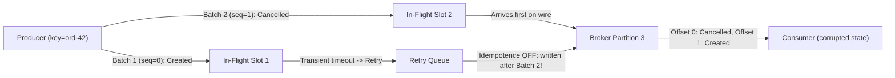
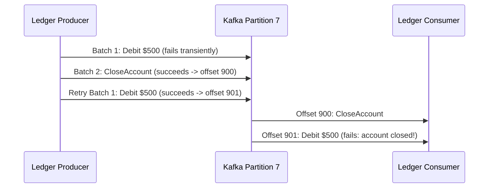

# Kafka Ordering Guarantees: Partition Keys, Retries & Sequence Numbers

> **Prerequisites:** [Lesson 06: Kafka Replication & Durability](../06-kafka-replication-durability/README.md) · [Lesson 04: Partitioning & Consumer Groups](../04-kafka-topics-partitions-offsets/README.md).  
> **Estimated Reading Time:** 24–28 minutes  
> **Target Audience:** Backend engineers designing ordered event pipelines, and candidates asked "how does Kafka guarantee ordering, and how can retries break it?"  
> **Free PDF Notes:** [Download SD-I-007.pdf](https://backendroadmap.com/notes/system-design/SD-I-007.pdf)

> [!NOTE]
> **In one line:** Kafka guarantees **strict FIFO ordering only within a single partition**, never across an entire topic. Preserving per-entity order requires deterministic **partition keys** (e.g., `order_id`), **in-flight request limits or idempotent producer sequence numbers** (`enable.idempotence=true`), and **single-threaded per-partition consumption**—and even then, **repartitioning, key skew, and async consumer worker pools** can silently break it.

> [!TIP]
> **The Golden Rule:** Order by the **smallest entity boundary that actually needs causal ordering** (usually `account_id` or `order_id`, not `tenant_id` or global). Use `enable.idempotence=true` on producers so retries never reorder batches, and never hand off messages from a single partition to an unordered worker pool if order matters.

---

## 1. What Kafka Ordering Is, and What It Isn't

A payments service emits two events for order `ord-42`: first `OrderCreated`, then `OrderCancelled`. If a downstream ledger processes `OrderCancelled` before `OrderCreated`, it either throws a `NotFound` error or—worse—creates a ghost order that stays open forever. Engineers often assume "Kafka is an ordered log, so events arrive in order." That assumption holds **only within a single partition** and **only when neither the producer nor the consumer reorders them**.

| Term | Precise Meaning | Example |
| :--- | :--- | :--- |
| **Total (global) order** | Every event in a topic is ordered relative to every other event | Single-partition topic (max 1 consumer active) |
| **Per-partition order** | Events appended to partition $p$ are read by offset $0, 1, 2, \dots$ | All events in `orders-p3` |
| **Partition key** | Value hashed (`murmur2` in Java Kafka) to pick target partition | `key = "ord-42"` $\rightarrow$ partition 3 |
| **In-flight batch** | `ProduceRequest` sent to broker before previous ack arrives | `max.in.flight.requests.per.connection = 5` |
| **Producer sequence number** | Monotonic per-(PID, partition) counter checked by the broker | `(PID=107, seq=14)` rejected if `seq != 13 + 1` |
| **Consumer worker pool** | Thread/goroutine pool pulling from one partition concurrently | Breaks per-partition order unless sharded by key |
| **Not** | A cross-partition or cross-topic timestamp guarantee | Partition 0 at $t=10\text{ ms}$ may be read after Partition 1 at $t=15\text{ ms}$ |

### Why It Matters
1. State-machine transitions (`Created` $\rightarrow$ `Paid` $\rightarrow$ `Shipped` $\rightarrow$ `Refunded`) and CDC (Change Data Capture) streams corrupt state if applied out of order.
2. Increasing partition count for throughput changes the modulo hash `hash(key) % N`, which **splits an entity's history across two partitions** during scaling.
3. Enabling producer retries without idempotence (`enable.idempotence=false`) and `max.in.flight.requests.per.connection > 1` is the classic production bug that silently swaps adjacent events.

---

## 2. Anatomy: How Ordering Breaks in Producer, Broker & Consumer



Ordering must hold across **four distinct stages**; breaking any one of them breaks end-to-end order:

| Stage | How Ordering Is Preserved | How It Breaks |
| :--- | :--- | :--- |
| **1. Partitioning** | Deterministic key hash: `hash(key) % P` | `null` key (sticky/round-robin), changing `P` (repartitioning), or custom partitioner bug |
| **2. Producer Wire** | `enable.idempotence=true` (PID + sequence) or `max.in.flight=1` | `retries > 0` with `max.in.flight > 1` and idempotence disabled |
| **3. Broker Storage** | Leader appends batches sequentially to partition log | Unclean leader election (`unclean.leader.election.enable=true`) truncating acked tail |
| **4. Consumer Processing** | Sequential processing per partition (or per-key sub-queues) | Async thread pool / `CompletableFuture` committing offsets out of order |

> [!WARNING]
> **Repartitioning a live keyed topic breaks ordering.** If a topic grows from 6 partitions to 12 partitions, `murmur2("ord-42") % 6` (say partition 2) and `murmur2("ord-42") % 12` (say partition 8) differ. While old events drain from partition 2 and new events land on partition 8, consumers read partition 8 ahead of partition 2. Always drain or dual-write to a new topic when changing partition count for ordered keys.

---

## 3. Mathematical Model: Partition Routing, Skew & Retry Reordering

**Hash-based partition assignment.** Kafka's default partitioner maps a non-null key $k$ across $P$ partitions using 32-bit Murmur2 (masked to non-negative):

$$p(k) = \frac{\text{murmur2}(k) \mathbin{\&} \text{0x7fffffff}}{1} \bmod P$$

**Throughput vs. Ordering Coupling.** If a single partition sustains $R_{\text{part}}$ messages/s (typically $10\text{–}50\text{ MB/s}$ or $20\text{k–}100\text{k msg/s}$ depending on message size and `acks=all`), and an entity key $k$ generates $r_k$ messages/s, ordering requires:

$$r_k \le R_{\text{part}} \quad \text{and} \quad P \ge \left\lceil \frac{R_{\text{total}}}{R_{\text{part}}} \right\rceil$$

**Zipfian Key Skew.** If keys follow a Zipf distribution with parameter $s$ across $K$ distinct keys, the hottest key receives fraction:

$$f_1 = \frac{1}{\sum_{i=1}^{K} i^{-s}}$$

**Worked Numerical Example:**
Suppose a topic processes $R_{\text{total}} = 120{,}000\text{ msg/s}$ across $P = 12$ partitions (average $10{,}000\text{ msg/s}$ per partition), and each consumer instance handles at most $R_{\text{part}} = 15{,}000\text{ msg/s}$.
- If traffic is keyed by `tenant_id` across $K = 1{,}000$ tenants with Zipf skew $s = 1.0$, then $\sum_{i=1}^{1000} i^{-1} \approx 7.49$, so the largest tenant generates:
  $$r_1 = 120{,}000 \times \frac{1}{7.49} \approx 16{,}021\text{ msg/s}$$
- Even if that single partition had *zero* other tenants, $16{,}021 > 15{,}000\text{ msg/s}$: **that single partition lags indefinitely**, while the other 11 partitions sit at $\sim 63\%$ utilization.
- Switching the partition key from `tenant_id` to `order_id` (say $100{,}000$ active orders/s) drops $r_{\max}$ to $< 50\text{ msg/s}$, restoring uniform load across all 12 partitions while preserving per-order causality.

---

## 4. Metrics & Percentiles

| Metric | Meaning | Alert when |
| :--- | :--- | :--- |
| **Per-partition consumer lag** | `LEO - committed_offset` per partition | One partition's lag grows while peers stay near 0 (hot key skew) |
| **`OutOfOrderSequenceException`** | Broker rejected a batch whose sequence $\neq \text{last\_seq} + 1$ | Any occurrence $> 0$ (producer state/session bug) |
| **Produce retry rate** | `record-retry-rate` on producer | Sustained $> 1\%$ (elevated risk if idempotence is off) |
| **Partition skew ratio** | $\max(\text{bytes/s}_p) / \text{avg}(\text{bytes/s}_p)$ | $> 2.0\times$ across partitions of an ordered topic |
| **End-to-end state violation** | Consumer detects invalid transition (e.g., `Cancelled` before `Created`) | Any occurrence $> 0$ (broken key, repartition, or async worker bug) |
| **Rebalance frequency** | Consumer group `JoinGroup` / `SyncGroup` rate | $> 2/\text{hour}$ (stalls partition consumption & triggers duplicate/out-of-order risk if offsets lag) |

### Worked Example (`OrderCreated` $\rightarrow$ `OrderCancelled`)
An order service produces `OrderCreated` (Batch 1, `seq=0`) and 4 ms later `OrderCancelled` (Batch 2, `seq=1`) with `key="ord-42"` to Partition 3.
1. **With `enable.idempotence=false`, `max.in.flight=5`:** Batch 1 hits a transient broker socket timeout and is queued for retry. Batch 2 arrives and is written at **offset 100**. Batch 1 retries 50 ms later and is written at **offset 101**. Consumer reads `OrderCancelled` then `OrderCreated`.
2. **With `enable.idempotence=true`, `max.in.flight=5`:** Broker tracks `(PID=107, last_seq=-1)` for Partition 3. Batch 2 (`seq=1`) arrives first; broker sees `1 != -1 + 1` and returns `OutOfOrderSequenceException` (retriable on the producer). Batch 1 (`seq=0`) retries, succeeds at **offset 100** (`last_seq=0`), and then Batch 2 (`seq=1`) retries and succeeds at **offset 101**. Strict order is preserved **without** sacrificing pipelining throughput.

---

## 5. Compounding & Failure Modes

| Failure Mode | Trigger | Compounding Effect |
| :--- | :--- | :--- |
| **Retry Inversion** | `max.in.flight > 1` + `enable.idempotence=false` | Network blip flips adjacent events; corrupts state silently |
| **Hot-Key Partition Pinning** | Coarse key (`country`, `tenant_id`) | 1 of $P$ consumers saturates CPU/DB; adding partitions does nothing |
| **Async Worker Pool Scramble** | Consumer dispatches partition messages to $N$ goroutines/threads | Fast message #2 finishes before slow message #1; offset commit skips or corrupts |
| **Repartition Split-Brain** | `kafka-topics.sh --alter --partitions 24` on keyed topic | Old and new keys land on different partitions; parallel consumers race |
| **Unclean Leader Election** | `unclean.leader.election.enable=true` during broker outage | Out-of-sync follower becomes leader, losing tail and diverging sequences |

**Quantifying Async Worker Scramble:** If a single partition delivers $1{,}000\text{ msg/s}$ to a 16-thread worker pool where processing latency has mean $10\text{ ms}$ and $p_{99} = 80\text{ ms}$, any two consecutive events for the same key within $70\text{ ms}$ have a high probability of inverting. Only **per-key sharded queues** (where `hash(key) % W` pins each key to one worker) restore order while retaining concurrency.

---

## 6. Numbers Every Engineer Must Know

| Item | Typical | Implication |
| :--- | :---: | :--- |
| Default `enable.idempotence` | `true` (Kafka 3.0+), `false` (< 3.0) | Explicitly set `enable.idempotence=true` in client config |
| Max `max.in.flight.requests.per.connection` with idempotence | `5` | Broker keeps a 5-batch sequence window per `(PID, partition)` |
| Kafka sequence number type | 32-bit signed int (`0` to $2^{31}-1$) | Wraps cleanly; broker validates exact `last_seq + 1` |
| Producer ID (`PID`) table retention | `transactional.id.expiration.ms` (7 days default) | Long-idle producers get a new PID; sequence resets safely |
| Single-partition throughput ceiling | $\sim 10\text{–}50\text{ MB/s}$ (with replication) | Bounds how hot a single entity key can be |
| Per-key vs. global ordering | $P$ parallel consumers vs. $1$ consumer | Global order caps topic throughput at 1 partition's speed |

---

## 7. Protocol / Mechanism Deep Dive: Idempotent Producer Sequence Numbers

```mermaid
sequenceDiagram
    participant P as Producer (PID=107)
    participant B as Broker Leader (Partition 3)
    Note over P,B: Initial state: Broker last_seq = -1
    P->>B: Produce Batch 1 (seq=0, Created)
    P->>B: Produce Batch 2 (seq=1, Cancelled)
    Note over B: Batch 1 dropped on network; Batch 2 arrives first
    B-->>P: Error: OutOfOrderSequence (expected seq=0, got 1)
    P->>B: Retry Batch 1 (seq=0, Created)
    B->>B: seq == -1 + 1 -> Append at offset 100, last_seq=0
    B-->>P: Ack (offset 100)
    P->>B: Retry Batch 2 (seq=1, Cancelled)
    B->>B: seq == 0 + 1 -> Append at offset 101, last_seq=1
    B-->>P: Ack (offset 101)
```

| Question | Answer |
| :--- | :--- |
| **How does the broker detect a duplicate vs. out-of-order batch?** | It caches the last 5 `(seq, offset)` entries per `(PID, partition)`. `seq <= last_seq` in the window is a duplicate (returns existing offset without re-appending); `seq > last_seq + 1` is out-of-order. |
| **Does `enable.idempotence=true` guarantee ordering across partitions?** | **No.** Sequence numbers are scoped per `(PID, partition)`. Cross-partition ordering requires either a single partition or application-level causal timestamps/version vectors. |
| **What if the producer process restarts?** | A non-transactional idempotent producer gets a **new PID** on restart. That is safe because the old process is dead and its in-flight batches are done. |
| **When NOT to force strict ordering** | Independent telemetry, clickstreams, log lines, and metrics. Forcing keys or `max.in.flight=1` unnecessarily creates hot-partition risk and lowers batching efficiency. |

---

## 8. Hierarchical Budgets & Design Rules

| Slice | Rule | Control |
| :--- | :--- | :--- |
| **Key Granularity** | Choose the finest-grained entity key that needs causal order | `order_id` or `account_id`, never `country` or `tenant_id` |
| **Producer Config** | `enable.idempotence=true`, `acks=all`, `retries=MAX_INT` | Enforce in shared producer factory/SDK |
| **In-Flight Window** | `max.in.flight.requests.per.connection <= 5` (with idempotence) | Set to `1` only on legacy brokers (< 0.11) without idempotence |
| **Topic Scaling** | Never `--alter --partitions` on an ordered keyed topic | Create v2 topic, drain v1, or use consistent hashing + drain |
| **Consumer Concurrency** | Never exceed 1 thread per partition without key-sharded sub-queues | Sharded worker pool: `worker = hash(key) % N` |
| **Consumer Validation** | Include monotonic `entity_version` / `seq` in event payload | Reject or park stale events (`event.seq <= current.seq`) |

---

## 9. Top Mitigations

1. **Always enable `enable.idempotence=true` and `acks=all`** so producer retries never invert or duplicate batches inside a partition.
2. **Partition by the smallest causal unit** (e.g., `user_id`, `order_id`) to avoid Zipfian hot-key bottlenecks.
3. **Embed a monotonic sequence number or `version` in the payload** so consumers can detect out-of-order delivery even across repartitions or bug regressions.
4. **Use key-sharded in-memory queues on the consumer** if you need multi-threaded I/O within a single partition—never a shared unordered thread pool.
5. **Prohibit in-place partition increases** on ordered topics via CI/IaC policy; migrate via a new topic and drain the old one first.
6. **Keep `unclean.leader.election.enable=false`** so failover never truncates acknowledged ordered records.
7. **Alert on per-partition lag skew** ($\max / \text{avg} > 2$) to catch hot keys before they cause SLA breaches.

---

## 10. Production Reference: The `max.in.flight=5` Retry Inversion Incident

A fintech ledger team ran Kafka 2.x with `acks=all`, `retries=10`, `max.in.flight.requests.per.connection=5`, and **default `enable.idempotence=false`**. During a minor broker rolling restart, a `LeaderNotAvailable` transient error caused Batch 1 (`Debit $500`) to retry while Batch 2 (`CloseAccount`) succeeded on the new leader connection 12 ms earlier.



- **Root Cause:** Without `enable.idempotence=true`, Kafka brokers do not validate sequence numbers; pipelined `ProduceRequest`s can overtake each other on retry.
- **Fix:** Enabled `enable.idempotence=true` across all producers, added a monotonic `account_seq` field to every domain event, and enforced an optimistic concurrency check (`WHERE seq = expected - 1`) in the consumer.

---

## 11. Multi-Language Production Code Tabs

Demonstrating **key-sharded ordered consumer worker pools** and **sequence-number validation** (so you get multi-core concurrency *without* breaking per-key order).

````carousel
```go
// Go: key-sharded worker pool preserving per-key order across concurrent goroutines.
package main

import (
	"fmt"
	"hash/fnv"
	"sync"
)

type Event struct {
	Key string
	Seq int64
	Op  string
}

type OrderedPool struct {
	shards []chan Event
	last   sync.Map // key -> int64 (last applied Seq)
	wg     sync.WaitGroup
}

func NewOrderedPool(workers int) *OrderedPool {
	p := &OrderedPool{shards: make([]chan Event, workers)}
	for i := 0; i < workers; i++ {
		ch := make(chan Event, 256)
		p.shards[i] = ch
		p.wg.Add(1)
		go func(c chan Event) {
			defer p.wg.Done()
			for ev := range c {
				p.applyInOrder(ev)
			}
		}(ch)
	}
	return p
}

func (p *OrderedPool) Submit(ev Event) {
	h := fnv.New32a()
	_, _ = h.Write([]byte(ev.Key))
	p.shards[int(h.Sum32())%len(p.shards)] <- ev
}

func (p *OrderedPool) applyInOrder(ev Event) {
	if prev, ok := p.last.Load(ev.Key); ok && ev.Seq <= prev.(int64) {
		fmt.Printf("skip stale/dup key=%s seq=%d\n", ev.Key, ev.Seq)
		return
	}
	p.last.Store(ev.Key, ev.Seq)
	fmt.Printf("applied key=%s seq=%d op=%s\n", ev.Key, ev.Seq, ev.Op)
}

func (p *OrderedPool) Close() {
	for _, ch := range p.shards {
		close(ch)
	}
	p.wg.Wait()
}
```
<!-- slide -->
```typescript
// TypeScript: per-key serialized async queue on top of a concurrent consumer.
export interface OrderedEvent {
  key: string;
  seq: number;
  op: string;
}

export class KeyOrderedDispatcher {
  private queues = new Map<string, Promise<void>>();
  private lastSeq = new Map<string, number>();

  dispatch(ev: OrderedEvent, handler: (e: OrderedEvent) => Promise<void>): Promise<void> {
    const prev = this.queues.get(ev.key) ?? Promise.resolve();
    const next = prev.then(async () => {
      const seen = this.lastSeq.get(ev.key) ?? -1;
      if (ev.seq <= seen) {
        return; // drop duplicate or stale out-of-order event
      }
      await handler(ev);
      this.lastSeq.set(ev.key, ev.seq);
    });
    // Keep chain alive even if a single handler throws, and clean up when idle.
    const safe = next.catch(() => undefined);
    this.queues.set(ev.key, safe);
    return next;
  }
}
```
<!-- slide -->
```python
# Python: Murmur2-style partition routing + Zipf skew & retry-inversion simulator (stdlib only).
import hashlib
from collections import Counter


def partition_for_key(key: str, num_partitions: int) -> int:
    digest = int.from_bytes(hashlib.md5(key.encode()).digest()[:4], "big") & 0x7FFFFFFF
    return digest % num_partitions


def simulate_zipf_skew(total_rps=120_000, partitions=12, part_cap=15_000, num_keys=1000, s=1.0):
    weights = [1.0 / (i ** s) for i in range(1, num_keys + 1)]
    norm = sum(weights)
    part_load = Counter()
    for i, w in enumerate(weights):
        rps = total_rps * (w / norm)
        p = partition_for_key(f"tenant-{i}", partitions)
        part_load[p] += rps
    hottest_p, hottest_rps = max(part_load.items(), key=lambda kv: kv[1])
    avg_rps = total_rps / partitions
    return {
        "hottest_partition": hottest_p,
        "hottest_rps": round(hottest_rps, 1),
        "avg_rps": round(avg_rps, 1),
        "skew_ratio": round(hottest_rps / avg_rps, 2),
        "overloaded": hottest_rps > part_cap,
    }
```
<!-- slide -->
```csharp
// C#: key-sharded Channel<T> worker pool with monotonic sequence guard.
using System.Collections.Concurrent;
using System.Threading.Channels;

public sealed record OrderedEvent(string Key, long Seq, string Op);

public sealed class KeyShardedProcessor
{
    private readonly Channel<OrderedEvent>[] _shards;
    private readonly ConcurrentDictionary<string, long> _lastSeq = new();
    private readonly Task[] _workers;

    public KeyShardedProcessor(int workerCount, Func<OrderedEvent, Task> handle)
    {
        _shards = new Channel<OrderedEvent>[workerCount];
        _workers = new Task[workerCount];
        for (int i = 0; i < workerCount; i++)
        {
            var ch = Channel.CreateBounded<OrderedEvent>(256);
            _shards[i] = ch;
            _workers[i] = Task.Run(async () =>
            {
                await foreach (var ev in ch.Reader.ReadAllAsync())
                {
                    if (_lastSeq.TryGetValue(ev.Key, out var prev) && ev.Seq <= prev)
                        continue; // reject stale or duplicate sequence
                    await handle(ev);
                    _lastSeq[ev.Key] = ev.Seq;
                }
            });
        }
    }

    public ValueTask EnqueueAsync(OrderedEvent ev, CancellationToken ct = default)
    {
        int idx = (ev.Key.GetHashCode(StringComparison.Ordinal) & 0x7FFFFFFF) % _shards.Length;
        return _shards[idx].Writer.WriteAsync(ev, ct);
    }

    public async Task CompleteAsync()
    {
        foreach (var ch in _shards) ch.Writer.Complete();
        await Task.WhenAll(_workers);
    }
}
```
````

---

## 12. Hands-On CLI Verification Workflows

Verify partition routing, producer idempotence settings, and per-partition lag skew on a live Kafka cluster:

```bash
# 1. Create an ordered topic with 6 partitions and unclean leader election disabled
kafka-topics.sh --bootstrap-server localhost:9092 \
  --create --topic orders-ordered --partitions 6 --replication-factor 3 \
  --config unclean.leader.election.enable=false

# 2. Produce keyed events (format key:value) so all events for ord-42 hit one partition
kafka-console-producer.sh --bootstrap-server localhost:9092 \
  --topic orders-ordered \
  --property parse.key=true --property key.separator=: \
  --producer-property enable.idempotence=true \
  --producer-property acks=all <<< $'ord-42:Created\nord-42:Paid\nord-42:Shipped'

# 3. Inspect per-partition offsets and lag to detect hot-key skew
kafka-consumer-groups.sh --bootstrap-server localhost:9092 \
  --describe --group order-processor
```

Run the Python Zipf skew check from Section 11:

```bash
python -c "from sim import simulate_zipf_skew; print(simulate_zipf_skew())"
```

---

## 13. Common Mistakes to Avoid

1. **Assuming Kafka orders messages across an entire topic** rather than within a single partition.
2. **Leaving `enable.idempotence=false` with `max.in.flight > 1`**, which allows producer retries to invert batch order.
3. **Using `null` keys** on events that have state-machine dependencies.
4. **Choosing a coarse partition key (`tenant_id`, `country`)** that creates a hot partition under Zipfian traffic.
5. **Dispatching partition records to an unordered thread pool** on the consumer, scrambling processing order.
6. **Running `kafka-topics.sh --alter --partitions` on a live ordered topic**, splitting an entity's stream across old and new partitions.
7. **Relying on wall-clock timestamps (`CreateTime`) for ordering** across partitions—clock skew across producers makes timestamps unreliable.

---

## 14. Key Terms Glossary

| Key Term | Definition |
| :--- | :--- |
| **Per-partition ordering** | Strict FIFO offset order guaranteed within a single Kafka partition. |
| **Partition key** | Message key hashed deterministically to assign a record to a specific partition. |
| **Idempotent producer** | Producer configured with `enable.idempotence=true`, assigning a PID and sequence number to every batch. |
| **Producer ID (PID)** | Unique 64-bit identifier assigned by a Kafka broker to an idempotent producer session. |
| **Sequence number** | Monotonic 32-bit counter per `(PID, partition)` validated by the broker to prevent duplicates and reordering. |
| **`OutOfOrderSequenceException`** | Broker error returned when a batch's sequence number skips ahead of `last_seq + 1`. |
| **Hot key / Zipf skew** | Disproportionate traffic to one key, overloading a single partition and consumer. |
| **Repartitioning** | Changing a topic's partition count, which alters `hash(key) % P` mappings. |
| **Key-sharded worker pool** | Consumer concurrency pattern pinning each key to a dedicated single-threaded queue. |
| **Unclean leader election** | Promoting an out-of-sync replica to leader, risking loss of acknowledged tail records. |

---

## 15. System Design Interview Questions & Answers

### Basic Conceptual Questions

<details>
<summary><strong>Q1: How does Kafka guarantee message ordering? [BASIC]</strong></summary>

**Answer:**
Kafka guarantees strict FIFO ordering **only within a single partition**. Records appended to a partition receive monotonically increasing offsets ($0, 1, 2, \dots$), and a consumer reads them in that exact offset order. There is **no ordering guarantee across different partitions** of the same topic.
</details>

<details>
<summary><strong>Q2: How do you ensure all events for a single entity (e.g., an order) are processed in order? [BASIC]</strong></summary>

**Answer:**
Set the entity's ID (`order_id`) as the **partition key**. Kafka's default partitioner hashes the key (`murmur2(key) % num_partitions`), routing every event for that `order_id` to the same partition—and therefore to the same consumer instance in a consumer group.
</details>

<details>
<summary><strong>Q3: What happens to ordering if you have 1 partition vs. 10 partitions? [BASIC]</strong></summary>

**Answer:**
With 1 partition, you get **global total ordering** across the topic, but throughput is capped at what **one broker leader and one consumer thread** can handle. With 10 partitions, you scale throughput $10\times$ across 10 consumers, but ordering is scoped **per key / per partition**, not globally.
</details>

<details>
<summary><strong>Q4: Why does `null` key break ordering? [BASIC]</strong></summary>

**Answer:**
With a `null` key, Kafka's sticky/round-robin partitioner distributes batches across different partitions to balance load. Consecutive events for the same entity land on different partitions and are consumed concurrently by different consumers in arbitrary order.
</details>

### Scenario-Based Architecture Questions

<details>
<summary><strong>Q5: A producer sets `key=order_id`, `retries=5`, `max.in.flight=5`, and `enable.idempotence=false`. Occasionally `OrderCancelled` arrives before `OrderCreated`. Why? [SCENARIO]</strong></summary>

**Answer:**
Retry inversion. Batch 1 (`OrderCreated`) hit a transient network or leader error and was queued for retry, while Batch 2 (`OrderCancelled`) was already in flight on the same connection and succeeded first. When Batch 1 retried, it was appended *after* Batch 2. Fix: set `enable.idempotence=true` (so the broker enforces sequence numbers) or `max.in.flight.requests.per.connection=1`.
</details>

<details>
<summary><strong>Q6: You partition a payments topic by `tenant_id`. One enterprise tenant generates 40% of all traffic, and its partition is lagging by 2 hours while 15 other partitions are idle. How do you fix it? [SCENARIO]</strong></summary>

**Answer:**
First check if ordering is actually needed at the `tenant_id` level or at a finer boundary like `account_id` or `payment_id`. Re-keying to `account_id` spreads the enterprise tenant across all 16 partitions while preserving per-account causality. If strict `tenant_id` order is genuinely required, isolate the whale tenant onto its own dedicated topic/cluster or scale downstream I/O via key-sharded concurrency.
</details>

<details>
<summary><strong>Q7: Your consumer reads from 1 partition at 500 msg/s, but each message makes a 20 ms DB call. You add a 16-thread worker pool and throughput jumps, but state corruptions appear. Why? [SCENARIO]</strong></summary>

**Answer:**
An unordered worker pool allows two threads to process consecutive events for the same key concurrently, and the second event can finish its DB write before the first. Fix: replace the shared queue with a **key-sharded worker pool** (`worker = hash(key) % 16`), so each key's events execute sequentially on one worker while different keys run in parallel.
</details>

<details>
<summary><strong>Q8: Your ordered topic has 8 partitions and is at 90% capacity. You want to increase to 16 partitions. What goes wrong if you run `--alter --partitions 16` live? [SCENARIO]</strong></summary>

**Answer:**
`hash(key) % 8` and `hash(key) % 16` map the same key to different partitions. New events written to partition 11 can be consumed *before* older events still queued in partition 3. Instead, create a new 16-partition topic (`orders-v2`), switch producers (or pause producers briefly), drain `orders-v1` completely, and then cut consumers over—or route by a versioned dual-read barrier.
</details>

### Advanced & Tricky Interview Questions

<details>
<summary><strong>Q9: How does `enable.idempotence=true` preserve ordering even with `max.in.flight.requests.per.connection=5`? [TRICKY]</strong></summary>

**Answer:**
The producer assigns a Producer ID (`PID`) and a monotonically increasing 32-bit sequence number per `(PID, partition)`. The broker tracks the last 5 sequence numbers for each `(PID, partition)`. If Batch 2 (`seq=1`) arrives before Batch 1 (`seq=0`), the broker rejects Batch 2 with `OutOfOrderSequenceException`. The producer retries Batch 1 (`seq=0`) first, then Batch 2 (`seq=1`), guaranteeing exact append order without disabling pipelining.
</details>

<details>
<summary><strong>Q10: Can a producer crash and restart break idempotent sequence ordering? [TRICKY]</strong></summary>

**Answer:**
When a non-transactional idempotent producer restarts, it requests a brand-new `PID` from the broker and starts at `seq=0`. Because the old process is dead and its TCP sockets are closed, its old in-flight batches cannot interleave with the new process's batches (unless a zombie process is still running—which is why **transactional producers** with `transactional.id` and epoch fencing are used to fence zombies).
</details>

<details>
<summary><strong>Q11: You need global causal ordering across multiple microservices (Order, Payment, Inventory) without using a single-partition Kafka topic. How do you achieve it? [TRICKY]</strong></summary>

**Answer:**
You cannot get global order from a multi-partition broker. Instead: (1) use **correlation/causation IDs** and **choreography/saga state machines** where each step triggers the next explicitly, or (2) embed a **monotonic entity version / Lamport timestamp** in each event so consumers apply Compare-And-Set (`WHERE version = expected - 1`) and buffer or reject out-of-order transitions.
</details>

<details>
<summary><strong>Q12: Why doesn't sorting by Kafka's message timestamp (`CreateTime`) on the consumer solve cross-partition ordering? [TRICKY]</strong></summary>

**Answer:**
First, `CreateTime` comes from producer clocks, which suffer from NTP drift/clock skew across hosts. Second, a consumer cannot know whether another partition has an *unarrived* message with an older timestamp without holding back all partitions indefinitely (watermarking/windowing), which adds latency and still fails if a producer stalls.
</details>

---

## 16. One-Page Master Cheat Sheet

```
+---------------------------------------------------------------------------------------------------------+
|                    KAFKA ORDERING GUARANTEES — MASTER CHEAT SHEET                                       |
+---------------------------------------------------------------------------------------------------------+
| 1. SCOPE: Strict FIFO order holds ONLY within a single partition, NEVER across partitions.              |
+---------------------------------------------------------------------------------------------------------+
| 2. ROUTING: hash(key) % P pins an entity to 1 partition. Null key = round-robin/sticky (no order).      |
+---------------------------------------------------------------------------------------------------------+
| 3. PRODUCER: Set enable.idempotence=true + acks=all. Broker enforces (PID, seq) so max.in.flight=5      |
|    never reorders batches on retry. Without idempotence, retries + max.in.flight>1 = silent inversion.  |
+---------------------------------------------------------------------------------------------------------+
| 4. CONSUMER: 1 thread per partition OR key-sharded worker pool (hash(key) % W).                         |
|    Never use an unordered thread pool for stateful ordered events.                                      |
+---------------------------------------------------------------------------------------------------------+
| 5. SCALING TRAP: Never --alter --partitions on a live ordered topic (breaks hash(key) % P).             |
|    Avoid coarse keys (tenant_id) that cause Zipfian hot-partition lag.                                  |
+---------------------------------------------------------------------------------------------------------+
| 6. DEFENSE IN DEPTH: Embed monotonic entity_version in payload + optimistic DB check (WHERE seq=prev+1).|
+---------------------------------------------------------------------------------------------------------+
```

---

## Further Reading & Sources

- Apache Kafka Documentation, [Producer Configs (`enable.idempotence`, `max.in.flight.requests.per.connection`)](https://kafka.apache.org/documentation/#producerconfigs).
- Confluent Engineering Blog, *Idempotent Producer & Exactly-Once Semantics in Apache Kafka* (KIP-98).
- Martin Kleppmann, *Designing Data-Intensive Applications*, Chapter 11 ("Stream Processing" & partitioned logs).
- Jay Kreps, *The Log: What every software engineer should know about real-time data's unifying abstraction*.

---

## Free PDF Notes

[SD-I-007.pdf](https://backendroadmap.com/notes/system-design/SD-I-007.pdf)

---

## Next

Continue with [Lesson 08: Delivery Semantics: At-Most-Once vs At-Least-Once (Offset Commits)](../08-delivery-semantics/README.md).
