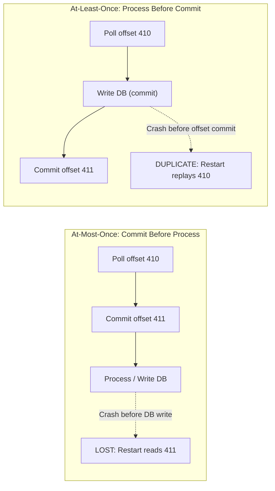
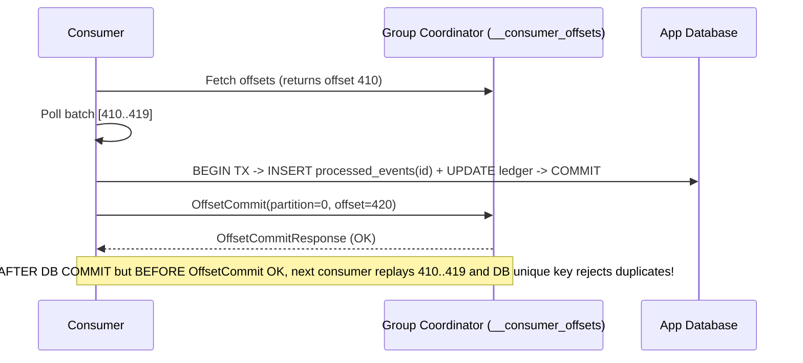
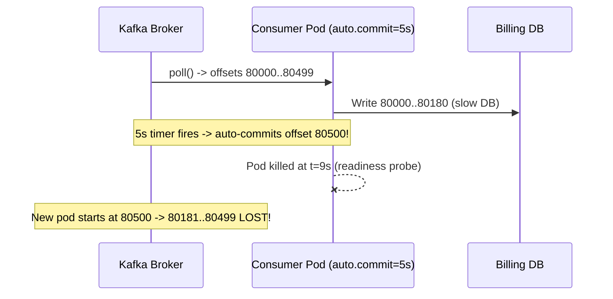

# Delivery Semantics: At-Most-Once vs At-Least-Once (Offset Commits)

> **Prerequisites:** [Lesson 07: Kafka Ordering Guarantees](../07-kafka-ordering-guarantees/README.md) · [Lesson 20: Idempotent Consumers](../../09-distributed-systems/20-idempotent-consumers/README.md).  
> **Estimated Reading Time:** 24–28 minutes  
> **Target Audience:** Backend engineers tuning Kafka/SQS/RabbitMQ consumers, and candidates asked "what is the difference between at-most-once, at-least-once, and exactly-once delivery?"  
> **Free PDF Notes:** [Download SD-I-008.pdf](https://backendroadmap.com/notes/system-design/SD-I-008.pdf)

> [!NOTE]
> **In one line:** In an asynchronous network with crashes, **you cannot prevent both message loss and duplicate processing purely at the transport layer**. **Commit before processing** gives **at-most-once** (possible loss, no duplicates); **commit after processing** gives **at-least-once** (no loss, possible duplicates). Production systems choose **at-least-once + idempotent consumers** ("effectively-once").

> [!TIP]
> **The Golden Rule:** Disable `enable.auto.commit=true` for any side-effecting consumer. Process the batch, durably commit the side effect, and **then** commit the offset synchronously/explicitly. Treat every message as if it will be delivered twice.

---

## 1. What Delivery Semantics Are, and What They Aren't

A consumer pulls `PaymentCaptured ($120)` from Kafka offset 410. Halfway through updating the ledger database, the Kubernetes pod is `SIGKILL`ed during an OOM or node drain. When a replacement pod starts, where does it resume? That depends entirely on **when the consumer committed offset 411** relative to **when it committed the database write**.

| Term | Precise Meaning | Example |
| :--- | :--- | :--- |
| **At-most-once** | Commit/ack *before* processing; crash loses the in-flight message | UDP metrics, real-time clickstream sampling |
| **At-least-once** | Process *before* committing/acking; crash replays the message | Payments, order fulfillment, emails |
| **Exactly-once delivery (myth)** | Transport-level guarantee across arbitrary external DBs | Impossible in general (Two Generals' Problem) |
| **Effectively-once** | **At-least-once delivery + idempotent consumer** | Duplicate message produces zero duplicate side effects |
| **Kafka EOS (Transactional)** | Atomic read-process-write *strictly within Kafka* (`isolation.level=read_committed`) | Kafka Streams / `consume -> transform -> produce` |
| **Auto-commit** | Background timer (`auto.commit.interval.ms=5000`) commits latest polled offset | Causes **both** message loss and duplicates on crash |
| **Not** | A broker-only checkbox | Delivery semantics depend on **producer + broker + consumer** together |

### Why It Matters
1. Kafka's default `enable.auto.commit=true` (every 5 seconds) silently **loses messages** if a consumer polls a batch, auto-commits, and crashes before finishing—or **duplicates** 4.9 seconds of work if it crashes just before the timer fires.
2. Interviewers test whether you know **why true exactly-once delivery across a broker and an external DB is impossible** without distributed transactions (2PC) or outbox/inbox patterns.
3. Rebalance storms (`max.poll.interval.ms` exceeded) trigger massive redelivery cascades if your consumer does not bound batch size and processing time.

---

## 2. Anatomy: Commit-Before vs. Commit-After vs. Auto-Commit



| Dimension | At-Most-Once | At-Least-Once | At-Least-Once + Idempotency |
| :--- | :--- | :--- | :--- |
| **Commit timing** | Before processing (or `auto.commit` race) | After durable processing | After durable processing + dedup key |
| **On consumer crash** | Message can be **lost** | Message can be **duplicated** | Replayed, **ignored safely** |
| **Throughput / Latency** | Highest / Lowest (fire-and-forget) | High (batched offset commit) | High (1 extra `INSERT`/`UPSERT` check) |
| **External DB safety** | Unsafe for state/money | Unsafe without idempotency | **Production gold standard** |

> [!WARNING]
> **Why `enable.auto.commit=true` is dangerous:** `poll()` fetches e.g. 500 records (offsets 100–599). If the 5-second background timer fires while you are on offset 150, Kafka commits **600** (the highest offset returned by the *last* `poll()`). If your pod crashes at offset 151, offsets **151–599 are permanently skipped** on restart!

---

## 3. Mathematical Model: Loss Probability, Duplicate Window & Rebalance Overhead

**Duplicate Window under Periodic Commits.** Suppose a consumer processes messages at rate $\mu$ (msg/s) and commits offsets every $\Delta t$ seconds (or every $B$ messages). If the consumer crashes at a uniform random point in the commit interval, the expected number of replayed (duplicate) messages on recovery is:

$$E[\text{duplicates}] = \frac{\mu \cdot \Delta t}{2} = \frac{B}{2}$$

**Auto-Commit Loss Window.** If `enable.auto.commit=true` fires while a batch of size $B_{\text{poll}}$ (`max.poll.records`) is $50\%$ processed, the expected number of **lost** messages on crash is:

$$E[\text{lost}] \approx \frac{B_{\text{poll}}}{2}$$

**Idempotency Overhead vs. Exactly-Once Cost.** Let $t_{\text{proc}}$ be business logic latency and $t_{\text{dedup}}$ be the cost of storing `(message_id, processed_at)` in the *same* local DB transaction as the business write. Because it shares the same ACID transaction, $t_{\text{dedup}} \approx 0.2\text{–}1\text{ ms}$ (one extra unique-index insert), whereas cross-system 2PC (XA) adds $2\text{–}4$ network round trips ($20\text{–}80\text{ ms}$) and holds locks across failure.

**Worked Numerical Example:**
A consumer processes $\mu = 2{,}000\text{ msg/s}$ with `max.poll.records = 500` and commits offsets once per batch ($\Delta t = 250\text{ ms}$):
- Under **at-least-once** (commit after batch): a crash mid-batch replays on average $500 / 2 = \mathbf{250\text{ messages}}$ (max $500$), and loses **0 messages**.
- Under **`enable.auto.commit=true`** (`5{,}000\text{ ms}$): if the timer fires right after `poll()` returns 500 records and the pod crashes 50 ms later, up to **400 messages are silently lost** (`100` processed, `400` skipped).
- If an idempotency table (`processed_events(event_id PRIMARY KEY)`) is checked in the same DB transaction, all 250 replayed messages on crash recovery hit a unique-constraint conflict and are skipped in $< 1\text{ ms}$ each (250 ms total recovery).

---

## 4. Metrics & Percentiles

| Metric | Meaning | Alert when |
| :--- | :--- | :--- |
| **`commit-latency-avg` / $p_{99}$** | Time for `__consumer_offsets` `OffsetCommit` RPC | $p_{99} > 200\text{ ms}$ (group coordinator overload) |
| **Duplicate / Idempotency hit rate** | % of consumed messages already in `processed_events` | Sudden spike $> 1\%$ (indicates crash loop or rebalance storm) |
| **Consumer rebalance rate** | `rebalance-rate-per-hour` in consumer group | $> 2/\text{hour}$ (causes repeated offset replays) |
| **`CommitFailedException` count** | Consumer took $> \text{max.poll.interval.ms}$ and lost partition | Any occurrence $> 0$ (work was done, offset rejected $\rightarrow$ guaranteed replay) |
| **Uncommitted offset delta** | `current_processed_offset - last_committed_offset` | Exceeds $2 \times \text{max.poll.records}$ |
| **Consumer lag** | `LEO - committed_offset` | Sustained upward trend |

### Worked Example (`CommitFailedException` Replay Storm)
A consumer pulls `max.poll.records = 500` records. Each record calls an external slow API taking 800 ms ($500 \times 0.8\text{ s} = 400\text{ s}$). Meanwhile, `max.poll.interval.ms = 300,000` (5 minutes). At $t = 300\text{ s}$, the broker kicks the consumer out of the group and reassigns the partition to Pod B. At $t = 400\text{ s}$, Pod A finishes all 500 records and calls `commitSync()`, which throws **`CommitFailedException`**. Pod B meanwhile re-polls all 500 records from the last committed offset and processes them a second time—and if Pod B *also* takes 400 s, the entire partition enters an infinite **poison rebalance loop**.

---

## 5. Compounding & Failure Modes

| Failure Mode | Trigger | Compounding Effect |
| :--- | :--- | :--- |
| **Auto-Commit Data Loss** | `enable.auto.commit=true` + crash mid-batch | Committed offset > processed offset $\rightarrow$ permanent silent gap |
| **Rebalance Replay Storm** | `batch_time > max.poll.interval.ms` | Consumer evicted $\rightarrow$ `CommitFailedException` $\rightarrow$ next consumer repeats the same slow batch |
| **Zombie Consumer Overwrite** | Network partition/GC pause + async commit | Evicted consumer's late commit or DB write overwrites new owner's state |
| **Non-Idempotent Side Effect** | At-least-once replay on `Balance += 100` | Every crash/rebalance double-charges or double-credits customers |
| **Broker `acks=1` Tail Loss** | Producer uses `acks=1` + leader crash before follower sync | Producer thinks it was at-least-once, but broker actually lost the message |

---

## 6. Numbers Every Engineer Must Know

| Item | Typical | Implication |
| :--- | :---: | :--- |
| Default `enable.auto.commit` | `true` (every `5000 ms`) | Always set `false` for side-effecting consumers |
| Default `max.poll.interval.ms` | `300,000 ms` (5 min) | Total time to process one `poll()` batch must stay well below this |
| Default `max.poll.records` | `500` | Lower to `10–50` if per-record I/O is slow ($> 50\text{ ms}$) |
| `__consumer_offsets` partitions | `50` (default) | Offset commits are durable replicated writes to an internal compacted topic |
| Offset retention (`offsets.retention.minutes`) | `10080` (7 days) | Idle consumer groups lose committed offsets after 7 days $\rightarrow$ `auto.offset.reset` kicks in |
| Kafka `isolation.level` | `read_uncommitted` (default) | Must set `read_committed` to ignore aborted transactional messages |

---

## 7. Protocol / Mechanism Deep Dive: Offset Commit & Transactional EOS



| Question | Answer |
| :--- | :--- |
| **Why is `committed_offset` always `last_processed + 1`?** | Kafka stores the **next offset to read**, not the last one read. Committing `420` means `0..419` are done and recovery starts at `420`. |
| **Does `commitAsync()` break at-least-once?** | No, it still commits *after* processing, though a failed async commit isn't retried by default (risking more duplicates on crash). Best pattern: `commitAsync()` in the loop, `commitSync()` in `onPartitionsRevoked` and `finally`. |
| **What does Kafka's `exactly_once_v2` actually cover?** | Only **Kafka-to-Kafka** pipelines (`consume from Topic A -> process -> produce to Topic B` + `sendOffsetsToTransaction`). It does **not** make an external Postgres write or HTTP email call exactly-once. |
| **When IS at-most-once the right choice?** | High-volume, loss-tolerant telemetry (CPU metrics, ad impressions sampling, real-time logs) where dropping $0.01\%$ on crash is far cheaper than deduplication storage. |

---

## 8. Hierarchical Budgets & Design Rules

| Slice | Rule | Control |
| :--- | :--- | :--- |
| **Offset Strategy** | `enable.auto.commit=false`; commit only after durable state change | Enforce in consumer template |
| **Poll Batch Budget** | `max.poll.records * p99_record_ms < 0.5 * max.poll.interval.ms` | Tune `max.poll.records` down for slow I/O |
| **Idempotency** | Store `event_id` in the **same local ACID transaction** as state update | `INSERT ... ON CONFLICT DO NOTHING` |
| **Rebalance Hook** | Commit processed offsets synchronously in `onPartitionsRevoked` | Prevents replaying already-completed work |
| **Producer Durability** | `acks=all`, `min.insync.replicas >= 2`, `enable.idempotence=true` | At-least-once consumer cannot save a lost produce |
| **Offset Retention** | Set `offsets.retention.minutes` > max expected consumer downtime | Prevents unexpected reset to `earliest`/`latest` |

---

## 9. Top Mitigations

1. **Set `enable.auto.commit=false`** and commit offsets explicitly only after downstream writes succeed.
2. **Use the Idempotent Consumer (Inbox) pattern**: record `message_id` inside the same database transaction as the business mutation.
3. **Bound `max.poll.records`** so worst-case batch processing time never exceeds 50% of `max.poll.interval.ms`.
4. **Implement `ConsumerRebalanceListener.onPartitionsRevoked`** to flush and `commitSync()` completed offsets before handing off a partition.
5. **For Kafka-to-Kafka pipelines**, use `transactional.id` + `sendOffsetsToTransaction()` on the producer and `isolation.level=read_committed` on downstream consumers.
6. **Set `auto.offset.reset=earliest`** for critical state consumers (never `latest`, which silently skips messages produced while a new group initializes).
7. **Alert on `CommitFailedException` and duplicate-hit spikes** to catch rebalance loops early.

---

## 10. Production Reference: The 5-Second Auto-Commit Billing Gap

An invoicing service consumed `UsageRecorded` events with Kafka's default `enable.auto.commit=true` (`5000 ms`) and `max.poll.records=500`. Under normal load, 500 records took 400 ms, so the bug stayed hidden for months. During a database vacuum, query latency spiked to 12 seconds per batch:
1. `poll()` returned offsets `80,000–80,499`.
2. At $t = 5\text{ s}$, the consumer had written only `80,000–80,180`, while the background auto-commit timer committed **offset `80,500`**.
3. At $t = 9\text{ s}$, a readiness probe timeout killed the pod.
4. On restart, the new pod resumed at `80,500`—**permanently losing 319 billable usage events**.



- **Root Cause:** Auto-commit commits the *highest polled offset* on a wall-clock timer, completely decoupled from whether those records were actually processed.
- **Fix:** Switched to `enable.auto.commit=false`, reduced `max.poll.records=50`, added an `inbox_events(event_id PRIMARY KEY)` check in the billing transaction, and committed offsets explicitly after each DB transaction commit.

---

## 11. Multi-Language Production Code Tabs

Implementing an **at-least-once consumer loop with explicit post-commit offset tracking and transactional idempotency**.

````carousel
```go
// Go: explicit at-least-once loop with idempotent DB store and post-processing offset commit.
package main

import (
	"context"
	"errors"
	"fmt"
)

type Message struct {
	ID      string
	Offset  int64
	Payload string
}

type Store interface {
	// ApplyIdempotent runs dedup insert + state update in one ACID transaction.
	ApplyIdempotent(ctx context.Context, msgID, payload string) (applied bool, err error)
}

func ProcessBatch(ctx context.Context, batch []Message, store Store, commitOffset func(int64) error) error {
	var lastOffset int64 = -1
	for _, msg := range batch {
		applied, err := store.ApplyIdempotent(ctx, msg.ID, msg.Payload)
		if err != nil {
			// Commit up to the last fully succeeded offset before returning error.
			if lastOffset >= 0 {
				_ = commitOffset(lastOffset + 1)
			}
			return fmt.Errorf("offset %d failed: %w", msg.Offset, err)
		}
		if !applied {
			fmt.Printf("duplicate skipped id=%s offset=%d\n", msg.ID, msg.Offset)
		}
		lastOffset = msg.Offset
	}
	if lastOffset >= 0 {
		// Commit next-to-read offset ONLY after durable DB commit.
		if err := commitOffset(lastOffset + 1); err != nil {
			return errors.New("offset commit failed; batch will replay idempotently")
		}
	}
	return nil
}
```
<!-- slide -->
```typescript
// TypeScript: at-least-once consumer batch processor with idempotency guard and explicit commit.
export interface BrokerMessage {
  id: string;
  offset: number;
  payload: unknown;
}

export interface IdempotentStore {
  applyOnce(id: string, payload: unknown): Promise<boolean>; // false if already processed
}

export async function consumeAtLeastOnce(
  batch: BrokerMessage[],
  store: IdempotentStore,
  commitNextOffset: (nextOffset: number) => Promise<void>
): Promise<void> {
  let lastSucceeded = -1;
  try {
    for (const msg of batch) {
      const applied = await store.applyOnce(msg.id, msg.payload);
      if (!applied) {
        console.debug(`Duplicate ignored: ${msg.id} at offset ${msg.offset}`);
      }
      lastSucceeded = msg.offset;
    }
  } finally {
    // Commit progress up to the last durably processed message (nextOffset = last + 1).
    if (lastSucceeded >= 0) {
      await commitNextOffset(lastSucceeded + 1);
    }
  }
}
```
<!-- slide -->
```python
# Python: at-least-once vs at-most-once crash simulator (stdlib only).
import sqlite3


def init_db():
    conn = sqlite3.connect(":memory:")
    conn.execute("CREATE TABLE ledger (account TEXT PRIMARY KEY, balance INTEGER)")
    conn.execute("CREATE TABLE processed_events (event_id TEXT PRIMARY KEY)")
    conn.execute("INSERT INTO ledger VALUES ('acct-1', 0)")
    conn.commit()
    return conn


def apply_idempotent(conn, event_id: str, amount: int) -> bool:
    cur = conn.cursor()
    cur.execute("INSERT OR IGNORE INTO processed_events(event_id) VALUES (?)", (event_id,))
    if cur.rowcount == 0:
        conn.rollback()
        return False  # duplicate replay safely ignored
    cur.execute("UPDATE ledger SET balance = balance + ? WHERE account = 'acct-1'", (amount,))
    conn.commit()
    return True


def simulate_crash_recovery():
    conn = init_db()
    events = [(0, "evt-a", 100), (1, "evt-b", 50), (2, "evt-c", 25)]
    committed_offset = 0

    # Run 1: process 0 and 1, crash BEFORE committing offset 2
    for offset, eid, amt in events[:2]:
        apply_idempotent(conn, eid, amt)
    # Run 2: restart from committed_offset=0 -> replays 0, 1 and processes 2
    for offset, eid, amt in events[committed_offset:]:
        apply_idempotent(conn, eid, amt)
        committed_offset = offset + 1

    balance = conn.execute("SELECT balance FROM ledger WHERE account='acct-1'").fetchone()[0]
    return {"balance": balance, "committed_offset": committed_offset}  # 175, 3
```
<!-- slide -->
```csharp
// C#: explicit manual offset commit with idempotency check in the same transaction.
public sealed record ConsumedRecord(string EventId, long Offset, string Payload);

public interface IIdempotentRepository
{
    Task<bool> TryApplyAsync(string eventId, string payload, CancellationToken ct);
}

public static class AtLeastOnceProcessor
{
    public static async Task ProcessBatchAsync(
        IReadOnlyList<ConsumedRecord> batch,
        IIdempotentRepository repo,
        Func<long, Task> commitOffsetAsync,
        CancellationToken ct)
    {
        long lastCommitted = -1;
        foreach (var record in batch)
        {
            await repo.TryApplyAsync(record.EventId, record.Payload, ct);
            lastCommitted = record.Offset;
        }

        if (lastCommitted >= 0)
        {
            // Kafka commits the NEXT offset to fetch (lastCommitted + 1).
            await commitOffsetAsync(lastCommitted + 1);
        }
    }
}
```
````

---

## 12. Hands-On CLI Verification Workflows

Inspect consumer group committed offsets, lag, and run the Python idempotent crash-recovery simulation:

```bash
# 1. Inspect current committed offset vs LOG-END-OFFSET (LEO) for a consumer group
kafka-consumer-groups.sh --bootstrap-server localhost:9092 \
  --describe --group billing-consumers

# 2. Reset offsets to replay the last 100 messages idempotently (dry-run first!)
kafka-consumer-groups.sh --bootstrap-server localhost:9092 \
  --group billing-consumers --topic usage-events \
  --reset-offsets --shift-by -100 --dry-run

# 3. Check __consumer_offsets retention configuration on brokers
kafka-configs.sh --bootstrap-server localhost:9092 \
  --entity-type brokers --entity-default --describe | grep offsets.retention
```

Run the Python crash-recovery check from Section 11:

```bash
python -c "from sim import simulate_crash_recovery; print(simulate_crash_recovery())"
# Expected: {'balance': 175, 'committed_offset': 3}
```

---

## 13. Common Mistakes to Avoid

1. **Leaving `enable.auto.commit=true` on a stateful consumer**, causing silent data loss on crash.
2. **Committing the offset before the DB write**, which turns your pipeline into at-most-once.
3. **Treating at-least-once as "safe enough" without idempotency**, leading to double charges on every rebalance.
4. **Assuming Kafka's `exactly-once` covers external Postgres/HTTP calls**—it only spans Kafka-to-Kafka.
5. **Setting `max.poll.records` too high for slow per-message I/O**, triggering `CommitFailedException` and rebalance storms.
6. **Using `auto.offset.reset=latest` on critical topics**, which skips messages produced before the consumer group's first commit.
7. **Storing the deduplication key in Redis with a short TTL while the DB write happens separately**—if Redis evicts or the DB fails after Redis writes, you lose consistency.

---

## 14. Key Terms Glossary

| Key Term | Definition |
| :--- | :--- |
| **At-most-once** | Delivery semantic where messages are never duplicated, but may be lost on crash. |
| **At-least-once** | Delivery semantic where messages are never lost, but may be delivered more than once. |
| **Effectively-once** | End-to-end outcome achieved by combining **at-least-once** delivery with an **idempotent consumer**. |
| **Offset commit** | Durable write to `__consumer_offsets` recording the *next* offset a consumer group should read. |
| **`enable.auto.commit`** | Kafka consumer setting (default `true`) that periodically commits the highest polled offset in the background. |
| **`CommitFailedException`** | Error thrown when a consumer tries to commit offsets after being evicted from the group (`max.poll.interval.ms` exceeded). |
| **`isolation.level`** | Consumer setting (`read_uncommitted` vs `read_committed`) controlling visibility of aborted Kafka transactions. |
| **Idempotent consumer** | Consumer that records processed message IDs (typically in the same local DB transaction) so replays have no extra effect. |
| **`auto.offset.reset`** | Policy (`earliest`, `latest`, `none`) used when a consumer group has no valid committed offset. |
| **Rebalance storm** | Repeated consumer group evictions and partition reassignments causing continuous offset replays. |

---

## 15. System Design Interview Questions & Answers

### Basic Conceptual Questions

<details>
<summary><strong>Q1: What is the difference between at-most-once and at-least-once delivery? [BASIC]</strong></summary>

**Answer:**
In **at-most-once**, the consumer commits the offset (or acks the message) *before* processing it; a crash loses the message, but it is never processed twice. In **at-least-once**, the consumer processes the message *first* and commits the offset *after*; a crash before the commit causes the message to be replayed, so it is never lost, but may be processed more than once.
</details>

<details>
<summary><strong>Q2: Why does Kafka store `last_processed + 1` as the committed offset? [BASIC]</strong></summary>

**Answer:**
Kafka's committed offset represents the **next offset to fetch** upon restart or rebalance. If a consumer successfully processes offset `419`, it commits `420` so the next `poll()` starts cleanly at `420` without re-reading `419`.
</details>

<details>
<summary><strong>Q3: Why is `enable.auto.commit=true` risky in production? [BASIC]</strong></summary>

**Answer:**
Auto-commit runs on a 5-second timer inside `poll()` and commits the **highest offset returned by the previous `poll()`**, regardless of how many records your application has actually finished processing. A crash mid-batch skips all remaining uncommitted-in-app records permanently.
</details>

<details>
<summary><strong>Q4: What is "effectively-once" processing? [BASIC]</strong></summary>

**Answer:**
Effectively-once is **at-least-once delivery paired with an idempotent consumer**. The broker may deliver a message multiple times after a crash or network retry, but the consumer detects the duplicate (e.g., via a unique `event_id` in the same DB transaction) and produces the exact same final state as if it ran once.
</details>

### Scenario-Based Architecture Questions

<details>
<summary><strong>Q5: Your consumer reads from Kafka, updates PostgreSQL, and sends an email. How do you prevent double-charging or double-emailing on crash? [SCENARIO]</strong></summary>

**Answer:**
Set `enable.auto.commit=false` and commit offsets only after processing. In PostgreSQL, insert `event_id` into an `inbox_events` table (with a `PRIMARY KEY` on `event_id`) inside the **same transaction** as the state update; duplicates hit a conflict and are skipped. For the external email API (which cannot share a DB transaction), either pass an **idempotency key** to the email provider or record an outbox/status flag in Postgres before calling the provider.
</details>

<details>
<summary><strong>Q6: A consumer group keeps throwing `CommitFailedException` and reprocessing the same 500 messages every 5 minutes. What happened and how do you fix it? [SCENARIO]</strong></summary>

**Answer:**
Processing the 500-message batch took longer than `max.poll.interval.ms` (default 5 min), so the broker assumed the consumer was dead and triggered a rebalance. When the consumer finally called `commitSync()`, its generation ID was stale. Fix: lower `max.poll.records` (e.g., from 500 to 25), optimize/parallelize slow downstream calls, or raise `max.poll.interval.ms` to exceed worst-case batch duration.
</details>

<details>
<summary><strong>Q7: A consumer group was offline for 10 days during a holiday freeze. When restarted, it skipped 3 days of backlog. Why? [SCENARIO]</strong></summary>

**Answer:**
Kafka's default `offsets.retention.minutes` is `10080` (7 days). Because the group had no active consumers for 10 days, the broker expired its committed offsets from `__consumer_offsets`, and the consumer fell back to `auto.offset.reset=latest`, jumping to the tip of the log. Fix: set `auto.offset.reset=earliest` for critical consumers and increase `offsets.retention.minutes` if long outages are possible.
</details>

<details>
<summary><strong>Q8: How do you combine `commitAsync()` and `commitSync()` in a high-throughput consumer? [SCENARIO]</strong></summary>

**Answer:**
Call `commitAsync()` at the end of each poll loop iteration so you don't block on a broker round trip every batch (transient failures are naturally superseded by the next batch's higher offset). Then, inside `ConsumerRebalanceListener.onPartitionsRevoked()` and the shutdown `finally` block, call **`commitSync()`** so the final offset before handing off a partition or exiting is guaranteed durable.
</details>

### Advanced & Tricky Interview Questions

<details>
<summary><strong>Q9: Why is true "exactly-once delivery" across Kafka and an external database impossible without distributed transactions? [TRICKY]</strong></summary>

**Answer:**
Updating an external database and committing a Kafka offset are two separate network operations on two independent systems. Either one can succeed while the other fails or times out (a variant of the Two Generals' Problem). Without a two-phase commit (2PC) coordinator spanning both systems—which hurts availability and latency—you must choose either commit-first (at-most-once) or process-first (at-least-once) and handle duplicates idempotently.
</details>

<details>
<summary><strong>Q10: How does Kafka's native Exactly-Once Semantics (EOS) work, and where does it stop? [TRICKY]</strong></summary>

**Answer:**
Kafka EOS uses an idempotent producer (`PID` + sequence numbers), a **Transaction Coordinator**, and a `transactional.id` with epoch fencing. The consumer-producer app writes output records to Topic B and calls `sendOffsetsToTransaction()` to write `__consumer_offsets` in **one atomic Kafka transaction**. Downstream consumers set `isolation.level=read_committed` so they never see aborted/uncommitted records. However, EOS **stops at Kafka's boundary**—it does not cover writes to Postgres, Redis, S3, or external REST APIs.
</details>

<details>
<summary><strong>Q11: What happens if a consumer uses `acks=1` on the producer side and at-least-once on the consumer side? [TRICKY]</strong></summary>

**Answer:**
You still lose messages! If the partition leader acks the write with `acks=1` and crashes before followers replicate it, the message is gone forever—the consumer never even sees it. End-to-end at-least-once requires **producer `acks=all` + `min.insync.replicas >= 2` + `enable.auto.commit=false` on the consumer**.
</details>

<details>
<summary><strong>Q12: Can you avoid storing an `inbox_events` table if you store the Kafka `(partition, offset)` inside your Postgres table instead? [TRICKY]</strong></summary>

**Answer:**
Yes—for single-topic consumers! If you store `(topic, partition, offset)` in a Postgres table in the same ACID transaction and check `WHERE last_offset < new_offset`, you get atomic deduplication *and* exact recovery position in one row per partition. The caveat is that **rebalancing or topic recreation/repartitioning** changes offsets, whereas a business `event_id` (UUID) remains invariant across topics and replays.
</details>

---

## 16. One-Page Master Cheat Sheet

```
+---------------------------------------------------------------------------------------------------------+
|                    DELIVERY SEMANTICS — MASTER CHEAT SHEET                                              |
+---------------------------------------------------------------------------------------------------------+
| 1. AT-MOST-ONCE: Commit offset BEFORE processing -> fast, zero duplicates, CAN LOSE DATA on crash.      |
+---------------------------------------------------------------------------------------------------------+
| 2. AT-LEAST-ONCE: Process & commit DB BEFORE committing offset -> zero data loss, CAN DUPLICATE on crash.|
+---------------------------------------------------------------------------------------------------------+
| 3. EFFECTIVELY-ONCE (Gold Standard): At-least-once + Idempotent Consumer (inbox_events PK in same TX).  |
+---------------------------------------------------------------------------------------------------------+
| 4. AUTO-COMMIT TRAP: enable.auto.commit=true commits highest POLLED offset on a 5s timer -> loses tail. |
|    Always set enable.auto.commit=false for stateful consumers.                                          |
+---------------------------------------------------------------------------------------------------------+
| 5. REBALANCE TRAP: batch_time > max.poll.interval.ms -> CommitFailedException + infinite replay loop.   |
|    Keep max.poll.records * p99_ms < 50% of max.poll.interval.ms; commitSync() onPartitionsRevoked.      |
+---------------------------------------------------------------------------------------------------------+
| 6. KAFKA EOS: Atomic Kafka-to-Kafka (sendOffsetsToTransaction + read_committed). Stops at Kafka's edge! |
+---------------------------------------------------------------------------------------------------------+
```

---

## Further Reading & Sources

- Apache Kafka Documentation, [Consumer Configs & Message Delivery Semantics](https://kafka.apache.org/documentation/#semantics).
- Confluent, *Exactly-Once Semantics Is Possible: Here's How Apache Kafka Does It*.
- Martin Kleppmann, *Designing Data-Intensive Applications*, Chapter 11 ("Idempotence" & "Distributed Transactions in Practice").
- Chris Richardson, *Microservices Patterns*, "Idempotent Consumer" pattern.

---

## Free PDF Notes

[SD-I-008.pdf](https://backendroadmap.com/notes/system-design/SD-I-008.pdf)

---

## Next

Continue with [Lesson 09: Dead-Letter Queues: Handling Poison Messages (Retry Limits & Redrive)](../09-dead-letter-queues/README.md).
