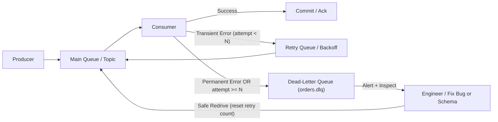
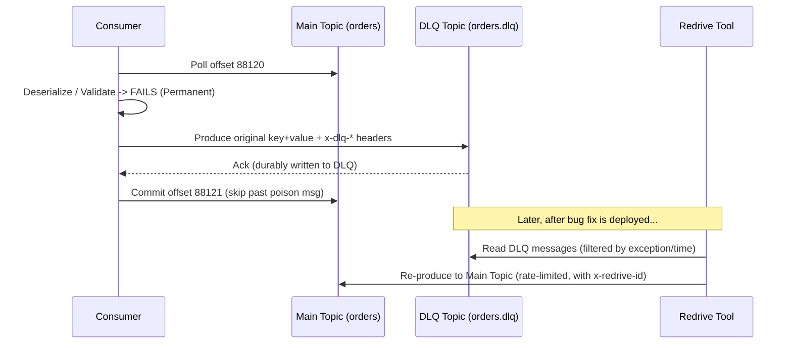
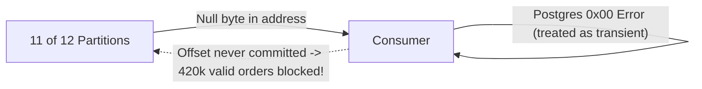

# Dead-Letter Queues: Handling Poison Messages (Retry Limits & Redrive)

> **Prerequisites:** [Lesson 08: Delivery Semantics](../08-delivery-semantics/README.md) · [Lesson 01: Why Use a Message Broker?](../01-why-use-a-message-broker-decoupling-load-levelling-the-costs/README.md).  
> **Estimated Reading Time:** 24–28 minutes  
> **Target Audience:** Backend engineers building resilient queue/stream consumers, and candidates asked "how do you handle poison messages without blocking the queue or losing data?"  
> **Free PDF Notes:** [Download SD-I-009.pdf](https://backendroadmap.com/notes/system-design/SD-I-009.pdf)

> [!NOTE]
> **In one line:** A **poison message** is a record that fails processing deterministically on every attempt. Without a **Dead-Letter Queue (DLQ)** and a bounded **`maxReceiveCount`**, it triggers an infinite crash/redelivery loop that starves healthy traffic. Route exhausted messages to a DLQ with rich diagnostic headers, alert immediately, and **redrive** only after fixing the root cause.

> [!TIP]
> **The Golden Rule:** Separate **transient errors** (network timeouts, 503s $\rightarrow$ retry with backoff) from **permanent/poison errors** (malformed JSON, schema violation, `NullPointerException` $\rightarrow$ send straight to DLQ without wasting retries). Never auto-redrive a DLQ in a blind loop.

---

## 1. What a Dead-Letter Queue Is, and What It Isn't

An upstream service ships a malformed `OrderPlaced` payload with `"amount": "free"` instead of an integer. Your consumer throws a deserialization exception, rolls back the DB transaction, and refuses to commit the offset (or `NACK`s in RabbitMQ / lets visibility timeout expire in SQS). The broker dutifully redelivers the **exact same message** 10 milliseconds later. Within minutes, your entire consumer fleet is burning 100% CPU retrying one unprocessable message while 50,000 valid customer orders pile up behind it.

| Term | Precise Meaning | Example |
| :--- | :--- | :--- |
| **Poison message** | A message that deterministic consumer logic can never process successfully | Corrupt JSON, missing required field, invalid foreign key |
| **Dead-Letter Queue (DLQ)** | A secondary queue or Kafka topic holding failed messages after retry exhaustion | `orders.dlq` / `orders-dlq` |
| **Retry limit (`maxReceiveCount`)** | Max delivery attempts before routing to the DLQ | `3`–`5` attempts in SQS/Kafka |
| **Transient failure** | Temporary infrastructure error likely to succeed on retry | DB deadlock, HTTP 503, DNS timeout |
| **Permanent failure** | Bug or data corruption that will fail 100% of retries | `JsonParseException`, `400 Bad Request` |
| **Redrive** | Moving repaired or safe DLQ messages back to the main topic/queue | AWS SQS `StartMessageMoveTask` or Kafka replay script |
| **Not** | A garbage bin to ignore | Unmonitored DLQs are silent data-loss factories |

### Why It Matters
1. In **Kafka**, a single unhandled poison message on Partition 3 **blocks every subsequent message on Partition 3** (head-of-line blocking) until it is skipped or routed to a DLQ.
2. In **SQS / RabbitMQ**, infinite redelivery burns worker concurrency, exhausts DB connection pools, and causes noisy-neighbor outages across unrelated queues.
3. Interviewers expect you to know **both** how to isolate poison messages *and* how to safely inspect, fix, and redrive them without causing duplicate side effects or infinite loops.

---

## 2. Anatomy: Poison-Message Isolation & Redrive Lifecycle



| Failure Classification | Action | Rationale |
| :--- | :--- | :--- |
| **Schema / Deserialization error** | **Immediate DLQ** (0 retries) | Retrying corrupt bytes 5 times wastes time and CPU |
| **4xx Business / Validation error** | **Immediate DLQ** (0 retries) | Input is invalid; retrying won't make it valid |
| **5xx / Timeout / Lock contention** | **Retry up to $N$ times**, then DLQ | Transient infra blip usually heals within seconds |
| **OOM / Crash during processing** | Broker redelivers ($+1$ receive count) $\rightarrow$ DLQ at $N$ | Prevents a single crash-inducing payload from killing every pod forever |

> [!WARNING]
> **Beware of the DLQ-to-Main Redrive Loop!** If you redrive messages from `orders.dlq` back into `orders` *without* fixing the bug (or without resetting/capping redrive headers), the exact same poison messages will fail $N$ more times and boomerang right back into the DLQ—doubling your load and masking whether new failures occurred.

---

## 3. Mathematical Model: Throughput Collapse & Head-of-Line Blocking

**Head-of-Line Blocking in Kafka.** Suppose a topic has $P$ partitions, each processing $\mu_{\text{part}}$ msg/s. If 1 poison message sits at the head of 1 partition and the consumer retries it forever, that partition's throughput drops to **0**, reducing total topic capacity by:

$$\Delta C = \frac{1}{P}$$

If poison messages appear at rate $\lambda_{\text{poison}}$ across the topic and each takes $N$ retries of duration $t_{\text{retry}}$ before DLQ routing, the wasted worker capacity is:

$$W_{\text{waste}} = \lambda_{\text{poison}} \cdot N \cdot t_{\text{retry}}$$

**Queue Starvation in SQS / RabbitMQ.** With $W$ total worker slots, each taking $t_{\text{ok}}$ for a healthy message and $t_{\text{fail}}$ for a failing message, if poison messages are retried infinitely (no DLQ), the number of poisoned slots grows over time until $W_{\text{poisoned}} = W$, at which point healthy throughput collapses to **0**.

**Worked Numerical Example:**
An SQS queue has $W = 50$ concurrent workers. Healthy messages take $t_{\text{ok}} = 20\text{ ms}$ (capacity $= 50 / 0.02 = 2{,}500\text{ msg/s}$). A bad upstream deploy emits $\lambda_{\text{poison}} = 10\text{ poison msg/s}$, and each failure times out after $t_{\text{fail}} = 2\text{ s}$.
- **Without a DLQ (infinite retries):** Within 5 seconds, $10 \times 5 = 50$ poison messages occupy all 50 worker slots in an infinite 2-second timeout loop. **Healthy throughput drops from $2{,}500\text{ msg/s}$ to $0\text{ msg/s}$.**
- **With a DLQ (`maxReceiveCount = 3`):** Each poison message consumes $3 \times 2\text{ s} = 6\text{ s}$ of worker time before moving to the DLQ. Steady-state poisoned slots $= \lambda_{\text{poison}} \times 6\text{ s} = 10 \times 6 = 60$... wait: $60 > 50$! Even with `maxReceiveCount = 3`, a 2-second timeout still saturates 50 workers!
- **With Fast-Fail Classification (0 retries on permanent errors, $t_{\text{fail}} = 5\text{ ms}$):** Poisoned slots $= 10 \times 0.005 = 0.05$ workers (**99.9% of capacity stays healthy**).

---

## 4. Metrics & Percentiles

| Metric | Meaning | Alert when |
| :--- | :--- | :--- |
| **DLQ message count / ingress rate** | Messages entering `*.dlq` per minute | **Any** ingress $> 0$ for critical pipelines (page on spike $> 10/\text{min}$) |
| **Oldest DLQ message age** | Age of oldest un-redriven message in DLQ | $> 1\text{ hour}$ (SLA for triage) or approaching retention limit |
| **ReceiveCount histogram** | Distribution of delivery attempts before success | $p_{99} > 2$ (systemic downstream flakiness) |
| **DLQ-by-error-class** | Count grouped by exception type (`JsonParse`, `Timeout`, `FKViolation`) | Spike in a single class (identifies bad deploy immediately) |
| **Redrive success rate** | % of redriven DLQ messages that succeed on replay | $< 99\%$ (bug wasn't actually fixed before redrive) |

### Worked Example (Diagnostic Headers in Kafka DLQ)
When a Kafka consumer routes an exhausted record from `orders` (partition 3, offset 88,120) to `orders.dlq`, it **must** preserve the original key and payload and attach diagnostic headers:
- `x-dlq-original-topic`: `orders`
- `x-dlq-original-partition`: `3`
- `x-dlq-original-offset`: `88120`
- `x-dlq-exception-class`: `com.fasterxml.jackson.core.JsonParseException`
- `x-dlq-exception-message`: `Unexpected character ('f' (code 102))`
- `x-dlq-consumer-group`: `billing-service`
- `x-dlq-failed-at`: `2026-11-25T08:12:00Z`
- `x-dlq-attempt-count`: `3`

With these headers, an engineer can immediately see *which* deploy broke *which* field without digging through 100 GB of application logs.

---

## 5. Compounding & Failure Modes

| Failure Mode | Trigger | Compounding Effect |
| :--- | :--- | :--- |
| **Missing DLQ (Infinite Loop)** | Consumer NACKs forever | 100% worker starvation; healthy traffic stalls completely |
| **DLQ Retention Expiry** | DLQ has 4-day retention; nobody checks it for a week | Silent permanent data loss |
| **Ordered-Topic DLQ Bypass** | `ord-42:Created` goes to DLQ, `ord-42:Paid` succeeds on main topic | Out-of-order state corruption when `Created` is later redriven |
| **Unbounded DLQ Poisoning** | Upstream sends 1M bad events $\rightarrow$ 1M DLQ writes | DLQ storage fills or redrive overwhelms downstream DB |
| **Missing Original Metadata** | Consumer drops headers/key when publishing to DLQ | Impossible to trace origin partition, offset, or entity key |

**The Ordering + DLQ Trap:** If `ord-42:OrderCreated` fails transiently and is routed to `orders.dlq`, while `ord-42:OrderPaid` arrives 2 seconds later and succeeds (or fails differently), redriving `OrderCreated` later will replay it *after* `OrderPaid`. For strictly ordered keys, either **pause/park the key** or make downstream consumers resilient to out-of-order redrives (via entity version checks).

---

## 6. Numbers Every Engineer Must Know

| Item | Typical | Implication |
| :--- | :---: | :--- |
| Typical `maxReceiveCount` | `3` to `5` | Enough for transient blips; small enough to stop poison loops fast |
| Permanent-error retry count | `0` (immediate DLQ) | Never waste retries on `400`/schema/deserialization errors |
| DLQ retention period | `14` to `30` days (longer than main queue's 4–7 days) | Gives engineers time over weekends/holidays to fix & redrive |
| DLQ publish durability | `acks=all` + sync flush before committing main offset | Never commit the main offset until the DLQ write is durably acked |
| Redrive rate limit | `10%–25%` of normal consumer capacity | Prevents redriving 500k messages from DDoSing your own DB |

---

## 7. Protocol / Mechanism Deep Dive: SQS Native Redrive vs. Kafka App-Level DLQ



| Question | Answer |
| :--- | :--- |
| **Does Kafka have a built-in broker-level DLQ like SQS or RabbitMQ?** | **No.** Kafka brokers have no concept of "processing failure." The **consumer application** (or framework like Spring Kafka `DeadLetterPublishingRecoverer` / Kafka Connect `errors.tolerance=all`) must produce the failed record to `<topic>.dlq` and then commit the main offset. |
| **What if producing to the DLQ fails?** | **Do NOT commit the main offset.** Let the consumer retry or crash so the message is never silently dropped. |
| **How do SQS and RabbitMQ track retry counts?** | SQS tracks `ApproximateReceiveCount` on the broker and moves the message to the `RedrivePolicy` target automatically when exceeded. RabbitMQ uses `x-death` headers with a Dead-Letter Exchange (`x-dead-letter-exchange`) on `basic.nack(requeue=false)` or TTL/delivery-limit (`x-delivery-limit` on Quorum Queues). |
| **When NOT to use a DLQ** | Ephemeral, replaceable data (e.g., periodic cache-warming pings or live GPS coordinates where the next ping 1 second later supersedes the failed one). |

---

## 8. Hierarchical Budgets & Design Rules

| Slice | Rule | Control |
| :--- | :--- | :--- |
| **Error Classification** | Distinguish permanent (0 retries) vs. transient ($N$ retries) | Explicit exception hierarchy (`NonRetryableException`) |
| **DLQ Commit Order** | Write to DLQ $\rightarrow$ await Ack $\rightarrow$ commit main offset | Prevents data loss if DLQ publish fails |
| **Diagnostic Context** | Attach topic, partition, offset, exception, stack trace, timestamp | Standardized `x-dlq-*` headers |
| **DLQ Retention** | $\ge 14$ days (at least $2\times$ main topic retention) | IaC / Terraform topic & queue policy |
| **Redrive Safety** | Rate-limited, filtered by error/time, requires fixed consumer deployed | Never auto-redrive blindly on a cron |
| **Alerting** | Page or Slack alert on `dlq_depth > 0` or `dlq_ingress_rate > 0` | Treat DLQ ingress as an active incident signal |

---

## 9. Top Mitigations

1. **Always configure a DLQ** on every production queue and stateful Kafka consumer (`<topic>.dlq`).
2. **Fail fast on permanent errors** (malformed JSON, schema mismatch, invalid business state)—route directly to DLQ with 0 retries.
3. **Commit the main offset only AFTER the DLQ write is acknowledged** (`acks=all`).
4. **Enrich DLQ records with `x-dlq-*` headers** (origin topic/partition/offset, consumer group, exception class, timestamp, attempt count).
5. **Set DLQ retention to 14–30 days** so weekend incidents don't expire before triage.
6. **Monitor and alert on DLQ ingress**—a silent DLQ is just delayed data loss.
7. **Rate-limit redrives** and verify idempotency before replaying DLQ messages back to the main topic.

---

## 10. Production Reference: The Unbounded Deserialization Loop

An e-commerce fulfillment service consumed `ShipmentRequested` from a 12-partition Kafka topic. A mobile client upgrade sent a UTF-8 null byte (`\u0000`) inside an address field, which PostgreSQL's `TEXT` column rejected with `ERROR: invalid byte sequence for encoding "UTF8": 0x00`.
- The consumer caught `SQLException` generically, treated it as transient, and refused to commit the offset.
- Over 4 hours, 11 of the 12 partitions hit at least one bad address and **froze completely**, backing up 420,000 legitimate shipments.



- **Root Cause:** Treating a deterministic data-validation/DB-constraint error as a transient error with infinite retries and no DLQ.
- **Fix:** Classified Postgres `22021` (`character_not_in_repertoire`) and `JsonParseException` as `NonRetryableException`, routed them immediately to `shipments.dlq` with `x-dlq-*` headers, sanitized null bytes in the hotfix, and redrove the 380 DLQ records cleanly in 2 seconds.

---

## 11. Multi-Language Production Code Tabs

Implementing a **classifier-aware DLQ router** that separates permanent vs. transient failures and commits the main offset only after durable DLQ delivery.

````carousel
```go
// Go: error-classifying consumer with synchronous DLQ publish before offset commit.
package main

import (
	"context"
	"errors"
	"fmt"
	"time"
)

var ErrPermanent = errors.New("permanent poison error")

type Record struct {
	Topic     string
	Partition int
	Offset    int64
	Key       string
	Value     []byte
	Headers   map[string]string
}

type DLQProducer interface {
	PublishSync(ctx context.Context, dlqTopic string, rec Record) error
}

func HandleWithDLQ(
	ctx context.Context,
	rec Record,
	maxRetries int,
	process func(Record) error,
	dlq DLQProducer,
	commitOffset func(int64) error,
) error {
	var lastErr error
	for attempt := 1; attempt <= maxRetries; attempt++ {
		lastErr = process(rec)
		if lastErr == nil {
			return commitOffset(rec.Offset + 1)
		}
		if errors.Is(lastErr, ErrPermanent) {
			break // fail fast: do not waste retries on poison messages
		}
		time.Sleep(time.Duration(attempt*50) * time.Millisecond)
	}

	// Enrich headers and durably write to DLQ BEFORE committing main offset.
	if rec.Headers == nil {
		rec.Headers = map[string]string{}
	}
	rec.Headers["x-dlq-original-topic"] = rec.Topic
	rec.Headers["x-dlq-original-offset"] = fmt.Sprintf("%d", rec.Offset)
	rec.Headers["x-dlq-error"] = lastErr.Error()

	if err := dlq.PublishSync(ctx, rec.Topic+".dlq", rec); err != nil {
		return fmt.Errorf("dlq publish failed, keeping offset uncommitted: %w", err)
	}
	return commitOffset(rec.Offset + 1)
}
```
<!-- slide -->
```typescript
// TypeScript: Permanent vs Transient error classification with DLQ routing.
export class PermanentError extends Error {}

export interface ConsumedMessage {
  topic: string;
  partition: number;
  offset: number;
  key: string;
  payload: string;
  headers: Record<string, string>;
}

export async function processWithDlq(
  msg: ConsumedMessage,
  maxRetries: number,
  handler: (m: ConsumedMessage) => Promise<void>,
  publishDlq: (topic: string, m: ConsumedMessage) => Promise<void>,
  commitOffset: (nextOffset: number) => Promise<void>
): Promise<void> {
  let lastError: unknown;
  for (let attempt = 1; attempt <= maxRetries; attempt++) {
    try {
      await handler(msg);
      await commitOffset(msg.offset + 1);
      return;
    } catch (err) {
      lastError = err;
      if (err instanceof PermanentError) break; // immediate DLQ
      await new Promise((r) => setTimeout(r, attempt * 50));
    }
  }

  const dlqMsg: ConsumedMessage = {
    ...msg,
    headers: {
      ...msg.headers,
      "x-dlq-original-topic": msg.topic,
      "x-dlq-original-partition": String(msg.partition),
      "x-dlq-original-offset": String(msg.offset),
      "x-dlq-error": lastError instanceof Error ? lastError.message : String(lastError),
      "x-dlq-failed-at": new Date().toISOString(),
    },
  };
  await publishDlq(`${msg.topic}.dlq`, dlqMsg);
  await commitOffset(msg.offset + 1); // commit only after DLQ ack
}
```
<!-- slide -->
```python
# Python: SQS/Worker starvation simulator comparing infinite retry vs DLQ vs fast-fail (stdlib only).
def simulate_poison_impact(workers=50, ok_ms=20, fail_ms=2000, poison_rps=10,
                           max_retries=None, fast_fail=False, duration_s=10):
    """Estimates healthy throughput loss under poison-message arrivals."""
    if max_retries is None:
        # Infinite retries: once poison_rps * t >= workers, all workers are permanently wedged
        wedged = min(workers, poison_rps * duration_s)
        healthy_cap = max(0.0, (workers - wedged) / (ok_ms / 1000.0))
        return {"mode": "no_dlq", "wedged_workers": wedged, "healthy_rps": round(healthy_cap, 1)}

    attempts = 1 if fast_fail else max_retries
    fail_cost_s = (5 / 1000.0) if fast_fail else (attempts * fail_ms / 1000.0)
    busy_workers = min(float(workers), poison_rps * fail_cost_s)
    healthy_cap = max(0.0, (workers - busy_workers) / (ok_ms / 1000.0))
    return {
        "mode": "fast_fail_dlq" if fast_fail else f"dlq_retries_{max_retries}",
        "busy_workers": round(busy_workers, 2),
        "healthy_rps": round(healthy_cap, 1),
    }
```
<!-- slide -->
```csharp
// C#: Dead-letter router with NonRetryableException fast-fail and diagnostic headers.
public sealed class NonRetryableException(string message) : Exception(message);

public sealed record BrokerMessage(
    string Topic, int Partition, long Offset, string Key, byte[] Value,
    Dictionary<string, string> Headers);

public static class DlqRouter
{
    public static async Task HandleAsync(
        BrokerMessage msg,
        int maxAttempts,
        Func<BrokerMessage, Task> processAsync,
        Func<string, BrokerMessage, Task> publishDlqAsync,
        Func<long, Task> commitOffsetAsync)
    {
        Exception? last = null;
        for (int attempt = 1; attempt <= maxAttempts; attempt++)
        {
            try
            {
                await processAsync(msg);
                await commitOffsetAsync(msg.Offset + 1);
                return;
            }
            catch (NonRetryableException ex)
            {
                last = ex;
                break; // poison message: skip retries
            }
            catch (Exception ex)
            {
                last = ex;
                await Task.Delay(attempt * 50);
            }
        }

        msg.Headers["x-dlq-original-topic"] = msg.Topic;
        msg.Headers["x-dlq-original-offset"] = msg.Offset.ToString();
        msg.Headers["x-dlq-error"] = last?.Message ?? "unknown";

        await publishDlqAsync($"{msg.Topic}.dlq", msg);
        await commitOffsetAsync(msg.Offset + 1);
    }
}
```
````

---

## 12. Hands-On CLI Verification Workflows

Configure SQS DLQ redrive, inspect Kafka DLQ messages with headers, and run the Python starvation model:

```bash
# 1. AWS SQS: Start a native DLQ redrive back to the source queue (rate-limited at 50 msg/s)
aws sqs start-message-move-task \
  --source-arn arn:aws:sqs:us-east-1:123456789012:orders-dlq \
  --destination-arn arn:aws:sqs:us-east-1:123456789012:orders \
  --max-number-of-messages-per-second 50

# 2. Kafka: Inspect DLQ records along with diagnostic x-dlq-* headers
kafka-console-consumer.sh --bootstrap-server localhost:9092 \
  --topic orders.dlq --from-beginning \
  --property print.key=true --property print.headers=true --max-messages 10

# 3. RabbitMQ: Check dead-lettered messages in a DLQ
rabbitmqctl list_queues name messages_ready messages_unacknowledged | grep dlq
```

Run the Python worker-starvation simulation from Section 11:

```bash
python -c "from sim import simulate_poison_impact; print(simulate_poison_impact(max_retries=None)); print(simulate_poison_impact(max_retries=3)); print(simulate_poison_impact(max_retries=3, fast_fail=True))"
```

---

## 13. Common Mistakes to Avoid

1. **Having no DLQ at all**, letting one bad message wedge a partition or exhaust all workers.
2. **Retrying permanent errors (schema/400/deserialization)** 5–10 times before DLQ routing.
3. **Committing the main offset before the DLQ publish is acked**, risking silent message loss.
4. **Setting DLQ retention shorter than or equal to the main queue**, causing messages to expire before investigation.
5. **Dropping original keys, headers, or origin offsets** when writing to the DLQ.
6. **Auto-redriving the DLQ on a timer** without fixing the underlying bug (creating a boomerang loop).
7. **Forgetting to alert on DLQ ingress**, turning the DLQ into a silent graveyard.

---

## 14. Key Terms Glossary

| Key Term | Definition |
| :--- | :--- |
| **Poison message** | A message that fails processing deterministically on every delivery attempt. |
| **Dead-Letter Queue (DLQ)** | Secondary queue/topic storing messages that exceeded retry limits or failed permanently. |
| **`maxReceiveCount`** | Maximum number of delivery attempts before a broker (e.g., SQS) moves a message to a DLQ. |
| **Head-of-line blocking** | When one stuck message at the front of a partition/queue blocks all healthy messages behind it. |
| **Redrive** | Controlled replay of DLQ messages back to the main queue/topic after fixing the root cause. |
| **Transient vs. permanent error** | Temporary infra failure (retryable) vs. deterministic data/logic bug (non-retryable). |
| **`x-death` header** | RabbitMQ metadata header recording dead-lettering reason, queue, and count. |
| **Diagnostic headers** | `x-dlq-*` metadata attached to DLQ records (origin topic, partition, offset, exception). |
| **Boomerang loop** | Unfixed poison messages cycling endlessly between main queue and DLQ during blind redrives. |
| **DLQ retention** | How long the broker keeps dead-lettered messages (typically 14–30 days). |

---

## 15. System Design Interview Questions & Answers

### Basic Conceptual Questions

<details>
<summary><strong>Q1: What is a poison message, and why do we need a Dead-Letter Queue? [BASIC]</strong></summary>

**Answer:**
A poison message is a record that consistently fails processing (e.g., corrupt JSON, missing required field, or bug-triggering input). Without a DLQ, the consumer retries it forever, causing head-of-line blocking in Kafka or worker starvation in SQS/RabbitMQ. A DLQ isolates the bad message after $N$ attempts so healthy traffic keeps flowing and engineers can inspect and redrive it later.
</details>

<details>
<summary><strong>Q2: Which errors should be retried, and which should go straight to the DLQ? [BASIC]</strong></summary>

**Answer:**
**Transient errors** (network timeouts, HTTP 503, DB deadlocks) should be retried with backoff. **Permanent errors** (malformed JSON, schema validation failures, HTTP 400, `NullPointerException` on bad input) should go **straight to the DLQ with 0 retries** because retrying deterministic bugs wastes CPU and worker capacity.
</details>

<details>
<summary><strong>Q3: What metadata should every DLQ message carry? [BASIC]</strong></summary>

**Answer:**
Preserve the original key and payload, and attach headers for: original topic/queue, partition, offset, consumer group, exception class and message, stack trace (or trace ID), timestamp, and attempt count.
</details>

<details>
<summary><strong>Q4: Why should DLQ retention be longer than main topic retention? [BASIC]</strong></summary>

**Answer:**
Main topics may only retain 3–7 days of data, but DLQ messages often require human triage, bug fixes, code review, and deployment (especially over weekends or holidays). Setting DLQ retention to 14–30 days prevents silent expiration before redrive.
</details>

### Scenario-Based Architecture Questions

<details>
<summary><strong>Q5: How do you implement a DLQ in Kafka when Kafka brokers don't natively support `RedrivePolicy` like SQS? [SCENARIO]</strong></summary>

**Answer:**
The consumer application (or framework like Spring Kafka's `DeadLetterPublishingRecoverer`) catches exhausted or non-retryable failures, attaches `x-dlq-*` headers, produces the record synchronously (`acks=all`) to `<topic>.dlq`, and **only after the DLQ ack succeeds** commits the main consumer offset to move past the poison message.
</details>

<details>
<summary><strong>Q6: You fixed a bug that sent 50,000 messages to `orders.dlq`. How do you redrive them safely? [SCENARIO]</strong></summary>

**Answer:**
First, deploy and verify the fix on live traffic. Second, filter DLQ records by error class/timestamp so you don't replay unrelated poison messages. Third, verify the consumer is **idempotent** (in case any side effects partially ran before failure). Fourth, **rate-limit** the redrive (e.g., 10%–25% of spare consumer capacity) so you don't DDoS downstream databases or starve live orders.
</details>

<details>
<summary><strong>Q7: Your SQS queue has `maxReceiveCount=5` and a 30-second visibility timeout, and a bad deploy sends 20 poison messages/s. Why did healthy traffic still stall? [SCENARIO]</strong></summary>

**Answer:**
If each poison message takes 5 attempts $\times$ 30 s visibility timeout (or 5 s handler timeout) before moving to the DLQ, 20 msg/s $\times$ 25 s = 500 concurrent worker slots consumed by poison messages. Fix: **explicitly `Delete` or move permanent errors to the DLQ on attempt 1** (don't let them wait out visibility timeouts 5 times) and lower `maxReceiveCount` to 3.
</details>

<details>
<summary><strong>Q8: What happens if you route a message to a DLQ on an ordered, keyed Kafka topic? [SCENARIO]</strong></summary>

**Answer:**
You break strict per-key ordering for that entity! While `ord-42:Created` sits in the DLQ, `ord-42:Paid` may still be processed on the main topic. Options: (1) accept out-of-order handling and make consumers resilient via version/state checks, or (2) **park the entire key** (`ord-42`) in a per-key quarantine store until `Created` is resolved—never blocking unrelated keys like `ord-43`.
</details>

### Advanced & Tricky Interview Questions

<details>
<summary><strong>Q9: What if producing to the DLQ fails (e.g., broker outage or disk full)? [TRICKY]</strong></summary>

**Answer:**
**Never commit the main offset if the DLQ publish fails.** Let the consumer crash or retry the DLQ publish with backoff. Committing the main offset without a durable DLQ ack would permanently lose the message.
</details>

<details>
<summary><strong>Q10: How do you prevent a "poison pill" that crashes the JVM/process via OOM or segfault before it can even be caught and sent to a DLQ? [TRICKY]</strong></summary>

**Answer:**
In SQS/RabbitMQ, broker-side `ApproximateReceiveCount` / `x-delivery-limit` increments even when the process crashes mid-handling, so after $N$ crashes the broker moves it to the DLQ automatically. In Kafka (where brokers don't track consumer attempts), persist `(topic, partition, offset, attempt_count)` in a fast external store (Redis/DB) *before* processing—or use a **crash-resilient pre-flight counter** so on restart, if `attempt_count >= N`, the consumer immediately routes that offset to the DLQ without re-executing the crashing code.
</details>

<details>
<summary><strong>Q11: Why is an automated cron job that redrives the DLQ every 15 minutes usually an anti-pattern? [TRICKY]</strong></summary>

**Answer:**
For permanent/bug-induced poison messages, an auto-redrive cron creates an infinite **boomerang loop** that wastes compute, pollutes alerts, and resets message timestamps. Scheduled retries belong in **retry topics with exponential backoff** (Lesson 10), whereas the DLQ is the terminal holding pen for human/automated remediation.
</details>

<details>
<summary><strong>Q12: How do you handle redriving a DLQ when the schema of the main topic has evolved since the message failed? [TRICKY]</strong></summary>

**Answer:**
Maintain backward-compatible schemas in a Schema Registry (Avro/Protobuf/JSON Schema) so consumers can still deserialize older versions, or run a lightweight **DLQ transformation/migration script** during redrive that upgrades old payloads to the current schema version before republishing.
</details>

---

## 16. One-Page Master Cheat Sheet

```
+---------------------------------------------------------------------------------------------------------+
|                    DEAD-LETTER QUEUES (DLQ) — MASTER CHEAT SHEET                                        |
+---------------------------------------------------------------------------------------------------------+
| 1. POISON MESSAGE: Deterministic failure on every retry -> causes Kafka HoL blocking / worker starvation|
+---------------------------------------------------------------------------------------------------------+
| 2. CLASSIFY ERRORS:                                                                                     |
|    - Permanent (JSON parse, 400, schema): 0 retries -> IMMEDIATE DLQ.                                   |
|    - Transient (503, timeout, deadlock): N=3..5 retries with backoff -> then DLQ.                       |
+---------------------------------------------------------------------------------------------------------+
| 3. ATOMICITY: Write to DLQ (acks=all) -> WAIT FOR ACK -> THEN commit main offset. Never lose messages!  |
+---------------------------------------------------------------------------------------------------------+
| 4. METADATA: Always attach x-dlq-original-topic, partition, offset, error, stack/trace-id, timestamp.   |
+---------------------------------------------------------------------------------------------------------+
| 5. RETENTION & ALERTS: DLQ retention (14-30d) > main queue. Alert on DLQ ingress > 0!                   |
+---------------------------------------------------------------------------------------------------------+
| 6. REDRIVE: Fix bug first -> verify idempotency -> filter & rate-limit replay. Never blind-loop!        |
+---------------------------------------------------------------------------------------------------------+
```

---

## Further Reading & Sources

- AWS SQS Documentation, [Using Amazon SQS Dead-Letter Queues & Redrive](https://docs.aws.amazon.com/AWSSimpleQueueService/latest/SQSDeveloperGuide/sqs-dead-letter-queues.html).
- RabbitMQ Documentation, [Dead Letter Exchanges & Quorum Queue `x-delivery-limit`](https://www.rabbitmq.com/docs/dlx).
- Confluent Blog, *Error Handling Patterns in Kafka* (DLQ & `errors.tolerance`).
- Uber Engineering Blog, *Building Reliable Reprocessing and Dead Letter Queues with Apache Kafka*.

---

## Free PDF Notes

[SD-I-009.pdf](https://backendroadmap.com/notes/system-design/SD-I-009.pdf)

---

## Next

Continue with [Lesson 10: Retries & Delayed Messages: Retry Topics Without Blocking Kafka](../10-retries-delayed-messages/README.md).
