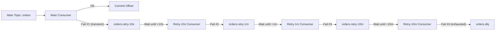
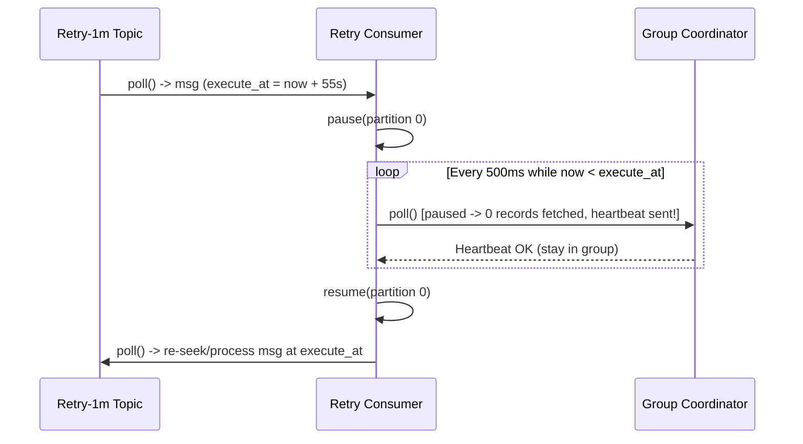
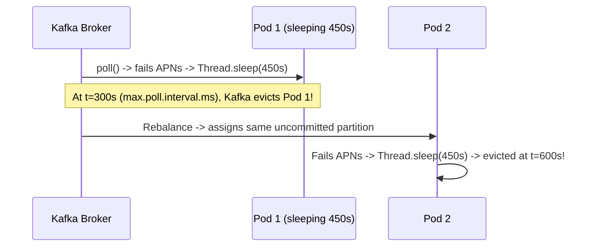

# Retries & Delayed Messages: Retry Topics Without Blocking Kafka

> **Prerequisites:** [Lesson 09: Dead-Letter Queues](../09-dead-letter-queues/README.md) · [Lesson 07: Kafka Ordering Guarantees](../07-kafka-ordering-guarantees/README.md).  
> **Estimated Reading Time:** 24–28 minutes  
> **Target Audience:** Backend engineers designing non-blocking Kafka retry pipelines, and candidates asked "how do you implement delayed retries in Kafka without blocking the partition?"  
> **Free PDF Notes:** [Download SD-I-010.pdf](https://backendroadmap.com/notes/system-design/SD-I-010.pdf)

> [!NOTE]
> **In one line:** Blocking `Thread.sleep()` inside a Kafka consumer stalls the entire partition and triggers `max.poll.interval.ms` rebalances. Instead, publish failed transient messages to **tiered retry topics** (`orders.retry-10s`, `orders.retry-1m`, `orders.retry-10m`), commit the main offset immediately, and let dedicated retry consumers `pause()`/`resume()` partitions until each message's `execute_at` timestamp arrives—moving exhausted messages to a **DLQ**.

> [!TIP]
> **The Golden Rule:** Never sleep for seconds or minutes inside a `poll()` loop. Use **tiered delay topics** (exponential backoff) for non-ordered events, or a **per-key parking store** if strict per-entity ordering must be preserved across retries.

---

## 1. What Non-Blocking Retry & Delay Topics Are, and What They Isn't

A payment webhook consumer calls Stripe, which returns `503 Service Unavailable` for a single merchant's account for 3 minutes. If the consumer sleeps for 30 seconds in-process and retries 6 times, **every other merchant on that Kafka partition is blocked for 3 minutes**—and after 5 minutes (`max.poll.interval.ms`), Kafka kicks the consumer out of the group and replays the entire batch on another pod.

| Term | Precise Meaning | Example |
| :--- | :--- | :--- |
| **In-process blocking retry** | Sleeping inside the consumer thread before committing offset | `time.sleep(10)` inside `poll()` loop (stalls partition!) |
| **Non-blocking retry topic** | Separate Kafka topic with a fixed delay tier; main offset commits right away | `orders.retry-10s`, `orders.retry-1m`, `orders.retry-10m` |
| **Delayed message** | Event scheduled for future execution (`execute_at = now + delay`) | Trial expiration, abandoned-cart reminder, scheduled retry |
| **Partition `pause()` / `resume()`** | Kafka client API that stops fetching from a partition while keeping heartbeats alive | Wait until `msg.execute_at <= now` without leaving the group |
| **Retry amplification** | Extra traffic/load caused by retrying failed messages during an outage | 10k msg/s $\times$ 5 retries = 50k msg/s if unbacked-off |
| **Full jitter** | Randomizing delay in $[0, \text{backoff}]$ to prevent thundering herds | `sleep = rand(0, min(cap, base * 2^attempt))` |
| **Not** | A free way to preserve strict per-key ordering | Moving a failed `key=ord-42` to a retry topic lets newer `ord-42` events pass it! |

### Why It Matters
1. Kafka has **no native per-message delay or visibility timeout** (unlike SQS `DelaySeconds` / `ChangeMessageVisibility` or RabbitMQ delayed-message plugin).
2. Naive `sleep()` retries cause **head-of-line blocking** and **rebalance storms** when `sleep > max.poll.interval.ms`.
3. Tiered retry topics (popularized by Uber, Confluent, and Spring Kafka `@RetryableTopic`) give **exponential backoff using only FIFO Kafka partitions**, because every message in `retry-1m` has the *same* 1-minute delay and therefore expires in FIFO order!

---

## 2. Anatomy: Tiered Exponential Retry Topics + DLQ



Why do **fixed-delay tiers** (`10s`, `1m`, `10m`) work on a FIFO Kafka log without sorting?
- Every message entering `orders.retry-10s` at time $t$ gets `execute_at = t + 10s`.
- Because $t$ is monotonically increasing as messages append, **`execute_at` is already sorted in FIFO order** inside each partition!
- The retry consumer reads the head message, checks `remaining = execute_at - now`, and if `remaining > 0`, calls `consumer.pause(partition)`, keeps calling `poll()` (which sends heartbeats and keeps the consumer in the group without fetching data), and calls `consumer.resume(partition)` once `now >= execute_at`.

> [!WARNING]
> **Retry topics break per-key ordering!** If `ord-42:Created` fails transiently and moves to `orders.retry-10s`, while `ord-42:Updated` arrives 50 ms later on `orders` and succeeds, `Updated` executes *before* `Created`. If strict per-entity ordering is mandatory, you must either **park the entity key** or retry in-memory with a short bounded budget before parking.

---

## 3. Mathematical Model: Head-of-Line Impact, Retry Amplification & Jitter

**Head-of-Line Blocking Cost.** If a partition processes $\mu_{\text{part}}$ msg/s and a single blocking retry sleeps for $T_{\text{sleep}}$ seconds, the partition accumulates a backlog of:

$$B_{\text{blocked}} = \lambda_{\text{part}} \cdot T_{\text{sleep}}$$

**Retry Amplification Factor.** If a downstream dependency fails with probability $p$ and each message is retried up to $R$ times, the effective arrival rate becomes:

$$\lambda_{\text{eff}} = \lambda_0 \sum_{k=0}^{R} p^k = \lambda_0 \frac{1 - p^{R+1}}{1 - p}$$

When a downstream is 100% down ($p = 1.0$) for longer than the retry horizon, $\lambda_{\text{eff}} = (R + 1)\lambda_0$.

**Thundering Herd with vs. without Jitter.** If $N = 10{,}000$ messages fail at $t = 0$ and all use deterministic backoff $10\text{ s}, 60\text{ s}, 600\text{ s}$, all $10{,}000$ wake up in the exact same millisecond, creating a $10{,}000\times$ spike. Adding **full jitter** spreads arrivals uniformly over $[0, \Delta_{\text{tier}}]$, reducing peak retry rate to $N / \Delta_{\text{tier}}$.

**Worked Numerical Example:**
A Kafka topic receives $\lambda = 5{,}000\text{ msg/s}$ across $P = 10$ partitions ($\lambda_{\text{part}} = 500\text{ msg/s}$). A downstream API has a 30-second brownout affecting 2% of requests ($100\text{ msg/s}$ failing).
- **In-process blocking retry (3 retries $\times$ 10 s = 30 s sleep):** Within 1 second, all 10 partitions hit a failing message and sleep for 30 s. Total backlog built across the cluster $= 5{,}000 \times 30 = \mathbf{150{,}000\text{ messages}}$—and every consumer exceeds `max.poll.interval.ms` if it has 10 such failures in one batch.
- **Tiered retry topics (`10s`, `1m`, `10m`) with jitter:** Main consumers publish the $100\text{ msg/s}$ failures to `retry-10s` in $< 2\text{ ms}$ and **never stall**. Healthy $4{,}900\text{ msg/s}$ traffic experiences **0 ms** extra lag. In `retry-10s`, $100 \times 30 = 3{,}000$ messages wait 10 s (spread over $[5\text{ s}, 15\text{ s}]$ with jitter $\rightarrow$ only $300\text{ msg/s}$ retry load).

---

## 4. Metrics & Percentiles

| Metric | Meaning | Alert when |
| :--- | :--- | :--- |
| **Retry-topic lag (per tier)** | Messages waiting in `retry-10s`, `retry-1m`, `retry-10m` | Rising monotonically (downstream outage ongoing) |
| **Retry-to-main ratio** | $\lambda_{\text{retry}} / \lambda_{\text{main}}$ | $> 5\%$ (systemic degradation, not isolated blips) |
| **Pause duration per partition** | Time spent in `consumer.pause()` | Expected $\le \text{tier delay}$; if `0` with high lag, consumer is overloaded |
| **Retry-to-DLQ graduation rate** | % of retried messages that still fail all tiers | $> 10\%$ (indicates permanent bug misclassified as transient) |
| **End-to-end delivery latency $p_{99}$** | Time from original publish to final success | Exceeds business freshness SLO |

### Worked Example (`execute_at` Header + `pause()`/`resume()`)
1. At `10:00:00.000`, `MainConsumer` fails to reach Payment API for `evt-99` (`attempt=0`).
2. It publishes `evt-99` to `payments.retry-10s` with headers: `x-retry-attempt=1`, `x-execute-at=10:00:10.000` (+ jitter), and commits the main offset.
3. At `10:00:00.015`, `Retry10sConsumer` polls `evt-99`, sees `execute_at - now = 9.985s > 0`, **calls `consumer.pause([partition])`**, and keeps its poll loop spinning every 500 ms (sending heartbeats so it is never evicted).
4. At `10:00:10.050`, `now >= execute_at` $\rightarrow$ calls `consumer.resume([partition])` and processes `evt-99`. If it fails again, it moves to `payments.retry-1m` (`attempt=2`).

---

## 5. Compounding & Failure Modes

| Failure Mode | Trigger | Compounding Effect |
| :--- | :--- | :--- |
| **Rebalance Storm from `sleep()`** | `sleep_time > max.poll.interval.ms` | Consumer evicted $\rightarrow$ batch replayed on new pod $\rightarrow$ sleeps again forever |
| **Retry Thundering Herd** | Fixed delay without jitter after outage | All queued retries hit recovering DB simultaneously, knocking it back down |
| **Retry Loop Amplification** | `retry-10m` accidentally routes back to `main` instead of `DLQ` | Infinite retry cycle that never terminates |
| **Out-of-Order Entity State** | `ord-42:Created` in `retry-10s`, `ord-42:Cancelled` on `main` | `Cancelled` runs before `Created` unless ordered/version-guarded |
| **Clock Skew Across Brokers/Pods** | Producers/consumers have unsynchronized clocks | `execute_at` fires early or stalls if one host's clock is minutes off |

---

## 6. Numbers Every Engineer Must Know

| Item | Typical | Implication |
| :--- | :---: | :--- |
| Number of retry topic tiers | `3` to `4` (e.g., `10s`, `1m`, `10m`, `1h`) | Covers transient blips through short deploys without exploding topic count |
| Partition count per retry topic | Usually `1` to `P/2` | Retry traffic is normally $< 1\%$; don't waste 100 partitions per tier |
| `max.poll.interval.ms` | `300,000 ms` (5 min) | `pause()` + `poll()` keeps heartbeats alive so long delays never trigger rebalances |
| Jitter band | $\pm 20\%$ or full jitter $[0, T]$ | Smooths synchronized outage recovery spikes |
| Max total retry budget | `15 min` – `2 hours` (business-dependent) | Beyond this, escalate to DLQ rather than retrying silently for days |

---

## 7. Protocol / Mechanism Deep Dive: `pause()` / `resume()` vs. Delay Queues



| Question | Answer |
| :--- | :--- |
| **Why not just `time.sleep(55)` inside the retry consumer?** | `sleep(55)` blocks the thread from calling `poll()`. If a few messages sleep or `max.poll.interval.ms` is exceeded (e.g., on `retry-10m`), Kafka **evicts the consumer** and triggers a rebalance! `pause()` + `poll()` keeps the consumer alive in the group. |
| **How do SQS and RabbitMQ handle delays natively?** | SQS supports `DelaySeconds` (0–900 s) on `SendMessage` and `ChangeMessageVisibility` (up to 12 hours) for exponential backoff. RabbitMQ uses **TTL + Dead-Letter Exchange** (per-tier delay queues) or the `rabbitmq-delayed-message-exchange` plugin. |
| **What if I need arbitrary per-message delays (e.g., 7 min vs 42 days) in Kafka?** | Tiered topics only handle a handful of fixed delays. For arbitrary or long delays (hours/days), store scheduled jobs in a **database / timer wheel / Temporal** and have a poller publish to Kafka when `due_at <= now`. |
| **When NOT to use retry topics** | (1) Permanent errors (send directly to DLQ), (2) strict per-key ordered streams where out-of-order retry is unacceptable, (3) millisecond-scale sub-second retries (a fast 2-attempt in-memory retry $< 200\text{ ms}$ is cheaper than a network round trip to a retry topic). |

---

## 8. Hierarchical Budgets & Design Rules

| Slice | Rule | Control |
| :--- | :--- | :--- |
| **In-Memory Fast Retry** | Cap at $\le 2$ attempts, total $\le 500\text{ ms}$ | Never block a Kafka partition for seconds |
| **Retry Tiers** | 3–4 exponential tiers (`10s`, `1m`, `10m`) + terminal `DLQ` | Standardized topic naming: `<topic>.retry-<tier>` |
| **Delay Enforcement** | `pause()`/`resume()` in poll loop; never long `sleep()` | Prevents `CommitFailedException` & rebalances |
| **Jitter** | Add $\pm 20\%$ jitter to `x-execute-at` | Prevents thundering herd on downstream recovery |
| **Circuit Breaker** | If retry rate $> 20\%$ or downstream is down, pause main consumer | Avoids churning millions of messages through retry tiers |
| **Idempotency** | Every retry consumer must assume duplicates on crash | Same `event_id` preserved across all retry hops |

---

## 9. Top Mitigations

1. **Use tiered retry topics (`10s`, `1m`, `10m`)** instead of blocking `sleep()` inside main Kafka consumers.
2. **Use `consumer.pause()` / `resume()`** on retry consumers so `poll()` heartbeats keep running during long delays.
3. **Add jitter** to `execute_at` timestamps so recovering dependencies aren't hit by a synchronized retry spike.
4. **Combine with a circuit breaker**: if 100% of calls to a downstream API are failing, pause the main consumer rather than pumping the entire topic into `retry-10s`.
5. **Preserve the original `event_id` and `x-retry-attempt` headers** across hops so idempotency and max-attempt cutoffs work reliably.
6. **Route permanent errors straight to the DLQ** (bypassing all retry tiers).
7. **Use a DB/scheduler (not Kafka)** for long-horizon delayed messages (hours, days, or arbitrary timestamps).

---

## 10. Production Reference: The 5-Minute Poll-Interval Rebalance Cascade

A notifications service processed `PushNotificationRequested` events. When Apple APNs had a 2-minute degradation, the team's newly added "resilient" retry loop ran `exponential_backoff(30s, 60s, 120s, 240s)` **inside the main consumer thread**:
- Within 20 seconds, every partition hit a failing APNs call and entered a 450-second total sleep.
- At 300 seconds (`max.poll.interval.ms`), Kafka evicted all 24 consumer pods and triggered a rebalance.
- The newly assigned pods immediately polled the **exact same uncommitted messages** and went back to sleep for 450 seconds—creating a 4-hour total outage even after APNs recovered in 2 minutes.



- **Root Cause:** Blocking `sleep()` inside the Kafka `poll()` loop exceeded `max.poll.interval.ms`, causing infinite rebalance-and-replay loops.
- **Fix:** Replaced in-thread sleep with `notifications.retry-10s` and `notifications.retry-1m` topics using `pause()`/`resume()`, plus a circuit breaker that pauses main consumption if APNs error rate exceeds 50%.

---

## 11. Multi-Language Production Code Tabs

Implementing a **tiered retry router with jittered `execute_at` headers** and a **non-blocking `pause()`/`resume()` retry consumer**.

````carousel
```go
// Go: tiered retry router with jittered execute_at and terminal DLQ fallback.
package main

import (
	"context"
	"fmt"
	"math/rand"
	"strconv"
	"time"
)

type RetryTier struct {
	Topic string
	Delay time.Duration
}

var Tiers = []RetryTier{
	{Topic: "orders.retry-10s", Delay: 10 * time.Second},
	{Topic: "orders.retry-1m", Delay: 1 * time.Minute},
	{Topic: "orders.retry-10m", Delay: 10 * time.Minute},
}

type Msg struct {
	Key     string
	Payload []byte
	Headers map[string]string
}

func RouteFailure(ctx context.Context, msg Msg, dlqTopic string, publish func(context.Context, string, Msg) error) error {
	attempt, _ := strconv.Atoi(msg.Headers["x-retry-attempt"])
	if attempt >= len(Tiers) {
		return publish(ctx, dlqTopic, msg) // exhausted all tiers -> DLQ
	}
	tier := Tiers[attempt]
	// Full jitter +/- 20% around tier.Delay to prevent thundering herd
	jitter := time.Duration(float64(tier.Delay) * (0.8 + 0.4*rand.Float64()))
	executeAt := time.Now().Add(jitter).UnixMilli()

	if msg.Headers == nil {
		msg.Headers = map[string]string{}
	}
	msg.Headers["x-retry-attempt"] = strconv.Itoa(attempt + 1)
	msg.Headers["x-execute-at-ms"] = fmt.Sprintf("%d", executeAt)
	return publish(ctx, tier.Topic, msg)
}
```
<!-- slide -->
```typescript
// TypeScript: non-blocking tiered retry router + partition pause/resume gate.
export interface RetryableMessage {
  key: string;
  payload: string;
  headers: Record<string, string>;
}

const RETRY_TIERS = [
  { topic: "orders.retry-10s", delayMs: 10_000 },
  { topic: "orders.retry-1m", delayMs: 60_000 },
  { topic: "orders.retry-10m", delayMs: 600_000 },
];

export async function routeToRetryOrDlq(
  msg: RetryableMessage,
  dlqTopic: string,
  publish: (topic: string, m: RetryableMessage) => Promise<void>
): Promise<void> {
  const attempt = Number(msg.headers["x-retry-attempt"] ?? "0");
  if (attempt >= RETRY_TIERS.length) {
    await publish(dlqTopic, msg);
    return;
  }
  const tier = RETRY_TIERS[attempt];
  const jitterFactor = 0.8 + Math.random() * 0.4; // +/- 20% jitter
  const executeAt = Date.now() + Math.round(tier.delayMs * jitterFactor);

  await publish(tier.topic, {
    ...msg,
    headers: {
      ...msg.headers,
      "x-retry-attempt": String(attempt + 1),
      "x-execute-at-ms": String(executeAt),
    },
  });
}

export function shouldPausePartition(msg: RetryableMessage, nowMs = Date.now()): number {
  const executeAt = Number(msg.headers["x-execute-at-ms"] ?? "0");
  return Math.max(0, executeAt - nowMs); // > 0 means pause(partition) until ready
}
```
<!-- slide -->
```python
# Python: tiered retry scheduler + jitter & blocking-vs-nonblocking simulator (stdlib only).
import random
import time


TIERS = [
    ("orders.retry-10s", 10.0),
    ("orders.retry-1m", 60.0),
    ("orders.retry-10m", 600.0),
]


def next_retry_target(attempt: int, base_topic="orders", now=None):
    now = now or time.time()
    if attempt >= len(TIERS):
        return {"topic": f"{base_topic}.dlq", "execute_at": now, "attempt": attempt}
    topic, delay_s = TIERS[attempt]
    jittered_delay = delay_s * random.uniform(0.8, 1.2)
    return {
        "topic": topic,
        "execute_at": round(now + jittered_delay, 3),
        "attempt": attempt + 1,
    }


def simulate_partition_stall(part_rps=500, sleep_s=30, max_poll_interval_s=300):
    """Shows backlog built and rebalance risk when sleeping inside poll()."""
    backlog = part_rps * sleep_s
    rebalance_triggered = sleep_s > max_poll_interval_s
    return {
        "blocking_backlog_per_partition": backlog,
        "rebalance_triggered": rebalance_triggered,
        "non_blocking_main_backlog": 0,
    }
```
<!-- slide -->
```csharp
// C#: Retry-tier dispatcher with jittered execute_at header and DLQ cutoff.
public sealed record RetryMessage(string Key, byte[] Payload, Dictionary<string, string> Headers);

public static class RetryTopicDispatcher
{
    private static readonly (string Topic, TimeSpan Delay)[] Tiers =
    [
        ("orders.retry-10s", TimeSpan.FromSeconds(10)),
        ("orders.retry-1m", TimeSpan.FromMinutes(1)),
        ("orders.retry-10m", TimeSpan.FromMinutes(10)),
    ];

    public static Task DispatchFailureAsync(
        RetryMessage msg,
        string dlqTopic,
        Func<string, RetryMessage, Task> publishAsync)
    {
        int attempt = msg.Headers.TryGetValue("x-retry-attempt", out var raw) && int.TryParse(raw, out var a) ? a : 0;
        if (attempt >= Tiers.Length)
            return publishAsync(dlqTopic, msg);

        var (topic, delay) = Tiers[attempt];
        double jitter = 0.8 + Random.Shared.NextDouble() * 0.4;
        long executeAtMs = DateTimeOffset.UtcNow.AddMilliseconds(delay.TotalMilliseconds * jitter).ToUnixTimeMilliseconds();

        msg.Headers["x-retry-attempt"] = (attempt + 1).ToString();
        msg.Headers["x-execute-at-ms"] = executeAtMs.ToString();
        return publishAsync(topic, msg);
    }
}
```
````

---

## 12. Hands-On CLI Verification Workflows

Create tiered retry topics, inspect `x-execute-at-ms` headers, and run the Python simulator:

```bash
# 1. Create tiered retry topics with fewer partitions than the main topic
for tier in retry-10s retry-1m retry-10m dlq; do
  kafka-topics.sh --bootstrap-server localhost:9092 \
    --create --topic "orders.${tier}" --partitions 3 --replication-factor 3
done

# 2. Monitor lag across all retry tiers simultaneously
kafka-consumer-groups.sh --bootstrap-server localhost:9092 \
  --describe --group orders-retry-workers

# 3. SQS equivalent: inspect delayed messages in flight
aws sqs get-queue-attributes --queue-url "$URL" \
  --attribute-names ApproximateNumberOfMessagesDelayed
```

Run the Python simulation from Section 11:

```bash
python -c "from sim import next_retry_target, simulate_partition_stall; print(next_retry_target(0)); print(simulate_partition_stall(sleep_s=450))"
```

---

## 13. Common Mistakes to Avoid

1. **Calling `Thread.sleep()` or `time.sleep()` inside a Kafka `poll()` loop** for multi-second retries.
2. **Using retry topics without `pause()`/`resume()`**, causing tight busy-spin loops that re-poll and re-publish the same message millions of times.
3. **Omitting jitter**, creating thundering-herd spikes when an outage ends.
4. **Routing permanent errors (`400`, `JsonParseException`) through 3 retry tiers** instead of sending them straight to the DLQ.
5. **Assuming per-key ordering still holds** once a key's failed message moves to a retry topic.
6. **Using Kafka retry topics as a general-purpose 30-day job scheduler** (use a DB/timer service instead).
7. **Forgetting a circuit breaker**—during a 100% downstream outage, pumping 50k msg/s into `retry-10s` just moves the load 10 seconds into the future.

---

## 14. Key Terms Glossary

| Key Term | Definition |
| :--- | :--- |
| **Non-blocking retry** | Offloading failed messages to a retry topic so the main partition continues processing. |
| **Tiered retry topics** | Fixed-delay topics (`retry-10s`, `retry-1m`, `retry-10m`) that preserve FIFO expiration per tier. |
| **Head-of-line blocking** | One slow/sleeping message stalling all subsequent messages in a partition. |
| **`pause()` / `resume()`** | Kafka consumer API to halt fetching from a partition while keeping group heartbeats alive. |
| **Exponential backoff** | Increasing delay between consecutive retry attempts ($10\text{ s} \rightarrow 1\text{ m} \rightarrow 10\text{ m}$). |
| **Full jitter** | Randomizing retry delay to desynchronize simultaneous retries across messages. |
| **Retry amplification** | Multiplier on traffic volume caused by repeated retry attempts during an outage. |
| **`x-execute-at-ms`** | Message header specifying the earliest Unix timestamp when a retry consumer may process the record. |
| **SQS `DelaySeconds`** | Native SQS per-message visibility delay (up to 15 minutes on send, 12 hours via `ChangeMessageVisibility`). |
| **Circuit breaker** | Mechanism that pauses main consumption when downstream error rate crosses a threshold. |

---

## 15. System Design Interview Questions & Answers

### Basic Conceptual Questions

<details>
<summary><strong>Q1: Why shouldn't you use `Thread.sleep()` for retries inside a Kafka consumer? [BASIC]</strong></summary>

**Answer:**
First, it causes **head-of-line blocking**—every healthy message behind the failing record on that partition is stalled. Second, if total sleep time exceeds `max.poll.interval.ms` (default 5 minutes), the broker evicts the consumer from the group, triggers a rebalance, and replays the uncommitted batch on another pod.
</details>

<details>
<summary><strong>Q2: How do tiered retry topics work in Kafka? [BASIC]</strong></summary>

**Answer:**
When a consumer hits a transient error, it publishes the message to `topic.retry-10s` with `x-execute-at-ms = now + 10s` and commits the main offset. A separate consumer reads `retry-10s`, pauses until `execute_at`, and retries. If it fails again, it moves to `retry-1m`, then `retry-10m`, and finally `topic.dlq`.
</details>

<details>
<summary><strong>Q3: Why do fixed-delay tiers (`10s`, `1m`, `10m`) work on a FIFO Kafka partition without sorting? [BASIC]</strong></summary>

**Answer:**
Because every message in a single tier has the **same delay** $\Delta$. If message A arrives at $t_1$ and message B arrives at $t_2 > t_1$, then $t_1 + \Delta < t_2 + \Delta$. Therefore, messages in a fixed-delay topic naturally become eligible for processing in **exact FIFO append order**.
</details>

<details>
<summary><strong>Q4: Why is jitter important in retry backoff? [BASIC]</strong></summary>

**Answer:**
Without jitter, all messages that failed together during a 5-second outage wake up at the exact same second on every retry tier, creating a **thundering herd** that can knock the recovering downstream service offline again.
</details>

### Scenario-Based Architecture Questions

<details>
<summary><strong>Q5: How does a retry consumer wait 10 minutes on `retry-10m` without getting kicked out of the Kafka consumer group? [SCENARIO]</strong></summary>

**Answer:**
Instead of calling `sleep(600)`, the consumer calls `consumer.pause([partition])` when it sees `execute_at > now`, and continues calling `consumer.poll()` on a short cadence (e.g., every 500 ms). While paused, `poll()` fetches zero records but still sends heartbeats and satisfies `max.poll.interval.ms`. Once `now >= execute_at`, it calls `consumer.resume([partition])`.
</details>

<details>
<summary><strong>Q6: A downstream payment gateway is 100% down for 30 minutes. What happens if you only rely on `retry-10s -> retry-1m -> retry-10m`? [SCENARIO]</strong></summary>

**Answer:**
Every incoming message still gets attempted on `main`, then `retry-10s`, then `retry-1m`, then `retry-10m`—generating $4\times$ Kafka churn and hammering the failing gateway, and after ~11 minutes messages start landing in the DLQ. Better: pair retry topics with a **circuit breaker** that calls `consumer.pause()` on the main consumer when downstream error rate exceeds e.g. 50%, letting the backlog sit safely in Kafka until the gateway recovers.
</details>

<details>
<summary><strong>Q7: How would you implement delayed retries in SQS vs. RabbitMQ vs. Kafka? [SCENARIO]</strong></summary>

**Answer:**
- **SQS:** Native! Call `ChangeMessageVisibility` with an exponentially increasing timeout (up to 12 hours) before letting it redeliver, or `SendMessage` with `DelaySeconds` (up to 15 min).
- **RabbitMQ:** Publish to per-tier delay queues with `x-message-ttl` and `x-dead-letter-exchange` pointing back to the main exchange (or use `rabbitmq-delayed-message-exchange`).
- **Kafka:** Tiered retry topics (`retry-10s`, `retry-1m`, `retry-10m`) with `pause()`/`resume()`, plus a DLQ.
</details>

<details>
<summary><strong>Q8: Your product needs to send a reminder email exactly 7 days after user signup. Should you use a Kafka `retry-7d` topic? [SCENARIO]</strong></summary>

**Answer:**
No. Holding a Kafka partition paused for 7 days wastes broker retention/disk, blocks any message with a shorter delay, and breaks if you need arbitrary per-user schedules or cancellations (e.g., user upgrades on day 3). Store scheduled jobs in a **database/scheduler (or Temporal)** and emit a Kafka event only when `due_at <= now`.
</details>

### Advanced & Tricky Interview Questions

<details>
<summary><strong>Q9: How can you preserve strict per-key ordering *and* do non-blocking retries in Kafka? [TRICKY]</strong></summary>

**Answer:**
You cannot use standard retry topics alone because newer events for `key=K` on the main topic will overtake `key=K`'s older event in `retry-10s`. To preserve strict order without blocking other keys: maintain a **per-key parking table** (or Redis set of `parked_keys`). When `K` fails, park `K` and divert subsequent events for `K` into the parked queue while `K+1` proceeds unimpeded on the main topic; unpark `K` only after its parked queue drains in order.
</details>

<details>
<summary><strong>Q10: In a `retry-10s` consumer, if `pause()` is called on Partition 0, what happens if the pod crashes while paused? [TRICKY]</strong></summary>

**Answer:**
Because the retry consumer **only commits the offset after processing succeeds** (not before pausing), a crash during `pause()` simply triggers a normal rebalance. The new consumer re-polls that same uncommitted message, checks `execute_at - now`, and either pauses for the remaining seconds or processes it immediately if `execute_at` has already passed.
</details>

<details>
<summary><strong>Q11: What happens if you add jitter to `execute_at` inside a single FIFO retry topic? Could a message with +12s delay block a message behind it with +8s delay? [TRICKY]</strong></summary>

**Answer:**
Yes! If `msg1` has `execute_at = t + 12s` and `msg2` behind it has `execute_at = t + 8s`, `msg1` will pause the partition until `t + 12s`, delaying `msg2` by 4 extra seconds. That's why jitter on tiered topics should be **small** (e.g., $\pm 10\%\text{–}20\%$)—enough to smear a spike across a few seconds without causing significant head-of-line delay.
</details>

<details>
<summary><strong>Q12: Why do some teams combine a short in-memory retry (e.g., 2 retries at 50 ms, 150 ms) with tiered retry topics? [TRICKY]</strong></summary>

**Answer:**
Most transient network blips (a single TCP reset or leader election) resolve in $< 200\text{ ms}$. Doing 1–2 fast in-memory retries avoids the extra Kafka produce/consume hop, keeps ordering intact for 95% of blips, and only spills sustained failures (seconds/minutes) into the tiered retry topics.
</details>

---

## 16. One-Page Master Cheat Sheet

```
+---------------------------------------------------------------------------------------------------------+
|                    RETRIES & DELAYED MESSAGES — MASTER CHEAT SHEET                                      |
+---------------------------------------------------------------------------------------------------------+
| 1. NEVER SLEEP IN POLL(): Thread.sleep() causes HoL blocking + exceeds max.poll.interval.ms -> rebalance|
+---------------------------------------------------------------------------------------------------------+
| 2. TIERED RETRY TOPICS: main -> retry-10s -> retry-1m -> retry-10m -> DLQ.                              |
|    Fixed delay per tier = execute_at is naturally sorted in FIFO order!                                 |
+---------------------------------------------------------------------------------------------------------+
| 3. PAUSE / RESUME: Retry consumer calls pause(partition) until now >= execute_at, while poll() keeps    |
|    heartbeats alive so the consumer is never evicted from the group.                                    |
+---------------------------------------------------------------------------------------------------------+
| 4. JITTER & CIRCUIT BREAKER: Small jitter (+/-20%) prevents thundering herd. Pause main consumer on     |
|    100% downstream outage instead of amplifying traffic through retry tiers.                            |
+---------------------------------------------------------------------------------------------------------+
| 5. ORDERING CAVEAT: Retry topics break per-key order (newer events pass failed ones). Use per-key       |
|    parking if strict order is required.                                                                 |
+---------------------------------------------------------------------------------------------------------+
| 6. LONG DELAYS (hours/days): Use a DB/timer scheduler or Temporal, not Kafka retry topics.              |
+---------------------------------------------------------------------------------------------------------+
```

---

## Further Reading & Sources

- Uber Engineering Blog, *Building Reliable Reprocessing and Dead Letter Queues with Apache Kafka* (non-blocking retry topic architecture).
- Confluent Blog, *Kafka Consumer `pause()` and `resume()` for Non-Blocking Retries*.
- Spring for Apache Kafka Documentation, [Non-Blocking Retries (`@RetryableTopic`)](https://docs.spring.io/spring-kafka/reference/retrytopic.html).
- AWS Architecture Blog, *Exponential Backoff and Jitter* (Marc Brooker).

---

## Free PDF Notes

[SD-I-010.pdf](https://backendroadmap.com/notes/system-design/SD-I-010.pdf)

---

## Next

Continue with [Lesson 11: Backpressure in Messaging: Consumer Lag, Bounded Queues & Autoscaling](../11-backpressure-in-messaging/README.md).
