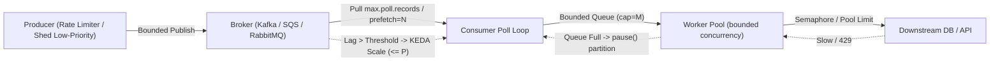
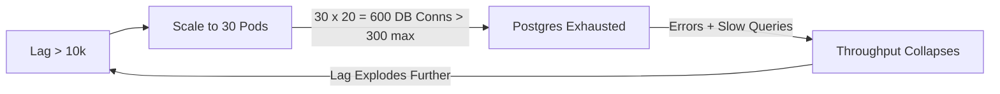

# Backpressure in Messaging: Consumer Lag, Bounded Queues & Autoscaling

> **Prerequisites:** [Lesson 10: Retries & Delayed Messages](../10-retries-delayed-messages/README.md) · [Lesson 01: Why Use a Message Broker?](../01-why-use-a-message-broker-decoupling-load-levelling-the-costs/README.md).  
> **Estimated Reading Time:** 24–28 minutes  
> **Target Audience:** Backend engineers scaling event-driven systems, and candidates asked "how do you handle consumer lag, backpressure, and autoscaling without crashing downstream databases?"  
> **Free PDF Notes:** [Download SD-I-011.pdf](https://backendroadmap.com/notes/system-design/SD-I-011.pdf)

> [!NOTE]
> **In one line:** **Backpressure** is the feedback signal that slows or bounds producers when consumers (or their downstream dependencies) cannot keep up. Because message brokers **decouple** producers from consumers, they hide backpressure by turning excess load into **consumer lag**—so you must manage **bounded in-memory buffers**, **pull-based `pause()`/`resume()`**, **partition-bounded autoscaling (KEDA)**, and **upstream load shedding** before broker disk fills or retention expires.

> [!TIP]
> **The Golden Rule:** In Kafka, **you cannot autoscale consumer pods beyond the number of partitions**, and **scaling consumers without bounding downstream DB/API concurrency just moves the crash downstream**. Always scale on **lag + message age** up to `min(partitions, downstream_safe_concurrency)`, and shed or degrade at the producer when lag breaches SLO.

---

## 1. What Backpressure in Messaging Is, and What It Isn't

A Black Friday flash sale pushes `orders` ingress from 2,000 msg/s to 25,000 msg/s. Your 12 Kafka consumer pods max out at 12,000 msg/s because the inventory database is at 90% CPU. Unlike a synchronous HTTP call (which returns `429`/`503` immediately), Kafka happily accepts all 25,000 msg/s. Over 20 minutes, consumer lag balloons to 15.6 million messages, pod memory OOMs from prefetch buffers, and KEDA spins up 48 pods—36 of which sit completely idle while the 12 active pods hammer the inventory DB into a full outage.

| Term | Precise Meaning | Example |
| :--- | :--- | :--- |
| **Backpressure** | Mechanism where a slow downstream forces upstream to slow down, buffer boundedly, or shed load | TCP flow control, `Channel.Bounded`, Kafka `pause()` |
| **Consumer lag** | `LogEndOffset - CommittedOffset` (messages) or `time_behind` (seconds) | `1,200,000` messages / `180 s` behind |
| **Pull vs. Push** | Consumer pulls at its own pace (Kafka/SQS) vs. broker pushes to consumer (RabbitMQ) | Push without `prefetch_count` OOMs slow consumers |
| **Bounded buffer** | Fixed-capacity in-memory queue between `poll()` and worker threads | `chan` of size 256; blocks `poll()` when full |
| **Partition ceiling** | Max active consumers in a Kafka group equals topic partition count $P$ | 12 partitions $\implies$ pod #13 is 100% idle |
| **Downstream-bounded scaling** | Capping consumer concurrency to what Postgres/Redis/APIs can survive | Max 200 DB connections $\implies$ max 20 pods $\times$ 10 conns |
| **Not** | Infinite free buffering | Broker disk or retention (`retention.ms`) eventually drops or stalls data |

### Why It Matters
1. **Unbounded internal queues** (e.g., pulling from Kafka into an unbounded `LinkedBlockingQueue` or Node.js array) cause **OOMKills** and **lose uncommitted offsets** on crash.
2. **RabbitMQ without `basic.qos(prefetch)`** pushes all queued messages over the network into consumer RAM until the process crashes.
3. **Naive HPA/KEDA autoscaling** without partition awareness or downstream connection budgets causes **rebalance storms** and **downstream DB collapse**.

---

## 2. Anatomy: End-to-End Backpressure Chain



Every hop in the chain must apply **explicit backpressure**:

| Hop | Backpressure Mechanism | What Breaks Without It |
| :--- | :--- | :--- |
| **DB $\rightarrow$ Workers** | Bounded connection pool + circuit breaker | Connection exhaustion, cascading timeouts |
| **Workers $\rightarrow$ Poll Loop** | Bounded channel/queue + `consumer.pause()` when full | OOMKill + `CommitFailedException` |
| **Broker $\rightarrow$ Consumer** | Kafka `max.poll.records` / `max.partition.fetch.bytes`; RabbitMQ `prefetch_count` | Network/RAM saturation on consumer |
| **Lag $\rightarrow$ Autoscaler** | KEDA scaling on lag/message-age, capped at `min(P, max_downstream_pods)` | Idle pods or downstream DB DDoS |
| **Broker $\rightarrow$ Producer** | Quota throttling, `buffer.memory` + `max.block.ms`, or priority load shedding | Broker disk 100% full $\rightarrow$ cluster outage |

> [!WARNING]
> **The `pause()` + `poll()` Rule in Kafka:** If your bounded in-memory worker queue fills up, **do not block the `poll()` thread indefinitely**. Call `consumer.pause(partitions)` and keep calling `poll()` (which returns 0 records while paused and keeps heartbeats alive) until the worker queue drains below a low-water mark (e.g., 50%), then call `consumer.resume()`.

---

## 3. Mathematical Model: Little's Law, Lag Growth & Scaling Bounds

**Lag Growth & Drain Time.** Let arrival rate be $\lambda$ (msg/s) and aggregate consumer throughput across $N$ active consumers ($N \le P$) be $\mu(N) = N \cdot \mu_1$. During a burst where $\lambda > \mu(N)$ for duration $T_{\text{burst}}$:

$$\text{Lag}_{\text{peak}} = \bigl(\lambda_{\text{burst}} - N\mu_1\bigr)\,T_{\text{burst}}, \qquad T_{\text{drain}} = \frac{\text{Lag}_{\text{peak}}}{N_{\text{scaled}}\mu_1 - \lambda_{\text{base}}}$$

**Consumer Lag in Time (Little's Law).** Waiting time of the newest message at the tail of a lag of $L$ messages is:

$$W_{\text{lag}} = \frac{L}{\mu_{\text{eff}}}$$

**Safe Autoscaling Ceiling.** Even if a topic has $P$ partitions, if each consumer pod opens $c_{\text{pod}}$ connections (or sends $r_{\text{pod}}$ RPS) to a shared database with safe limit $C_{\text{DB}}$, the maximum safe replica count is:

$$N_{\max} = \min\!\left(P,\; \left\lfloor \frac{C_{\text{DB}}}{c_{\text{pod}}} \right\rfloor\right)$$

**Worked Numerical Example:**
A Kafka topic has $P = 24$ partitions. Baseline arrival is $\lambda_{\text{base}} = 4{,}000\text{ msg/s}$, and a 5-minute ($300\text{ s}$) marketing push spikes arrivals to $\lambda_{\text{burst}} = 18{,}000\text{ msg/s}$. Each consumer pod processes $\mu_1 = 1{,}000\text{ msg/s}$ and uses $c_{\text{pod}} = 25$ Postgres connections. Postgres max safe pool is $C_{\text{DB}} = 400$ connections.
- **Safe pod ceiling:** $N_{\max} = \min(24,\; \lfloor 400 / 25 \rfloor) = \min(24, 16) = \mathbf{16\text{ pods}}$ (max $\mu = 16{,}000\text{ msg/s}$).
- **Peak lag during the 300 s burst** (with all 16 pods active):
  $$\text{Lag}_{\text{peak}} = (18{,}000 - 16{,}000) \times 300 = \mathbf{600{,}000\text{ messages}}$$
- **Tail message wait time at peak:** $W_{\text{lag}} = 600{,}000 / 16{,}000 = \mathbf{37.5\text{ s}}$.
- **Drain time after burst returns to $4{,}000\text{ msg/s}$:**
  $$T_{\text{drain}} = \frac{600{,}000}{16{,}000 - 4{,}000} = \mathbf{50\text{ s}}$$
- **What if someone scaled to 24 pods anyway?** $24 \times 25 = 600$ DB connections $> 400$, triggering Postgres lock contention, connection timeouts, and collapsing $\mu_1$ from $1{,}000$ to $100\text{ msg/s}$.

---

## 4. Metrics & Percentiles

| Metric | Meaning | Alert when |
| :--- | :--- | :--- |
| **Consumer lag (messages & seconds)** | `LEO - committed_offset` and `now - oldest_uncommitted_ts` | Lag time $> 60\text{ s}$ (or growing for $> 5\text{ min}$) |
| **Broker disk usage %** | Partition log disk utilization | $> 70\%$ (risk of broker crash before retention cleanup) |
| **Lag vs. retention ratio** | `oldest_uncommitted_age / retention.ms` | $> 50\%$ (imminent silent data loss if lag reaches retention!) |
| **In-memory queue occupancy %** | `buffered_items / queue_capacity` on consumer | Sustained $> 80\%$ (backpressure active; verify `pause()` fires) |
| **RabbitMQ unacked count** | Messages pushed to consumers awaiting `ack` | Near `prefetch_count * consumers` for $> 2\text{ min}$ |
| **Rebalance duration / rate** | Time spent in `PreparingRebalance` / `CompletingRebalance` | Autoscaler flapping (scale-up/down every 2 min) |

### Worked Example (Lag vs. Retention Danger)
A topic has `retention.ms = 86,400,000` (24 hours). A consumer group falls behind by 20 hours due to a slow downstream API. If it takes 5 more hours to catch up, **Kafka will delete 1 hour of unconsumed segments** at the 24-hour mark, silently dropping data without any error thrown to the consumer! Alerting on `oldest_uncommitted_age / retention.ms > 0.5` gives 12 hours of runway to scale, shed load, or temporarily extend `retention.ms`.

---

## 5. Compounding & Failure Modes

| Failure Mode | Trigger | Compounding Effect |
| :--- | :--- | :--- |
| **Unbounded Prefetch OOM** | RabbitMQ `prefetch=0` (unlimited) or unbounded async queue | Consumer RAM fills $\rightarrow$ OOMKill $\rightarrow$ broker redelivers all unacked $\rightarrow$ next pod OOMs |
| **Autoscaler Thrashing** | Scaling on CPU instead of lag, or short cooldowns | Rapid pod add/remove triggers constant Kafka rebalances, *lowering* throughput |
| **Downstream DDoS via Scaling** | Scaling consumers past DB capacity | DB latency spikes $\rightarrow$ consumer throughput drops $\rightarrow$ lag rises $\rightarrow$ scaler adds *more* pods! |
| **Retention Expiry Data Loss** | `lag_time > retention.ms` | Oldest unconsumed messages deleted by broker log cleaner |
| **Producer Blocking Cascade** | Kafka `buffer.memory` full + `max.block.ms=60000` | Producer HTTP threads block for 60 s waiting for broker $\rightarrow$ API gateway 504s |

---

## 6. Numbers Every Engineer Must Know

| Item | Typical | Implication |
| :--- | :---: | :--- |
| RabbitMQ `basic.qos` `prefetch_count` | `10`–`100` (never `0` unlimited) | Bounds in-flight RAM per consumer channel |
| Kafka `max.poll.records` | `50`–`500` | Lower for heavy per-message I/O; pairs with `max.partition.fetch.bytes` |
| KEDA scale-down stabilization window | `300 s` (5 min) | Prevents rebalance thrashing after brief traffic dips |
| Kafka Cooperative Sticky Assignor | `CooperativeStickyAssignor` | Incremental rebalances—only moved partitions pause instead of stop-the-world |
| Lag-to-retention alert threshold | `50%` of `retention.ms` | Leaves time to react before data expires |
| Producer `buffer.memory` / `max.block.ms` | `32 MB` / `5,000–60,000 ms` | Lower `max.block.ms` if API threads must fail fast and shed load |

---

## 7. Protocol / Mechanism Deep Dive: Pull Backpressure & Hysteresis

```mermaid
stateDiagram-v2
    [*] --> Active: "Queue < 50% (Low Watermark)"
    Active --> Paused: "Queue >= 80% (High Watermark) -> consumer.pause()"
    Paused --> Paused: "poll() returns 0 records; heartbeats continue"
    Paused --> Active: "Queue <= 50% (Low Watermark) -> consumer.resume()"
```



| Question | Answer |
| :--- | :--- |
| **Why use high/low watermarks (80% / 50%) instead of pausing at 100% and resuming at 99%?** | Hysteresis! Pausing at 80% and resuming at 50% prevents rapid `pause()`/`resume()` oscillation on every single message. |
| **Why does `CooperativeStickyAssignor` matter for autoscaling?** | Eager rebalancing stops **all** consumers across **all** partitions whenever 1 pod scales up or down. Cooperative sticky rebalancing only revokes the specific partitions moving to the new pod, keeping the rest of the fleet running continuously. |
| **How do you apply backpressure *all the way* to producers when a broker is full?** | (1) Broker **client quotas** (`producer_byte_rate`), (2) producer `max.block.ms` returning `TimeoutException` so the API returns `429 Too Many Requests` or sheds low-priority events (e.g., analytics), and (3) priority queues (keep `payments` flowing, shed `clickstream`). |
| **When NOT to autoscale consumers** | When the bottleneck is a **single hot key** (1 partition lagging, 23 idle) or an **already-saturated downstream DB**. Adding pods in either case adds zero throughput and can make things worse. |

---

## 8. Hierarchical Budgets & Design Rules

| Slice | Rule | Control |
| :--- | :--- | :--- |
| **Consumer Memory** | Never use unbounded queues between `poll()` and workers | Bounded buffer + `pause()` at 80%, `resume()` at 50% |
| **RabbitMQ / SQS** | Always set `prefetch_count` (RabbitMQ) / `MaxNumberOfMessages` (SQS) | Prevents broker-to-consumer memory flood |
| **Autoscaling Metric** | Scale on **consumer lag & message age**, not CPU | KEDA `kafka` / `aws-sqs` scaler |
| **Scaling Cap** | `maxReplicas <= min(partitions, DB_max_conns / conns_per_pod)` | Prevents idle pods and downstream DB collapse |
| **Rebalance Strategy** | Use `CooperativeStickyAssignor` + `300 s` scale-down cooldown | Eliminates stop-the-world scaling pauses |
| **Load Shedding** | Separate critical vs. best-effort topics; shed best-effort under crisis | Priority lanes + producer `429` / drop policy |

---

## 9. Top Mitigations

1. **Bound every in-memory buffer** between `poll()` and worker threads, and use **`pause()`/`resume()` with hysteresis** (80%/50%) so heartbeats stay alive.
2. **Set `prefetch_count` in RabbitMQ** (`10–100`) and bound `max.poll.records` in Kafka.
3. **Autoscale on lag/age via KEDA**, strictly capped at `min(partitions, downstream_safe_pods)`.
4. **Use `CooperativeStickyAssignor`** and generous scale-down stabilization windows (`300 s`) to avoid rebalance storms.
5. **Alert on `oldest_uncommitted_age / retention.ms > 0.5`** so you never silently lose unconsumed data to log retention.
6. **Implement priority lanes and producer load shedding** (drop/defer telemetry or return `429`) when sustained lag threatens core SLAs.
7. **Bound downstream concurrency** with semaphores/bulkheads so autoscaled consumers cannot overwhelm shared databases.

---

## 10. Production Reference: The Autoscaler Death Spiral

A retail platform configured Kubernetes HPA to scale their `order-enrichment` Kafka consumers whenever **consumer lag > 10,000**—with `maxReplicas: 50` on a **16-partition** topic, and each pod opening a **20-connection** pool to Postgres (`max_connections = 300`).
- During a flash sale, lag crossed 10,000. KEDA scaled from 6 pods to 16 pods, then kept trying to scale toward 50.
- At 16 pods $\times$ 20 connections = **320 connections**, Postgres hit `FATAL: remaining connection slots are reserved`, failing queries and causing consumer throughput to plummet.
- Lag spiked further, causing HPA to keep churning pods 17–50 (which sat idle on Kafka while still opening 20 idle/health-check DB connections each!) until Postgres crashed completely.



- **Root Cause:** Autoscaler `maxReplicas` exceeded both the Kafka partition count (16) and the Postgres connection budget ($300 / 20 = 15$ pods).
- **Fix:** Capped `maxReplicas` at **12** (leaving DB headroom for synchronous APIs), added PgBouncer connection pooling, switched to `CooperativeStickyAssignor`, and added a producer-side rate limiter for non-critical enrichment events.

---

## 11. Multi-Language Production Code Tabs

Implementing a **bounded worker queue with high/low-watermark `pause()`/`resume()` backpressure**.

````carousel
```go
// Go: bounded worker channel with high/low watermark pause/resume backpressure.
package main

import (
	"fmt"
	"sync"
)

type BackpressureConsumer struct {
	queue      chan string
	paused     bool
	highWater  int
	lowWater   int
	pauseFn    func()
	resumeFn   func()
	mu         sync.Mutex
}

func NewBackpressureConsumer(cap int, pauseFn, resumeFn func()) *BackpressureConsumer {
	return &BackpressureConsumer{
		queue:     make(chan string, cap),
		highWater: int(float64(cap) * 0.8),
		lowWater:  int(float64(cap) * 0.5),
		pauseFn:   pauseFn,
		resumeFn:  resumeFn,
	}
}

func (c *BackpressureConsumer) EnqueueFromPoll(msg string) {
	c.queue <- msg // blocks only if 100% full; watermark pauses before that
	c.mu.Lock()
	defer c.mu.Unlock()
	if !c.paused && len(c.queue) >= c.highWater {
		c.paused = true
		c.pauseFn() // call consumer.Pause(partitions)
		fmt.Println("backpressure: paused partitions")
	}
}

func (c *BackpressureConsumer) DequeueForWorker() string {
	msg := <-c.queue
	c.mu.Lock()
	defer c.mu.Unlock()
	if c.paused && len(c.queue) <= c.lowWater {
		c.paused = false
		c.resumeFn() // call consumer.Resume(partitions)
		fmt.Println("backpressure: resumed partitions")
	}
	return msg
}
```
<!-- slide -->
```typescript
// TypeScript: bounded async buffer with 80%/50% hysteresis pause/resume backpressure.
export class BoundedBackpressureBuffer<T> {
  private buffer: T[] = [];
  private paused = false;
  private readonly highWater: number;
  private readonly lowWater: number;

  constructor(
    private readonly capacity: number,
    private readonly onPause: () => void,
    private readonly onResume: () => void
  ) {
    this.highWater = Math.floor(capacity * 0.8);
    this.lowWater = Math.floor(capacity * 0.5);
  }

  push(item: T): boolean {
    if (this.buffer.length >= this.capacity) return false; // hard bound
    this.buffer.push(item);
    if (!this.paused && this.buffer.length >= this.highWater) {
      this.paused = true;
      this.onPause();
    }
    return true;
  }

  pop(): T | undefined {
    const item = this.buffer.shift();
    if (this.paused && this.buffer.length <= this.lowWater) {
      this.paused = false;
      this.onResume();
    }
    return item;
  }
}
```
<!-- slide -->
```python
# Python: lag, drain time, and DB-bounded autoscaling calculator (stdlib only).
import math


def plan_autoscaling(
    partitions=24,
    base_rps=4_000,
    burst_rps=18_000,
    burst_s=300,
    pod_rps=1_000,
    pod_db_conns=25,
    db_max_conns=400,
):
    safe_pods = min(partitions, db_max_conns // pod_db_conns)
    max_mu = safe_pods * pod_rps
    peak_lag = max(0, (burst_rps - max_mu) * burst_s)
    tail_wait_s = peak_lag / max_mu if max_mu > 0 else float("inf")
    drain_s = peak_lag / (max_mu - base_rps) if max_mu > base_rps else float("inf")
    return {
        "safe_max_pods": safe_pods,
        "max_consumer_rps": max_mu,
        "peak_lag_msgs": peak_lag,
        "tail_wait_s": round(tail_wait_s, 2),
        "drain_time_s": round(drain_s, 2),
    }
```
<!-- slide -->
```csharp
// C#: Bounded Channel<T> with high/low watermark pause/resume controller.
using System.Threading.Channels;

public sealed class BackpressureController<T>
{
    private readonly Channel<T> _channel;
    private readonly int _highWater;
    private readonly int _lowWater;
    private readonly Action _pause;
    private readonly Action _resume;
    private int _paused;

    public BackpressureController(int capacity, Action pause, Action resume)
    {
        _channel = Channel.CreateBounded<T>(new BoundedChannelOptions(capacity)
        {
            FullMode = BoundedChannelFullMode.Wait
        });
        _highWater = (int)(capacity * 0.8);
        _lowWater = (int)(capacity * 0.5);
        _pause = pause;
        _resume = resume;
    }

    public async ValueTask EnqueueAsync(T item, CancellationToken ct)
    {
        await _channel.Writer.WriteAsync(item, ct);
        if (_channel.Reader.Count >= _highWater && Interlocked.Exchange(ref _paused, 1) == 0)
            _pause();
    }

    public async ValueTask<T> DequeueAsync(CancellationToken ct)
    {
        var item = await _channel.Reader.ReadAsync(ct);
        if (_channel.Reader.Count <= _lowWater && Interlocked.Exchange(ref _paused, 0) == 1)
            _resume();
        return item;
    }
}
```
````

---

## 12. Hands-On CLI Verification Workflows

Inspect consumer lag, verify RabbitMQ prefetch/unacked counts, and run the Python capacity planner:

```bash
# 1. Kafka: inspect LAG per partition and check if any single consumer is overloaded or idle
kafka-consumer-groups.sh --bootstrap-server localhost:9092 \
  --describe --group order-enrichment

# 2. Kafka: inspect topic retention.ms to calculate lag-vs-retention runway
kafka-configs.sh --bootstrap-server localhost:9092 \
  --entity-type topics --entity-name orders --describe

# 3. Kubernetes + KEDA: inspect ScaledObject status & current replica count
kubectl get scaledobject order-enrichment-scaler -o wide

# 4. RabbitMQ: inspect unacknowledged messages per queue (verifies prefetch bounds)
rabbitmqctl list_queues name messages_ready messages_unacknowledged consumers
```

Run the Python autoscaling calculator from Section 11:

```bash
python -c "from sim import plan_autoscaling; print(plan_autoscaling())"
# Expected: {'safe_max_pods': 16, 'max_consumer_rps': 16000, 'peak_lag_msgs': 600000, 'tail_wait_s': 37.5, 'drain_time_s': 50.0}
```

---

## 13. Common Mistakes to Avoid

1. **Scaling Kafka consumers past the topic's partition count**—extra pods sit 100% idle while still consuming memory and DB connections.
2. **Scaling consumers on CPU instead of lag/message age** (I/O-bound consumers stay at 15% CPU even when lagging by 1M messages).
3. **Unbounded in-memory queues** between `poll()` and async workers, causing OOMKills and lost progress.
4. **Blocking the `poll()` thread instead of using `pause()`/`resume()`**, triggering `CommitFailedException` and rebalances.
5. **Omitting `prefetch_count` in RabbitMQ**, letting the broker flood consumer RAM.
6. **Autoscaling without a downstream DB/API concurrency cap**, turning a queue spike into a database outage.
7. **Ignoring `lag_time / retention.ms`**, causing Kafka to silently delete unconsumed messages during long incidents.

---

## 14. Key Terms Glossary

| Key Term | Definition |
| :--- | :--- |
| **Backpressure** | Feedback mechanism slowing or shedding upstream work when downstream capacity is saturated. |
| **Consumer lag** | Difference between the latest produced offset (`LEO`) and the consumer group's committed offset. |
| **High / low watermark** | Thresholds (e.g., 80% / 50%) triggering `pause()` and `resume()` with hysteresis. |
| **`prefetch_count`** | RabbitMQ `basic.qos` limit on unacknowledged messages pushed to a consumer. |
| **Partition ceiling** | Maximum active consumers in a Kafka group, bounded by partition count $P$. |
| **KEDA** | Kubernetes Event-driven Autoscaling; scales pods based on Kafka lag, SQS depth, or Prometheus metrics. |
| **CooperativeStickyAssignor** | Kafka rebalance protocol that moves only necessary partitions instead of stopping all consumers. |
| **Load shedding** | Intentionally dropping or deferring low-priority requests when capacity is exhausted. |
| **Lag-to-retention ratio** | Oldest uncommitted message age divided by broker retention time; > 50% signals data-loss risk. |
| **Bulkhead** | Isolation pattern bounding concurrency/connections per consumer or downstream dependency. |

---

## 15. System Design Interview Questions & Answers

### Basic Conceptual Questions

<details>
<summary><strong>Q1: What is backpressure in messaging, and why don't message brokers automatically slow down producers? [BASIC]</strong></summary>

**Answer:**
Backpressure is a signal from a slow consumer/downstream telling the producer to slow down or shed load. Brokers intentionally **decouple** producers from consumers to absorb spikes, so a healthy broker continues accepting messages while turning excess load into **consumer lag**—meaning you must build explicit backpressure at the consumer buffers, autoscaler, and producer quotas.
</details>

<details>
<summary><strong>Q2: What happens if you scale a Kafka consumer group to 30 pods on a 12-partition topic? [BASIC]</strong></summary>

**Answer:**
Only **12 pods** will be assigned partitions and process messages; the other **18 pods will sit completely idle** as standby consumers (while still wasting RAM and opening idle DB connections).
</details>

<details>
<summary><strong>Q3: Why is scaling consumers on CPU utilization an anti-pattern for messaging workers? [BASIC]</strong></summary>

**Answer:**
Most messaging consumers are **I/O-bound** (waiting on Postgres, Redis, or HTTP APIs). Their CPU stays low (10%–25%) even when consumer lag is growing by millions of messages. You should autoscale on **consumer lag** and **oldest message age** instead.
</details>

<details>
<summary><strong>Q4: What is the difference between Kafka's pull model and RabbitMQ's push model regarding backpressure? [BASIC]</strong></summary>

**Answer:**
Kafka consumers **pull** batches (`max.poll.records`) only when ready, giving natural consumer-side backpressure. RabbitMQ **pushes** messages over the TCP channel; without `basic.qos(prefetch_count=N)`, the broker floods the consumer's memory with unacked messages until it OOMs.
</details>

### Scenario-Based Architecture Questions

<details>
<summary><strong>Q5: Your consumer reads from Kafka and hands work to a bounded 500-item goroutine/thread pool. When the pool is full, what happens if you simply block `poll()`? [SCENARIO]</strong></summary>

**Answer:**
Blocking `poll()` for longer than `max.poll.interval.ms` (5 minutes) causes the Kafka broker to assume the consumer is dead, evict it from the group, and trigger a rebalance. Instead, call `consumer.pause(partitions)` at 80% queue capacity, keep calling `poll()` on a short loop so heartbeats stay alive, and call `consumer.resume(partitions)` when the queue drains to 50%.
</details>

<details>
<summary><strong>Q6: You configure KEDA to scale consumers from 4 to 40 pods when lag > 50,000, but every scale-up crashes your Postgres database. How do you fix it? [SCENARIO]</strong></summary>

**Answer:**
Bound `maxReplicas` by `min(partitions, db_safe_connections / conns_per_pod)`, put PgBouncer in front of Postgres, add a downstream semaphore/circuit breaker, and if lag still grows beyond SLO, shed or defer low-priority work at the producer rather than crashing the shared DB.
</details>

<details>
<summary><strong>Q7: Your Kafka topic has 48-hour retention, and consumer lag just reached 30 hours during a downstream outage. What is your immediate operational action? [SCENARIO]</strong></summary>

**Answer:**
Immediately **increase `retention.ms`** on the topic (e.g., to 7 days) via `kafka-configs.sh` so Kafka does not delete unconsumed segments at hour 48. Then fix/scale the downstream bottleneck or temporarily divert low-priority traffic before retention runs out.
</details>

<details>
<summary><strong>Q8: Frequent KEDA scale-ups and scale-downs are causing 30-second processing pauses every few minutes. Why, and how do you stop it? [SCENARIO]</strong></summary>

**Answer:**
Pod additions/removals trigger consumer group rebalances. Fix by: (1) switching from eager rebalancing to **`CooperativeStickyAssignor`** (incremental rebalances), (2) setting `cooldownPeriod` / `stabilizationWindowSeconds` to 300+ seconds on scale-down, and (3) using static group membership (`group.instance.id`) for rolling restarts.
</details>

### Advanced & Tricky Interview Questions

<details>
<summary><strong>Q9: How do you propagate backpressure from a slow consumer all the way back to an HTTP API producer? [TRICKY]</strong></summary>

**Answer:**
You rarely want a slow consumer to directly block an HTTP API thread (that defeats decoupling). Instead, use **indirect feedback**: (1) monitor consumer lag/age; when it crosses a critical threshold, publish a control flag (or feature flag/Redis key) telling the API gateway to **shed low-priority requests** (`429 Too Many Requests` with `Retry-After`) or degrade features; (2) enforce broker **producer byte-rate quotas** so rogue producers get throttled and hit `max.block.ms` fast.
</details>

<details>
<summary><strong>Q10: Why can't `CooperativeStickyAssignor` help if your lag is concentrated on 1 of 24 partitions? [TRICKY]</strong></summary>

**Answer:**
`CooperativeStickyAssignor` only minimizes rebalance disruption; it still assigns each partition to at most **one consumer**. If 1 partition has a hot key, scaling from 12 to 24 pods won't speed up that 1 partition. You must fix the **partition key** (e.g., `order_id` instead of `tenant_id`) or use a **key-sharded in-memory worker pool** inside the consumer owning that partition.
</details>

<details>
<summary><strong>Q11: In a burst of 18,000 msg/s for 5 minutes with max consumer capacity 16,000 msg/s and base load 4,000 msg/s, how long does it take to drain the backlog after the burst? [TRICKY]</strong></summary>

**Answer:**
During the 300 s burst, backlog grows at $18{,}000 - 16{,}000 = 2{,}000\text{ msg/s}$, peaking at $2{,}000 \times 300 = 600{,}000\text{ messages}$. After the burst, spare drain capacity is $16{,}000 - 4{,}000 = 12{,}000\text{ msg/s}$, so drain time is $600{,}000 / 12{,}000 = \mathbf{50\text{ seconds}}$.
</details>

<details>
<summary><strong>Q12: How do priority lanes help with backpressure when you have mixed critical (payments) and non-critical (analytics) events? [TRICKY]</strong></summary>

**Answer:**
Never mix critical and non-critical events in the same topic/queue. Separate them into `events.critical` and `events.bulk` with independent consumer groups and quotas. Under overload, you can scale down or pause `events.bulk` (or shed it at the producer) so `events.critical` keeps all DB and broker headroom with zero lag.
</details>

---

## 16. One-Page Master Cheat Sheet

```
+---------------------------------------------------------------------------------------------------------+
|                    BACKPRESSURE IN MESSAGING — MASTER CHEAT SHEET                                       |
+---------------------------------------------------------------------------------------------------------+
| 1. BROKERS HIDE BACKPRESSURE: Excess arrivals become consumer lag until disk or retention.ms expires.   |
+---------------------------------------------------------------------------------------------------------+
| 2. CONSUMER BUFFERING: Bound internal queues! Use pause() at 80% / resume() at 50% while poll() runs.  |
|    RabbitMQ: ALWAYS set basic.qos(prefetch_count=10..100).                                              |
+---------------------------------------------------------------------------------------------------------+
| 3. AUTOSCALING BOUNDS: Scale on lag/age (KEDA), NEVER CPU.                                              |
|    maxReplicas <= min(partitions, DB_max_conns / conns_per_pod).                                        |
+---------------------------------------------------------------------------------------------------------+
| 4. REBALANCE STABILITY: Use CooperativeStickyAssignor + 300s scale-down cooldown.                       |
+---------------------------------------------------------------------------------------------------------+
| 5. DRAIN MATH: Peak lag = (burst - mu)*T; Drain time = Peak lag / (mu - base).                          |
|    Alert when oldest_uncommitted_age > 50% of retention.ms!                                             |
+---------------------------------------------------------------------------------------------------------+
| 6. PRIORITY & SHEDDING: Separate critical vs bulk topics; shed bulk or return 429 during crisis.        |
+---------------------------------------------------------------------------------------------------------+
```

---

## Further Reading & Sources

- Martin Kleppmann, *Designing Data-Intensive Applications*, Chapter 11 ("Stream Processing" & backpressure).
- Confluent Documentation, [Kafka Consumer `pause()` / `resume()` and `CooperativeStickyAssignor`](https://kafka.apache.org/documentation/#consumerconfigs).
- KEDA Documentation, [Apache Kafka & AWS SQS Scalers](https://keda.sh/docs/latest/scalers/apache-kafka/).
- AWS Architecture Blog, *Avoiding Insurmountable Queue Backlogs* (Amazon Builders' Library).

---

## Free PDF Notes

[SD-I-011.pdf](https://backendroadmap.com/notes/system-design/SD-I-011.pdf)

---

## Next

Continue with [Lesson 12: Event Types: Notifications vs State Transfer vs Commands, Thin vs Fat](../12-event-types/README.md).
