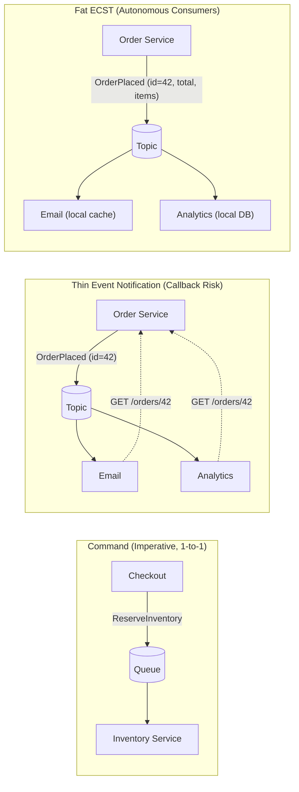
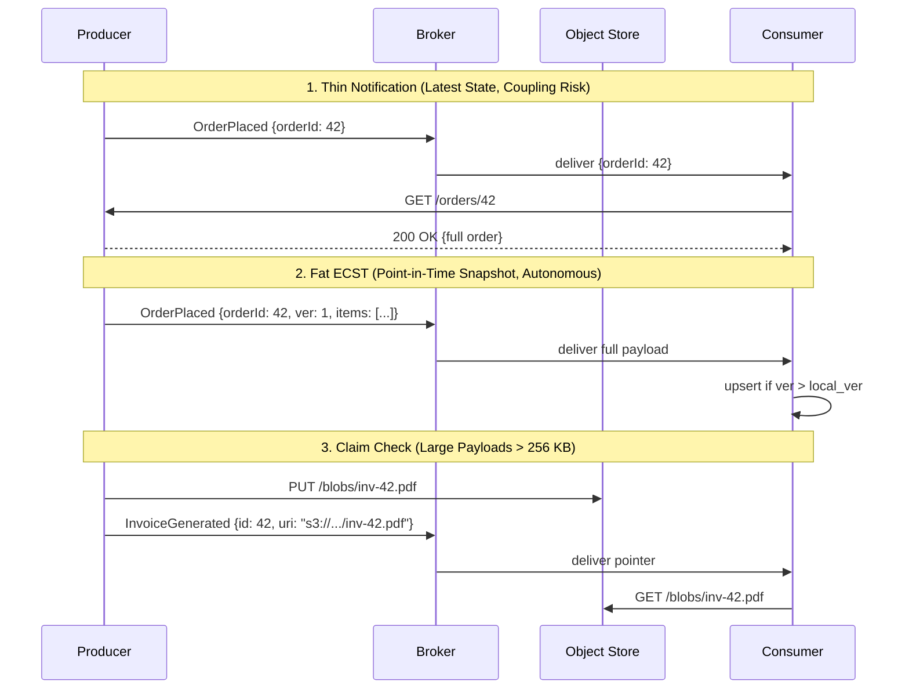
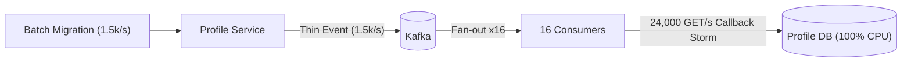

# Event Types: Notifications vs State Transfer vs Commands, Thin vs Fat

> **Prerequisites:** [Lesson 11: Backpressure in Messaging](../11-backpressure-in-messaging/README.md) · [Lesson 01: Why Use a Message Broker?](../01-why-use-a-message-broker-decoupling-load-levelling-the-costs/README.md).  
> **Estimated Reading Time:** 24–28 minutes  
> **Target Audience:** Backend engineers designing service contracts and event schemas, and candidates asked "should this event carry just the ID or the full payload?"  
> **Free PDF Notes:** [Download SD-I-012.pdf](https://backendroadmap.com/notes/system-design/SD-I-012.pdf)

> [!NOTE]
> **In one line:** Not every message is an event, and not every event carries the same payload. **Commands** ask a specific service to do work; **Event Notifications** (thin) announce a fact and force consumers to fetch state; **Event-Carried State Transfer (ECST)** (fat) embeds the changed state so consumers stay autonomous without callback storms.

> [!TIP]
> **The Golden Rule:** Use **Commands** for point-to-point intent, **Thin Notifications** when security, freshness, or payload size forbids embedding state, and **Fat State Transfer (ECST)** when you want consumers to remain available even if the producer is down.

---

## 1. What Event Types Are, and What They Aren't

When an order changes status, teams often argue about the message payload. One team publishes `{"orderId": "ord-91"}` (tiny, clean, forces every consumer to call `GET /orders/ord-91`). Another team publishes the entire 4 KB order JSON with customer address, line items, and totals (no callbacks, but larger broker traffic and schema coupling). A third team names the message `SendOrderEmail` and routes it to a specific service—which isn't an event at all, it's a **command**.

| Term | Precise Meaning | Example |
| :--- | :--- | :--- |
| **Command** | Imperative request to one receiver to perform an action; can be rejected | `ReserveInventory` |
| **Domain Event** | Immutable past-tense fact that something happened; cannot be rejected | `OrderPlaced` |
| **Event Notification (Thin)** | Minimal event carrying only IDs and metadata; consumer queries source for details | `{"event": "OrderPlaced", "orderId": "123"}` |
| **ECST (Fat Event)** | Event-Carried State Transfer; embeds full or delta state needed by consumers | `{"orderId": "123", "total": 9900, "items": [...]}` |
| **Delta / Patch Event** | Carries only the fields that changed (`before` / `after`) | `{"orderId": "123", "status": "SHIPPED"}` |
| **Claim Check** | Thin event carrying a URI/key to a large blob stored in S3/GCS | `{"invoiceId": "9", "blobUri": "s3://..."}` |
| **Not** | A naming convention alone (`OrderEvent` vs `OrderCommand`) | Semantics dictate coupling and failure modes |

### Why It Matters
1. Choosing thin vs fat events determines whether your producer's database gets DDoS'd by consumer callbacks during a fan-out spike.
2. Confusing a **command** with an **event** creates hidden coupling: producers start expecting a specific consumer to obey, breaking decoupling in space.
3. Interviewers test whether you recognize the **stale-read vs callback-storm** trade-off and know how to combine Claim Check or hybrid events.

---

## 2. Anatomy: Thin Notification vs Fat ECST vs Command



In **Thin Notification**, the producer emits a tiny pointer. Every consumer must call back to the producer's API to hydrate the data. In **Fat ECST**, the producer embeds a snapshot of the relevant fields so consumers can update their own local read stores and never call the producer synchronously.

| Dimension | Command | Thin Notification | Fat Event (ECST) |
| :--- | :--- | :--- | :--- |
| **Naming** | Imperative (`ChargeCard`) | Past tense (`OrderPlaced`) | Past tense (`OrderPlaced`) |
| **Coupling** | Producer knows consumer's intent | Temporal & availability coupling via callback | Schema coupling to payload fields |
| **Payload Size** | Small–Medium (100 B–2 KB) | Tiny (100–300 B) | Large (1–50 KB) |
| **Callback Storm** | None | High ($N$ consumers $\times$ $\lambda$ RPS) | None |
| **Data Freshness** | Current at execution | Always latest at callback time | Point-in-time snapshot (can be stale/reordered) |
| **Security / PII** | Scoped to target service | Safe (no PII on broker) | Risky (PII replicated to all consumers) |

> [!WARNING]
> **The Thin-Event Callback Storm:** If 12 microservices subscribe to `UserUpdated` and each calls `GET /users/{id}` upon receiving the thin notification, a batch import of 50,000 users triggers **600,000 synchronous HTTP calls** against the User Service—turning an async broker into a self-inflicted DDoS.

---

## 3. Mathematical Model: Callback Amplification, Bandwidth & Staleness

**1. Callback Amplification (Thin Events).**
If a producer emits events at rate $\lambda$ (events/s) to $N$ independent consumer groups, and each consumer issues $k$ synchronous API calls back to the producer to hydrate state, the producer's read load becomes:

$$R_{\text{callback}} = \lambda \cdot N \cdot k$$

With $\lambda = 5{,}000\text{ events/s}$, $N = 8$ consumer groups, and $k = 1$ callback each, the producer absorbs **$40{,}000\text{ req/s}$** of synchronous read traffic—8x the write rate.

**2. Broker Bandwidth & Storage (Fat Events).**
Let $s_{\text{thin}}$ be the thin payload size and $s_{\text{fat}}$ be the fat payload size. Over retention window $T_{\text{ret}}$ with replication factor $RF$:

$$B_{\text{net}} = \lambda \cdot s \cdot (1 + N) \qquad S_{\text{disk}} = \lambda \cdot T_{\text{ret}} \cdot s \cdot RF$$

**Worked Numerical Example:**
Suppose $\lambda = 5{,}000\text{ events/s}$, $N = 8$ consumers, $T_{\text{ret}} = 7\text{ days} = 604{,}800\text{ s}$, $RF = 3$:
- **Thin ($s_{\text{thin}} = 200\text{ B}$):**
  - Network egress+ingress: $5{,}000 \times 200\text{ B} \times 9 = 9\text{ MB/s}$.
  - Disk footprint (7 days, RF=3): $5{,}000 \times 604{,}800 \times 200\text{ B} \times 3 = 1.81\text{ TB}$.
  - Producer callback load: $5{,}000 \times 8 = 40{,}000\text{ HTTP req/s}$.
- **Fat ECST ($s_{\text{fat}} = 4{,}000\text{ B}$):**
  - Network egress+ingress: $5{,}000 \times 4{,}000\text{ B} \times 9 = 180\text{ MB/s}$ (20x higher).
  - Disk footprint (7 days, RF=3): $5{,}000 \times 604{,}800 \times 4{,}000\text{ B} \times 3 = 36.29\text{ TB}$.
  - Producer callback load: **$0\text{ req/s}$**.

**3. Out-of-Order Staleness Window (ECST).**
Without sequence numbers or version checks, if `OrderUpdated(v=2)` is delayed and processed after `OrderUpdated(v=3)`, the consumer overwrites newer state with older state. Probability of inversion grows with network jitter $\sigma$ and concurrent update rate $\lambda_{\text{entity}}$ on the same entity: $P(\text{invert}) \approx \lambda_{\text{entity}} \cdot \sigma$.

---

## 4. Metrics & Percentiles

| Metric | Meaning | Alert when |
| :--- | :--- | :--- |
| **Callback RPS / Producer Read Load** | `GET` requests from consumers per event | $> 2 \times \lambda$ or approaching producer DB read limit |
| **Payload Size $p_{99}$** | 99th percentile serialized message size | $> 100\text{ KB}$ (approaching broker default 1 MB limit) |
| **Broker Network Egress** | Bytes/s delivered across $N$ fan-out consumers | $> 70\%$ of NIC / cluster bandwidth |
| **Stale Version Rejections** | ECST messages dropped due to `msg.version <= local.version` | Sudden spike (indicates partition reordering or replay) |
| **Claim Check Fetch Latency $p_{99}$** | Time for consumer to download blob from S3/GCS | $> 500\text{ ms}$ (stalls consumer loop) |
| **DLQ Rate on Deserialization** | Messages failing schema validation | $> 0\%$ (breaking schema change on fat event) |

### Worked Example (`CustomerAddressUpdated`)
A fintech platform publishes `CustomerAddressUpdated` whenever a user moves.
- **Attempt 1 (Thin):** Payload is 180 bytes (`customerId`, `timestamp`). Six downstream services (Fraud, Billing, Cards, Notifications, Analytics, Compliance) call `GET /customers/{id}`. During a bulk KYC refresh of 100,000 accounts in 2 minutes ($833\text{ events/s}$), the Customer Service receives $833 \times 6 = 5{,}000\text{ req/s}$ and its read replica saturates, causing timeouts and consumer retries that amplify load further.
- **Attempt 2 (Fat ECST + Version):** Payload embeds `{customerId, version: 14, address: {...}}` (1.2 KB). Callback traffic drops to **0 req/s**. Consumers store `version` alongside the address and ignore any message with `version <= stored_version`.

---

## 5. Compounding & Failure Modes

What happens when a bulk job emits 100,000 events in 60 seconds ($\lambda \approx 1{,}667\text{ events/s}$) across $N = 10$ consumers, and the producer's read API has a capacity of $4{,}000\text{ req/s}$?

| Design | Producer API Load | Broker Throughput | Outcome |
| :--- | :--- | :--- | :--- |
| **Thin Notification (No Cache)** | $1{,}667 \times 10 = 16{,}670\text{ req/s}$ | $3.6\text{ MB/s}$ | **Producer API collapses** ($4.1\times$ over capacity); consumers retry and cascade |
| **Thin + Producer Read Cache (90% hit)** | $1{,}667\text{ req/s}$ DB + $15{,}000\text{ req/s}$ Redis | $3.6\text{ MB/s}$ | Survives if cache is warm; **cold cache still fails** |
| **Fat ECST (4 KB)** | $0\text{ req/s}$ | $73.3\text{ MB/s}$ | **Zero producer impact**; consumers process at full speed |
| **Claim Check (200 B msg + 500 KB S3)** | $0\text{ req/s}$ on API | $3.6\text{ MB/s}$ broker + $8.3\text{ GB/s}$ S3 | Broker stays fast; S3 absorbs blob fan-out |

Notice the subtle trap with **Thin + Cache**: if consumers only fetch *new* entities (cache miss on first read), cache hit rate during a new-entity import is 0%, and the database still melts.

---

## 6. Numbers Every Engineer Must Know

| Item | Typical | Implication |
| :--- | :---: | :--- |
| Thin notification size | 150–400 bytes | Minimal broker cost; high callback cost |
| Fat ECST event size | 1–20 KB | High broker egress; zero callback cost |
| Kafka default `max.message.bytes` | 1 MB | Exceeding it rejects fat events; use Claim Check |
| SQS / SNS max message size | 256 KB | Payloads > 256 KB require S3 Claim Check |
| Callback amplification | $N \times \lambda$ | Scales linearly with number of consumer groups |
| Compression ratio (JSON $\to$ zstd/lz4) | 3x–6x | Essential for fat ECST topics |
| Claim Check threshold | ~64–256 KB | Offload blobs (PDFs, images, huge arrays) to object storage |

---

## 7. Protocol Deep Dive: Thin Callback vs Fat ECST vs Claim Check



| Question | Answer |
| :--- | :--- |
| **Why does Thin return "latest state" while Fat returns "snapshot state"?** | Thin fetches at *consumption time* (may include later edits); Fat captures state at *event emission time*. |
| **Can you mix Thin and Fat?** | Yes—**Hybrid Events** carry the 5 most-used fields (IDs, status, total, version) and a `detailsUri` for rare consumers. |
| **How do you handle PII in Fat ECST?** | Either omit PII (keep it Thin for PII), encrypt fields with per-tenant keys (crypto-shredding), or restrict topic ACLs. |
| **When is a Command better than an Event?** | When the sender requires a specific outcome (`ChargePayment`) and cares if it fails or is rejected. |

**When NOT to use Fat ECST:** Do not use fat events when payloads exceed broker limits (>256 KB), contain highly sensitive PII/PCI data that not all consumers are authorized to see, or mutate so rapidly that point-in-time snapshots confuse consumers more than a fresh `GET`.

---

## 8. Hierarchical Budgets & Design Rules

| Slice | Rule | Control |
| :--- | :--- | :--- |
| **Intent vs Fact** | Imperative verb = Command; Past-tense verb = Event | API/schema linter in CI |
| **Payload Size** | Keep broker messages $< 64\text{ KB}$; $> 256\text{ KB}$ must use Claim Check | Producer middleware size guard |
| **Ordering & Freshness** | Every ECST event carries monotonic `version` or `sequence` | Consumer rejects `msg.version <= stored.version` |
| **Callback Protection** | Thin-event producers must enforce rate limits & caching for consumers | API gateway + `Cache-Control` / ETag |
| **Schema Governance** | Fat ECST events must use backward-compatible schemas | Schema Registry (Lesson 17) |
| **Compression** | Enable `lz4` or `zstd` on all ECST topics | Broker/producer config policy |
| **PII Hygiene** | Never broadcast raw PII to general-purpose fan-out topics | Field-level encryption or Thin + Authz |

---

## 9. Top Mitigations

1. **Include a monotonic `entity_version` in every ECST event** so consumers drop stale/reordered updates safely.
2. **Use Claim Check for blobs $> 64\text{ KB}$** to keep broker page cache hot and avoid `RecordTooLargeException`.
3. **Enable `zstd` or `lz4` compression** on fat event topics to cut network egress and disk footprint by 3–5x.
4. **Rate-limit and cache producer `GET` endpoints** if you choose Thin Notifications, and consider batch-fetch APIs (`POST /orders/batch`).
5. **Separate Commands and Events onto distinct channels** (queues for commands, topics for events) so routing and authorization stay clean.
6. **Design Hybrid Events (80/20 rule)**: include the core immutable attributes most consumers need, plus a link for rare deep lookups.
7. **Encrypt or omit PII in ECST** so adding a new analytics consumer doesn't accidentally violate GDPR/PCI scope.

---

## 10. Production Reference: The Callback Storm on `ProfileUpdated`

A social platform redesigned its monolith into microservices. To keep Kafka messages "clean and small," the team standardized on **Thin Notifications**: `ProfileUpdated` contained only `{"userId": "u-881", "updatedAt": 1700000000}`.

Sixteen downstream services (Search Indexer, Feed Ranker, Recommendations, Ad Targeting, Moderation, Email, Billing, etc.) subscribed to `ProfileUpdated`. Each consumer immediately called `GET /internal/users/u-881`.

During a routine privacy-policy migration, a batch script updated 2 million user records at 1,500 updates/sec. The Profile Service was hit with $1{,}500 \times 16 = 24{,}000\text{ req/s}$ of synchronous reads. Its PostgreSQL read replicas hit 100% CPU, p99 latency jumped from 8 ms to 4,200 ms, consumers timed out and retried with exponential backoff, and the entire platform suffered a 45-minute SEV-1 outage.



**Root Cause:** Thin notifications converted an asynchronous $1{,}500\text{ writes/s}$ stream into a synchronous $24{,}000\text{ reads/s}$ amplification storm.
**Fix:** Switched `ProfileUpdated` to **ECST with delta + version** (`{userId, version, changedFields, snapshot}`) compressed with `zstd`. Callback traffic dropped to **0 req/s**, and Kafka egress stayed under 40 MB/s.

---

## 11. Multi-Language Production Code Tabs

Demonstrating **Command vs Thin vs Fat ECST** dispatch and **version-checked ECST consumption** (preventing stale out-of-order overwrites).

````carousel
```go
// Go: version-guarded ECST consumer vs Command handler.
package main

import (
	"errors"
	"fmt"
	"sync"
)

type EventType string

const (
	TypeThin EventType = "THIN_NOTIFICATION"
	TypeECST EventType = "FAT_ECST"
)

type OrderECST struct {
	OrderID string
	Version int64
	Status  string
	Total   int64
}

type ReadStore struct {
	mu     sync.Mutex
	orders map[string]OrderECST
}

func NewReadStore() *ReadStore {
	return &ReadStore{orders: make(map[string]OrderECST)}
}

// ApplyECST ignores stale or duplicate events using monotonic version.
func (s *ReadStore) ApplyECST(ev OrderECST) (bool, error) {
	if ev.OrderID == "" || ev.Version <= 0 {
		return false, errors.New("invalid ECST payload")
	}
	s.mu.Lock()
	defer s.mu.Unlock()
	if cur, ok := s.orders[ev.OrderID]; ok && ev.Version <= cur.Version {
		return false, nil // stale or duplicate event safely ignored
	}
	s.orders[ev.OrderID] = ev
	return true, nil
}

func main() {
	store := NewReadStore()
	applied1, _ := store.ApplyECST(OrderECST{OrderID: "ord-1", Version: 3, Status: "SHIPPED", Total: 5000})
	applied2, _ := store.ApplyECST(OrderECST{OrderID: "ord-1", Version: 2, Status: "PAID", Total: 5000}) // out-of-order
	fmt.Printf("v3 applied=%v, v2 applied=%v\n", applied1, applied2)
}
```
<!-- slide -->
```typescript
// TypeScript: Discriminated union for Command vs Thin vs Fat ECST + version guard.
export type Message =
  | { kind: "COMMAND"; commandName: "ReserveInventory"; orderId: string; sku: string; qty: number }
  | { kind: "THIN_EVENT"; eventName: "OrderPlaced"; orderId: string; occurredAt: number }
  | { kind: "ECST_EVENT"; eventName: "OrderPlaced"; orderId: string; version: number; totalCents: number; status: string };

export class OrderProjection {
  private state = new Map<string, { version: number; totalCents: number; status: string }>();

  handle(msg: Message): "APPLIED" | "IGNORED_STALE" | "FETCH_REQUIRED" | "EXECUTED_CMD" {
    switch (msg.kind) {
      case "COMMAND":
        return "EXECUTED_CMD";
      case "THIN_EVENT":
        // Caller must hydrate via GET /orders/{orderId}
        return "FETCH_REQUIRED";
      case "ECST_EVENT": {
        const current = this.state.get(msg.orderId);
        if (current && msg.version <= current.version) {
          return "IGNORED_STALE";
        }
        this.state.set(msg.orderId, { version: msg.version, totalCents: msg.totalCents, status: msg.status });
        return "APPLIED";
      }
    }
  }
}
```
<!-- slide -->
```python
# Python: Bandwidth & callback amplification simulator + version-guarded ECST store.
from dataclasses import dataclass

def simulate_event_cost(
    rate_per_sec: int,
    consumers: int,
    thin_bytes: int = 200,
    fat_bytes: int = 4000,
    retention_days: int = 7,
    rf: int = 3,
) -> dict:
    sec = retention_days * 86400
    return {
        "thin_callback_rps": rate_per_sec * consumers,
        "thin_egress_mb_s": round(rate_per_sec * thin_bytes * (1 + consumers) / 1e6, 2),
        "thin_disk_tb": round(rate_per_sec * sec * thin_bytes * rf / 1e12, 2),
        "fat_callback_rps": 0,
        "fat_egress_mb_s": round(rate_per_sec * fat_bytes * (1 + consumers) / 1e6, 2),
        "fat_disk_tb": round(rate_per_sec * sec * fat_bytes * rf / 1e12, 2),
    }

@dataclass
class OrderECST:
    order_id: str
    version: int
    status: str
    total_cents: int

class LocalReadModel:
    def __init__(self) -> None:
        self._orders: dict[str, OrderECST] = {}

    def apply(self, ev: OrderECST) -> bool:
        cur = self._orders.get(ev.order_id)
        if cur is not None and ev.version <= cur.version:
            return False  # stale or duplicate
        self._orders[ev.order_id] = ev
        return True

if __name__ == "__main__":
    print(simulate_event_cost(rate_per_sec=5000, consumers=8))
```
<!-- slide -->
```csharp
// C#: Version-guarded ECST consumer and Claim Check payload model.
using System.Collections.Concurrent;

public abstract record DomainMessage(string MessageId);
public sealed record ReserveInventoryCommand(string MessageId, string OrderId, string Sku, int Qty) : DomainMessage(MessageId);
public sealed record OrderThinEvent(string MessageId, string OrderId) : DomainMessage(MessageId);
public sealed record OrderEcstEvent(string MessageId, string OrderId, long Version, string Status, long TotalCents) : DomainMessage(MessageId);

public sealed class OrderEcstStore
{
    private readonly ConcurrentDictionary<string, OrderEcstEvent> _store = new();

    public bool TryApply(OrderEcstEvent ev)
    {
        while (true)
        {
            if (_store.TryGetValue(ev.OrderId, out var existing))
            {
                if (ev.Version <= existing.Version) return false; // stale or duplicate
                if (_store.TryUpdate(ev.OrderId, ev, existing)) return true;
            }
            else if (_store.TryAdd(ev.OrderId, ev))
            {
                return true;
            }
        }
    }
}
```
````

---

## 12. Hands-On CLI Verification Workflows

Run the Python cost model to compare Thin vs Fat ECST at 5,000 events/s across 8 consumers:

```bash
python -c "
rate, n, days, rf = 5000, 8, 7, 3
for name, sz, cb in [('Thin', 200, rate*n), ('Fat', 4000, 0)]:
    egress = rate * sz * (1 + n) / 1e6
    disk = rate * days * 86400 * sz * rf / 1e12
    print(f'{name}: callbacks={cb}/s, network={egress:.1f} MB/s, 7d_disk={disk:.2f} TB')
"
```

Inspect Kafka message sizes and compression ratios in production:

```bash
# Check topic compression type and max message bytes
kafka-configs.sh --bootstrap-server localhost:9092 \
  --entity-type topics --entity-name orders.ecst --describe

# Sample 5 messages to measure raw payload size and inspect version headers
kafka-console-consumer.sh --bootstrap-server localhost:9092 \
  --topic orders.ecst --from-beginning --max-messages 5 \
  --property print.headers=true --property print.key=true
```

---

## 13. Common Mistakes to Avoid

1. **Naming a Command like an Event** (or vice versa), hiding point-to-point coupling behind a pub/sub topic.
2. **Choosing Thin Notifications for high-fan-out topics** without modeling the $N \times \lambda$ callback storm.
3. **Applying Fat ECST updates without a monotonic version check**, allowing reordered messages to overwrite newer state.
4. **Pushing multi-megabyte payloads directly onto Kafka/SQS** instead of using the Claim Check pattern.
5. **Replicating unencrypted PII inside Fat ECST events** to analytics/logging consumers that lack clearance.
6. **Turning off broker compression** on Fat ECST topics, wasting 3–5x on network egress and disk.
7. **Assuming Fat ECST means "dump the entire database row"**—only include stable, contractually agreed domain attributes.

---

## 14. Key Terms Glossary

| Key Term | Definition |
| :--- | :--- |
| **Command** | An imperative message directing a specific receiver to perform an action. |
| **Domain Event** | An immutable, past-tense record of a fact that has already occurred. |
| **Event Notification** | A thin event containing only identifiers, requiring consumers to query the source. |
| **ECST (Event-Carried State Transfer)** | A fat event embedding the state consumers need to operate autonomously. |
| **Callback Storm** | Synchronous read overload on a producer caused by $N$ consumers hydrating thin events. |
| **Claim Check Pattern** | Storing a large payload in object storage and sending only its URI in the message. |
| **Monotonic Version** | A strictly increasing per-entity counter used to reject stale out-of-order ECST events. |
| **Delta Event** | An event carrying only changed fields (`before`/`after`) rather than the full entity. |
| **Temporal Coupling** | Dependency where a consumer cannot finish processing if the producer's API is down. |
| **Schema Coupling** | Dependency where consumers break if the producer alters fat event field structures. |

---

## 15. System Design Interview Questions & Answers

### Basic Conceptual Questions

<details>
<summary><strong>Q1: What is the difference between a Command and an Event? [BASIC]</strong></summary>

**Answer:**
A **Command** is an imperative request (`ChargePayment`) sent to one specific receiver, and it can be rejected or fail validation. An **Event** is a past-tense fact (`PaymentCharged`) broadcast to zero or more unknown subscribers; it has already happened and cannot be rejected.
</details>

<details>
<summary><strong>Q2: What is a Thin Event (Event Notification) vs a Fat Event (ECST)? [BASIC]</strong></summary>

**Answer:**
A **Thin Event** carries only an ID and metadata (`{orderId: "42"}`), forcing consumers to call back to the producer for details. A **Fat Event (ECST)** embeds the entity's state (`{orderId: "42", total: 9900, items: [...]}`) so consumers can maintain local state without calling the producer.
</details>

<details>
<summary><strong>Q3: What is the Claim Check pattern and when do you use it? [BASIC]</strong></summary>

**Answer:**
When a payload exceeds broker limits (e.g., $> 256\text{ KB}$ in SQS or $> 1\text{ MB}$ in Kafka), the producer writes the blob to S3/GCS and publishes a small message containing the URI and checksum. Consumers fetch the blob from object storage using that reference.
</details>

<details>
<summary><strong>Q4: Why do Fat ECST events improve consumer availability? [BASIC]</strong></summary>

**Answer:**
Consumers store the received state locally and never call the producer's synchronous API. Even if the producer goes down for maintenance or suffers an outage, consumers keep serving reads from their local projections.
</details>

### Scenario-Based Architecture Questions

<details>
<summary><strong>Q5: 10 microservices consume `OrderUpdated`. How do you prevent a callback storm during Black Friday? [SCENARIO]</strong></summary>

**Answer:**
Switch from Thin Notifications to **Fat ECST** (or Hybrid events) with `zstd` compression and a monotonic `version` field. This drops producer callback load from $10 \times \lambda$ req/s to **0 req/s**. If thin events are legally required (e.g., strict PII), put a high-hit-rate Redis cache and batch-fetch endpoint in front of the producer DB.
</details>

<details>
<summary><strong>Q6: A consumer receives `UserUpdated(v=5)` and then `UserUpdated(v=4)` due to retries. How do you handle it? [SCENARIO]</strong></summary>

**Answer:**
Include a strictly increasing per-entity `version` (or Lamport/DB sequence number) in every ECST event. The consumer persists `version` in its local table and performs a conditional upsert (`WHERE incoming_version > stored_version`), silently discarding `v=4`.
</details>

<details>
<summary><strong>Q7: Your service emits 5 MB PDF invoices on every `InvoiceGenerated` event. How should you design the message? [SCENARIO]</strong></summary>

**Answer:**
Use the **Claim Check** pattern: upload the 5 MB PDF to S3/GCS, then publish a 300-byte event with `{invoiceId, s3Uri, sha256, totalCents, customerId}`. Keep the metadata fat enough for analytics/billing, while offloading the 5 MB binary from the broker.
</details>

<details>
<summary><strong>Q8: Security flags that your Fat ECST `CustomerUpdated` topic leaks SSNs to the Analytics team. What do you do? [SCENARIO]</strong></summary>

**Answer:**
Remove sensitive PII from the general ECST topic. Either split into a restricted PII topic with strict ACLs, encrypt the SSN field with a key only authorized services hold, or keep PII **Thin** so consumers must pass an authorized `GET /customers/{id}/pii` check.
</details>

### Advanced & Tricky Interview Questions

<details>
<summary><strong>Q9: Why might a Thin Notification actually return *fresher* data than a Fat ECST event? [TRICKY]</strong></summary>

**Answer:**
Because a Thin consumer queries the producer's API at *consumption time*, it reads the latest committed state—even if the entity was updated three more times while the message sat in a queue. A Fat ECST event carries a *point-in-time snapshot* from emission time, which can be stale if consumer lag is high.
</details>

<details>
<summary><strong>Q10: How do you avoid schema coupling when 15 teams consume a Fat ECST event? [TRICKY]</strong></summary>

**Answer:**
Enforce backward/forward compatibility via a Schema Registry (Protobuf/Avro/JSON Schema), never remove or rename fields without deprecation windows, and avoid exposing internal database columns—publish a curated **public domain contract** instead.
</details>

<details>
<summary><strong>Q11: Can you guarantee global ordering across all entities in ECST? [TRICKY]</strong></summary>

**Answer:**
No, and you don't need to. Partition the stream by `entity_id` (e.g., `orderId`) so all events for a single entity land in the same partition in order, and still enforce `version` checks at the consumer in case of producer retries or partition rebalances.
</details>

<details>
<summary><strong>Q12: What is the "Passive-Aggressive Event" anti-pattern? [TRICKY]</strong></summary>

**Answer:**
Disguising a synchronous-intent **Command** as an **Event**—for example, `OrderService` publishing `InventoryShouldBeReserved` and expecting `InventoryService` to reply with `InventoryReserved`. It creates hidden orchestration coupling while pretending to be decoupled pub/sub.
</details>

---

## 16. One-Page Master Cheat Sheet

```
+---------------------------------------------------------------------------------------------------------+
|                    EVENT TYPES: COMMANDS vs THIN vs FAT ECST — MASTER CHEAT SHEET                       |
+---------------------------------------------------------------------------------------------------------+
| 1. COMMAND vs EVENT:                                                                                    |
|    Command = imperative, 1-to-1, can be rejected (ReserveInventory).                                    |
|    Event   = past-tense fact, 1-to-many, immutable (OrderPlaced).                                       |
+---------------------------------------------------------------------------------------------------------+
| 2. THIN NOTIFICATION:                                                                                   |
|    Tiny payload (IDs only). Safe for PII, always latest state on GET.                                   |
|    DANGER: Callback storm = lambda * N_consumers * k. At 5k/s x 8 consumers = 40,000 GET/s!             |
+---------------------------------------------------------------------------------------------------------+
| 3. FAT ECST (Event-Carried State Transfer):                                                             |
|    Embeds state snapshot. Zero callbacks, autonomous consumers.                                         |
|    COST: 10-20x broker bandwidth/disk; requires monotonic `version` check against out-of-order writes.  |
+---------------------------------------------------------------------------------------------------------+
| 4. CLAIM CHECK:                                                                                         |
|    Payload > 64-256 KB? Store blob in S3/GCS, publish {id, uri, sha256} on the broker.                  |
+---------------------------------------------------------------------------------------------------------+
| 5. HYBRID (80/20 RULE):                                                                                 |
|    Embed core fields + version + compression (zstd/lz4); keep sensitive/huge fields behind URI/API.     |
+---------------------------------------------------------------------------------------------------------+
```

---

## Further Reading & Sources

- Martin Fowler, [What do you mean by "Event-Driven"?](https://martinfowler.com/articles/201701-event-driven.html) (Notification vs ECST vs Event Sourcing).
- Gregor Hohpe and Bobby Woolf, *Enterprise Integration Patterns* (Command Message, Event Message, Claim Check).
- Martin Kleppmann, *Designing Data-Intensive Applications*, Chapter 11 ("Stream Processing").
- Confluent Developer, [Designing Events and Event-Carried State Transfer](https://developer.confluent.io/patterns/).

---

## Free PDF Notes

[SD-I-012.pdf](https://backendroadmap.com/notes/system-design/SD-I-012.pdf)

---

## Next

Continue with [Lesson 13: Event Sourcing Explained: Event Store, Snapshots, Projections & Pitfalls](../13-event-sourcing-explained/README.md): storing state as an append-only log of facts.
