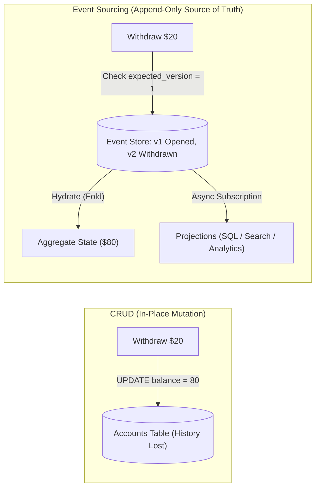
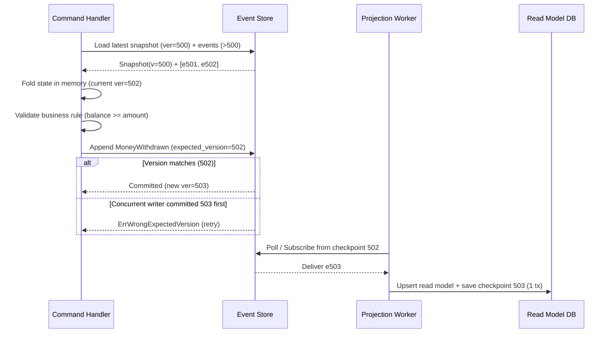
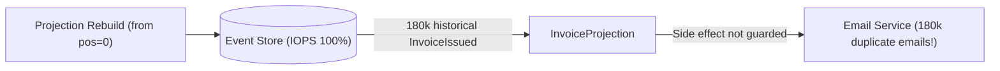

# Event Sourcing Explained: Event Store, Snapshots, Projections & Pitfalls

> **Prerequisites:** [Lesson 12: Event Types](../12-event-types/README.md) · [Lesson 04: Event Log & Kafka Architecture](../04-kafka-topics-partitions-offsets/README.md).  
> **Estimated Reading Time:** 25–28 minutes  
> **Target Audience:** Backend engineers building audit-critical ledgers or temporal systems, and candidates asked "when would you use Event Sourcing instead of CRUD?"  
> **Free PDF Notes:** [Download SD-I-013.pdf](https://backendroadmap.com/notes/system-design/SD-I-013.pdf)

> [!NOTE]
> **In one line:** Instead of overwriting rows in place (`UPDATE accounts SET balance = 80`), **Event Sourcing** persists every state change as an immutable, append-only sequence of domain events (`AccountOpened`, `MoneyWithdrawn`) in an **Event Store**. Current state is derived by folding (replaying) those events, accelerated by **snapshots** and queried via **projections**.

> [!TIP]
> **The Golden Rule:** Use Event Sourcing only when the **history of how you got to the current state** has first-class business value (financial ledgers, compliance audits, time-travel debugging, collaborative editing). For standard CRUD entities, a mutable table + audit log is far simpler.

---

## 1. What Event Sourcing Is, and What It Isn't

In a traditional CRUD bank account, `UPDATE accounts SET balance = balance - 20 WHERE id = 'A1'` destroys the previous balance ($100). If a customer disputes a charge or a bug corrupts balances, you only see the final number. In **Event Sourcing**, the database is an append-only log of facts: `AccountOpened(100)`, `MoneyWithdrawn(20)`. The current balance (`80`) is a *derived cache* computed by replaying the stream.

| Term | Precise Meaning | Example |
| :--- | :--- | :--- |
| **Event Store** | Append-only database storing ordered streams per aggregate with optimistic concurrency | EventStoreDB, Marten (Postgres), DynamoDB |
| **Aggregate Stream** | Ordered sequence of events for a single entity ID | `account-A1: [v1, v2, v3]` |
| **Fold / Hydration** | Left-folding events from $v=1 \dots n$ in memory to reconstruct current state | `state = reduce(apply, events, init)` |
| **Snapshot** | Materialized state checkpoint at version $k$ to bound replay length | `{id: "A1", version: 500, balance: 80}` |
| **Projection** | Asynchronous read model built by subscribing to the global event stream | `AccountSummary` table in Postgres/ES |
| **Optimistic Concurrency** | Rejecting an append if `expected_version != current_stream_version` | Prevents lost updates without locks |
| **Not** | Just "publishing events to Kafka after a DB update" | In Event Sourcing, the event log *is* the source of truth |

### Why It Matters
1. **Complete audit trail by construction**: every state transition, who triggered it, and why is preserved forever.
2. **Temporal queries & replayability**: you can reconstruct state at any past timestamp or spin up new read models from historical events.
3. **High interview failure rate**: candidates often confuse Event Sourcing with Event-Driven Architecture (EDA) or forget snapshots, optimistic concurrency, and schema upcasting.

---

## 2. Anatomy: CRUD State Mutation vs Event Sourcing



In Event Sourcing, writes only append to the stream after validating invariants against the hydrated aggregate. Reads **never** scan the Event Store for list queries (`SELECT * WHERE balance > 1000`); instead, projections materialize query-friendly views asynchronously.

| Dimension | Traditional CRUD | Event Sourcing |
| :--- | :--- | :--- |
| **Source of Truth** | Current row state | Immutable event stream |
| **Write Operation** | `UPDATE` / `DELETE` in place | `INSERT` (append) with `expected_version` |
| **Audit & History** | Requires separate triggers/audit table | Built-in, lossless |
| **Read Queries** | Direct SQL `WHERE` / `JOIN` | Must use Projections (eventual consistency) |
| **Schema Changes** | `ALTER TABLE` migration | Event versioning + Upcasters (events are immutable!) |
| **GDPR Deletion** | `DELETE` / `UPDATE NULL` | Crypto-shredding (delete per-user encryption key) |

> [!WARNING]
> **Event Sourcing is NOT "Kafka as your database."** Kafka topics have retention limits (unless compacted, which deletes intermediate history) and lack per-aggregate optimistic concurrency (`expected_version`) checks. A true Event Store enforces atomic per-stream version checks on append.

---

## 3. Mathematical Model: Replay Latency, Snapshot Interval & Storage

**1. Aggregate Hydration Latency (Without vs With Snapshots).**
Let $N$ be the total events in an aggregate's stream, $t_{\text{read}}$ be the per-event deserialization + fold time, $K$ be the snapshot interval (snapshot every $K$ events), and $t_{\text{snap}}$ be the time to load one snapshot.

- **Without snapshots:**
$$T_{\text{hydrate}} = T_{\text{net}} + N \cdot t_{\text{read}}$$

- **With snapshots every $K$ events (worst-case $K-1$ events after snapshot):**
$$T_{\text{hydrate, snap}} = T_{\text{net}} + t_{\text{snap}} + ((N \bmod K)) \cdot t_{\text{read}}$$

**Worked Numerical Example:**
Suppose a high-frequency trading account has $N = 100{,}000$ events, $T_{\text{net}} = 2\text{ ms}$, $t_{\text{read}} = 0.05\text{ ms/event}$, and $t_{\text{snap}} = 1.5\text{ ms}$:
- **Without snapshots:** $T_{\text{hydrate}} = 2 + 100{,}000 \times 0.05 = \mathbf{5{,}002\text{ ms}}$ (5 seconds per write!).
- **With snapshot every $K = 500$ events (worst case 499 tail events):**
  $$T_{\text{hydrate, snap}} = 2 + 1.5 + 499 \times 0.05 = \mathbf{28.45\text{ ms}}$$
  That is a **175x speedup** on write hydration!

**2. Storage Growth & Projection Catch-up Time.**
If total system write rate is $\lambda$ events/s and average event size is $s_{\text{ev}}$, daily raw storage is:

$$S_{\text{day}} = \lambda \cdot 86{,}400 \cdot s_{\text{ev}}$$

At $\lambda = 2{,}000\text{ events/s}$ and $s_{\text{ev}} = 500\text{ B}$: $S_{\text{day}} = 2{,}000 \times 86{,}400 \times 500 = 86.4\text{ GB/day}$ ($\approx 31.5\text{ TB/year}$).
If you rebuild a projection from scratch over $D$ days of history at replay throughput $\mu_{\text{proj}}$:

$$T_{\text{rebuild}} = \frac{\lambda \cdot D \cdot 86{,}400}{\mu_{\text{proj}} - \lambda}$$

Replaying 30 days ($5.184 \times 10^9$ events) at $\mu_{\text{proj}} = 100{,}000\text{ events/s}$ while live writes continue at $2{,}000\text{ events/s}$ takes:

$$T_{\text{rebuild}} = \frac{5.184 \times 10^9}{98{,}000} \approx 52{,}898\text{ s} \approx \mathbf{14.7\text{ hours}}$$

---

## 4. Metrics & Percentiles

| Metric | Meaning | Alert when |
| :--- | :--- | :--- |
| **Events Loaded per Write $p_{99}$** | Tail events replayed after latest snapshot | $> K$ (snapshotter falling behind) |
| **Optimistic Concurrency Conflict Rate** | Percentage of appends failing `WrongExpectedVersion` | $> 5\%$ (hot aggregate contention) |
| **Projection Lag (Events / Seconds)** | Distance between Event Store head and projection checkpoint | Exceeds read-staleness SLO (e.g., $> 2\text{ s}$) |
| **Event Store Append Latency $p_{99}$** | Time to durably commit an event + version check | $> 50\text{ ms}$ |
| **Snapshot Write Failure Rate** | Failed background snapshot checkpoints | Any sustained failure (causes unbounded replay growth) |
| **Projection Rebuild ETA** | Estimated time to backfill a new read model | Exceeds deployment/maintenance window |

### Worked Example (`BankAccount` Hot Aggregate)
An e-commerce marketplace uses a single `PlatformFeeAccount` aggregate for all 500 checkouts/sec.
- Every checkout tries to hydrate `PlatformFeeAccount` at `version = V`, append `FeeCollected`, and commit with `expected_version = V`.
- With 500 concurrent writers, 499 fail with `WrongExpectedVersion` and retry—causing a **99.8% conflict rate** and collapsing throughput.
- **Fix:** Split the hot aggregate into sharded daily/bucketed streams (`PlatformFeeAccount-2026-11-25-shard-0..31`), or aggregate asynchronously via a projection.

---

## 5. Compounding & Failure Modes

| Failure Mode | Mechanism | Impact |
| :--- | :--- | :--- |
| **No Snapshots on Long Streams** | Stream grows to $10^5$–$10^6$ events | Hydration latency degrades linearly $O(N)$, causing write timeouts |
| **Breaking Event Schema Change** | V2 code renames/removes field in historical V1 event | Deserialization crashes during replay or projection rebuild |
| **Missing Idempotency in Projections** | Projection crashes after DB write, before checkpoint commit | Duplicate event increments counters twice (`balance += 20` twice) |
| **Side Effects During Replay** | Aggregate/projection sends email or charges card inside `apply()` | Rebuilding a projection sends 100,000 duplicate emails to customers |
| **GDPR "Right to be Forgotten"** | Immutable log still contains `email`/`ssn` after user deletion | Compliance violation unless crypto-shredding is used |

---

## 6. Numbers Every Engineer Must Know

| Item | Typical | Implication |
| :--- | :---: | :--- |
| Snapshot interval ($K$) | 100–1,000 events | Keeps $p_{99}$ hydration under 10–30 ms |
| Event size | 300 B–2 KB | Compact JSON/Protobuf keeps replay fast |
| Event Store append $p_{99}$ | 5–20 ms | Single-stream optimistic lock is fast when contention is low |
| Projection lag (healthy) | 10–200 ms | Users must tolerate brief eventual consistency |
| Projection rebuild speed | 20k–200k events/s | Batch DB upserts (`COPY`/`UNNEST`) are 10x faster than row-by-row |
| Hot aggregate ceiling | ~50–100 writes/s per stream | Beyond this, optimistic concurrency retries dominate |

---

## 7. Protocol Deep Dive: Optimistic Append, Snapshotting & Upcasting



| Question | Answer |
| :--- | :--- |
| **How do you evolve an event schema if events are immutable?** | **Upcasting**: keep old events untouched in the store; a reader-side upcaster transforms `v1` events into `v2` in memory during hydration/projection. |
| **How do you handle GDPR deletion in an immutable log?** | **Crypto-shredding**: encrypt PII fields with a per-user key stored in a mutable key vault. To "delete" the user, delete their key—the historical events become unreadable ciphertext. |
| **Where should snapshots be stored?** | In a separate `snapshots` table/bucket keyed by `(stream_id, version)` so they can be deleted or regenerated without touching the source-of-truth events. |
| **How do projections avoid double-applying events?** | Store the `last_processed_position` (checkpoint) in the **exact same local transaction** as the read-model update, or track `event_id` for idempotency. |

**When NOT to use Event Sourcing:** Do not use it for simple CRUD (user preferences, CMS pages, reference catalogs), when strict immediate global consistency across entities is required on every read, or when the team cannot afford the operational complexity of projections, upcasters, and eventual consistency.

---

## 8. Hierarchical Budgets & Design Rules

| Slice | Rule | Control |
| :--- | :--- | :--- |
| **Concurrency** | Every append MUST specify `expected_version` | Unique constraint `(stream_id, version)` in DB |
| **Snapshots** | Snapshot asynchronously every $K$ events ($K \in [100, 1000]$) | Background worker; never block write path |
| **Pure Apply** | `apply(state, event)` must be 100% deterministic with zero I/O | Unit test: replay twice $\implies$ identical state |
| **Schema Evolution** | Never mutate stored events; use Upcasters on read | Version tag on every event envelope |
| **Projection Checkpoints** | Save read-model state + checkpoint atomically | Single local DB transaction |
| **PII / GDPR** | Encrypt PII per `subject_id` (crypto-shredding) | Key-management policy enforced at serializer |
| **Aggregate Size** | Keep streams bounded (e.g., monthly/daily accounting periods) | Closing/rollover events (`MonthClosed`) |

---

## 9. Top Mitigations

1. **Enforce `UNIQUE (stream_id, version)`** at the Event Store storage layer for rock-solid optimistic concurrency.
2. **Automate snapshotting every $K$ events** and treat snapshots as disposable caches (if schema changes, invalidate snapshots and rebuild from events).
3. **Keep `apply()` pure and side-effect-free**—never send emails, call HTTP APIs, or read `time.Now()` inside an event fold.
4. **Build an Upcaster pipeline** (`v1 -> v2 -> v3`) in your deserializer so historical events never break new code.
5. **Commit projection state and checkpoint in one transaction** (or use `event_version > stored_version`) to make projections idempotent.
6. **Use batching when rebuilding projections** (`INSERT ... ON CONFLICT DO UPDATE` in batches of 1,000) to cut rebuild times from days to minutes.
7. **Shard hot aggregates** if a single stream exceeds ~50 writes/sec.

---

## 10. Production Reference: The Unbounded Stream & Replay Email Storm

A SaaS billing team implemented Event Sourcing for `Subscription` aggregates. Two design flaws went unnoticed for 18 months:
1. **No snapshots:** Enterprise tenants with usage-based billing accumulated 40,000+ `UsageRecorded` events per subscription.
2. **Side effect in projection:** The `InvoiceProjection` sent an HTTP call to the Email Service whenever it processed `InvoiceIssued` without checking if it was in live mode vs replay mode.

When a new analytics column was added to `InvoiceProjection`, an engineer triggered a full projection rebuild from `position = 0`. Within 3 minutes, the Email Service received **180,000 duplicate invoice emails** for historical months, while simultaneously, the Event Store saturated its IOPS replaying 40,000-event streams for live writes.



**Root Cause:** Mixing side effects into projection handlers without a replay guard / outbox separation, combined with unbounded stream hydration without snapshots.
**Fix:**
1. Moved email dispatch to a dedicated **Process Manager / Policy** that only emits commands once (tracked via Inbox/Outbox) and is disabled during read-model rebuilds.
2. Added **snapshots every 250 events** and introduced monthly billing-cycle streams (`sub-123-2026-11`), capping max replay to 250 events.

---

## 11. Multi-Language Production Code Tabs

A complete, dependency-free **Event Store with Optimistic Concurrency, Snapshotting, and Pure Fold** in all 4 languages.

````carousel
```go
// Go: In-memory Event Store with optimistic concurrency and snapshots.
package main

import (
	"errors"
	"fmt"
	"sync"
)

var ErrWrongExpectedVersion = errors.New("wrong expected version")

type Event struct {
	StreamID string
	Version  int
	Type     string
	Amount   int64
}

type AccountState struct {
	Version int
	Balance int64
}

func (s AccountState) Apply(ev Event) AccountState {
	switch ev.Type {
	case "AccountOpened":
		s.Balance = ev.Amount
	case "MoneyDeposited":
		s.Balance += ev.Amount
	case "MoneyWithdrawn":
		s.Balance -= ev.Amount
	}
	s.Version = ev.Version
	return s
}

type EventStore struct {
	mu        sync.Mutex
	streams   map[string][]Event
	snapshots map[string]AccountState
}

func NewEventStore() *EventStore {
	return &EventStore{
		streams:   make(map[string][]Event),
		snapshots: make(map[string]AccountState),
	}
}

func (es *EventStore) Append(streamID string, expectedVer int, evs []Event) error {
	es.mu.Lock()
	defer es.mu.Unlock()
	cur := len(es.streams[streamID])
	if cur != expectedVer {
		return fmt.Errorf("%w: expected %d, got %d", ErrWrongExpectedVersion, expectedVer, cur)
	}
	for i := range evs {
		evs[i].StreamID = streamID
		evs[i].Version = cur + i + 1
	}
	es.streams[streamID] = append(es.streams[streamID], evs...)
	return nil
}

func (es *EventStore) Hydrate(streamID string) AccountState {
	es.mu.Lock()
	defer es.mu.Unlock()
	state := es.snapshots[streamID] // starts at Version 0 if no snapshot
	for _, ev := range es.streams[streamID] {
		if ev.Version > state.Version {
			state = state.Apply(ev)
		}
	}
	return state
}
```
<!-- slide -->
```typescript
// TypeScript: Event Store with optimistic concurrency, fold, and snapshot support.
export type AccountEvent =
  | { type: "AccountOpened"; version: number; amount: number }
  | { type: "MoneyDeposited"; version: number; amount: number }
  | { type: "MoneyWithdrawn"; version: number; amount: number };

export interface AccountState {
  version: number;
  balance: number;
}

export function applyEvent(state: AccountState, ev: AccountEvent): AccountState {
  switch (ev.type) {
    case "AccountOpened":
      return { version: ev.version, balance: ev.amount };
    case "MoneyDeposited":
      return { version: ev.version, balance: state.balance + ev.amount };
    case "MoneyWithdrawn":
      return { version: ev.version, balance: state.balance - ev.amount };
  }
}

export class EventStore {
  private streams = new Map<string, AccountEvent[]>();
  private snapshots = new Map<string, AccountState>();

  append(streamId: string, expectedVersion: number, events: Omit<AccountEvent, "version">[]): void {
    const stream = this.streams.get(streamId) ?? [];
    if (stream.length !== expectedVersion) {
      throw new Error(`WrongExpectedVersion: expected ${expectedVersion}, got ${stream.length}`);
    }
    const numbered = events.map((ev, idx) => ({ ...ev, version: stream.length + idx + 1 } as AccountEvent));
    this.streams.set(streamId, [...stream, ...numbered]);
  }

  hydrate(streamId: string): AccountState {
    let state = this.snapshots.get(streamId) ?? { version: 0, balance: 0 };
    const stream = this.streams.get(streamId) ?? [];
    for (const ev of stream) {
      if (ev.version > state.version) {
        state = applyEvent(state, ev);
      }
    }
    return state;
  }

  saveSnapshot(streamId: string): void {
    this.snapshots.set(streamId, this.hydrate(streamId));
  }
}
```
<!-- slide -->
```python
# Python: Event Store with optimistic concurrency, snapshots, and hydration latency model.
from dataclasses import dataclass

@dataclass(frozen=True)
class Event:
    stream_id: str
    version: int
    kind: str
    amount: int

@dataclass
class AccountState:
    version: int = 0
    balance: int = 0

    def apply(self, ev: Event) -> "AccountState":
        if ev.kind == "AccountOpened":
            return AccountState(ev.version, ev.amount)
        if ev.kind == "MoneyDeposited":
            return AccountState(ev.version, self.balance + ev.amount)
        if ev.kind == "MoneyWithdrawn":
            return AccountState(ev.version, self.balance - ev.amount)
        raise ValueError(f"Unknown event kind: {ev.kind}")

class EventStore:
    def __init__(self, snapshot_every: int = 500) -> None:
        self._streams: dict[str, list[Event]] = {}
        self._snapshots: dict[str, AccountState] = {}
        self.snapshot_every = snapshot_every

    def append(self, stream_id: str, expected_version: int, kind: str, amount: int) -> Event:
        stream = self._streams.setdefault(stream_id, [])
        if len(stream) != expected_version:
            raise RuntimeError(f"WrongExpectedVersion: expected {expected_version}, got {len(stream)}")
        ev = Event(stream_id, len(stream) + 1, kind, amount)
        stream.append(ev)
        if ev.version % self.snapshot_every == 0:
            self._snapshots[stream_id] = self.hydrate(stream_id)
        return ev

    def hydrate(self, stream_id: str) -> AccountState:
        state = self._snapshots.get(stream_id, AccountState())
        for ev in self._streams.get(stream_id, []):
            if ev.version > state.version:
                state = state.apply(ev)
        return state
```
<!-- slide -->
```csharp
// C#: Event Store with optimistic concurrency and snapshot-accelerated fold.
public abstract record AccountEvent(int Version);
public sealed record AccountOpened(int Version, long Amount) : AccountEvent(Version);
public sealed record MoneyDeposited(int Version, long Amount) : AccountEvent(Version);
public sealed record MoneyWithdrawn(int Version, long Amount) : AccountEvent(Version);

public sealed record AccountState(int Version, long Balance)
{
    public AccountState Apply(AccountEvent ev) => ev switch
    {
        AccountOpened e => new AccountState(e.Version, e.Amount),
        MoneyDeposited e => new AccountState(e.Version, Balance + e.Amount),
        MoneyWithdrawn e => new AccountState(e.Version, Balance - e.Amount),
        _ => throw new InvalidOperationException($"Unknown event: {ev.GetType().Name}")
    };
}

public sealed class InMemoryEventStore
{
    private readonly Dictionary<string, List<AccountEvent>> _streams = new();
    private readonly Dictionary<string, AccountState> _snapshots = new();

    public void Append(string streamId, int expectedVersion, Func<int, AccountEvent> factory)
    {
        if (!_streams.TryGetValue(streamId, out var stream))
        {
            stream = new List<AccountEvent>();
            _streams[streamId] = stream;
        }
        if (stream.Count != expectedVersion)
            throw new InvalidOperationException($"WrongExpectedVersion: expected {expectedVersion}, actual {stream.Count}");

        stream.Add(factory(stream.Count + 1));
    }

    public AccountState Hydrate(string streamId)
    {
        var state = _snapshots.GetValueOrDefault(streamId) ?? new AccountState(0, 0);
        if (_streams.TryGetValue(streamId, out var stream))
        {
            foreach (var ev in stream)
                if (ev.Version > state.Version) state = state.Apply(ev);
        }
        return state;
    }
}
```
````

---

## 12. Hands-On CLI Verification Workflows

Verify the snapshot speedup math and projection rebuild time in Python:

```bash
python -c "
n, t_net, t_read, k, t_snap = 100_000, 2.0, 0.05, 500, 1.5
no_snap = t_net + n * t_read
with_snap = t_net + t_snap + ((n - 1) % k) * t_read
print(f'No snapshot: {no_snap:.2f} ms | With snapshot (K={k}): {with_snap:.2f} ms | Speedup: {no_snap/with_snap:.1f}x')
"
```

Inspect a PostgreSQL-backed Event Store (`events` table) for stream length distribution and optimistic concurrency setup:

```bash
# Verify unique constraint for optimistic concurrency
psql -d eventstore -c "\d events"

# Find the longest streams that urgently need snapshotting
psql -d eventstore -c "
SELECT stream_id, MAX(version) AS event_count
FROM events
GROUP BY stream_id
ORDER BY event_count DESC
LIMIT 10;"
```

---

## 13. Common Mistakes to Avoid

1. **Confusing Event Sourcing with Event-Driven Architecture** (publishing events to Kafka after a CRUD `UPDATE` is *not* Event Sourcing).
2. **Omitting `expected_version` checks on append**, causing silent lost updates under concurrent writes.
3. **Forgetting snapshots** on long-lived aggregates, leading to $O(N)$ hydration timeouts.
4. **Executing I/O or non-deterministic calls (`time.Now()`, HTTP calls) inside `apply()`**, breaking replayability.
5. **Mutating historical events in place** when schemas change instead of writing reader-side **Upcasters**.
6. **Scanning the Event Store directly for user queries** (`SELECT * FROM events WHERE ...`) instead of using **Projections**.
7. **Storing unencrypted PII in an immutable log**, making GDPR deletion impossible without crypto-shredding.

---

## 14. Key Terms Glossary

| Key Term | Definition |
| :--- | :--- |
| **Event Store** | Append-only database storing ordered event streams per aggregate with version checks. |
| **Aggregate Stream** | The ordered sequence of domain events belonging to a single entity instance. |
| **Hydration (Fold)** | Reconstructing an aggregate's current state by sequentially applying its events. |
| **Snapshot** | A periodic saved state at version $k$ used to avoid replaying events $1 \dots k$. |
| **Projection** | An asynchronous read model derived by subscribing to the Event Store's global stream. |
| **Optimistic Concurrency** | Detecting concurrent writes by asserting `expected_version == current_version` on append. |
| **Upcaster** | A transformation function that upgrades an older event schema (`v1`) to `v2` during read. |
| **Crypto-Shredding** | Achieving GDPR deletion in an immutable log by deleting the per-user encryption key. |
| **Checkpoint** | The last global log position processed by a projection, stored atomically with read state. |
| **Temporal Query** | Querying what an entity's state was at any historical point in time by stopping replay at $t$. |

---

## 15. System Design Interview Questions & Answers

### Basic Conceptual Questions

<details>
<summary><strong>Q1: What is Event Sourcing in one sentence? [BASIC]</strong></summary>

**Answer:**
Event Sourcing stores every state change as an immutable, append-only sequence of domain events rather than overwriting current state in place, and derives current state by replaying those events.
</details>

<details>
<summary><strong>Q2: How do you query across all users (e.g., "find users with balance > $1000") in Event Sourcing? [BASIC]</strong></summary>

**Answer:**
You never query the Event Store directly for cross-entity filters. Instead, you run an asynchronous **Projection** that subscribes to the event stream and maintains a standard indexed SQL or Elasticsearch read table.
</details>

<details>
<summary><strong>Q3: What is a Snapshot and why is it needed? [BASIC]</strong></summary>

**Answer:**
A Snapshot is a cached copy of an aggregate's state at a specific version $K$. On write, you load the latest snapshot plus only the events after version $K$, turning $O(N)$ replay into $O(N \bmod K)$.
</details>

<details>
<summary><strong>Q4: How do two concurrent writes to the same aggregate avoid overwriting each other? [BASIC]</strong></summary>

**Answer:**
Via **optimistic concurrency control**: the writer passes `expected_version` (the version it hydrated). The Event Store enforces a unique constraint on `(stream_id, version)`; the second writer gets `WrongExpectedVersion` and must reload and retry.
</details>

### Scenario-Based Architecture Questions

<details>
<summary><strong>Q5: A bank account has 200,000 events and writes are timing out. How do you fix it? [SCENARIO]</strong></summary>

**Answer:**
Implement **snapshots** every $K = 500$ events so hydration only replays at most 499 events. For unbounded streams like ledgers, also consider **closing the stream** periodically (e.g., monthly `StatementClosed` rollover into a new stream) so streams stay naturally small.
</details>

<details>
<summary><strong>Q6: You need to add a new `loyalty_tier` column to the User Dashboard. How do you backfill 10M historical users? [SCENARIO]</strong></summary>

**Answer:**
Create a new version of the projection (`UserDashboard_v2`), start it from `position = 0` in the background using batched DB upserts, let it catch up to the live tail (keeping side effects disabled), and then atomically swap the read alias/view to `v2` with zero downtime.
</details>

<details>
<summary><strong>Q7: A user exercises their GDPR "Right to be Forgotten" on your Event-Sourced system. What do you do? [SCENARIO]</strong></summary>

**Answer:**
Use **Crypto-Shredding**: encrypt PII fields (`email`, `name`, `address`) inside events with a unique per-user symmetric key stored in a mutable Key Store. On deletion, destroy the user's key; the historical events remain immutable for accounting/audit, but the PII is permanently unreadable.
</details>

<details>
<summary><strong>Q8: Your `Order` aggregate has a hot-spot conflict rate of 40% during flash sales. Why and how do you fix it? [SCENARIO]</strong></summary>

**Answer:**
Too many concurrent commands are targeting the exact same `stream_id` (e.g., a global `InventoryPool` aggregate). Split the aggregate into finer-grained streams (e.g., per-SKU or sharded inventory buckets) so optimistic concurrency checks don't collide across unrelated operations.
</details>

### Advanced & Tricky Interview Questions

<details>
<summary><strong>Q9: We upgraded `OrderPlaced` from v1 to v2 (split `fullName` into `firstName`/`lastName`). How do we replay v1 events? [TRICKY]</strong></summary>

**Answer:**
Never mutate the stored v1 events. Implement a chain of **Upcasters** in the deserialization layer: when a v1 event is read from the Event Store, the `OrderPlacedV1ToV2Upcaster` transforms the JSON/struct in memory into the v2 shape before passing it to `apply()` or projections.
</details>

<details>
<summary><strong>Q10: Why is Event Sourcing often paired with CQRS, and can you use one without the other? [TRICKY]</strong></summary>

**Answer:**
Event Sourcing *forces* CQRS on you because an append-only event log cannot efficiently answer ad-hoc `WHERE`/`JOIN` queries—you need separate read projections. Conversely, you *can* use CQRS without Event Sourcing (e.g., a normal CRUD Postgres write DB syncing to an Elasticsearch read model).
</details>

<details>
<summary><strong>Q11: If a projection crashes after updating the read DB but before saving its checkpoint, what happens? [TRICKY]</strong></summary>

**Answer:**
On restart, the projection replays the last event (at-least-once). If the projection isn't idempotent, it will double-count (e.g., `views += 1` twice). Fix this by storing the checkpoint in the **same local DB transaction** as the read-model update, or checking `event_version > stored_version`.
</details>

<details>
<summary><strong>Q12: Why can't you just use Kafka as your Event Store? [TRICKY]</strong></summary>

**Answer:**
Kafka lacks per-aggregate **optimistic concurrency** (`append if stream_version == N`), cannot efficiently read a single aggregate's stream (`stream_id = X`) out of a shared partition without scanning, and time/size retention or log compaction will eventually drop historical events.
</details>

---

## 16. One-Page Master Cheat Sheet

```
+---------------------------------------------------------------------------------------------------------+
|                    EVENT SOURCING — MASTER CHEAT SHEET                                                  |
+---------------------------------------------------------------------------------------------------------+
| 1. CORE IDEA:                                                                                           |
|    Source of truth = append-only log of immutable events. Current state = fold(events).                 |
+---------------------------------------------------------------------------------------------------------+
| 2. WRITE PATH (COMMAND -> AGGREGATE -> EVENT STORE):                                                    |
|    Load Snapshot(v=K) + tail events -> Fold in memory -> Validate -> Append with expected_version.      |
|    Concurrency control: UNIQUE(stream_id, version) rejects stale writers (WrongExpectedVersion).        |
+---------------------------------------------------------------------------------------------------------+
| 3. SNAPSHOTS:                                                                                           |
|    Checkpoint state every K events (100-1,000). Drops hydration from O(N) to O(N mod K).                |
|    Example: 100k events -> 5,002 ms without snapshots vs 28.45 ms with K=500 (175x faster).             |
+---------------------------------------------------------------------------------------------------------+
| 4. READ PATH (PROJECTIONS):                                                                             |
|    Async worker subscribes to global log -> updates read DB + saves checkpoint in ONE transaction.      |
+---------------------------------------------------------------------------------------------------------+
| 5. PITFALLS & FIXES:                                                                                    |
|    Schema change -> Upcasters (never mutate log) | GDPR -> Crypto-shredding (delete user key).          |
|    Replay side effects -> Pure apply(), no I/O   | Hot stream -> Shard aggregate or close periods.      |
+---------------------------------------------------------------------------------------------------------+
```

---

## Further Reading & Sources

- Martin Fowler, [Event Sourcing](https://martinfowler.com/eaaDev/EventSourcing.html).
- Greg Young, *Versioning in an Event Sourced System* (Upcasters, weak/strong schemas).
- Martin Kleppmann, *Designing Data-Intensive Applications*, Chapter 11 ("Event Sourcing and Change Data Capture").
- EventStoreDB Documentation, [Streams, Projections, and Optimistic Concurrency](https://developers.eventstore.com/).

---

## Free PDF Notes

[SD-I-013.pdf](https://backendroadmap.com/notes/system-design/SD-I-013.pdf)

---

## Next

Continue with [Lesson 14: CQRS Explained: Separate Read and Write Models (and When Not To)](../14-cqrs-explained/README.md): scaling reads and writes independently.
