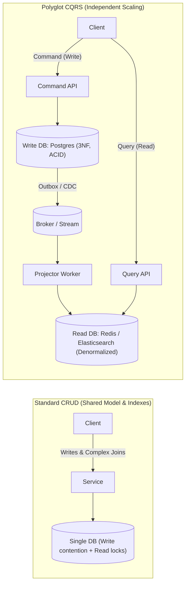
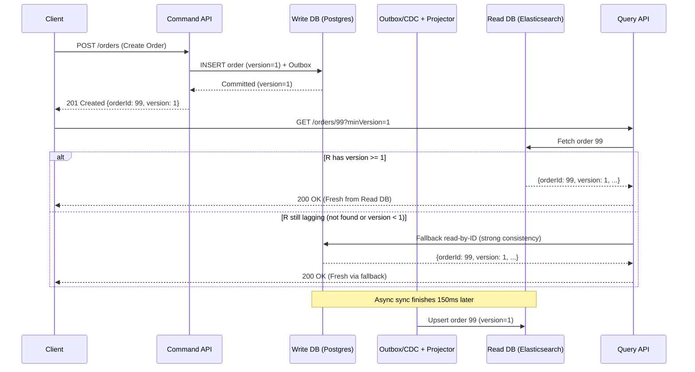
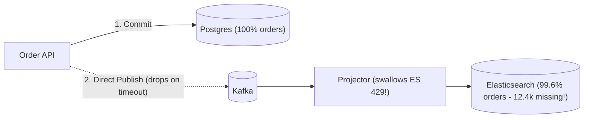

# CQRS Explained: Separate Read and Write Models (and When Not To)

> **Prerequisites:** [Lesson 13: Event Sourcing Explained](../13-event-sourcing-explained/README.md) · [Lesson 01: Why Use a Message Broker?](../01-why-use-a-message-broker-decoupling-load-levelling-the-costs/README.md).  
> **Estimated Reading Time:** 23–27 minutes  
> **Target Audience:** Backend engineers scaling read-heavy or search-heavy workloads, and candidates asked "when do you split read and write models?"  
> **Free PDF Notes:** [Download SD-I-014.pdf](https://backendroadmap.com/notes/system-design/SD-I-014.pdf)

> [!NOTE]
> **In one line:** **CQRS (Command Query Responsibility Segregation)** separates the model that **updates** state (Commands) from the model that **reads** state (Queries). This lets you optimize each side independently—normalized ACID tables for writes, denormalized caches or search indexes for reads—at the cost of **eventual consistency** and **synchronization complexity**.

> [!TIP]
> **The Golden Rule:** Start with a single CRUD model. Introduce CQRS only when read and write shapes, latencies, or scaling ratios diverge sharply (e.g., 100:1 read/write with complex joins or full-text search), and **never** assume CQRS requires Event Sourcing.

---

## 1. What CQRS Is, and What It Isn't

In a standard CRUD service, one `Order` class and one normalized PostgreSQL schema serve both writes (`POST /orders`) and reads (`GET /orders/dashboard`). Over time, writes want strict 3NF normalization and foreign keys so invariants hold, while reads want pre-joined, denormalized views, aggregations, and full-text search. Adding 12 indexes to the write table slows down `INSERT`/`UPDATE`s, and 6-way `JOIN`s lock rows or stall dashboards. **CQRS** splits the two paths cleanly.

| Term | Precise Meaning | Example |
| :--- | :--- | :--- |
| **Command Model** | Validates business invariants and mutates state; returns `ack`/ID, not full DTOs | `PlaceOrder(items) -> orderId` |
| **Query Model** | Read-only DTOs tailored to UI/API views; zero business logic | `GET /orders/summary -> OrderSummaryDTO` |
| **Same-DB CQRS** | Logical code split in one DB (writes to tables, reads from materialized views) | Postgres tables + `REFRESH MATERIALIZED VIEW` |
| **Polyglot CQRS** | Separate physical stores synced asynchronously via Outbox/CDC | Postgres (write) $\to$ Kafka $\to$ Elasticsearch (read) |
| **Read-Your-Own-Writes** | User writes data and immediately queries before the read store catches up | User edits profile, refreshes, sees old name |
| **Replication / Sync Lag** | Time between write commit and read-model visibility | $\Delta t_{\text{lag}} = t_{\text{read\_updated}} - t_{\text{write\_committed}}$ |
| **Not** | Event Sourcing, or mandatory microservices | You can do CQRS inside a single modular monolith |

### Why It Matters
1. Most high-scale systems (e-commerce catalogs, social feeds, analytics dashboards) have 10:1 to 1,000:1 read/write ratios with completely different query shapes.
2. CQRS unlocks **polyglot persistence**: ACID transactions on writes, sub-10ms key-value or full-text search on reads.
3. Interviewers probe whether you understand the **eventual consistency UX trap** (stale reads right after a write) and know when CQRS is over-engineering.

---

## 2. Anatomy: Monolithic CRUD vs Polyglot CQRS



Notice the two independent scaling axes: if Black Friday traffic is 50,000 reads/s and 500 writes/s, you scale the **Query API + Read DB** 50x while keeping the **Command API + Write DB** lean and heavily protected.

| Dimension | Shared CRUD | Same-DB CQRS | Polyglot CQRS |
| :--- | :--- | :--- | :--- |
| **Consistency** | Strong (immediate) | Strong or near-real-time | Eventual ($\Delta t_{\text{lag}}$) |
| **Write Throughput** | Degrades as read indexes grow | Moderate | High (write DB has minimal indexes) |
| **Read Latency** | Slow on multi-table `JOIN`s | Fast (pre-joined views) | Ultra-fast (pre-computed JSON / ES) |
| **Operational Cost** | Low (1 DB) | Low (1 DB, 2 code paths) | High (Write DB + Broker + Projector + Read DB) |
| **Best For** | 80% of CRUD apps | Reporting/dashboards on one DB | High-scale search, feeds, polyglot reads |

> [!WARNING]
> **CQRS is a complexity multiplier.** Adding an asynchronous read store introduces sync lag, projector failures, schema drift, and backfill pipelines. Never adopt Polyglot CQRS just because "it's best practice"—use it only when a single DB + read replicas genuinely cannot meet your read/write SLA.

---

## 3. Mathematical Model: Index Write Amplification & Sync Lag

**1. Why Separating Read Indexes Speeds Up Writes.**
In a B-tree database, every secondary index adds $O(\log N)$ page modifications and WAL bytes per `INSERT`/`UPDATE`. Let $t_{\text{base}}$ be the base row write cost, $k$ be the number of read-only secondary indexes on the write table, and $t_{\text{idx}}$ be the per-index maintenance cost:

$$T_{\text{write, CRUD}} = t_{\text{base}} + k \cdot t_{\text{idx}} \qquad T_{\text{write, CQRS}} = t_{\text{base}} + k_{\text{min}} \cdot t_{\text{idx}}$$

**Worked Numerical Example:**
Suppose a base `orders` insert takes $t_{\text{base}} = 1.2\text{ ms}$, and each B-tree index adds $t_{\text{idx}} = 0.6\text{ ms}$ (plus WAL & vacuum overhead).
- **CRUD table** with $k = 10$ indexes to support every dashboard filter:
  $$T_{\text{write, CRUD}} = 1.2 + 10 \times 0.6 = \mathbf{7.2\text{ ms}}$$
  Max single-connection throughput $\approx 139\text{ writes/s}$.
- **CQRS Write DB** with only $k_{\text{min}} = 2$ indexes (Primary Key + `customer_id`):
  $$T_{\text{write, CQRS}} = 1.2 + 2 \times 0.6 = \mathbf{2.4\text{ ms}}$$
  Max single-connection throughput $\approx 417\text{ writes/s}$ (**3x faster writes**), while all 10 search/filter dimensions live in Elasticsearch!

**2. End-to-End Read Staleness ($\Delta t_{\text{lag}}$).**
Total time from write commit to read-model visibility is the sum of CDC/Outbox polling ($t_{\text{cdc}}$), broker transit ($t_{\text{broker}}$), projector batching ($t_{\text{proj}}$), and read-store refresh ($t_{\text{refresh}}$, e.g., Elasticsearch 1s refresh interval):

$$\Delta t_{\text{lag}} = t_{\text{cdc}} + t_{\text{broker}} + t_{\text{proj}} + t_{\text{refresh}}$$

With $t_{\text{cdc}} = 20\text{ ms}$, $t_{\text{broker}} = 10\text{ ms}$, $t_{\text{proj}} = 30\text{ ms}$, and $t_{\text{refresh}} = 1{,}000\text{ ms}$:
$$\Delta t_{\text{lag}} = \mathbf{1{,}060\text{ ms}}$$
Any user who queries within 1.06 seconds of writing risks seeing **stale data** unless mitigated.

---

## 4. Metrics & Percentiles

| Metric | Meaning | Alert when |
| :--- | :--- | :--- |
| **Projection Sync Lag $p_{99}$** | `now() - event.committed_at` at the Read DB | $> \text{SLO}$ (e.g., $> 2\text{ s}$ for user-facing views) |
| **Command Latency $p_{99}$** | Time for write DB commit (excluding async projection) | $> 100\text{ ms}$ |
| **Query Latency $p_{99}$** | Time for Read API to serve denormalized DTO | $> 30\text{ ms}$ |
| **Stale-Read Retry Rate** | Client/API retries waiting for `read_version >= min_version` | $> 1\%$ of post-write reads |
| **Projector Error / DLQ Rate** | Events failing transformation into the Read DB | $> 0$ (causes silent missing records in UI) |
| **Read/Write Drift Count** | Reconciliation diff between Write DB and Read DB | $> 0$ after lag window settles |

### Worked Example (`OrderDashboard` Read-Your-Own-Writes)
A seller updates an item price from `$50` to `$45` via `PATCH /items/88` (Command API) and the frontend immediately redirects to `GET /items/88` (Query API backed by Elasticsearch with a 1,000 ms refresh interval).
- At $t = 50\text{ ms}$, `GET /items/88` still returns `$50`! The seller panics and clicks "Save" again.
- **Fix:** `PATCH /items/88` returns `{ "itemId": "88", "version": 12 }`. The frontend either:
  1. Applies **optimistic UI** locally, or
  2. Sends `GET /items/88?minVersion=12`; if the Query API sees `readModel.version < 12`, it either polls briefly (50–150 ms) or falls back to the Write DB for that single ID.

---

## 5. Compounding & Failure Modes

| Failure Mode | Mechanism | Impact |
| :--- | :--- | :--- |
| **Read-Your-Own-Writes Violation** | User queries Read DB before $\Delta t_{\text{lag}}$ completes | User sees old state, assumes write failed, retries |
| **Silent Projector Drop** | Projector catches exception and acks message | Write DB has the order; Read DB never shows it (permanent drift) |
| **Out-of-Order Projection** | Two updates for entity `X` arrive in reverse order | Read DB overwrites `v=5` with `v=4` |
| **Dual-Write Divergence** | Command API writes to Postgres, then directly calls Elasticsearch | ES call fails after Postgres commit; two DBs permanently out of sync |
| **Thundering Herd on Rebuild** | Rebuilding Read DB from scratch without rate limiting | Saturates Write DB or Read DB during peak hours |

---

## 6. Numbers Every Engineer Must Know

| Item | Typical | Implication |
| :--- | :---: | :--- |
| Read-to-Write ratio in CQRS candidates | 10:1 to 1,000:1 | Scaling reads separately saves huge DB compute |
| Postgres-to-Read-DB lag (Debezium + Kafka) | 50–300 ms | Fast enough for dashboards; noticeable on immediate redirects |
| Elasticsearch `refresh_interval` | 1,000 ms (default) | Dominates $\Delta t_{\text{lag}}$ unless using `?refresh=wait_for` |
| Read DB query $p_{99}$ (denormalized) | 2–15 ms | Zero `JOIN`s; single key or index lookup |
| Index write amplification reduction | 2x–5x faster writes | Removing 8–10 secondary indexes from Write DB |
| Version-token fallback rate | $< 0.5\%$ of reads | Only triggered immediately after a user's own write |

---

## 7. Protocol Deep Dive: Solving Read-Your-Own-Writes with Version Tokens



| Question | Answer |
| :--- | :--- |
| **Does CQRS require separate databases?** | No. You can start with **Same-DB CQRS** (separate Command/Query services in code, reading from SQL Views) and split physical DBs only when needed. |
| **Does CQRS require Event Sourcing?** | No. Most production CQRS systems use a normal CRUD Write DB (Postgres) + Outbox/CDC (Debezium) to sync a Read DB (Redis/Elasticsearch). |
| **How do you prevent Read-Your-Own-Writes bugs?** | Return a `version` (or LSN/ETag) from the Command; pass `minVersion` on the immediate Query; fall back to Write DB or short-poll if `read.version < minVersion`. |
| **How do you detect Write/Read DB drift?** | Run a periodic **reconciliation job** comparing counts/checksums of recent `updated_at` windows between Write DB and Read DB. |

**When NOT to use CQRS:** Do not use Polyglot CQRS for simple CRUD apps, admin panels with low traffic, domains where every read strictly requires linearizable consistency across all users, or small teams without the operational bandwidth to monitor lag and run projectors.

---

## 8. Hierarchical Budgets & Design Rules

| Slice | Rule | Control |
| :--- | :--- | :--- |
| **Simplicity Gate** | Prove CRUD + Read Replicas is insufficient before splitting DBs | Architecture review checklist |
| **Sync Mechanism** | Never dual-write; always sync Write $\to$ Read via Outbox or CDC | Lesson 15 (Transactional Outbox) |
| **Read Consistency** | Commands return `{id, version}`; immediate reads pass `minVersion` | API contract standard |
| **Idempotent Projector** | Projectors must check `incoming.version > stored.version` | Conditional upsert in Read DB |
| **Zero Joins on Read** | Read models are pre-joined, flat, query-optimized documents | 1 query = 1 UI screen |
| **Lag Budget** | Define max acceptable $\Delta t_{\text{lag}}$ per view (e.g., 500 ms vs 5 min) | SLO alert on projector lag |
| **Reconciliation** | Daily/hourly diff check between Write DB and Read DB | Automated repair job |

---

## 9. Top Mitigations

1. **Start with Logical CQRS (same database)**—separate Command and Query handlers in code before introducing a second database.
2. **Use Transactional Outbox or CDC (Debezium)** to sync the Read DB; never dual-write from application code.
3. **Return a monotonic `version` token from every Command** so clients/APIs can enforce Read-Your-Own-Writes when needed.
4. **Make every Projector idempotent and version-guarded** (`WHERE version < incoming_version`) to survive retries and reordering.
5. **Keep the Write DB index-light** (Primary Key + uniqueness constraints only) to maximize write throughput.
6. **Build a zero-downtime Read DB rebuild pipeline** (blue/green index or shadow table) for schema evolution.
7. **Run continuous reconciliation** on a sample of recent records to catch silent projector bugs early.

---

## 10. Production Reference: The Search Index Drift & Missing Orders

An e-commerce marketplace used **Polyglot CQRS**: orders were written to PostgreSQL, and the `OrderService` published `OrderCreated` directly to Kafka (no outbox), which a projector indexed into Elasticsearch for the Seller Portal.

Two issues compounded over 6 months:
1. During occasional Kafka timeouts, Postgres committed the order, but the Kafka publish failed (dual-write loss).
2. During Elasticsearch `429 Too Many Requests` spikes, the projector caught the exception, logged a warning, and committed the Kafka offset anyway to "avoid blocking the consumer."

Sellers complained that paid orders were missing from their Seller Portal, even though customers had receipts. A reconciliation script revealed **0.4% of orders (12,400 orders)** existed in Postgres but were completely absent from Elasticsearch.



**Root Cause:** Dual-write without an Outbox + non-blocking error swallowing in the projector.
**Fix:**
1. Replaced direct Kafka publish with **Debezium CDC** reading the Postgres WAL / Outbox table.
2. Configured the projector to **never commit offsets on ES 429/5xx**, routing poison messages to a DLQ after bounded retries.
3. Added a nightly **reconciliation job** comparing Postgres vs Elasticsearch order counts per hour.

---

## 11. Multi-Language Production Code Tabs

A clean **CQRS Command/Query split with Version-Token Read-Your-Own-Writes fallback** in all 4 languages.

````carousel
```go
// Go: CQRS CommandHandler + QueryHandler with Read-Your-Own-Writes version fallback.
package main

import (
	"errors"
	"fmt"
	"sync"
)

type OrderRecord struct {
	ID      string
	Version int64
	Status  string
	Total   int64
}

type CQRSStore struct {
	mu      sync.RWMutex
	writeDB map[string]OrderRecord
	readDB  map[string]OrderRecord // simulates lagging denormalized read store
}

func NewCQRSStore() *CQRSStore {
	return &CQRSStore{
		writeDB: make(map[string]OrderRecord),
		readDB:  make(map[string]OrderRecord),
	}
}

// Command: mutates Write DB and returns (id, version) for read-your-own-writes.
func (s *CQRSStore) PlaceOrder(id string, total int64) (int64, error) {
	if total <= 0 {
		return 0, errors.New("total must be positive")
	}
	s.mu.Lock()
	defer s.mu.Unlock()
	nextVer := s.writeDB[id].Version + 1
	s.writeDB[id] = OrderRecord{ID: id, Version: nextVer, Status: "PLACED", Total: total}
	return nextVer, nil
}

// Projector: asynchronously syncs Write -> Read DB with version guard.
func (s *CQRSStore) Project(rec OrderRecord) {
	s.mu.Lock()
	defer s.mu.Unlock()
	if cur, ok := s.readDB[rec.ID]; ok && rec.Version <= cur.Version {
		return
	}
	s.readDB[rec.ID] = rec
}

// Query: serves from Read DB unless minVersion is newer (Read-Your-Own-Writes fallback).
func (s *CQRSStore) GetOrder(id string, minVersion int64) (OrderRecord, string, error) {
	s.mu.RLock()
	defer s.mu.RUnlock()
	if r, ok := s.readDB[id]; ok && r.Version >= minVersion {
		return r, "READ_DB", nil
	}
	if w, ok := s.writeDB[id]; ok {
		return w, "WRITE_DB_FALLBACK", nil
	}
	return OrderRecord{}, "", errors.New("not found")
}

func main() {
	store := NewCQRSStore()
	ver, _ := store.PlaceOrder("ord-7", 4500)
	rec, src, _ := store.GetOrder("ord-7", ver) // readDB hasn't synced yet
	fmt.Printf("Got %+v from %s\n", rec, src)
}
```
<!-- slide -->
```typescript
// TypeScript: CQRS CommandBus / QueryBus with minVersion consistency token.
export interface OrderDTO {
  orderId: string;
  version: number;
  status: string;
  totalCents: number;
}

export class CqrsOrderService {
  private writeDb = new Map<string, OrderDTO>();
  private readDb = new Map<string, OrderDTO>();

  // Command side: validates & writes to normalized store, returns version token
  async executePlaceOrder(orderId: string, totalCents: number): Promise<{ orderId: string; version: number }> {
    if (totalCents <= 0) throw new Error("Invalid total");
    const prev = this.writeDb.get(orderId);
    const version = (prev?.version ?? 0) + 1;
    this.writeDb.set(orderId, { orderId, version, status: "PLACED", totalCents });
    return { orderId, version };
  }

  // Async projector: idempotent version-checked upsert
  projectToReadDb(event: OrderDTO): void {
    const existing = this.readDb.get(event.orderId);
    if (existing && event.version <= existing.version) return;
    this.readDb.set(event.orderId, event);
  }

  // Query side: fast Read DB by default; Write DB fallback if minVersion not yet projected
  async queryOrder(orderId: string, minVersion = 0): Promise<{ data: OrderDTO; source: "READ_DB" | "WRITE_FALLBACK" }> {
    const readHit = this.readDb.get(orderId);
    if (readHit && readHit.version >= minVersion) {
      return { data: readHit, source: "READ_DB" };
    }
    const writeHit = this.writeDb.get(orderId);
    if (!writeHit) throw new Error("Order not found");
    return { data: writeHit, source: "WRITE_FALLBACK" };
  }
}
```
<!-- slide -->
```python
# Python: CQRS Write/Read split with version-token fallback and lag simulator.
from dataclasses import dataclass

@dataclass(frozen=True)
class Order:
    order_id: str
    version: int
    status: str
    total_cents: int

class CqrsService:
    def __init__(self) -> None:
        self._write_db: dict[str, Order] = {}
        self._read_db: dict[str, Order] = {}

    def handle_place_order(self, order_id: str, total_cents: int) -> int:
        if total_cents <= 0:
            raise ValueError("total_cents must be > 0")
        ver = self._write_db[order_id].version + 1 if order_id in self._write_db else 1
        self._write_db[order_id] = Order(order_id, ver, "PLACED", total_cents)
        return ver

    def project(self, order: Order) -> bool:
        cur = self._read_db.get(order.order_id)
        if cur is not None and order.version <= cur.version:
            return False
        self._read_db[order.order_id] = order
        return True

    def query_order(self, order_id: str, min_version: int = 0) -> tuple[Order, str]:
        r = self._read_db.get(order_id)
        if r is not None and r.version >= min_version:
            return r, "READ_DB"
        if order_id in self._write_db:
            return self._write_db[order_id], "WRITE_DB_FALLBACK"
        raise KeyError(order_id)

if __name__ == "__main__":
    svc = CqrsService()
    v = svc.handle_place_order("ord-1", 9900)
    print(svc.query_order("ord-1", min_version=v))
```
<!-- slide -->
```csharp
// C#: CQRS Command/Query separation with Read-Your-Own-Writes fallback.
using System.Collections.Concurrent;

public sealed record OrderView(string OrderId, long Version, string Status, long TotalCents);

public sealed class OrderCqrsHandler
{
    private readonly ConcurrentDictionary<string, OrderView> _writeDb = new();
    private readonly ConcurrentDictionary<string, OrderView> _readDb = new();

    public long PlaceOrder(string orderId, long totalCents)
    {
        if (totalCents <= 0) throw new ArgumentOutOfRangeException(nameof(totalCents));
        var updated = _writeDb.AddOrUpdate(
            orderId,
            _ => new OrderView(orderId, 1, "PLACED", totalCents),
            (_, cur) => cur with { Version = cur.Version + 1, TotalCents = totalCents });
        return updated.Version;
    }

    public void Project(OrderView view)
    {
        _readDb.AddOrUpdate(
            view.OrderId,
            view,
            (_, cur) => view.Version > cur.Version ? view : cur);
    }

    public (OrderView View, string Source) GetOrder(string orderId, long minVersion = 0)
    {
        if (_readDb.TryGetValue(orderId, out var readView) && readView.Version >= minVersion)
            return (readView, "READ_DB");

        if (_writeDb.TryGetValue(orderId, out var writeView))
            return (writeView, "WRITE_DB_FALLBACK");

        throw new KeyNotFoundException(orderId);
    }
}
```
````

---

## 12. Hands-On CLI Verification Workflows

Verify write-amplification savings from removing secondary indexes on the Write DB:

```bash
python -c "
t_base, t_idx = 1.2, 0.6
for name, k in [('CRUD (10 indexes)', 10), ('CQRS Write DB (2 indexes)', 2)]:
    t = t_base + k * t_idx
    print(f'{name}: write_latency={t:.1f} ms, single_conn_tps={1000/t:.0f}/s')
"
```

Check PostgreSQL-to-Elasticsearch sync lag and reconciliation in production:

```bash
# Check Kafka Connect (Debezium) projector lag
kafka-consumer-groups.sh --bootstrap-server localhost:9092 \
  --describe --group order-es-projector

# Compare total order count in Postgres vs Elasticsearch for the last hour
psql -d orders -t -c "SELECT COUNT(*) FROM orders WHERE updated_at > NOW() - INTERVAL '1 hour';"
curl -s "http://localhost:9200/orders/_count" -H "Content-Type: application/json" \
  -d '{"query":{"range":{"updated_at":{"gte":"now-1h"}}}}'
```

---

## 13. Common Mistakes to Avoid

1. **Adopting Polyglot CQRS for simple CRUD** where a single Postgres DB + read replica would suffice.
2. **Assuming CQRS requires Event Sourcing** (most CQRS systems use normal mutable tables + CDC/Outbox).
3. **Ignoring Read-Your-Own-Writes**, causing users to see stale data right after clicking "Save."
4. **Dual-writing** from the Command API to both Write DB and Read DB without an Outbox or CDC.
5. **Swallowing projector errors and committing offsets**, leading to silent permanent drift.
6. **Putting business validation logic in the Query API** instead of keeping queries pure projections.
7. **Forgetting to test Read DB rebuilds** from scratch when adding new fields to a read model.

---

## 14. Key Terms Glossary

| Key Term | Definition |
| :--- | :--- |
| **CQRS** | Command Query Responsibility Segregation; separating write models from read models. |
| **Command Model** | The write-side domain model responsible for validating invariants and persisting changes. |
| **Query Model** | The read-side denormalized DTOs/tables optimized strictly for fast queries. |
| **Same-DB CQRS** | Splitting read/write code paths while sharing one physical database (e.g., tables + views). |
| **Polyglot CQRS** | Using different database engines for writes (Postgres) and reads (Elasticsearch/Redis). |
| **Read-Your-Own-Writes** | Guaranteeing a user immediately sees the effect of their own write despite async sync. |
| **Version Token** | A monotonic version returned by a Command and passed as `minVersion` to a Query. |
| **Projector** | A consumer/worker that transforms write-side events into read-model updates. |
| **Write Amplification** | Extra disk/WAL I/O per write caused by maintaining many secondary read indexes. |
| **Reconciliation** | Periodic verification comparing Write DB and Read DB to detect and repair drift. |

---

## 15. System Design Interview Questions & Answers

### Basic Conceptual Questions

<details>
<summary><strong>Q1: What is CQRS and what problem does it solve? [BASIC]</strong></summary>

**Answer:**
CQRS separates the **Command** (write) model from the **Query** (read) model. It solves the conflict where writes need normalized, ACID-enforced schemas with few indexes, while reads need denormalized, pre-joined, search-indexed views scaled independently.
</details>

<details>
<summary><strong>Q2: Does CQRS require Event Sourcing? [BASIC]</strong></summary>

**Answer:**
No. Event Sourcing *requires* CQRS (because you can't run ad-hoc queries on an event log), but CQRS does *not* require Event Sourcing. You can use a normal relational Write DB and sync changes to a Read DB via CDC or Transactional Outbox.
</details>

<details>
<summary><strong>Q3: Can you use CQRS without two separate databases? [BASIC]</strong></summary>

**Answer:**
Yes. **Logical / Same-DB CQRS** keeps separate Command and Query classes in code against one database (e.g., writes go to normalized tables; reads query SQL views or a read replica). You only split physical engines when query shapes or scale demand it.
</details>

<details>
<summary><strong>Q4: What is the main cost of Polyglot CQRS? [BASIC]</strong></summary>

**Answer:**
**Eventual consistency** between the Write DB and Read DB ($\Delta t_{\text{lag}}$), plus the operational overhead of running a sync pipeline (Outbox/CDC, broker, projector, reconciliation).
</details>

### Scenario-Based Architecture Questions

<details>
<summary><strong>Q5: A user updates their shipping address and immediately refreshes the page, seeing the old address. How do you fix this? [SCENARIO]</strong></summary>

**Answer:**
Return a `version` token from the `UpdateAddress` command. Have the UI pass `?minVersion=V` to the Query API (or use Optimistic UI). If the Read DB's stored version is `< V`, the Query API falls back to reading that single record from the Write DB.
</details>

<details>
<summary><strong>Q6: Your `orders` table has 12 indexes for admin search filters and `INSERT` latency is spiking. What do you do? [SCENARIO]</strong></summary>

**Answer:**
Apply **Polyglot CQRS**: strip the `orders` write table down to 1–2 essential indexes (PK + foreign key), stream changes via Debezium/Outbox to Elasticsearch, and route all admin search/filter queries to Elasticsearch.
</details>

<details>
<summary><strong>Q7: How do you add a new field (`customer_tier`) to your Elasticsearch Read Model for 50M existing orders? [SCENARIO]</strong></summary>

**Answer:**
Create a new Elasticsearch index (`orders_v2`), run a background backfill/projector job reading from the Write DB (or Event Store) while also tailing live events, verify counts match, and atomically flip the Elasticsearch alias `orders_read` from `v1` to `v2`.
</details>

<details>
<summary><strong>Q8: When would you push back against a teammate proposing CQRS for a new microservice? [SCENARIO]</strong></summary>

**Answer:**
When the service has a low or balanced read/write ratio, simple queries satisfied by 1–2 indexes, or strict immediate consistency requirements on every read. A standard CRUD service with a read replica is vastly simpler to build and operate.
</details>

### Advanced & Tricky Interview Questions

<details>
<summary><strong>Q9: How do you guarantee the Write DB and Read DB never permanently drift out of sync? [TRICKY]</strong></summary>

**Answer:**
First, eliminate dual writes by using the **Transactional Outbox** or **CDC (WAL tailing)**. Second, make projectors idempotent and version-guarded (`incoming.version > stored.version`) and never swallow errors before committing offsets. Third, run an automated **reconciliation job** to detect and repair any drift.
</details>

<details>
<summary><strong>Q10: In CQRS, should a Command return the updated resource DTO? [TRICKY]</strong></summary>

**Answer:**
Strictly, Commands should return only an acknowledgment, `entityId`, and `version` token—not a full read DTO—to preserve separation. Pragmatically, returning `{id, version}` lets the client either fetch from Query API with `minVersion` or update local state cleanly.
</details>

<details>
<summary><strong>Q11: What happens if two different Read Models subscribe to the same Write DB and one falls 10 minutes behind? [TRICKY]</strong></summary>

**Answer:**
Because each Read Model has its own independent consumer group / projector checkpoint, a slow analytics projector does **not** block or slow down the fast user-facing Redis/ES projector. You isolate blast radius and alert on per-projector lag.
</details>

<details>
<summary><strong>Q12: How does Elasticsearch's `refresh_interval` interact with CQRS read-your-own-writes? [TRICKY]</strong></summary>

**Answer:**
By default, Elasticsearch buffers writes for 1,000 ms before making them searchable. Even if Kafka and your projector take only 30 ms, `GET` queries will miss the new document for up to 1 second unless you use `?refresh=wait_for` on critical writes or fall back to the Write DB via `minVersion`.
</details>

---

## 16. One-Page Master Cheat Sheet

```
+---------------------------------------------------------------------------------------------------------+
|                    CQRS EXPLAINED — MASTER CHEAT SHEET                                                  |
+---------------------------------------------------------------------------------------------------------+
| 1. DEFINITION:                                                                                          |
|    Separate Command (Write) model from Query (Read) model. Does NOT require Event Sourcing!             |
+---------------------------------------------------------------------------------------------------------+
| 2. SPECTRUM:                                                                                            |
|    CRUD (1 model) -> Logical CQRS (same DB, views) -> Polyglot CQRS (Postgres Write + ES/Redis Read).   |
+---------------------------------------------------------------------------------------------------------+
| 3. PERFORMANCE WIN:                                                                                     |
|    Write DB drops secondary indexes (10 -> 2): 3x faster writes.                                        |
|    Read DB stores pre-joined flat DTOs: 0 JOINs, 2-15 ms p99 reads.                                     |
+---------------------------------------------------------------------------------------------------------+
| 4. THE #1 TRAP (READ-YOUR-OWN-WRITES):                                                                  |
|    Lag = t_cdc + t_broker + t_proj + t_refresh (~100-1,000 ms).                                         |
|    Fix: Command returns {id, version}; Query passes ?minVersion=V -> fallback to Write DB if lagging.   |
+---------------------------------------------------------------------------------------------------------+
| 5. WHEN NOT TO USE:                                                                                     |
|    Simple CRUD, low traffic, or strict global linearizability. Don't add a second DB without a reason.   |
+---------------------------------------------------------------------------------------------------------+
```

---

## Further Reading & Sources

- Martin Fowler, [CQRS (Command Query Responsibility Segregation)](https://martinfowler.com/bliki/CQRS.html).
- Microsoft Azure Architecture Center, [CQRS Pattern](https://learn.microsoft.com/en-us/azure/architecture/patterns/cqrs).
- Udi Dahan, *Clarified CQRS* (logical separation before physical separation).
- Martin Kleppmann, *Designing Data-Intensive Applications*, Chapter 11 ("Derived Data").

---

## Free PDF Notes

[SD-I-014.pdf](https://backendroadmap.com/notes/system-design/SD-I-014.pdf)

---

## Next

Continue with [Lesson 15: Transactional Outbox Pattern: Fixing the Dual-Write Problem](../15-transactional-outbox-pattern/README.md): atomic database writes and event publishing.
