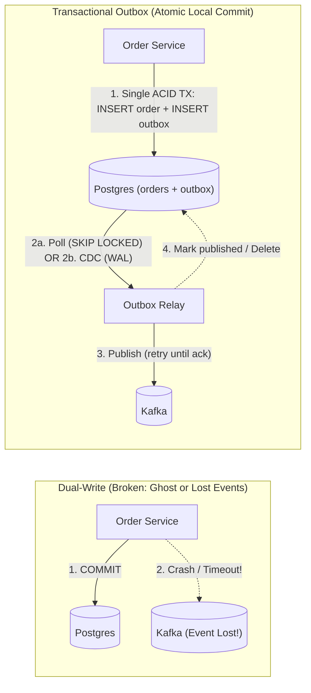
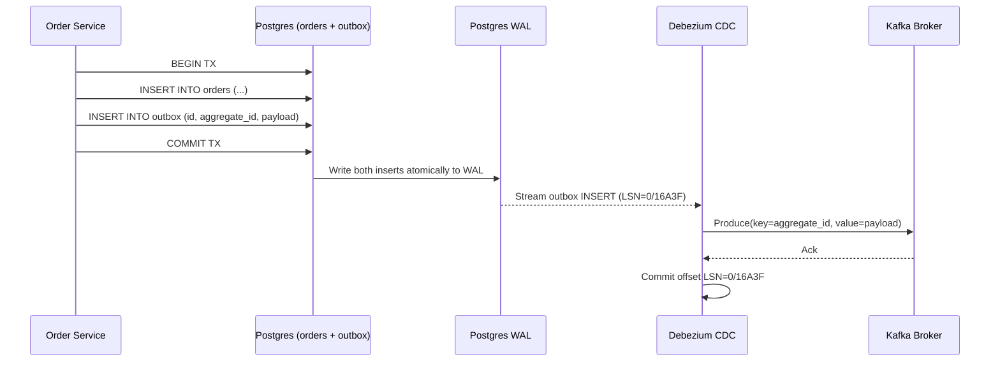
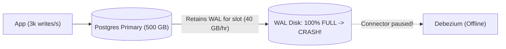

# Transactional Outbox Pattern: Fixing the Dual-Write Problem

> **Prerequisites:** [Lesson 14: CQRS Explained](../14-cqrs-explained/README.md) · [Lesson 06: Delivery Semantics](../08-delivery-semantics/README.md).  
> **Estimated Reading Time:** 24–28 minutes  
> **Target Audience:** Backend engineers building reliable microservices, and candidates asked "how do you update the database and publish an event atomically?"  
> **Free PDF Notes:** [Download SD-I-015.pdf](https://backendroadmap.com/notes/system-design/SD-I-015.pdf)

> [!NOTE]
> **In one line:** You cannot atomically commit to a database and publish to a message broker in two separate network calls (**the dual-write problem**). The **Transactional Outbox Pattern** fixes this by writing the business row and an `outbox` event row inside the **same local ACID transaction**, then having an asynchronous relay (Polling or CDC) publish the event to the broker with **at-least-once** guarantees.

> [!TIP]
> **The Golden Rule:** Never call `broker.publish()` inside or right after a database transaction without an Outbox. Use **Polling** (`FOR UPDATE SKIP LOCKED`) for simplicity at moderate scale, and **CDC Log Tailing** (Debezium) for low latency and zero polling load at high scale.

---

## 1. What the Transactional Outbox Is, and What It Isn't

Consider checkout: your service saves the order in PostgreSQL and publishes `OrderPlaced` to Kafka.
- **Order A (DB commit, then publish):** Postgres commits, then the pod crashes (OOMKill) or Kafka times out. The order exists, but inventory and email never hear about it (**lost event / zombie state**).
- **Order B (Publish, then DB commit):** Kafka receives `OrderPlaced`, then Postgres rolls back due to a constraint violation. Email sends a receipt for an order that doesn't exist (**ghost event**).
- **Order C (Publish *inside* an open DB transaction):** While waiting 200 ms for Kafka over the network, your DB transaction holds row locks and exhausts the connection pool—and if the DB commit still fails afterward, you still have a ghost event!

The **Transactional Outbox** eliminates all three failure modes by reducing two distributed writes into **one local ACID commit**.

| Term | Precise Meaning | Example |
| :--- | :--- | :--- |
| **Dual-Write Problem** | Updating two independent systems (DB + Broker) without a shared atomic commit | `db.commit()` followed by `kafka.send()` |
| **Outbox Table** | A table in the *same* database storing pending events to be published | `outbox(id, aggregate_id, payload, created_at)` |
| **Polling Publisher** | A background worker querying unpublished rows and pushing them to the broker | `SELECT ... FOR UPDATE SKIP LOCKED` every 100 ms |
| **Transaction Log Tailing (CDC)** | A connector reading the DB's WAL/binlog and streaming `outbox` inserts to Kafka | Debezium Postgres Connector |
| **2PC / XA** | Distributed two-phase commit protocol across DB and Broker | Slow, fragile, unsupported by Kafka/SQS |
| **Not** | Exactly-once delivery by itself | Outbox guarantees **at-least-once**; consumers need the Inbox pattern (Lesson 16) |

### Why It Matters
1. Dual writes are the #1 cause of silent data inconsistency in event-driven microservices.
2. Distributed 2PC/XA does not work with modern brokers (Kafka, SQS, RabbitMQ) and destroys tail latency.
3. Interviewers expect you to draw the Outbox table + Relay (Polling vs CDC) and immediately mention **at-least-once duplicates** and **table cleanup**.

---

## 2. Anatomy: Dual-Write Failure vs Transactional Outbox



Because `orders` and `outbox` live in the **exact same database**, they share the same ACID transaction log. Either *both* rows commit, or *neither* does. Once committed, the relay retries publishing until the broker acknowledges—so an event can never be lost.

| Relay Strategy | How It Works | Latency | DB Load | Best For |
| :--- | :--- | :---: | :---: | :--- |
| **Polling Publisher** | Worker runs `SELECT ... LIMIT 100` on interval $\Delta t$ | 50–500 ms | Medium (index scans + updates) | Simple stacks, $< 2{,}000\text{ events/s}$ |
| **CDC (WAL Tailing)** | Debezium streams `INSERT`s from Postgres WAL / MySQL binlog | 10–50 ms | Near zero (reads sequential WAL) | High throughput, strict latency, multi-service |

> [!WARNING]
> **The Outbox Relay can publish the same event twice.** If the relay publishes `OrderPlaced` to Kafka and crashes *before* marking the outbox row as published (or before committing its CDC offset), it will republish `OrderPlaced` on restart. Outbox provides **at-least-once** publishing—never exactly-once without idempotent consumers (Lesson 16).

---

## 3. Mathematical Model: Dual-Write Loss Rate, Polling Load & Table Bloat

**1. Why "Rare" Dual-Write Failures Compound at Scale.**
Suppose the probability of a crash or broker timeout *between* `db.commit()` and `broker.publish()` is only $p = 0.0005$ ($0.05\%$). At $\lambda = 1{,}000\text{ orders/s}$:

$$\text{Lost Events/day} = \lambda \cdot 86{,}400 \cdot p = 1{,}000 \times 86{,}400 \times 0.0005 = \mathbf{43{,}200\text{ lost events/day}}$$

Over a month, that is **1.3 million silently corrupted orders** requiring manual data-repair scripts.

**2. Polling Publisher Latency vs Database QPS.**
With polling interval $T_{\text{poll}}$ across $W$ relay workers:
- **Average publish delay:** $\bar{L}_{\text{poll}} = \frac{T_{\text{poll}}}{2} + t_{\text{batch}}$
- **Idle DB QPS:** $\text{QPS}_{\text{idle}} = \frac{W}{T_{\text{poll}}}$

**Worked Numerical Example:**
Suppose you run $W = 4$ relay pods polling every $T_{\text{poll}} = 50\text{ ms}$ ($0.05\text{ s}$) to keep average delay around 25 ms:
- Idle DB load: $\frac{4}{0.05} = \mathbf{80\text{ queries/s}}$ even at 3:00 AM with zero traffic!
- With $T_{\text{poll}} = 500\text{ ms}$ and adaptive backoff (sleep 500 ms when empty, 0 ms when batch was full): idle load drops to **8 queries/s**, while active throughput stays continuous.

**3. Outbox Table Bloat (If You Soft-Delete Without Cleanup).**
At $\lambda = 2{,}000\text{ events/s}$ with $1\text{ KB}$ per outbox row:
- Daily growth = $2{,}000 \times 86{,}400 \times 1\text{ KB} = \mathbf{172.8\text{ GB/day}}$!
- In PostgreSQL, updating `published = true` creates dead tuples; without aggressive `AUTOVACUUM` or `DELETE` + daily partition `DROP`, sequential scans degrade exponentially.
- **CDC advantage:** With Debezium CDC, you can `DELETE` the outbox row immediately (or never even store `published = true`—just `INSERT` into `outbox` and let a daily cron `TRUNCATE` old partitions), keeping the active table near **0 rows**.

---

## 4. Metrics & Percentiles

| Metric | Meaning | Alert when |
| :--- | :--- | :--- |
| **Outbox Lag (Oldest Unpublished Age)** | `now() - MIN(created_at)` of pending rows | $> 5\text{ s}$ (relay stalled or broker unreachable) |
| **Pending Outbox Queue Depth** | `COUNT(*)` of unpublished rows | Sustained growth $> 10{,}000$ rows |
| **Relay Publish Error Rate** | Failed broker `ack`s per second | $> 1\%$ for $> 1\text{ min}$ |
| **Outbox Table / Dead Tuple Size** | Physical disk size of `outbox` table + indexes | $> 5\text{ GB}$ (indicates missing cleanup/vacuum) |
| **CDC Replication Slot Lag** | Bytes retained in Postgres WAL for Debezium slot | $> 10\text{ GB}$ (risks filling DB disk!) |
| **Duplicate Publish Rate** | Retried outbox rows | Sudden spike (relay crashing mid-batch) |

### Worked Example (`PaymentCaptured` Outbox)
A payments service processes 800 payments/sec. Each `PaymentCaptured` event is inserted into `outbox` inside the same Postgres transaction as `payments`.
- **Failure simulation:** Kafka experiences a 3-minute network partition.
- **What happens:** Postgres commits continue normally at 800/s. The `outbox` table buffers $800 \times 180 = 144{,}000$ rows ($\approx 144\text{ MB}$). When Kafka recovers, the relay drains 144,000 rows in batches of 500 at 5,000 events/s, catching up completely in **34 seconds** with **0 lost events**.

---

## 5. Compounding & Failure Modes

| Failure Mode | Mechanism | Impact |
| :--- | :--- | :--- |
| **Stale Debezium Replication Slot** | Debezium crashes and nobody monitors `pg_replication_slots` | Postgres cannot recycle WAL files; **primary DB disk hits 100% and crashes** |
| **Missing `SKIP LOCKED` in Multi-Worker Polling** | 4 relay pods select the same 100 rows | 4x duplicate publishes + row-lock contention |
| **Out-of-Order Publish via Concurrent Pollers** | Worker A grabs `e1` (slow), Worker B grabs `e2` (fast) | `e2` arrives at Kafka before `e1` for the same aggregate |
| **Unindexed `WHERE published = false`** | Full table scan on 50M-row outbox table every 100 ms | Primary DB CPU hits 100% |
| **Poison Pill in Outbox** | 1 malformed 2 MB row fails Kafka `RecordTooLargeException` | Blocks head-of-line for the entire relay batch forever |

---

## 6. Numbers Every Engineer Must Know

| Item | Typical | Implication |
| :--- | :---: | :--- |
| Local ACID commit overhead for +1 outbox `INSERT` | $< 0.5\text{ ms}$ | Negligible latency impact vs 10–50 ms network call |
| Polling relay latency | 50–500 ms | Tuned by `T_poll` and adaptive sleep |
| CDC (Debezium) relay latency | 10–50 ms | Near real-time without DB polling queries |
| Batch size per relay poll | 100–500 rows | Amortizes network round-trips to DB and Kafka |
| Partial index size (`WHERE published_at IS NULL`) | Kilobytes | Keeps polling index tiny even if table has millions of rows |
| CDC WAL retention alert threshold | 5–10 GB | Never let an inactive replication slot fill primary disk |

---

## 7. Protocol Deep Dive: Polling (`SKIP LOCKED`) vs CDC (WAL Tailing)



| Question | Answer |
| :--- | :--- |
| **How do multiple Polling workers avoid grabbing the same outbox rows?** | Use PostgreSQL `SELECT * FROM outbox WHERE published_at IS NULL ORDER BY id LIMIT 100 FOR UPDATE SKIP LOCKED`. Locked rows are skipped by other workers. |
| **How do you preserve per-entity ordering in the Outbox?** | Set the Kafka partition key to `aggregate_id` (e.g., `order_id`), and either use single-threaded WAL tailing (CDC) or partition outbox polling by `hash(aggregate_id) % num_workers`. |
| **How do you prevent outbox table bloat?** | Either `DELETE` rows once published, use a **partial index** (`WHERE published_at IS NULL`), or **partition by day** and `DROP TABLE outbox_2026_11_01`. |
| **What if a poison message in the outbox fails broker validation?** | Move it to an `outbox_dead_letters` state (`status = 'FAILED'`, increment `retry_count`) after $N$ attempts so it never blocks subsequent rows. |

**When NOT to use the Transactional Outbox:** When you are already using a true **Event Store** (Lesson 13)—the Event Store *is* your outbox, because events are the primary write and projections subscribe directly to the Event Store's global stream. Also unnecessary for ephemeral telemetry/logs where losing 0.01% of events is acceptable.

---

## 8. Hierarchical Budgets & Design Rules

| Slice | Rule | Control |
| :--- | :--- | :--- |
| **Atomicity** | Business write + Outbox insert MUST share one local DB transaction | Code review + ban direct `broker.send()` in request path |
| **Partition Key** | Every outbox row MUST store `aggregate_id` as the broker routing key | `NOT NULL` column in `outbox` schema |
| **Polling Concurrency** | Multi-pod pollers MUST use `FOR UPDATE SKIP LOCKED` | SQL query lint / integration test |
| **Index Hygiene** | Use a partial index `CREATE INDEX ... WHERE published_at IS NULL` | Schema migration check |
| **Retention & Cleanup** | Partition `outbox` daily and drop old partitions (or delete on publish) | Automated retention cron |
| **CDC Safety** | Monitor `pg_replication_slots` lag & max WAL size (`max_slot_wal_keep_size`) | Postgres config + PagerDuty alert |
| **Consumer Contract** | Consumers MUST deduplicate (at-least-once delivery) | Inbox Pattern (Lesson 16) |

---

## 9. Top Mitigations

1. **Always write to `outbox` inside the same ACID transaction** as the domain entity—never commit first and insert to outbox second.
2. **Use `FOR UPDATE SKIP LOCKED`** if polling with multiple workers, and use **adaptive backoff** (poll immediately when full batch returned, sleep when empty).
3. **Prefer CDC (Debezium)** when throughput exceeds ~1,000 events/s or latency must be $< 50\text{ ms}$, and **always set `max_slot_wal_keep_size`** in Postgres to protect disk space.
4. **Route by `aggregate_id`** as the Kafka partition key so per-entity events stay ordered.
5. **Create a partial index** (`WHERE published_at IS NULL`) so polling stays $O(1)$ regardless of table history.
6. **Partition the outbox table by day** and `DROP` expired partitions instead of running massive `DELETE`s that cause vacuum storms.
7. **Pair every Outbox with an Inbox/Idempotent Consumer** (Lesson 16) to absorb the inevitable at-least-once duplicates.

---

## 10. Production Reference: The Stalled Replication Slot & Primary DB Outage

A logistics company migrated from dual-writes to **Transactional Outbox + Debezium CDC** on PostgreSQL 15. Throughput was 3,000 events/s, latency dropped to 18 ms, and zero events were lost.

Three months later, a staging-like config change accidentally paused the Debezium connector during a Friday deployment. Nobody had an alert on `pg_replication_slots` inactive duration. Because Postgres retains all WAL segments needed by an active/inactive replication slot, WAL files accumulated at 40 GB/hour. By Saturday morning, the 500 GB primary NVMe volume hit **100% disk utilization**, and PostgreSQL panicked and shut down—taking down the entire logistics platform.



**Root Cause:** Unbounded WAL retention on an unmonitored CDC replication slot.
**Fix:**
1. Set `max_slot_wal_keep_size = '20GB'` in `postgresql.conf` so Postgres invalidates a dead slot before crashing the primary DB.
2. Added alerts on `pg_wal_lsn_diff` $> 5\text{ GB}$ and inactive slot duration $> 5\text{ minutes}$.
3. Kept a fallback **Polling Relay** script ready to drain unpublished outbox rows if the CDC slot ever invalidates.

---

## 11. Multi-Language Production Code Tabs

Complete **Transactional Outbox + `SKIP LOCKED` Batch Relay** patterns in all 4 languages.

````carousel
```go
// Go: Atomic local transaction (Order + Outbox) and SKIP LOCKED batch relay.
package main

import (
	"context"
	"database/sql"
	"encoding/json"
	"time"
)

type OutboxEvent struct {
	ID          string
	AggregateID string
	EventType   string
	Payload     []byte
}

func CreateOrderWithOutbox(ctx context.Context, db *sql.DB, orderID string, totalCents int64) error {
	tx, err := db.BeginTx(ctx, nil)
	if err != nil {
		return err
	}
	defer tx.Rollback()

	if _, err := tx.ExecContext(ctx,
		`INSERT INTO orders (id, total_cents, status) VALUES ($1, $2, 'PLACED')`,
		orderID, totalCents,
	); err != nil {
		return err
	}

	payload, _ := json.Marshal(map[string]any{"orderId": orderID, "totalCents": totalCents})
	if _, err := tx.ExecContext(ctx,
		`INSERT INTO outbox (id, aggregate_id, event_type, payload) VALUES (gen_random_uuid(), $1, 'OrderPlaced', $2)`,
		orderID, payload,
	); err != nil {
		return err
	}

	return tx.Commit() // Both commit atomically, or neither does
}

func RelayBatch(ctx context.Context, db *sql.DB, publish func(OutboxEvent) error) (int, error) {
	tx, err := db.BeginTx(ctx, nil)
	if err != nil {
		return 0, err
	}
	defer tx.Rollback()

	rows, err := tx.QueryContext(ctx, `
		SELECT id, aggregate_id, event_type, payload
		FROM outbox
		WHERE published_at IS NULL
		ORDER BY created_at ASC
		LIMIT 100
		FOR UPDATE SKIP LOCKED`)
	if err != nil {
		return 0, err
	}
	defer rows.Close()

	var count int
	var ids []string
	for rows.Next() {
		var ev OutboxEvent
		if err := rows.Scan(&ev.ID, &ev.AggregateID, &ev.EventType, &ev.Payload); err != nil {
			return 0, err
		}
		if err := publish(ev); err != nil {
			return 0, err // Rollback keeps rows unpublished for retry
		}
		ids = append(ids, ev.ID)
		count++
	}
	for _, id := range ids {
		if _, err := tx.ExecContext(ctx, `UPDATE outbox SET published_at = $1 WHERE id = $2`, time.Now(), id); err != nil {
			return 0, err
		}
	}
	return count, tx.Commit()
}
```
<!-- slide -->
```typescript
// TypeScript: Transactional Outbox simulation with atomic unit-of-work & SKIP LOCKED relay.
export interface OutboxRow {
  id: string;
  aggregateId: string;
  eventType: string;
  payload: string;
  publishedAt: number | null;
}

export class OutboxDatabase {
  private orders = new Map<string, { id: string; totalCents: number }>();
  private outbox: OutboxRow[] = [];
  private lockedIds = new Set<string>();

  // Atomic local transaction: both order and outbox row succeed or fail together
  placeOrderAtomic(orderId: string, totalCents: number): void {
    if (totalCents <= 0) throw new Error("Invalid total: rollback");
    this.orders.set(orderId, { id: orderId, totalCents });
    this.outbox.push({
      id: `evt-${orderId}-${Date.now()}`,
      aggregateId: orderId,
      eventType: "OrderPlaced",
      payload: JSON.stringify({ orderId, totalCents }),
      publishedAt: null,
    });
  }

  // Polling relay with SKIP LOCKED semantics
  async relayBatch(batchSize: number, publish: (row: OutboxRow) => Promise<void>): Promise<number> {
    const batch = this.outbox
      .filter((r) => r.publishedAt === null && !this.lockedIds.has(r.id))
      .slice(0, batchSize);

    for (const r of batch) this.lockedIds.add(r.id);
    try {
      for (const row of batch) {
        await publish(row); // If this throws, row stays unpublished for retry
        row.publishedAt = Date.now();
      }
      return batch.length;
    } finally {
      for (const r of batch) this.lockedIds.delete(r.id);
    }
  }
}
```
<!-- slide -->
```python
# Python: Atomic Outbox unit-of-work + dual-write loss simulator (stdlib only).
import json
import sqlite3
from datetime import datetime, timezone

def init_schema(conn: sqlite3.Connection) -> None:
    conn.executescript("""
        CREATE TABLE IF NOT EXISTS orders (id TEXT PRIMARY KEY, total_cents INTEGER NOT NULL);
        CREATE TABLE IF NOT EXISTS outbox (
            id INTEGER PRIMARY KEY AUTOINCREMENT,
            aggregate_id TEXT NOT NULL,
            event_type TEXT NOT NULL,
            payload TEXT NOT NULL,
            published_at TEXT NULL
        );
        CREATE INDEX IF NOT EXISTS idx_outbox_pending ON outbox(id) WHERE published_at IS NULL;
    """)

def place_order_atomic(conn: sqlite3.Connection, order_id: str, total_cents: int) -> None:
    payload = json.dumps({"order_id": order_id, "total_cents": total_cents})
    with conn:  # Single ACID transaction
        conn.execute("INSERT INTO orders(id, total_cents) VALUES (?, ?)", (order_id, total_cents))
        conn.execute(
            "INSERT INTO outbox(aggregate_id, event_type, payload) VALUES (?, 'OrderPlaced', ?)",
            (order_id, payload),
        )

def relay_pending(conn: sqlite3.Connection, publish_fn, limit: int = 100) -> int:
    rows = conn.execute(
        "SELECT id, aggregate_id, event_type, payload FROM outbox WHERE published_at IS NULL ORDER BY id LIMIT ?",
        (limit,),
    ).fetchall()
    if not rows:
        return 0
    now = datetime.now(timezone.utc).isoformat()
    for row_id, agg_id, ev_type, payload in rows:
        publish_fn(agg_id, ev_type, payload)
        conn.execute("UPDATE outbox SET published_at = ? WHERE id = ?", (now, row_id))
    conn.commit()
    return len(rows)

if __name__ == "__main__":
    db = sqlite3.connect(":memory:")
    init_schema(db)
    place_order_atomic(db, "ord-101", 5900)
    sent = relay_pending(db, lambda k, t, p: print(f"Published key={k} type={t} payload={p}"))
    print(f"Relayed {sent} event(s)")
```
<!-- slide -->
```csharp
// C#: Atomic DB + Outbox commit and BackgroundService polling relay pattern.
using System.Data;

public sealed record OutboxMessage(Guid Id, string AggregateId, string EventType, string Payload);

public sealed class OrderOutboxRepository
{
    public async Task PlaceOrderWithOutboxAsync(
        IDbConnection conn, string orderId, long totalCents, CancellationToken ct)
    {
        if (conn.State != ConnectionState.Open) conn.Open();
        using var tx = conn.BeginTransaction();
        try
        {
            using (var cmd = conn.CreateCommand())
            {
                cmd.Transaction = tx;
                cmd.CommandText = "INSERT INTO orders (id, total_cents) VALUES (@id, @total)";
                AddParam(cmd, "@id", orderId);
                AddParam(cmd, "@total", totalCents);
                cmd.ExecuteNonQuery();
            }
            using (var outboxCmd = conn.CreateCommand())
            {
                outboxCmd.Transaction = tx;
                outboxCmd.CommandText =
                    "INSERT INTO outbox (id, aggregate_id, event_type, payload) VALUES (@oid, @agg, 'OrderPlaced', @payload)";
                AddParam(outboxCmd, "@oid", Guid.NewGuid());
                AddParam(outboxCmd, "@agg", orderId);
                AddParam(outboxCmd, "@payload", $"{{\"orderId\":\"{orderId}\",\"total\":{totalCents}}}");
                outboxCmd.ExecuteNonQuery();
            }
            tx.Commit(); // Atomic commit of domain state + outbox event
        }
        catch
        {
            tx.Rollback();
            throw;
        }
        await Task.CompletedTask;
    }

    private static void AddParam(IDbCommand cmd, string name, object value)
    {
        var p = cmd.CreateParameter();
        p.ParameterName = name;
        p.Value = value;
        cmd.Parameters.Add(p);
    }
}
```
````

---

## 12. Hands-On CLI Verification Workflows

Simulate the daily dual-write failure rate at 1,000 events/s:

```bash
python -c "
rate, p_fail = 1000, 0.0005
lost_day = rate * 86400 * p_fail
print(f'Dual-write lost events/day at p={p_fail}: {lost_day:,.0f} ({lost_day*30:,.0f}/month)')
"
```

Verify PostgreSQL Outbox partial index, `SKIP LOCKED` query plan, and Debezium replication slot health:

```bash
# 1. Inspect outbox partial index usage
psql -d orders -c "
EXPLAIN ANALYZE
SELECT id, aggregate_id, payload FROM outbox
WHERE published_at IS NULL
ORDER BY created_at ASC LIMIT 100
FOR UPDATE SKIP LOCKED;"

# 2. Check Debezium CDC replication slot WAL lag (alert if > 5 GB)
psql -d orders -c "
SELECT slot_name, active,
       pg_size_pretty(pg_wal_lsn_diff(pg_current_wal_lsn(), restart_lsn)) AS retained_wal
FROM pg_replication_slots;"
```

---

## 13. Common Mistakes to Avoid

1. **Dual-writing** (`db.commit()` followed by `kafka.send()`) under the assumption "Kafka rarely fails."
2. **Publishing to the broker *inside* an open DB transaction**, holding DB locks during network calls and still risking ghost events on commit failure.
3. **Running multiple polling workers without `FOR UPDATE SKIP LOCKED`**, causing massive duplicate publishes.
4. **Forgetting a partial index (`WHERE published_at IS NULL`)**, turning every poll into a full table scan.
5. **Leaving `outbox` rows forever without partitioning or deletion**, bloating the primary DB.
6. **Using Debezium CDC without `max_slot_wal_keep_size`**, risking a 100% WAL disk crash if the connector stops.
7. **Assuming Outbox gives exactly-once delivery**—it gives **at-least-once**; consumers still need the Inbox Pattern (Lesson 16).

---

## 14. Key Terms Glossary

| Key Term | Definition |
| :--- | :--- |
| **Dual-Write Problem** | Writing to two independent systems (DB + Broker) without an atomic transaction, causing lost or ghost events. |
| **Transactional Outbox** | Storing outgoing events in an `outbox` table within the same local ACID transaction as domain state. |
| **Polling Publisher** | A relay worker that periodically queries unpublished outbox rows and pushes them to the broker. |
| **SKIP LOCKED** | SQL clause allowing concurrent relay workers to lock disjoint batches without blocking each other. |
| **Transaction Log Tailing (CDC)** | Streaming `outbox` inserts directly from the database WAL/binlog (e.g., via Debezium). |
| **Partial Index** | An index covering only `WHERE published_at IS NULL` so polling stays tiny and fast. |
| **Replication Slot** | A PostgreSQL cursor tracking how far a CDC consumer has read in the WAL. |
| **Ghost Event** | An event published to the broker whose corresponding DB transaction later rolled back. |
| **Lost Event** | A committed DB transaction whose corresponding broker publish failed or crashed. |
| **2PC / XA** | Two-Phase Commit across heterogeneous systems; brittle and unsupported by most message brokers. |

---

## 15. System Design Interview Questions & Answers

### Basic Conceptual Questions

<details>
<summary><strong>Q1: What is the Dual-Write Problem? [BASIC]</strong></summary>

**Answer:**
It occurs when a service must update a database and publish a message to a broker. Because they are separate systems without a shared atomic transaction, crashing or timing out between the two calls leaves them permanently inconsistent (either a lost event or a ghost event).
</details>

<details>
<summary><strong>Q2: How does the Transactional Outbox Pattern solve dual writes? [BASIC]</strong></summary>

**Answer:**
Instead of calling the broker directly, the service writes the business entity and an `outbox` event row in the **same local ACID transaction**. A separate relay then reads committed `outbox` rows and publishes them to the broker, retrying until acknowledged.
</details>

<details>
<summary><strong>Q3: What are the two ways to implement the Outbox Relay? [BASIC]</strong></summary>

**Answer:**
1. **Polling Publisher:** A worker queries `WHERE published_at IS NULL` using `FOR UPDATE SKIP LOCKED` and marks rows published.
2. **CDC (Log Tailing):** A tool like Debezium tails the database's WAL/binlog and streams `outbox` inserts directly to Kafka.
</details>

<details>
<summary><strong>Q4: Why not just use Two-Phase Commit (2PC / XA) between Postgres and Kafka? [BASIC]</strong></summary>

**Answer:**
Modern brokers (Kafka, SQS, RabbitMQ) do not support XA distributed transactions with external databases. Even where supported, 2PC adds multiple network round-trips, holds locks across coordinators, and reduces availability when any participant is slow.
</details>

### Scenario-Based Architecture Questions

<details>
<summary><strong>Q5: Your Outbox polling relay is running on 5 pods and publishing every event 5 times. Why and how do you fix it? [SCENARIO]</strong></summary>

**Answer:**
The 5 pods are selecting the same unpublished rows simultaneously. Fix it by wrapping the poll + publish + update in a transaction using `SELECT ... FOR UPDATE SKIP LOCKED` so each pod claims a disjoint batch of rows.
</details>

<details>
<summary><strong>Q6: Your `outbox` table has grown to 80 million rows and polling queries take 4 seconds. What do you do? [SCENARIO]</strong></summary>

**Answer:**
First, add a **partial index** (`CREATE INDEX idx_pending ON outbox(id) WHERE published_at IS NULL`) so Postgres only indexes pending rows. Second, **partition `outbox` by day** and `DROP` old partitions (or delete rows immediately after publishing) to stop bloat.
</details>

<details>
<summary><strong>Q7: You switched to Debezium CDC for Outbox, and your primary Postgres disk suddenly filled up. What happened? [SCENARIO]</strong></summary>

**Answer:**
Debezium stopped or fell behind, and Postgres retained WAL segments indefinitely for its replication slot. Set `max_slot_wal_keep_size` in `postgresql.conf` to cap WAL retention and alert on `pg_wal_lsn_diff`.
</details>

<details>
<summary><strong>Q8: How do you guarantee events for the same `orderId` are published in order when using an Outbox? [SCENARIO]</strong></summary>

**Answer:**
Store `aggregate_id` (`orderId`) on every outbox row and use it as the Kafka partition key. With CDC, a single sequential WAL reader preserves exact commit order. With multi-worker polling, shard workers by `hash(aggregate_id) % W` so one worker handles all events for a given `orderId`.
</details>

### Advanced & Tricky Interview Questions

<details>
<summary><strong>Q9: Does the Transactional Outbox guarantee Exactly-Once delivery to consumers? [TRICKY]</strong></summary>

**Answer:**
No. It guarantees **at-least-once** publishing. If the relay publishes a message to Kafka and crashes before updating `published_at` (or committing its CDC offset), it will publish the same message again on restart. Consumers must use the **Inbox Pattern / Idempotency** (Lesson 16).
</details>

<details>
<summary><strong>Q10: In a CDC Outbox, do you even need to keep rows in the `outbox` table after `INSERT`? [TRICKY]</strong></summary>

**Answer:**
No! Because Debezium reads the `INSERT` from the WAL, you can `INSERT INTO outbox` and immediately `DELETE FROM outbox` (or delete in the very next statement/batch)—Debezium still captures the `INSERT` WAL record, and the `outbox` table stays empty! (Most teams just partition by day and drop partitions instead to avoid `DELETE` WAL overhead.)
</details>

<details>
<summary><strong>Q11: What happens if you put `broker.publish()` *inside* the DB transaction before `COMMIT`? [TRICKY]</strong></summary>

**Answer:**
Two bad things: (1) Holding a DB transaction open across a network call to Kafka stalls DB connections and row locks during broker slowdowns; (2) If `broker.publish()` succeeds and `DB COMMIT` then fails (e.g., serialization error or deadlock), you still emit a **ghost event** for a rolled-back transaction.
</details>

<details>
<summary><strong>Q12: How do you handle a "poison pill" outbox row that exceeds Kafka's `max.message.bytes`? [TRICKY]</strong></summary>

**Answer:**
Track `retry_count` and `status` (`PENDING`, `FAILED`) on the outbox row. If a row fails broker validation with a non-retryable error (or exceeds `max_retries`), mark it `FAILED` (dead-letter) and alert, so it doesn't head-of-line block the relay for all other healthy events.
</details>

---

## 16. One-Page Master Cheat Sheet

```
+---------------------------------------------------------------------------------------------------------+
|                    TRANSACTIONAL OUTBOX PATTERN — MASTER CHEAT SHEET                                    |
+---------------------------------------------------------------------------------------------------------+
| 1. DUAL-WRITE PROBLEM:                                                                                  |
|    DB commit + Broker publish in 2 calls = lost events (crash after commit) or ghost events (rollback). |
|    At 1,000/s and p=0.05% failure -> 43,200 corrupted events/day!                                       |
+---------------------------------------------------------------------------------------------------------+
| 2. THE FIX (OUTBOX):                                                                                    |
|    BEGIN TX -> INSERT domain_row -> INSERT outbox(id, aggregate_id, payload) -> COMMIT TX.              |
|    One local ACID transaction = zero lost events, zero ghost events.                                    |
+---------------------------------------------------------------------------------------------------------+
| 3. TWO RELAYS:                                                                                          |
|    - Polling: SELECT ... WHERE published_at IS NULL LIMIT 100 FOR UPDATE SKIP LOCKED (50-500 ms).       |
|    - CDC (Debezium): Tails DB WAL/binlog -> Kafka (10-50 ms, zero polling load; cap slot WAL size!).    |
+---------------------------------------------------------------------------------------------------------+
| 4. HYGIENE & GUARANTEES:                                                                                |
|    Partial index (WHERE published_at IS NULL) + daily partition DROP for cleanup.                       |
|    Guarantees AT-LEAST-ONCE publishing -> pair with Inbox Pattern (Lesson 16) at the consumer.          |
+---------------------------------------------------------------------------------------------------------+
```

---

## Further Reading & Sources

- Chris Richardson, [Pattern: Transactional Outbox](https://microservices.io/patterns/data/transactional-outbox.html).
- Debezium Documentation, [Outbox Event Router](https://debezium.io/documentation/reference/stable/transformations/outbox-event-router.html).
- Martin Kleppmann, *Designing Data-Intensive Applications*, Chapter 11 ("Change Data Capture").
- Gunnar Morling, *Reliable Microservices Data Exchange With the Outbox Pattern* (Debezium Engineering Blog).

---

## Free PDF Notes

[SD-I-015.pdf](https://backendroadmap.com/notes/system-design/SD-I-015.pdf)

---

## Next

Continue with [Lesson 16: Inbox Pattern & Deduplication: Never Process a Message Twice](../16-inbox-pattern-deduplication/README.md): closing the loop on end-to-end exactly-once effects.
