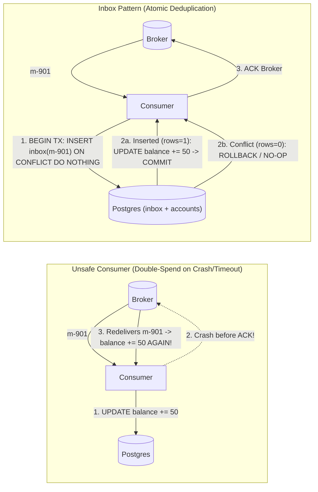
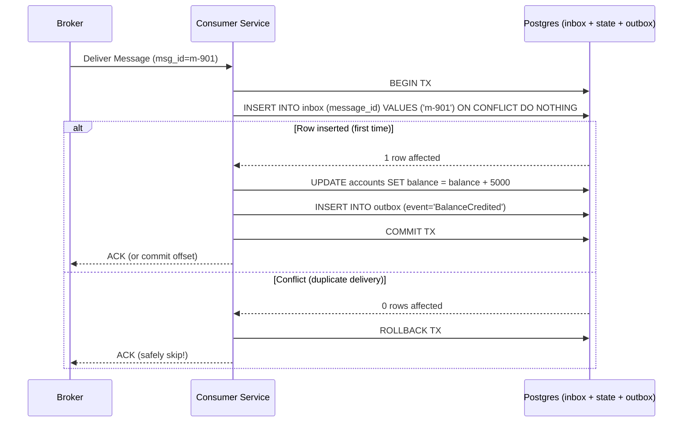
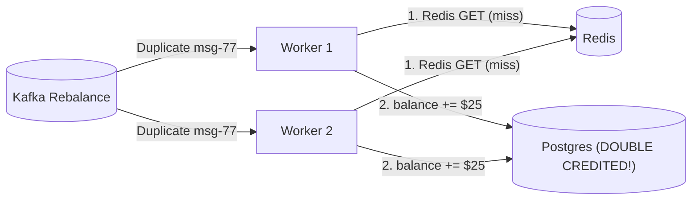

# Inbox Pattern & Deduplication: Never Process a Message Twice

> **Prerequisites:** [Lesson 15: Transactional Outbox Pattern](../15-transactional-outbox-pattern/README.md) · [Lesson 06: Delivery Semantics](../08-delivery-semantics/README.md).  
> **Estimated Reading Time:** 24–28 minutes  
> **Target Audience:** Backend engineers building payment, inventory, or ledger consumers, and candidates asked "how do you achieve effectively-once processing on an at-least-once broker?"  
> **Free PDF Notes:** [Download SD-I-016.pdf](https://backendroadmap.com/notes/system-design/SD-I-016.pdf)

> [!NOTE]
> **In one line:** Most brokers and Outbox relays deliver **at-least-once**, meaning duplicates *will* happen during retries, consumer crashes, or rebalances. The **Inbox Pattern** achieves **effectively-once state transitions** by recording each `message_id` in an `inbox` table inside the **exact same local ACID transaction** as the business update—making duplicate deliveries a safe no-op.

> [!TIP]
> **The Golden Rule:** Never check Redis for deduplication before committing to Postgres—that's just a reverse dual-write race. Put `INSERT INTO inbox (message_id) ON CONFLICT DO NOTHING` inside the **same database transaction** as your business mutation, and only `ack` the broker after `COMMIT`.

---

## 1. What the Inbox Pattern Is, and What It Isn't

Suppose your consumer receives `PaymentCaptured(msg_id="m-901", order_id="o-42", amount=5000)` and increments the merchant's balance (`balance = balance + 5000`).
- **Crash before Ack:** The consumer commits `balance + 5000` to Postgres, then crashes before sending `ack` to RabbitMQ/SQS or committing the Kafka offset. The broker redelivers `m-901`, and the consumer adds `$50` **a second time**.
- **Slow Processing / Visibility Timeout:** GC pause or slow downstream query causes SQS visibility timeout (30 s) or Kafka `max.poll.interval.ms` to expire. Another consumer receives `m-901` concurrently, and both add `$50`.
- **Producer / Outbox Retry:** The upstream Outbox relay crashed after publishing `m-901` and republished it with the same `message_id`.

The **Inbox Pattern** closes this loop by making the consumer's database transaction itself **idempotent**.

| Term | Precise Meaning | Example |
| :--- | :--- | :--- |
| **Inbox Table** | A table in the consumer's DB storing processed `message_id`s with a `PRIMARY KEY` | `inbox(message_id UUID PRIMARY KEY, processed_at)` |
| **Effectively-Once** | At-least-once delivery + idempotent/deduplicated consumer = state changes once | Outbox + Kafka + Inbox |
| **Natural Idempotency** | Operations that are inherently safe to repeat without an inbox table | `UPDATE orders SET status = 'PAID'` |
| **Non-Idempotent Mutation** | Operations that corrupt state if repeated (`+=`, `APPEND`, external API call) | `balance += 50`, `sendEmail()` |
| **Visibility Timeout / Lease** | Duration a broker hides an in-flight message before redelivering it | SQS 30 s default |
| **Inbox + Outbox** | Consumer atomically updates state + `inbox` + its own `outbox` in one TX | Saga / workflow step |
| **Not** | A Redis `SETNX` cache check before DB write | Redis + DB is a split-brain dual write |

### Why It Matters
1. **Outbox (Lesson 15) + Inbox (Lesson 16)** is the industry-standard recipe for **end-to-end effectively-once** processing across microservices without distributed 2PC.
2. External side effects (charging a credit card, sending an email) cannot share a SQL transaction, so you must understand how to combine Inbox with **idempotency keys** on external APIs.
3. Interviewers frequently ask: *"What if two threads receive the exact same duplicate message at the exact same millisecond?"*—only an atomic DB `PRIMARY KEY` constraint handles that cleanly.

---

## 2. Anatomy: Unsafe Consumer vs Atomic Inbox Pattern



Notice the ordering: **DB `COMMIT` happens BEFORE Broker `ACK`**. If the consumer crashes *after* `COMMIT` and *before* `ACK`, the broker redelivers `m-901`, `INSERT INTO inbox` hits the `PRIMARY KEY` conflict (`rows_affected = 0`), and the consumer safely skips the update and sends `ACK`.

| Deduplication Strategy | Atomicity | Concurrent Race Safety | Cost / Storage | Best For |
| :--- | :---: | :---: | :---: | :--- |
| **Inbox Table (SQL `PRIMARY KEY`)** | **100% Atomic** with state | Safe (DB row lock on PK) | Disk + periodic cleanup | Financial ledgers, inventory, critical state |
| **Natural Idempotency (`SET x = y`)** | **100% Atomic** | Safe (if version-guarded) | Zero extra table | Status transitions (`status = 'SHIPPED'`) |
| **Redis `SET NX EX`** | Not atomic with DB | Race window between Redis & DB | Low RAM, TTL auto-evict | Best-effort notifications, high-throughput caches |
| **Bloom Filter** | Probabilistic | False positives drop valid msgs! | Tiny RAM | Pre-filter only (must verify against DB on hit) |

> [!WARNING]
> **Never use a Bloom Filter alone for financial deduplication.** Bloom filters have a non-zero **false positive rate**—meaning a brand-new, legitimate payment message could be falsely flagged as a "duplicate" and silently dropped! Use exact DB `PRIMARY KEY` constraints for correctness.

---

## 3. Mathematical Model: Duplicate Probability, Inbox Size & Retention

**1. Concurrent Duplicate Rate from Processing Time vs Visibility Timeout.**
If a consumer's processing latency $T_{\text{proc}}$ follows a heavy-tailed distribution and exceeds the broker's visibility timeout / poll interval $T_{\text{vis}}$, the broker redelivers the message while the first worker is still running:

$$P(\text{in-flight duplicate}) = P(T_{\text{proc}} > T_{\text{vis}})$$

With $\lambda = 2{,}000\text{ msg/s}$ and even $0.1\%$ tail latency exceeding $T_{\text{vis}}$ ($p = 0.001$), plus $0.05\%$ from Outbox retries and pod restarts ($p_{\text{total}} = 0.0015$):

$$\text{Duplicates/day} = 2{,}000 \times 86{,}400 \times 0.0015 = \mathbf{259{,}200\text{ duplicate deliveries/day}}$$

Without an Inbox, that is **259,200 double-charges or double-counts every single day**.

**2. Inbox Table Growth & Retention Window.**
Let $\lambda$ be message rate, $s_{\text{row}}$ be the size of one inbox row (`UUID` 16 B + `TIMESTAMPTZ` 8 B + tuple header/index $\approx 80\text{ B}$), and $D_{\text{ret}}$ be the deduplication retention window in days (how long you keep `message_id`s before dropping old partitions):

$$S_{\text{inbox}} = \lambda \cdot 86{,}400 \cdot D_{\text{ret}} \cdot s_{\text{row}}$$

**Worked Numerical Example:**
At $\lambda = 5{,}000\text{ msg/s}$, $s_{\text{row}} = 80\text{ B}$, and $D_{\text{ret}} = 7\text{ days}$ (covering broker retention + DLQ replay window):
- Daily rows: $5{,}000 \times 86{,}400 = 432{,}000{,}000\text{ rows/day}$ ($34.56\text{ GB/day}$).
- 7-day total: $3.024 \times 10^9\text{ rows} \approx \mathbf{241.9\text{ GB}}$ (plus ~100 GB B-tree PK index).
- **Why Partitioning Matters:** Deleting 432M rows/day with `DELETE FROM inbox` would trigger massive autovacuum I/O. Partitioning `inbox` by day (`inbox_2026_11_25`) and running `DROP TABLE inbox_2026_11_18` frees 34.5 GB in **$< 10\text{ ms}$**!

---

## 4. Metrics & Percentiles

| Metric | Meaning | Alert when |
| :--- | :--- | :--- |
| **Inbox Deduplication Hit Rate** | `duplicates_skipped / total_received` | $> 1\%$ (indicates upstream retry storm or short visibility timeout) |
| **Inbox Insert Latency $p_{99}$** | Time for `INSERT INTO inbox ON CONFLICT` | $> 15\text{ ms}$ (index bloat or lock contention) |
| **In-Flight Processing Time $p_{99}$** | Time from receive to `COMMIT` | $> 50\%$ of broker visibility timeout / `max.poll.interval.ms` |
| **Inbox Table / Index Size** | Disk footprint of `inbox` partitions | $> \text{budget}$ (partition drop cron failed) |
| **External Side-Effect Mismatch** | DB committed `inbox`, external API call failed | $> 0$ (requires Outbox from consumer) |

### Worked Example (`MerchantPayout` Consumer)
A payout worker consumes `OrderSettled` from Kafka ($1{,}000\text{ msg/s}$). During a 10-minute rolling deploy + Kafka consumer group rebalance, 18,000 in-flight messages are redelivered across pods.
- **Without Inbox:** 18,000 merchants are credited twice; accounting reconciliation halts payouts for 6 hours.
- **With Inbox:** `INSERT INTO inbox (message_id) VALUES ($1) ON CONFLICT (message_id) DO NOTHING RETURNING message_id` returns `0 rows` for all 18,000 duplicates. The worker logs `duplicate_skipped` and commits the Kafka offset. **Financial discrepancy: $0.00.**

---

## 5. Compounding & Failure Modes

| Failure Mode | Mechanism | Impact |
| :--- | :--- | :--- |
| **Check-Then-Insert Race (`SELECT` then `INSERT`)** | Two threads `SELECT` simultaneously, both see "not found," both process | **Double-processing race condition** under concurrent duplicates |
| **External API Call Inside Inbox TX** | Consumer inserts `inbox`, calls Stripe HTTP API, then commits | If Stripe succeeds and DB commit fails $\implies$ charged twice; if DB waits on Stripe $\implies$ connection pool exhaustion |
| **Unbounded Inbox Table** | Retaining `message_id`s forever without TTL/partitioning | B-tree PK index exceeds RAM; every `INSERT` becomes random disk I/O |
| **DLQ Replay Past Retention Window** | Message sits in DLQ for 14 days, inbox retention is 7 days | Replaying DLQ bypasses deduplication if original `message_id` was purged |
| **Non-Deterministic `message_id` on Producer** | Producer generates a *new* UUID on every retry instead of reusing the original ID | Inbox sees two different IDs for the same event and processes both! |

---

## 6. Numbers Every Engineer Must Know

| Item | Typical | Implication |
| :--- | :---: | :--- |
| Healthy duplicate rate (at-least-once) | 0.01%–0.5% | Always present during deploys, rebalances, and network blips |
| Inbox row + PK index overhead | ~80–120 bytes | ~35–50 GB/day at 5,000 msg/s |
| Inbox retention window | 7–30 days | Must exceed broker retention + max DLQ replay age |
| SQS default visibility timeout | 30 seconds | Extend via heartbeat or set $> 3 \times p_{99}$ processing time |
| Kafka `max.poll.interval.ms` | 300 seconds (5 min) | Exceeding it triggers rebalance and redelivery |
| Partition `DROP` vs `DELETE` | $< 10\text{ ms}$ vs hours | Always partition `inbox` by day/week |

---

## 7. Protocol Deep Dive: Atomic Inbox + Consumer Outbox (Saga Step)



| Question | Answer |
| :--- | :--- |
| **Why `INSERT ... ON CONFLICT DO NOTHING` instead of `SELECT` then `INSERT`?** | `SELECT` then `INSERT` has a classic TOCTOU (Time-of-Check to Time-of-Use) race when two duplicates arrive concurrently. `INSERT ... ON CONFLICT` uses the DB's atomic unique-index lock. |
| **What if the consumer must call an external HTTP API (e.g., Stripe) instead of just updating a DB?** | Split it into two steps: (1) Consumer writes `inbox` + `payout_requests(status='PENDING', idempotency_key=m-901)` + `outbox`; (2) A worker calls Stripe passing `Idempotency-Key: m-901` so Stripe itself deduplicates retries! |
| **Where does `message_id` come from?** | The **producer** (or Outbox row `id`) MUST assign a stable `message_id` *before* publishing, and reuse that exact same ID on every retry. |
| **What if `inbox` is partitioned by `processed_at`—can `PRIMARY KEY (message_id)` enforce global uniqueness?** | In Postgres, a unique index on a partitioned table must include the partition key: `PRIMARY KEY (processed_day, message_id)` (or use a UUIDv7 where the timestamp prefix derives the partition!). |

**When NOT to use an Inbox Table:** Do not add an Inbox table when the operation is **naturally idempotent** (e.g., `UPDATE users SET email = $1 WHERE id = $2 AND version < $3`), or for lossy/approximate telemetry (e.g., page-view counters where 0.1% overcount is irrelevant).

---

## 8. Hierarchical Budgets & Design Rules

| Slice | Rule | Control |
| :--- | :--- | :--- |
| **Stable ID** | Producer MUST set deterministic/persisted `message_id` (e.g., Outbox UUID) | Schema validation; reject messages missing `message_id` |
| **Atomic TX** | `INSERT INTO inbox` + business mutation MUST share one local ACID TX | No external HTTP calls inside the DB transaction |
| **Concurrency** | Use `ON CONFLICT DO NOTHING` (never `SELECT` before `INSERT`) | Code review + concurrency integration test |
| **Ack Ordering** | Broker `ACK` / offset commit MUST happen *after* `DB COMMIT` | Consumer framework middleware |
| **External APIs** | Pass `message_id` as `Idempotency-Key` to external payment/email APIs | HTTP client wrapper |
| **Retention** | Partition `inbox` by day/week; retention $\ge$ Broker TTL + DLQ SLA | Automated partition manager |
| **Heartbeat** | Extend visibility timeout / keep batch size small so $T_{\text{proc}} \ll T_{\text{vis}}$ | Alert on `processing_time_p99 > 0.5 * T_vis` |

---

## 9. Top Mitigations

1. **Assign `message_id` at the source (Outbox row ID)** and preserve it across all retries and DLQ replays.
2. **Use `INSERT INTO inbox ... ON CONFLICT DO NOTHING`** inside the same ACID transaction as the state change.
3. **Commit to the DB *before* acking the broker**—if you ack first and DB commit fails, the message is lost forever.
4. **Partition the `inbox` table by time (daily/weekly)** and `DROP` old partitions to keep the B-tree index in RAM.
5. **Use UUIDv7 (time-ordered UUIDs)** for `message_id` so B-tree inserts are sequential (append-only) rather than random page splits!
6. **Never make external HTTP calls inside the Inbox transaction**; write to a local `outbox` or pass `message_id` as an external `Idempotency-Key`.
7. **Prefer natural idempotency + monotonic `version`** when updating entity state (`WHERE version < incoming_version`), saving the Inbox table for non-idempotent deltas (`+=`, ledger entries).

---

## 10. Production Reference: The Rebalance Double-Charge Incident

A ride-sharing billing service consumed `TripCompleted` events from Kafka and credited driver wallets (`UPDATE wallets SET balance = balance + fare`). To "prevent duplicates," the engineer added a **Redis `SETNX` check** (`if redis.exists(msg_id): return`) *before* updating PostgreSQL, then wrote `redis.setex(msg_id, 86400, 1)` *after* `DB COMMIT`.

During a peak Friday evening, a Kubernetes node crashed, triggering a Kafka consumer group rebalance while 400 messages were in-flight, and simultaneously a Redis primary failover dropped the last 2 seconds of keys. Two workers processed the same `TripCompleted` events concurrently—both passed `redis.exists(msg_id)` (not yet written!) and both executed `balance = balance + fare` in Postgres, double-crediting **1,420 drivers**.



**Root Cause:** Non-atomic check-then-act across two separate systems (Redis + Postgres) created a TOCTOU race window.
**Fix:**
1. Removed Redis from the deduplication path completely.
2. Added a partitioned `inbox` table in the **same PostgreSQL database** as `wallets`, using `INSERT INTO inbox (message_id) VALUES ($1) ON CONFLICT DO NOTHING`.
3. Wrapped `inbox` insert + `wallets` update in a single ACID transaction. Concurrent duplicates block on the DB unique index and exit cleanly with `0` double-credits.

---

## 11. Multi-Language Production Code Tabs

Complete **Atomic Inbox Deduplication (`ON CONFLICT DO NOTHING`)** implementations in all 4 languages.

````carousel
```go
// Go: Atomic Inbox deduplication inside a single SQL transaction.
package main

import (
	"context"
	"database/sql"
	"fmt"
)

type PaymentCaptured struct {
	MessageID  string
	AccountID  string
	AmountCent int64
}

// ProcessPaymentAtomic guarantees effectively-once balance credit on at-least-once delivery.
func ProcessPaymentAtomic(ctx context.Context, db *sql.DB, msg PaymentCaptured) (bool, error) {
	tx, err := db.BeginTx(ctx, nil)
	if err != nil {
		return false, err
	}
	defer tx.Rollback()

	// 1. Atomic deduplication claim via PRIMARY KEY
	res, err := tx.ExecContext(ctx,
		`INSERT INTO inbox (message_id, processed_at) VALUES ($1, NOW()) ON CONFLICT (message_id) DO NOTHING`,
		msg.MessageID,
	)
	if err != nil {
		return false, err
	}
	rows, err := res.RowsAffected()
	if err != nil {
		return false, err
	}
	if rows == 0 {
		// Duplicate message: rollback (no-op) and return processed=false so caller ACKs broker
		return false, nil
	}

	// 2. Non-idempotent business mutation protected by the Inbox claim
	if _, err := tx.ExecContext(ctx,
		`UPDATE accounts SET balance_cents = balance_cents + $1 WHERE id = $2`,
		msg.AmountCent, msg.AccountID,
	); err != nil {
		return false, err
	}

	if err := tx.Commit(); err != nil {
		return false, err
	}
	fmt.Printf("Credited %d to %s (msg=%s)\n", msg.AmountCent, msg.AccountID, msg.MessageID)
	return true, nil
}
```
<!-- slide -->
```typescript
// TypeScript: Atomic Inbox deduplication with simulated DB transaction & duplicate test.
export interface PaymentEvent {
  messageId: string;
  accountId: string;
  amountCents: number;
}

export class InboxLedgerService {
  private inbox = new Set<string>(); // models SQL PRIMARY KEY constraint
  private balances = new Map<string, number>();

  async handlePayment(ev: PaymentEvent): Promise<"APPLIED" | "DUPLICATE_SKIPPED"> {
    // Atomic claim inside transaction
    if (this.inbox.has(ev.messageId)) {
      return "DUPLICATE_SKIPPED";
    }
    try {
      this.inbox.add(ev.messageId);
      const cur = this.balances.get(ev.accountId) ?? 0;
      this.balances.set(ev.accountId, cur + ev.amountCents);
      return "APPLIED";
    } catch (err) {
      this.inbox.delete(ev.messageId); // rollback on failure
      throw err;
    }
  }

  getBalance(accountId: string): number {
    return this.balances.get(accountId) ?? 0;
  }
}
```
<!-- slide -->
```python
# Python: Real SQLite ACID transaction demonstrating Inbox deduplication (stdlib only).
import sqlite3

def init_db(conn: sqlite3.Connection) -> None:
    conn.executescript("""
        CREATE TABLE IF NOT EXISTS inbox (
            message_id TEXT PRIMARY KEY,
            processed_at TEXT NOT NULL DEFAULT (datetime('now'))
        );
        CREATE TABLE IF NOT EXISTS accounts (
            id TEXT PRIMARY KEY,
            balance_cents INTEGER NOT NULL DEFAULT 0
        );
        INSERT OR IGNORE INTO accounts (id, balance_cents) VALUES ('acct-1', 10000);
    """)

def process_payment(conn: sqlite3.Connection, message_id: str, account_id: str, amount: int) -> bool:
    with conn:  # Single ACID transaction
        cur = conn.execute(
            "INSERT INTO inbox (message_id) VALUES (?) ON CONFLICT(message_id) DO NOTHING",
            (message_id,),
        )
        if cur.rowcount == 0:
            return False  # Duplicate safely ignored!
        conn.execute(
            "UPDATE accounts SET balance_cents = balance_cents + ? WHERE id = ?",
            (amount, account_id),
        )
        return True

if __name__ == "__main__":
    db = sqlite3.connect(":memory:")
    init_db(db)
    print("1st delivery applied:", process_payment(db, "msg-901", "acct-1", 5000))
    print("2nd delivery applied:", process_payment(db, "msg-901", "acct-1", 5000))
    print("Final balance:", db.execute("SELECT balance_cents FROM accounts WHERE id='acct-1'").fetchone()[0])
```
<!-- slide -->
```csharp
// C#: Atomic Inbox deduplication inside a SQL transaction before broker ACK.
using System.Data;

public sealed record PaymentCapturedMessage(string MessageId, string AccountId, long AmountCents);

public sealed class PaymentInboxHandler
{
    public async Task<bool> HandleAsync(IDbConnection conn, PaymentCapturedMessage msg, CancellationToken ct)
    {
        if (conn.State != ConnectionState.Open) conn.Open();
        using var tx = conn.BeginTransaction();
        try
        {
            using var inboxCmd = conn.CreateCommand();
            inboxCmd.Transaction = tx;
            inboxCmd.CommandText =
                "INSERT INTO inbox (message_id) VALUES (@mid) ON CONFLICT (message_id) DO NOTHING";
            var pMid = inboxCmd.CreateParameter();
            pMid.ParameterName = "@mid";
            pMid.Value = msg.MessageId;
            inboxCmd.Parameters.Add(pMid);

            int inserted = inboxCmd.ExecuteNonQuery();
            if (inserted == 0)
            {
                tx.Rollback();
                return false; // Duplicate detected; caller should ACK broker and move on
            }

            using var acctCmd = conn.CreateCommand();
            acctCmd.Transaction = tx;
            acctCmd.CommandText =
                "UPDATE accounts SET balance_cents = balance_cents + @amt WHERE id = @aid";
            var pAmt = acctCmd.CreateParameter();
            pAmt.ParameterName = "@amt";
            pAmt.Value = msg.AmountCents;
            acctCmd.Parameters.Add(pAmt);
            var pAid = acctCmd.CreateParameter();
            pAid.ParameterName = "@aid";
            pAid.Value = msg.AccountId;
            acctCmd.Parameters.Add(pAid);

            acctCmd.ExecuteNonQuery();
            tx.Commit();
            return true;
        }
        catch
        {
            tx.Rollback();
            throw;
        }
        await Task.CompletedTask;
    }
}
```
````

---

## 12. Hands-On CLI Verification Workflows

Run the Python SQLite Inbox verification to prove duplicate deliveries never double-credit:

```bash
python -c "
import sqlite3
db = sqlite3.connect(':memory:')
db.executescript('''
  CREATE TABLE inbox (message_id TEXT PRIMARY KEY);
  CREATE TABLE accounts (id TEXT PRIMARY KEY, balance INT);
  INSERT INTO accounts VALUES ('a1', 100);
''')
for attempt in range(1, 4):
    with db:
        c = db.execute('INSERT INTO inbox VALUES (?) ON CONFLICT DO NOTHING', ('msg-42',))
        if c.rowcount == 1:
            db.execute('UPDATE accounts SET balance = balance + 50 WHERE id = ?', ('a1',))
    print(f'Attempt {attempt}: balance={db.execute(\"SELECT balance FROM accounts\").fetchone()[0]}')
"
```

Inspect PostgreSQL Inbox partition sizes and duplicate hit rates in production:

```bash
# Check size of daily inbox partitions
psql -d billing -c "
SELECT relname AS partition, pg_size_pretty(pg_total_relation_size(relid)) AS total_size
FROM pg_catalog.pg_statio_user_tables
WHERE relname LIKE 'inbox_%'
ORDER BY relname DESC;"

# Verify SQS visibility timeout vs consumer processing time
aws sqs get-queue-attributes --queue-url "$URL" \
  --attribute-names VisibilityTimeout ReceiveMessageWaitTimeSeconds
```

---

## 13. Common Mistakes to Avoid

1. **Using `SELECT` followed by `INSERT` for deduplication**, creating a race condition when two duplicates arrive simultaneously.
2. **Putting Redis `SETNX` in front of Postgres** instead of keeping the `inbox` table inside the same ACID transaction.
3. **Acking the broker *before* committing the DB transaction**, risking permanent message loss on crash.
4. **Calling external HTTP APIs inside the Inbox DB transaction**, exhausting connection pools and risking split-brain failures.
5. **Forgetting to partition and purge the `inbox` table**, causing the PK index to outgrow RAM and kill write throughput.
6. **Using random UUIDv4s at massive scale** without partitioning, causing random B-tree page splits (prefer **UUIDv7**).
7. **Purging `inbox` rows *sooner* than your DLQ replay window**, allowing old replayed messages to bypass deduplication.

---

## 14. Key Terms Glossary

| Key Term | Definition |
| :--- | :--- |
| **Inbox Pattern** | Recording processed `message_id`s in a DB table inside the same ACID transaction as state updates. |
| **Effectively-Once** | Achieving the effect of once-only state mutation via at-least-once delivery + deduplication. |
| **Idempotency** | Property where applying the same operation $n$ times yields the exact same result as applying it once. |
| **Natural Idempotency** | Operations like `SET status = 'PAID'` that are inherently safe to repeat without an inbox table. |
| **TOCTOU Race** | Time-of-Check to Time-of-Use bug caused by checking `SELECT` before `INSERT` concurrently. |
| **Visibility Timeout** | Time a queue hides an in-flight message before assuming the consumer died and redelivering it. |
| **Idempotency Key** | A client-supplied unique token passed to external APIs (e.g., Stripe) so they deduplicate retries. |
| **UUIDv7** | Time-ordered UUID standard that keeps B-tree primary key inserts sequential. |
| **Bloom Filter** | Space-efficient probabilistic set with false positives; unsafe as the sole dedup gate for money. |
| **Inbox + Outbox** | Consumer atomically writes `inbox`, domain state, and its own `outbox` in one local TX. |

---

## 15. System Design Interview Questions & Answers

### Basic Conceptual Questions

<details>
<summary><strong>Q1: What is the Inbox Pattern and why do we need it? [BASIC]</strong></summary>

**Answer:**
Message brokers and Outbox relays guarantee **at-least-once** delivery, meaning duplicate messages will arrive on retries, timeouts, or rebalances. The Inbox Pattern stores each processed `message_id` in an `inbox` table inside the **same local ACID transaction** as the business update, ensuring duplicates are skipped atomically.
</details>

<details>
<summary><strong>Q2: What is the difference between the Outbox Pattern and the Inbox Pattern? [BASIC]</strong></summary>

**Answer:**
The **Outbox** sits on the **producer** side to guarantee an event is never *lost* after a DB commit (at-least-once publishing). The **Inbox** sits on the **consumer** side to guarantee a delivered event is never *processed twice* (effectively-once consumption).
</details>

<details>
<summary><strong>Q3: When do you NOT need an Inbox table? [BASIC]</strong></summary>

**Answer:**
When the operation is **naturally idempotent**—such as `UPDATE orders SET status = 'SHIPPED' WHERE id = $1 AND version < $2`—or for approximate analytics where an occasional duplicate is harmless. You need an Inbox for non-idempotent mutations like `balance += 50` or triggering downstream workflows.
</details>

<details>
<summary><strong>Q4: Should you ACK the broker before or after the Inbox DB transaction commits? [BASIC]</strong></summary>

**Answer:**
Always **after** `DB COMMIT`. If you ACK first and the DB crashes before commit, the message is lost forever. If you commit first and crash before ACK, the broker redelivers—and the Inbox safely catches and skips the duplicate.
</details>

### Scenario-Based Architecture Questions

<details>
<summary><strong>Q5: Two identical `PaymentCaptured` messages arrive at the exact same millisecond on two consumer pods. What happens? [SCENARIO]</strong></summary>

**Answer:**
Both pods execute `INSERT INTO inbox (message_id) VALUES ($1) ON CONFLICT DO NOTHING` inside their transactions. The database's unique-index lock serializes the two inserts: Pod A inserts (`rowcount = 1`) and updates the balance; Pod B blocks until Pod A commits, then gets `rowcount = 0`, rolls back, and ACKs the duplicate.
</details>

<details>
<summary><strong>Q6: Your `inbox` table has 1 billion rows and `INSERT` latency has degraded from 1 ms to 40 ms. How do you fix it? [SCENARIO]</strong></summary>

**Answer:**
1. **Partition `inbox` by day or week** and `DROP` partitions older than your deduplication window (e.g., 14 days), keeping the active B-tree index small enough to fit in RAM.
2. Use **UUIDv7** (time-ordered) for `message_id` so inserts append sequentially to the right edge of the B-tree.
</details>

<details>
<summary><strong>Q7: Your consumer needs to charge a credit card via Stripe when it receives `OrderPlaced`. How do you make that safe with Inbox? [SCENARIO]</strong></summary>

**Answer:**
Never call Stripe inside the DB transaction. Instead, use the **Inbox** transaction to record `message_id` and insert a `charges(status='PENDING', idempotency_key=message_id)` row. A worker then calls Stripe passing `Idempotency-Key: message_id` (so Stripe deduplicates retries) and updates `charges` to `SUCCEEDED`.
</details>

<details>
<summary><strong>Q8: Why did a teammate's Redis-based deduplication still allow double-credits during a Kafka rebalance? [SCENARIO]</strong></summary>

**Answer:**
Because Redis and Postgres do not share an atomic transaction. Between `redis.exists(id)` returning `false` and `redis.set(id)` executing after the DB write, a second worker received the duplicate, also saw `false` in Redis, and both credited Postgres.
</details>

### Advanced & Tricky Interview Questions

<details>
<summary><strong>Q9: How do Outbox + Broker + Inbox together achieve "Effectively-Once Processing"? [TRICKY]</strong></summary>

**Answer:**
1. **Outbox** guarantees the producer publishes the event $\ge 1$ time whenever its DB commits (no lost events).
2. **Broker** delivers the message $\ge 1$ time to the consumer.
3. **Inbox** guarantees the consumer applies the state change $\le 1$ time per `message_id` (no duplicate effects).
Together: $\ge 1$ delivery + $\le 1$ application = **exactly-once state effect**.
</details>

<details>
<summary><strong>Q10: A message fails, sits in the DLQ for 10 days, and is replayed—but your Inbox retention is 7 days. What happens? [TRICKY]</strong></summary>

**Answer:**
If the message actually *had* succeeded earlier (e.g., before a crash-before-ACK) and its `message_id` was purged on day 7, replaying it on day 10 would bypass the Inbox and double-apply! Rule: **Inbox retention must strictly exceed Broker retention + maximum DLQ replay age** (e.g., 30 days).
</details>

<details>
<summary><strong>Q11: Can you use a Bloom filter in front of the Inbox table to save DB queries? [TRICKY]</strong></summary>

**Answer:**
Only as a **negative-lookup shortcut** in reverse—Wait: if a Bloom filter says "not seen," it is **100% guaranteed** not seen (zero false negatives), so you *still* have to insert into `inbox`! If it says "maybe seen," you *still* have to check `inbox` because it could be a false positive. Thus, a Bloom filter cannot safely skip the `INSERT INTO inbox` write, though an in-memory LRU cache of *confirmed* recent `message_id`s can skip obvious immediate duplicates.
</details>

<details>
<summary><strong>Q12: How does a Saga step combine Inbox and Outbox? [TRICKY]</strong></summary>

**Answer:**
In a **single local ACID transaction**, the Saga participant: (1) inserts `incoming_message_id` into `inbox`, (2) updates its domain table (`reserve_inventory`), and (3) inserts `InventoryReserved` into its `outbox` table. Either all three happen atomically, or none do.
</details>

---

## 16. One-Page Master Cheat Sheet

```
+---------------------------------------------------------------------------------------------------------+
|                    INBOX PATTERN & DEDUPLICATION — MASTER CHEAT SHEET                                   |
+---------------------------------------------------------------------------------------------------------+
| 1. WHY DUPLICATES HAPPEN:                                                                               |
|    Outbox retries + Broker at-least-once + Crash before ACK + Visibility timeout > T_proc.              |
|    At 2,000 msg/s and 0.15% dup rate -> 259,200 duplicate deliveries/day!                               |
+---------------------------------------------------------------------------------------------------------+
| 2. THE ATOMIC INBOX PATTERN:                                                                            |
|    BEGIN TX -> INSERT INTO inbox(message_id) ON CONFLICT DO NOTHING                                     |
|      - If rowcount == 1: apply state mutation (+ optional outbox insert) -> COMMIT -> ACK Broker.        |
|      - If rowcount == 0: duplicate! ROLLBACK -> ACK Broker.                                             |
+---------------------------------------------------------------------------------------------------------+
| 3. NEVER DO:                                                                                            |
|    - SELECT then INSERT (TOCTOU race)         - Redis SETNX before Postgres (split-brain race)          |
|    - ACK Broker before DB COMMIT (data loss)  - External HTTP calls inside DB transaction               |
|    - Bloom filter alone for money (false positives drop valid payments!)                                |
+---------------------------------------------------------------------------------------------------------+
| 4. END-TO-END EFFECTIVELY-ONCE:                                                                         |
|    Transactional Outbox (Producer) + At-Least-Once Broker + Transactional Inbox (Consumer).             |
|    Partition `inbox` by day (UUIDv7) and keep retention > Broker TTL + max DLQ replay age.              |
+---------------------------------------------------------------------------------------------------------+
```

---

## Further Reading & Sources

- Chris Richardson, [Pattern: Idempotent Consumer](https://microservices.io/patterns/communication-style/idempotent-consumer.html).
- Martin Kleppmann, *Designing Data-Intensive Applications*, Chapter 11 ("Idempotence and Deduplication").
- Oskar Dudycz, *Inbox / Outbox Pattern — The Ultimate Guide* (Event-Driven.io).
- AWS Architecture Blog, [Making Retries Safe with Idempotent APIs](https://aws.amazon.com/builders-library/making-retries-safe-with-idempotent-APIs/).

---

## Free PDF Notes

[SD-I-016.pdf](https://backendroadmap.com/notes/system-design/SD-I-016.pdf)

---

## Next

Continue with [Lesson 17: Schema Evolution & Schema Registry: Backward vs Forward Compatibility](../17-schema-evolution-schema-registry/README.md): evolving event contracts without breaking consumers.
