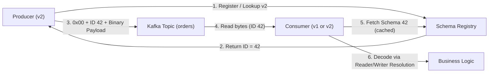
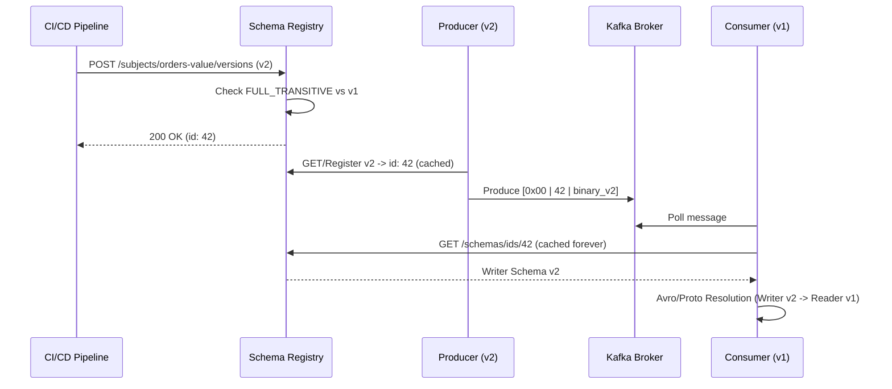
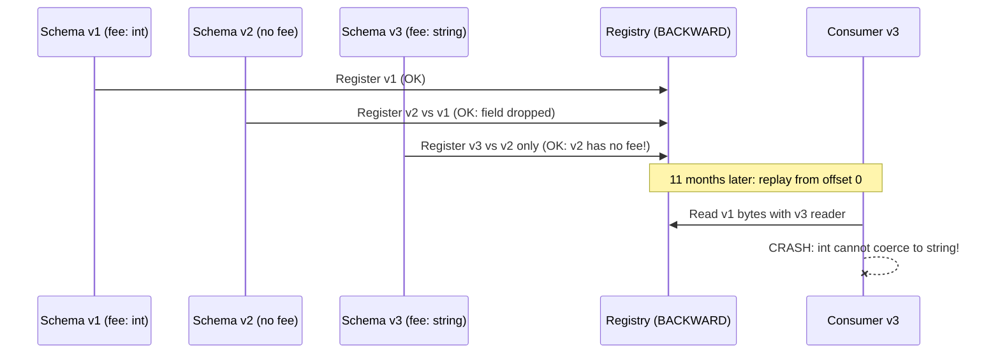

# Schema Evolution & Schema Registry: Backward vs Forward Compatibility

> **Prerequisites:** [Lesson 16: Inbox Pattern & Deduplication](../16-inbox-pattern-deduplication/README.md) · [Lesson 02: Message Queues vs Event Streams](../02-message-queues-vs-event-streams/README.md).  
> **Estimated Reading Time:** 24–28 minutes  
> **Target Audience:** Backend and data engineers evolving event contracts across independent microservices, and candidates asked "how do you change an event schema without breaking consumers or losing old messages?"  
> **Free PDF Notes:** [Download SD-I-017.pdf](https://backendroadmap.com/notes/system-design/SD-I-017.pdf)

> [!NOTE]
> **In one line:** A **Schema Registry** is a versioned contract store that assigns an integer **schema ID** to every event shape and enforces **compatibility rules** (Backward, Forward, Full) at publish/registration time—so producers and consumers can deploy independently without deserialization crashes or shipping redundant JSON field names in every message.

> [!TIP]
> **The Golden Rule:** In event-driven systems, you cannot deploy all producers and consumers atomically, and you cannot rewrite immutable log history (Kafka topics, S3 archives). Default to **FULL_TRANSITIVE** compatibility for long-lived event streams, or **BACKWARD_TRANSITIVE** if you always upgrade consumers before producers.

---

## 1. What Schema Evolution & Schema Registry Is, and What It Isn't

The Checkout service publishes `OrderPlaced` events to Kafka. On Tuesday, a developer renames `amount` (cents, integer) to `total_cents` and deploys Checkout. Seconds later, the Billing consumer crashes with `KeyError: 'amount'`, the Fraud consumer silently treats `amount` as `0`, and 40,000 events pile up in the Dead-Letter Queue (DLQ). Meanwhile, the Analytics team tries to replay 90 days of historical `OrderPlaced` events from Kafka and hits mixed formats in the same partition.

| Term | Precise Meaning | Example |
| :--- | :--- | :--- |
| **Schema** | Formal structural contract (field names, types, defaults, nullability) | Avro `.avsc`, Protobuf `.proto`, JSON Schema |
| **Schema evolution** | Changing a schema over time without breaking existing readers or writers | Adding an optional `currency` field with default `"USD"` |
| **Schema Registry** | Central HTTP service storing versioned schemas mapped to compact integer IDs | Confluent Schema Registry, AWS Glue Schema Registry, Apicurio |
| **Wire format** | Magic byte + 4-byte schema ID + binary payload | `0x00 | 00 00 00 2A | <avro-bytes>` |
| **Backward compatibility** | **New** consumer schema can read **old** producer data | Adding an optional field with a default; deleting an old field |
| **Forward compatibility** | **Old** consumer schema can read **new** producer data | Adding a field (old reader ignores it); deleting an optional field |
| **Full compatibility** | Both backward and forward compatible | Adding or deleting *only* optional fields with defaults |
| **Transitive (`*_TRANSITIVE`)** | Compatible with **all** previous versions, not just $V_{n-1}$ | Replaying 2-year-old $V_1$ events into a $V_8$ consumer |
| **Not** | A runtime ETL/mapping engine or a substitute for semantic versioning | A registry validates structure, not business meaning (`cents` vs `dollars`) |

### Why It Matters
1. **Zero-downtime independent deployments:** In microservices, producers and consumers deploy on different schedules; without compatibility checks, one bad deploy poisons the entire topic.
2. **Replayability of event logs:** Kafka and EventBridge archives hold months of immutable events; only transitive compatibility guarantees that today's consumer can reprocess last year's events.
3. **Massive wire-size savings:** Replacing self-describing JSON keys with a 5-byte Schema Registry header + Avro/Protobuf binary encoding cuts payload size by **60%–85%**, saving broker disk, network bandwidth, and cross-AZ egress cost.

---

## 2. Anatomy: Wire Format & Compatibility Matrix



Unlike JSON—which repeats `"order_id"`, `"customer_id"`, `"total_cents"` in every single message—a Schema Registry architecture strips field names off the wire. The producer sends a 5-byte prefix (`0x00` magic byte + 4-byte big-endian schema ID) followed by compact binary data (Avro or Protobuf). Consumers cache `ID -> Schema` locally in memory, so the Registry is **not** on the hot path per message.

| Compatibility Mode | Who Upgrades First? | Allowed Changes | Rejected Changes |
| :--- | :--- | :--- | :--- |
| **BACKWARD** | Consumers first | Add field **with default**; delete any field | Add required field (no default); change field type |
| **FORWARD** | Producers first | Add any field; delete field **that had a default** | Delete required field; change field type |
| **FULL** | Any order (either first) | Add field **with default**; delete field **with default** | Add required field; delete required field; rename field |
| **NONE** | Coordinated big-bang | Anything (registry acts only as ID store) | Nothing (dangerous in production) |

> [!WARNING]
> **The #1 Trap: Non-Transitive vs. Transitive Compatibility.**
> By default, Confluent Schema Registry sets `BACKWARD` (checks $V_n$ against $V_{n-1}$ **only**), **not** `BACKWARD_TRANSITIVE` (checks $V_n$ against $V_1 \dots V_{n-1}$). If $V_1$ had field `a`, $V_2$ deleted `a`, and $V_3$ re-adds `a` with an incompatible type (`int` vs `string`), non-transitive `BACKWARD` allows $V_3$ because $V_2$ didn't have `a`! When your consumer replays $V_1$ from Kafka, it crashes. Always use `*_TRANSITIVE` for event streams.

---

## 3. Mathematical Model: Wire Overhead, Bandwidth & Deserialization Cache

**1. Payload Compression Ratio ($R_{\text{wire}}$).**
Let $S_{\text{json}}$ be the average JSON payload size (keys + stringified numbers + punctuation), $S_{\text{bin}}$ be the binary Avro/Protobuf payload size, and $H_{\text{sr}} = 5$ bytes be the Schema Registry wire header (`1` magic byte + `4` bytes `uint32` schema ID):

$$S_{\text{sr}} = H_{\text{sr}} + S_{\text{bin}}, \qquad \text{Savings} = 1 - \frac{S_{\text{sr}}}{S_{\text{json}}}$$

**2. Daily Cross-AZ Egress & Storage Cost.**
For a topic receiving $\lambda$ events/sec with replication factor $RF$ and retention $D$ days:

$$\text{Storage}_{\text{topic}} = \lambda \cdot 86{,}400 \cdot D \cdot RF \cdot S_{\text{msg}}$$

**3. Registry Lookup Cache Hit Rate.**
If a consumer fleet of $N_c$ instances processes $\lambda$ messages/sec and there are $V$ distinct schema versions active in the topic with local in-memory caching (infinite TTL for immutable IDs), the total requests to the Schema Registry during steady state are:

$$Q_{\text{sr}} = \frac{N_c \cdot V}{T_{\text{restart}}} \quad (\text{only on cold start/deploy})$$

### Worked Numerical Example
Suppose `OrderPlaced` has 12 fields:
- **Raw JSON:** $S_{\text{json}} = 420$ bytes.
- **Avro + Schema Registry:** $S_{\text{bin}} = 85$ bytes, plus $H_{\text{sr}} = 5$ bytes $\implies S_{\text{sr}} = 90$ bytes.
- **Payload reduction:** $1 - \frac{90}{420} = 78.6\%$ smaller messages.
- **At $\lambda = 50{,}000$ events/sec, $RF = 3$, retention $D = 7$ days:**
  - Total messages stored $= 50{,}000 \times 86{,}400 \times 7 = 30.24 \times 10^9$ messages.
  - **JSON disk footprint:** $30.24 \times 10^9 \times 3 \times 420\text{ B} = 38.10\text{ TB}$.
  - **Avro + Registry disk footprint:** $30.24 \times 10^9 \times 3 \times 90\text{ B} = 8.16\text{ TB}$ (**saves 29.94 TB** of NVMe/EBS storage and proportional network I/O).

---

## 4. Metrics & Percentiles

| Metric | Meaning | Alert When |
| :--- | :--- | :--- |
| **Schema registration 409 rate** | Rejected incompatible schema pushes in CI/CD or producers | Any spike in prod (indicates unvalidated producer deploy) |
| **Registry cache miss rate** | Consumers fetching unknown schema IDs over HTTP | $> 0.1\%$ steady-state (indicates broken local cache or restart loop) |
| **Deserialization error / DLQ rate** | Messages failing wire-header or schema resolution | $> 0$ (poison pill or bypassed registry producer) |
| **Registry HTTP $p_{99}$ latency** | Time to register/fetch a schema ID | $> 50\text{ ms}$ (slows cold starts and CI pipelines) |
| **Active schema versions per subject** | Distinct IDs actively produced in the last 24h | $> 5$ (signals schema sprawl or uncoordinated producers) |
| **Unknown magic byte count** | Raw JSON/corrupt payloads pushed to a binary topic | $> 0$ (producer bypassed the serializer) |

### Worked Example (`OrderPlaced` Evolution)
1. **$V_1$:** `{ "order_id": string, "amount_cents": long }`.
2. **$V_2$ (Safe):** Add `"currency": string` with default `"USD"`. Under `FULL_TRANSITIVE`:
   - Old consumer ($V_1$) reading $V_2$ data ignores `currency` $\implies$ **Forward compatible**.
   - New consumer ($V_2$) reading $V_1$ data fills `currency = "USD"` $\implies$ **Backward compatible**.
3. **$V_3$ (Unsafe rename):** Rename `amount_cents` to `total_cents`. Rejected by Registry with `HTTP 409 Conflict` (`READER_FIELD_MISSING_DEFAULT_VALUE`) because $V_3$ cannot read $V_1$/$V_2$ without a default, and $V_1$/$V_2$ cannot read $V_3$ where `amount_cents` vanished.
4. **Safe Multi-Step Rename:** Add `total_cents` (optional, default `null`), dual-write both fields for one release cycle, migrate all consumers to `total_cents`, then deprecate/remove `amount_cents` (if it had a default).

---

## 5. Compounding & Failure Modes

What happens when schema discipline breaks at scale?

| Failure Mode | Mechanism | Quantitative Impact at 50k msg/s |
| :--- | :--- | :--- |
| **Silent semantic drift** | Developer changes `amount` from dollars (`12.50` float) to cents (`1250` int) without changing type/field | 100% of billing records overcharged by **100x**; Registry passes it because structural type is numeric |
| **Bypassed serializer (Raw JSON in Avro topic)** | A debug script or misconfigured producer writes raw JSON (`{` = `0x7B`) instead of `0x00` magic byte | Consumer throws `SerializationException` on every message; entire partition stalls if no DLQ |
| **Schema explosion (unbounded subjects)** | Producer dynamically embeds tenant ID or timestamp into schema name (`orders-tenant-9912-value`) | 100,000+ schemas bloat Registry DB and exhaust consumer JVM/Go heap caches |
| **Registry outage during cold start** | Schema Registry goes down when Kubernetes autoscales 200 new consumer pods | New pods have empty caches and cannot resolve schema ID `42`; **100% consumer stall** until Registry recovers |
| **Non-transitive field resurrection** | $V_1$ (`id: int`) $\to$ $V_2$ (drop `id`) $\to$ $V_3$ (`id: string`) under non-transitive `BACKWARD` | $V_3$ consumers crash when replaying $V_1$ historical events |

---

## 6. Numbers Every Engineer Must Know

| Item | Typical | Implication |
| :--- | :--- | :--- |
| **Schema Registry wire header** | 5 bytes (`0x00` + 4B ID) | Negligible overhead; supports up to $2^{31}-1$ schemas |
| **Avro vs JSON payload size** | 60%–85% smaller | Major savings on Kafka disk, replication, and cross-AZ egress |
| **Protobuf vs Avro overhead** | Protobuf tags + varints; Avro 0-tag positional | Avro requires writer schema to decode; Protobuf is self-delimiting via field numbers |
| **Registry cache hit rate (steady state)** | $> 99.999\%$ | Schema IDs are immutable; cache forever in memory |
| **Registry cold-start lookup latency** | 2–15 ms (local/VPC) | Pre-warm or bundle known schemas for mission-critical consumers |
| **Maximum recommended compatibility mode** | `FULL_TRANSITIVE` | Only mode allowing arbitrary deploy order + full historical replay |
| **Multi-step field rename cycle** | 3–4 deployments | Expand (add new) $\to$ Dual-write $\to$ Migrate readers $\to$ Contract (drop old) |

---

## 7. Protocol / Mechanism Deep Dive: Avro vs. Protobuf vs. JSON Schema



| Question | Avro | Protobuf | JSON Schema |
| :--- | :--- | :--- | :--- |
| **How are fields matched?** | By **field name** (and aliases) | By **numeric tag** (`= 1`, `= 2`) | By **JSON property name** |
| **Self-describing on wire?** | No (must have writer schema) | Partially (tags + wire types, no names) | Yes (full JSON text) |
| **Renaming a field** | Breaks unless `aliases` used | **Safe** if tag number stays identical | Breaks readers expecting old key |
| **Wire size** | Smallest (no field tags) | Very small (varint tags) | Largest (text keys + numbers) |
| **Schema evolution ergonomics** | Strict defaults required | `optional` / `proto3` presence + `reserved` tags | `additionalProperties: false` breaks forward |

### When NOT to Use a Schema Registry
- **Single-service internal queues** where producer and consumer are the same codebase deployed together (e.g., Sidekiq/Celery background jobs).
- **Ultra-low-volume control-plane webhooks** (< 10 msg/min) where human-readable JSON + unit-tested DTOs suffice.
- **Unstructured/polymorphic log ingestion** where payloads vary wildly per source and are queried via schema-on-read (e.g., raw clickstream dumps into ClickHouse/BigQuery).

---

## 8. Hierarchical Budgets & Design Rules

| Slice | Rule | Control |
| :--- | :--- | :--- |
| **Compatibility Policy** | Enforce `FULL_TRANSITIVE` on shared domain topics | Set subject compatibility via Terraform/IaC; lock `NONE` in prod |
| **CI/CD Gate** | Fail PRs before merge if schema breaks compatibility | Run `schema-registry` compatibility check in CI against prod registry |
| **Auto-Registration** | Disable `auto.register.schemas=true` in production producers | Pre-register schemas in CI/CD; prod producers only `use.latest.version` or lookup by ID |
| **Subject Naming** | Use `TopicNameStrategy` (1 schema) or `TopicRecordNameStrategy` (multi-event) | Never embed dynamic IDs (tenant/user) in subject names |
| **Field Evolution** | Never reuse deleted Protobuf tag numbers or Avro field names with new types | Use `reserved 3, 4;` in Protobuf; add new fields with explicit defaults |
| **Resilience** | Cache schemas indefinitely in-process; handle poison pills | In-memory concurrent map + DLQ for `SerializationException` |

---

## 9. Top Mitigations

1. **Disable `auto.register.schemas` in production:** Force schemas through CI/CD compatibility gates so a rogue service cannot silently register a breaking or malformed schema at runtime.
2. **Use `FULL_TRANSITIVE` on core domain topics:** Guarantees any consumer version can read any historical or future message, enabling safe rollbacks and Kafka replay.
3. **Follow the Expand-and-Contract pattern for renames/type changes:** Never rename in place. Add the new field, dual-write both, migrate all consumers, then retire the old field.
4. **Embed a local fallback schema bundle:** For tier-0 consumers, ship known schema IDs in the container image or Redis backup so pods can still boot if the Schema Registry is temporarily unreachable.
5. **Version semantics, not just syntax:** If `amount` changes from dollars to cents, create a new field `amount_cents`—structural compatibility cannot catch unit mismatches.
6. **Reserve deleted tags and field names:** In Protobuf, always add `reserved 5; reserved "old_field";` so future engineers never accidentally reuse a retired wire tag.
7. **Route `SerializationException` to a DLQ with raw bytes:** Never let a single raw-JSON poison message halt consumer partition progress; capture the raw bytes, topic, offset, and alert.

---

## 10. Production Reference / War Story

**Incident (SEV-1): The Silent `BACKWARD` Replay Crash**
A fintech payments platform used Kafka + Avro with the default `BACKWARD` (non-transitive) compatibility mode.
- **T+0 months:** `PaymentSettled` $V_1$ had `fee_amount: int`.
- **T+4 months:** A refactor dropped `fee_amount` in $V_2$ (valid under `BACKWARD`).
- **T+9 months:** A new feature re-added `fee_amount: string` (decimal string `"1.25"`) in $V_3$. Because $V_2$ didn't have `fee_amount`, `BACKWARD` only checked $V_3$ against $V_2$ and **approved** $V_3$.
- **T+11 months (The Outage):** During a ledger reconciliation incident, engineers reset the consumer group offset to `earliest` to replay 12 months of `PaymentSettled` events. When the $V_3$ consumer hit $V_1$ events (`fee_amount: int`), Avro resolution threw `AvroTypeException: Found int, expecting string`. Every partition stalled, delaying settlement reconciliation by 6 hours.



**Root Cause:** Non-transitive `BACKWARD` only validates against $V_{n-1}$, ignoring $V_1$.
**Fix:** Switched all core topics to `FULL_TRANSITIVE`, added a CI check validating new schemas against *all* historical versions, and enforced field-name reservation lint rules.

---

## 11. Multi-Language Production Code Tabs

````carousel
```go
// Go: Wire-format encoder/decoder + Schema Registry compatibility checker (stdlib only).
package main

import (
	"encoding/binary"
	"errors"
	"fmt"
	"sync"
)

const MagicByte byte = 0x00

type Field struct {
	Name       string
	Type       string
	HasDefault bool
}

type Schema struct {
	ID     uint32
	Fields []Field
}

type Registry struct {
	mu       sync.RWMutex
	nextID   uint32
	schemas  map[uint32]Schema
	subjects map[string][]Schema
}

func NewRegistry() *Registry {
	return &Registry{
		nextID:   1,
		schemas:  make(map[uint32]Schema),
		subjects: make(map[string][]Schema),
	}
}

// CheckFullTransitive ensures newSchema is both backward and forward compatible with ALL prior versions.
func CheckFullTransitive(history []Schema, candidate Schema) error {
	for _, old := range history {
		if err := checkPair(old, candidate); err != nil {
			return fmt.Errorf("incompatible with v%d: %w", old.ID, err)
		}
	}
	return nil
}

func checkPair(oldS, newS Schema) error {
	oldMap := make(map[string]Field, len(oldS.Fields))
	for _, f := range oldS.Fields {
		oldMap[f.Name] = f
	}
	newMap := make(map[string]Field, len(newS.Fields))
	for _, f := range newS.Fields {
		newMap[f.Name] = f
	}
	// Backward: new reader reading old writer -> any new field must have a default; matching fields must match type.
	for name, nf := range newMap {
		if of, ok := oldMap[name]; ok {
			if of.Type != nf.Type {
				return fmt.Errorf("field %q type changed %s -> %s", name, of.Type, nf.Type)
			}
		} else if !nf.HasDefault {
			return fmt.Errorf("new field %q lacks default (breaks backward)", name)
		}
	}
	// Forward: old reader reading new writer -> any deleted field must have had a default.
	for name, of := range oldMap {
		if _, ok := newMap[name]; !ok && !of.HasDefault {
			return fmt.Errorf("deleted required field %q (breaks forward)", name)
		}
	}
	return nil
}

func (r *Registry) Register(subject string, s Schema) (uint32, error) {
	r.mu.Lock()
	defer r.mu.Unlock()
	if err := CheckFullTransitive(r.subjects[subject], s); err != nil {
		return 0, err
	}
	s.ID = r.nextID
	r.nextID++
	r.schemas[s.ID] = s
	r.subjects[subject] = append(r.subjects[subject], s)
	return s.ID, nil
}

// EncodeWire prefixes [0x00 | 4-byte big-endian schemaID] before the payload.
func EncodeWire(schemaID uint32, payload []byte) []byte {
	out := make([]byte, 5+len(payload))
	out[0] = MagicByte
	binary.BigEndian.PutUint32(out[1:5], schemaID)
	copy(out[5:], payload)
	return out
}

func DecodeWire(frame []byte) (uint32, []byte, error) {
	if len(frame) < 5 || frame[0] != MagicByte {
		return 0, nil, errors.New("invalid magic byte or truncated frame")
	}
	return binary.BigEndian.Uint32(frame[1:5]), frame[5:], nil
}
```
<!-- slide -->
```typescript
// TypeScript: Schema Registry wire framing + FULL_TRANSITIVE compatibility validator.
export interface SchemaField {
  name: string;
  type: "string" | "int64" | "boolean";
  hasDefault: boolean;
}

export interface SchemaVersion {
  id: number;
  fields: SchemaField[];
}

export class SchemaRegistry {
  private nextId = 1;
  private byId = new Map<number, SchemaVersion>();
  private subjects = new Map<string, SchemaVersion[]>();

  register(subject: string, fields: SchemaField[]): number {
    const history = this.subjects.get(subject) ?? [];
    for (const prev of history) {
      this.assertFullCompatible(prev.fields, fields, prev.id);
    }
    const version: SchemaVersion = { id: this.nextId++, fields };
    this.byId.set(version.id, version);
    this.subjects.set(subject, [...history, version]);
    return version.id;
  }

  private assertFullCompatible(oldFields: SchemaField[], newFields: SchemaField[], oldId: number): void {
    const oldMap = new Map(oldFields.map((f) => [f.name, f]));
    const newMap = new Map(newFields.map((f) => [f.name, f]));

    for (const [name, nf] of newMap) {
      const of = oldMap.get(name);
      if (of && of.type !== nf.type) {
        throw new Error(`Type mismatch on '${name}' vs schema ${oldId}: ${of.type} -> ${nf.type}`);
      }
      if (!of && !nf.hasDefault) {
        throw new Error(`Added field '${name}' without default breaks BACKWARD vs schema ${oldId}`);
      }
    }
    for (const [name, of] of oldMap) {
      if (!newMap.has(name) && !of.hasDefault) {
        throw new Error(`Removed required field '${name}' breaks FORWARD vs schema ${oldId}`);
      }
    }
  }

  static encodeWire(schemaId: number, payload: Uint8Array): Uint8Array {
    const buf = new Uint8Array(5 + payload.length);
    const view = new DataView(buf.buffer);
    view.setUint8(0, 0x00); // Magic byte
    view.setUint32(1, schemaId, false); // Big-endian uint32
    buf.set(payload, 5);
    return buf;
  }

  static decodeWire(frame: Uint8Array): { schemaId: number; payload: Uint8Array } {
    if (frame.length < 5 || frame[0] !== 0x00) {
      throw new Error("Invalid Schema Registry wire header");
    }
    const schemaId = new DataView(frame.buffer, frame.byteOffset, 5).getUint32(1, false);
    return { schemaId, payload: frame.subarray(5) };
  }
}
```
<!-- slide -->
```python
# Python: Schema Registry wire framing, FULL_TRANSITIVE check & bandwidth calculator (stdlib only).
import struct
from dataclasses import dataclass

MAGIC_BYTE = 0x00


@dataclass(frozen=True)
class Field:
    name: str
    dtype: str
    has_default: bool = False


class CompatibilityError(ValueError):
    pass


class SchemaRegistry:
    def __init__(self) -> None:
        self._next_id = 1
        self._by_id: dict[int, list[Field]] = {}
        self._subjects: dict[str, list[tuple[int, list[Field]]]] = {}

    def register(self, subject: str, fields: list[Field]) -> int:
        history = self._subjects.get(subject, [])
        for old_id, old_fields in history:
            self._check_full(old_id, old_fields, fields)
        sid = self._next_id
        self._next_id += 1
        self._by_id[sid] = fields
        self._subjects.setdefault(subject, []).append((sid, fields))
        return sid

    @staticmethod
    def _check_full(old_id: int, old_fields: list[Field], new_fields: list[Field]) -> None:
        old_map = {f.name: f for f in old_fields}
        new_map = {f.name: f for f in new_fields}
        for name, nf in new_map.items():
            if name in old_map:
                if old_map[name].dtype != nf.dtype:
                    raise CompatibilityError(f"v{old_id}: '{name}' type {old_map[name].dtype} -> {nf.dtype}")
            elif not nf.has_default:
                raise CompatibilityError(f"v{old_id}: new field '{name}' missing default (not BACKWARD)")
        for name, of in old_map.items():
            if name not in new_map and not of.has_default:
                raise CompatibilityError(f"v{old_id}: removed required field '{name}' (not FORWARD)")


def encode_wire(schema_id: int, payload: bytes) -> bytes:
    return struct.pack(">BI", MAGIC_BYTE, schema_id) + payload


def decode_wire(frame: bytes) -> tuple[int, bytes]:
    if len(frame) < 5 or frame[0] != MAGIC_BYTE:
        raise ValueError("Invalid magic byte or truncated frame")
    _, schema_id = struct.unpack(">BI", frame[:5])
    return schema_id, frame[5:]


def storage_savings_tb(rate_per_s=50_000, days=7, rf=3, json_bytes=420, bin_bytes=85) -> tuple[float, float]:
    msgs = rate_per_s * 86_400 * days * rf
    return round(msgs * json_bytes / 1e12, 2), round(msgs * (bin_bytes + 5) / 1e12, 2)
```
<!-- slide -->
```csharp
// C#: Schema Registry wire framing and FULL_TRANSITIVE compatibility check.
using System.Buffers.Binary;

public sealed record SchemaField(string Name, string Type, bool HasDefault);

public sealed class SchemaRegistry
{
    private int _nextId = 1;
    private readonly Dictionary<string, List<(int Id, List<SchemaField> Fields)>> _subjects = new();

    public int Register(string subject, List<SchemaField> fields)
    {
        if (!_subjects.TryGetValue(subject, out var history))
        {
            history = new List<(int, List<SchemaField>)>();
            _subjects[subject] = history;
        }
        foreach (var (oldId, oldFields) in history)
            CheckFull(oldId, oldFields, fields);

        int id = _nextId++;
        history.Add((id, fields));
        return id;
    }

    private static void CheckFull(int oldId, List<SchemaField> oldFields, List<SchemaField> newFields)
    {
        var oldMap = oldFields.ToDictionary(f => f.Name);
        var newMap = newFields.ToDictionary(f => f.Name);

        foreach (var (name, nf) in newMap)
        {
            if (oldMap.TryGetValue(name, out var of))
            {
                if (of.Type != nf.Type)
                    throw new InvalidOperationException($"v{oldId}: '{name}' type changed {of.Type} -> {nf.Type}");
            }
            else if (!nf.HasDefault)
            {
                throw new InvalidOperationException($"v{oldId}: new field '{name}' lacks default");
            }
        }
        foreach (var (name, of) in oldMap)
        {
            if (!newMap.ContainsKey(name) && !of.HasDefault)
                throw new InvalidOperationException($"v{oldId}: removed required field '{name}'");
        }
    }

    public static byte[] EncodeWire(int schemaId, ReadOnlySpan<byte> payload)
    {
        var frame = new byte[5 + payload.Length];
        frame[0] = 0x00;
        BinaryPrimitives.WriteInt32BigEndian(frame.AsSpan(1, 4), schemaId);
        payload.CopyTo(frame.AsSpan(5));
        return frame;
    }
}
```
````

---

## 12. Hands-On CLI Verification Workflows

Verify the Python compatibility & storage model locally:

```bash
python3 -c '
from dataclasses import dataclass
# Run storage math check: 50k msg/s, 7 days, RF=3
msgs = 50_000 * 86_400 * 7 * 3
print("JSON TB:", round(msgs * 420 / 1e12, 2), "SR+Avro TB:", round(msgs * 90 / 1e12, 2))
'
```

Inspect and test a live Confluent Schema Registry via `curl`:

```bash
# 1. Set subject compatibility to FULL_TRANSITIVE
curl -X PUT -H "Content-Type: application/vnd.schemaregistry.v1+json" \
  --data '{"compatibility": "FULL_TRANSITIVE"}' \
  http://localhost:8081/config/orders-value

# 2. Test compatibility BEFORE registering (CI/CD gate)
curl -X POST -H "Content-Type: application/vnd.schemaregistry.v1+json" \
  --data '{"schema": "{\"type\":\"record\",\"name\":\"OrderPlaced\",\"fields\":[{\"name\":\"order_id\",\"type\":\"string\"},{\"name\":\"currency\",\"type\":\"string\",\"default\":\"USD\"}]}"}' \
  http://localhost:8081/compatibility/subjects/orders-value/versions/latest

# 3. Inspect schema ID 42 from a captured Kafka message
curl -s http://localhost:8081/schemas/ids/42 | jq .
```

---

## 13. Common Mistakes to Avoid

1. **Using `BACKWARD` instead of `FULL_TRANSITIVE`:** Non-transitive checks allow a deleted field to be re-added with a different type, breaking historical log replays.
2. **Leaving `auto.register.schemas=true` in production:** Any buggy producer deploy can register a breaking or garbage schema at runtime.
3. **Renaming fields directly in Avro/JSON:** Renaming breaks readers unless you use Avro `aliases` or the multi-step Expand-and-Contract pattern.
4. **Assuming Schema Registry catches semantic changes:** Changing `amount` from dollars to cents with the same numeric type passes all compatibility checks and silently corrupts data.
5. **Forgetting `reserved` tags in Protobuf:** Reusing a previously deleted field number (`= 3`) causes old clients to misinterpret new bytes as the old field.
6. **Putting dynamic IDs in subject names:** Creating `orders-tenant123-value` explodes the registry catalog and exhausts consumer schema caches.
7. **Skipping local caching or DLQs for poison pills:** Querying the registry over HTTP per message adds milliseconds of latency, and failing to DLQ `SerializationException` halts the entire partition.

---

## 14. Key Terms Glossary

| Key Term | Definition |
| :--- | :--- |
| **Schema Registry** | Centralized HTTP service storing versioned schemas and mapping them to compact integer IDs. |
| **Wire Format** | Binary framing (`0x00` magic byte + 4-byte schema ID + encoded payload) used on the broker. |
| **Backward Compatibility** | New consumer code can read data written by older producer versions. |
| **Forward Compatibility** | Old consumer code can read data written by newer producer versions. |
| **Full Compatibility** | Both backward and forward compatible; producers and consumers can upgrade in any order. |
| **Transitive Compatibility** | Compatibility verified against *all* historical versions ($V_1 \dots V_{n-1}$), not just $V_{n-1}$. |
| **Writer Schema** | The exact schema version used by the producer when serializing a message. |
| **Reader Schema** | The schema version expected by the consumer when deserializing a message. |
| **Schema Resolution** | The algorithm (e.g., Avro) that maps writer fields to reader fields and applies defaults. |
| **Expand-and-Contract** | Multi-release pattern for safe breaking changes: add new field, dual-write, migrate readers, drop old. |
| **Subject** | A named scope in the Schema Registry under which schema versions evolve (e.g., `orders-value`). |
| **Protobuf `reserved`** | Directive preventing future schemas from reusing retired tag numbers or field names. |

---

## 15. System Design Interview Questions & Answers

### Basic Conceptual Questions

<details>
<summary><strong>Q1: What is the difference between backward and forward compatibility? [BASIC]</strong></summary>

**Answer:**
Backward compatibility means a **new** consumer can read data produced by an **old** producer (e.g., adding an optional field with a default). Forward compatibility means an **old** consumer can read data produced by a **new** producer (e.g., adding a field that old consumers ignore, or deleting an optional field that had a default).
</details>

<details>
<summary><strong>Q2: Why use a Schema Registry instead of just sending JSON? [BASIC]</strong></summary>

**Answer:**
First, it enforces compatibility contracts before bad schemas reach production. Second, it replaces repeated JSON field names on the wire with a 5-byte header (magic byte + 4-byte schema ID) + binary Avro/Protobuf, typically reducing payload size by 60%–85% and cutting broker storage and network costs proportionally.
</details>

<details>
<summary><strong>Q3: Does the consumer call the Schema Registry for every message? [BASIC]</strong></summary>

**Answer:**
No. Schema IDs are immutable, so consumers cache `schema_id -> schema` indefinitely in memory. HTTP calls happen only once per unique schema ID per process lifetime (cold start or when a new schema version first appears).
</details>

<details>
<summary><strong>Q4: What is FULL compatibility, and when is it required? [BASIC]</strong></summary>

**Answer:**
FULL compatibility means a schema change is both backward and forward compatible (e.g., only adding or removing fields that have defaults). It is required whenever you cannot control whether producers or consumers deploy first, or when you have multiple independent consumer teams upgrading on different schedules.
</details>

### Scenario-Based Architecture Questions

<details>
<summary><strong>Q5: You need to rename `amount` to `total_cents` and change its type from float to int on a live Kafka topic. How do you do it with zero downtime? [SCENARIO]</strong></summary>

**Answer:**
Use **Expand-and-Contract**: (1) Add `total_cents` as an optional field with a default (`null`), keeping `amount`; (2) Update producers to dual-write both fields; (3) Migrate all consumers to read `total_cents` (falling back to `amount` during transition); (4) Stop writing `amount` and optionally retire it in a later version if it had a default. Never rename or change types in place.
</details>

<details>
<summary><strong>Q6: A team wants to store `OrderPlaced`, `OrderCancelled`, and `OrderShipped` in one Kafka topic `orders` to preserve per-order ordering. How should they configure Schema Registry? [SCENARIO]</strong></summary>

**Answer:**
By default, `TopicNameStrategy` enforces one schema per topic (`orders-value`), which would reject different event types. Switch to `TopicRecordNameStrategy` (subjects become `orders-OrderPlaced`, `orders-OrderCancelled`) or use a Protobuf `oneof` / Avro union envelope schema so each event type evolves independently while preserving partition ordering by `order_id`.
</details>

<details>
<summary><strong>Q7: Your Schema Registry experiences a 15-minute outage. What happens to running producers/consumers vs. autoscaling pods? [SCENARIO]</strong></summary>

**Answer:**
Already-running producers and consumers with warm in-memory schema caches continue operating normally as long as no brand-new schema ID appears. Newly autoscaled pods with cold caches will fail to serialize/deserialize until the Registry returns—mitigate this by running the Registry HA (multi-node backed by a replicated Kafka `_schemas` topic) and optionally bundling known schemas or caching them in Redis.
</details>

<details>
<summary><strong>Q8: A buggy script accidentally published raw JSON to an Avro-encoded Kafka topic. How do consumers handle it? [SCENARIO]</strong></summary>

**Answer:**
The consumer's deserializer checks byte `0` for the `0x00` magic byte, sees `0x7B` (`{`), and throws a `SerializationException`. If not caught, the consumer crashes and loops forever on that offset. The consumer must catch `SerializationException`, forward the raw bytes + offset metadata to a Dead-Letter Queue (DLQ), commit the offset, and fire an alert.
</details>

### Advanced & Tricky Interview Questions

<details>
<summary><strong>Q9: Why can `BACKWARD` compatibility still break a Kafka replay? [TRICKY]</strong></summary>

**Answer:**
Non-transitive `BACKWARD` only checks $V_n$ against $V_{n-1}$. If $V_1$ had `x: int`, $V_2$ deleted `x`, and $V_3$ re-added `x: string`, $V_3$ passes against $V_2$. Replaying $V_1$ from Kafka into a $V_3$ consumer fails because `int` cannot coerce to `string`. Always use `BACKWARD_TRANSITIVE` or `FULL_TRANSITIVE`.
</details>

<details>
<summary><strong>Q10: Compare Avro vs. Protobuf for schema evolution in event streams. [TRICKY]</strong></summary>

**Answer:**
Avro matches fields by **name** and writes zero field tags on the wire, making it slightly more compact, but it strictly requires the exact writer schema to decode any byte payload. Protobuf matches fields by **numeric tag** (`= 1`), making field renames effortless if tags stay constant, and unknown fields are automatically preserved/skipped without needing the writer schema—though you must `reserved` deleted tag numbers.
</details>

<details>
<summary><strong>Q11: Why should `auto.register.schemas` be `false` in production? [TRICKY]</strong></summary>

**Answer:**
With auto-registration enabled, a misconfigured or canary producer can register an unintended schema version (or if compatibility is misconfigured, pollute the subject), bypassing code review and CI/CD gates. Pre-registering schemas in CI/CD guarantees only reviewed, compatible contracts get an ID.
</details>

<details>
<summary><strong>Q12: How do you handle PII deletion (GDPR "right to be forgotten") when immutable events are serialized with a Schema Registry? [TRICKY]</strong></summary>

**Answer:**
Use **crypto-shredding**: encrypt PII fields inside the schema using a per-user key stored in a key vault, or store only a pseudonymized `user_id` in the event while keeping PII in a mutable store. When a user requests deletion, delete their encryption key—the historical Avro/Protobuf events remain structurally valid and schema-compatible, but the PII bytes become unreadable.
</details>

---

## 16. One-Page Master Cheat Sheet

```
+---------------------------------------------------------------------------------------------------------+
|                  SCHEMA EVOLUTION & SCHEMA REGISTRY — MASTER CHEAT SHEET                                |
+---------------------------------------------------------------------------------------------------------+
| 1. WIRE FORMAT: [0x00 magic byte (1B)] + [Schema ID (4B big-endian)] + [Compact Binary (Avro/Proto)].   |
|    Cuts payload size 60%-85% vs JSON; Registry is NOT on the per-message hot path (cache IDs forever).  |
+---------------------------------------------------------------------------------------------------------+
| 2. COMPATIBILITY:                                                                                       |
|    - BACKWARD (consumers upgrade first): add optional w/ default, delete any field.                     |
|    - FORWARD  (producers upgrade first): add any field, delete optional w/ default.                     |
|    - FULL     (upgrade in any order):    add/delete ONLY optional fields w/ defaults.                   |
+---------------------------------------------------------------------------------------------------------+
| 3. TRANSITIVE TRAP: Always use *_TRANSITIVE (FULL_TRANSITIVE) so V3 is checked against V1..V2, not V2.  |
+---------------------------------------------------------------------------------------------------------+
| 4. SAFE BREAKING CHANGE: Expand-and-Contract (Add new -> Dual-write -> Migrate readers -> Drop old).    |
+---------------------------------------------------------------------------------------------------------+
| 5. PROD CONTROLS: auto.register.schemas=false, CI/CD compatibility gate, DLQ for SerializationException,|
|    Protobuf `reserved` tags, and never confuse structural compatibility with semantic changes (cents/$).  |
+---------------------------------------------------------------------------------------------------------+
```

---

## Further Reading & Sources

- Martin Kleppmann, *Designing Data-Intensive Applications*, Chapter 4, "Encoding and Evolution".
- Confluent Documentation, [Schema Evolution and Compatibility](https://docs.confluent.io/platform/current/schema-registry/fundamentals/schema-evolution.html).
- Google Cloud / Protocol Buffers Documentation, [Updating a Message Type (Proto3)](https://protobuf.dev/programming-guides/proto3/#updating).
- AWS Architecture Blog, [Schema Management with AWS Glue Schema Registry](https://docs.aws.amazon.com/glue/latest/dg/schema-registry.html).

---

## Free PDF Notes

[SD-I-017.pdf](https://backendroadmap.com/notes/system-design/SD-I-017.pdf)

---

## Next

Continue with [Lesson 18: Event-Driven Microservices: Choreography, Event Spaghetti & Tracing](../18-event-driven-microservices/README.md).
